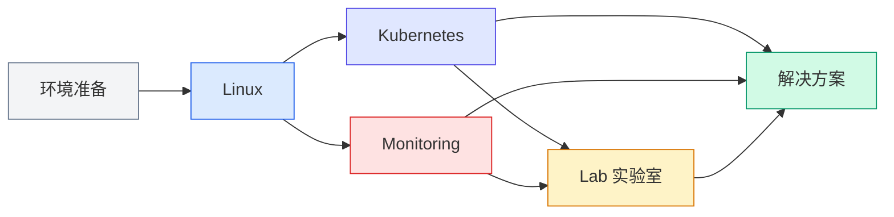

# 一根头发丝的宽度

一根头发丝的宽度，一份对技术细节的执着。

1HairLabs 是一个专注于 Linux、Kubernetes 与云原生技术的实践实验室。希望通过持续输出高质量原创内容，帮助更多开发者、运维工程师和云原生学习者，从理解原理到掌握实践，构建属于自己的技术能力体系。

---

## 名字背后

**1HairLabs**（一根头发实验室）的名字来源于一句话：

**真正影响系统稳定性的，往往不是庞大的架构，而是那些容易被忽略的细节。**

一条日志、一项配置、一个参数、一个命令，都可能成为定位问题和解决故障的关键。

"一根头发丝"代表的是一种技术态度：

- **关注细节**，而不是停留在表面
- **尊重原理**，而不是死记命令
- **注重实践**，而不是纸上谈兵
- **持续学习**，而不是浅尝辄止

希望每一篇文章，都能够帮助读者真正理解技术背后的工作原理，而不仅仅是完成一次操作。

---

## 实验员档案

目前主要从事虚拟化、平台运维、云原生基础设施及相关技术工作。

长期关注以下技术方向：

| 领域 | 技术 |
|---|---|
| 操作系统 | Linux、Windows Server |
| 虚拟化 | VMware ESXi / vCenter、Proxmox VE |
| 容器 | Docker、Kubernetes |
| 可观测性 | Prometheus、Grafana、Alertmanager |
| 自动化 | Git、GitHub Actions、Ansible |
| 方向 | 平台工程（Platform Engineering）、AI 与基础设施 |

喜欢通过实验验证技术原理，坚持"知其然，更知其所以然"的学习方式。

---

## 技术版图

本站目前有以下技术专栏，各专栏相互关联，共同构成从基础到生产的技术知识体系。

| 专栏 | 定位 | 进入 |
|---|---|---|
| [环境准备](../deployment/tutorials.md) | 系统安装与部署入门 | 从这里开始 |
| [Linux](../linux/index.md) | 系统基础与运维实践 | 地基 |
| [Kubernetes](../kubernetes/index.md) | 集群架构与生产实践 | 核心 |
| [可观测性](../observability/index.md) | 监控体系建设 | 保障 |
| [Lab 实验室](../lab/index.md) | 故障演练与技术验证 | 验证 |
| [解决方案](../solutions/index.md) | 端到端方案落地 | 整合 |

---

## 实验守则

| 原则 | 说明 |
|---|---|
| 优先原创 | 所有文章基于实际项目经验或实验环境编写 |
| 注重原理 | 不仅介绍"怎么做"，更关注"为什么这样做" |
| 提供验证 | 涉及部署或实验的内容，提供完整步骤、截图及结果验证，确保可复现 |
| 持续维护 | 随技术发展和版本更新，已有文章持续修订，保持与当前版本一致 |

---

## 站点架构

本站基于以下技术构建：

| 层 | 技术 |
|---|---|
| 站点框架 | MkDocs + Material for MkDocs |
| 内容格式 | Markdown |
| 版本管理 | Git + GitHub |
| CI/CD | GitHub Actions |
| CDN | Cloudflare |

坚持使用静态站点方案，构建快速、安全且易于维护的知识库。

---

## 保持联系

| 渠道 | 信息 |
|---|---|
| 🌐 网站 | [1hairlabs.cn](https://1hairlabs.cn) |
| 💬 微信公众号 | 1HairLabs |
| 📧 Email | hfei929@163.com |

如果觉得本站内容对你有所帮助，欢迎收藏本站并关注微信公众号，与更多技术爱好者一起交流学习。

---

## 转载须知

除特别说明外，本站所有原创文章均为作者原创。欢迎学习、引用和分享。

转载请注明文章来源并保留原文链接。如果文章中存在错误或不足，欢迎提出建议，共同完善内容。

---

> 技术的发展没有终点，学习也是一场长期的旅程。
>
> Stay Curious. Keep Learning.
>
> —— 1HairLabs
