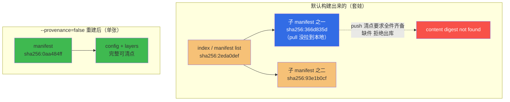

# 从零点亮 CI：GitHub Actions 构建站点镜像，和两个半小时的海关仓

> **实测声明**：本文全部命令与输出在真实环境实测，时间窗 2026-11-13 至 11-14。集群为 3 master + 3 worker（K8s 1.36.1 / Debian 13 / Calico / Ceph rook），构建流水线 GitHub Actions → GHCR → Harbor（192.168.114.136）→ worker03。终端输出逐字存档，除注明省略外未改一字；省略仅限超长 digest 中段与逐层传输行（均带省略号标注）。这是「应用交付系列」的第一篇——用一个真实站点走完从源码到集群的全链路。

## 一个搞了几个月 K8s 的人，为什么还没点过 CI

先交代背景，因为这事有点好笑。

我的测试集群跑了几个月，监控、日志、告警、存储全套都上过了：[Prometheus 抠过 P99 的分桶](../lab/p99-apiserver-latency-60s.md)，[Loki 破过 ring 500 的事故](../lab/loki-from-zero.md)，[Ceph 杀过 OSD 看它怎么搬家](../lab/ceph-osd-600s-sit-1min-move-0bytes-back.md)。但直到这个月，集群里所有 Pod 用的镜像，都是我手工搬进去的——在能上网的机器上 pull，retag，再想办法塞进内网。一场镜像断网战役打完，我对"镜像从哪来"这件事的全部认知就是：从别人手里接。

这个系列要补的就是这块：给一个真实的应用，从零走完源码 → 构建 → 制品库 → 部署的全链路。应用选的是我自己的技术站点 1hairlabs.cn——它本来跑在 Cloudflare Pages 上，源码是 GitHub 上的公开仓库。计划是在集群里跑一个"影子站"：同一个仓库、同样的构建，集群里跑的那份和生产站完全同构。

第一个问题就把我问住了：**Pod 里的镜像从哪来？**

我的第一反应是在集群节点上直接 build。但我的集群是断网环境——六台节点 pull Docker Hub 全部 i/o timeout，这是十月份装机时用一晚上换来的认知。节点上连拉个基础镜像都费劲，还想在上面装 python、mkdocs、docker build 一条龙？这条路在工程上也说不过去：给六台运维面节点平添一套构建环境，以后每个节点都是"可能坏的地方"。

## 供给链设计：构建厂、海关仓、运行时

把问题拆开看，镜像的旅程其实分三段，每段有各自的角色：

```mermaid
flowchart LR
    A["Mac<br/>改 markdown"] -->|"git push"| B["GitHub 仓库<br/>源码唯一真相"]
    B -->|"push 自动触发"| C["Actions 构建<br/>mkdocs build + docker build"]
    C -->|"自动推送"| D["GHCR<br/>ghcr.io"]
    D ==>|"ctr pull<br/>两小时二十七分"| E["master01<br/>手工搬运"]
    E -->|"retag + push"| F["Harbor<br/>192.168.114.136"]
    F -->|"局域网 秒级"| G["worker03<br/>site x2 + waline-0"]
    style A fill:#f6c177
    style B fill:#326ce5,color:#fff
    style C fill:#3fb950
    style D fill:#326ce5,color:#fff
    style E fill:#f6c177
    style F fill:#326ce5,color:#fff
    style G fill:#3fb950
```



- **GitHub 仓库是源码的唯一真相**。生产站 1hairlabs.cn 就是 Cloudflare Pages 从这个仓库构建的，影子站和生产线共用同一个源头——改一处，两边拿到的是同一个版本。"同构蓝本"不是口号，是字面意思。
- **GitHub Actions 当构建厂**。Actions 的 runner 在国外，网络完美。这个判断有前科背书：之前排查一个镜像名问题时，四个国内镜像源全部报 401/404 撒一样的谎，唯一说真话的就是 Actions runner——它直连 Docker Hub，一句 `repository does not exist` 定了案。构建这活儿，就得给网络最畅的人干。
- **Harbor 当海关仓**。六台节点到 Docker Hub 全断，但六台到 192.168.114.136 全通。把外网制品囤进内网一次，集群之后怎么部署都不依赖外网。

映射到 CI/CD 的标准五阶段——源码管理、CI（构建+测试）、制品库、CD（部署）、运行时运维——这套设计点亮的是前三个阶段，部署和运维靠既有家底。而在这条链真正跑通之前，我连"CI 需要哪些零件"都说不上来。

!!! note "先侦察再动手"
    写 workflow 之前，我先把仓库翻了一遍。事实证明这一步价值极高——第一个雷就是翻仓库时拆掉的，不是跑红之后才发现的。

## 先侦察再动手：一个空的 requirements.txt

用 GitHub API 拉仓库的文件树，两分钟就看见一个不对劲的东西：**requirements.txt 是空的**。

CF Pages 的 MkDocs 预设环境自带 mkdocs-material 一家老小，所以这个站点在 CF Pages 上跑了这么久，从没需要写过依赖清单。但 GitHub Actions 的 runner 是一台干净的 Ubuntu——如果照着"CI 里都跑 `pip install -r requirements.txt`"的惯性写，装出来是个寂寞，`mkdocs build` 必红给你看。

再翻 mkdocs.yml，确认实际用到的第三方件：material 主题，加 minify 和 glightbox 两个插件。所以 workflow 里要显式装三个包，一个不能少。

!!! tip "构建配置的隐形依赖是平台预设"
    一个构建在 A 平台能跑、到 B 平台就红，第一怀疑对象就是 A 平台的预装环境。CI 的原则反过来最保险：**runner 上用了什么，就显式装什么**。requirements.txt 空着能跑半年，不代表它在别处也能跑。

## 三十二行 workflow

成品长这样（32 行，后来加过一个参数，后面说）：

```yaml
name: build-site
on:
  workflow_dispatch:
  push:
    branches: [main]
permissions:
  packages: write
jobs:
  build:
    runs-on: ubuntu-latest
    steps:
      - name: Checkout
        uses: actions/checkout@v4
      - name: Setup Python
        uses: actions/setup-python@v5
        with:
          python-version: '3.12'
      - name: Install MkDocs
        run: pip install mkdocs-material mkdocs-minify-plugin mkdocs-glightbox
      - name: Build site
        run: mkdocs build
      - name: Build image
        run: |
          printf 'server {\n  listen 80;\n  server_name _;\n  root /usr/share/nginx/html;\n  index index.html;\n  error_page 404 /404.html;\n}\n' > nginx-site.conf
          printf 'FROM nginx:stable-alpine\nCOPY site/ /usr/share/nginx/html/\nCOPY nginx-site.conf /etc/nginx/conf.d/default.conf\n' > Dockerfile
          docker build --provenance=false -t ghcr.io/hfei929/1hair-site:latest -t ghcr.io/hfei929/1hair-site:$(git rev-parse --short HEAD) .
      - name: Login GHCR
        run: echo "${{ secrets.GITHUB_TOKEN }}" | docker login ghcr.io -u ${{ github.actor }} --password-stdin
      - name: Push
        run: |
          docker push ghcr.io/hfei929/1hair-site:latest
          docker push ghcr.io/hfei929/1hair-site:$(git rev-parse --short HEAD)
```

几个设计决策值得展开：

**双触发**：`push` 到 main 自动触发（这是 CI 的本义——源码变了构建跟着变），`workflow_dispatch` 留个手动开关（调试和补跑用）。

**`permissions: packages: write`**：GHCR 是 GitHub Packages 的一部分，workflow 要推镜像就得有这个权限。不用手动配任何 token——`secrets.GITHUB_TOKEN` 是 Actions 运行时自带的临时身份，权限就是上面这行声明的。

**Dockerfile 是现场 printf 出来的**：站点是纯静态文件，Dockerfile 三行——`FROM nginx:stable-alpine`、COPY 构建产物、COPY nginx 配置。不值得为它单维护一个文件，构建脚本里现写反而干净。404 那行是 MkDocs 的老朋友：它生成的静态站默认所有路由都能落到 404.html，nginx 配一条 `error_page` 就接住了。

**双 tag 策略**：`latest` 加当前 commit 的短 sha。latest 是"最新"的便捷别名，sha 是版本号——后面做滚动发布实验时要靠 sha tag 对账"这个 Pod 跑的到底是哪一次构建"，latest 滚起来就说不清了。两个都推，成本为零。

!!! warning "上传方式也有坑"
    把这个文件放进仓库，别用 GitHub 网页编辑器粘贴。我之前用网页编辑器贴 yaml，permissions 和 jobs 的缩进被编辑器吃掉过——提交前看截图才发现整个文件结构是坏的。走仓库页的 **Add file → Upload files** 上传本地文件，缩进一个字节都不会动。

## 54 秒跑绿

上传 commit，Actions 页面几秒后出现运行条目。手动又触发了一次，页面上看到的关键信息：

```text
build-site #2  ✅
Manually triggered · commit 0685e3b · main
Status: Success · Total duration: 54s
build  ✅ 50s
```

54 秒，绿了。点进 Packages 页面，`1hair-site` 已经躺在那里，`latest` 和 `0685e3b` 两个 tag 都在——Actions 自动推上来的，中间没有任何人工动作。第一次看着"源码进去、镜像出来"全自动发生，还是有点感动的。

顺带一提，构建日志里挂着两条黄色提示：一条说 `actions/checkout@v4` 这些 action 还基于 Node.js 20，已被强制跑在 Node.js 24 上；另一条说 `ubuntu-latest` 标签将在 2026 年 10 月 19 日开始迁移到 Ubuntu 26。不影响运行，但它们提醒你：CI 的地基（runner 的 OS、action 的运行时）自己也在缓慢移动，绿色不代表可以永远不看它。

到这里，CI 段的"构建"就通了。但镜像还在墙外的 GHCR 里，集群还摸不着它。接下来是把货搬进海关仓——真正的故事从这开始。

## 第一记闷棍：content digest not found

搬运作业在 master01 上做，三步：从 GHCR 拉下来、retag 成 Harbor 的地址、推进 Harbor。

第一步出奇地顺：

```text
ghcr.io/hfei929/1hair-site:latest:    resolved       |++++++++++++++++++++++++++++++++++++++|
layer-sha256:c12ffff18732349750d8928e649e2333d19363a2a201978b1876c80f38aaf292:    exists         |++++++++++++++++++++++++++++++++++++++|
elapsed: 1.6 s                                                                    total:   0.0 B (0.0 B/s)
unpacking linux/amd64 sha256:2eda0def06a0b8d6dfda0dc5ffd312691e0372a844278951779fcc5921062cfe...
done: 10.02578ms
192.168.114.136/hairlabs/site:latest
192.168.114.136/hairlabs/site:0685e3b
```

`exists` 表示层已在本地，1.6 秒是拉第二个 tag 时的缓存命中。retag 也完成了。然后第三步，push，两秒钟后画风突变：

```text
index-sha256:2eda0def06a0b8d6dfda0dc5ffd312691e0372a844278951779fcc5921062cfe:    waiting       |--------------------------------------|
manifest-sha256:366d835d2e90627f1ede799ca3f721deb7c21f82166cdeb82c254781fb104dbe: waiting       |--------------------------------------|
manifest-sha256:93e1b0cfd4f04bcc0c471ac74edf95e5930e7daf747efea32deb8776a2673bc6: waiting       |--------------------------------------|
elapsed: 0.1 s                                                                    total:   0.0 B (0.0 B/s)
ctr: content digest sha256:366d835d2e90627f1ede799ca3f721deb7c21f82166cdeb82c254781fb104dbe: not found
```

`content digest not found`——ctr 说：你让我推这个镜像，但它的某个部件在我本地的内容库里找不到。

第一直觉是怀疑网络、怀疑 Harbor、怀疑密码。都不对——错误发生在本地清点阶段，还没轮到和 Harbor 说话。真正该注意的是这三行 waiting 的结构：**一个 index，下面挂着两个 manifest**。

## 真凶：镜像里的出生证明

一个正常的单架构镜像，清单结构应该是"一张 manifest，下面挂 config 和 layers"。而这个镜像是三层套娃：最外层是个 manifest list（index），里面装着两个 manifest——单从这两行输出没法指认谁是谁，但能确定的事实有两个：第一，pull 时 unpacking 成功，说明真实内容在本地；第二，push 清点时缺的 `366d835d` 是一个**从来没在本机出现过的子件**。



为什么 pull 没拉全？**pull 和 push 的清点口径不对称**：ctr pull 默认只拉当前平台需要的那部分子件，ctr push 却要求 index 引用的全部子件齐备。于是出现"拉得进来、推不出去"的死锁。

那个"多出来的"子 manifest 是哪来的？provenance attestation，来源证明。现在的 docker build（BuildKit）默认会给镜像附带这么一张证明：谁构建的、在哪台机器上、用的什么源。本意是供应链安全——DevSecOps 里正经的加分项，让你能回答"这个镜像真的是从这份源码构建的吗"。副作用是：你的"单架构镜像"从此变成了 manifest list 套娃，哪怕里面只有一个平台的内容。

Docker 全家桶自己搬运这种套娃没问题，纯 [containerd 工具链（ctr）](../kubernetes/architecture/node/containerd-from-cri-to-runc.md) 就会水土不服——它按清单结构逐件清点，发现 index 引用的某个子件本地不存在，拒绝出库。`content digest not found` 说的不是"Harbor 上没有"，是"你手上就不齐"。

修复是一行参数的事：

```text
docker build --provenance=false ...
```

workflow 改这一行，commit，push——Actions 自动重新构建，产出一个真正的单 manifest 镜像。GHCR 上的 latest 从此指向重建版（manifest `0aa484ff` 开头）。

!!! note "这不是安全功能的锅"
    provenance 本身是好东西，是我后面做 DevSecOps 时要正经接的环节。今天关掉它，是因为纯 containerd 工具链搬运 attestation 镜像的水土不服——先让链路通，安全扫描是另一道工序的事，不该让"出生证明"卡死"货物出库"。

顺带记一笔：这已经是我第三次在"默认值"上翻车了。waline 的 `SQLITE_PATH` 默认值和我想的不一样，StatefulSet 的滚动更新有我想不到的就绪门禁，这次是 docker build 的隐形行李。**默认值不等于你以为的值**——这句话值一句加粗。

## 两小时二十七分与一秒八

修好 workflow，回到 master01 重做搬运：删掉本地旧标签，重新 pull。

这次 pull 的输出证明修复生效——没有 index、没有双子 manifest，单张 manifest 直落内容层。但另一个数字让我在屏幕前坐了两小时二十七分：

```text
ghcr.io/hfei929/1hair-site:latest:    resolved       |++++++++++++++++++++++++++++++++++++++|
manifest-sha256:0aa484ff97dd062b11a3d3142ba7ef787b6e91e8cdebb63af66135a62988165c: done       |++++++++++++++++++++++++++++++++++++++|
layer-sha256:a4a5f644678e087a8657fe0833213b1ab4c772cb82d770a714feef19c6f675bd:    done        |+++++（中间多行省略）+++++
elapsed: 8841.8 s                                                                    total:  140.4 (16.3 KiB/s)
unpacking linux/amd64 sha256:0aa484ff97dd062b11a3d3142ba7ef787b6e91e8cdebb63af66135a62988165c...
done: 2.244159481s
```

**8841.8 秒，总量 140.4，均速 16.3 KiB/s。** 从 GHCR 到我机房的平均速度，16 KiB 每秒——这是跨境链路的裸现实。

有个细节值得记：上一次拉取攒下的层缓存这次没有命中，140.4 的总量几乎全部重走了一遍。为什么缓存没帮上忙——是两次构建的层摘要变了（构建产物的文件时间戳不同，层的 digest 就不同），还是删除本地镜像引用后容器运行时回收了内容库里的孤儿层——写这篇文章时我还没定案，两个候选都需要再设计实验才能分辨。能确定的只有行为层面的事实：**"我拉过这个仓库的镜像"不等于"这次 pull 能命中缓存"**，跨境场景里每次重拉都要做好全量的心理准备。

货终于落地，推进 Harbor：

```text
manifest-sha256:0aa484ff97dd062b11a3d3142ba7ef787b6e91e8cdebb63af66135a62988165c: done    |++++++++++++++++++++++++++++++++++++++|
config-sha256:6d8cebaad5500251d23dab5867514384d049ae27fc3f50524c8aa7fa446eb824:   done    |+++++++++++++++++++++++++++++++++++++++
elapsed: 1.8 s                                                                    total:  14.7 K (8.1 KiB/s)
```

**1.8 秒，总共只传了 14.7K**——从进度行看只有 manifest 和 config 两张"纸"，层一行都没传。ctr 推送前会先问 Harbor"哪些件你已经有了"，只补缺的部分：这说明在 push 之前，这个镜像的层在 Harbor 上已经齐了。

但它们是什么时候进的 Harbor？我写文时把时间线来回捋了几遍，发现我的第一直觉是错的——"昨天那次失败的 push 顺手把层传上去了"不成立：回看昨天失败的输出，`elapsed: 0.1 s total: 0.0 B`，push 在清点阶段就死了，一个字节都没出门。层进入 Harbor 的确切路径，截至发稿没有证据定案，这里如实标注存疑。能闭环验证的是结果侧：几分钟后 worker03 以 `imagePullPolicy: Always` 从 Harbor 拉起了两个 Pod——Harbor 里的镜像完整可用，这是部署环节背过的书。

把三个数字摆在一起，"海关仓"这个模式的含金量就不用论证了：

| 路段 | 实测 |
|---|---|
| GHCR → master01（跨境，140.4 总量） | 8841.8 s |
| master01 → Harbor（仅补交 14.7K 清单件） | 1.8 s |
| Harbor → worker03（局域网，部署拉取） | 秒级 |

出国搬一次货两小时二十七分，进关之后全集群分发是秒级。而且这笔税只交一次——之后每次部署、每个节点、重启重建，走的都是 Harbor 这条局域网腿。要是没有海关仓，六台节点每次拉镜像都直连 GHCR，那才是灾难。

## 影子站开门

镜像就位，最后一步是让它跑起来。清单不复杂：[Deployment](../kubernetes/architecture/resources/workloads.md) 两副本钉在 worker03，镜像指向 Harbor，外加 [NodePort](../kubernetes/architecture/resources/server-resources.md) 门牌：

```yaml
apiVersion: apps/v1
kind: Deployment
metadata:
  name: site
  namespace: hairlabs-site
spec:
  replicas: 2
  selector:
    matchLabels:
      app: site
  template:
    metadata:
      labels:
        app: site
    spec:
      nodeSelector:
        kubernetes.io/hostname: worker03
      containers:
      - name: site
        image: 192.168.114.136/hairlabs/site:latest
        imagePullPolicy: Always
        # （探针和 resources 略——完整清单见文末附录）
```

apply 下去：

```text
deployment.apps/site created
service/site created
Waiting for deployment "site" rollout to finish: 0 out of 2 new replicas have been updated...
Waiting for deployment "site" rollout to finish: 0 of 2 updated replicas are available...
Waiting for deployment "site" rollout to finish: 1 of 2 updated replicas are available...
deployment "site" successfully rolled out
NAME                    READY   STATUS    RESTARTS   AGE   IP              NODE       NOMINATED NODE   READINESS GATES
site-58988b6599-9mtrl   1/1     Running   0          16s   10.244.19.119   worker03   <none>           <none>
site-58988b6599-fb2b6   1/1     Running   0          16s   10.244.19.122   worker03   <none>           <none>
waline-0                1/1     Running   0          18h   10.244.19.123   worker03   <none>           <none>
```

两副本 16 秒内全部 Running——worker03 从 Harbor 拉 140MB 走的是局域网，和 GHCR 那两个多小时是两个世界。同框的 waline-0 已经 18 小时零重启，那是这个集群的第一位居民，一个带 [Ceph RBD 持久卷](../kubernetes/architecture/storage/pv-pvc-storageclass.md) 的评论系统，它的入住故事够单独写一篇。

浏览器打开 `http://192.168.114.150:30002`——Material 主题、左侧导航、顶部 tab，和生产站 1hairlabs.cn 一个模子刻出来的。同一个仓库，同一次构建，换了个地方跑。这就是"影子站"三个字的全部含义，也是这条供给链的验收章。

## 这条流水线还缺什么

盘一下家底，按 CI/CD 五阶段算：

- 源码管理：✅ GitHub 仓库，生产站和影子站共用
- CI 构建：✅ 本文——源码变更到镜像产出全自动（测试环节：静态站暂时没东西可测）
- 制品库：✅ GHCR 外网仓 + Harbor 内网仓，双仓就位
- **CD 部署：半自动**——镜像是新的了，但"部署到集群"还是我手工 `kubectl apply`。工业界的 CD 是镜像出新版自动上集群，这是接下来的主战场：滚动发布的策略实验，再往后是 ArgoCD 那套 GitOps（[Gitea → Jenkins → Harbor → ArgoCD 的样板链路](../kubernetes/practice/10-takeaways.md)已经跑通过一次）。
- 运行时运维：✅ 监控、日志、告警三件套加 Ceph 存储，前面几个战役攒的家底

也就是说，这条链点亮了"源码变镜像"，还差"镜像变部署"。差的那段，恰恰是信息量最大的那段——滚动更新时 Pod 怎么排队、老版本怎么退场、出问题怎么回滚，都是接下来的实验素材。

这个系列的下一篇，回到第一位居民 waline 入住那三天：一个改配置不生效的 StatefulSet 死锁、一个把 500 错误翻译成"账号密码错误"的前端、和一个每三十秒被杀一次的僵死循环——排查它们的工具，正好是前几个战役装好的监控和日志。

## 附录：完整 Deployment 清单

```yaml
apiVersion: apps/v1
kind: Deployment
metadata:
  name: site
  namespace: hairlabs-site
  labels:
    app: site
spec:
  replicas: 2
  selector:
    matchLabels:
      app: site
  template:
    metadata:
      labels:
        app: site
    spec:
      nodeSelector:
        kubernetes.io/hostname: worker03
      containers:
      - name: site
        image: 192.168.114.136/hairlabs/site:latest
        imagePullPolicy: Always
        ports:
        - containerPort: 80
          name: http
        readinessProbe:
          httpGet:
            path: /
            port: 80
          initialDelaySeconds: 3
          periodSeconds: 10
          timeoutSeconds: 3
        livenessProbe:
          httpGet:
            path: /
            port: 80
          initialDelaySeconds: 10
          periodSeconds: 20
          timeoutSeconds: 3
        resources:
          requests:
            cpu: 10m
            memory: 32Mi
          limits:
            memory: 128Mi
---
apiVersion: v1
kind: Service
metadata:
  name: site
  namespace: hairlabs-site
  labels:
    app: site
spec:
  type: NodePort
  selector:
    app: site
  ports:
  - name: http
    port: 80
    targetPort: 80
    nodePort: 30002
```

## 推荐阅读

- [Kubernetes containerd 原理：从 CRI 请求到 runc 启动容器全过程](../kubernetes/architecture/node/containerd-from-cri-to-runc.md)：理解 ctr 与内容库为什么按清单逐件清点，而不是按 tag 搬运。
- [Loki 从零装机：日志的三层记忆，和一把熟悉的新刀](../lab/loki-from-zero.md)：镜像断网与 `ctr` retag 的第一次交手，华为源 + 双 tag 的解法就在那篇。
- [PV、PVC、StorageClass：K8s 存储三个对象到底谁管谁](../kubernetes/architecture/storage/pv-pvc-storageclass.md)：影子站第二位居民 waline 的持久化底座。
- [杀一块 Ceph OSD：600 秒静坐、1 分钟搬家、0 字节回迁](../lab/ceph-osd-600s-sit-1min-move-0bytes-back.md)：RBD 卷背后那块盘的生死实测，滚动发布实验之前值得先看。
- [Kubernetes 工作负载：从 Pod 到 CronJob，控制器是怎么管住它们的](../kubernetes/architecture/resources/workloads.md)：Deployment 副本、就绪探针与滚动更新的机制背景。
- [Kubernetes 服务资源：Service 到底虚拟出了什么](../kubernetes/architecture/resources/server-resources.md)：NodePort 与 Service 转发链路，影子站门牌的原理。
- [完整部署私有云经验总结](../kubernetes/practice/10-takeaways.md)：Gitea → Jenkins → Harbor → ArgoCD 的完整自动交付样板，本系列后半程的参照。
