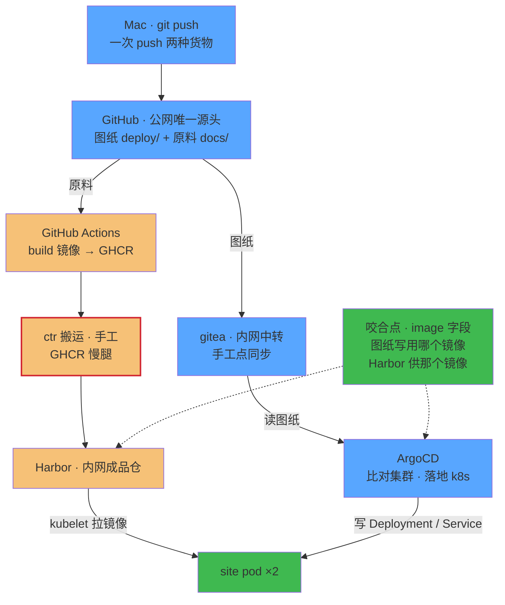
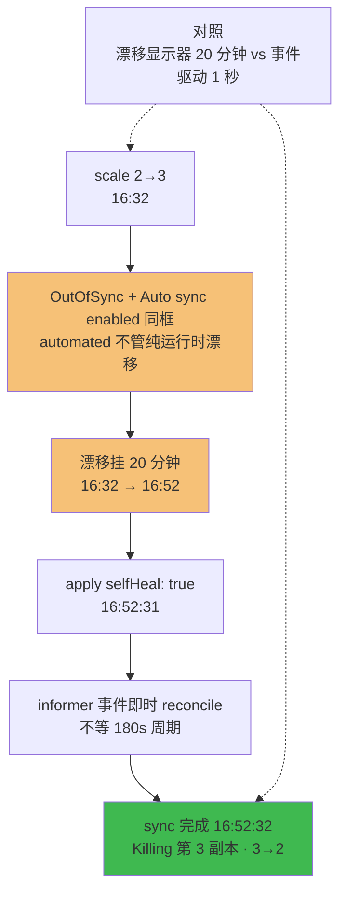
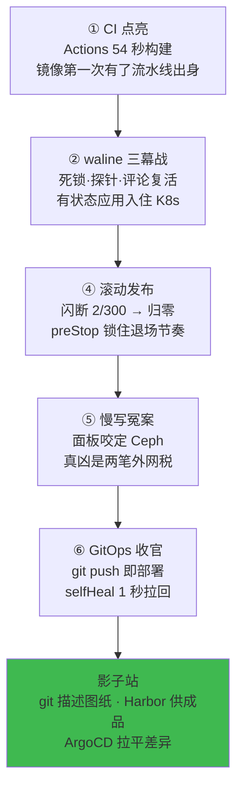

# 影子站进 GitOps：漂移挂了 20 分钟没人管，开关一开 1 秒拉回

> 实测声明：本文数据来自 2026-11-25 至 11-27 在 3 Master + 3 Worker 自建集群（K8s 1.36.1）上的真实装机与实验。ArgoCD v3.6.2 装机走官方非 HA manifest，影子站 = site Deployment ×2 + waline StatefulSet + user-sim。装机与搬运环节的个别数字（镜像体积、慢腿耗时、字节对账）取自 11-25/26 当天台账判读记录；装机后的全部实验（幕 3/幕 4/waline 案）数据均为 11-27 当天命令与截图原文。[上一篇](waline-3acts.md)把 waline 的两笔外网税清了零，按系列规划，CI/CD 链还剩最后一环：GitOps。这篇是收官。

[慢写冤案](sentinel-alerts-but-culprit-not-in-storage.md)结尾说过，下一篇要让 ArgoCD 把影子站的发布从"kubectl set image"变成"git push 即部署"。实际跑完之后，整篇里最让我意外的不是"push 就能部署"——这件事装完机就见过了——而是后面两个数字的反差：

- 我手动 scale 了一个副本出来，ArgoCD 看着它漂移，**挂了 20 分钟一动不动**，界面上明明写着 Auto sync is enabled
- 打开一个开关之后，同样的事情再发生一次，**从 apply 落地到 sync 完成，1 秒**

这两个数字怎么来的、中间隔着一个 crashloop 的 waline、以及"自动同步"到底自动了什么，从头讲。Waline 初次入住、SQLite 和探针问题的来龙去脉，见[影子站第一位居民：Waline 开光三幕战](waline-3acts.md)。

## 装机：镜像搬运的第三次撞墙

ArgoCD 装机前先探源。GitHub releases 现场查，最新稳定版 v3.6.2。非 HA 最小集三个镜像：argocd（server/controller/repo-server/applicationset/notifications 五组件复用）、redis、dex。quay.io 国内直连不用想了，走老链路：[GitHub Actions 构建并推送 GHCR，再用 ctr 搬进 Harbor](ci-lightup.md)。

搬运环节撞的还是那堵墙。GHCR 的 Actions 先红了一轮：login 绿、pull 全通、push 层全 Unavailable 死循环重试。报错是 `installation not allowed to Create organization package`——字面看着像组织权限问题，但我用的是个人账号。最后在仓库 Settings 里找到真凶：**repo 级 Workflow permissions 是 read-only**，它把 workflow yaml 里声明的 `packages: write` 压住了。开关改成 Read and write，重跑，20 秒层缓存全通。这个层级关系容易踩：yaml 里的声明会被仓库设置覆盖，排错时别被报错文案带去查组织。

三个镜像齐落 Harbor：argocd 220.4MiB、dex 48.2MiB、redis 37.2MiB。dex 那条慢腿实测 603.9s，约 80KiB/s——和④⑤里 GHCR 慢腿的量级一致，跨境恒慢这个事已经不用再测了。

## 59 个资源一次 apply，炸在 256KB 上

install.yaml 从官方仓库拉。沙箱里 raw.githubusercontent 已经断（HTTP 000），codeload.tar.gz 反而通，54.8MB 全包到手。master01 就地下载 + sed 改镜像引用，10 处替换：argocd 8 处、dex 1 处（ghcr）、redis 1 处——redis 的官方引用其实是 public.ecr.aws 前缀，跟我预想的不同，数出来才知道。改完做了字节对账：+69 字节 = 8×8−5+10，精确吻合——这个算式是同源同构的机械裁判，比肉眼核对 sed 结果可靠。

然后装机翻车。`kubectl apply -f install.yaml`，59 个资源 created，最后炸出一条：`applicationsets.argoproj.io` 的 metadata.annotations Too long，超过 262144 字节——**last-applied 注解把整个 CRD 塞爆了 256KB 上限**。这是大 CRD 的经典坑：client-side apply 会把完整对象塞进 last-applied 注解，CRD 这种动辄几万行的对象根本塞不下。`last-applied-configuration` 如何参与声明式更新，可参看[Kubernetes API 资源体系：GVK、API Group 与一次 apply 的完整旅程](../kubernetes/architecture/resources/api-resources.md)。

修法一行：`kubectl apply --server-side --force-conflicts`。SSA 不写 last-applied，全量重放，全绿。教训一句话：**装 CRD 大的组件，首选 SSA**。applicationset-controller 有 6 次 RESTARTS，是 CRD 缺失那 19 分钟的 crashloop 遗留（启动即查 CRD、缺失即崩），SSA 补上后稳定——不是新故障，是考古。

7 个 pod 全 1/1，全落 worker03。有点意外：install.yaml 里没有 nodeSelector，scheduler 恰好把它们全撒到了内存最宽裕的节点。拍板时想过钉死 worker03，现在看 scheduler 自己做对了，就不折腾了。

UI 暴露走 NodePort，base64 单行 patch（嵌套花括号的 JSON 走粘贴会被 WindTerm 吃，老规矩绕道）。30003 http、30004 https，Windows 浏览器登录 admin + 初始密码，界面点亮。

## github 直连不稳定：ArgoCD 的第一课

装机只是拿了张入场券。GitOps 的本体是让 ArgoCD 盯着一个 git 仓库，仓库变了它就同步。我盯的是影子站公开仓——第一反应是直连 github.com，公开仓零凭证，听着很干净。

实际上 ArgoCD 的 Application 一落地就报 `ComparisonError: DeadlineExceeded`。它连不上 github.com。诊断走了三层：master01 上对 github 同机连测两次，一次 HTTP 000（连接失败）、一次 200——间歇性黑洞实锤；换到 Harbor VM 136 的独立出口测，HTTP 200、0.48s，通。结论：**github 的可达性看出口、看时段，无法承诺稳定**。ArgoCD 要的是每三分钟一次的稳定巡逻，间歇黑洞对人是"重试一下"，对 reconciliation loop 是持续报错。

方案：gitea mirror。Harbor VM 上那个 gitea 1.25.4 容器（4 月装机遗留、Exited 两个月）`docker start` 复活，建一个镜像仓库指向 github 上的公开仓，勾上"该仓库将是一个镜像"复选框，gitea 定期从 github 拉，ArgoCD 的 repoURL 指向 gitea——同一内网，零黑洞。Application 的 repoURL 一改，错误消失。站内[私有云部署经验总结](../kubernetes/practice/10-takeaways.md)也记录过 Gitea、Harbor、ArgoCD 组成的交付链路。

这里有个当时卡住我的地方，记下来：gitea 的同步按钮不好找。仓库设置 → 镜像设置里确实有手动同步，但最顺手的入口其实在仓库主页——"已同步 X 分钟前"**这个时间戳本身是可点的**，点一下就触发同步；旁边的镜像地址倒是个跳转链接，点它只会飞去 GitHub。长得一样的链接，一个能触发同步一个会跳走，第一次谁都踩。

这一幕还带出一组概念，是我后来给这套架构起的名字：

- **图纸链**：Mac → github → gitea → ArgoCD → 集群。图纸（manifest）从 git 流向集群，描述"应该是什么样"
- **成品链**：Mac → Actions → GHCR → ctr → Harbor → pod。成品（镜像）从 CI 流向节点，是"实际跑的东西"

ArgoCD 只管图纸链。它读 git、比集群、拉平差异；镜像从哪来、怎么到节点上，它一概不问。两条链在 pod spec 的 image 字段会合——这也是后面彩蛋案的全部伏笔。四组件的分工和两条链的走向，一张图收拢（手工环节单独标出，这是当时的实况）：



## 把影子站抄进 git

git 化范围拍板只做 site（最小闭环，waline/user-sim 留作后续）。仓库根下建 `deploy/site.yaml`，把运行态的 site Deployment + Service **逐字段转录**成双文档清单——不是抄一份大概，是逐字段。为什么较这个真： transcription 的正确性后面会被 ArgoCD 机械验证，抄漏一个字段它就给你报 OutOfSync。

image 字段顺手销了一笔旧账：从 `latest` 改 pin 到当时运行态的 sha tag。这个 `latest` 漂移从④第一天就挂着——运行时 image 和仓库 yaml 各走各的，git 化之后这种漂移在原理上就不存在了，git 是唯一真相。[滚动发布实测](rolling-update-first-lesson.md)记录了接管 GitOps 前的镜像版本、ReplicaSet 与回滚现场。

Application CR 也落地了：repoURL 指向 gitea，`path: deploy`，`targetRevision: main`，syncPolicy 先留 manual——第一课手动，automated 是掌握之后才敢开的。apply 完 ArgoCD 立刻开始对比，首滚顺利接管，影子站 2 副本原样不动。

## git push 即部署：完成标志时刻

前三幕都是铺垫，这一幕是系列规划的完成标志：**改 manifest → push → 影子站滚出新版本**，全程零 kubectl。

演示方向选了回滚：手头没有更新的镜像（最新的 e195915 正在运行），那就把 manifest 里的 image pin 回 8dd8393b——11-19 的快照。Mac 上改一行 tag、commit、push。push 过程又撞了两次 GitHub 黑洞（443 timeout 75 秒 + HTTP2 framing layer 报错），第三次裸 push 成功——间歇性黑洞的"重试就是标准答案"，本地 commit 不丢，心态不用崩。

push 之后去 gitea 主页点同步，等 ArgoCD 巡逻：

```
push 15:41 → Sync OK to 087bb0a @ 15:56:54
```

端到端 16 分钟（含我手动同步等待和 refresh 周期），Synced + Healthy。影子站浏览器一开：《慢写冤案》从首页消失了——8dd8393b 是 11-19 的内容快照，⑤的文章当然不在里面。 **"滚回旧版本"在这里不是一个比喻，是字面意思**：git 指向哪天，影子站就是哪天。

这里有个彩蛋。滚动完成后看 RS：

```
site-6548fd94dc   2/2   8d   …site:8dd8393b
```

ArgoCD 没有新建 RS，直接把 **8 天前④时代那个旧 RS 复活了**，scale 到 2——pod-template-hash 相同，声明式系统认 hash 不认时间。这个行为还带出一个隐藏价值：hash 命中等于 git 转录通过机械裁判——如果我转录 manifest 时漏了字段、或多写了什么，pod template hash 必然不同，就会生成一个新 RS。**转录有偏差必出新 hash，hash 命中即逐字段一致**，比我肉眼检查十遍都硬。关于 Deployment 如何管理 ReplicaSet 和滚动版本，可参看[Kubernetes 工作负载控制器解析](../kubernetes/architecture/resources/workloads.md)。

## scale 一下，看看 ArgoCD 会不会管

接管完成、自动同步打开（syncPolicy 改 automated，prune 先留 false）。按计划做最后一幕：手动 scale 制造漂移，看 ArgoCD 的反应。

```bash
kubectl -n hairlabs-site scale deployment/site --replicas=3
```

第 3 个副本起来了，3/3 Running。打开 ArgoCD 界面，两张卡片并排：

- SYNC STATUS: **OutOfSync**（from main(087bb0a)）
- 一行小字：**Auto sync is enabled**
- APP HEALTH: **Healthy**

三个状态各说各话：它知道漂了（OutOfSync），它开着自动同步（enabled），而且它觉得应用很健康（Healthy）。然后——什么都没发生。我盯着这页看了十几分钟，第 3 个副本活得好好的。

10 分钟后又复查了一次，3/3 还在，OutOfSync 还在。**漂移挂了 20 分钟，没人管。**

这就是 automated sync 的真实语义：它管的是"**git 变了**就把变更滚下去"，git 没变、集群自己歪了——scale、改 env、手删资源——这些"纯运行时漂移"不归它管，除非另开一个开关。**automated ≠ self-heal，automated 只是半自动**。Health 和 Sync 也是两回事：健康说的是"活得好好的"，同步说的是"和 git 一致"——一个 3 副本漂移的 deployment 可以同时 Healthy 和 OutOfSync。

## 开关一开，1 秒拉回

selfHeal 就是那个开关。改 Application 清单，在 automated 下加一行：

```yaml
  syncPolicy:
    automated:
      prune: false
      selfHeal: true
```

cp 备份 + sed 同级缩进插入 + grep 守卫确认 + apply，一条链跑完。然后见证时刻——先看证据链，三个证人：

```bash
kubectl -n argocd get application site -o json | python3 -c 'import json,sys; s=json.load(sys.stdin)["status"]; o=s.get("operationState",{}); print("opState:", o.get("startedAt"), o.get("finishedAt"), o.get("phase")); [print("hist:", h.get("deployedAt"), h.get("revision")[:7]) for h in s.get("history",[])]'
```

```
opState: 2026-11-27T08:52:31Z 2026-11-27T08:52:32Z Succeeded
hist: 2026-11-27T01:59:49Z 67fc209
hist: 2026-11-27T07:56:54Z 087bb0a
```

opState 的 startedAt 16:52:31（UTC+8 换算）、finishedAt 16:52:32——**apply 落地到 sync 完成，1 秒**。events 里同一时刻出现第 3 副本的 Killing 和 Scaled down 3→2。轮询记录 16:54:46 起全 2，UI 从 OutOfSync 直接跳 Synced。

1 秒这个数字推翻了我自己的预注册。我预判"3-6 分钟"，判据是 ArgoCD 默认 180 秒的 refresh 周期——但 apply 修改 Application spec 本身是个事件，走的是 informer 事件通道，controller 立刻收到变更立刻 reconcile，根本不等周期轮询。**refresh 周期管的是"没人动它时的例行巡逻"，spec 变更走的是事件通道即时响应**，两条路我先混为一谈了。预注册翻车翻得值：机制模型被实测纠正，这比预注册全中值钱。

还有个细节：这一次 self-heal 的 sync 在 status.history 里没有记录——history 还是只有两条（09:59 的手动、15:56 的自动）。同 revision 的漂移修复只更新 operationState，不追加 history 条目（这是我基于输出的推断，ArgoCD 内部簿记行为，如实验证可查源码）。也就是说**在这个 UI 上你找不到"1 秒拉回"这次行动的痕迹**，证据只在 operationState 和 events 里。找证据的时候别只盯一个证人。

时间线对照收尾这一幕：



## 彩蛋：waline 被 GitOps 陪葬了

正片收尾时，集群里另一头出事了。events 尾部混进来几行不该有的东西：

```
Warning   Unhealthy   pod/waline-0   Readiness probe failed: HTTP probe failed with statuscode: 500
Normal    Killing     pod/waline-0   Container waline failed liveness probe, will be restarted
Warning   BackOff     pod/waline-0   Back-off restarting failed container waline
Normal    Pulling     pod/waline-0   Pulling image "…waline:latest"
```

waline-0 crashloop，RESTARTS 21。抓崩溃容器最后一搏的日志（`--previous`），病根一行就露馅：

```
SyntaxError: Unexpected token '<', "<!doctype "... is not valid JSON
    at parseJSONFromBytes (node:internal/deps/undici/undici:3226:19)
```

有代码在 fetch 一个地址，对端返回了 HTML（`<!doctype` 开头），它拿去 JSON.parse，炸了。什么地址、什么时候开始炸的？两个线索一拼就出来了：

**地址**：[⑤慢写冤案中清理 Waline 双外网税的修法](sentinel-alerts-but-culprit-not-in-storage.md)，就是让 oauth middleware 的 OAUTH_URL 指向影子站的替身端点 `http://site.hairlabs-site.svc.cluster.local/oauth-services`——影子站 nginx 上有一个 location，返回 `{"services":[]}`。**而**  **`/oauth-services`** **这个路由是 11-23 加进 nginx 配置的，只存在于 e195915 镜像里。**

**时间**：waline 开崩的时刻 16:52——正是 GitOps 把影子站滚回 8dd8393b 的那几分钟。8dd8393b 是 11-19 的快照，nginx 里还没有这个路由。当场验证，curl 一发：

```
<!doctype html><html lang=zh class=no-js>…<h1>404 - Not found</h1>…
```

全案闭环：**GitOps 把 site 滚回旧版本，顺手拆掉了 waline 的救命稻草**。waline 每次启动、每个请求都 fetch 这个端点，拿到 404 页 HTML，JSON.parse 当场炸死进程，探针同路径也炸，liveness 击杀，21 次重启循环。

修复也走了一遍完整的 GitOps 链路——这一次方向向前：把 manifest 的 image pin 回 e195915（真实最新版，含慢写冤案文章和 oauth 路由），commit message 写明动机，push，gitea 同步，ArgoCD 自动滚：

```
Sync OK to 83b2609 @ 18:00:58
Comment: repin site image to e195915, restore oauth route for waline
```

UI 上连 commit message 和作者都显示在 sync 记录里。18:05 验收三条全中：e195915 的 RS 回到 2/2、`/oauth-services` 返回 `{"services":[]}`、waline-0 重建后 1/1 零重启。从锁定病根到全案闭环 31 分钟，中途没碰过一次 set image。

顺带又确认了一次 RS 的复用剧本：这次滚回 e195915，我预注册"会新建 RS"——实际复用了 template hash 相同的旧 RS。和上午 8dd8393b 复活 8 天前旧 RS 是同一个机制，预注册二连翻车同因。**pod-template-hash 相同就复用，RS 不看时间只看长相**。

这次滚动后 `kubectl get rs -o wide` 的 RS 家族特别值得看一眼（截取 site 行）：

```
site-58988b6599   0/0   13d    …hairlabs/site:latest
site-959d9f6b5    0/0   8d     …hairlabs/site:8dd8393b
site-54c7f98f4c   0/0   8d     …hairlabs/site:8dd8393b
site-6548fd94dc   0/0   8d     …hairlabs/site:8dd8393b
site-7bb7d7954d   0/0   4d8h   ghcr.io/hfei929/1hair-site:e195915
site-5c987cf8ff   2/2   8h     …hairlabs/site:e195915
```

六个 RS，三个镜像源时代并存（截取 site 行、按 AGE 重排）：latest 时代（13 天前）、ghcr.io 时代（4 天前）、Harbor 时代（现在）。**镜像供给链从 GHCR 搬进 Harbor 的迁移史，被 RS 家族原样记录着**。挂 0 副本吃灰的 latest RS，就是④销掉的"latest 漂移"那笔旧账的物证。

## GitOps 管不到 git 外的依赖

waline 陪葬案值得单独拎出来讲，因为它暴露的是 GitOps 的边界，不是 bug。

复盘依赖关系：waline 正常工作的前提，是影子站上有一个特定路由。这条依赖**不在任何 git 仓库里**——waline 的 StatefulSet 没 git 化，它的 env 里写着对 site 服务的引用；ArgoCD 的 Application 只管 site，滚 site 时它不知道 waline 还靠这个 site 的一个路由活着。于是完全合规的 GitOps 操作（把 site 滚回旧版本）制造了一次生产事故（waline 21 次重启）。

这不是 ArgoCD 的锅，是声明式管理的固有边界：**它拉平"git 里写的"和"集群里跑的"，git 里没写的依赖，它既不知道也不负责**。传统运维靠人脑记依赖，GitOps 靠 git 记——git 里没有的，就没人记。

所以这一案的修复方向也很清楚了：不是给 waline 手工补配置，而是把更多东西写进 git。waline 的 StatefulSet git 化、user-sim 的 git 化，都在下一程清单上——git 化的理由现在有血证了：**没进 git 的东西，连它自己的死活都没人管**。

## 方法论清点

- **automated ≠ self-heal**。automated 只响应"git 变了"；纯运行时漂移要 selfHeal 开关。两个开关、两个语义，UI 上 Auto sync is enabled 和 OutOfSync 同框不冲突。
- **Health 和 Sync 是正交的**。Healthy 只说明活得好，不说明和 git 一致。看 ArgoCD 状态要两个都看。
- **事件通道和周期轮询是两条路**。apply Application spec 走 informer 即时 reconcile（实测 1 秒）；180s refresh 周期只管例行巡逻。预注册时把两条路混了，翻车。
- **pod-template-hash 相同就复用 RS**。声明式系统不造新对象，hash 命中同时是 git 转录正确性的机械裁判——转录有偏差必出新 hash。
- **RS 是化石层**。每次模板变更留一层，镜像源迁移史、探针演进、内容快照全在里面。排障和考古都从 get rs -o wide 开始。
- **装 CRD 大的组件首选 SSA**。client-side apply 的 last-applied 注解会塞爆 256KB，59 资源里最后一个报错的坑。
- **GitHub 仓库设置会压过 yaml 声明**。Workflow permissions read-only 压住 packages: write，报错文案把你往组织权限上带，别信。
- **间歇性黑洞的重试就是标准答案**。github 直连不稳就 mirror 进内网（gitea），别让 reconciliation loop 赌网络。
- **GitOps 管不到 git 外的依赖**。git 是唯一真相的前提是真相都在 git 里——没 git 化的应用，连依赖它的东西出事都不知道。

## 系列盘点：从 54 秒构建到 git push 即部署

应用交付系列到此收官。规划时排了六篇，实际成文五篇——原计划的③Harbor 复活记，素材最终拆进了④的 14.7KB 悬案和⑤的慢腿叙事，单篇不再单独成文。回头看这五篇，其实是一条链的五个环节，每一篇解决"上一环节跑通之后的下一个真问题"：



- **①CI 点亮记**：第一次让代码自己变成镜像。54 秒构建很快，但 140MB 镜像爬了两个半小时才到 GHCR——跨境慢腿从此成为系列常驻反派。
- **②waline 三幕战**：有状态应用入住。STS 滚动死锁、探针端口对账、一句活了三天的评论——K8s 管无状态容易，管"带记忆的应用"全是细节。
- **④滚动发布第一课**：闪断 2/300 两次手术后归零，preStop 和探针各管一头。"无状态"也不是免检的。
- **⑤慢写冤案**：最像侦探小说的一篇。面板指认 Ceph，真凶是 akismet 默认 key 和 oauth middleware 的两笔外网税——归因不过源码，谁都可以是冤大头。
- **⑥GitOps 收官（本篇）** ：把"发布"这个词从动词变成名词——不再是你去做发布，而是 git 的状态决定集群的状态。

整条链现在的样子：Mac 上改两行 yaml，push，CI 造镜像进 GHCR，搬进 Harbor，gitea 同步图纸，ArgoCD 把集群拉平到 git 说的样子——**图纸链和成品链各管各的，在人身上只交汇一次：那次 push**。

## 挂账与下一程

- **waline/user-sim git 化**：⑥只做了 site 最小闭环，waline 陪葬案就是它们没 git 化的代价。把两个 manifest 抄进 deploy/，隐式依赖变显式。
- **D1 self-hosted runner / D2 Trivy 镜像扫描 / Image Updater**：Phase D 规划里砍出⑥范围的三项， Runner 能消掉 GHCR 慢腿（构建-推送全内网化），Trivy 是 DevSecOps 的入场券，Image Updater 则能自动改 git 里的 image tag——正好接上本篇 pin sha 的做法。
- **Harbor admin 与 ArgoCD admin 密码**：初始密码都在排障路上进过聊天记录，改强密码，同族挂账两笔一起清。
- **prune 还是没开**：资源删除现在还是手工的。等 waline/user-sim 都进 git 之后，可以开 prune 做一次"删掉 manifest 集群里跟着消失"的演示——那是下一篇的素材了。

系列完结，但影子站还在跑：user-sim 每 360 秒一笔评论落进 waline，热态 3-9ms 的基线在面板上累积着；ArgoCD 每 3 分钟巡逻一次，盯着 gitea 那份图纸。以后每次 push，滚动的就是这套 GitOps 链——包括这篇正在被你读到的文章本身。

## 推荐阅读

- [从零点亮 CI：GitHub Actions 构建站点镜像，和两个半小时的海关仓](ci-lightup.md)：应用交付链的起点，理解本文镜像如何从 CI 进入 GHCR 与 Harbor。
- [影子站第一位居民：Waline 开光三幕战](waline-3acts.md)：Waline 的部署、StatefulSet 与数据卷背景。
- [滚动发布第一课：进度条说只传了 14.7KB，Harbor 磁盘躺着 147MB](rolling-update-first-lesson.md)：Deployment 滚动、ReplicaSet 复用和回滚的前置实测。
- [哨兵报的警，凶手不在存储：一场持续 20 小时的慢写冤案](sentinel-alerts-but-culprit-not-in-storage.md)：本文 Waline OAuth 路由依赖的由来，以及排除外网延迟的完整过程。
- [Kubernetes 工作负载：从 Pod 到 CronJob，控制器是怎么管住它们的](../kubernetes/architecture/resources/workloads.md)：Deployment、ReplicaSet 和 StatefulSet 的控制器机制背景。
