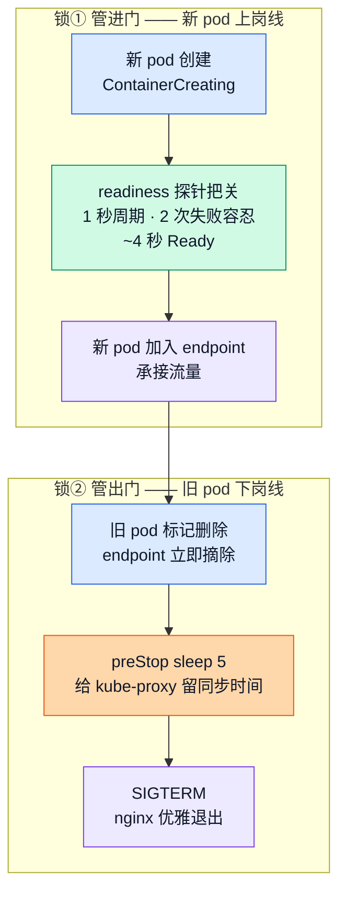

# 滚动发布第一课：进度条说只传了 14.7KB，Harbor 磁盘躺着 147MB

> 实测声明：本文所有命令跑在 2026-11-18/19 两天的三主三从 K8s 1.36 集群上（K8s 1.36.1，Calico，Harbor v2.13.5 自建镜像仓），影子站 Deployment `site` 跑在 worker03 的 hairlabs-site 命名空间。所有输出均为当天逐字落盘的原文，仅个别标注"未落盘"的数据引用自当日判读记录。长度敏感的 blob ID 在个别长输出中完整保留——它们是取证的物证编号。

影子站在集群里跑起来之后（[CI 每次提交自动构建镜像](ci-lightup.md) 推到 GHCR，再搬进自建 Harbor），下一步就该回答那个所有教程都一笔带过的问题：**新版本怎么换上去，用户无感？**

这一课把整条滚动发布链完整走了一遍：追平镜像版本、第一次滚动发布、第一次回滚、两次"止血手术"，外加一场折腾到半夜的取证书悬案。最后以 300 个请求零闪断收官——以及一张把这一切摊到真实团队分工上的角色图。

## 先把镜像追平

起点就卡住了。GHCR 的慢腿第二次实测又一次刷新认知：Actions 构建只要 54 秒，`latest` 镜像从 GHCR 爬到国内集群却用了 3647.6 秒——61 分钟，140.5MB 内容层折合 39.4KiB/s（这次 9 层缓存全部命中，重下的只有那个 ~140MB 的单层内容层；两次实测都是恒速慢腿，这条腿慢得稳定）。这个输出没落盘，数字取自当天判读记录，WindTerm 的 session log 可以回查。

镜像到手，先改个 tag 再推进 Harbor：

```console
xxxx@master01:~/rook-v1.18$ sudo ctr -n k8s.io images tag ghcr.io/hfei929/1hair-site:latest 192.168.114.136/hairlabs/site:8dd8393b && sudo ctr -n k8s.io images push --plain-http 192.168.114.136/hairlabs/site:8dd8393b && sudo ctr -n k8s.io images ls | grep hairlabs/site
192.168.114.136/hairlabs/site:8dd8393b
manifest-sha256:8dd8393b9f35b4e675522c01bc8ae93b4d90509a802fb8c504b91922633378fb: waiting        |--------------------------------------| 
config-sha256:42531d08d4f367ca353e0669eabbdb72572e3e77c640dfa6d3837221217b4a4f:   waiting        |--------------------------------------| 
elapsed: 0.2 s                                                                    total:   0.0 B (0.0 B/s)                                         
ctr: push access denied, repository does not exist or may require authorization: authorization failed: no basic auth credentials
```

这个报错是个好消息：`no basic auth credentials` 是 Harbor 的认证应答，HTTP 链路是通的，纯凭证问题。补上 `--user admin:...` 重推，进度条噼里啪啦跑完——**`total: 14.7K`**。

14.7KB。一个 140.5MB 的镜像。当时盯着这行数字的第一反应是"进度条骗人"，第二反应是"Harbor 会不会根本没收到"。带着这个疑问去 Harbor 查 blob，当场看到了矛盾：digest `0c631fc4` 开头的 blob 在 Harbor 磁盘上，`stat` 出来正好 147,335,579 字节——140.5MB，正是 GHCR pull 下载的主体。**进度条说只传了 14.7KB，磁盘说收到了 147MB。**

## 三份证词打架

取证的弯路走了不少（审计日志一度让人怀疑有"暗度陈仓的 push"，后来证实那条 `anonymous` 记录是 pull 不是 push——Harbor 对公开项目的 pull 记 anonymous，push 才记用户名）。最后矛盾收敛成三句话：

1. **审计日志**：11-14 09:44 → 11-18 20:48，hairlabs 项目零写入
2. **push 实测**：今天推 8dd8393b 只报了 14.7KB
3. **pull 实测**：21:05 worker03 从 Harbor 成功拉到完整的 8dd8393b（内容层 140MB，最新文章都在）

三个证人必有一个说谎。纸上推演绕了四圈没有新信息，直接上文件系统物证——blob 的 `stat` 时间戳和字节数是不可伪造的出生证。

## registry.log 一锤定音

Harbor 的 registry 日志把案翻了：

```console
xxxx@k8s-harbor:~$ sudo grep "0c631fc4" /var/log/harbor/registry.log | head -10
Nov 18 20:48:56 172.18.0.1 registry[827]: time="2026-11-18T12:48:56.280740112Z" level=info msg="authorized request" go.version=go1.24.13 http.request.contenttype="application/octet-stream" http.request.host=192.168.114.136 http.request.id=bb31ef94-46e0-4cde-8fe9-113eb367a962 http.request.method=PUT http.request.remoteaddr=192.168.114.145 http.request.uri="/v2/hairlabs/site/blobs/uploads/8bf56ec0-91a4-4154-938f-981bf1ae3824?_state=sga7TKwjj-jO3Jj-J9traS9Y77cmj4RG9Ibe6F9J4OV7Ik5hbWUiOiJoYWlybGFicy9zaXRlIiwiVVVJRCI6IjhiZjU2ZWMwLTkxYTQtNDE1NC05MzhmLTk4MWJmMWFlMzgyNCIsIk9mZnNldCI6MCwiU3RhcnRlZEF0IjoiMjAyNi0xMS0xOFQxMjo0ODo1Ni4yNDE5MzA5ODlaIn0%3D&digest=sha256%3A0c631fc4c7df369529adf2352acd24e84b9769058a1c1be53bf89c96084cd30c" http.request.useragent="containerd/1.7.24~ds1" vars.name="hairlabs/site" vars.uuid=8bf56ec0-91a4-4154-938f-981bf1ae3824 
```

```console
Nov 18 20:48:57 172.18.0.1 registry[827]: time="2026-11-18T12:48:57.581141678Z" level=info msg="response completed" ... http.request.method=PUT ... http.response.duration=1.311647606s http.response.status=201 http.response.written=0
```

**PUT 耗时 1.3 秒，返回 201，147MB 真传了。** blob 目录的 Birth 时间戳 20:48:57.575 与 PUT 完成时刻严丝合缝。pull 侧再交叉验证：

```console
... "GET /v2/hairlabs/site/blobs/sha256:0c631fc4c7df369529adf2352acd24e84b9769058a1c1be53bf89c96084cd30c HTTP/1.1" 200 147335579 "" "containerd/1.7.24~ds1"
```

registry 访问日志里这次 GET 耗时 689ms——213MB/s 的内网速度。同一份层，外网 GHCR 爬了 61 分钟，内网 Harbor 一秒多就送完。

那 14.7KB 是什么？对了一下账：config 文件 + 几个 265B~1.4KB 的碎层 + manifest，加起来严丝合缝就是 14.7K。真相是 **ctr 的进度条只把"走完的层"记进 total**——140MB 内容层的 PUT 是和 manifest 上传并发的，total 结账时那 147MB 还在路上（精确的记账机制需要翻 containerd 源码，这个坑先挖着）。顺手还测了 Harbor VM 的网卡：`ens192` 速度 10000Mb/s——vmxnet3 是 10G 网卡，之前一直默认它跑千兆。

!!! note "这一段的方法论"
    判读证据的时候最容易犯的错是拿"看起来合理的解释"替代"没验证的事实"。三个证人打架时，唯一能裁决的是文件系统上的字节数和时间戳——日志可以错读，审计界面可以看漏，`stat` 不会。

## 第一刀：set image 滚上去

镜像追平，开滚。先架上观测夹具——一个 curl 循环持续打影子站，一个 `kubectl get pods -w` 全程录像：

```console
xxxx@master01:~/rook-v1.18$ for i in $(seq 1 300); do curl -s -m 2 -o /dev/null http://192.168.114.148:30002/ && echo OK || echo FAIL; sleep 0.25; done > ~/rollout-b2-curl.log &
[1] 3311961
xxxx@master01:~/rook-v1.18$ kubectl -n hairlabs-site get pods -o wide -w --request-timeout=150s > ~/rollout-b2-pods.log 2>&1 &
[2] 3312098
```

然后是今天唯一一条"变更"命令：

```console
xxxx@master01:~/rook-v1.18$ CN=$(kubectl -n hairlabs-site get deploy site -o custom-columns=CN:.spec.template.spec.containers[*].name --no-headers | tr -d ' ') ; kubectl -n hairlabs-site set image deployment/site $CN=192.168.114.136/hairlabs/site:8dd8393b && kubectl -n hairlabs-site rollout status deployment/site --timeout=180s
deployment.apps/site image updated
Waiting for deployment "site" rollout to finish: 1 out of 2 new replicas have been updated...
Waiting for deployment "site" rollout to finish: 1 out of 2 new replicas have been updated...
Waiting for deployment "site" rollout to finish: 1 out of 2 new replicas have been updated...
Waiting for deployment "site" rollout to finish: 1 old replicas are pending termination...
Waiting for deployment "site" rollout to finish: 1 old replicas are pending termination...
Waiting for deployment "site" rollout to finish: 1 old replicas are pending termination...
deployment "site" successfully rolled out
```

这七行就是滚动发布的全部剧本：**先建 1 个新副本 → 等它 Ready → 再杀 1 个旧副本 → 收敛**。背后是 [Deployment](../kubernetes/architecture/resources/workloads.md) 默认的 `maxSurge=25%, maxUnavailable=25%`——2 副本的取整结果就是"同一时刻最多 3 个 pod，最少 2 个可用"。`kubectl rollout status` 的每一行 Waiting 都对应这个节拍器的一次摆动。

`pods -w` 的录像里，顺序和预测完全一致：新 pod gv7z4 先出生（15 秒 Ready），旧 pod fb2b6 再退场；第二个新 pod rnc7b 出生（12 秒 Ready），最后一个旧 pod 9mtrl 退场。**新先旧后，全程任一时刻至少 2 个可用副本。**

代价在另一份录像里。300 个请求打完：

```console
xxxx@master01:~/rook-v1.18$ grep -c FAIL ~/rollout-b2-curl.log ; wc -l ~/rollout-b2-curl.log
2
300 /home/xxxx/rollout-b2-curl.log
```

**2/300。** 滚动过程中有 2 个请求失败。curl 循环当时没打时间戳（观测设计缺口，第二轮就补了），没法把 FAIL 精确归因到某条 pod 事件；按 0.25 秒的请求间隔估计，中断窗口在秒级以内。

这就是滚动发布的"体面"里藏的那把刀：pod 退场时 Kubernetes 先摘 endpoint 再杀容器，但 [kube-proxy](../kubernetes/architecture/network/kube-proxy.md) 的摘除在集群内传播有亚秒级延迟——**摘除信号还没传到每一个节点，容器已经死了，in-flight 的请求就撞在尸体上**。2/300 在玩具集群里是个脚注，在真实业务里就是"发布那几秒用户报错"的工单来源。

## 回滚不是时间倒流

发布完顺手验证了回滚。`kubectl rollout undo deployment/site` 把 Deployment 滚回旧版本，输出里有个值得抠字眼的 warning：

```console
Warning: resource deployments/site was previously managed with 'kubectl apply'. Rolling back will not update the kubectl.kubernetes.io/last-applied-configuration annotation, which may cause unexpected behavior on future 'kubectl apply' operations. Consider using 'kubectl apply' with your previous configuration file instead.
deployment.apps/site rolled back
Waiting for deployment spec update to be observed...
Waiting for deployment spec update to be observed...
Waiting for deployment "site" rollout to finish: 0 out of 2 new replicas have been updated...
Waiting for deployment "site" rollout to finish: 1 out of 2 new replicas have been updated...
Waiting for deployment "site" rollout to finish: 1 out of 2 new replicas have been updated...
Waiting for deployment "site" rollout to finish: 1 out of 2 new replicas have been updated...
Waiting for deployment "site" rollout to finish: 1 old replicas are pending termination...
Waiting for deployment "site" rollout to finish: 1 old replicas are pending termination...
Waiting for deployment "site" rollout to finish: 1 old replicas are pending termination...
deployment "site" successfully rolled out
deployment.apps/site 
REVISION  CHANGE-CAUSE
3         <none>
4         <none>
```

两个发现：

**REVISION 3 不是原来的 revision 1。** `rollout history` 里 revision 1 消失了，取而代之的是 3 和 4。机制是：undo 并不是"时间倒流"回放旧版本，而是**把旧 ReplicaSet 拉回来，改个 revision 号复用**——原来编号 1 的 RS（58988b6599）被重新标注为 3。历史列表是 RS 的影子，号变了，模板没变。

**这个 warning 是给未来埋的雷。** `set image` 和 `undo` 走的是 annotate 路径，不更新 `kubectl.kubernetes.io/last-applied-configuration`。以后如果有人拿着旧清单 `kubectl apply`，kubectl 会认为自己知道完整状态，把手工演进过的配置整个覆盖回去。混合使用 apply 和 set image/undo 的团队，这个雷迟早会响。

回滚还附带揭了 14.7KB 悬案的老底：滚回旧镜像后 curl 影子站，**[三幕战](waline-3acts.md)=0、点亮=0**——旧镜像 0aa484ff 是 11-14 早上构建的，那时候这两篇文章还没写进仓库。时间线反而对上了，也为后面"新镜像内容确实变了"补了个对照。

## dry-run 里掉出来的证物

两刀止血手术开始之前，`--dry-run=server` 先给了一个意外的惊喜。

计划是给 site 加 [readiness 探针](../kubernetes/architecture/node/pod-lifecycle.md)。patch 文件写好，先 dry-run 验证一下（这是 patch 类变更的标准动作）：

```console
xxx@master01:~/rook-v1.18$ kubectl -n hairlabs-site patch deploy site --patch-file ~/b4/readiness-patch.yaml --dry-run=server -o yaml | grep -B2 -A7 readinessProbe
    deployment.kubernetes.io/revision: "4"
    kubectl.kubernetes.io/last-applied-configuration: |
      {"apiVersion":"apps/v1","kind":"Deployment","metadata":{"annotations":{},"labels":{"app":"site"},"name":"site","namespace":"hairlabs-site"},"spec":{"replicas":2,"selector":{"matchLabels":{"app":"site"}},"template":{"metadata":{"labels":{"app":"site"}},"spec":{"containers":[{"image":"192.168.114.136/hairlabs/site:latest","imagePullPolicy":"Always","livenessProbe":{"httpGet":{"path":"/","port":80},"initialDelaySeconds":10,"periodSeconds":20,"timeoutSeconds":3},"name":"site","ports":[{"containerPort":80,"name":"http"}],"readinessProbe":{"httpGet":{"path":"/","port":80},"initialDelaySeconds":3,"periodSeconds":10,"timeoutSeconds":3},"resources":{"limits":{"memory":"128Mi"},"requests":{"cpu":"10m","memory":"32Mi"}}}],"nodeSelector":{"kubernetes.io/hostname":"worker03"}}}}}
  creationTimestamp: "2026-11-14T01:44:38Z"
  generation: 5
```

grep 的本意是看探针，结果 `last-applied-configuration` 抢镜了——**这份 11-14 创建的原始 manifest 里，readinessProbe 和 livenessProbe 本来就在**（`initialDelaySeconds:3, periodSeconds:10`）。

这直接推翻了 B2 之后的叙事。当时的推断链是"影子站没配探针 → Running 就算 Ready → 滚动时新 pod 还没起就顶上 → 闪断"。实际上探针一直在，15 秒 Ready 里的很大一部分就是探针在把关。B2 那 2/300 的闪断**不是"缺就绪门禁"的锅**，病根在另一头：旧 pod 的退场节奏。

!!! warning "dry-run 是个免费的考古现场"
    `--dry-run=server -o yaml` 会把对象的完整状态（包括所有 annotation）打回来。`last-applied-configuration` 里冻结着 manifest 的原始面貌——想知道"当初到底写了什么"，不用翻 Git，一条 dry-run 就行。反过来，它也会把 annotation 里的秘密全部泄露出来，grep 的时候留意点视线范围。

## 第二刀：探针收紧

探针虽然已在，但参数是"通用默认"：周期 10 秒、容忍 3 次失败。对滚动发布来说它太迟钝——把周期收紧到 1 秒、失败容忍 2 次，pod 挂掉能在 2 秒内被摘出 endpoint。patch 全文：

```yaml
spec:
  template:
    spec:
      containers:
      - name: site
        readinessProbe:
          httpGet:
            path: /
            port: 80
          periodSeconds: 1
          failureThreshold: 2
          timeoutSeconds: 2
```

注意这次**没有改镜像、没有改任何业务内容**——只动了 Pod 模板的一个探针参数，`rollout status` 照样跑完了整个滚动流程。**Deployment 的滚动是以 Pod 模板为单位的，模板里任何一个字段的变更都会触发一轮滚动。** 这是它和"改副本数不滚动"（scale 只改 RS 的 replicas 计数）的关键分界。

观测夹具也升级了：curl 循环这次带上时间戳，FAIL 能精确归因。

```console
xxxx@master01:~/rook-v1.18$ cd ~ && rm -f b4/curl-b4.log b4/pods-b4.log && (for i in $(seq 1 300); do curl -sf -o /dev/null http://192.168.114.148:30002/delivery/waline-3acts/ || echo "FAIL $(date +%T.%N) req$i" >> ~/b4/curl-b4.log; sleep 0.4; done &) && (kubectl -n hairlabs-site get pods -o wide -w > ~/b4/pods-b4.log 2>&1 &) && sleep 3 && kubectl -n hairlabs-site patch deploy site --patch-file ~/b4/readiness-patch.yaml && kubectl -n hairlabs-site rollout status deployment/site --timeout=180s && kubectl -n hairlabs-site rollout history deployment/site
```

结果：REVISION 5，FAIL 计数 **1**：

```console
1
FAIL 10:09:23.584602146 req18
```

2/300 → 1/300。有进步，但没归零——而且这 1 条 FAIL 发生在 req18，时间上是 wave 1 旧 pod（8x9vm）的退场瞬间。`pods-b4.log` 里它的谢幕过程：

```console
site-959d9f6b5-8x9vm    1/1     Terminating         0          30m     10.244.19.125   worker03   <none>           <none>
site-959d9f6b5-8x9vm    0/1     Completed           0          30m     10.244.19.125   worker03   <none>           <none>
```

Terminating 显示 1/1——**退场期间 readiness 一直是好的**，endpoint 摘除时 pod 还活着。容器的 Completed 是 nginx 收到 SIGTERM 后优雅退出（退出码 0）。这条录像反而把嫌疑锁死了：新 pod 这边，探针把就绪门禁管得很好（1 秒周期，Ready 4 秒就位）；**剩下的 FAIL 全部来自终止侧——endpoint 还没摘干净，容器已经退了**。

就绪门禁管不了这件事。得在退场路径上再垫一道闸。

## 第三刀：preStop

Lifecycle 的 `preStop` hook 在容器收到 SIGTERM **之前**执行。给它垫 5 秒：

```yaml
spec:
  template:
    spec:
      containers:
      - name: site
        lifecycle:
          preStop:
            exec:
              command:
              - /bin/sh
              - -c
              - sleep 5
```

dry-run 验证落位（`lifecycle` 出现在 `livenessProbe` 之前，patch 生效）：

```console
xxx@master01:~$ kubectl -n hairlabs-site patch deploy site --patch-file ~/b4/prestop-patch.yaml --dry-run=server -o yaml | grep -B3 -A8 lifecycle
      containers:
      - image: 192.168.114.136/hairlabs/site:8dd8393b
        imagePullPolicy: Always
        lifecycle:
          preStop:
            exec:
              command:
              - /bin/sh
              - -c
              - sleep 5
        livenessProbe:
          failureThreshold: 3
```

REVISION 6。同样的夹具再滚一轮，300 个请求跑完去收 FAIL 计数——等来的不是数字，是一行 `No such file or directory`：`curl-b42.log` 根本不存在。

`curl-b42.log` 不存在。这乍看像个观测失败，其实恰恰是**零失败的证据形态**：FAIL 日志是追加式创建的——有 FAIL 才写文件。300 个请求全部通过，FAIL 分支一次都没执行，文件从头到尾没被创建。同一条命令链里 `pods-b42.log` 好好地躺在磁盘上（kubectl -w 的录像在），证明整条链完整执行、curl 循环确实跑完了 135 秒。**文件不存在 = 零 FAIL**。

`pods-b42.log` 里两波退场，节奏完全一致：

```console
site-54c7f98f4c-2q6nf   0/1     Completed           0          22m     10.244.19.126   worker03   <none>           <none>
...
site-54c7f98f4c-m42t9   1/1     Terminating         0          22m     10.244.19.69    worker03   <none>           <none>
site-54c7f98f4c-m42t9   1/1     Terminating         0          22m     10.244.19.69    worker03   <none>           <none>
site-54c7f98f4c-m42t9   1/1     Terminating         0          22m     10.244.19.69    worker03   <none>           <none>
site-54c7f98f4c-m42t9   0/1     Completed           0          22m     10.244.19.69    worker03   <none>           <none>
site-54c7f98f4c-m42t9   0/1     Completed           0          22m     10.244.19.69    worker03   <none>           <none>
```

三幕弧线就此收官：**2/300（裸滚）→ 1/300（收紧探针）→ 0/300（preStop 垫 5 秒）**。

## 5.5 秒退场时序

`pods -w` 的 AGE 列是分钟粒度，判不了 5 秒的间隔。要钉死 preStop 的时序，需要秒级的表。不用改模板再滚一轮——`kubectl scale` 就能触发同一条退场路径（缩容杀 pod 走的也是 preStop → SIGTERM，且 scale 不改模板、不产生新 revision），夹具换成每秒快照、时间戳精确到纳秒：

```console
xxxx@master01:~$ cd ~ && rm -f b4/exit-timeline.log && (while true; do date +%T.%N >> b4/exit-timeline.log; kubectl -n hairlabs-site get pods -o wide --no-headers >> b4/exit-timeline.log 2>&1; sleep 1; done &) && sleep 3 && kubectl -n hairlabs-site scale deployment/site --replicas=1 && sleep 25 && kubectl -n hairlabs-site scale deployment/site --replicas=2 && sleep 10 && kubectl -n hairlabs-site get pods -o wide && pkill -f "get pods -o wide --no-headers" ; tail -40 b4/exit-timeline.log
```

被缩容的 pod 叫 njkjp，它的完整退场（快照里还有 h6htz 和 waline-0 两行，与本剧情无关，下面略去，只留 njkjp）：

```console
11:20:09.670699577
site-6548fd94dc-njkjp   1/1   Running   0     50m     10.244.19.79    worker03   <none>   <none>
11:20:12.911368268
site-6548fd94dc-njkjp   1/1   Terminating   0     50m     10.244.19.79    worker03   <none>   <none>
11:20:14.009278822
site-6548fd94dc-njkjp   1/1   Terminating   0     50m     10.244.19.79    worker03   <none>   <none>
11:20:15.086490958
site-6548fd94dc-njkjp   1/1   Terminating   0     50m     10.244.19.79    worker03   <none>   <none>
11:20:16.223998290
site-6548fd94dc-njkjp   1/1   Terminating   0     50m     10.244.19.79    worker03   <none>   <none>
11:20:17.296468361
site-6548fd94dc-njkjp   1/1   Terminating   0     50m     10.244.19.79    worker03   <none>   <none>
11:20:18.371629335
site-6548fd94dc-njkjp   0/1   Completed   0     50m     10.244.19.79    worker03   <none>   <none>
11:20:19.501744377
（njkjp 从列表中消失）
```

**Terminating 首帧 11:20:12.91，Completed 11:20:18.37，全程 5.5 秒**，正好是 preStop 的 sleep 5 + SIGTERM + nginx 秒退。而且五帧 Terminating 全部显示 1/1——**退场期间 readiness 一直是好的，服务能力一直在**。

这 5.5 秒里发生了什么：pod 被标记删除的当秒，endpoint 摘除就开始传播（亚秒级传遍全网）；preStop 的 sleep 5 给 kube-proxy 留足了同步时间；5 秒后 SIGTERM 才真正发出去，nginx 收到信号优雅退出。**摘除在前、死亡在后，中间垫 5 秒**——in-flight 请求撞尸体的窗口被彻底关掉。

顺手从 events 里捞了个彩蛋：这一轮滚动的新 pod 拉镜像只用了 **73ms**——

```console
... Normal   Pulled             pod/site-6548fd94dc-njkjp    Successfully pulled image "192.168.114.136/hairlabs/site:8dd8393b" in 73ms (73ms including waiting). Image size: 173414215 bytes.
```

Harbor 就在同一个内网，镜像层本地有缓存，滚动周期里没有任何拉取噪声，所有时序测量都是干净的。

## events 的语义课

钉时序时还顺带踩了个语义坑，值得单独记。预注册的判读点是"Killing 事件与 SuccessfulDelete 事件的秒级差值 ≈ 5s"——结果两个时间戳**同秒**：

```console
2026-11-19T02:29:56Z   SuccessfulDelete    site-54c7f98f4c         Deleted pod: site-54c7f98f4c-2q6nf
2026-11-19T02:29:56Z   Killing             site-54c7f98f4c-2q6nf   Stopping container site
2026-11-19T02:30:00Z   SuccessfulDelete    site-54c7f98f4c         Deleted pod: site-54c7f98f4c-m42t9
2026-11-19T02:30:00Z   Killing             site-54c7f98f4c-m42t9   Stopping container site
```

5 秒不见了？没有——是**预注册的判读点选错了证人**。`Killing: Stopping container site` 是 kubelet 收到删除请求当秒打的**记账事件**，不是 SIGTERM 真正发出的时刻；SIGTERM 在 preStop 跑完之后才发。事件的名字不等于动作的完成点。最终给 5.5 秒背书的，是上面的秒级快照轮询——每秒一行、时间戳带纳秒的原始数据，比任何事件流都硬。

顺便，这一场实验贡献了一整套提取层教训：`201 0` 里的 0 是响应体大小不是请求体；`get events`/`get pods -w` 的 AGE 列是分钟粒度；events 的 reason（Killing）和 message（Stopping container site）是两个字段，grep `.message` 找不到 "Killing"；`tail -40` 会把文件头段的证据截掉。每一条都是当场踩的。

## 两把锁各管一头

把三次手术拼起来，滚动发布的零闪断其实是两把锁的合力：



- **readiness 探针是进门的锁**：不 Ready 就不接流量，它保护的是"新 pod 什么时候可以上岗"
- **preStop 是出门的锁**：摘完 [endpoint](../kubernetes/architecture/resources/server-resources.md) 才允许死，它保护的是"旧 pod 什么时候可以下班"

B2 的误诊（"没探针所以闪断"）就是因为把两把锁当成了同一把——探针收紧确实有收益（1/300），但真正归零靠的是出门的锁。

还有一条工程上的省心账：从 REVISION 4 到 6，两次滚动都**没有动镜像**——readiness 参数和 preStop 都是模板层的变更。日常运维里大量变更（探针调参、资源限额、环境变量、preStop）都是这一类，意味着改配置 = 触发一次受控滚动，不需要重新构建镜像。当然反过来的义务也来了：**模板变更和代码变更一样要走预发验证**，一个写错的探针路径会让所有 pod 一起 Ready 不了，滚动直接卡死。

## 摊到团队上：这条流水线谁是干什么的

以上是一个人干完全部活的版本。但真实团队里，这条链是被拆开的——而且拆法有讲究。把影子站这条流水线摊开看：

| 环节 | 影子站实验里的动作 | 团队里的角色 | 产出物（交给下一棒的接口） |
|---|---|---|---|
| 规划 | lab-plan + 预注册 18 条判据 | PM / Tech Lead | 需求 + 验收标准 |
| 编码 | 写文章 = 改 markdown，push 触发一切 | 开发 | **一个带 tag 的镜像在镜像仓里** |
| 构建/CI | Actions：mkdocs build → 打镜像 → 推 GHCR | DevOps / 平台工程（日常无人值守） | 构建流水线本身 |
| 测试 | dry-run 校验 patch、curl 验收（三幕战=3） | QA | 通过/不通过的判定 |
| 发布 | 探针、preStop、滚动策略、回滚预案 | **SRE / 运维（主战场）** | 零停机的发布能力 |
| 观测 | curl 循环、pods -w、events、闪断计数 | SRE | 发布健康判据 |

几个对"团队协作怎么协作"最要紧的对应关系：

**开发的交付物是镜像，不是部署。** 开发改完代码、提了 PR、CI 绿了，他的工作就结束了——终点是一个带唯一 tag（比如 `8dd8393b`）的镜像躺在仓库里。他不需要知道 deployment 长什么样，也不该碰集群。我们这轮实验里唯一算"开发"的活是往站点仓 push 文章，剩下的全是发布侧的事。

**运维的交付物是发布能力，不是某次发布。** 探针参数、preStop 时长、maxSurge/maxUnavailable、回滚预案——这些是"能力"，一次构建，受益于之后每一次发布。运维日常真正动手的正是这块：今天改的全是 Pod 模板，业务内容一个字没动。这就是两边的**物理边界**：开发改业务（模板里的 image tag 由 CI 自动推进，或走 GitOps 由流水线代改），运维改模板，互不踩脚。

**测试的接口是"通过标准"。** QA 不需要懂 Kubernetes，需要的是一条 curl 能跑通的验收清单（内容对不对、接口通不通）。发布侧拿着这个标准决定"滚不滚、停不停、回不回"。滚动发布里的 `rollout status` 天然是个卡点：新副本不 Ready，滚动就停在那一步，坏版本不会滚完——这就是给 QA 留的介入窗口。

**观测是发布的裁判，不是事后收拾。** 2/300 这个数字如果没有发布前的 curl 循环，闪断根本不会被看见。真实团队里这是 [Prometheus / 告警](../observability/prometheus.md) 的事，原理一样：**先有观测夹具，再动生产**。我们[预注册 18 条判据](../lab/index.md)再开滚，就是为了让"发布成功/失败"有事先定好的裁判标准，而不是滚完再看结果找补。

小团队（比如一个人 + 一个辅助的独立站）当然可以全兼——这篇实验就是这么跑的。但哪怕全兼，**按角色归位地写清楚每个环节的接口**，等第二个人进来时，他接的不是一团浆糊，是一个已经有边界的流水线。这份边界清单就是上一张表。

## 收尾

终态对账（B4 全部实验收完之后）：

```console
xxxx@master01:~$ kubectl -n hairlabs-site get deploy site -o custom-columns=IMAGE:.spec.template.spec.containers[0].image,RS:.status.readyReplicas && curl -s http://192.168.114.148:30002/delivery/waline-3acts/ | grep -c "三幕战"
IMAGE                                    RS
192.168.114.136/hairlabs/site:8dd8393b   2
3
```

REVISION 6 的影子站现在是生产级配置：readiness + liveness 双探针、preStop 5 秒、零闪断发布能力，回滚一条命令。Phase B 的第一课就此结课。

下一课已经排上了：user-sim 流量模拟器——常驻 0.05 QPS 打着影子站，让之后每次发布都有真实的"用户"在场上。CI 链的第二位顾客，等着开张。

---

## 推荐阅读

- [从零点亮 CI：GitHub Actions 构建站点镜像，和两个半小时的海关仓](ci-lightup.md)：系列第一篇，本篇那 14.7KB 与 147MB 的矛盾就埋在那条 GHCR → Harbor 的搬运链里。
- [影子站第一位居民：Waline 开光三幕战](waline-3acts.md)：系列第二篇，StatefulSet 的有序更新与本篇 Deployment 的 maxSurge 滚动正好互为对照。
- [Kubernetes 工作负载：从 Pod 到 CronJob，控制器是怎么管住它们的](../kubernetes/architecture/resources/workloads.md)：maxSurge/maxUnavailable、ReplicaSet 与 revision 的机制背景。
- [Kubernetes Pod 生命周期源码解析：从 Pending 到 Running 到底经历了什么？](../kubernetes/architecture/node/pod-lifecycle.md)：探针判定、重启退避与 Pod 退场路径。
- [kube-proxy 工作原理](../kubernetes/architecture/network/kube-proxy.md)：endpoint 摘除为什么要"亚秒级传遍全网"，preStop 垫的 5 秒到底在等什么。
- [Kubernetes 服务资源：Service 到底虚拟出了什么](../kubernetes/architecture/resources/server-resources.md)：endpoint → iptables/IPVS 的转发链路。
- [Prometheus 监控体系：架构、PromQL 与服务发现](../observability/prometheus.md)：把本篇的 curl 夹具升级成指标与告警的正规做法。
