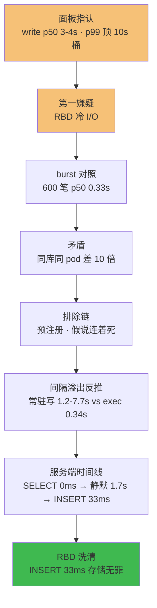
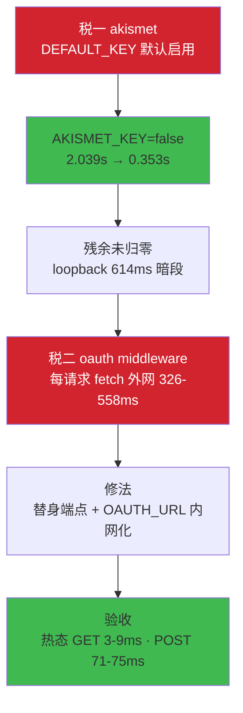

# 哨兵报的警，凶手不在存储：一场持续 20 小时的慢写冤案

> 实测声明：本文所有数据来自 2026-11-21 至 11-23 在 3 Master + 3 Worker 自建集群（K8s 1.36.1 + Calico + Ceph/rook v1.18.1）上的真实实验，监控栈为 kube-prometheus + Loki + Grafana。个别第二批实验数字（burst 基线、svc/np 连发、两处源码摘录）待回查 session log 后回填，文中有 ⚠️ 标记。[系列上一篇](rolling-update-first-lesson.md)把滚动发布跑通，影子站铺上了常驻流量模拟器 user-sim——结果它上岗 20 小时就喊冤，这篇就是整个翻案过程。

## 面板把矛头指给了 Ceph

先交代一下原告。user-sim 是我给影子站配的常驻流量模拟器：按设计稿，每 20 秒 GET 一次影子站首页、每 360 秒往 [Waline](waline-3acts.md) 发一条评论，固定昵称 `user-sim`，带四个指标。接进 Grafana 我拼了个面板，盯了它一天多之后，面板给我看了这么一幅画面：

- write p50 在 3-4s 徘徊
- p95 到 8s
- p99 顶在 10s 桶上

写一条评论要三到五秒。waline 的库是 SQLite，文件落在 [Ceph RBD 的 PVC](../lab/ceph-osd-600s-sit-1min-move-0bytes-back.md) 上。我脑子里立刻蹦出来的嫌疑人：**RBD 冷 I/O**。之前 [Waline 刚入住时](waline-3acts.md)就有过"首笔写要好几秒"的观察，当时还挂了个"RBD 冷 I/O 秒级延迟根因待深挖"的账，面板这数字跟挂账严丝合缝。

至此案情看起来很完整：常驻写慢 → 库在 RBD 上 → Ceph 网络存储慢 → 结案写篇"RBD 深挖"。计划都排上了。

## burst 一测，矛盾露头

结案之前我按纪律跑了对照：`BURST=1` 触发 user-sim 的 burst 模式，以约 1 QPS 密集写了 600 笔，全部返回 200。⚠️（这批的 p50/p99/max 精确数字待回查 session log 回填，量级是 p50 0.33s / p99 0.43s / max 0.88s，零超时——注意这些数字的折扣见后文 IPQPS 一节）

600 笔 200 返回，p50 三百毫秒出头，跟常驻基线的 3-4s 差了整整 10 倍。同一个库、同一个 pod、同一天——如果 RBD 真的写不动，密集写只会更惨，不可能快 10 倍。

矛盾成立，"Ceph 慢"这个结论开始晃。而且这里我先认一个口径失误：我一开始预告"面板会出现方波"——实际没有，因为 **burst 阶段的 curl 流量根本不进 user-sim 的计数器**（那些写是我在另一个进程里发起的，不是 user-sim 发的）。指标只量自己进程发的请求，归因之前先问口径。

## 排除链：假说连着死

"常驻慢、手跑快"，差异一定在两者不同的某个环节上。我给每轮都写了预注册预测再动手，结果假说连着死：

**第一轮：缓存温度。** "慢写是 RBD 冷读导致的，burst 把库焐热了"——听着挺合理。测法：让常驻空闲 2 小时再冷测一笔。结果 0.68s，不慢。⚠️（0.68 这个数字待回查 session log）而且 burst 窗口期面板上 user-sim 自己的写照样 4s、照样顶 10s 桶。缓存温度说出局。

**第二轮：网络路径。** 常驻走 svc 域名，我手跑时试过直连 pod IP——难道是 Service 这层慢？这里先踩了个雷：我想当然把 waline 的 svc 当普通 ClusterIP 去解析，命令直接报 `gaierror`。`kubectl get svc` 一看才反应过来——waline 的 svc 是 **headless**（`CLUSTER-IP` 为 `None`），根本没有 VIP 可解析。（这个 headless svc 是当时手快抄的清单，顺手记了账。）改用正确姿势，svc 和 NodePort 各连发 5 笔：⚠️（精确数字待回查 session log，量级 0.34-0.50 vs 0.34-0.36，无差异；唯一单发 2.7s 的样本重复采样后洗清，是瞬时抖动）路径出局。

**第三轮：Python 客户端库。** 怀疑 urllib 有什么诡异的连接池行为。同一 pod 里 exec 裸测 urllib，⚠️（0.34s，待回查 session log）。出局。

**第四轮：Session/连接复用。** 把 user_sim.py 源码读了一遍——裸 urllib，每次新连接，read 间隔 20s、write 间隔 360s。什么花活都没有。出局。

**第五轮：mail 字段。** waline 写评论带不带 mail 有不同分支？带 mail 的完整 body 一笔 0.571s，不带的 0.322s，都快。出局。

五轮下来，body、URL、库、路径、DNS、代理全部同款。剩下的差异只有两个：**常驻进程 vs 即席新进程**，和**时间**。

## 间隔溢出反推：给常驻进程测延迟

还有一个更阴险的假说："面板 3-4s 是历史慢样本堆出来的，v3 现在其实已经不慢了"。Grafana histogram 是累积分布——v3 上岗以来的全部样本都在分布里，历史慢样本会永久钉死 p50/p99。面板上的 3-4s 到底是"现在的行为"还是"遗产"，光看面板分不出来。

零成本的判别法藏在 user-sim 的日志里。它的循环是每 20s 一轮 read、每 360s 触发一笔 write，所以**相邻两行 `write #N -> 200` 日志的时间差 ≈ 360s + 18 次 read 耗时 + 该笔写的耗时**——溢出量就是写的真实耗时（这个模型后面还要修正一次，先往下看）。这种固定节奏服务的观测方法，也适合用 [Kubernetes 日志与告警排查](../lab/k8s-alerts-ignored-for-25-days.md)中的同一套证据闭环来校验：

```bash
POD=$(kubectl -n hairlabs-site get pods -l app=user-sim -o custom-columns=N:.metadata.name --no-headers) && kubectl -n hairlabs-site logs $POD --timestamps | grep 'write #' | tail -30
```

29 笔样本，间隔全部落在 362.06-368.61s，中位 ≈363.3s。read 面板上贴着 0（<50ms 桶），18 笔最多贡献 ~0.9s。减掉之后：**常驻进程每笔写真实耗时 1.2-7.7s，中位 2.4s 级**。

铁矛盾就此定案：同一个 pod、同一分钟里，常驻进程写要 2-8s，exec 手跑 0.34s。慢不在 waline 全局、不在网络、不在 body——只在"这个进程发出的写"里。

## 服务端时间线：慢在 SELECT 和 INSERT 之间

下一步拆"waline 收到请求后处理慢"还是"客户端等响应慢"。waline 每条 SQL 都打 INFO 日志，挑常驻最近一笔 write #5113 对账：

```bash
kubectl -n hairlabs-site logs deployment/user-sim --timestamps | grep 'write #5113' && kubectl -n hairlabs-site logs waline-0 --timestamps --tail=5000 | grep '流量探测 #5113'
```

输出三行，时间线自己会说话：

```
2026-11-21T22:31:47.260082570+08:00 [2026-11-21T22:31:47.259] [15] [INFO] - SQL: SELECT * FROM wl_Comment WHERE ( url = '/delivery/ci-lightup/' ) AND ( mail = 'user-sim@1hairlabs.cn' ) AND ( nick = 'user-sim' ) AND ( link IS NULL ) AND ( comment = 'user-sim 流量探测 #5113 @1795271506' ), Time: 0ms
2026-11-21T22:31:48.959308826+08:00 [2026-11-21T22:31:48.958] [15] [INFO] - SQL: INSERT INTO wl_Comment (comment,ip,mail,nick,status,url) VALUES ('user-sim 流量探测 #5113 @1795271506','::ffff:10.244.19.88','user-sim@1hairlabs.cn','user-sim','approved','/delivery/ci-lightup/'), Time: 33ms
2026-11-21T22:31:48.966071874+08:00 write #5113 -> 200
```

SELECT 查重 0ms，INSERT 落库 33ms，SQL 本身快得没问题。**但两条 SQL 之间静默了 1.699 秒**，客户端收响应只比 INSERT 晚 8ms。慢在 waline 服务端内部，RBD 也就是在这个时刻正式洗清的——INSERT 才 33ms，Ceph 写根本不慢。（这里还有个小插曲：我当时 grep 用的评论串过滤，把 SELECT 和 INSERT 之间可能存在的其他日志行全吞了。"grep 的形状决定看到的世界"——后来查 oauth 时就换了整窗口捞。）

那个"RBD 冷 I/O 深挖"挂账，销案。

追凶上半场的链条：



## 定罪 akismet：一行默认配置的隐藏行为

慢在 waline 内部、SELECT 和 INSERT 之间、非 SQL、依赖请求内容。这个形状指向反垃圾检查——waline 支持 Akismet 反垃圾服务。翻容器里的源码，`/app/src/` 下就是未打包的 JS。⚠️（下面这段源码摘录待回查 session log 核对）：

```js
// akismet.js
const { DEFAULT_KEY } = require('../const');
// ...
```

`DEFAULT_KEY = '70542d86693e'`——waline 内置了一个默认 Akismet key，**就算你不配 `AKISMET_KEY`，检查照样启用**，只有显式配 `false` 才关。而调用侧的 `.catch(err => false)` 把一切错误静默吞掉——连不上 Akismet 服务器也不报错，就是慢。

确认动机还需要一个对照实验：什么请求会走慢分支？凌晨的 nick A/B 一发定罪，同 mail、同 body 结构，唯一变量是昵称：

```
nick=user-sim   200 2.039
nick=burst-bot  200 0.326
```

原因后来对上了：Akismet 服务端按评论者特征打信誉分，`user-sim` 这个昵称以固定节奏发了几百笔同模式评论，被打了慢通道；`burst-bot` 是陌生昵称走快通道。服务端黑盒，机制到此为止，诚实标注。

一行 env 翻案：

```bash
kubectl -n hairlabs-site set env sts/waline AKISMET_KEY=false
```

滚动完成后验收：user-sim 0.353s（此前 2.039s），burst-bot 0.389s（基本持平——它本来就不慢）。akismet 税实缴约 1.7s/笔。

## 残余不是零，第二税现形

按理该结案了，但间隔溢出没归零。AKISMET_KEY=false 滚动后，常驻 write 间隔还是 361.8-366.5s（溢出 1.8-6.5s）。如果 akismet 是全部真相，溢出应该掉回 1s 以内。

先做了模型修正：`last_write` 是在写开始**前**赋值的，所以相邻间隔里上一笔和这一笔的写耗时**都被计入**——间隔 = 360 + Σ18×read + w(这笔) + w(上笔)。修正后重算，测到的全部溢出本来就是 akismet 单税闭环，跟第二税无关。但这个修正解释不了 loopback 测试：在 waline 容器内、127.0.0.1 打自己的 API，零网络零外因，POST 一笔评论 **614ms**，SQL 全程只占 ~33ms——进程内有一段无日志的暗段，akismet 关了它还在。

追这段暗段。容器里 `/app/src/config/middleware.js` 是 ThinkJS 的中间件挂载清单，第一行：

```js
module.exports = [
  {
    handle: 'fetch-oauth-service',
  },
  ...
```

`fetch-oauth-service` **裸挂首位，无 match 无 enable**。⚠️（它的源码行为细节待回查 session log 核对）翻它的源码：每个请求都会 fetch `OAUTH_URL`，默认值是 `https://oauth.lithub.cc`——waline 官方的 OAuth 服务发现端点。而且 `OAUTH_URL` 没有"关闭"开关：配 `'false'` 字符串是 truthy，直接 fetch 字符串 'false' 会炸。**GET、POST、评论列表、所有请求，每笔都跑一趟外网往返。**

裸测上游服务对照（输出里的 ERR 是我交付命令块自身的翻车，见后）：

```
oauth#1 558 ms ERR body is not defined
oauth#2 326 ms ERR body is not defined
oauth#3 327 ms ERR body is not defined
```

326-558ms 与进程内暗段严丝合缝，同一分钟内 558 和 326 并存，顺手展示了外网抖动的形状。第二税定罪。（这段命令的丑闻值得记：我交付的命令块里 console.log 参数写了个非法表达式，三笔全在打印行炸 `ERR body is not defined`——好在报错发生在 fetch 完成、耗时算完之后，catch 里把耗时和错误一起打了出来，558/326/327 这些数字本身可信。侥幸有效不是有效，交付前过眼睛这课我又上了一遍。）

至此双税案完整：**akismet 每笔 ~1.7s + oauth middleware 每笔 ~0.3-0.55s，全是从 GFW 环境打出去的外网往返**。所谓"RBD 慢写"，从第一笔起就是这两笔税的叠加。

## 修法：把外网依赖内网化

两个税两把刀：

**刀一已落**：`AKISMET_KEY=false`。

**刀二**：waline 没留 oauth 的关闭开关，但 OAUTH_URL 可以指向任何地址——那就自己造一个返回 `{"services":[]}` 的替身端点。影子站的 nginx 正好顺手，conf 加一个 location：

```nginx
server {
  listen 80;
  server_name _;
  root /usr/share/nginx/html;
  index index.html;
  error_page 404 /404.html;

  location /oauth-services {
    default_type application/json;
    return 200 '{"services":[]}';
  }
}
```

然后 `OAUTH_URL=http://site.hairlabs-site.svc.cluster.local/oauth-services`，外网往返变集群内 DNS + 内网 HTTP。

落地过程又付了两笔学费，都值得记：

**第一笔：CI 炸在文件名上。** nginx conf 是在 GitHub Actions 的 run 块里用 printf 生成的（站点仓库走 CI 构建 nginx 镜像）。printf 长串里有单引号，缩进折叠进 yaml 一塌糊涂，最后用 `\x27` 转义压成单行。第一次提交 CI 直接红——`printf ... > nginx-default.conf` 生成的文件名，和 Dockerfile 里 `COPY nginx-site.conf` 对不上，COPY 找不到文件 exit 1。**同一行里"生成的文件名"和"COPY 的文件名"是两个必须逐字符对齐的锚点**，以后这种生成+消费一对文件名的场景要做成显式检查步骤。

**第二笔：GHCR 慢腿二进宫。** 影子站换镜像 `set image` 后，rollout 卡在 1/2 超 900 秒——内容层 ~140MB 重下，base 层有缓存秒过。`crictl pull` 是静默模式，前台"卡住"其实就是爬行中；开另一个窗口 `du` content store 目录隔半分钟对比，数字在涨就是活的。kubelet 和 crictl 两路 pull 共享 content store，谁先爬完都算数。30-45 分钟后镜像落地，rollout 自动收敛——慢腿第三次撞墙，40-60 分钟的预期已经能背出来了。

**验收**（预注册 GET <30ms）：

```
/ 73 ms 200
/api/comment?path=/delivery/ci-lightup/ 239 ms 200
/ 9 ms 200
/api/comment?path=/delivery/ci-lightup/ 75 ms 200
/ 3 ms 200
/api/comment?path=/delivery/ci-lightup/ 71 ms 200
```

首查 73ms 是冷启动（RBD 冷 I/O 的真实指纹——它只影响"很久没访问后的第一笔"，量级百 ms 以内，跟之前 3-4s 完全两个世界）。热态 **3-9ms**，预注册达标。POST 71-75ms，减掉 INSERT 的 25-33ms 就是框架开销，干净。对照修复前 GET 370ms 级、常驻写 2s+，**GET 快了约 40-120 倍，写快约 27 倍**。

下半场的链条：



## 顺手案：IPQPS 限流和 burst 假成功

追凶期间还顺手办了两案，都是给"验收数字"泼冷水的：

**IPQPS 限流**。waline 对同 IP 评论有 60 秒一条的频率闸门。user-sim 的部署 env 里 `USER_SIM_WRITE_INTERVAL=20`（11-20 部署时留下的实验值，设计稿默认是 360s），20s 一笔撞 60s 窗——**每 3 笔只有 1 笔真落库**，被拒的返回 200 静默丢弃。也就是说 11-21 那 600 笔 burst 里大半是假成功，库里的 id 序列直接对账。修复：`kubectl set env deployment/user-sim USER_SIM_WRITE_INTERVAL-`（末尾减号是删除语法），回归代码默认 360s。

**env 漂移**。代码默认值无罪（L28 就是 360），锅在部署 env 覆盖。同一个案子里还发现 user-sim 的镜像引用是 `latest` + `IfNotPresent`——Harbor 上推了新版，pod 重建也只会用节点本地旧缓存。运行时与仓库 yaml 的漂移攒了一堆，留了一次性清账的 commit。

## 方法论清点

这案子从 11-20 面板指认 Ceph 开始，到 11-23 双税清零收官，三天翻两个案、杀两个税、RBD 两次洗清。沉淀下来的东西：

- **面板指认 ≠ 定罪**。归因必须过服务端时间线或源码。这次要是直接信了面板，Ceph 就背锅了，"RBD 深挖篇"都排上了。
- **histogram 是累积分布**。判"当前行为"看新增样本或日志时间戳现算，别盯着累积 p50/p99 下结论。
- **间隔溢出反推法**。固定节奏任务，日志时间戳差 − 基线间隔 = 该次动作真实耗时。零侵入测常驻进程延迟，专治"常驻慢 vs 手跑快"的矛盾。注意赋值时机：写开始前记 last_write 的话，w 会被双计入。
- **口径先于归因**。burst 流量不进 user-sim 计数器这种事，动手前该想清楚。
- **错误文案也是翻译层**。被限流静默返回 200、akismet `.catch(err => false)` 吞错——"看起来成功"的路径上什么都可能发生。
- **GFW 环境里，开源软件的"默认联网"是隐形雷区**。waline 两处默认外网调用（Akismet 默认 key、oauth middleware 默认 URL），不配不报错、配了 'false' 还会炸。内网部署的软件第一件事：审计它的默认外网依赖。

下一篇是系列收官：CI/CD 链最后一个环节 GitOps，ArgoCD 把影子站的发布从"kubectl set image"变成"git push 即部署"。而 user-sim 会继续常驻——p99 从顶 10s 桶回落到 100ms 桶的新基线，已经在面板上开始累积了。

## 推荐阅读

- [影子站第一位居民：Waline 开光三幕战](waline-3acts.md)：本文所排查的 Waline StatefulSet、SQLite 数据卷、探针与滚动更新故障背景。
- [Kubernetes 滚动发布第一课：零闪断与 preStop 退场时序](rolling-update-first-lesson.md)：为影子站和 user-sim 上岗铺好的 Deployment 发布链路与零闪断验证方法。
- [从零点亮 CI：GitHub Actions、GHCR 与 Harbor 内网仓库](ci-lightup.md)：这套实验所依赖的镜像构建、跨境搬运与内网分发供给链。
- [杀一块 Ceph OSD：600 秒静坐、1 分钟搬家、0 字节回迁](../lab/ceph-osd-600s-sit-1min-move-0bytes-back.md)：本文排除 Ceph RBD 写慢结论时所依据的存储故障与迁移实测。
- [Loki 从零装机：日志的三层记忆](../lab/loki-from-zero.md)：常驻进程日志、服务端 SQL 日志和集群事件如何串成完整取证链。
