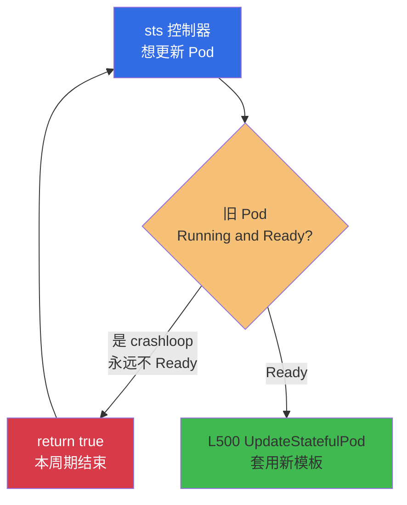

# 影子站第一位居民：Waline 开光三幕战

> **实测声明**：本文全部命令与输出在真实环境实测，时间窗 2026-11-12 至 11-13，集群 3 master + 3 worker（K8s 1.36.1 / Debian 13）。Waline 以 StatefulSet 部署于 `hairlabs-site` 命名空间，存储走 Ceph RBD（PVC `data-waline-0`，2Gi）。文中源码引用均已对照上游仓库实核，行号基于文末标注的版本。

## 为什么是 Waline

影子站立项时有一条硬边界：生产站永久走 Cloudflare Pages，集群里跑的是练兵场。但静态站没有状态——MkDocs 在构建期把 markdown 烘焙成 HTML，运行期没有后端可部署。要练"有状态应用"的发布、迁移、故障恢复，得有一位真实的常住居民。

选 Waline 有三个理由。第一，它是这个站原本就缺的评论系统——九月份拍板过 Vercel + Neon 方案，一直挂账没部署，这次清账。第二，它的数据是真实的：评论、用户、点赞，每一个都是别人写的字，备份和恢复有真实意义，比 `echo hello > file` 的实验卷硬一个量级。第三，它给刚打完的 [存储战役](../lab/ceph-osd-600s-sit-1min-move-0bytes-back.md) 补上最后一块：Ceph RBD 第一次承接真实业务数据，而不是测试卷。

部署形态想清楚了再动手：StatefulSet 管副本、[PVC](../kubernetes/architecture/storage/pv-pvc-storageclass.md) 走 Ceph RBD，镜像从 Harbor 拉（`192.168.114.136`，[上一章点亮的供给链](ci-lightup.md) 正好当第一位顾客的入口）。

```yaml
# 骨架先定这三件：headless Service、StatefulSet、volumeClaimTemplates
apiVersion: v1
kind: Service
metadata:
  name: waline
  namespace: hairlabs-site
spec:
  clusterIP: None
  selector:
    app: waline
  ports:
  - name: http
    port: 8360
    targetPort: 8360
---
apiVersion: apps/v1
kind: StatefulSet
metadata:
  name: waline
  namespace: hairlabs-site
spec:
  serviceName: waline
  replicas: 1
  # volumeClaimTemplates 里申了 2Gi 的 RBD 卷
```

完整清单在站点仓库 `deploy/` 目录。apply 下去，Pod 顺利起在 worker03——然后第一幕开演。

## 第一幕：容器活着，存储没找到

Pod 的出生证在 worker03 的 journal 里，精确到秒——11:54:15，RBD 卷的第一次挂载紧随其后：

```text
Nov 12 11:54:17 worker03 kubelet[1017]: I1112 11:54:17.406102    1017 reconciler_common.go:251] "operationExecutor.VerifyControllerAttachedVolume started for volume \"pvc-2ef3103a-e9b3-4b79-9211-d5c2097408cf\" (UniqueName: \"kubernetes.io/csi/rook-ceph.rbd.csi.ceph.com^0001-0009-rook-ceph-0000000000000002-118c13b8-c2c7-4e81-be1e-032423be3c94\") pod \"waline-0\" (UID: \"b076fe65-2408-4ada-8c4e-95ecfc7abeb9\") " pod="hairlabs-site/waline-0"
```

（这行日志里那个 PVC 名字 `pvc-2ef3103a`，后面八个 Pod 用的还是它——卷是同一个，换的只是 Pod。）

但容器一起来就不对劲——应用反复崩溃，从上午 11:54 到下午 14:34，这个 Pod 在 CrashLoopBackOff 里泡了两个半小时。journal 里 14:30 前后的死亡记录长这样：

```text
Nov 12 14:30:18 worker03 kubelet[1017]: E1112 14:30:18.175064    1017 pod_workers.go:1324] "Error syncing pod, skipping" err="failed to \"StartContainer\" for \"waline\" with CrashLoopBackOff: \"back-off 5m0s restarting failed container=waline pod=waline-0_hairlabs-site(b076fe65-2408-4ada-8c4e-95ecfc7abeb9)\"" pod="hairlabs-site/waline-0" podUID="b076fe65-2408-4ada-8c4e-95ecfc7abeb9"
Nov 12 14:31:22 worker03 kubelet[1017]: E1112 14:31:22.211112    1017 pod_workers.go:1324] "Error syncing pod, skipping" err="failed to \"StartContainer\" for \"waline\" with CrashLoopBackOff: \"back-off 5m0s restarting failed container=waline pod=waline-0_hairlabs-site(b076fe65-2408-4ada-8c4e-95ecfc7abeb9)\"" pod="hairlabs-site/waline-0" podUID="b076fe65-2408-4ada-8c4e-95ecfc7abeb9"
（14:32:25 同款，略）
Nov 12 14:33:49 worker03 kubelet[1017]: E1112 14:33:49.210686    1017 pod_workers.go:1324] "Error syncing pod, skipping" err="failed to \"StartContainer\" for \"waline\" with CrashLoopBackOff: \"back-off 5m0s restarting failed container=waline pod=waline-0_hairlabs-site(b076fe65-2408-4ada-8c4e-95ecfc7abeb9)\"" pod="hairlabs-site/waline-0" podUID="b076fe65-2408-4ada-8c4e-95ecfc7abeb9"
```

容器临死前喊的是这句：`No valid storage found. Please check your environment variables.`——报错原文写在 config.js L80，当时 `kubectl logs` 现场看到的就是它。这段 crashloop 的日志没能在 Loki 留档（waline-0 在 Loki 里的最早一条是当天 16:49:59，为什么，取证方法论一节讨论）。

一个 Node.js 应用在说：我找不到任何一种数据库。可是 PVC 明明 Bound 了，卷明明白白挂在 `/app/data`。问题不在卷，在 Waline 的存储选择逻辑——它根本不知道自己该用 SQLite。

Waline 支持八种存储后端：LeanCloud、MongoDB、PostgreSQL、SQLite、MySQL、TiDB、GitHub、云开发。选哪个，完全由环境变量决定。判定链在 `packages/server/src/config/config.js`，整段就是个 if-else 瀑布：

```javascript
// waline config.js L54-81（引用自 walinejs/waline，main 分支）
if (LEAN_KEY) {
  storage = 'leancloud';
  jwtKey ||= LEAN_KEY;
} else if (MONGO_DB) {
  storage = 'mongodb';
  jwtKey ||= MONGO_PASSWORD;
} else if (PG_DB || POSTGRES_DATABASE) {
  storage = 'postgresql';
  jwtKey ||= PG_PASSWORD || POSTGRES_PASSWORD;
} else if (SQLITE_PATH) {
  storage = 'sqlite';
} else if (MYSQL_DB) {
  storage = 'mysql';
  jwtKey ||= MYSQL_PASSWORD;
} else if (TIDB_DB) {
  storage = 'tidb';
  jwtKey ||= TIDB_PASSWORD;
} else if (GITHUB_TOKEN) {
  storage = 'github';
  jwtKey ||= GITHUB_TOKEN;
} else if (think.env === 'cloudbase' || TCB_ENV) {
  storage = 'cloudbase';
  jwtKey ||= TENCENTCLOUD_SECRETKEY || TCB_KEY || TCB_ENV;
}

if (storage === null) {
  throw new Error('No valid storage found. Please check your environment variables.');
}
```

一个环境变量都没给，八条分支全走空，`storage` 保持 `null`，L80 直接抛错退出。它不会"聪明地"猜你挂了卷就想用 SQLite——**显式声明是这类多后端应用的铁律**。顺带注意一个细节，它是第三幕的伏笔：八个分支里七个都有 `jwtKey ||=` 兜底，唯独 SQLite 分支（L63-64）什么都没有。

修复就是给 env 加 `SQLITE_PATH`。这里我按文件路径的直觉写了 `/app/data/waline.db`——apply、删 Pod 解死锁，应用起来了，crashloop 停了。看起来修好了：存储选定了，进程不崩了。其实埋了个雷——这个值会被当成**目录**来用。这个雷当晚就会响，第三幕细说。

## 第二幕：改了环境变量，Pod 纹丝不动

给 StatefulSet 改 env，通常的预期是：控制器照着新模板滚动更新，旧 Pod 退场，新 Pod 带着新配置出生。这次 `kubectl apply` 之后，`kubectl rollout status` 挂住不动，`get pods` 里那个旧 Pod 活得好好的，一个新 Pod 都没冒出来。

更新卡死了。而且没有任何报错——没有事件，没有日志，控制器安静得像没收到更新请求。

不报错的问题最难查。kubectl 这边能查的都查了：`get sts` 的 revision 与 Pod 的 revision hash 对不上——控制器知道要更新，但就是不执行。死锁发生时的输出已经随事件过期，但 worker03 的 kubelet journal 留着全程尸检记录，而且它比 kubectl 诚实——上面第一幕引用的那四条 CrashLoopBackOff，**podUID 从头到尾都是 `b076fe65`**：同一个 Pod 对象在反复地死，StatefulSet 想更新的正是这个对象，而它永远到不了 Ready。

下一步看 [StatefulSet 控制器](../kubernetes/architecture/resources/workloads.md) 的调试日志。StatefulSet 的更新策略是**有序、逐个、等前一个就绪才轮到下一个**，这个"等"里藏着机关。翻 K8s 源码（v1.36.1，`pkg/controller/statefulset/stateful_set_control.go`）：

```go
// kubernetes v1.36.1 stateful_set_control.go L469-476
// If we have a Pod that has been created but is not running and ready we can not make progress.
// We must ensure that all for each Pod, when we create it, all of its predecessors, with respect to its
// ordinal, are Running and Ready.
if !isRunningAndReady(replicas[i]) && monotonic {
        logger.V(4).Info("StatefulSet is waiting for Pod to be Running and Ready",
                "statefulSet", klog.KObj(set), "pod", klog.KObj(replicas[i]))
        return true, nil
}
```

以及两百多行循环之后的：

```go
// 同文件 L498-502
// Make a deep copy so we don't mutate the shared cache
replica := replicas[i].DeepCopy()
if err := ssc.podControl.UpdateStatefulPod(ctx, updateSet, replica); err != nil {
        return true, err
}
```

L472 的就绪门禁排在 L500 的模板更新**之前**。翻译成人话：**控制器要先看到旧 Pod "Running and Ready"，才会把它更新成新模板。** 而第一幕的 bug 让这个 Pod 处于 crashloop——它永远到不了 Ready。

死锁成型：



控制器在等 Pod 就绪，Pod 在等控制器更新配置（修好 SQLITE_PATH 才能就绪），两边互相等。更阴险的是那个 `logger.V(4)`——V(4) 级别的日志默认不输出，kube-controller-manager 不开 `-v=4` 根本看不见"StatefulSet is waiting for Pod to be Running and Ready"这行自白。静默不是没有日志，是日志被等级压住了。

逃生门只有一个：手动删掉那个 crashloop 的 Pod。Pod 对象一删，L472 的检查对象就没了——控制器下一个周期从"等旧 Pod 就绪"变成"创建新 Pod"，新 Pod 按新模板出生，带着修好的 env，死锁解除。

journal 里能看到这扇门开动的瞬间——14:34:08，一个全新的 podUID 出生，10 秒后 Running，镜像从 Harbor 拉取只用了 68 毫秒（海关仓的局域网腿，上一章的账在这兑现）：

```text
Nov 12 14:35:18 worker03 kubelet[1017]: I1112 14:35:18.151415    1017 pod_startup_latency_tracker.go:148] "Observed pod startup duration" pod="hairlabs-site/waline-0" podStartSLOduration=70.082834479 podStartE2EDuration="1m10.151359755s" totalImagesPullingTime="68.525276ms" totalInitContainerRuntime="0s" isStatefulPod=true podCreationTimestamp="2026-11-12 14:34:08 +0800 CST" imagePullSessionsCount=1 imagePullSessionsStartsCount=0 observedRunningTime="2026-11-12 14:34:18.598039822 +0800 CST m=+400858.555806302" watchObservedRunningTime="2026-11-12 14:35:18.151359755 +0800 CST m=+400918.109126330"
```

（这行日志本身还藏着个小课：`podStartE2EDuration` 写着 1m10s，`observedRunningTime` 减 `podCreationTimestamp` 实际只有 10.6 秒——多出来的一分钟出在观察链路上，kubelet 这个指标把"观察到 Running"的时刻当终点。读数之前先想清楚"测量的时刻"和"事件发生的时刻"是不是同一个。）

今天再看，更新早已收敛——updateRevision、currentRevision、Pod 的 revision hash 三者同值：

```text
$ kubectl -n hairlabs-site get sts waline -o custom-columns=UPDATE:.status.updateRevision,CURRENT:.status.currentRevision
UPDATE              CURRENT
waline-6696dc6df8   waline-6696dc6df8
$ kubectl -n hairlabs-site get pod waline-0 -o custom-columns=HASH:.metadata.labels.controller-revision-hash
HASH
waline-6696dc6df8
```

!!! warning "StatefulSet 滚动更新的隐藏前提"
    Deployment 的滚动更新天然容忍旧副本不健康（maxUnavailable 语义）；StatefulSet 的逐个更新则把"上一个 Pod 就绪"当**前置条件**。任何让存量 Pod 无法 Ready 的配置错误，都会把滚动更新整个卡死，且不报错。crashloop 中的 StatefulSet 想改配置自救，`kubectl delete pod` 往往是唯一出路。

这个机制第二天拿到了反面验证：次日上午 apply v4（模板移植那版清单），Pod 是 Ready 的——滚动更新正常走完，`rollout status` 秒回 complete，零干预。同一套机制，存量 Pod 死着就死锁，活着就畅通——门禁拦的从来不是"更新"，是"想更新一个不健康的对象"。

## 幕间课：探针端口对账

新 Pod 就绪前后还有一段小插曲：[探针](../kubernetes/architecture/node/pod-lifecycle.md) 一直失败，Pod 反复重启。journal 里那个 14:34 出生的新 Pod，14:45 又进了 back-off：

```text
Nov 12 14:45:48 worker03 kubelet[1017]: E1112 14:45:48.232578    1017 pod_workers.go:1324] "Error syncing pod, skipping" err="failed to \"StartContainer\" for \"waline\" with CrashLoopBackOff: \"back-off 2m40s restarting failed container=waline pod=waline-0_hairlabs-site(951285ec-bc4d-47dc-92de-62f22fd3df41)\"" pod="hairlabs-site/waline-0" podUID="951285ec-bc4d-47dc-92de-62f22fd3df41"
```

直到 14:46 删掉重建、探针改对端口之后才稳定下来。

原因说出来很朴素：我照着容器惯例给探针写了 3000 端口，而 Waline（ThinkJS 框架）默认监听 **8360**。探针敲 3000 的门，里面根本没人。

这条的原始证据（`Unhealthy` 事件、`Liveness probe failed` 行）已经拿不回来了——events 一小时就过期，kubelet 的 journal 里两次死亡窗口翻了个遍，Error syncing 有的是，probe failed 一行没有。现存能站住的是状态对比：改 8360 之前，Pod 在 back-off 里反复进出；改完之后，14:46 重建的 Pod 1.6 秒就绪、14:47 四绿收官，此后再没进过 back-off。取证有时限性——想清楚哪些证据会过期，出事第一时间先把 events 拍下来，这是这次学到的。

有两个细节值得记。第一，日志里那行监听地址打印的是 `127.0.0.1:8360`——但 Pod 内探针（同网络空间）能连通，NodePort 外部也能连通。这是框架的**显示惯例**：日志爱写什么写什么，真实绑定要看内核（`ss -ltnp` 才是法官）。第二，这节课后来直接救了场：第三幕的僵死循环排查里，"探针和真实监听对不对得上"是第一个要确认的问题。

探针端口改成 8360。14:47，终审四绿：READY 1/1、revision 收敛、curl 200。三幕战的前两幕落幕。

## 第三幕：业务开光日

Pod Running 只代表进程活着，业务开光要过三关：能建表、能登录、能留评论。

### 建表：一次 500 引出的两个真相

当晚开通 NodePort 30001 门牌，浏览器注册——500。服务端日志里，这个 500 的原始面目是一组查询加一个堆栈：

```text
2026-11-12 16:50:29.103 INFO [2026-11-12T16:50:29.103] [15] [INFO] - SQL: SELECT * FROM wl_Users WHERE ( email = '邮箱地址' ), Time: 1ms
SqliteError: no such table: wl_Users
    at Database.prepare (/app/node_modules/better-sqlite3/lib/methods/wrappers.js:5:21)
    at /app/node_modules/think-model-sqlite/lib/socket.js:180:33
```

当天四次注册尝试（16:49:59、16:50:29、16:51:12、16:51:37），次次撞在同一堵墙上。顺着这堵墙挖，两个真相一起出土。

第一个真相是 `SQLITE_PATH` 的语义。这个连接是懒加载的——进程启动不碰库，第一次业务请求才建连接，所以那行 `sqlite:` 日志直到当晚 16:49:59 才出现，而它暴露的路径是个惊喜：

```text
2026-11-12 16:49:59.191 INFO [2026-11-12T16:49:59.189] [15] [INFO] - sqlite:/app/data/waline.db/waline.sqlite
```

我第一幕修复时写的 `/app/data/waline.db` 被当成了目录，真正的库文件是它下面的 `waline.sqlite`——一个当晚新造的空库。翻 waline 依赖的 think-model-sqlite 源码，语义写得明明白白（`src/socket.js`）：

```javascript
// socket.js L31-38（引用自 thinkjs/think-model-sqlite，master 分支）
let savePath = this.config.path;
if (savePath === true || savePath === ':memory:') {
  savePath = ':memory:';
} else {
  assert(savePath, 'config.path must be set');
  helper.mkdir(savePath);
  savePath = path.join(savePath, `${this.config.database}.sqlite`);
}
```

`mkdir` + `join`，两步都是文件系统操作，没有一行 DDL——所以那个空库里连表都没有，注册一头撞上 `no such table`。这就是第二个真相：表结构得自己带。官方仓库 `assets` 目录里有一份现成的 SQLite 模板，24576 字节，三张业务表——`wl_Comment`（17 列）、`wl_Users`（19 列）、`wl_Counter`（14 列），外加 sqlite 自己维护的 `sqlite_sequence`。前缀 `wl_` 不是巧合，waline 的 adapter 配置里写着 `SQLITE_PREFIX || 'wl_'`。修复路径定了：`SQLITE_PATH` 改成 `/app/data`、模板 `kubectl cp` 进数据卷，作为 v4 清单过夜，次日上午上线（journal 里 09:07 的那次滚动更新就是它）。落盘验证：

```text
$ kubectl -n hairlabs-site exec waline-0 -- ls -l /app/data
total 44
drwx------ 2 root root 16384 Nov 12 11:54 lost+found
drwxr-xr-x 2 root root  4096 Nov 12 16:49 waline.db
-rw-rw-r-- 1 node node 24576 Nov 13 14:47 waline.sqlite
```

这一屏 `ls` 有三层读法。`waline.sqlite`，24576 字节，正是模板的原尺寸；mtime 停在 **Nov 13 14:47**——第一句评论落库就是那一分钟，文件系统替我记了台账。`lost+found`，RBD 块设备被格式化成 ext4 时的出生痕迹，Ceph 战役的知识在这串了门。`waline.db` 这个 root 属主目录是第一幕那次错误配置的化石——waline 的镜像没有 USER 指令、容器以 root 跑，socket.js 忠实地把 `/app/data/waline.db` 建成了目录；修复后 `SQLITE_PATH` 换成 `/app/data`，它留在了卷上，16:49:59 那行 `sqlite:` 日志就是它的出生证明。

!!! note "事故小记"
    中午注册的管理员账号（12:33:36）后来没了——14:43 重新注册前的 `COUNT(*)` 查到空表，重新注册拿回 administrator。但拿到的 id 是 **2** 不是 1：`sqlite_sequence` 停在 2，说明头一个 id 被消耗过、行却不在了。如果那遍误重跑的 `kubectl cp` 真把文件盖成了纯模板，计数器会一起归零——它与 seq=2 对不上。更自洽的版本是行级删除，而删除不走应用日志——中午用 better-sqlite3 开棺验尸的那几次 exec 直连，在 Loki 里是隐形的。事故的精确机制就此存疑，两个教训是实的：**对数据卷的写操作没有幂等保护**；**排查期的手工 exec 是台账外的暗操作**。好在"首个注册用户自动成为 administrator"的规则兜了底——没人保证每次都有这种兜底。

### 登录："账号密码错误"是个翻译

建表完成，用管理员账号登录——"账号密码错误"。改密码，还是"账号密码错误"。密码明明是对的（注册时我自己设的）。

这里差点被带偏：错误文案指向"密码验证失败"，排查方向自然去了"密码是不是没存对、登录接口是不是没接到库"。但前端显示的文案是前端自己定的——**错误提示也是一层翻译，采信前先问"这行字是谁生成的、原始错误在哪"**。

原始错误在服务端日志里。Loki 一查，四条同款报错，全在登录请求的时间点上：

```text
2026-11-13 12:33:45.633  Error: secretOrPrivateKey must have a value
2026-11-13 12:33:53.034  Error: secretOrPrivateKey must have a value
2026-11-13 12:34:20.755  Error: secretOrPrivateKey must have a value
2026-11-13 12:37:04.266  Error: secretOrPrivateKey must have a value
```

前两条隔 8 秒，第三条之后 journal 里出现了一次 Pod 重建（12:35），12:37:04 是新 Pod 上的再试——还是同一个错。错误跟人走、不跟 Pod 走，这基本排除了"运行时状态"方向，把嫌疑压向配置。

还有一个细节，Loki 的 SQL 时间线给了实锤：每条报错前一百多毫秒，都有一条 `SELECT * FROM wl_Users WHERE ( email = '我的邮箱' )`，0 到 1 毫秒返回。密码验证真的发生了、也真的查到了人——崩的是验证成功之后的下一步。

`jsonwebtoken sign → secretOrPrivateKey must have a value`——JWT 签发时没有私钥。结合判定链源码看，机制完全闭合：

```javascript
// waline config.js L52 与 L63-64
let jwtKey = JWT_TOKEN;
...
} else if (SQLITE_PATH) {
  storage = 'sqlite';
}
```

八个存储分支里，**七个**都会在没给 `JWT_TOKEN` 时拿数据库密码兜底（`jwtKey ||=`），唯独 SQLite 分支什么都不兜——SQLite 根本没有密码这个概念。所以：密码验证早就通过了（数据库里有用户记录，查得到），死在验证成功之后的签令牌环节，HTTP 500。前端把 500 翻译成"账号密码错误"，排查方向被翻译层带偏了一下午。

修复：env 再加一个 `JWT_TOKEN`，值用 `openssl rand -hex 32` 现场生成。有个交付细节——生成命令要写进不带引号的 heredoc，让 `$(openssl rand -hex 32)` 在**写入时**就固化为字面值；引号一包，变量会被原样存进 secret，每次读取重新求值，值就漂了。

### 僵死循环：每三十秒死一次

登录悬案还没破，Pod 又陷入了另一种死法：探针超时 → 杀 → 重启 → 活一会儿 → 再被杀。退出码 **137**（128 + 9，SIGKILL），且每次都吃满 30 秒宽限期才死。

worker03 的 journal 记下了这场死亡行军的全程——13:23 到 14:15，五十二分钟，同一个 podUID 从头死到尾，back-off 从 2m40s 一路升到 5m0s：

```text
Nov 13 13:23:41 worker03 kubelet[1017]: E1113 13:23:41.378740    1017 pod_workers.go:1324] "Error syncing pod, skipping" err="failed to \"StartContainer\" for \"waline\" with CrashLoopBackOff: \"back-off 2m40s restarting failed container=waline pod=waline-0_hairlabs-site(1976f49a-a43f-4886-bbaa-d6f1c1b3ed4d)\"" pod="hairlabs-site/waline-0" podUID="1976f49a-a43f-4886-bbaa-d6f1c1b3ed4d"
（13:28:01 起 back-off 升到 5m0s，此后二十余条同款，略）
Nov 13 14:15:55 worker03 kubelet[1017]: E1113 14:15:55.210930    1017 pod_workers.go:1324] "Error syncing pod, skipping" err="failed to \"StartContainer\" for \"waline\" with CrashLoopBackOff: \"back-off 5m0s restarting failed container=waline pod=waline-0_hairlabs-site(1976f49a-a43f-4886-bbaa-d6f1c1b3ed4d)\"" pod="hairlabs-site/waline-0" podUID="1976f49a-a43f-4886-bbaa-d6f1c1b3ed4d"
```

137 + 吃满宽限，这个组合指向一个反直觉的结论：**进程不是被 OOM 秒杀的，是 SIGTERM 发下去 30 秒都没处理完，宽限到期升级成 SIGKILL 的**。Node 的事件循环被什么东西冻住了——连排进队列的 SIGTERM 处理器都没机会执行。

冻住它的是数据库查询。Loki 里的 SQL 时间线把现场记录得明明白白——同一张表，热读 1 毫秒，冷读 225 毫秒：

```text
2026-11-13 14:47:20.210 INFO [2026-11-13T14:47:20.208] [15] [INFO] - SQL: SELECT COUNT(*) AS think_count FROM wl_Comment WHERE ( url = '/' ) AND ( status NOT IN ('waiting','spam') ) AND ( rid IS NULL ) LIMIT 1, Time: 1ms
2026-11-13 14:50:44.013 INFO [2026-11-13T14:50:44.012] [15] [INFO] - SQL: SELECT * FROM wl_Comment WHERE ( url = '/' ) AND ( status NOT IN ('waiting','spam') ) AND ( rid IS NULL ) ORDER BY sticky DESC,insertedAt DESC,id DESC LIMIT 10 OFFSET 0, Time: 225ms
2026-11-13 14:50:44.011 INFO [2026-11-13T14:50:44.011] [15] [INFO] - SQL: SELECT COUNT(*) AS think_count FROM wl_Comment WHERE ( url = '/' ) AND ( status NOT IN ('waiting','spam') ) AND ( rid IS NULL ) LIMIT 1, Time: 227ms
```

而全库的第一次查询更夸张。11-13 12:33:36，注册流程触发了这个库建库以来的第一次读——4242 毫秒：

```text
1794544416696   2026-11-13T04:33:36.696Z        [2026-11-13T12:33:36.692] [15] [INFO] - SQL: SELECT * FROM wl_Users WHERE ( email = '邮箱地址' ), Time: 4242ms
```

最狠的证据是死亡行军窗口本身：13:23 到 14:15，SQL 日志一条都没有，连 `sqlite:` 的连接日志都没有——九十分钟里一轮轮重启，没有一轮完成过一次数据库连接。每一轮都死在冷启动阶段：连接没建好、首查没返回，探针的 1 秒超时先到，SIGTERM 下去也冻在队列里。放大器是 better-sqlite3——同步 I/O 库，查询不完成，事件循环不转，探针的 HTTP 请求也排不上队。探针默认 1 秒超时，对这种"冷启动秒级延迟"的进程太脆了：冷读一起，探针先超时，kubelet 发 SIGTERM，SIGTERM 也冻在队列里——雪崩就是这么开始的。

修复分两层：治标是探针放宽（`timeoutSeconds: 5` + `failureThreshold: 5`），连同 `JWT_TOKEN` 一起作为 v5 在 14:38 上线，给冷启动留活路；治本那笔账挂在 Ceph 名下——RBD 卷冷读 225ms、首查 4.2 秒，而当时集群 `HEALTH_OK`、九个 OSD 全闲，卷的冷 I/O 延迟根因还没挖透，单独立案。

!!! warning "exit 137 不是 OOM 的同义词"
    137 的字面意思是"收到 SIGKILL"。OOM 会触发 SIGKILL（[Pod OOM 故障模拟](../lab/pod-oom-test.md) 里就是那个形态），但 kubelet 宽限期到了也会。区分两者看一个细节：**是否吃满 terminationGracePeriodSeconds**。秒死是 OOM 的概率大；吃满 30 秒才死，是进程冻结、SIGTERM 没人接——两者的修法完全不同（前者调内存，后者治冻结源）。

## 验收：一句评论穿越 Pod 死亡

三关全过后做验收。登录成功、后台可见。然后是这条链路里我最想验证的一幕——**数据真的穿过 Pod 死亡活下来了吗**。先看它进去的那一刻，Loki 里的 INSERT 原文，时间精确到毫秒：

```text
2026-11-13 14:47:48.914 INFO [2026-11-13T14:47:48.913] [15] [INFO] - SQL: INSERT INTO wl_Comment (comment,ip,link,mail,nick,status,ua,url) VALUES ('P26 留言：第一位居民在 Ceph 上的第一句话.','::ffff:192.168.114.150','','','匿名','approved','Mozilla/5.0 (Windows NT 10.0; Win64; x64; rv:159.0) Gecko/20100101 Firefox/159.0','/'), Time: 32ms
```

journal 把删除的时刻也钉死了：评论落库 14:47:48，79 秒后我把 Pod 删了，14:49:07 新 Pod 出生，1.8 秒就绪——数据卷重新挂上，那句评论原样在。

更硬的证据是三天后。11-16，直接进容器查库：

```text
$ kubectl -n hairlabs-site exec waline-0 -- node -e "const s=require('better-sqlite3')('/app/data/waline.sqlite');console.log(JSON.stringify(s.prepare('SELECT insertedAt,comment FROM wl_Comment').all(),null,1))"
[
 {
  "insertedAt": "2026-11-13 14:47:48",
  "comment": "P26 留言：第一位居民在 Ceph 上的第一句话."
 }
]
```

三天、好几个 Pod 世代之后，这行记录逐字健在。它以 SQLite 文件的形式躺在 Ceph RBD 卷里，三副本分布在这台集群的三台 worker 上——Pod 死了、重建了、将来哪怕节点坏了换一台，数据都在。

顺手记一个观察：那条 INSERT 里评论者的 IP 是 `::ffff:192.168.114.150`——这是 worker03 节点自己的 IP。NodePort 流量经过了 [SNAT](../kubernetes/architecture/network/snat-three-scenarios.md)，真实客户端 IP 被节点 IP 顶掉了，后台显示的也是它。对评论系统这只是个显示瑕疵，对任何"要看真实来源 IP"的业务（限流、风控、审计）这是必须处理的坑——`externalTrafficPolicy: Local` 的话题先记在这（[Gateway API 那篇](../lab/gateway-api-installation.md) 复现过源 IP 丢失），以后单独做实验。

## 取证方法论：单证人与全史

复盘整场三幕战，真正的新兵器不是哪条命令，是**取证姿势**。

`kubectl logs --previous` 只能看最后一个死容器——crashloop 了二十几轮的 Pod，它只给你最后一轮的现场。而这台集群有 [Loki](../lab/loki-from-zero.md)（alloy 从 10 月起全量采集），历史容器的日志"几乎"全在：四条 JWT 报错、SQL 冷热读时间线、两次注册的 INSERT、每一次重启的告别——`logs --previous` 看不见的，LogQL 全查得回来。

但"几乎"两个字是这章的最后一课：幕一那两个半小时的 crashloop，日志一条都没进 Loki——waline-0 在 Loki 里的最早一条是当天 16:49:59。漏采的具体原因没定案，候选两个：alloy 对新 Pod 日志文件的 tail_from_end 首扫会跳过发现时刻之前的内容；crash 堆栈走的是 stderr 流，管线对它的处理与 stdout 不同。留个尾巴，单独实验。"全量采集"也要抽查验证——拿一个已知存在的关键词反查，查不到就该怀疑采集面，而不是断定数据没发生过。

还有一类盲区不在采集面，在日志的边界之外：所有绕过应用的手工操作——`exec` 进容器直连 SQLite 的调试命令、直接改文件的 `cp`——都不经过应用日志，Loki 里查无此账。这次事故里"第一个用户怎么没的"最终没钉死，就是因为中间隔着一段看不见的手工操作。**日志只记录走它门的操作；没走它门的，得靠台账和记忆补。**

而 kubelet 的 journal 是另一个证人，它记录的是 Pod 对象的一生。两天的死亡史拼出来是这样一张时间线——九个 Pod 的出生记录，每一次的出生时刻、启动耗时、镜像拉取耗时都在：

| 时刻 | podUID（前 8 位） | 启动 | 拉镜像 | 这一刻发生了什么 |
|---|---|---|---|---|
| 11-12 11:54:15 | b076fe65 | — | — | Pod 出生、RBD 卷首挂载（lost+found 的 11:54 就是这一刻）；随后 crashloop 两个半小时（第一幕） |
| 11-12 14:34:08 | 951285ec | 10.6s | 68ms | 手动删 Pod，死锁解除，新模板生效 |
| 11-12 14:46:15 | 2187170c | 1.6s | 76ms | 探针端口修复后再重建；14:47 终审四绿 |
| 11-12 16:52:31 | 88a0ecb0 | 2.4s | 88ms | 晚间调试期重建（注册撞 no such table 的排查时段） |
| 11-13 09:07:19 | 643c1777 | 2.5s | 80ms | v4 滚动更新 + 官方模板移植——Ready 的 Pod 正常滚动 |
| 11-13 12:35:29 | 1976f49a | 1.7s | 82ms | 登录排查中重建（12:33-12:34 三次失败后）；13:23-14:15 死亡行军 |
| 11-13 14:38:22 | 899ba760 | 8.6s | 90ms | v5 修复（JWT_TOKEN + 探针放宽）；最慢启动，与首查 4242ms 吻合 |
| 11-13 14:42:12 | e418df46 | 3.8s | 74ms | v5 后验证期重建；14:43:47 重新注册拿回 administrator |
| 11-13 14:49:07 | 8e72600b | 1.8s | 77ms | 首条评论（14:47:48）后的删 Pod 验收 |

有意思的是镜像拉取那一列：八次实测全部落在 68-90 毫秒——Harbor 在局域网那头的"秒级"承诺，每一次 Pod 重生都在兑现。

监控栈建好三个月，第一次在自家事故里当主角。

## 下一步

Waline 稳定运行，影子站评论框可以接线了。但那是下一章的素材：新功能进站点仓库 → CI 出新镜像 → 集群里的影子站滚动更新——**源码变镜像已经点亮，镜像变部署还是手工的**。滚动更新时 Pod 怎么排队、读者会不会看见 404、出问题怎么一刀回滚，下一篇在战场见。

---

*源码引用版本：waline `packages/server/src/config/config.js`（部署镜像版本 **1.43.6**，经核该文件最后修改于 2026-05-07、早于 1.43.6，main 分支与部署版本在此文件上一致，行号精确）、`think-model-sqlite src/socket.js`（master 分支）、kubernetes `v1.36.1 pkg/controller/statefulset/stateful_set_control.go`。部署镜像 `192.168.114.136/hairlabs/waline:latest`，digest `sha256:5152dd129eca...`*

---

## 推荐阅读

- [从零点亮 CI：GitHub Actions 构建站点镜像，和两个半小时的海关仓](ci-lightup.md)：本系列上一篇，Harbor 那条局域网腿就是本章 waline 每次 68-90 毫秒拉起镜像的出处。
- [PV、PVC、StorageClass：K8s 存储三个对象到底谁管谁](../kubernetes/architecture/storage/pv-pvc-storageclass.md)：`volumeClaimTemplates` 申请的 2Gi RBD 卷怎么绑定、怎么在 Pod 重建后重新挂上。
- [杀一块 Ceph OSD：600 秒静坐、1 分钟搬家、0 字节回迁](../lab/ceph-osd-600s-sit-1min-move-0bytes-back.md)：冷读 225ms 那笔账挂靠的存储底座，`lost+found` 的来历也在那篇。
- [Kubernetes 工作负载：从 Pod 到 CronJob，控制器是怎么管住它们的](../kubernetes/architecture/resources/workloads.md)：StatefulSet 有序更新、就绪门禁与探针语义的机制背景。
- [Kubernetes Pod 生命周期源码解析：从 Pending 到 Running 到底经历了什么？](../kubernetes/architecture/node/pod-lifecycle.md)：探针失败、重启退避与 CrashLoopBackOff 的完整链路。
- [Kubernetes 故障模拟实战（二）：Pod OOM 之后会发生什么？](../lab/pod-oom-test.md)：exit 137 的另一种来路——秒死与吃满宽限两种死法的对照。
- [Loki 从零装机：日志的三层记忆，和一把熟悉的新刀](../lab/loki-from-zero.md)：本篇取证的主角，LogQL 查历史容器日志的前提。
