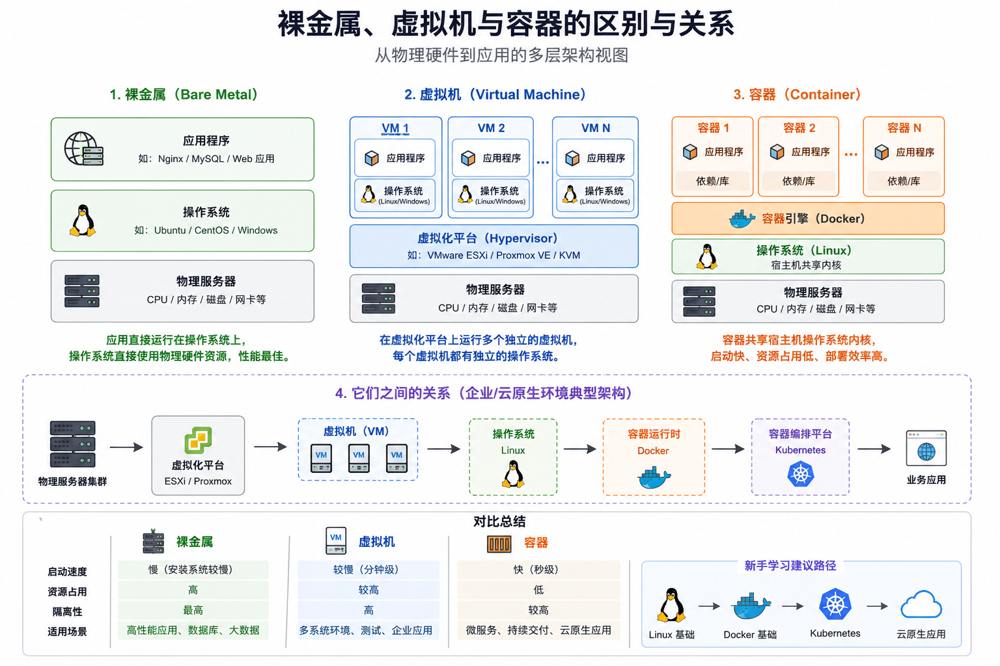
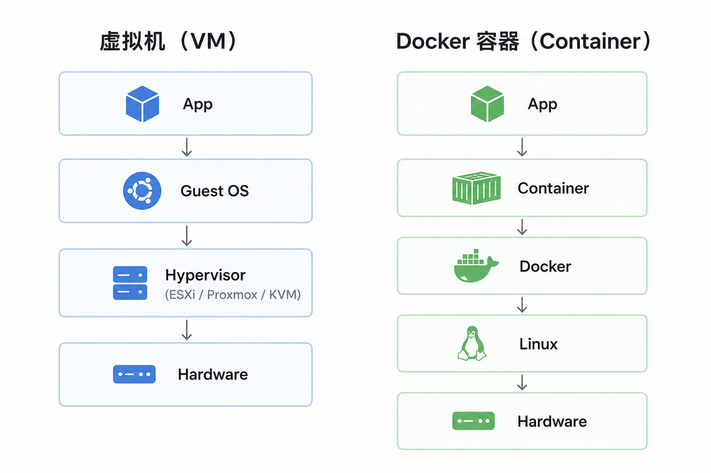

# 裸金属、虚拟机与容器：部署层次和区别

学习服务器和云原生技术时，常会遇到几个容易混淆的问题：ESXi 是操作系统吗？Docker 和虚拟机有什么不同？Kubernetes 是否必须运行在 Docker 里？一台电脑应该先安装什么？

理解这些概念的关键，是分清它们所处的层次：**物理硬件提供资源，操作系统或 Hypervisor 管理资源，虚拟机和容器承载工作负载，Kubernetes 负责协调容器化应用。** 不是每个环境都要把这些层全部叠起来。



## 先看整体层次

典型的虚拟化环境可以表示为：

```text
物理服务器
└── Hypervisor（例如 ESXi、KVM）
    ├── Linux 虚拟机
    │   └── 容器运行时 → 容器化应用
    └── Windows 虚拟机
        └── Windows 应用
```

容器共享所在操作系统的内核；虚拟机则运行独立的客户机操作系统。Kubernetes 位于应用管理层，通过容器运行时启动和管理工作负载，并不取代物理服务器、Hypervisor 或操作系统。

## 裸金属：工作负载直接运行在物理机操作系统上

**裸金属（bare metal）**指物理服务器本身，或强调工作负载直接运行在物理硬件上的部署方式。例如，在一台实体服务器上安装 Linux，再运行数据库：

```text
数据库
└── Linux
    └── 物理服务器
```

裸金属并不意味着“没有操作系统”。通常仍有 Linux 或 Windows 管理硬件和运行应用；只有在特定场景下，应用才会直接访问设备或使用专用系统。

### 什么时候选择裸金属

- 需要直接使用特定硬件、设备或本地存储；
- 工作负载对性能、延迟或资源可预测性有较高要求；
- 已有物理机运维、备份和故障恢复能力。

裸金属可以减少虚拟化层，但不会自动带来高可用。硬件故障、系统升级和容量扩展仍需要独立规划。

## 虚拟机：在一台物理机上运行多个独立操作系统

**Hypervisor（虚拟机监控程序）**负责把物理 CPU、内存、存储和网络资源分配给虚拟机。每台虚拟机都拥有虚拟硬件，并运行自己的客户机操作系统和内核。

```text
Linux VM            Windows VM
客户机操作系统       客户机操作系统
       └──── Hypervisor ────┘
              物理服务器
```

从操作系统视角看，虚拟机像一台独立计算机。它通常比容器提供更完整的操作系统边界，但需要为每个客户机维护系统、补丁、磁盘和资源配置。

### Type 1 与 Type 2 Hypervisor

| 类型 | 运行方式 | 常见例子 | 常见用途 |
| --- | --- | --- | --- |
| **Type 1（裸金属型）** | 直接运行在物理硬件上，提供虚拟机管理能力 | VMware ESXi、服务器上的 Hyper-V、KVM-based platforms | 服务器虚拟化、数据中心和专用实验主机 |
| **Type 2（托管型）** | 作为应用运行在已有桌面操作系统上 | VMware Workstation、Oracle VirtualBox | 个人电脑上的学习、测试和临时环境 |

产品实现和管理方式可能更复杂，表格用于理解常见运行形态，不代表所有产品只符合单一分类。

### ESXi 与 Proxmox VE

- **VMware ESXi** 是直接安装在物理服务器上的 Hypervisor，用来运行和管理虚拟机。**vCenter** 是集中管理多个 ESXi 主机的管理平台，不是运行在 ESXi 与虚拟机之间的另一层 Hypervisor。
- **Proxmox VE（PVE）** 是基于 Debian 的虚拟化平台，集成 KVM 虚拟机和 LXC 容器管理能力。它既包含宿主机操作系统，也提供 Web 管理和集群工具。
- **KVM** 是 Linux 内核中的虚拟化能力，常与 QEMU 等组件配合运行虚拟机；部署平台会负责资源管理、网络和存储集成。

因此，“装 ESXi”“装 PVE”与“在 Ubuntu 上运行 Workstation”代表不同的主机架构。可以先参考 [ESXi 8.0 与 7.0 部署差异](../vmware/esxi-8.0.md)，再根据设备和学习目标选择。

## 容器：隔离应用进程，共享宿主机内核

容器不是一台精简版虚拟机，也不自带一套完整内核。Linux 容器通常是由内核提供的进程隔离与资源控制能力组成的运行环境，例如 namespaces 和 cgroups。容器镜像包含应用及其用户空间依赖，容器运行时负责创建和管理容器进程。

```text
应用与依赖（容器 A）   应用与依赖（容器 B）
             └── 容器运行时
                 └── 宿主机操作系统与内核
                     └── 物理机或虚拟机
```

容器的启动和分发通常较轻量，适合打包、交付和扩缩应用；但共享内核意味着它与虚拟机的隔离边界不同。容器安全还取决于镜像来源、权限、内核、运行时配置和宿主机防护，不能简单理解为“容器不安全”或“容器和 VM 一样隔离”。

### Docker 与容器的关系

**容器是一种操作系统级隔离和打包运行方式；Docker 是一套容器开发与管理工具。** Docker 常用于构建镜像、管理容器和本地开发。容器还可以由 containerd、CRI-O 等运行时运行，并不等于 Docker 产品本身。

在 Linux 上，Docker Engine 通常直接使用 Linux 内核能力。macOS 和 Windows 上的 Docker Desktop 则通过轻量 Linux 虚拟机运行 Linux 容器；Windows 容器使用不同的 Windows 容器机制，不能与 Linux 容器任意混用。

更多实践可参考 [Docker 安装与基础操作](../docker&k8s/docker.md)。

### 虚拟机与容器对比



| 对比项 | 虚拟机 | 容器 |
| --- | --- | --- |
| 内核 | 每台 VM 运行客户机内核 | 通常共享宿主机内核 |
| 操作系统 | 可运行与宿主机不同的客户机系统 | 容器镜像提供用户空间，内核需与运行环境兼容 |
| 资源与启动 | 需要为客户机 OS 分配资源，启动相对较重 | 通常更轻量，启动速度依应用和环境而定 |
| 隔离边界 | 虚拟硬件和 Hypervisor 提供隔离 | 依赖内核隔离机制及运行时配置 |
| 常见用途 | 多操作系统、系统级隔离、传统应用 | 应用打包、微服务、弹性部署 |

选择时不要只比较启动速度或资源占用，还要考虑操作系统需求、隔离目标、团队运维能力和故障恢复方式。

## Kubernetes：管理容器化工作负载

Kubernetes 是容器编排平台。它通过 API 接收期望状态，再由控制器、调度器和节点组件协调工作负载，例如副本数量、放置位置和滚动更新。

```text
Kubernetes 控制面
        ↓ API 与调度
节点操作系统 + 容器运行时
        ↓
Pod 与容器化应用
```

Kubernetes 可以运行在物理服务器或虚拟机上。集群节点需要兼容的容器运行时；现代 Kubernetes 通过 CRI 与运行时交互，常见选择包括 containerd 和 CRI-O。**Kubernetes 并不要求安装 Docker Engine 才能运行容器。**

编排也不等于应用自动高可用：副本、调度策略、持久化存储、探针、容量和应用自身的数据一致性都需要正确设计。入门可参考 [Kubernetes 集群部署教程](../docker&k8s/k8s.md)。

## 常见部署组合

下面是几种常见组合，不是必须逐层叠加的唯一架构：

### 个人电脑上学习

```text
Windows / macOS / Linux
└── Workstation / VirtualBox / Docker Desktop
    └── Linux VM 或容器
```

适合学习 Linux、命令行、Docker 和基础 Kubernetes。资源有限时，可先在单台 Linux VM 中练习容器，不必同时建立多层虚拟化。

### 家庭实验室或小型虚拟化环境

```text
物理服务器
└── ESXi 或 Proxmox VE
    ├── Linux VM → Docker / Kubernetes
    └── 其他用途的 VM
```

适合练习虚拟机网络、存储、快照和多节点环境。若在 Workstation 里的 VM 再运行 Hypervisor 或 Kubernetes 节点，这属于嵌套虚拟化，会增加资源和网络配置复杂度。

### 云原生或生产环境

Kubernetes 节点可以部署在云主机、物理机或虚拟机上。生产设计应优先依据可用性目标、供应商支持矩阵、容量、隔离要求、存储与备份方案选择，不应把 HomeLab 的层级结构直接当作生产标准。

## 如何选择学习路径

| 目标 | 建议起步方式 |
| --- | --- |
| 学 Linux 和系统管理 | 在现有电脑上创建一台 Linux VM，先熟悉网络、磁盘、用户和服务 |
| 学 Docker | 在 Linux VM 或受支持的桌面环境安装 Docker，练习镜像、卷、网络和 Compose |
| 学 Kubernetes | 先理解 Linux 与容器基础，再使用 VM 或专用实验集群练习节点和控制面 |
| 学服务器虚拟化 | 使用闲置且兼容的物理机测试 ESXi 或 Proxmox VE，并提前备份磁盘数据 |
| 模拟企业平台 | 再逐步加入多个 Hypervisor、集中管理、共享存储、监控和故障演练 |

所有方案都应先明确宿主机可用的 CPU、内存和存储。虚拟机、容器和 Kubernetes 节点共享底层资源，分配给虚拟机或 Pod 的资源也不能超过物理宿主机长期承载能力。

## 常见问题

### ESXi 是 Linux 吗？

ESXi 不是通用 Linux 发行版，而是 VMware 的 Hypervisor。它管理物理硬件并运行虚拟机；运维操作和硬件支持应参考 ESXi 对应版本的官方文档。

### Docker 是操作系统或虚拟机吗？

都不是。Docker 提供镜像构建和容器管理工具；Linux 容器共享宿主机内核。Docker Desktop 为桌面系统运行 Linux 容器时使用轻量虚拟机。

### 容器能完全代替虚拟机吗？

不能一概而论。容器适合应用打包和部署；虚拟机适合需要独立客户机内核、不同操作系统或系统级隔离的场景。也可以先在 VM 中运行容器，将两种技术组合使用。

### 部署 Kubernetes 前一定要安装 Docker 吗？

不需要。Kubernetes 节点通过 CRI 使用兼容的容器运行时；可按集群部署工具和 Kubernetes 版本要求选择运行时。

## 推荐阅读

| 主题 | 文章 |
| --- | --- |
| **Linux 系统入门** | [Ubuntu 22.04 部署教程](../linux/ubuntu-22.04.md)——从虚拟机准备到系统安装与初始化。 |
| **虚拟化平台** | [ESXi 8.0 与 7.0 部署差异](../vmware/esxi-8.0.md)——了解裸金属 Hypervisor 的部署和版本差异。 |
| **Docker 基础** | [Docker 安装与基础操作](../docker&k8s/docker.md)——开始构建和运行容器。 |
| **Kubernetes 实践** | [Kubernetes 集群部署教程](../docker&k8s/k8s.md)——了解容器编排和集群节点。 |
| **控制平面高可用** | [Kubernetes 高可用架构实践](../../kubernetes/practice/ha-cluster.md)——进一步认识 API 入口、控制平面和 etcd 的关系。 |

---

## 总结

- **裸金属**描述物理硬件及直接使用硬件的部署形态；通常仍由操作系统管理资源。
- **虚拟机**通过 Hypervisor 获得虚拟硬件，并运行独立客户机内核。
- **容器**隔离应用进程并共享宿主机内核；Docker 是容器工具链之一。
- **Kubernetes**通过 API 和控制器协调容器化工作负载，不替代底层操作系统、虚拟化平台或运行时。

学习时从一台 Linux VM 开始通常最简单；理解基础后，再按目标增加容器、Kubernetes 和虚拟化平台。
