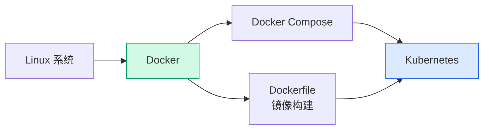

# Docker 部署教程：从零开始安装与使用容器引擎

## 前言

Docker 是目前最流行的容器化平台，它将应用及其依赖打包成轻量级容器，实现了「一次构建，到处运行」。无论你是开发者、运维工程师还是云原生入门者，Docker 都是必须掌握的基石技能。

在 [裸金属、虚拟机与容器的区别](../basics/baremetal-vm-container.md) 中我们讨论了容器的核心优势——秒级启动、资源高效、环境一致。本文将从安装开始，带你迈出容器化的第一步。

!!! info "前置条件"
    本教程假设你已拥有一台可用的 Linux 服务器（物理机或虚拟机）。如果没有，请先参考 [Ubuntu 22.04 部署教程](../linux/ubuntu-22.04.md) 完成系统安装。

---

## Docker 版本说明

| 版本 | 说明 | 推荐 |
| --- | --- | :---: |
| **Docker CE（社区版）** | 免费开源，社区维护 | ✓ |
| **Docker EE（企业版）** | 付费商业版，企业级支持 | ✗ |
| **Docker Desktop** | 带 GUI 的桌面版（macOS/Windows） | GUI 用户 |

本教程安装 **Docker CE（社区版）**，适用于所有主流 Linux 发行版。

---

## 环境准备

### 系统要求

| 项目 | 要求 |
| --- | --- |
| **操作系统** | Ubuntu 22.04+ / Debian 12+ / CentOS 7+ / Rocky Linux 9+ |
| **内核版本** | 3.10 以上（`uname -r` 查看） |
| **架构** | x86_64 / ARM64 |
| **磁盘空间** | 至少 2 GB 可用空间 |
| **网络** | 需能访问 Docker Hub（docker.io） |

### 卸载旧版本（如有）

```bash
sudo apt remove docker docker-engine docker.io containerd runc 2>/dev/null
sudo yum remove docker docker-client docker-common docker-latest 2>/dev/null
```

---

## 安装 Docker CE

### 方式一：官方脚本安装（推荐，一键完成）

```bash
curl -fsSL https://get.docker.com | bash
```

安装完成后启动 Docker 服务：

```bash
sudo systemctl enable docker --now
```

验证安装：

```bash
docker --version
```

预期输出：

```text
Docker version 27.x.x, build xxxxx
```

!!! tip "安装脚本做了什么？"
    官方脚本自动检测你的 Linux 发行版，添加对应的 Docker APT/Yum 源，然后安装最新稳定版 Docker CE。对新手最友好，生产环境也可放心使用。

---

### 方式二：手动安装（Ubuntu/Debian）

#### Step 1：安装依赖

```bash
sudo apt update
sudo apt install -y ca-certificates curl gnupg lsb-release
```

#### Step 2：添加 Docker 官方 GPG 密钥

```bash
sudo mkdir -p /etc/apt/keyrings
curl -fsSL https://download.docker.com/linux/ubuntu/gpg | sudo gpg --dearmor -o /etc/apt/keyrings/docker.gpg
```

#### Step 3：添加 Docker APT 源

```bash
echo "deb [arch=$(dpkg --print-architecture) signed-by=/etc/apt/keyrings/docker.gpg] https://download.docker.com/linux/ubuntu $(lsb_release -cs) stable" | sudo tee /etc/apt/sources.list.d/docker.list > /dev/null
```

#### Step 4：安装 Docker

```bash
sudo apt update
sudo apt install -y docker-ce docker-ce-cli containerd.io docker-buildx-plugin docker-compose-plugin
```

#### Step 5：启动并验证

```bash
sudo systemctl enable docker --now
docker --version
```

---

### 方式三：手动安装（CentOS/Rocky Linux）

```bash
sudo yum install -y yum-utils
sudo yum-config-manager --add-repo https://download.docker.com/linux/centos/docker-ce.repo
sudo yum install -y docker-ce docker-ce-cli containerd.io docker-buildx-plugin docker-compose-plugin
sudo systemctl enable docker --now
docker --version
```

---

## 安装后配置

### 允许非 root 用户运行 Docker

默认情况下只有 root 用户能运行 Docker。将当前用户加入 `docker` 用户组：

```bash
sudo usermod -aG docker $USER
```

**退出当前 SSH 会话并重新登录**（或执行 `newgrp docker`），使权限生效。

验证：

```bash
docker ps
```

不再需要 `sudo`。

---

### 配置 Docker 镜像加速

由于网络原因，直接访问 Docker Hub 下载镜像可能很慢。配置国内镜像加速器：

```bash
sudo mkdir -p /etc/docker
sudo tee /etc/docker/daemon.json << 'EOF'
{
  "registry-mirrors": [
    "https://docker.1ms.run",
    "https://docker.xuanyuan.me"
  ]
}
EOF
sudo systemctl daemon-reload
sudo systemctl restart docker
```

验证镜像加速器已生效：

```bash
docker info | grep -A 5 "Registry Mirrors"
```

---

## 安装 Docker Compose

Docker Compose 用于编排多容器应用。新版 Docker 已内置 Compose 插件：

```bash
docker compose version
```

预期输出：

```text
Docker Compose version v2.x.x
```

!!! tip "新旧命令区别"
    新版使用 `docker compose`（空格），旧版使用 `docker-compose`（横线）。本教程统一使用新版命令。

---

## 第一个容器

### Hello World

```bash
docker run hello-world
```

预期输出：

```text
Hello from Docker!
This message shows that your installation appears to be working correctly.
```

如果看到这段信息，恭喜你——Docker 安装成功！ 🎉

---

### 运行一个 Nginx 容器

```bash
# 拉取并运行 Nginx，映射到本机 8080 端口
docker run -d --name my-nginx -p 8080:80 nginx:latest
```

浏览器访问 `http://<服务器IP>:8080`，应该看到 Nginx 欢迎页。


---

### 常用容器管理命令

```bash
docker ps                  # 查看运行中的容器
docker ps -a               # 查看所有容器（包括已停止）
docker stop my-nginx       # 停止容器
docker start my-nginx      # 启动容器
docker restart my-nginx    # 重启容器
docker rm my-nginx         # 删除容器（需先停止）
docker logs my-nginx       # 查看容器日志
docker exec -it my-nginx bash  # 进入容器内部
```

---

## 常用 Docker 命令速查

### 镜像管理

```bash
docker images                  # 列出本地镜像
docker pull nginx:latest       # 拉取镜像
docker rmi nginx:latest        # 删除镜像
docker search nginx            # 搜索 Docker Hub 上的镜像
```

### 容器运行

```bash
docker run -d --name myapp -p 8080:80 nginx      # 后台运行
docker run -it --name test ubuntu bash            # 交互式运行
docker run -d --restart=always nginx              # 开机自启
docker run -d -v /host/path:/container/path nginx # 挂载数据卷
```

### 清理

```bash
docker system prune -a    # 清理所有未使用的镜像、容器、网络
docker volume prune       # 清理未使用的数据卷
```

---

## Docker Compose 快速入门

使用 Compose 一键编排多容器应用：

### 示例：WordPress + MySQL

创建 `docker-compose.yml`：

```yaml
version: '3.8'

services:
  db:
    image: mysql:8.0
    environment:
      MYSQL_ROOT_PASSWORD: example
      MYSQL_DATABASE: wordpress
    volumes:
      - db_data:/var/lib/mysql

  wordpress:
    image: wordpress:latest
    ports:
      - "8080:80"
    environment:
      WORDPRESS_DB_HOST: db
      WORDPRESS_DB_USER: root
      WORDPRESS_DB_PASSWORD: example
      WORDPRESS_DB_NAME: wordpress
    depends_on:
      - db

volumes:
  db_data:
```

启动：

```bash
docker compose up -d
```

浏览器访问 `http://<服务器IP>:8080`，看到 WordPress 安装页面。


停止并清理：

```bash
docker compose down -v
```

---

## 常见问题

### Docker 启动失败：Cannot connect to the Docker daemon

```bash
sudo systemctl start docker     # 启动 Docker 服务
sudo systemctl status docker    # 查看服务状态
```

---

### 镜像拉取失败或超时

1. 检查镜像加速器是否配置正确：`docker info | grep Mirrors`
2. 尝试更换加速器地址
3. 检查网络能否访问 Docker Hub

---

### 容器内无法访问外网

检查宿主机的 IP 转发是否开启：

```bash
sudo sysctl net.ipv4.ip_forward
# 如果输出 0，执行：
echo "net.ipv4.ip_forward=1" | sudo tee -a /etc/sysctl.conf
sudo sysctl -p
```

---

### 磁盘空间不足

Docker 镜像和容器会占用大量磁盘空间，定期清理：

```bash
docker system df           # 查看 Docker 磁盘使用情况
docker system prune -a     # 清理所有未使用资源
```

---

## 下一步学习



| 方向 | 教程 |
| --- | --- |
| **容器编排** | [Kubernetes 部署教程](k8s.md) |
| **系统基础** | [Ubuntu 22.04 部署教程](../linux/ubuntu-22.04.md) |
| **虚拟化平台** | [ESXi 7.0 部署教程](../vmware/esxi-7.0.md) |
| **概念理解** | [裸金属、虚拟机与容器](../basics/baremetal-vm-container.md) |

---

## 总结

本文从零开始完成了 Docker 的安装与初步使用：

1. **安装**：官方脚本一键安装，或手动按发行版安装
2. **配置**：非 root 用户授权、镜像加速器
3. **Compose**：新版已内置，用于多容器编排
4. **实战**：Hello World → Nginx → WordPress + MySQL

Docker 的精髓在于「构建 → 分发 → 运行」的标准化流程。掌握基础安装后，建议深入学习 Dockerfile 编写和 Docker Compose 编排，为后续 Kubernetes 学习打好基础。 🚀

