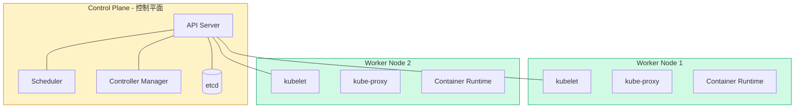
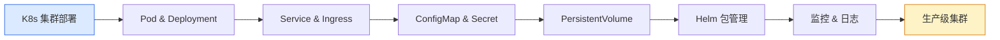

# Kubernetes 部署教程：从零搭建 K8s 集群（kubeadm）

## 前言

Kubernetes（简称 K8s）是目前最主流的容器编排平台，由 Google 开源并捐赠给 CNCF。它负责自动化容器的部署、扩缩容、负载均衡、服务发现和自愈，是云原生技术栈的核心。

在完成 [Docker 部署教程](docker.md) 后，你已经掌握了单机容器运行的方式。但当容器数量增长到数十甚至数百个时，手动管理变得不可能——这正是 Kubernetes 要解决的问题。

本教程使用 **kubeadm** 工具，带领大家从零搭建一个可用于学习和实验的 Kubernetes 集群。

!!! info "前置条件"
    本教程假设你已：
    1. 拥有至少 1 台 Ubuntu 22.04 服务器（[安装教程](../linux/ubuntu-22.04.md)）
    2. 已安装 Docker 或对容器有基本了解（[Docker 教程](docker.md)）
    3. 对 Linux 命令有基本操作能力

---

## Kubernetes 架构速览



| 组件 | 位置 | 职责 |
| --- | --- | --- |
| **API Server** | Control Plane | 集群统一入口，所有操作通过它 |
| **etcd** | Control Plane | 分布式 KV 存储，保存集群所有数据 |
| **Scheduler** | Control Plane | 将 Pod 调度到合适的 Node |
| **Controller Manager** | Control Plane | 维护集群期望状态（副本数、端点等） |
| **kubelet** | 每个 Node | 节点代理，管理容器生命周期 |
| **kube-proxy** | 每个 Node | 网络代理，实现 Service 负载均衡 |

---

## 环境要求

### 硬件配置

| 节点类型 | CPU | 内存 | 磁盘 |
| --- | --- | --- | --- |
| **Control Plane（单节点）** | 2 Core | 4 GB | 40 GB |
| **Worker Node** | 2 Core | 4 GB | 40 GB |

!!! tip "单节点学习环境"
    如果资源有限，可以先部署一个 **单节点集群**（Control Plane 同时充当 Worker），1 台 4 GB 内存的虚拟机即可。

### 软件要求

| 软件 | 版本 |
| --- | --- |
| **操作系统** | Ubuntu 22.04 / 24.04 |
| **内核** | 5.4 以上 |
| **网络** | 所有节点互通、可访问外网 |

---

## 所有节点通用配置

以下步骤在 **每台节点** 上都需要执行。

### Step 1：系统基础配置

```bash
# 关闭 swap
sudo swapoff -a
sudo sed -i '/swap/s/^/#/' /etc/fstab

# 加载内核模块
cat <<EOF | sudo tee /etc/modules-load.d/k8s.conf
overlay
br_netfilter
EOF

sudo modprobe overlay
sudo modprobe br_netfilter

# 配置内核网络参数
cat <<EOF | sudo tee /etc/sysctl.d/k8s.conf
net.bridge.bridge-nf-call-iptables  = 1
net.bridge.bridge-nf-call-ip6tables = 1
net.ipv4.ip_forward                 = 1
EOF

sudo sysctl --system
```

---

### Step 2：安装 containerd 容器运行时

Kubernetes 1.24+ 已移除对 Docker Shim 的内置支持，推荐使用 **containerd** 作为容器运行时。

```bash
# 安装 containerd
sudo apt update
sudo apt install -y containerd

# 生成默认配置
sudo mkdir -p /etc/containerd
containerd config default | sudo tee /etc/containerd/config.toml

# 启用 SystemdCgroup（K8s 推荐）
sudo sed -i 's/SystemdCgroup = false/SystemdCgroup = true/' /etc/containerd/config.toml

# 重启 containerd
sudo systemctl restart containerd
sudo systemctl enable containerd
```

!!! warning "务必启用 SystemdCgroup"
    不修改 `SystemdCgroup = true` 可能导致 kubelet 无法正确管理容器资源，节点状态异常。

---

### Step 3：安装 kubeadm、kubelet、kubectl

```bash
# 添加 Kubernetes APT 源
sudo apt update
sudo apt install -y apt-transport-https ca-certificates curl gpg

curl -fsSL https://pkgs.k8s.io/core:/stable:/v1.31/deb/Release.key | sudo gpg --dearmor -o /etc/apt/keyrings/kubernetes-apt-keyring.gpg

echo 'deb [signed-by=/etc/apt/keyrings/kubernetes-apt-keyring.gpg] https://pkgs.k8s.io/core:/stable:/v1.31/deb/ /' | sudo tee /etc/apt/sources.list.d/kubernetes.list

# 安装
sudo apt update
sudo apt install -y kubelet kubeadm kubectl

# 锁定版本（防止意外升级）
sudo apt-mark hold kubelet kubeadm kubectl

# 启用 kubelet
sudo systemctl enable --now kubelet
```

!!! tip "Kubernetes 版本选择"
    本教程使用 **v1.31**。如需其他版本，将 URL 中的 `v1.31` 替换为目标版本号。建议选择当前最新的稳定版本。

---

## 初始化 Control Plane

以下步骤**仅在 Control Plane 节点**上执行。

### Step 4：初始化集群

```bash
sudo kubeadm init \
  --pod-network-cidr=10.244.0.0/16 \
  --apiserver-advertise-address=<你的控制平面IP>
```

参数说明：

| 参数 | 说明 |
| --- | --- |
| `--pod-network-cidr` | Pod 网络 CIDR（与 Calico 默认配置匹配） |
| `--apiserver-advertise-address` | API Server 对外暴露的 IP |

!!! warning "如果初始化失败"
    排查问题后重新初始化：
    ```bash
    sudo kubeadm reset -f
    sudo rm -rf /etc/cni/net.d
    ```

初始化成功后，会输出类似以下内容：

```text
Your Kubernetes control-plane has initialized successfully!

To start using your cluster, you need to run the following as a regular user:
  mkdir -p $HOME/.kube
  sudo cp -i /etc/kubernetes/admin.conf $HOME/.kube/config
  sudo chown $(id -u):$(id -g) $HOME/.kube/config

You can now join any number of worker nodes by running:
kubeadm join <control-plane-ip>:6443 --token <token> --discovery-token-ca-cert-hash sha256:<hash>
```

**保存好 `kubeadm join` 命令**，后续 Worker 节点加入集群需要用到。

---

### Step 5：配置 kubectl

```bash
mkdir -p $HOME/.kube
sudo cp -i /etc/kubernetes/admin.conf $HOME/.kube/config
sudo chown $(id -u):$(id -g) $HOME/.kube/config
```

验证集群状态：

```bash
kubectl get nodes
```

此时节点状态为 `NotReady`，因为还没有安装网络插件。

---

### Step 6：安装 Calico 网络插件

```bash
kubectl apply -f https://raw.githubusercontent.com/projectcalico/calico/v3.28/manifests/calico.yaml
```

等待 Calico Pod 启动完成：

```bash
kubectl get pods -n kube-system -w
```

几分钟后再次查看节点状态：

```bash
kubectl get nodes
```

节点状态应变为 `Ready`。


---

## 加入 Worker Node

### Step 7：在 Worker Node 上加入集群

在每台 Worker Node 上执行初始化时保存的 `kubeadm join` 命令：

```bash
sudo kubeadm join 192.168.1.100:6443 \
  --token abcdef.0123456789abcdef \
  --discovery-token-ca-cert-hash sha256:xxxxx
```

如果忘记 join 命令，在 Control Plane 上重新生成：

```bash
kubeadm token create --print-join-command
```

---

### Step 8：验证集群

在 Control Plane 上：

```bash
kubectl get nodes
```

预期输出：所有节点状态为 `Ready`。

```text
NAME          STATUS   ROLES           AGE   VERSION
k8s-master    Ready    control-plane   10m   v1.31.x
k8s-worker1   Ready    <none>          5m    v1.31.x
```

```bash
kubectl get pods -A   # 查看所有命名空间的 Pod
```

所有 `kube-system` 下的 Pod 应为 `Running`。

---

## 部署 Dashboard（可选）

Kubernetes Dashboard 提供基于 Web 的集群管理界面：

```bash
# 部署 Dashboard
kubectl apply -f https://raw.githubusercontent.com/kubernetes/dashboard/v2.7.0/aio/deploy/recommended.yaml

# 创建管理员账户
cat <<EOF | kubectl apply -f -
apiVersion: v1
kind: ServiceAccount
metadata:
  name: admin-user
  namespace: kubernetes-dashboard
---
apiVersion: rbac.authorization.k8s.io/v1
kind: ClusterRoleBinding
metadata:
  name: admin-user
roleRef:
  apiGroup: rbac.authorization.k8s.io
  kind: ClusterRole
  name: cluster-admin
subjects:
- kind: ServiceAccount
  name: admin-user
  namespace: kubernetes-dashboard
EOF

# 获取登录 Token
kubectl -n kubernetes-dashboard create token admin-user
```

### 访问 Dashboard

```bash
kubectl proxy
```

浏览器访问：

```text
http://localhost:8001/api/v1/namespaces/kubernetes-dashboard/services/https:kubernetes-dashboard:/proxy/
```

输入上一步获取的 Token 登录。


---

## 第一个应用

### 部署 Nginx

```bash
kubectl create deployment nginx --image=nginx:latest
kubectl expose deployment nginx --port=80 --type=NodePort
```

查看访问端口：

```bash
kubectl get svc nginx
```

```text
NAME    TYPE       CLUSTER-IP     EXTERNAL-IP   PORT(S)        AGE
nginx   NodePort   10.96.100.1    <none>        80:3xxxx/TCP   5s
```

浏览器访问 `http://<任意节点IP>:<NodePort>` 即可看到 Nginx 欢迎页。

---

## 常用 kubectl 命令速查

```bash
# 节点管理
kubectl get nodes                     # 查看所有节点
kubectl describe node <node-name>     # 节点详细信息

# Pod 管理
kubectl get pods                      # 查看 Pod（当前命名空间）
kubectl get pods -A                   # 查看所有命名空间的 Pod
kubectl describe pod <pod-name>       # Pod 详细信息
kubectl logs <pod-name>               # 查看 Pod 日志
kubectl exec -it <pod-name> -- bash   # 进入 Pod 内部

# 资源管理
kubectl get all                       # 查看所有资源
kubectl delete pod <pod-name>         # 删除 Pod
kubectl apply -f <filename>.yaml      # 应用 YAML 配置
kubectl delete -f <filename>.yaml     # 通过 YAML 删除资源

# 命名空间
kubectl get namespaces                # 查看命名空间
kubectl create namespace <name>       # 创建命名空间
```

---

## 常见问题

### kubeadm init 失败：CRI 未就绪

```bash
# 检查 containerd 状态
sudo systemctl status containerd

# 检查 SystemdCgroup 是否已启用
grep SystemdCgroup /etc/containerd/config.toml
# 应为 SystemdCgroup = true
```

---

### 节点状态为 NotReady

通常是网络插件未安装或异常：

```bash
kubectl get pods -n kube-system | grep calico
```

如果 Calico Pod 异常，查看日志定位问题：

```bash
kubectl logs -n kube-system <calico-pod-name>
```

---

### Worker Node 加入失败：token 过期

```bash
# 在 Control Plane 上重新生成
kubeadm token create --print-join-command
```

---

### kubectl 命令报错：connection refused

确认 kubectl 配置是否正确：

```bash
ls -la $HOME/.kube/config
kubectl cluster-info
```

如果 `admin.conf` 丢失，在 Control Plane 上重新复制：

```bash
sudo cp /etc/kubernetes/admin.conf $HOME/.kube/config
sudo chown $(id -u):$(id -g) $HOME/.kube/config
```

---

## 下一步学习



| 方向 | 教程 |
| --- | --- |
| **容器基础** | [Docker 部署教程](docker.md) |
| **系统基础** | [Ubuntu 22.04 部署教程](../linux/ubuntu-22.04.md) |
| **虚拟化平台** | [ESXi 7.0 部署教程](../vmware/esxi-7.0.md) |
| **K8s 进阶** | [Kubernetes 架构详解](../../kubernetes/architecture/index.md) |

---

## 总结

本文使用 kubeadm 从零搭建了一个完整的 Kubernetes 集群，包括：

1. **节点初始化**：关闭 swap、加载内核模块、配置网络参数
2. **运行时安装**：containerd 替代 Docker，SystemdCgroup 配置
3. **K8s 组件安装**：kubeadm、kubelet、kubectl
4. **集群初始化**：kubeadm init + Calico 网络插件
5. **节点加入**：Worker Node 通过 join 命令加入
6. **Dashboard 部署**：Web 管理界面 + 登录 Token
7. **第一个应用**：Nginx Deployment + NodePort Service

Kubernetes 的上限很高——从部署一个简单应用到管理数千节点的全球分布式集群，它都能胜任。本文是这条学习曲线的起点，后续建议深入学习 Pod、Deployment、Service、Ingress 等核心资源对象。 🚀

