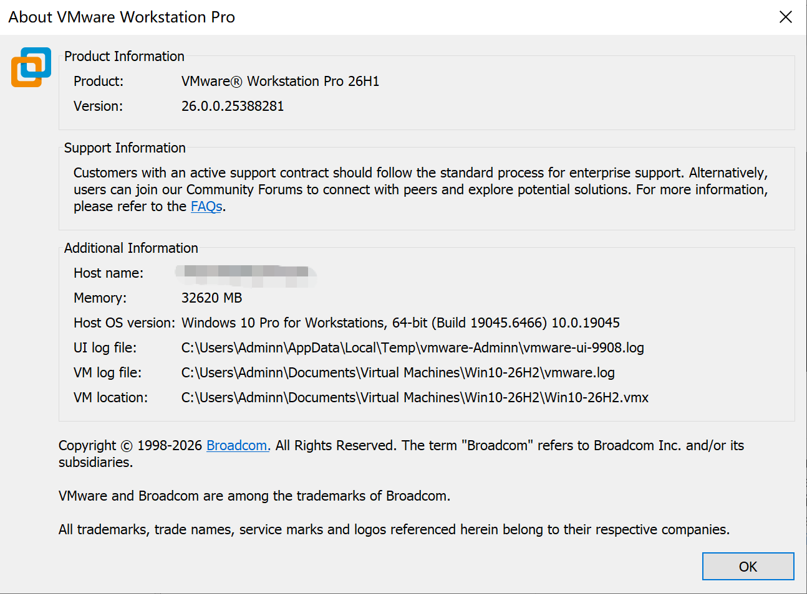
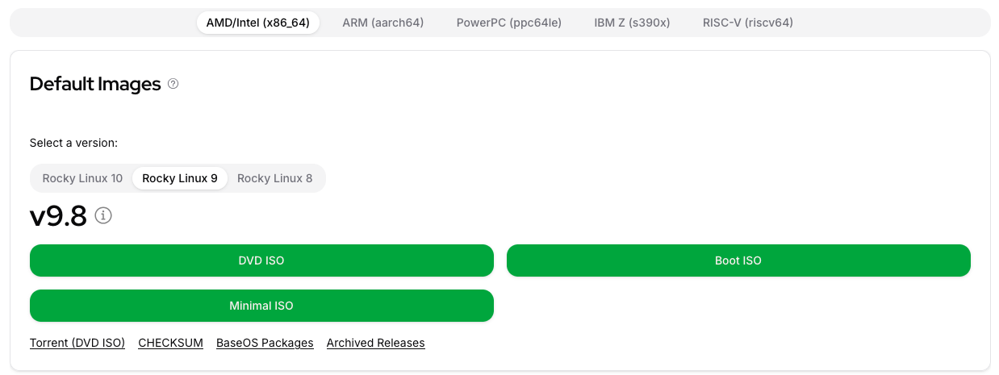
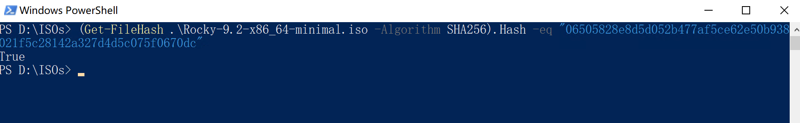
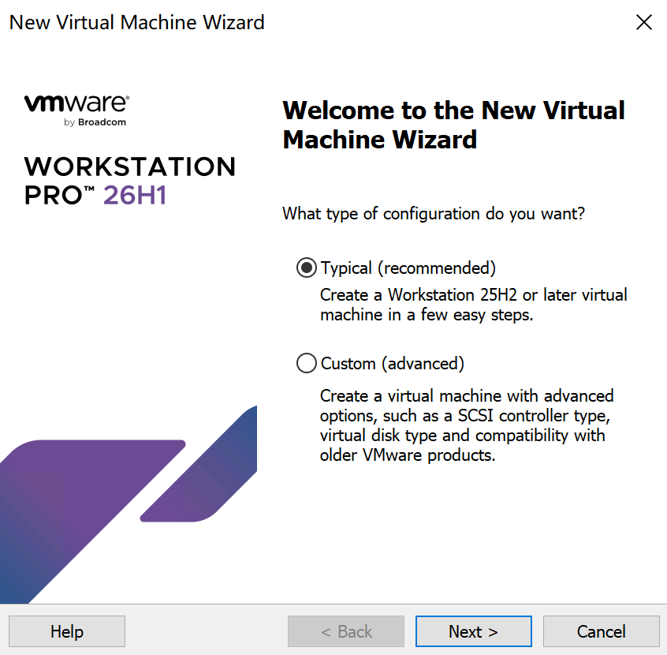
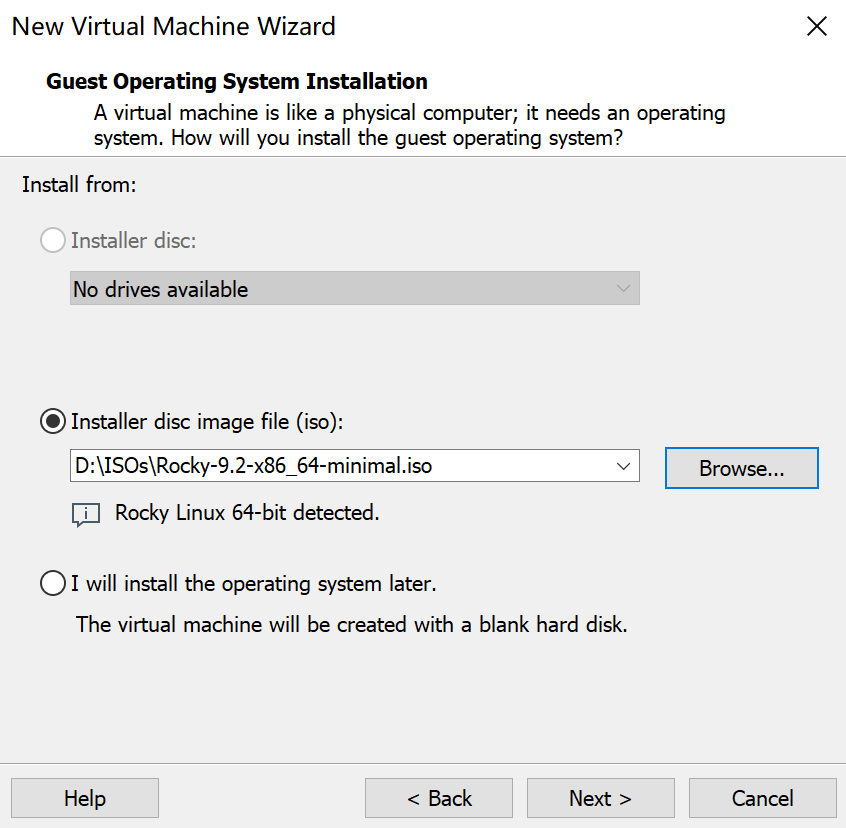
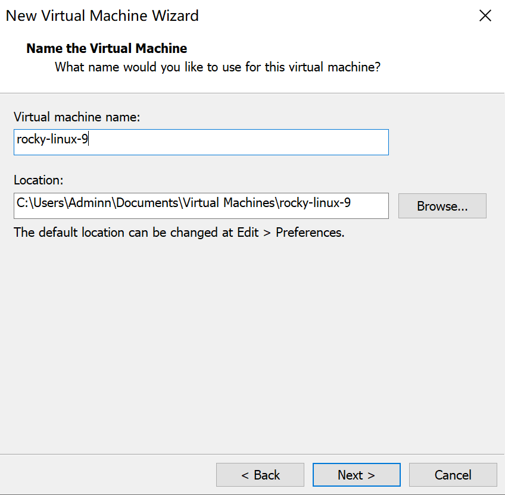
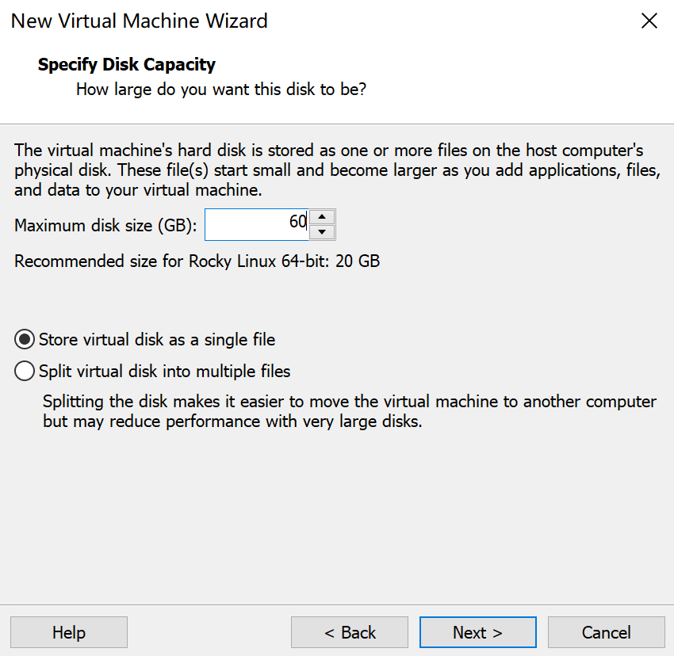
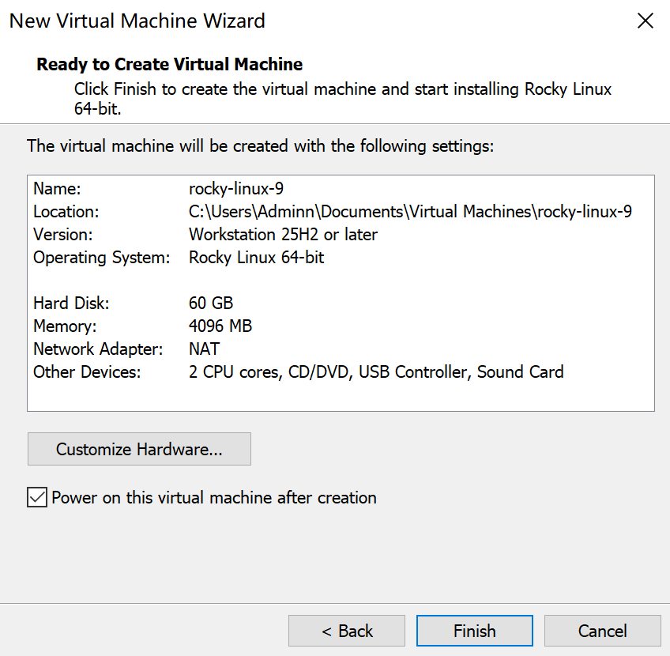
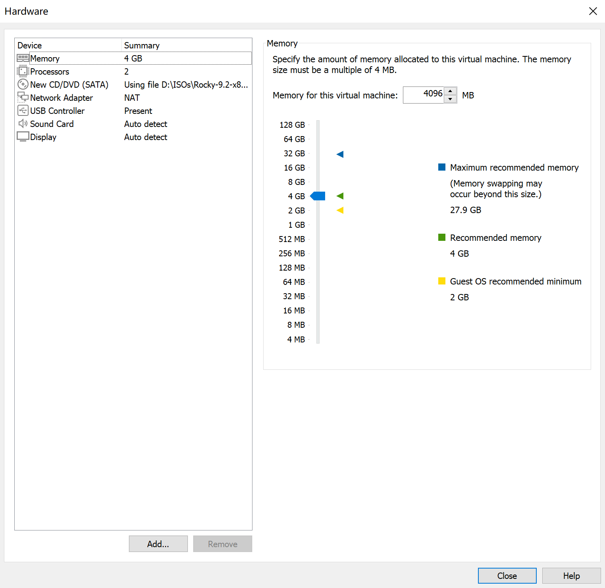
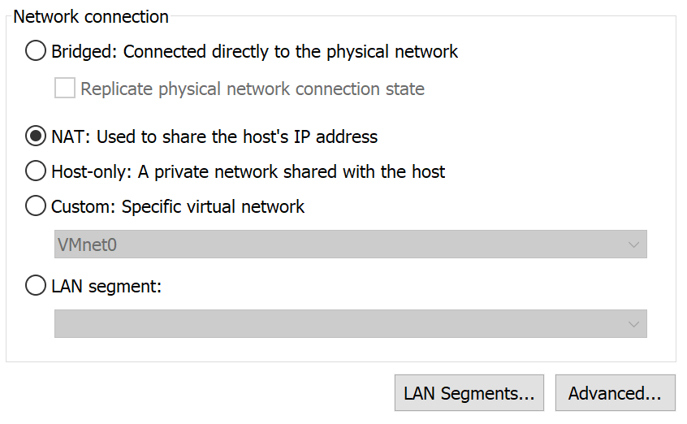

# Rocky Linux 安装教程（9.x）

## 前言

Rocky Linux 是目前企业环境中最主流的 Linux 发行版之一，也是 CentOS 停止维护之后最受欢迎的替代方案。

由于其与 Red Hat Enterprise Linux（RHEL） 保持高度兼容，因此被广泛应用于：

- 企业服务器
- Kubernetes 集群
- 数据库服务器
- Web 服务
- 云计算平台
- 虚拟化环境

如果你正在学习 Linux、Kubernetes 或云原生技术，那么 Rocky Linux 是一个非常值得选择的发行版

---

## 关于本文版本说明

本文以 Rocky Linux 9.x 为例进行演示。

> 这里的 9.x 表示 Rocky Linux 9 的所有小版本，例如 9.4、9.5、9.6 等。

由于 Rocky Linux 在同一个主版本内（Major Version）安装程序几乎保持一致，因此本文不仅适用于当前演示版本，也适用于后续发布的 Rocky Linux 9 小版本。

例如：

|版本|	是否适用|
|---|---|
|Rocky Linux 9.1	|✅|
|Rocky Linux 9.2	|✅|
|Rocky Linux 9.4	|✅|
|Rocky Linux 9.5	|✅|
|Rocky Linux 9.6	|✅|
|Rocky Linux 9.7	|✅|

通常只有安装界面的少量细节、默认软件包以及部分系统组件版本会有所调整，不会影响整体安装流程。

---

## Rocky Linux 8 与 Rocky Linux 10 是否适用？

部分读者也会关心：

> Rocky Linux 8 或 Rocky Linux 10 是否可以参考本文？

### Rocky Linux 8

Rocky Linux 8 与 Rocky Linux 9 的安装流程非常相似。

主要区别包括：

- 默认内核版本不同
- 默认软件包版本不同
- 安装界面略有调整
- 生命周期不同

对于基础安装流程而言，可以参考本文完成绝大部分操作。

### Rocky Linux 10

Rocky Linux 10 属于新的主版本。

虽然安装流程仍然保持一致，但可能涉及：

- 新版 Anaconda 安装程序
- 新的软件包管理策略
- 默认文件系统调整
- 新增系统功能

因此，本站后续将单独推出：

>《Rocky Linux 10 安装教程》

帮助大家了解新版本带来的变化

---

## 安装前准备

在正式安装 Rocky Linux 之前，建议先准备好安装所需的软件、镜像以及硬件资源。

提前完成这些准备工作，可以避免安装过程中因镜像错误、资源不足或网络配置不当而导致安装失败。

本文所有演示均基于 VMware 虚拟机完成，但安装流程同样适用于物理服务器，仅个别硬件配置步骤会有所区别。

---

## Rocky Linux 简介

[Rocky Linux](https://rockylinux.org/) 是一个免费的企业级 Linux 发行版，由社区维护，并与 **Red Hat Enterprise Linux（RHEL）** 保持 **1:1 二进制兼容（Bug-for-Bug Compatible）**。

简单来说，绝大多数运行在 RHEL 上的软件，都可以直接运行在 Rocky Linux 上。

相比个人桌面系统，Rocky Linux 更侧重于：

* 企业服务器
* 云计算平台
* Kubernetes 集群
* Docker 容器宿主机
* 数据库服务器
* Web 服务
* 虚拟化平台

由于其稳定性高、生命周期长，因此也是目前生产环境中最常见的 Linux 发行版之一。

---

## 系统安装方式

Rocky Linux 支持多种安装方式，包括：

* 物理服务器安装
* VMware 虚拟机安装
* VirtualBox 虚拟机安装
* Hyper-V 虚拟机安装
* KVM 虚拟化安装
* 云服务器镜像部署（AWS、Azure、阿里云、腾讯云等）

为了方便学习与实验，本文选择 **VMware Workstation / VMware Fusion** 作为演示环境。



如需下载安装 VMware Workstation 26H1 请点击[此处](https://pan.quark.cn/s/14503c2e7051)的夸克网盘下载，提取码：`MBKT`

如果你使用的是其他虚拟化平台，也可以参考本文，大部分安装步骤保持一致。

---

## 系统要求

Rocky Linux 对硬件要求并不高，但为了保证后续能够顺利学习 Docker、Kubernetes 等内容，建议按照以下配置创建虚拟机。

| 项目  | 最低配置    | 推荐配置   |
| --- | ------- | --------- |
| CPU | 2 核     | 4 核及以上    |
| 内存  | 2 GB    | 4 GB～8 GB |
| 磁盘  | 20 GB   | 60 GB 以上  |
| 网络  | NAT 或桥接 | NAT       |
| 固件  | UEFI    | UEFI      |

!!! tip "说明"

    如果后续计划部署 Kubernetes 集群，建议每台虚拟机至少分配 **2 vCPU、4 GB 内存和 60 GB 磁盘空间**，以获得更好的学习体验。

---

## 下载 Rocky Linux 镜像

安装系统前，需要先下载官方 ISO 镜像。

建议始终从 **Rocky Linux 官方网站** 下载最新稳定版本，以确保系统安全性和完整性。

目前官方提供多种镜像类型：

| 镜像类型        | 说明              | 推荐    |
| ----------- | --------------- | ----- |
| Boot ISO    | 网络安装，安装过程中下载软件包 | ❌     |
| Minimal ISO | 最小化安装           | ⭐⭐⭐⭐⭐ |
| DVD ISO     | 完整安装包，包含大量软件    | ⭐⭐⭐⭐  |

对于学习 Linux 和 Kubernetes，推荐使用 **Minimal ISO**。

原因包括：

* 镜像体积较小
* 安装速度更快
* 默认软件更少
* 更接近生产服务器环境
* 后续需要的软件可按需安装



如果网络环境较差，也可以选择 DVD ISO，一次性安装完整的软件包。

!!! tip "推荐"
    如果你刚开始学习 Linux，建议选择 **Rocky Linux 9.x Minimal ISO**。

---

## 校验镜像完整性（可选但推荐）

下载完成后，建议校验镜像文件的 SHA256 值，以确保镜像未损坏或被篡改。

Linux 系统可以执行：

```bash
sha256sum Rocky-9.x-x86_64-minimal.iso
```

macOS 可以执行：

```bash
shasum -a 256 Rocky-9.x-x86_64-minimal.iso
```

Windows PowerShell 可以执行：

```powershell
Get-FileHash .\Rocky-9.x-x86_64-minimal.iso -Algorithm SHA256
```

将计算结果与官方网站公布的 SHA256 值进行对比，一致即可正常使用。



!!! tip "说明"

    虽然在个人学习环境中很多人会忽略这一步，但在企业生产环境中，校验镜像完整性是一项非常重要的安全措施。

---

## VMware 版本说明

本文演示环境如下：

| 软件                                  | 版本       |
| ----------------------------------- | -------- |
| VMware Workstation Pro | 26H1   |
| Rocky Linux                         | 9.x      |
| 固件类型                                | UEFI     |
| 磁盘控制器                               | NVMe（默认） |
| 网络模式                                | NAT      |

如果你的 VMware 版本较旧，安装界面可能略有不同，但不会影响整体安装流程。

---

## 安装前确认

开始创建虚拟机之前，请确认以下内容已经准备完成：

* 已下载 Rocky Linux 9.x ISO 镜像
* 已安装 VMware Workstation 或 VMware Fusion
* 主机磁盘剩余空间不少于 80 GB
* 已开启硬件虚拟化（Intel VT-x / AMD-V）
* 网络连接正常

确认以上内容后，即可开始创建 Rocky Linux 虚拟机。

---

## 创建 VMware 虚拟机

本节将在 VMware 中创建一台用于安装 Rocky Linux 的虚拟机。

虽然 VMware 提供了大量可配置选项，但对于大多数学习和实验环境而言，并不需要全部修改。本文将重点介绍每个关键配置项的作用，并给出推荐配置。

> **说明**
>
> 文中截图基于 VMware Workstation Pro 26H1 制作，不同版本界面可能略有差异，但配置流程基本一致。

---

## 第一步：创建新的虚拟机

启动 VMware，点击 **Create a New Virtual Machine（创建新的虚拟机）**。



建议选择：

```text
Typical（Recommended）
```

而不是：

```text
Custom（Advanced）
```

### 为什么选择 Typical？

Typical 模式会自动采用 VMware 推荐的默认硬件配置，对于 Rocky Linux 来说已经完全满足安装需求。

只有在以下场景中才建议选择 Custom：

* 指定 BIOS 或 UEFI
* 自定义虚拟磁盘控制器
* 调整兼容版本
* 企业特殊环境

对于初学者来说，Typical 更简单，也更容易避免配置错误。

---

## 第二步：选择安装镜像

在安装来源页面，选择：

```text
Installer disc image file (ISO)
```

然后浏览并选择刚刚下载的 Rocky Linux 9.x ISO 文件。


确认后，VMware 会自动识别系统类型。

如果未识别成功，也无需担心，后续可以手动指定。

---

## 第三步：选择客户机操作系统

如果 VMware 没有自动识别系统，请手动选择：

```text
Guest Operating System

Linux
```

版本选择：

```text
Red Hat Enterprise Linux 9 64-bit
```

或者：

```text
Other Linux 5.x kernel 64-bit
```

不同版本 VMware 的名称可能略有不同。

### 为什么选择 RHEL？

Rocky Linux 与 Red Hat Enterprise Linux 保持高度兼容，因此 VMware 官方也推荐选择对应的 RHEL 模板。

这样可以获得更好的：

* 硬件兼容性
* 虚拟驱动支持
* 网络性能
* 存储性能

---

## 第四步：设置虚拟机名称

输入虚拟机名称，例如：

```text
rocky-linux-9
```

同时选择虚拟机保存路径。



建议命名规范统一，例如：

```text
rocky-linux-9

k8s-master01

k8s-worker01

ubuntu-server
```

统一命名便于后续管理多个虚拟机。

---

## 第五步：配置存储大小

虽然 Rocky Linux 安装完成后仅占用几 GB 空间，但后续实验中可能需要：

* Docker 镜像
* Kubernetes 镜像
* 容器日志
* 实验数据

预留足够磁盘空间，可以避免频繁扩容。

推荐大小为 20 G，建议设置 60 G，有条件可以设置更大一些。

选择 `Store virtual disk as a single file`



### 存储方式的区别

单文件（Store as a single file）：虚拟机的所有数据会打包成一个巨大的 .vmdk 文件。

* 优点：读写速度最快（无碎片化开销），文件管理最简单（只有一个文件，想删除或复制直接找它就行）。

* 缺点：灵活性极差。如果这个文件损坏，整个虚拟机就报废了；且一旦文件体积很大（比如几百GB），复制或移动到另一台电脑时非常耗时，且要求目标硬盘必须支持这么大的单个文件（例如必须格式化为 NTFS 或 exFAT，不支持旧版的 FAT32）。

多文件（Split into multiple files）：数据会被切割成多个 约 2GB 大小 的小文件（如 xxx-s001.vmdk, xxx-s002.vmdk...）。

* 优点：搬运方便。如果目标移动硬盘是 FAT32 格式（最大只支持 4GB 单文件），只有切成小块才能拷贝走；此外，如果其中一个文件损坏，通常只丢失部分数据，有机会通过专业工具修复。

* 缺点：性能略有降低（读写时需要频繁寻址多个文件），且文件数量多，管理起来比较杂乱。

!!! tip "特别提醒"
    这个选项只在新建虚拟机时生效，一旦选好，后期无法通过简单设置直接转换（需要借助 VMware 自带的 vmware-vdiskmanager 工具进行磁盘格式转换）


---

## 第六步：完成虚拟机创建



建议配置：

| 项目              | 推荐 |
| --------------- | -: |
| CPU Socket      |  2 |
| Processor Cores |  2 |
|Memory| 8G |

可以点击 `Customize Hardware` 按钮对虚拟机配置进行修改，比如 CPU、内存、网络等.



### 内存应该分配多少？

| 场景         |      推荐 |
| ---------- | ------: |
| 学习 Linux   |    4 GB |
| Docker     |  4~6 GB |
| Kubernetes |    8 GB |
| 数据库实验      | 8 GB 以上 |

---

### 配置网络

VMware 提供三种常见网络模式：

| 模式        | 说明       | 推荐    |
| --------- | -------- | ----- |
| NAT       | 与宿主机共享网络 | ⭐⭐⭐⭐⭐ |
| Bridged   | 独立 IP    | ⭐⭐⭐⭐  |
| Host-only | 仅主机通信    | ⭐⭐⭐   |

对于初学者，建议选择：

```text
NAT
```

**为什么推荐 NAT？**

优点：

* 能正常访问互联网
* 不需要额外配置交换机
* 不占用局域网 IP
* 部署简单

后续学习 Kubernetes 时，如果需要多节点通信，也完全能够满足要求。



---

## 本节小结

至此，一台符合学习和实验需求的 Rocky Linux 虚拟机已经创建完成。

下一节将正式进入 Rocky Linux 安装程序（Anaconda），包括：

* 语言选择
* 安装目标
* 磁盘分区
* Root 用户配置
* 普通用户创建
* 软件安装
* 系统首次启动

这些步骤完成后，一台可用于后续学习 Linux、Docker 和 Kubernetes 的 Rocky Linux 系统就安装完成了。

