# Ubuntu 22.04 安装教程：从零开始部署你的第一台 Linux 服务器

## 前言

Ubuntu 是目前最流行的 Linux 发行版之一，凭借稳定性高、社区活跃、文档丰富等特点，被广泛应用于：

* 云服务器
* Web 服务
* Docker 容器平台
* Kubernetes 集群
* AI 与大数据平台

对于刚接触 Linux 的用户来说，Ubuntu 也是最容易上手的选择之一。

本教程将带领大家从零开始完成 Ubuntu 22.04 Server 的安装部署。

---

## Ubuntu 22.04 简介

Ubuntu 由：

Canonical

开发维护。

Ubuntu 每两年发布一个 LTS（Long Term Support）长期支持版本。

目前最常用版本：

| 版本           | 类型  | 支持周期 |
| ------------ | --- | ---- |
| Ubuntu 20.04 | LTS | 2025 |
| Ubuntu 22.04 | LTS | 2027 |
| Ubuntu 24.04 | LTS | 2029 |
| Ubuntu 26.04 | LTS | 2031 |

本教程采用：

**Ubuntu Server 22.04 LTS**

---

## 部署前准备

### 硬件要求

最低配置：

| 项目  | 配置     | 推荐配置|
| --- | ------ |----|
| CPU | 1 Core |2 Core|
| 内存  | 2 GB   | 4 GB|
| 磁盘  | 20 GB  | 50 GB
| 网络  | 可联网    | 千兆网络|

---

### 软件准备

提前下载 Ubuntu ISO 镜像：

[Ubuntu 官方下载页面](https://ubuntu.com/download/server)

建议下载：

```text
ubuntu-22.04.x-live-server-amd64.iso
```

如果想学习压力小一点可以先安装  版本体验。

---

## 创建虚拟机

本教程使用  演示。

### 新建虚拟机

点击客户端左上角的 “File” 选择：

```text
New Virtual Machine
```

接着 `下一步`

---

### 选择安装介质

加载 Ubuntu ISO 文件

```text
ubuntu-22.04.x-live-server-amd64.iso
```

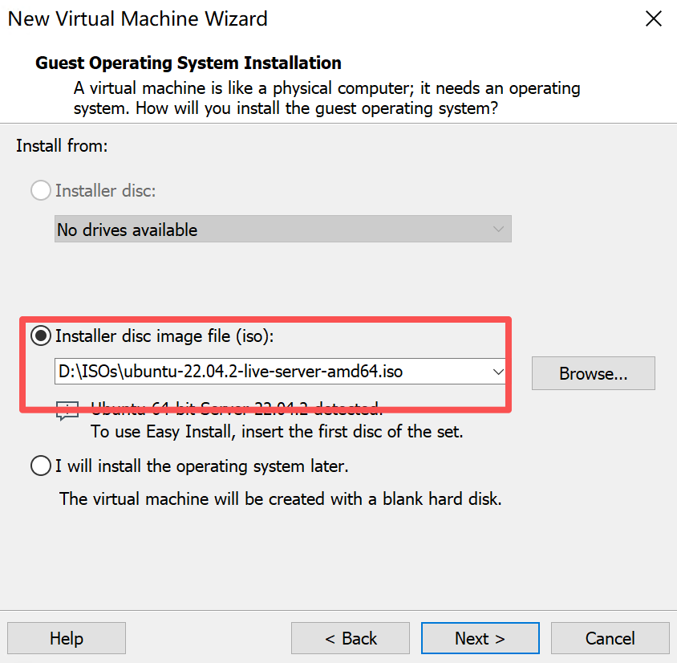

---

### 名称和存放位置

  - 名称随意
  - 存放位置保持默认，也可选择个人偏向的位置。
  - 大小按默认翻个倍，选择 “单个磁盘文件”

  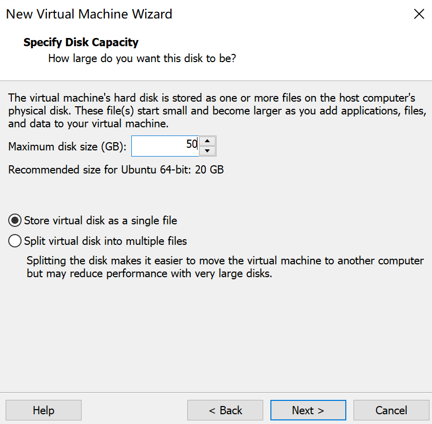
---

### 配置虚拟机规格

可在虚拟机设置界面修改：右键点击相应的虚拟机，选择末尾的“设置”.

建议：

```text
CPU：2 Core

Memory：4096 MB

Disk：50 GB
```

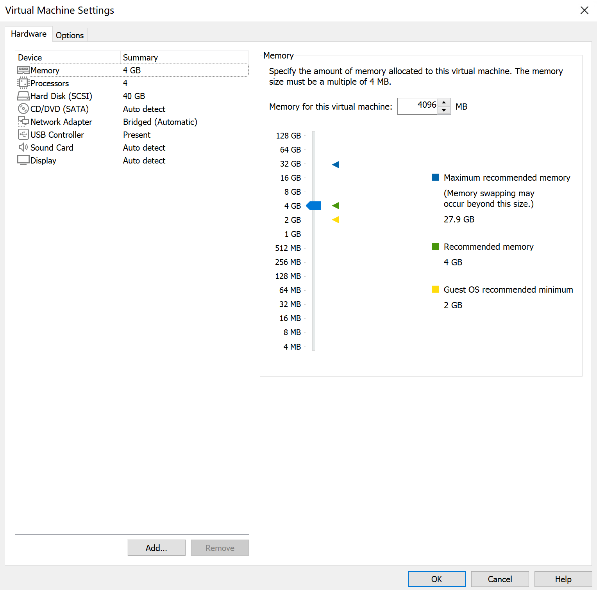

---

## 启动安装

虚拟机开机后会进入安装界面。

选择：

```text
Try or Install Ubuntu Server
```

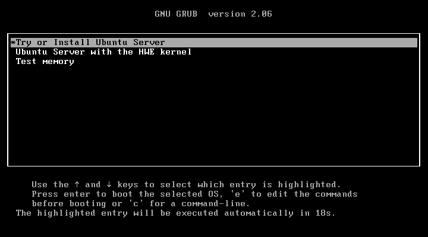
---

## 语言选择

推荐：

```text
English
```

原因：

* 大部分技术文档使用英文
* 错误日志容易搜索
* 避免编码问题

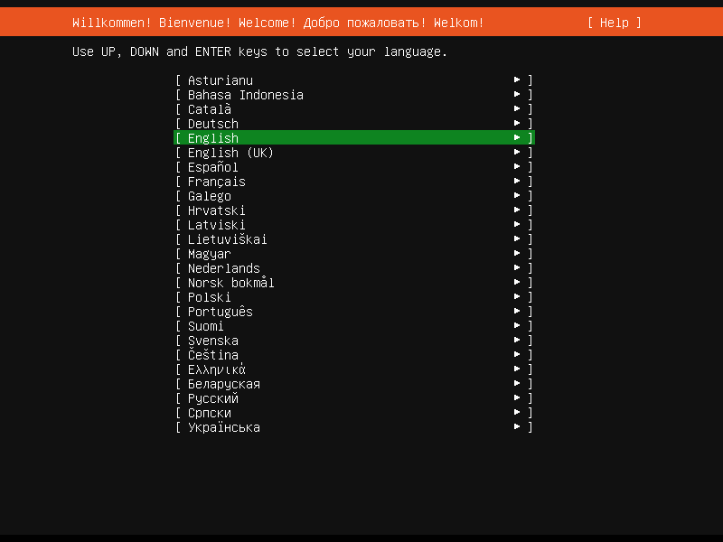

接下来直接跳过更新

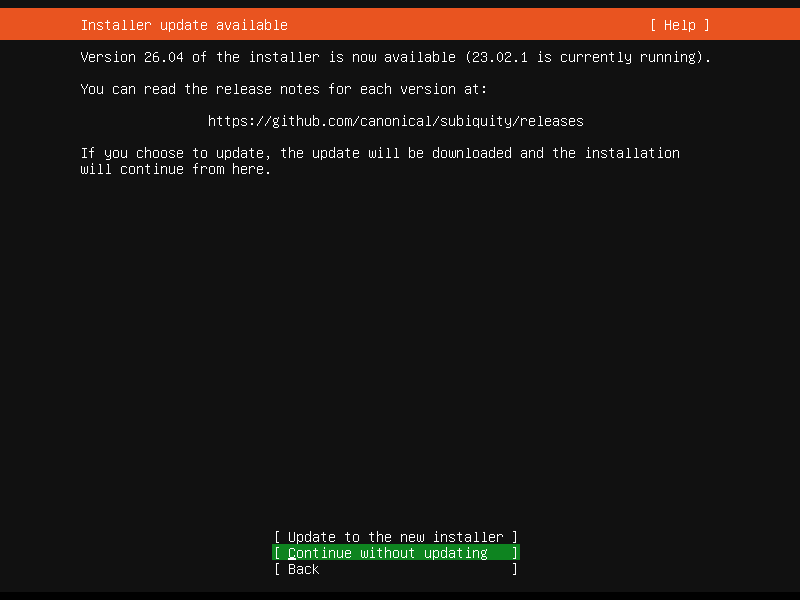

---

## 键盘布局

默认即可：

```text
English (US)
```

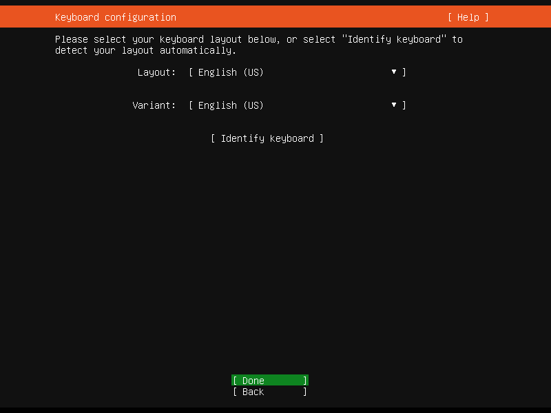

---

## 安装类型

保持默认即可：

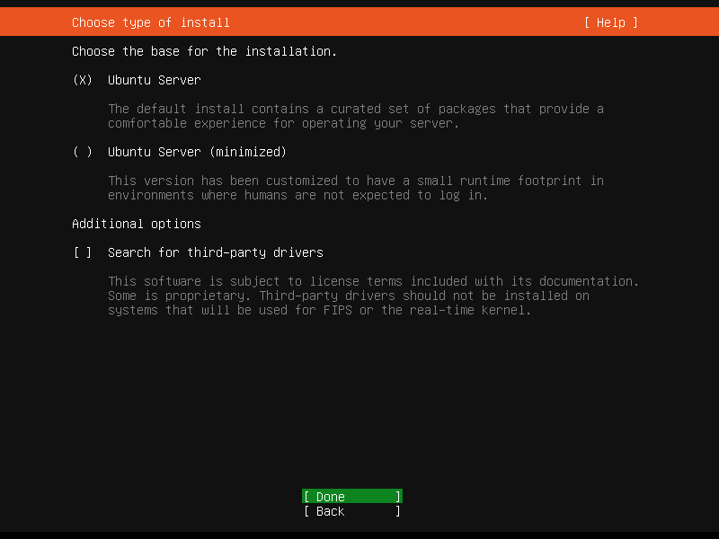

---

## 网络配置

安装程序会自动识别网卡，默认 DHCP 自动获取 IP 地址，如需修改 IP 地址可在系统安装完成后配置。

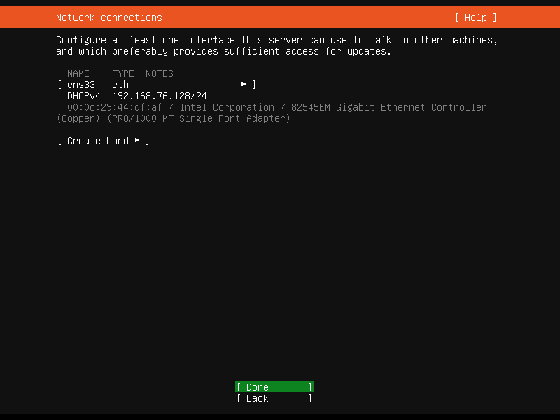

---

## 配置代理

直接回车跳过：

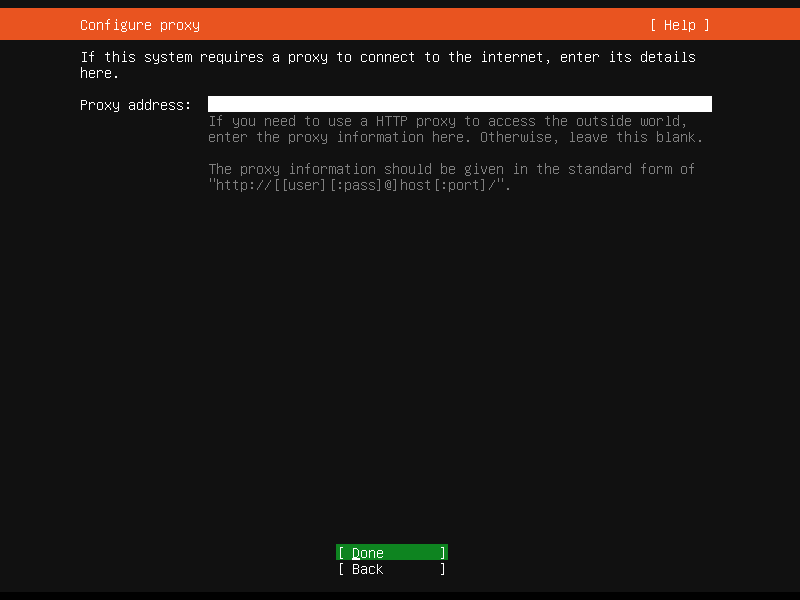

---

## 软件源配置

建议使用默认源：

```text
http://cn.archive.ubuntu.com/ubuntu
```

国内用户可以后续切换镜像源。

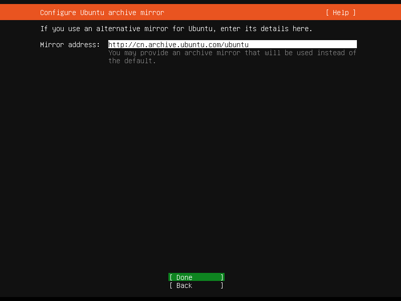

---

## 磁盘分区

对于学习环境：

选择：

```text
Use Entire Disk
```

即可。

自动完成：

```text
/
swap
```

分区创建。

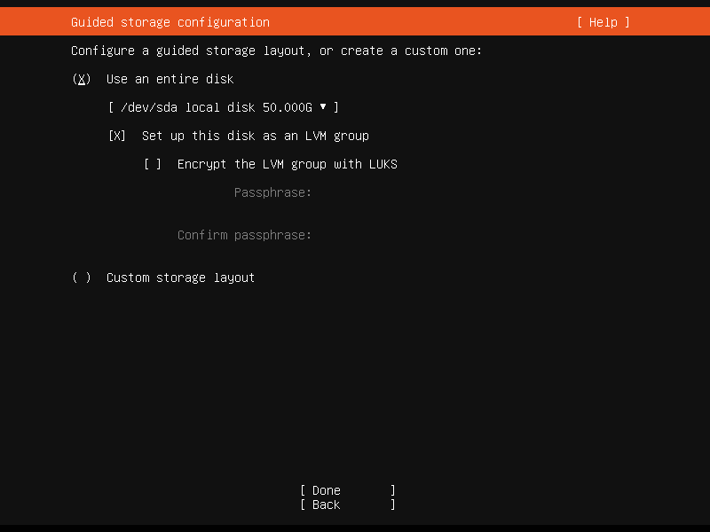

继续保持默认：

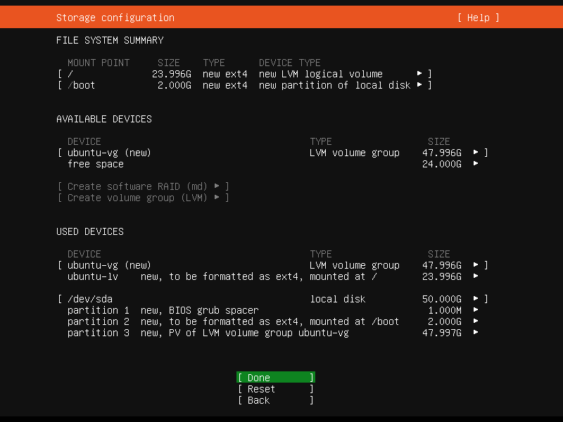

选择 `Done` 后会弹出 “确认” 框，选择 `Continue` 继续。

---

## 创建系统账户

填写：

```text
Your Name

Server Name

Username

Password
```

例如：

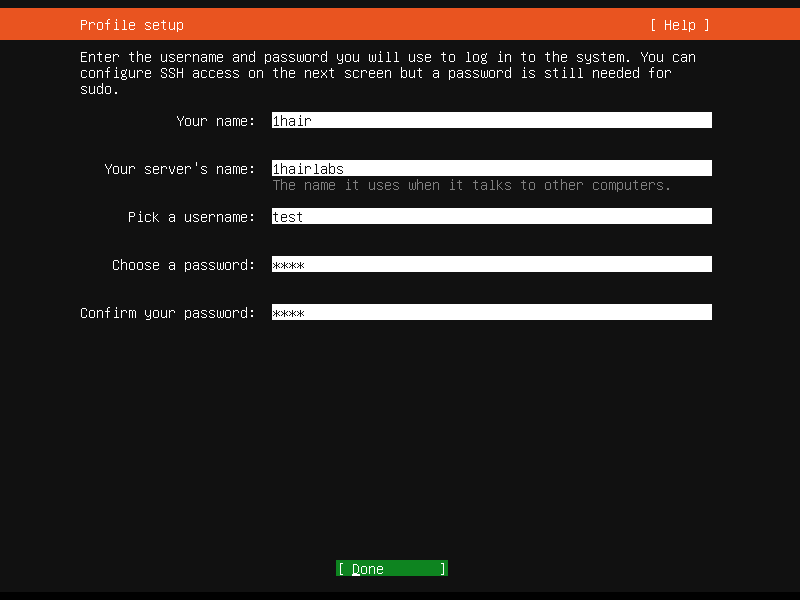

跳过 Ubuntu Pro

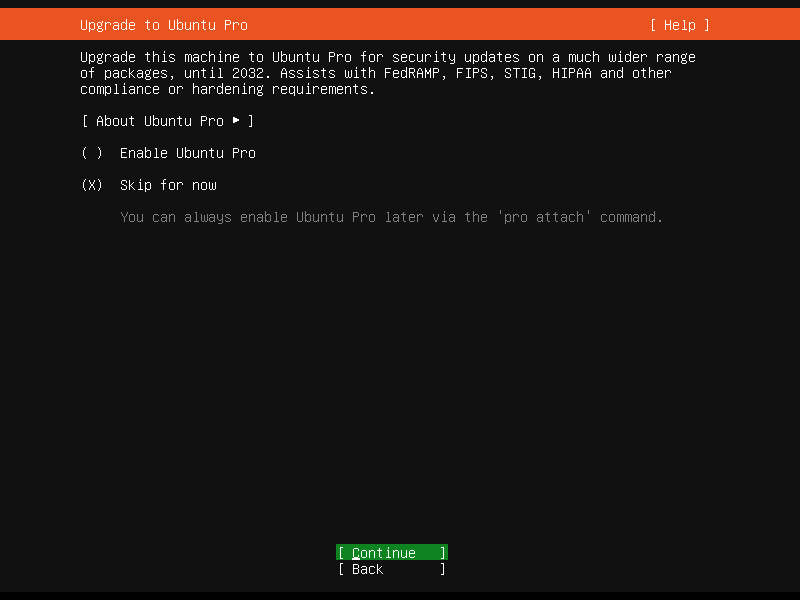

---

## SSH 服务

建议勾选：

```text
Install OpenSSH Server
```

这样安装完成后即可远程连接。

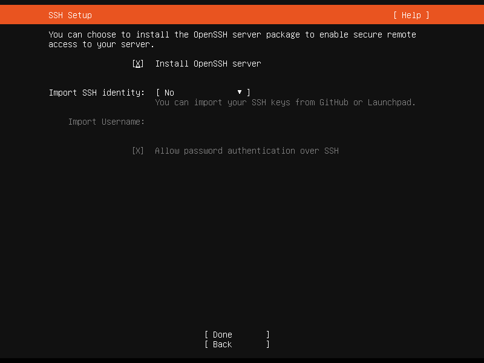

---

## 额外软件包

这里先不安装。

直接：

```text
Done
```

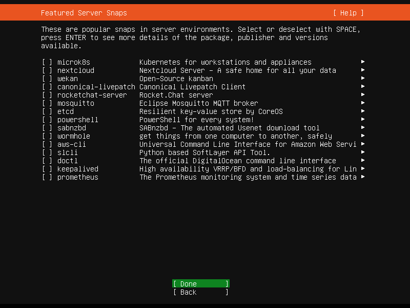

---

## 开始安装

系统开始复制文件。

整个过程约：

```text
5 ~ 15 分钟
```

取决于硬件性能。

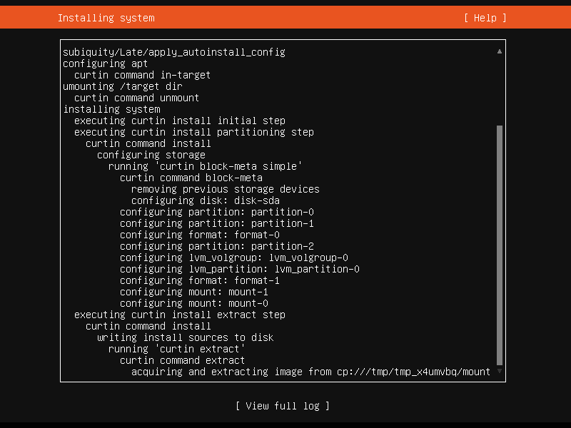

---

## 重启系统

安装完成后选择：

```text
Reboot Now
```

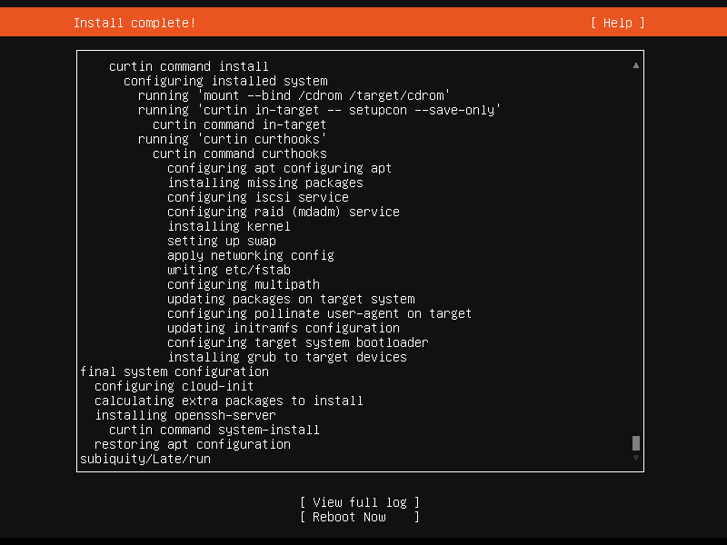

> 重启之前会提示卸载挂载的光驱，虚拟机按 Enter 跳过，物理机拔掉启动盘。

---

## 首次登录

输入：

```bash
login:
```

以及密码。

成功后看到：

```bash
test@1hairlabs:~$
```

表示安装成功。

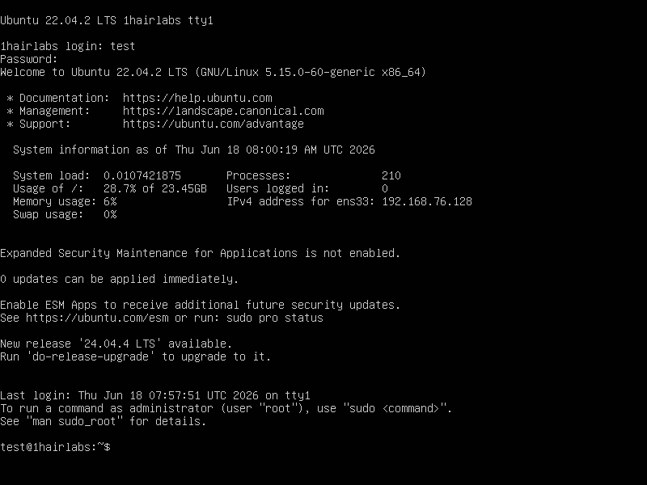

---

## 安装后检查

查看系统版本：

```bash
cat /etc/os-release
```

查看内核：

```bash
uname -r
```

查看 IP：

```bash
ip addr
```

查看磁盘：

```bash
df -h
```

查看内存：

```bash
free -h
```

---

## 更新系统

安装完成后第一件事：

```bash
sudo apt update
sudo apt upgrade -y
```

更新软件包到最新状态。

---

## 常见问题

### 无法获取 IP

检查：

```bash
ip addr
```

确认网卡状态。

查看网络配置：

```bash
sudo nano /etc/netplan/*.yaml
```

---

### SSH 无法连接

检查服务状态：

```bash
sudo systemctl status ssh
```

启动服务：

```bash
sudo systemctl enable ssh --now
```

---

### 软件源下载慢

更换国内镜像源：

```bash
阿里云
腾讯云
华为云
清华大学
```

镜像站。

---

## 总结

!!! tip "其他版本安装"
    其他的版本的安装和本教程的安装相差无几，可以参考。

至此，我们已经完成：

✅ Ubuntu 22.04 安装

✅ 用户创建

✅ SSH 服务配置

✅ 系统更新

✅ 基础检查

下一篇我们将继续部署：

> CentOS 7 安装教程：企业环境中仍然广泛使用的经典 Linux 系统

---

### 相关阅读

* Linux 和系统安装简介
* Linux 目录结构说明
* Linux 常用命令
* VMware Workstation 安装教程
* Docker 安装教程
* Kubernetes 集群部署教程