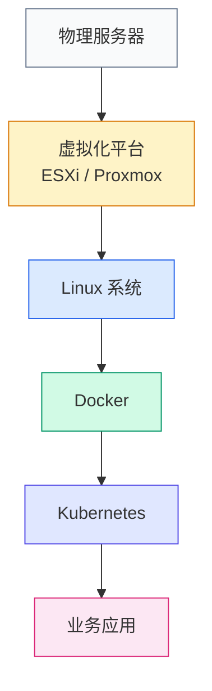
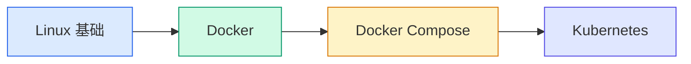

---

title: 新手部署教程概览
description: Linux、VMware、Docker、Kubernetes 等系统与软件安装部署教程，从零开始学习服务器、虚拟化、容器与云原生技术。
keywords:
  - Linux安装教程
  - VMware教程
  - Docker教程
  - Kubernetes教程
  - HomeLab
  - 服务器部署
  - 新手教程

---

# 基础环境准备

系统安装与部署教程，帮助零基础用户快速完成环境搭建。

所有教程均基于真实实验环境验证，采用图文步骤、环境说明、命令示例和常见问题排查的方式呈现。

## 部署顺序

如果你刚接触服务器、虚拟化和云原生技术，建议按照以下顺序学习：

在开始安装系统之前，建议先阅读 👉 [裸金属、虚拟机与容器的区别](basics/baremetal-vm-container.md)，建立对计算资源运行层次的基础认知。

---

## Linux 系统部署

Linux 是服务器领域最常见的操作系统，也是学习 Docker、Kubernetes 和云原生技术的基础。

| 教程 | 说明 |
|---|---|
| [Ubuntu 22.04 安装教程](linux/ubuntu-22.04.md) | 从零开始部署 Ubuntu Server，适合新手入门 |
| [Rocky Linux 9 安装教程](linux/rocky-linux-9.md) | RHEL 系发行版，企业环境常用 |
| [CentOS 7 安装教程](linux/centos-7.md) | 旧版 RHEL 系，存量环境维护参考 |
| [CentOS 8 安装教程](linux/centos-8.md) | CentOS 8 部署流程 |
| [Debian 13 安装教程](linux/debian-13.md) | Debian 最新版，轻量稳定 |

!!! info "发行版版本说明"
    同一发行版的各版本安装流程差异很小。比如 Debian 13 的教程同样适用于 Debian 12 / 11，需要安装其他版本时直接参考即可。

---

## VMware 虚拟化部署

虚拟化技术是现代数据中心的基础能力。学习虚拟化推荐从 VMware 开始，适合家庭实验室和企业虚拟化平台。

| 教程 | 说明 |
|---|---|
| [ESXi 7.0 安装教程](vmware/esxi-7.0.md) | VMware 裸金属虚拟化平台部署 |
| [ESXi 8.0 安装教程](vmware/esxi-8.0.md) | ESXi 最新版安装指南 |
| [vCenter 7.0 安装教程](vmware/vcenter-7.0.md) | 集中管理多台 ESXi 主机 |
| [vCenter 8.0 安装教程](vmware/vcenter-8.0.md) | vCenter 最新版部署 |

---

## Docker 与 Kubernetes 部署

Docker 和 Kubernetes 是云原生时代的核心技术。

| 教程 | 说明 |
|---|---|
| [Docker 安装教程](docker&k8s/docker.md) | Docker 引擎安装与基础操作 |
| [Kubernetes 集群部署教程](docker&k8s/k8s.md) | 从零搭建 K8s 集群 |

> Docker Compose 和 Helm 部署教程持续更新中。

---

## Windows 系统部署

| 教程 | 说明 |
|---|---|
| [Windows 10 安装教程](windows/windows-10.md) | 桌面版 Windows 部署 |
| [Windows 11 安装教程](windows/windows-11.md) | Windows 11 安装指南 |
| [Windows Server 2016 部署教程](windows/windows-server-2016.md) | 服务器版 Windows 部署 |

---

## HomeLab 推荐项目

掌握基础部署后，可以尝试搭建自己的实验环境，将学到的知识应用到实际场景中。

**推荐方向：**

- **Grafana + Prometheus** — 监控平台 → [查看监控专题](../observability/index.md)
- **Kubernetes 实验集群** — 容器编排实践 → [查看 K8s 实践](../kubernetes/index.md)
- **Jellyfin** — 家庭影音平台（教程规划中）
- **Nextcloud** — 私有云盘（教程规划中）
- **GitLab** — 私有代码仓库（教程规划中）
- **Harbor** — 镜像仓库（教程规划中）

---

## 常见问题

### 我的电脑配置不高，可以学习吗？

一般以下配置即可完成绝大多数实验：

- CPU：4 核以上
- 内存：16 GB 以上
- SSD：256 GB 以上

### 学 Linux 必须购买服务器吗？

不需要。初学者在 Windows 上使用 VMware Workstation 创建虚拟机即可完成大部分学习内容。

### 学 Kubernetes 需要先学 Docker 吗？

建议先掌握 Linux 基础和 Docker 基础，再学习 Kubernetes，这样更容易理解容器和集群相关概念。

---

