# ESXi 7.0 部署教程：从零开始搭建 VMware 虚拟化平台

## 前言

VMware ESXi 是企业级 Type-1 裸金属 Hypervisor，也是 vSphere 虚拟化平台的核心组件。它直接运行在物理硬件之上，无需底层操作系统，因此资源开销极小、性能接近裸机。

对于刚接触虚拟化的新手来说，ESXi 是进入企业级虚拟化世界的最佳入口：

-   **学习 Kubernetes/vSphere with Tanzu**：ESXi 是 K8s 学习和实验的底层基石
-   **搭建 HomeLab**：一台物理机就能运行数十台虚拟机
-   **职业发展**：VMware 虚拟化技能在运维、DevOps、云架构岗位中需求旺盛

本教程将带领大家**在 VMware Workstation 中完成 ESXi 7.0 的嵌套虚拟化部署**，无需额外物理硬件，一台普通电脑即可动手实践。

!!! info "什么是嵌套虚拟化？"
    嵌套虚拟化（Nested Virtualization）指在虚拟机内部再次运行 Hypervisor。本教程中，我们在 VMware Workstation 创建的虚拟机里安装 ESXi，让一台电脑模拟出完整的虚拟化实验环境。

---

## ESXi 7.0 简介

VMware vSphere 7.0 于 2020 年发布，相比 6.7 版本带来了多项重大更新：

| 特性 | 说明 |
| --- | --- |
| **vSphere Lifecycle Manager** | 统一固件与软件生命周期管理 |
| **vSAN 7.0** | 原生文件服务、精简快照 |
| **Kubernetes 原生支持** | 通过 vSphere with Tanzu 运行 K8s 工作负载 |
| **安全增强** | 支持 TPM 2.0、vTPM 虚拟化 |
| **DPU 支持** | 卸载网络与存储 I/O 到智能网卡 |

ESXi 7.0 仍被大量企业和 HomeLab 用户使用，稳定性经过长期验证，是本教程的理想选择。

---

## 部署前准备

### 硬件要求

| 项目 | 最低配置 | 本教程推荐 |
| --- | --- | --- |
| **宿主机 CPU** | 支持 Intel VT-x 或 AMD-V | 4 核以上 |
| **宿主机内存** | 8 GB | 16 GB 以上 |
| **宿主机磁盘** | 50 GB 可用空间 | SSD，100 GB 可用 |
| **ESXi 虚拟机 CPU** | 2 Core | 4 Core |
| **ESXi 虚拟机内存** | 4 GB | 8 GB 以上 |
| **ESXi 虚拟机磁盘** | 32 GB | 60 GB |
| **网络** | 1 张虚拟网卡 | 桥接模式 |

!!! warning "BIOS 设置检查"
    在开始之前，请确保宿主机 BIOS/UEFI 中已开启 **Intel VT-x**（Intel CPU）或 **AMD-V**（AMD CPU）虚拟化技术。这是嵌套虚拟化的前提条件。

    验证方法（Windows）：打开任务管理器 → 性能 → CPU → 查看「虚拟化」是否为「已启用」。

### 软件准备

提前下载所需软件：

| 软件 | 说明 | 下载地址 |
| --- | --- | --- |
| **VMware Workstation Pro 17+** | 宿主机虚拟化软件 | [VMware 官网](https://www.vmware.com/products/workstation-pro.html) 或 [网盘地址（提取码：MBKT）](https://pan.quark.cn/s/14503c2e7051) |
| **ESXi 7.0 ISO** | 安装镜像 | [网盘地址（提取码：3wWs）](https://pan.quark.cn/s/d072a9072975) |

---

## 创建虚拟机

在 VMware Workstation 中创建虚拟机的通用步骤已在前文 [Ubuntu 22.04 部署教程](../linux/ubuntu-22.04.md#创建虚拟机) 中详细说明，此处不再重复。以下仅列出 **ESXi 特有的关键设置**：

### 客户机操作系统

```text
VMware ESX → VMware ESXi 7
```

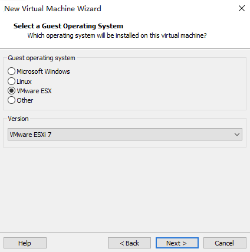

### 虚拟机规格

| 参数 | 推荐值 | 说明 |
| --- | --- | --- |
| **CPU** | 4 Core | 至少 2 Core，4 Core 可流畅运行嵌套 VM |
| **内存** | 8 GB（8192 MB） | 最低 4 GB，需为嵌套 VM 预留资源 |
| **磁盘** | 60 GB | 系统约占用 32 GB，剩余用于数据存储 |
| **网络** | 桥接模式 | 便于局域网内其他设备访问 ESXi |

!!! danger "务必开启嵌套虚拟化"
    创建虚拟机后，编辑虚拟机设置 → 处理器 → **必须勾选「虚拟化 Intel VT-x/EPT 或 AMD-V/RVI」**，否则 ESXi 内部无法运行虚拟机。

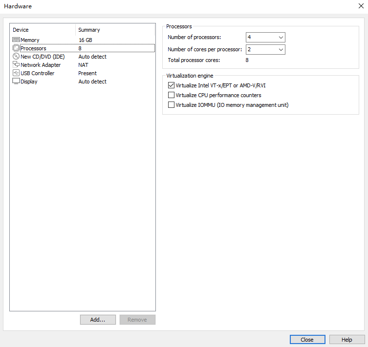

### 挂载 ESXi ISO

在虚拟机设置中将 CD/DVD 指向下载好的 ISO：

```text
VMware-VMvisor-Installer-7.0xxx-xxxx.x86_64.iso
```

确认 **「启动时连接」** 已勾选。

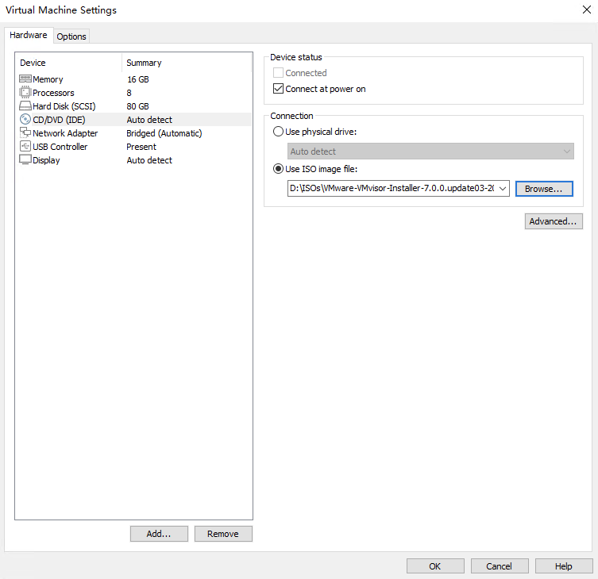

---

## 安装 ESXi 7.0

### 启动安装

点击 **「开启此虚拟机」**。

虚拟机启动后进入 ESXi 安装引导界面。等待自动进入或按 `Enter`：

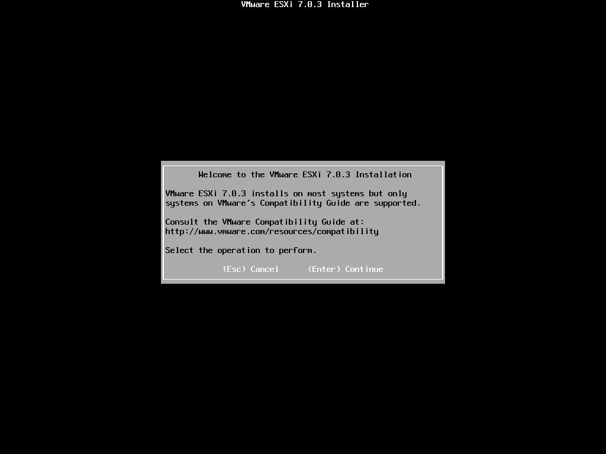

!!! tip "如果出现黑屏或无响应"
    按 `Ctrl + Alt` 释放鼠标后，点击虚拟机窗口内部重新获取焦点。
    如果长时间卡在黑屏，重启虚拟机并在启动时迅速按 `Shift + O`，添加 boot 选项 `ignoreHeadless=TRUE`。

加载安装文件后进入欢迎界面，按 `Enter` 继续。

---

### 接受许可协议

按 `F11` 接受 VMware 最终用户许可协议。

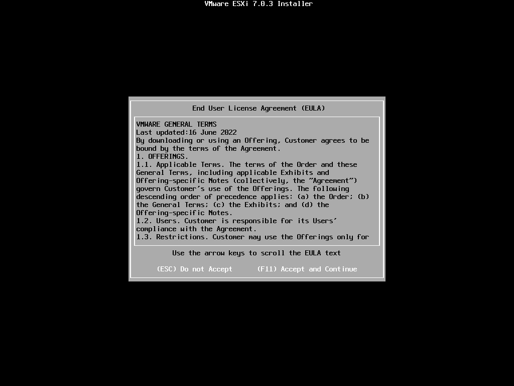

---

### 选择安装磁盘

ESXi 扫描可用磁盘后，选择之前配置的 60 GB 虚拟磁盘（通常显示为 `Local VMware Disk`）→ 按 `Enter`。

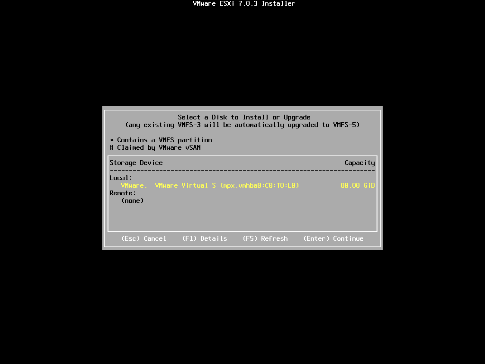

---

### 键盘布局

默认即可：

```text
US Default
```

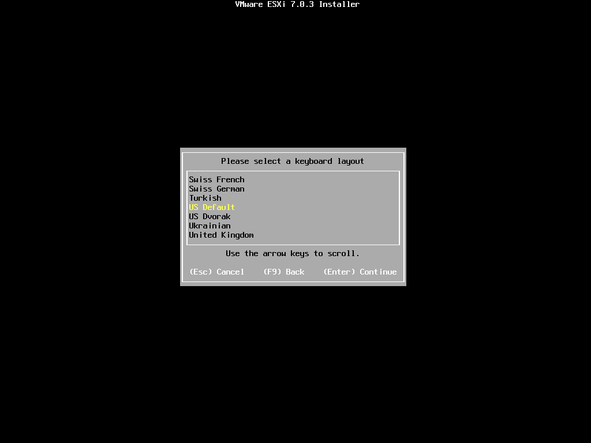

---

### 设置 root 密码

输入 root 密码并确认。

!!! warning "密码要求"
    ESXi 7.0 默认要求密码满足复杂度：
    -   至少 7 个字符
    -   包含大小写字母、数字、特殊字符中的至少三类

    例如：`P@ssw0rd` 或 `Esxi@2024`

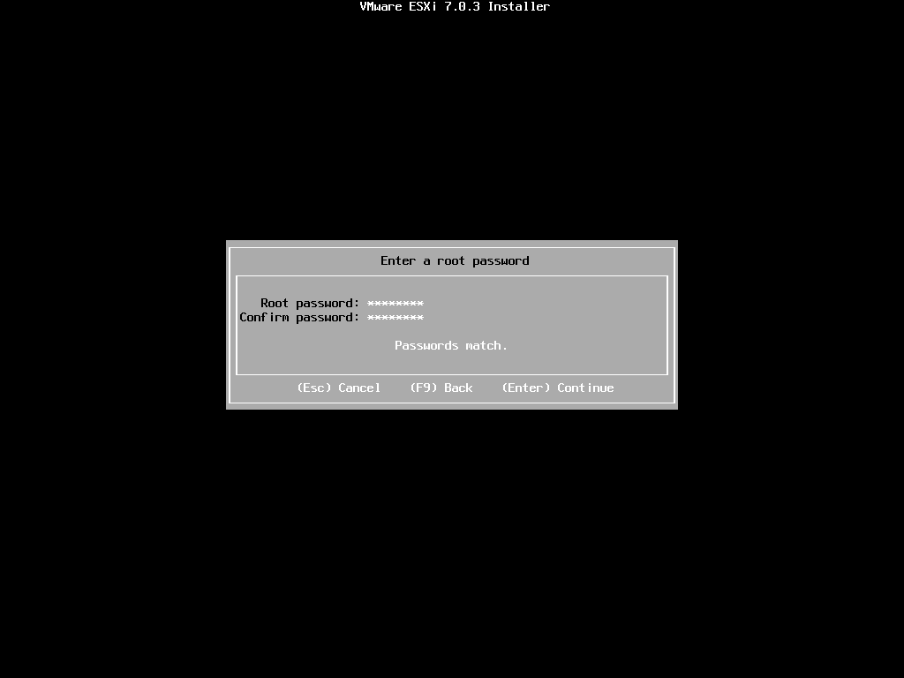

---

### 确认安装

安装程序确认安装目标并警告磁盘将被重新分区。按 `F11` 开始安装。

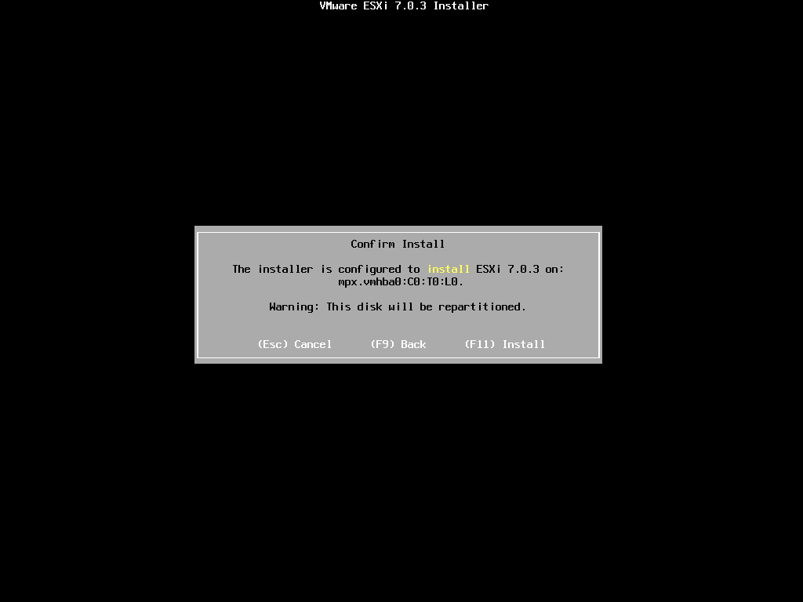

安装过程约：

```text
3 ~ 5 分钟
```

取决于硬件性能。


---

### 移除安装介质并重启

安装完成后，提示移除安装介质。在 VMware Workstation 中：

-   点击菜单 **「虚拟机」→「可移动设备」→「CD/DVD」→「断开连接」**
-   或编辑虚拟机设置，取消 CD/DVD 的「已连接」和「启动时连接」

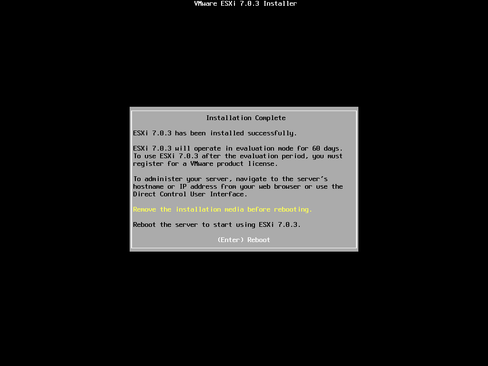

按 `Enter` 重启。

---

## 初始配置

重启后进入 ESXi 的 **DCUI（Direct Console User Interface，直接控制台界面）**：


### 配置管理网络 IP

ESXi 默认使用 DHCP 获取 IP。建议配置**静态 IP**，避免 IP 变动导致无法访问。

按 `F2` → 输入 root 密码 → 进入 **系统定制** 菜单：

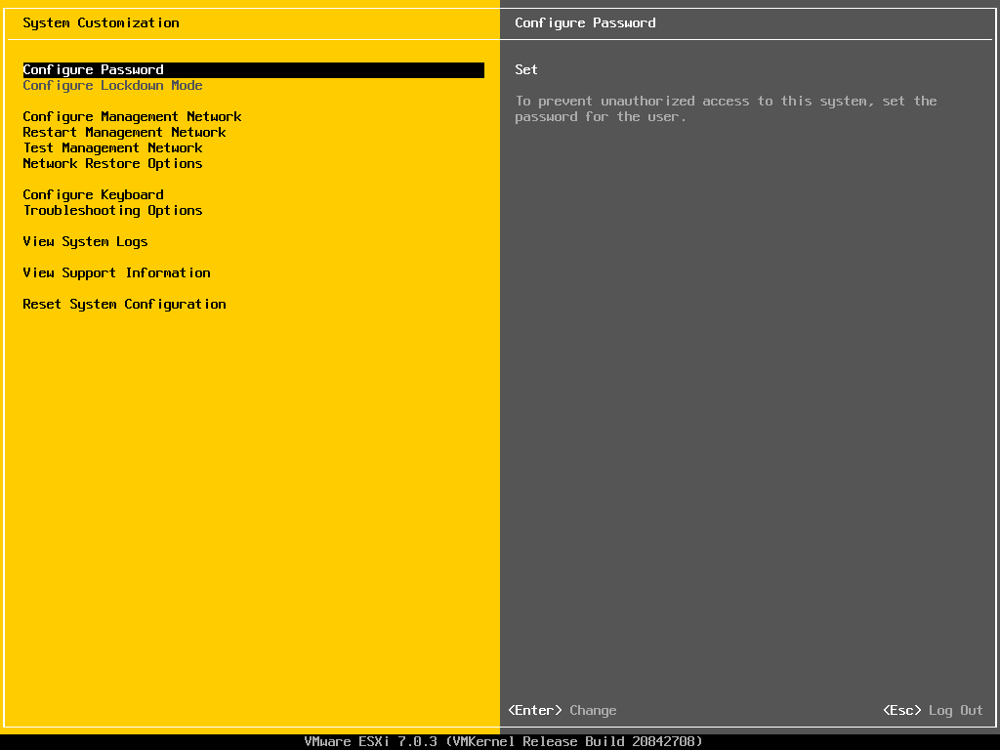

选择 **「Configure Management Network」** → 按 `Enter`：

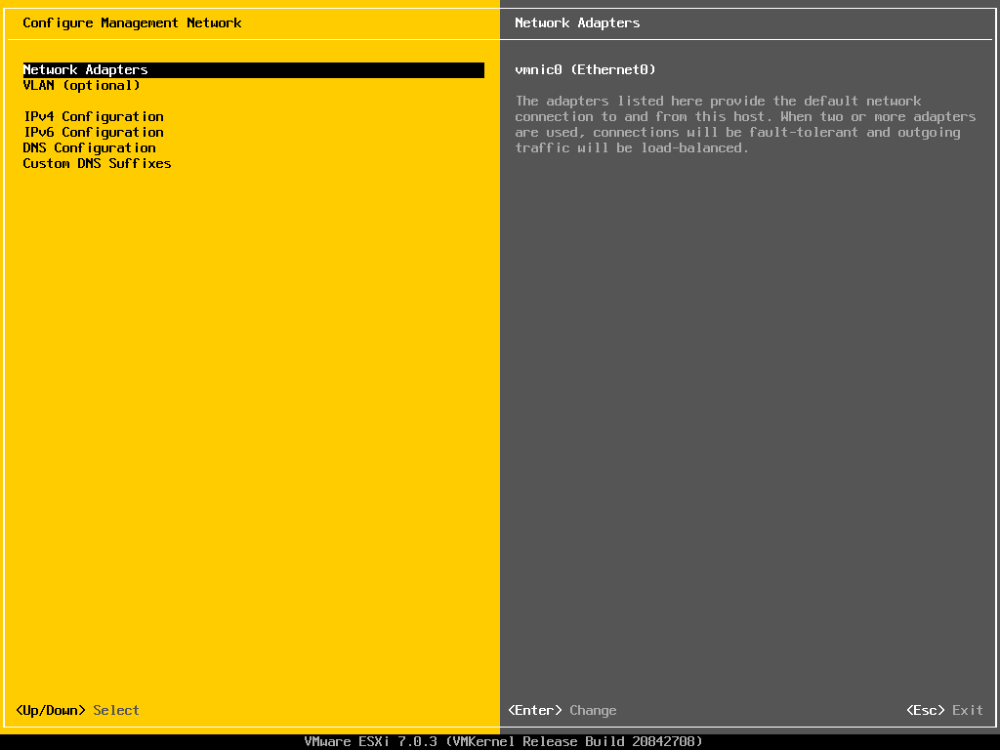

选择 **「IPv4 Configuration」** → 按 `Enter`。

使用方向键移动到 **「Set static IPv4 address and network configuration」** → 按 `空格键` 选中。

填入网络参数：

| 字段 | 示例值 | 说明 |
| --- | --- | --- |
| IPv4 Address | `192.168.1.100` | 根据你的局域网修改 |
| Subnet Mask | `255.255.255.0` | 子网掩码 |
| Default Gateway | `192.168.1.1` | 路由器/网关地址 |


按 `Enter` 确认 → `Esc` 退出 → 提示应用更改时按 `Y`。

---

### 验证网络连通性

按 `F2` → 输入密码 → 选择 **「Test Management Network」** → 按 `Enter`。

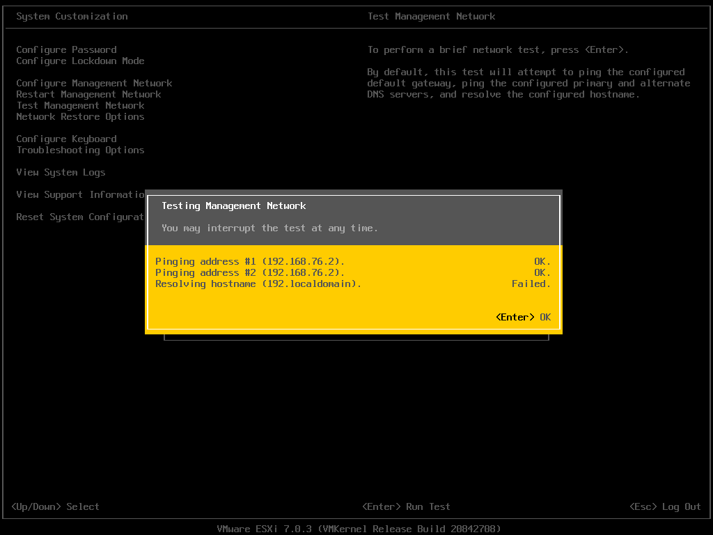

全部通过（OK）即说明网络配置成功。

---

### 确认版本信息

回到 DCUI 主界面，确认屏幕顶部信息：

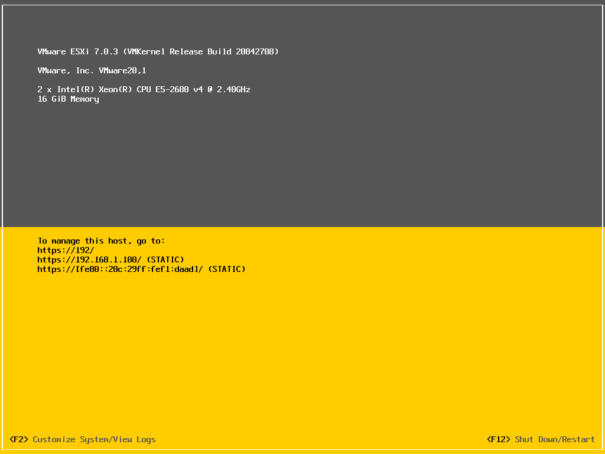

-   **VMware ESXi 7.0 Update 3**：版本信息
-   **IP Address**：管理 IP（如 `192.168.1.100`）

现在 ESXi 安装已完成！ 🎉

---

## 通过 Web Client 管理 ESXi

ESXi 主要通过 **Host Client**（网页管理端）进行日常管理。

### 访问 ESXi Web Client

在宿主机（或局域网内任一设备）浏览器地址栏输入：

```text
https://<ESXi-IP>/ui
```

例如 `https://192.168.1.100/ui`。

!!! warning "HTTPS 证书警告"
    ESXi 使用自签名证书，浏览器会提示「您的连接不是私密连接」。点击 **「高级」**→**「继续前往」** 即可。

输入用户名 `root` 和密码 → 登录。

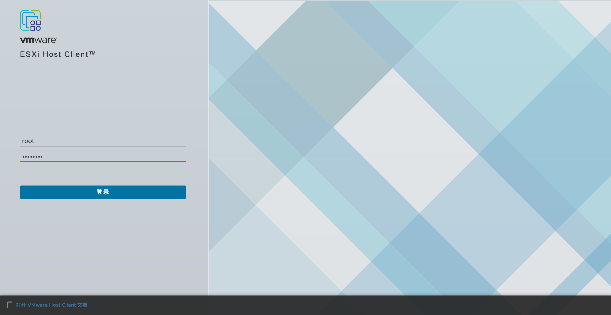

---

### Web Client 概览

登录后进入 ESXi Host Client 主界面：

| 区域 | 说明 |
| --- | --- |
| **导航器** | 左侧菜单，包含主机、虚拟机、存储、网络等管理入口 |
| **主机概览** | 显示 CPU、内存、存储使用情况和硬件信息 |
| **虚拟机** | 列出所有虚拟机，可在此创建和管理 VM |
| **监控** | 性能图表、事件日志、告警 |

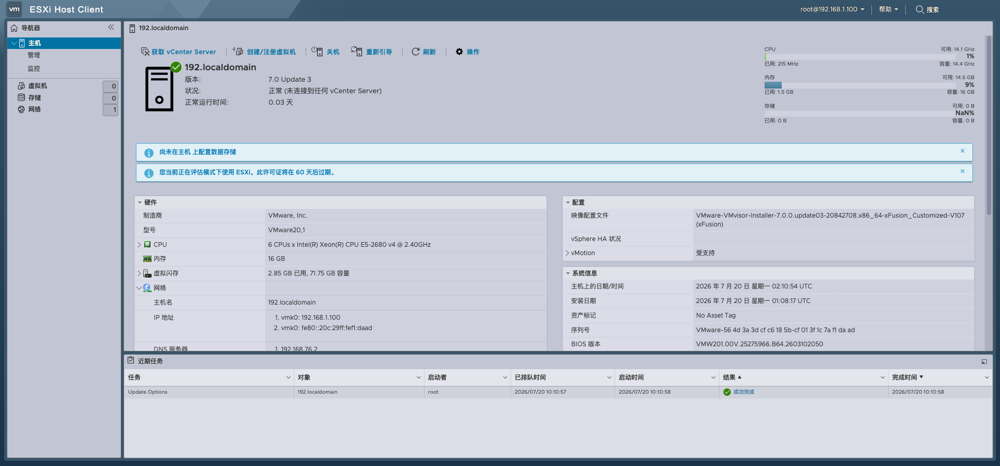

!!! tip "申请免费 License"
    ESXi 60 天试用期到期后部分高级功能将受限。
    
    1. 访问 [VMware vSphere Hypervisor Free](https://customerconnect.vmware.com/web/vmware/evalcenter?p=free-esxi7)
    2. 注册或登录 VMware 账号 → 获取免费 License Key
    3. Web Client：导航器 → **管理** → **许可** → 分配许可证

---

## 在 ESXi 中创建第一台虚拟机

部署 ESXi 的最终目的是运行虚拟机。下面快速演示创建一台测试 VM。

### 上传 ISO 到数据存储

在 Web Client 左侧导航器选择 **存储** → `datastore1` → **数据存储浏览器** → **上载** → 选择要安装的操作系统 ISO（如 Ubuntu Server）。

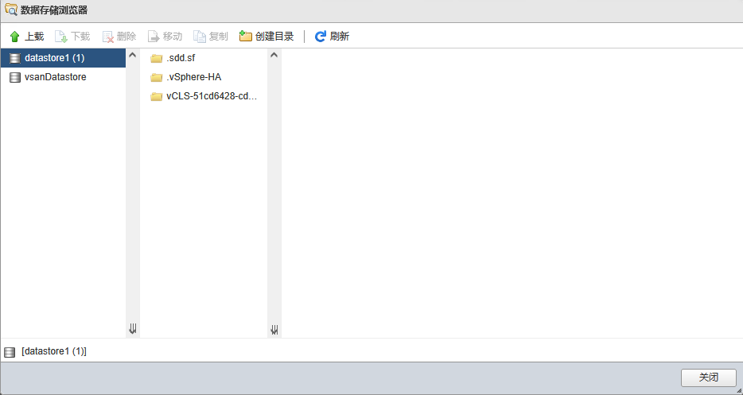

---

### 创建虚拟机

左侧导航器 → **虚拟机** → **创建/注册虚拟机** → **「创建新虚拟机」**。

填写虚拟机名称：

```text
ubuntu-test
```

客户机操作系统系列选择 `Linux`，版本选择 `Ubuntu Linux (64-bit)`：

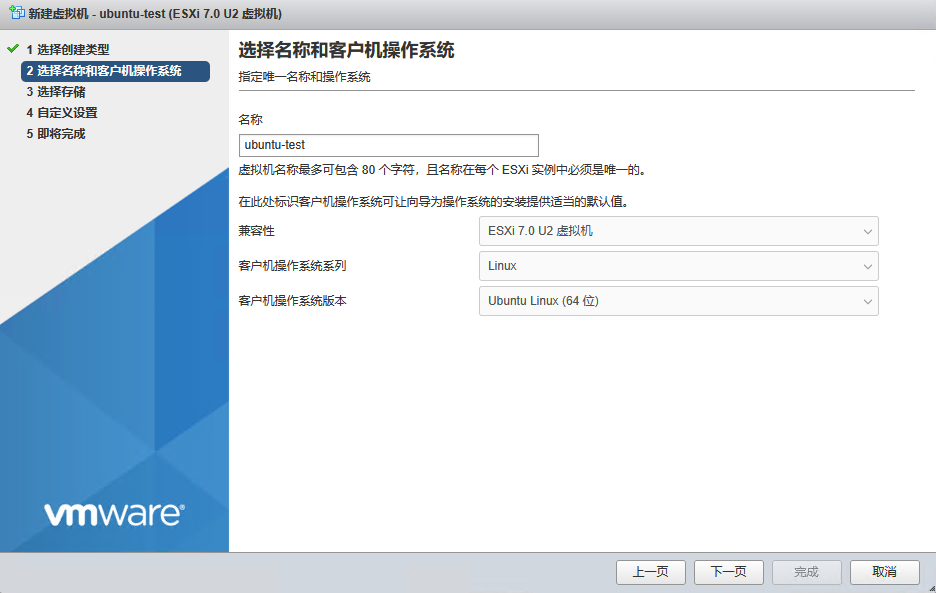

选择数据存储 `datastore1`。

自定义硬件配置：

| 参数 | 推荐值 |
| --- | --- |
| CPU | 2 |
| 内存 | 2 GB（2048 MB） |
| 硬盘 | 20 GB |
| CD/DVD 驱动器 | 选择「数据存储 ISO 文件」→ 浏览上传的 ISO |

!!! warning "网络适配器"
    在嵌套环境中如遇网络不通，检查 ESXi 虚拟机的网络模式是否为「桥接」。

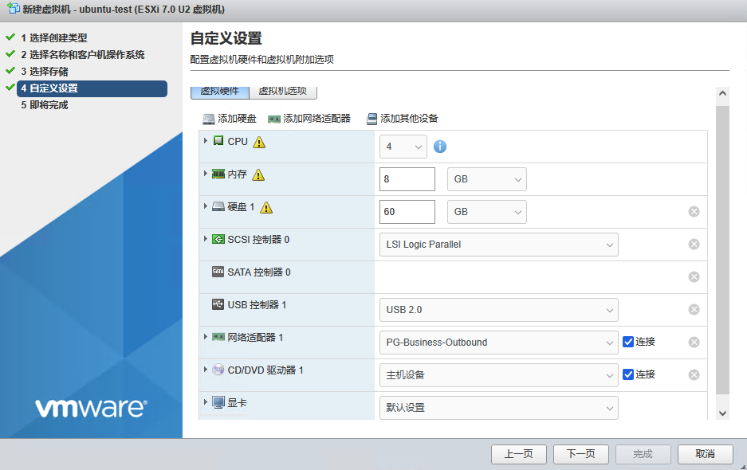

点击 **完成**。

---

### 启动虚拟机

在虚拟机列表中找到 `ubuntu-test` → **打开电源** → **控制台** → 在浏览器中打开远程控制台 → 按常规步骤完成操作系统安装。


!!! success "恭喜！"
    你已经成功在 ESXi 7.0 上创建并运行了第一台嵌套虚拟机。ESXi 的强大之处在于可以同时运行数十台此类 VM，充分利用服务器硬件资源。

---

## 常见问题

### 不支持嵌套虚拟化

**原因**：宿主机未开启 CPU 虚拟化，或 Workstation 虚拟机未勾选虚拟化引擎。

**解决**：
1. 检查宿主机 BIOS → 开启 VT-x / AMD-V
2. 编辑 ESXi 虚拟机设置 → 处理器 → 勾选 **「虚拟化 Intel VT-x/EPT 或 AMD-V/RVI」**
3. 如果选项为灰色，关闭虚拟机后编辑 `.vmx` 文件，添加：

```text
vhv.enable = "TRUE"
```

---

### 安装过程中卡在加载界面

**原因**：通常与显卡或内存设置有关。

**解决**：
1. ESXi 虚拟机内存至少设置 6 GB（推荐 8 GB）
2. 启动时按 `Shift + O`，输入 `ignoreHeadless=TRUE` 然后回车
3. 尝试减少显存或关闭 3D 加速（虚拟机设置 → 显示器）

---

### 无法通过浏览器访问 ESXi Web Client

**原因**：网络配置错误或防火墙阻挡。

**排查步骤**：
1. 检查 ESXi DCUI 主界面的 IP 地址是否正确
2. 宿主机执行：

```bash
ping <ESXi-IP>
```

3. 确认宿主机与 ESXi VM 处于同一网段（桥接模式）
4. 尝试访问 `https://<ESXi-IP>`（不加 /ui）看是否有响应
5. 检查宿主机防火墙是否放行了 443 端口

---

### ESXi 内部虚拟机没有网络

**原因**：嵌套环境中虚拟交换机与物理网卡的映射问题。

**解决**：
1. 确认 ESXi 虚拟机的网络适配器为 **桥接模式**（而非 NAT）
2. ESXi 中所有 VM 使用默认的 `VM Network` 端口组即可
3. 如果桥接仍不通，可为 ESXi 虚拟机添加第二张网卡（仅主机模式）作为管理口

---

### ESXi 试用期过了怎么办？

ESXi 提供 **免费 License**，到期后在 VMware 官网申请即可继续使用核心功能（创建 VM、数据存储、基础网络等）。个人学习和 HomeLab 场景下免费版完全够用。

---

## 下一步学习

完成 ESXi 7.0 部署后，建议按以下路线继续进阶：

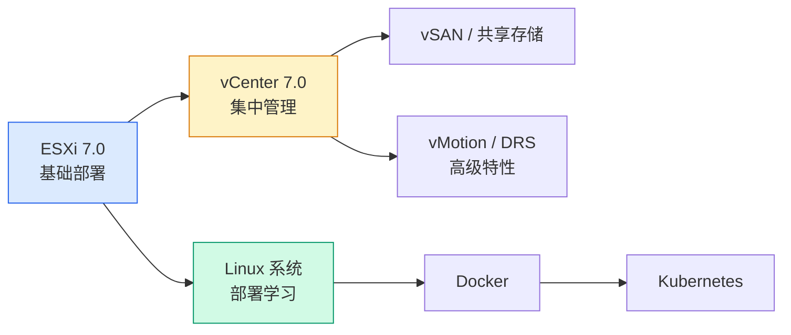

| 方向 | 教程 |
| --- | --- |
| **集中管理** | [vCenter 7.0 部署教程](vcenter-7.0.md) |
| **Linux 入门** | [Ubuntu 22.04 部署教程](../linux/ubuntu-22.04.md) |
| **容器化** | [Docker 部署教程](../docker&k8s/docker.md) |
| **虚拟化进阶** | [ESXi 8.0 部署教程](esxi-8.0.md) |
| **版本对比** | [裸金属、虚拟机与容器](../basics/baremetal-vm-container.md) |

---

## 总结

本文从零开始，完整讲解了在 VMware Workstation 环境中部署 ESXi 7.0 的全过程：

1.  **环境准备**：检查宿主机虚拟化支持、下载必要软件
2.  **创建虚拟机**：合理配置 CPU、内存、磁盘和网络
3.  **安装 ESXi**：引导安装、分区、设置 root 密码
4.  **初始配置**：配置静态 IP、验证网络连通性
5.  **Web Client 管理**：通过浏览器管理 ESXi 主机
6.  **创建嵌套 VM**：上传 ISO、创建并启动第一台虚拟机

ESXi 是企业虚拟化的基石，掌握它对于理解云原生架构（Kubernetes + 虚拟化）具有重要意义。希望本教程能帮助你顺利迈出第一步！

如果你在部署过程中遇到任何问题，欢迎在评论区留言交流。 🚀

