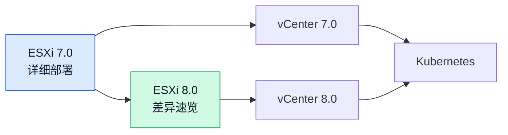

# ESXi 8.0：与 7.0 的差异与部署要点

## 阅读指引

ESXi 8.0 与 7.0 的基本安装流程相似，但硬件兼容性、资源规划和部分安全提示需要重新核对。本文聚焦版本差异和升级前的检查，不重复逐屏安装步骤。

!!! tip "请先阅读 7.0 教程"
    如果你还没有看过 [ESXi 7.0 部署教程](esxi-7.0.md)，建议先完整阅读。本文仅列出 **8.0 与 7.0 的差异点**，不再重复通用部署步骤。

本文原有的 TPM 提示和 Host Client 截图目前缺失，已改为文字说明；真实示意图将在后续更新中补足。不同 ESXi 更新版本、硬件和授权可能影响可用功能，生产环境请以对应版本的官方发行说明、兼容性指南和授权条款为准。

---

## 版本演进概览

| 项目 | ESXi 7.0 | ESXi 8.0 |
| --- | :---: | :---: |
| 发布时间 | 2020 年 | 2022 年底 |
| 安装最低内存 | 4 GB | 8 GB |
| 安装介质与启动设备 | 按具体版本的硬件要求核对 | 按具体版本的硬件要求核对 |
| TPM 2.0 | 用于部分安全功能 | 用于部分安全功能；不是所有部署场景的通用安装前提 |

---

## ESXi 8.0 核心新特性

| 特性 | 说明 |
| --- | --- |
| **vSAN Express Storage Architecture（ESA）** | vSAN 8 提供的新存储架构；是否可用取决于兼容硬件、配置和相应授权，不能仅凭版本号判断 |
| **DPU 支持与卸载能力** | 面向受支持的 DPU、服务器平台及配置，不代表普通 HomeLab 设备都能使用 |
| **安全与生命周期能力** | 增加或改进了安全、设备管理和生命周期相关能力；具体范围随 ESXi/vCenter 更新版本和授权而异 |
| **虚拟硬件与工作负载支持** | 支持更新的虚拟硬件版本和平台能力；升级前需检查客户机、驱动及外围设备兼容性 |

不要把产品宣传中的能力理解为所有硬件默认具备的功能。规划 vSAN、DPU、GPU 或 Kubernetes 相关实验前，应先确认所用版本、硬件兼容性、许可证和依赖组件。

---

## 部署差异对照

### 硬件要求

以下是嵌套虚拟化的**实验环境建议值**，不是所有部署通用的最低要求。实际最低要求和启动设备限制应按计划使用的 ESXi 更新版本核对。

| 项目 | ESXi 7.0 实验建议 | ESXi 8.0 实验建议 |
| --- | ---: | ---: |
| ESXi 虚拟机 vCPU | 4 核 | 4 核起 |
| ESXi 虚拟机内存 | 8 GB 起 | 12-16 GB 起 |
| ESXi 虚拟机启动磁盘 | 60 GB 起 | 80 GB 起 |
| 物理宿主机内存 | 16 GB 起 | 24 GB 起；运行多层虚拟机时预留更多 |

嵌套运行的客户机还会继续占用宿主机内存、CPU 和存储。分配给 ESXi 虚拟机的内存并不是宿主机可用内存；若启动后频繁出现资源不足，应减少并发虚拟机或增加物理资源，而不是只按表格中的起步值配置。

### VMware Workstation 虚拟机创建

| 设置 | ESXi 7.0 | ESXi 8.0 |
| --- | --- | --- |
| 客户机操作系统 | `VMware ESXi 7` | `VMware ESXi 8` |
| 固件与启动模式 | 按实验需求设置并保持一致 | 按 ESXi 8 安装介质及虚拟机配置要求核对 |
| 嵌套虚拟化 | 需要运行 ESXi 内部虚拟机时启用 | 需要运行 ESXi 内部虚拟机时启用 |
| CPU、内存、磁盘 | 按工作负载分配 | 参考上面的实验建议，并为宿主机留出资源 |

VMware Workstation 中选择 ESXi 客户机类型，并在处理器设置中启用虚拟化扩展。完整的 Workstation 创建流程可参考 [ESXi 7.0 部署教程](esxi-7.0.md)；完成后还要确认 ESXi 虚拟机本身可以启动，并能将硬件虚拟化能力传递给内部客户机。

---

## 安装过程中的不同点

### TPM 2.0 提示

TPM 2.0 与 ESXi 的部分安全能力有关，但不能简单概括为“所有 ESXi 8.0 安装都必须有 TPM”。是否出现提示以及提示含义，可能因安装镜像、更新版本和硬件而异。遇到 TPM 相关提示时，应先阅读屏幕上的完整信息并核对目标功能要求；如果安装程序允许继续且实验不依赖相应安全能力，可按提示继续。

不要据此推断没有 TPM 就不影响任何功能。若计划使用可信启动、远程证明或其他与 TPM 绑定的安全功能，应按官方文档配置兼容的 TPM 2.0 硬件或虚拟 TPM，并验证端到端支持。

### root 密码

安装时设置的 root 密码需符合屏幕上显示的复杂度策略。不要复用其他服务的密码，也不要将密码写入文章、脚本或公开截图。磁盘选择、键盘布局和确认安装等通用步骤可参考 [ESXi 7.0 部署教程](esxi-7.0.md)。

若已有旧版 ESXi，务必先确认安装目标磁盘和数据状态；全新安装或重装可能覆盖磁盘上的数据。

---

## 初始配置

安装后可通过 DCUI 配置管理网络、测试连通性并查看版本信息。具体操作见 [ESXi 7.0 部署教程](esxi-7.0.md)，但请按自己的网络规划设置地址、网关、DNS 和 VLAN；确认 IP 无冲突后，再从管理终端访问主机。

初始配置完成后，可继续学习 [vCenter 8.0 部署教程](vcenter-8.0.md)，了解 VCSA 部署、SSO 设置与 ESXi 主机纳管。

---

## Host Client 访问与管理

通过浏览器访问 `https://<ESXi 管理 IP>/ui`，并使用已配置的账户登录。首次访问时浏览器可能提示证书不受信任；只有在确认地址属于自己的 ESXi 主机后，才继续访问。若无法打开页面，先检查管理网络连通性、地址和浏览器证书提示。

登录后可在 Host Client 中检查主机状态、存储和网络，并按需上传 ISO、创建虚拟机。管理界面的具体布局可能随更新版本变化；功能操作可参考 [ESXi 7.0 部署教程](esxi-7.0.md)，不要把截图中的菜单位置视为 8.0 各更新版本都完全相同。

---

## 在 ESXi 8.0 中创建虚拟机

基本流程是上传安装介质、创建虚拟机、配置硬件并启动安装。创建客户机时，应按客户机操作系统选择兼容的虚拟硬件版本、固件和控制器；磁盘与网络配置也要结合工作负载核对。

!!! tip "嵌套虚拟化提示"
    在 ESXi 8.0 内部运行另一个 Hypervisor 时，需要将硬件辅助虚拟化能力传递给客户机。相关选项名称和可用性取决于 ESXi 版本、客户机类型及底层 CPU；启用后仍需确认底层 Workstation 已开放嵌套虚拟化。

完整示例见 [ESXi 7.0 部署教程](esxi-7.0.md)，其中介绍了上传 ISO 和创建第一台虚拟机的流程。

---

## 7.0 升级到 8.0

升级前先确认目标版本仍支持你的 CPU、网卡、存储控制器及其他设备，并阅读相应版本的升级说明。不要仅依据“7.0 可以升级到 8.0”就直接在生产主机上操作：

1. **核对兼容性**：使用对应版本的 VMware/Broadcom 兼容性指南检查 CPU、网卡、存储控制器、驱动和固件。
2. **核对升级路径**：确认当前版本、目标更新版本、授权和升级方式受支持；参考目标版本的发行说明。
3. **备份并安排维护**：备份 ESXi 配置及虚拟机数据，确认恢复方案，安排维护窗口。
4. **先行验证**：在非生产环境完成升级和工作负载检查，再按官方流程升级生产主机。

不要把某一个 CPU 指令集型号作为所有升级路径的唯一判断依据；硬件支持取决于具体 CPU 型号和目标版本。

---

## 常见问题

### TPM 警告影响使用吗？

不一定影响基础安装或常规运行；具体取决于提示内容和你要使用的安全功能。需要 TPM 的功能无法仅靠忽略提示获得支持。

### 安装后内存不足

先检查宿主机剩余内存、ESXi 虚拟机分配值和内部客户机的资源总量。嵌套环境可以尝试减少同时运行的客户机，或在宿主机资源允许时增加 ESXi 虚拟机内存；16 GB 可作为较复杂实验的起点，而不是固定要求。

### 和 7.0 比，该选哪个？

| 场景 | 选择建议 |
| --- | --- |
| 学习已有的 ESXi 7.0 环境 | 按现有实验目标继续使用，并确认其生命周期与安全更新状态 |
| 新建实验环境 | 优先评估目标 ESXi 版本的硬件兼容性、资源要求和可获得的更新 |
| 已运行 ESXi 7.0 | 先检查兼容性、升级路径、备份和维护窗口，再决定是否升级 |

---

## 下一步学习

| 学习方向 | 推荐内容 |
| --- | --- |
| **逐步安装 ESXi** | [ESXi 7.0 完整部署教程](esxi-7.0.md)——本文引用的通用安装、网络和 Host Client 操作都可从这里入手。 |
| **集中管理 ESXi 8** | [vCenter 8.0 部署教程](vcenter-8.0.md)——继续了解 VCSA 部署、SSO 和主机纳管。 |
| **了解 vCenter 7** | [vCenter 7.0 部署教程](vcenter-7.0.md)——对照上一代集中管理平台的部署流程。 |
| **理解虚拟化层次** | [裸金属、虚拟机与容器](../basics/baremetal-vm-container.md)——厘清 ESXi、虚拟机与容器各自所处的层次。 |

---

## 总结

ESXi 8.0 与 7.0 的基本安装步骤相似，但不应把旧版的硬件、资源和功能假设直接套用到新版。部署或升级前重点做好三项检查：

1. **核对兼容性与资源**：按目标更新版本确认 CPU、设备支持和实验资源预算。
2. **理解安全提示**：区分基础安装与 TPM 相关功能，不要把跳过提示等同于启用安全能力。
3. **升级前做好验证和备份**：确认升级路径、备份配置与数据，并先在实验环境验证。

需要逐步安装说明时，请回到 [ESXi 7.0 完整部署教程](esxi-7.0.md)；准备集中管理时，可继续阅读 [vCenter 8.0 部署教程](vcenter-8.0.md)。
