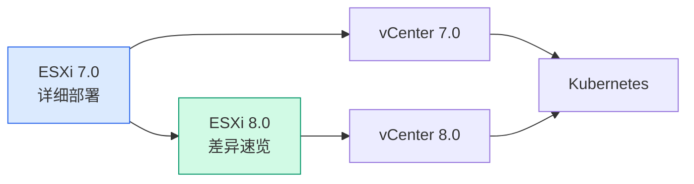

# ESXi 8.0：与 7.0 的差异与部署要点

## 阅读指引

ESXi 8.0 的安装部署流程与 7.0 **高度一致**——从 VMware Workstation 创建虚拟机、挂载 ISO、键盘布局选择、root 密码设置，到 DCUI 配置静态 IP、Web Client 登录，操作步骤几乎完全相同。

!!! tip "请先阅读 7.0 教程"
    如果你还没有看过 [ESXi 7.0 部署教程](esxi-7.0.md)，建议先完整阅读。本文仅列出 **8.0 与 7.0 的差异点**，不再重复通用部署步骤。

---

## 版本演进概览

| | ESXi 7.0 | ESXi 8.0 |
| --- | :---: | :---: |
| 发布时间 | 2020 年 | 2022 年底 |
| 最低内存 | 4 GB | **8 GB** |
| 系统占用磁盘 | ~32 GB | ~48 GB |
| TPM 要求 | 可选 | 默认要求（可跳过） |
| Photon OS 版本 | 3.0 | 5.0 |
| 免费 License | ✓ | ✓ |

---

## ESXi 8.0 核心新特性

| 特性 | 说明 |
| --- | --- |
| **vSAN 8.0 ESA** | 全新 Express Storage Architecture，性能大幅提升 |
| **DPU 深度集成** | 网络与存储 I/O 卸载到 DPU/智能网卡 |
| **TPM 2.0 要求** | 安装程序默认检测 TPM 2.0（实验环境可直接跳过） |
| **vSphere Green Metrics** | 碳排放监控与能效分析 |
| **Tanzu 增强** | 更紧密的 Kubernetes 原生集成 |
| **AI/ML 加速** | NVIDIA GPU 虚拟化与 AI 工作负载支持 |
| **Host Client 升级** | 界面更现代化、响应速度更快 |

---

## 部署差异对照

### 硬件要求

8.0 对宿主机和 ESXi 虚拟机的资源需求均有所提升：

| 项目 | ESXi 7.0 推荐 | ESXi 8.0 推荐 |
| --- | :---: | :---: |
| ESXi VM CPU | 4 Core | 4 Core（不变） |
| ESXi VM 内存 | 8 GB | **12 GB 以上** |
| ESXi VM 磁盘 | 60 GB | **80 GB** |
| 宿主机内存 | 16 GB | **24 GB 以上** |

### VMware Workstation 虚拟机创建

| 步骤 | 7.0 | 8.0 |
| --- | --- | --- |
| 客户机操作系统 | `VMware ESXi 7` | `VMware ESXi 8` |
| 嵌套虚拟化 | 必须勾选 | 必须勾选（同 7.0） |
| 其余步骤 | — | 与 7.0 完全一致 |

操作参考：[ESXi 7.0 - 创建虚拟机](esxi-7.0.md#创建虚拟机)

---

## 安装过程中的不同点

### 新增：TPM 2.0 警告

启动安装后，8.0 会检测 TPM 2.0 芯片。VMware Workstation 虚拟环境通常没有虚拟 TPM，安装程序会弹出警告：

> **在实验环境直接按 `Enter` 继续即可**，不影响安装和使用。

该警告仅影响部分高级安全功能（如 vSphere Trust Authority），HomeLab 无需关注。

### 密码复杂度

8.0 的密码策略默认比 7.0 更严格，增加了字典单词检测。其余安装界面（磁盘选择、键盘布局、确认安装）与 7.0 完全一致。

### 其余步骤

从接受许可协议 → 选择磁盘 → 键盘布局 → 设置密码 → 确认安装 → 重启，全部参考 [ESXi 7.0 安装步骤](esxi-7.0.md#安装-esxi-70)。

---

## 初始配置

DCUI 配置静态 IP、测试网络连通性、确认版本信息——与 7.0 完全相同。

参考：[ESXi 7.0 - 初始配置](esxi-7.0.md#初始配置)

---

## Web Client 差异

8.0 的 Host Client 主要改进：

-   **界面更现代**：全新视觉风格，响应速度提升
-   **布局一致**：导航器结构与 7.0 相同，升级用户无缝过渡
-   **访问方式不变**：`https://<ESXi-IP>/ui`，用户名 `root`

其余管理操作（上传 ISO、创建 VM、监控性能）与 7.0 步骤一致，参考 [ESXi 7.0 - Web Client 管理](esxi-7.0.md#通过-web-client-管理-esxi)。

---

## 在 ESXi 8.0 中创建虚拟机

流程与 7.0 完全一致：上传 ISO → 创建新 VM → 配置硬件 → 启动安装。

!!! tip "嵌套虚拟化提示"
    在 ESXi 8.0 内部创建虚拟机时如需再次嵌套（三层虚拟化），需在 VM 选项中勾选 **「向客户机操作系统公开硬件辅助的虚拟化」**。

参考：[ESXi 7.0 - 创建第一台虚拟机](esxi-7.0.md#在-esxi-中创建第一台虚拟机)

---

## 7.0 升级到 8.0

支持原地升级，但需注意：

1. **硬件兼容性**：CPU 需支持 x86-64-v3 指令集（Intel Haswell / AMD Excavator 以上）
2. **备份**：升级前务必备份 ESXi 配置
3. **验证**：建议先在实验环境验证
4. **路径**：通过 vCenter Lifecycle Manager 或 ESXi 命令行执行

---

## 常见问题

### TPM 警告影响使用吗？

不影响。在没有 TPM 2.0 的环境中，ESXi 8.0 完全正常运行。

### 安装后内存不足

8.0 内存开销比 7.0 大约增加 2 GB。如果嵌套 VM 报内存不足，将 ESXi VM 内存提升至 16 GB。

### 和 7.0 比，该选哪个？

| 场景 | 推荐 |
| --- | --- |
| 新手入门、兼容旧硬件 | **ESXi 7.0** |
| 新装 HomeLab、硬件较新 | **ESXi 8.0** |
| 已有 7.0 环境 | 保持 7.0，等有需求再升级 |

---

## 下一步学习

| 方向 | 教程 |
| --- | --- |
| **7.0 详细步骤** | [ESXi 7.0 部署教程](esxi-7.0.md) |
| **集中管理** | [vCenter 8.0 部署教程](vcenter-8.0.md) |
| **上一代管理** | [vCenter 7.0 部署教程](vcenter-7.0.md) |
| **版本概念** | [裸金属、虚拟机与容器](../basics/baremetal-vm-container.md) |

---

## 总结

ESXi 8.0 不是 7.0 的「推倒重来」，而是在其基础上的迭代升级。核心差异就三点：

1. **资源要求更高**：内存 8 GB 起步（7.0 为 4 GB），磁盘 48 GB 起步
2. **新增 TPM 警告**：实验环境直接跳过，无影响
3. **Host Client 更好用**：界面更快更现代，但操作逻辑不变

掌握 7.0 后，8.0 几乎零学习成本。对于新建环境建议直接上 8.0，已有 7.0 环境也无需急着升级。 🚀
