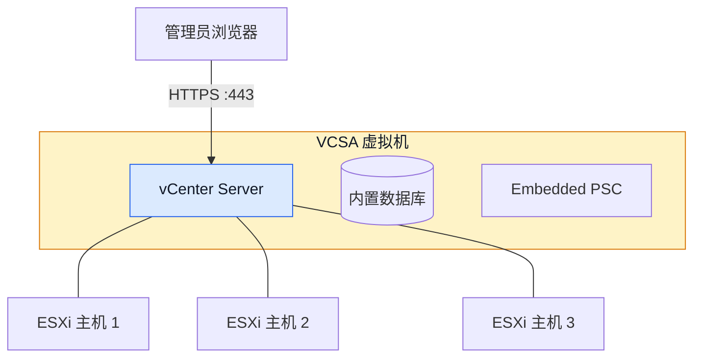
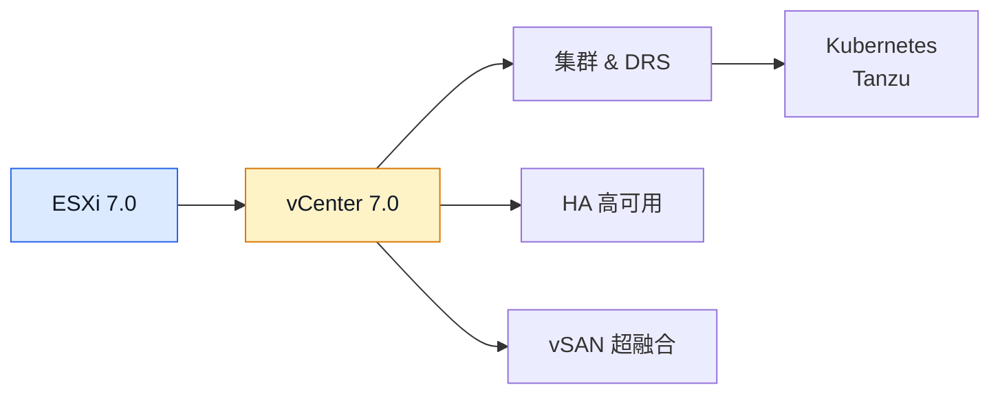

# vCenter 7.0 部署教程：VCSA 安装与 ESXi 主机纳管

## 前言

vCenter Server 是集中管理 vSphere 环境的组件。本教程介绍如何将 vCenter Server Appliance（VCSA）7.0 部署到 ESXi 主机，包括部署前检查、两阶段安装、SSO 设置、首次登录和添加 ESXi 主机。

**生命周期提醒：** vSphere 7 已结束常规支持。本文适用于旧环境复现、隔离实验或迁移准备；用于现有环境前，请依据 Broadcom 生命周期与支持合同确认可用更新和支持范围。新建生产环境应优先评估仍受支持的版本。

!!! info "VCSA 是什么？"
    VCSA（vCenter Server Appliance）是以虚拟设备形式部署的 vCenter Server。本文使用 ISO 中的安装程序将设备部署到 ESXi；设备内部服务和数据库由 VMware 集成管理。

本文部分安装界面图示目前缺失，已用文字步骤和字段说明替代；关于图示将在未来的更新中完善。不同 7.0 更新版本的安装界面、资源规格和可用功能可能不同，实际操作时请以对应 ISO 和该版本官方文档为准。

---

## vCenter 7.0 架构简介



vCenter Server 7.0 支持嵌入式 PSC 架构；较早版本曾有外部 PSC 部署方式。本文按嵌入式部署介绍，不应将旧拓扑直接套用到新建环境或升级场景。

---

## 部署前准备

### 环境要求

| 项目 | 要求 |
| --- | --- |
| **目标 ESXi 主机** | 版本须满足所用 VCSA 7.0 更新版本的互操作性要求 |
| **资源与数据存储** | 按安装程序给出的部署规模预留 CPU、内存和虚拟磁盘容量 |
| **部署客户端** | 可访问目标 ESXi 管理地址及部署所需网络 |
| **DNS 与网络** | 预先规划 VCSA 的 FQDN、静态 IP、网关和 DNS；确认名称解析和路由正确 |
| **时间同步** | 检查 ESXi、DNS/NTP 和部署客户端时间，避免明显偏差 |

!!! tip "部署规模选择"
    VCSA 7.0 的可选规模与规格应以当前使用的安装介质为准。下表为常见规格参考，升级版本或补丁级别可能影响数值和清单限制：

    | 规模 | vCPU | 内存 | 磁盘 | 适用场景 |
    | --- | --- | --- | --- | --- |
    | **Tiny** | 2 | 12 GB | 415 GB | 最多 10 台主机、100 台 VM |
    | **Small** | 4 | 19 GB | 480 GB | 最多 100 台主机、1000 台 VM |
    | **Medium** | 8 | 28 GB | 700 GB | 最多 400 台主机、4000 台 VM |
    | **Large** | 16 | 37 GB | 1065 GB | 最多 1000 台主机、10000 台 VM |

    小型实验环境可评估 **Tiny**；仍需依据安装向导的 CPU、内存、磁盘和清单容量说明确认是否合适。

### 软件准备

| 软件 | 说明 | 下载地址 |
| --- | --- | --- |
| **VCSA 7.0 ISO** | vCenter 安装镜像 | [VMware 评估中心](https://customerconnect.vmware.com/evalcenter) |

!!! warning "旧版本安装介质"
    vSphere 7 已结束常规支持，下载和更新可用性可能受 Broadcom 门户、授权和支持合同影响。仅从官方渠道获取与目标环境匹配的 ISO，并核对版本和校验信息。ISO 文件名通常类似：
    ```text
    VMware-VCSA-all-7.0.x-xxxx.iso
    ```
    ISO 大小约 7~8 GB，下载需要一些时间。

---

## vCenter 安装概览

VCSA 安装通常分为两个阶段，界面细节会随安装介质更新版本变化：

| 阶段 | 任务 | 耗时 |
| --- | --- | --- |
| **阶段一：部署** | 将 VCSA 虚拟机部署到目标 ESXi，设置规模、存储和网络 | 取决于网络与存储 |
| **阶段二：配置** | 配置 SSO、时间同步并启动服务 | 取决于资源与环境 |

部署耗时会受存储性能、网络和 ESXi 负载影响，建议预留维护时间，不要以固定分钟数判断安装是否卡住。

---

## 阶段一：部署 VCSA 虚拟机

### 挂载 VCSA ISO

在部署客户端挂载 VCSA ISO，进入 `vcsa-ui-installer` 下与操作系统对应的目录并启动图形安装程序。Windows 通常使用 `win32/installer.exe`；使用与 ISO 匹配的安装程序。

!!! warning "安装程序运行环境"
    -   Windows：直接运行 GUI 安装程序
    -   macOS/Linux 可使用 ISO 中对应平台的图形安装程序；需要自动化时，使用同一版本提供的 CLI 工具和官方模板，并先在测试环境验证。
    -   安装程序所在机器必须能访问目标 ESXi 管理地址。

选择 **Install** 开始新部署。升级或迁移现有 vCenter 时，应使用对应的升级/迁移流程，而不是重新执行新安装。

---

### 开始部署

1.  安装程序主界面选择 **「Install」**（全新安装）。

2.  进入 **Introduction** 页面 → 点击 **「NEXT」**。

3.  勾选 **「I accept the terms of the license agreement」** → **「NEXT」**。

4.  输入目标 ESXi 主机信息：

    | 字段 | 填写说明 |
    | --- | --- |
    | ESXi 主机名或 IP | 填写可从部署客户端访问的管理地址；使用 FQDN 时先确认 DNS 解析 |
    | 用户名 | 使用具备部署所需权限的账户；实验环境通常使用 `root` |
    | 密码 | 在安装程序中输入，不要写入文档或命令历史 |

5.  核对目标主机身份和证书信息后，再确认信任。

---

### 设置 VCSA 虚拟机

1.  **VM 名称**：建议保持默认 `VMware vCenter Server`，或自定义如 `vcenter-7.0`。

2.  **设置 root 密码**：这是 VCSA 虚拟机操作系统的 root 密码（非 vCenter SSO 密码）。

    !!! warning "区分两个密码"
        -   **VCSA 操作系统 root 密码**：用于登录 VCSA 虚拟机的 Linux 系统（本步设置）
        -   **vCenter SSO 管理员密码**：用于登录 vCenter Web Client（阶段二设置）
        
        两者是不同的，务必记清楚。

---

### 选择部署规模

按环境规模及安装程序显示的资源规格选择部署规模。不要仅根据主机数量判断；还应考虑受管虚拟机数量、性能需求和未来增长。

---

### 选择数据存储

选择目标 ESXi 主机的数据存储（如 `datastore1`）。

!!! tip "精简置备"
    精简置备可降低初始物理空间占用，但不会减少虚拟磁盘逻辑容量；空间会随 VCSA 数据增长。部署前检查可用容量，并持续监控 datastore，避免过量置备导致空间耗尽。

---

### 配置网络

填入 VCSA 虚拟机的网络参数：

| 字段 | 填写说明 |
| --- | --- | --- |
| **FQDN** | 使用 DNS 中配置且可解析的完整主机名；不要随意填写无法解析的名称 |
| **IP Address** | 为 VCSA 预留的静态地址，避免 DHCP 变化或地址冲突 |
| **Subnet Mask** | 按管理网络子网填写 |
| **Default Gateway** | 填写该网段可达的网关 |
| **DNS Server** | 使用可解析 VCSA、ESXi 及相关服务名称的 DNS 服务器 |

部署前验证正向/反向解析、网关和路由；不同安装版本支持的网络字段可能略有不同。

---

### 确认并部署

1.  在 **「Ready to complete stage 1」** 页面确认所有配置无误。

2.  点击 **「FINISH」** 开始部署。

3.  等待部署进度完成，安装程序会提示阶段一已结束。

    不要关闭安装程序或中断网络。失败时记录完整错误，并检查 ESXi 任务、权限、DNS、网络和数据存储空间。

---

## 阶段二：配置 vCenter 服务

阶段一完成后，按安装程序提示启动阶段二配置；不同安装程序版本的界面衔接方式可能略有差异。

### 开始配置

1.  阶段二欢迎页面 → 点击 **「NEXT」**。

2.  **NTP 时间同步**：选择组织认可且网络可达的时间源，或按环境策略与 ESXi 主机同步：
    ```text
    <组织内的 NTP 服务器或已验证的公共 NTP 服务>
    ```

---

### 配置 SSO（Single Sign-On）

SSO 是 vCenter 的身份认证核心：

| 字段 | 示例值 | 说明 |
| --- | --- | --- |
| **SSO Domain** | `vsphere.local` | 默认域名（实验环境保持默认） |
| **SSO Administrator** | `administrator@vsphere.local` | SSO 管理员完整用户名 |
| **SSO Password** | 你的密码 | 满足复杂度要求 |

!!! danger "保管好 SSO 管理员密码"
    SSO 管理员凭据具备高权限。使用密码管理器保存，不要与 VCSA root 密码混淆或复用其他服务密码。

---

### 加入 CEIP

CEIP（客户体验改进计划）为可选项。阅读说明后，按组织隐私策略或个人选择决定是否加入，然后继续。

---

### 确认并完成配置

1.  在 **「Ready to complete」** 页面核对所有配置。

2.  勾选 **「I have backed up...」** → 点击 **「FINISH」**。

3.  弹出最终警告 → 点击 **「OK」**，开始配置 vCenter 服务。

等待服务配置完成并记录安装程序给出的访问地址。若失败，保留错误信息并检查 DNS、时间同步、资源和日志，不要在原因未明时重复部署。

---

## 访问 vCenter Web Client

### 登录 vCenter

浏览器访问：

```text
https://<VCSA-IP>/ui
```

建议使用部署时配置且已验证解析的 VCSA FQDN；只有在网络与证书配置允许时才直接使用 IP。

使用 SSO 管理员账号登录：

```text
administrator@vsphere.local
```

---

### vCenter Web Client 概览

登录后可在 vSphere Client 中管理清单、主机、虚拟机和权限。首次访问可能遇到证书提示；确认访问地址和证书后再继续。具体界面可能随更新版本变化。

vCenter 与 ESXi Host Client 的主要区别：

| 功能 | ESXi Host Client | vCenter Web Client |
| --- | :---: | :---: |
| 管理多个 ESXi 主机 | ✗ | ✓ |
| vMotion 迁移 | ✗ | 依许可、网络和共享存储等条件 |
| DRS 集群 | ✗ | 依许可、集群配置和兼容性等条件 |
| HA 高可用 | ✗ | 依许可、集群配置和容量等条件 |
| 模板与内容库 | 有限 | 可集中管理；具体能力依版本和许可 |
| 性能图表 | 短期 | 长期 + 历史对比 |
| 权限 & 角色管理 | 基础 | 企业级 |

---

## 将 ESXi 主机加入 vCenter

### 创建数据中心

1.  在 vSphere Client 清单中选择 vCenter 节点，创建 **New Datacenter**。

2.  命名数据中心（如 `Lab-DC`）。

输入数据中心名称，并按组织或实验环境的清单结构规划命名。

---

### 添加主机

1.  右键数据中心 → **「Add Host」**。

2.  输入 ESXi 主机 FQDN 或 IP → 用户名 `root` → 密码。

3.  核对并信任主机证书，检查主机摘要；按实际许可证和安全策略完成向导中的选项。

4.  **「FINISH」** 完成添加。

完成后在清单中检查主机连接状态和告警。重复操作前先确认主机不处于不兼容的管理状态，并注意纳管可能影响现有独立管理流程。

---

## 常见问题

### 阶段一部署失败：目标 ESXi 主机空间不足

先以安装程序显示的磁盘配置容量为准，并区分逻辑容量与精简置备后的初始占用。检查 datastore 可用空间和扩展能力；只有确认可安全清理的文件才可删除。精简置备不会消除空间耗尽风险。

---

### 阶段二配置超时

先检查安装客户端到目标 ESXi/VCSA 的网络、VCSA FQDN 正反向解析、网关、时间同步和部署日志。端口要求会随工作流和部署环境而异，应按对应版本官方网络端口文档核对；不要仅凭一个固定端口列表调整防火墙。时间同步失败时先排除 DNS、路由和防火墙问题，不建议长期忽略时间偏差。

---

### vCenter 服务启动慢

VCSA 首次启动或完成安装后，服务可能需要一段时间就绪。等待后仍无法访问时，可在 VCSA Shell 中检查服务状态（使用 SSH 前需确认其已按安全策略启用）：

```bash
service-control --status --all
```

查看所有服务状态；该命令需要具备相应管理权限。

---

## 下一步学习

完成 vCenter 7.0 部署后，建议继续学习：



| 方向 | 教程 |
| --- | --- |
| **vSphere 基础平台** | [ESXi 7.0 部署教程](esxi-7.0.md)——了解 ESXi 主机安装与基础管理。 |
| **新版 vCenter** | [vCenter 8.0 部署教程](vcenter-8.0.md)——了解 VCSA 8.0 部署及更新版本兼容性注意事项。 |
| **新版 ESXi** | [ESXi 8.0 部署教程](esxi-8.0.md)——查看 ESXi 8.0 与 7.0 的差异及升级前检查。 |

---

## 总结

vCenter Server 为 vSphere 环境提供集中管理能力。本文覆盖：

1. **环境准备**：确认 ESXi 主机资源、下载 VCSA ISO
2. **阶段一**：在目标 ESXi 主机上部署 VCSA 虚拟机
3. **阶段二**：配置 SSO、网络、时间同步等核心服务
4. **访问 vCenter**：通过 Web Client 登录管理
5. **添加主机**：将 ESXi 主机纳入 vCenter 统一管理

本文面向旧环境复现和隔离实验。选择部署规模时以对应安装介质的规格为准；精简置备需监控实际空间。vSphere 7 已结束常规支持，现有环境应制定迁移和恢复计划，新建生产部署优先选择仍受支持的版本。
