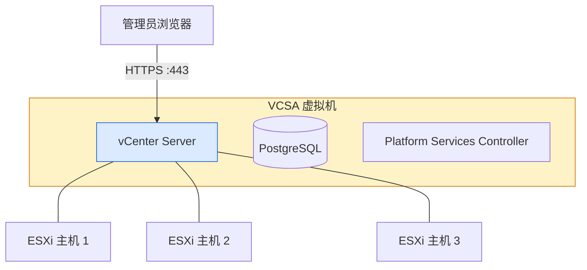
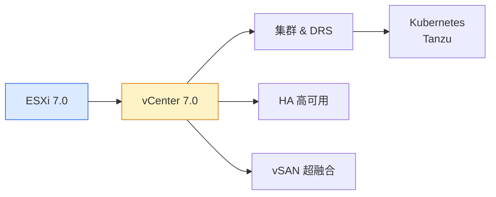

# vCenter 7.0 部署教程：VMware 虚拟化集中管理平台

## 前言

vCenter Server 是 VMware vSphere 虚拟化平台的集中管理核心。如果说 ESXi 是单台服务器的操作系统，那么 vCenter 就是管理整个数据中心的大脑。

当你拥有 2 台及以上 ESXi 主机时，vCenter 的价值就体现出来了：

-   **统一管理**：在一个界面管理所有 ESXi 主机和虚拟机
-   **vMotion 实时迁移**：虚拟机在主机间无中断迁移
-   **DRS 资源调度**：自动根据负载分配计算资源
-   **HA 高可用**：主机故障时虚拟机自动重启
-   **vSAN 管理**：超融合存储的统一管理入口
-   **模板与克隆**：快速批量部署标准化虚拟机

本教程将带领大家**在已有的 ESXi 7.0 主机上部署 vCenter Server Appliance（VCSA）7.0**。

!!! info "VCSA 是什么？"
    VCSA（vCenter Server Appliance）是 VMware 官方推荐的 vCenter 部署方式。它是一个预配置的 Linux 虚拟机，内置了所有必要组件（PostgreSQL 数据库、vCenter 服务等），通过 ISO 安装程序一键部署到 ESXi 主机上。

---

## vCenter 7.0 架构简介



在 vSphere 7.0 中，Platform Services Controller（PSC）服务可以嵌入 VCSA 内部（Embedded 模式），也可以独立部署（External 模式）。本教程采用 **Embedded 嵌入式模式**，最简单且适用于大多数场景。

---

## 部署前准备

### 环境要求

| 项目 | 要求 |
| --- | --- |
| **已有 ESXi 主机** | 至少 1 台 ESXi 7.0，且正常运行 |
| **ESXi 主机可用资源** | 至少 14 GB 内存 + 580 GB 磁盘（Tiny 部署规模） |
| **网络** | 安装程序的机器需能访问 ESXi 主机 IP |
| **DNS 解析** | 建议配置（非强制，可使用 IP 代替 FQDN） |

!!! tip "部署规模选择"
    VCSA 7.0 提供四种部署规模：

    | 规模 | vCPU | 内存 | 磁盘 | 适用场景 |
    | --- | --- | --- | --- | --- |
    | **Tiny** | 2 | 12 GB | 415 GB | 最多 10 台主机、100 台 VM |
    | **Small** | 4 | 19 GB | 480 GB | 最多 100 台主机、1000 台 VM |
    | **Medium** | 8 | 28 GB | 700 GB | 最多 400 台主机、4000 台 VM |
    | **Large** | 16 | 37 GB | 1065 GB | 最多 1000 台主机、10000 台 VM |

    本教程选用 **Tiny**，适合 HomeLab 和学习环境。

### 软件准备

| 软件 | 说明 | 下载地址 |
| --- | --- | --- |
| **VCSA 7.0 ISO** | vCenter 安装镜像 | [VMware 评估中心](https://customerconnect.vmware.com/evalcenter) |

!!! tip "VCSA ISO 下载"
    访问 [VMware Customer Connect](https://customerconnect.vmware.com/evalcenter) → 搜索 `vCenter Server 7.0` → 下载 ISO，文件名通常为：
    ```text
    VMware-VCSA-all-7.0.x-xxxx.iso
    ```
    ISO 大小约 7~8 GB，下载需要一些时间。

---

## vCenter 安装概览

VCSA 安装分为 **两个阶段**：

| 阶段 | 任务 | 耗时 |
| --- | --- | --- |
| **阶段一：部署** | 将 VCSA 虚拟机部署到目标 ESXi 主机 | 约 10 分钟 |
| **阶段二：配置** | 配置 SSO 域、网络、时间同步等服务 | 约 15 分钟 |

---

## 阶段一：部署 VCSA 虚拟机

### 挂载 VCSA ISO

在 Windows 宿主机上右键 VCSA ISO → **装载**（或在 VMware Workstation 中挂载到一台 Windows VM）。

进入光驱目录，找到 `vcsa-ui-installer/win32/` 下的 `installer.exe`，**右键以管理员身份运行**。

!!! warning "安装程序运行环境"
    -   Windows：直接运行 GUI 安装程序
    -   macOS/Linux：使用 CLI 安装程序（`vcsa-deploy` 命令行工具）
    -   安装程序的机器必须能通过 IP 访问目标 ESXi 主机


---

### 开始部署

1.  安装程序主界面选择 **「Install」**（全新安装）。

2.  进入 **Introduction** 页面 → 点击 **「NEXT」**。

3.  勾选 **「I accept the terms of the license agreement」** → **「NEXT」**。

4.  输入目标 ESXi 主机信息：

    | 字段 | 示例 |
    | --- | --- |
    | ESXi 主机 FQDN 或 IP | `192.168.1.100` |
    | 用户名 | `root` |
    | 密码 | 你的 ESXi root 密码 |

    

5.  点击 **「YES」** 信任 ESXi 主机证书。

---

### 设置 VCSA 虚拟机

1.  **VM 名称**：建议保持默认 `VMware vCenter Server`，或自定义如 `vcenter-7.0`。

2.  **设置 root 密码**：这是 VCSA 虚拟机操作系统的 root 密码（非 vCenter SSO 密码）。

    !!! warning "区分两个密码"
        -   **VCSA 操作系统 root 密码**：用于登录 VCSA 虚拟机的 Linux 系统（本步设置）
        -   **vCenter SSO 管理员密码**：用于登录 vCenter Web Client（阶段二设置）
        
        两者是不同的，务必记清楚。

    

---

### 选择部署规模

选择 **「Tiny vCenter Server」**（如果实验室资源充足可选 Small）。


---

### 选择数据存储

选择目标 ESXi 主机的数据存储（如 `datastore1`）。

!!! tip "精简置备"
    勾选 **「Enable Thin Disk Mode」**（精简置备），磁盘按需增长，节省空间。HomeLab 强烈推荐。


---

### 配置网络

填入 VCSA 虚拟机的网络参数：

| 字段 | 示例值 | 说明 |
| --- | --- | --- |
| **FQDN** | `vcenter.local` | 完整域名（实验环境随意） |
| **IP Address** | `192.168.1.200` | VCSA 固定 IP |
| **Subnet Mask** | `255.255.255.0` | 子网掩码 |
| **Default Gateway** | `192.168.1.1` | 网关 |
| **DNS Server** | `192.168.1.1` | DNS 服务器 |


---

### 确认并部署

1.  在 **「Ready to complete stage 1」** 页面确认所有配置无误。

2.  点击 **「FINISH」** 开始部署。

    

3.  部署过程约 8~12 分钟，进度条走完即完成阶段一。

    

---

## 阶段二：配置 vCenter 服务

阶段一完成后，安装程序自动进入阶段二配置向导。

### 开始配置

1.  阶段二欢迎页面 → 点击 **「NEXT」**。

2.  **NTP 时间同步**：建议使用默认 NTP 服务器，或填入国内 NTP：
    ```text
    ntp.aliyun.com
    ntp.tencent.com
    ```

---

### 配置 SSO（Single Sign-On）

SSO 是 vCenter 的身份认证核心：

| 字段 | 示例值 | 说明 |
| --- | --- | --- |
| **SSO Domain** | `vsphere.local` | 默认域名（实验环境保持默认） |
| **SSO Administrator** | `administrator@vsphere.local` | SSO 管理员完整用户名 |
| **SSO Password** | 你的密码 | 满足复杂度要求 |

!!! danger "记住 SSO 管理员密码"
    `administrator@vsphere.local` 的密码是最重要的凭证，用于登录 vCenter Web Client 管理一切。**务必妥善保存**。


---

### 加入 CEIP

CEIP（客户体验改进计划）可选，建议取消勾选 → **「NEXT」**。

---

### 确认并完成配置

1.  在 **「Ready to complete」** 页面核对所有配置。

2.  勾选 **「I have backed up...」** → 点击 **「FINISH」**。

    

3.  弹出最终警告 → 点击 **「OK」**，开始配置 vCenter 服务。

配置过程约 10~15 分钟，完成后显示：


---

## 访问 vCenter Web Client

### 登录 vCenter

浏览器访问：

```text
https://<VCSA-IP>/ui
```

例如 `https://192.168.1.200/ui`，或使用 FQDN `https://vcenter.local/ui`。

使用 SSO 管理员账号登录：

```text
administrator@vsphere.local
```


---

### vCenter Web Client 概览

登录后进入 vSphere Client 主页：


vCenter 与 ESXi Host Client 的主要区别：

| 功能 | ESXi Host Client | vCenter Web Client |
| --- | :---: | :---: |
| 管理多个 ESXi 主机 | ✗ | ✓ |
| vMotion 迁移 | ✗ | ✓ |
| DRS 集群 | ✗ | ✓ |
| HA 高可用 | ✗ | ✓ |
| 模板 & 内容库 | 有限 | 完整 |
| 性能图表 | 短期 | 长期 + 历史对比 |
| 权限 & 角色管理 | 基础 | 企业级 |

---

## 将 ESXi 主机加入 vCenter

### 创建数据中心

1.  在 vCenter Web Client 左侧，右键顶部 vCenter 节点 → **「New Datacenter」**。

2.  命名数据中心（如 `Lab-DC`）。


---

### 添加主机

1.  右键数据中心 → **「Add Host」**。

2.  输入 ESXi 主机 FQDN 或 IP → 用户名 `root` → 密码。

3.  信任证书 → 确认主机摘要 → 选择许可证 → 锁定模式保持默认。

4.  **「FINISH」** 完成添加。


重复操作将所有 ESXi 主机加入 vCenter，即可在一个界面集中管理。

---

## 常见问题

### 阶段一部署失败：目标 ESXi 主机空间不足

VCSA Tiny 需要约 415 GB 磁盘。如果 ESXi 主机数据存储空间不足，尝试：
1. 清理数据存储上不必要的文件
2. 使用精简置备模式（勾选 Enable Thin Disk Mode）
3. 为 ESXi 虚拟机扩容虚拟磁盘

---

### 阶段二配置超时

通常是网络或 DNS 问题导致：
1. 确认安装程序的机器能 ping 通 VCSA IP
2. 确认 VCSA 能解析自己的 FQDN
3. 检查 ESXi 主机防火墙是否放行了必要端口（443、902、903）
4. 如果 NTP 连接超时，可跳过 NTP 配置

---

### vCenter 服务启动慢

VCSA 启动后各项服务需要 5~15 分钟才能完全就绪。如果刚装完登录不了，等一等再试。可通过 VCSA 控制台（或 SSH 登录）执行：

```bash
service-control --status --all
```

查看所有服务状态。

---

## 下一步学习

完成 vCenter 7.0 部署后，建议继续学习：



| 方向 | 教程 |
| --- | --- |
| **上一代版本基础** | [ESXi 7.0 部署教程](esxi-7.0.md) |
| **新版对比** | [vCenter 8.0 部署教程](vcenter-8.0.md) |
| **ESXi 8.0** | [ESXi 8.0 部署教程](esxi-8.0.md) |

---

## 总结

vCenter Server 是 vSphere 虚拟化平台的核心管理组件，为多台 ESXi 主机提供统一的管理入口和高级功能。本文完整覆盖：

1. **环境准备**：确认 ESXi 主机资源、下载 VCSA ISO
2. **阶段一**：在目标 ESXi 主机上部署 VCSA 虚拟机
3. **阶段二**：配置 SSO、网络、时间同步等核心服务
4. **访问 vCenter**：通过 Web Client 登录管理
5. **添加主机**：将 ESXi 主机纳入 vCenter 统一管理

对于学习和 HomeLab 场景，Tiny 部署规模完全够用，建议开启精简置备以节省存储空间。 🚀

