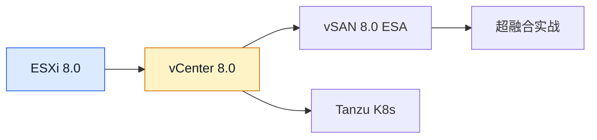

# vCenter 8.0 部署教程：新一代 VMware 集中管理平台

## 前言

vCenter Server Appliance（VCSA）是管理 vSphere 环境的集中式平台。本指南介绍通过安装程序将 VCSA 8.0 部署到 ESXi 主机的主要步骤，包括部署前检查、两阶段安装、首次登录和 ESXi 主机纳管。

如果你已阅读 [vCenter 7.0 部署教程](vcenter-7.0.md)，两阶段部署的基本概念会比较熟悉；但目标 ESXi 版本、VCSA 资源规格、安装介质和可用功能都应按具体 8.0 更新版本重新核对，不能直接沿用旧版数值。

!!! info "vCenter 8.0 重要变化"
    -   **PSC 架构**：vCenter 8 使用嵌入式 Platform Services Controller（Embedded PSC），不再采用独立外部 PSC 架构。
    -   **部署兼容性**：目标 ESXi 主机版本必须满足当前 VCSA 版本的互操作性要求；部署前查询 Broadcom Compatibility Guide 和发行说明。
    -   **安装流程**：通过 VCSA 安装程序完成部署和服务配置两个阶段，具体选项依版本、网络和部署目标而异。

文中原有的安装界面截图均已缺失，现以文字步骤和字段核对表替代；真实示意图将在后续更新中补足。安装程序版本、规模选项和资源要求可能随更新版本变化，操作时以所用 ISO 中的部署向导及该版本官方文档为准。

---

## vCenter 8.0 新特性速览

| 特性 | 说明 |
| --- | --- |
| **简化的架构** | 取消 External PSC，全部 Embedded 部署 |
| **vSphere Client 与管理体验** | 持续改进 Web 管理和生命周期管理能力，具体功能随更新版本而异 |
| **vSAN 8 ESA** | 提供 Express Storage Architecture；是否适用取决于兼容硬件、配置和授权 |
| **DPU 管理能力** | 面向受支持的 DPU、服务器平台及配置，不代表普通环境均可使用 |
| **安全与身份集成** | 支持多种身份、安全和证书管理能力；部署时需按组织策略配置，不应假设某一种方式适用于所有环境 |

功能是否可用还取决于 ESXi 版本、兼容硬件、许可证和其他组件。规划 vSAN、DPU、Tanzu 或安全集成功能前，请核对相应版本的官方文档。

---

## 部署前准备

### 环境要求

| 项目 | 要求 |
| --- | --- |
| **目标 ESXi 主机** | 版本须在当前 VCSA 8.0 更新版本的互操作性支持范围内 |
| **ESXi 主机资源** | 按部署规模为 VCSA 预留足够的内存、CPU 和数据存储空间 |
| **部署客户端** | 安装程序所在电脑可访问目标 ESXi 主机及部署时所需网络 |
| **管理网络与 DNS** | 预先规划 VCSA 静态 IP、网关、DNS 和 FQDN；确保名称解析与网络路由符合环境要求 |
| **时间同步** | 确认 ESXi、部署客户端、DNS/NTP 和后续管理环境的时间设置合理 |

### 部署规模选择

部署规模应按 VCSA 安装程序所附的当前版本规格表选择。以下是常见规模的规划参考，具体 CPU、内存、磁盘和最大清单数可能随 8.0 更新版本调整；请以安装程序显示值及官方文档为准。

| 规模 | 常见内存参考 | 常见用途 |
| --- | ---: | --- |
| **Tiny** | 约 14 GB | 小型实验环境；清单容量以当前版本规格为准 |
| **Small** | 约 24 GB | 较小的正式或实验环境 |
| **Medium** | 约 32 GB | 中型环境 |
| **Large** | 约 45 GB | 较大环境 |

!!! warning "先区分磁盘容量与实际占用"
    VCSA 各规模的虚拟磁盘配置容量可能较大，精简置备只影响初始占用，不会减少虚拟磁盘的逻辑容量，也不能代替容量监控。部署前确认数据存储有足够的可用空间，并为日志、数据库增长、备份和快照预留余量。

### 软件准备

| 软件 | 说明 | 下载地址 |
| --- | --- | --- |
| **VCSA 8.0 ISO** | vCenter 安装镜像 | [VMware 评估中心](https://customerconnect.vmware.com/evalcenter) |

从 Broadcom 官方门户获取与目标环境匹配的 VCSA 8.0 ISO，并校验下载文件及版本信息。ISO 文件较大，提前确认下载来源、可用磁盘空间和部署客户端与 ESXi 之间的网络连通性。

---

## 安装概览

VCSA 8.0 部署通常分为两个阶段；界面选项和具体步骤可能随安装介质版本变化：

| 阶段 | 任务 | 耗时 |
| --- | --- | --- |
| **阶段一：部署** | 向目标 ESXi 部署 VCSA 虚拟机，配置规模、数据存储和管理网络 | 取决于网络与存储 |
| **阶段二：配置** | 配置时间同步、SSO 和服务启动 | 取决于资源与环境 |

实际耗时会受 ISO 客户端、ESXi 主机负载、存储性能和网络状况影响；建议预留维护时间，不以固定分钟数判断部署是否卡住。

---

## 阶段一：部署 VCSA 虚拟机

### 启动安装程序

在部署客户端挂载 VCSA ISO，进入对应平台的 `vcsa-ui-installer` 目录并启动图形安装程序。Windows 通常使用 `win32/installer.exe`；启动前确认下载来源可信，并使用与当前 ISO 匹配的安装程序。

!!! tip "macOS/Linux 用户"
    macOS/Linux 可使用 ISO 中对应平台的图形安装程序。需要自动化部署时，使用该版本附带的 CLI 工具和官方模板，并先在测试环境验证模板参数；不要直接复用来源不明的模板。

启动安装程序后选择 **Install** 开始新部署。若要升级或迁移现有 vCenter，应使用对应的升级/迁移工作流，不要把新安装流程当作升级流程。

---

### 连接目标 ESXi 主机

在目标选择步骤输入一台满足互操作性要求且可访问的 ESXi 主机信息。部署账户需有执行部署所需的权限：

| 字段 | 填写说明 |
| --- | --- |
| ESXi 主机名或 IP | 使用可从部署客户端访问的管理地址；若填 FQDN，先确认 DNS 解析正确 |
| 用户名 | 使用有足够权限的账户；实验环境常使用 `root` |
| 密码 | 在安装程序中输入，不要保存到文档、命令历史或截图 |

核对主机身份和证书指纹后再确认信任。不要在未确认目标身份时接受证书提示。

---

### 设置 VCSA 虚拟机

设置 VCSA 虚拟机名称和操作系统 **root 密码**。此密码用于设备管理，不等同于后续配置的 SSO 管理员密码；分别保管并遵循组织密码策略。安装程序可能要求密码满足长度和复杂度规则。

---

### 选择部署规模

根据环境清单规模和安装程序给出的 CPU、内存、磁盘规格选择部署规模。小型实验室可评估 Tiny，但不可只依据“管理几台主机”判断：还需考虑虚拟机数量、性能需求、更新版本和未来增长。

---

### 选择数据存储

选择目标数据存储，并核对安装程序显示的虚拟磁盘容量与当前可用空间。精简置备可降低初始物理占用，但空间会随 VCSA 数据增长；若数据存储接近容量上限，不应仅依赖精简置备继续部署。

---

### 配置网络

填写 VCSA 的网络参数。生产或长期运行环境建议使用可稳定解析的 FQDN，并在部署前完成正向/反向 DNS 和网络规划；不要照抄下表中的示例地址：

| 字段 | 填写说明 |
| --- | --- |
| **FQDN** | 与 DNS 中记录一致的完整主机名 |
| **IP Address** | 规划为 VCSA 保留的静态地址，避免 DHCP 地址变化和地址冲突 |
| **Prefix / Subnet Mask** | 按管理网络子网填写 |
| **Default Gateway** | 填写该子网可达的网关；隔离实验网络按实际规划设置 |
| **DNS Server** | 使用可解析 VCSA、ESXi 及相关服务名称的 DNS 服务器 |
| **Ports / Network** | 按安装程序和实际 VLAN、端口组配置选择 |

---

### 确认并开始部署

部署前再次核对目标 ESXi、VCSA 名称、规模、数据存储、FQDN 和 IP。确认后启动阶段一，并等待虚拟机部署完成；期间不要关闭安装程序或中断网络。若失败，先记录完整错误信息并检查 ESXi 任务、网络解析、权限和数据存储空间，不要在未确认原因时重复创建多个 VCSA。

---

## 阶段二：配置 vCenter 服务

阶段一完成后，按安装程序提示启动阶段二；不同安装程序版本的界面衔接方式可能略有差异。

### NTP 时间同步

选择组织认可且网络可达的 NTP 源，或按环境策略与 ESXi 主机同步时间。确保 DNS、网络访问和防火墙策略允许时间同步：

```text
<组织内的 NTP 服务器或已验证的公共 NTP 服务>
```

---

### 配置 SSO

| 字段 | 示例/说明 |
| --- | --- |
| **SSO Domain** | 默认使用 `vsphere.local`；不要与组织现有身份域名冲突 |
| **SSO Administrator** | 默认格式为 `administrator@<SSO 域>` |
| **SSO Password** | 设置符合策略的唯一强密码，并通过密码管理器保存 |

!!! danger "保管好 SSO 管理员密码"
    SSO 管理员凭据具备高权限。不要与 VCSA root 密码混淆、复用其他服务密码，或粘贴到公开工单和截图中。

---

### 完成配置

核对时间同步和 SSO 设置后启动阶段二。完成后保存安装程序提供的访问地址和部署信息，并等待服务启动；若安装失败，记录错误并检查 DNS、时间同步、目标资源和安装日志。

---

## 访问 vCenter 8.0

从可访问 VCSA 管理网络的客户端打开：

```text
https://<VCSA-IP>/ui
```

使用 `administrator@<SSO 域>` 和设置的 SSO 密码登录。首次访问可能出现证书警告；核对地址和证书后再继续。若页面无法访问，检查 VCSA 服务状态、客户端到 VCSA 的网络、DNS 解析以及系统时间。

---

## 添加 ESXi 主机到 vCenter

在 vSphere Client 中创建或选择数据中心，选择 **Add Host**，输入 ESXi 管理地址和具备相应权限的凭据。确认 ESXi 主机证书后按向导完成添加；若主机已有独立管理配置，先评估纳管操作对现有环境的影响。

详细步骤可参考 [vCenter 7.0 部署教程](vcenter-7.0.md)，该教程包含添加 ESXi 主机的完整流程。

---

## 7.0 升级到 8.0 注意事项

如果你已有 vCenter 7.0 环境，升级前按目标 VCSA 8.0 更新版本核对兼容性与支持的升级路径。升级不是新安装，建议先在实验环境演练：

1. **检查互操作性**：确认 vCenter、所有 ESXi 主机、插件、备份软件、驱动和其他集成组件在目标版本支持范围内。
2. **核实升级路径**：查阅目标版本的升级指南和发行说明；不要假设所有 7.0 更新版本都能使用同一升级路径。
3. **备份并验证恢复**：按官方流程备份 VCSA，并确认备份可访问、恢复方案可执行；另行备份 ESXi 配置和关键工作负载数据。
4. **检查拓扑与运行状态**：确认 SSO、证书、DNS、时间同步、存储空间及现有部署拓扑满足升级要求。
5. **安排维护窗口并演练**：先在非生产环境验证升级与回退/恢复计划。不要把“保留旧备份”误认为升级失败后可直接回滚。

---

## 常见问题

### 阶段一提示「目标 ESXi 主机版本不满足要求」

目标 ESXi 版本是否可用取决于所用 VCSA 8.0 更新版本。查阅该版本的互操作性矩阵和发行说明；不要仅依赖旧版文章中的固定版本门槛。确认不兼容时，按受支持的升级路径先处理 ESXi，再部署 VCSA。

---

### 阶段二 NTP 配置失败

先检查 NTP 地址解析、路由、防火墙和 ESXi/VCSA 时间。若安装向导允许继续，可在完成部署后通过 VAMI（`https://<VCSA-FQDN>:5480`）或受支持的管理界面修正时间同步配置；不要长期忽略时间偏差，它可能影响证书、身份验证和服务通信。

---

### VCSA 磁盘空间不足

以安装向导显示的部署规模和磁盘配置为准。先确认 datastore 有足够可用容量，并检查 VCSA 磁盘增长、日志和备份需求。精简置备不会减少逻辑容量，清理旧 ISO 或快照也不能替代容量规划；不要删除用途不明的 VCSA 磁盘或快照。

---

## 下一步学习



| 学习方向 | 推荐内容 |
| --- | --- |
| **上一代 vCenter** | [vCenter 7.0 部署教程](vcenter-7.0.md)——对照上一代 VCSA 部署和 ESXi 纳管流程。 |
| **vSphere 基础平台** | [ESXi 8.0 部署教程](esxi-8.0.md)——了解 ESXi 8.0 与 7.0 的差异和升级检查。 |
| **ESXi 完整安装** | [ESXi 7.0 部署教程](esxi-7.0.md)——查看从创建虚拟机到 Host Client 管理的完整步骤。 |
| **虚拟化基础概念** | [裸金属、虚拟机与容器](../basics/baremetal-vm-container.md)——了解 ESXi、虚拟机与容器的关系。 |

---

## 总结

vCenter 8.0 在 7.0 的基础上简化了架构、提升了性能、增强了云原生集成。部署流程与 7.0 高度一致，主要区别在于：

1. **先核对兼容性**：目标 ESXi、插件和集成组件需满足对应 VCSA 更新版本的互操作性要求。
2. **按安装向导规划资源**：部署规模的内存、磁盘和清单限制以当前版本规格为准。
3. **使用嵌入式 PSC 架构**：部署与升级前确认现有 SSO/PSC 拓扑符合支持路径。
4. **做好 DNS、时间和备份准备**：这些基础条件直接影响部署、登录与后续恢复。

完成 VCSA 部署后，可按需继续阅读 [ESXi 8.0 差异与部署要点](esxi-8.0.md)。已有 vCenter 7.0 环境时，应先核对目标版本的兼容性、升级路径和恢复方案，再安排升级。
