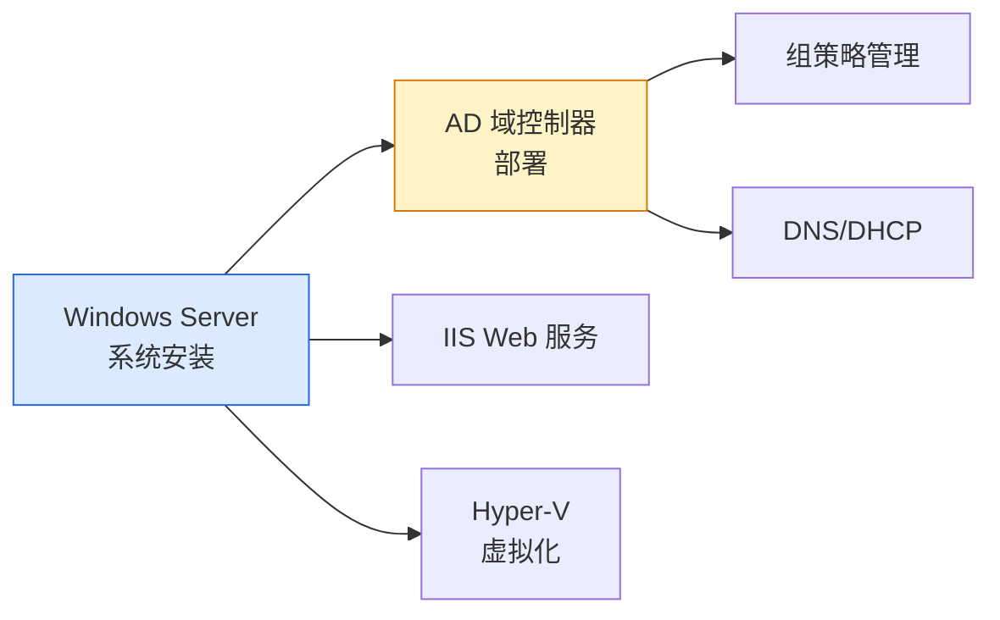

# Windows Server 2016 部署教程：企业级服务器系统安装

## 前言

Windows Server 2016 是微软面向企业数据中心的核心服务器操作系统。虽然 Windows Server 2022 和 2025 已发布，但 2016 仍然是大量企业的生产环境主力版本——它的稳定性经过近十年的验证，学习它对于进入企业运维岗位非常有价值。

本教程面向新手，详细说明 Windows Server 2016 的安装与初始化配置。本文以虚拟机环境演示，物理机安装流程一致。

!!! note "关于操作示意图"
    本文部分安装界面的真实截图暂缺，现阶段先以文字步骤和关键选项说明操作。真实示意图将在后续更新中逐步补足。

!!! tip "Windows Server 各版本部署流程通用"
    **Windows Server 2016 / 2019 / 2022 / 2025 的安装部署流程完全一致。** 它们在安装界面、分区步骤、初始配置、角色添加等方面几乎没有区别——差异仅在于版本号、UI 细节和新功能。因此本站不再为每个 Server 版本单独撰写部署教程，学好这一篇即可通用于所有主流 Windows Server 版本。若要部署桌面版 Windows，可参考 [Windows 10 安装与系统配置教程](windows-10.md) 或 [Windows 11 部署教程](windows-11.md)。

!!! info "为什么学 2016 而不是最新版？"
    企业中「稳定压倒一切」。Windows Server 2016 的存量市场极大，面试和实际工作中遇到 2016 的概率远高于 2025。学好 2016 后，迁移到 2019/2022/2025 几乎没有障碍。

---

## Windows Server 2016 版本介绍

| 版本 | 适用场景 |
| --- | --- |
| **Standard** | 中小型企业，支持 2 台 Hyper-V 虚拟机 |
| **Datacenter** | 大型数据中心，无限 Hyper-V 虚拟机、SDN、存储直通 |
| **Essentials** | 微型企业（25 用户/50 设备限制） |

安装选项：

| 选项 | 说明 |
| --- | --- |
| **Desktop Experience** | 带完整 GUI 桌面（推荐给新手） |
| **Server Core** | 纯命令行，无桌面（占用资源少，适合生产） |

本教程选择 **Windows Server 2016 Standard (Desktop Experience)**——既有完整桌面便于学习，又是最通用的版本。

---

## 部署前准备

### 硬件要求

| 项目 | 最低配置 | 推荐配置 |
| --- | --- | --- |
| CPU | 1.4 GHz，64 位 | 2 Core 以上 |
| 内存 | 512 MB（Desktop Experience 需 2 GB） | 4 GB |
| 磁盘 | 32 GB | 60 GB |
| 网络 | 可联网 | 桥接模式 |

### 软件准备

| 软件 | 说明 | 下载地址 |
| --- | --- | --- |
| **Windows Server 2016 ISO** | 安装镜像 | [微软评估中心](https://www.microsoft.com/evalcenter/evaluate-windows-server-2016) |

!!! tip "评估版与正式版"
    微软提供 180 天免费评估版，到期可通过 `slmgr /rearm` 续期。评估版功能与正式版完全一致，非常适合学习。

---

## 创建虚拟机

VMware Workstation 创建虚拟机的通用步骤请参考 [Ubuntu 22.04 部署教程](../linux/ubuntu-22.04.md#创建虚拟机)。以下仅列出 Windows Server 特有关键设置：

### 客户机操作系统

```text
Microsoft Windows → Windows Server 2016
```

### 虚拟机规格

```text
CPU：2 Core
内存：4096 MB（4 GB）
磁盘：60 GB
网络：桥接模式
```

---

## 安装 Windows Server 2016

### 启动安装

挂载 ISO → 开启虚拟机 → 看到引导提示按任意键 → 进入安装程序。

进入安装程序前，如果出现“Press any key to boot from CD or DVD”，按任意键从挂载的 ISO 启动。若虚拟机直接进入已有系统，检查虚拟机的 CD/DVD 是否已连接并指向正确的 ISO，再重启虚拟机。

---

### 语言和区域

选择语言、时间和键盘布局 → **「下一步」** → **「现在安装」**。

---

### 选择版本

选择 **「Windows Server 2016 Standard (Desktop Experience)」**。

!!! warning "务必选择 Desktop Experience"
    如果选 `Windows Server 2016 Standard`（不带 Desktop Experience），装完后只有命令行界面。新手务必选择带 **Desktop Experience** 的版本。

安装程序会列出 Standard、Datacenter 等版本，并区分是否带 Desktop Experience。请按授权和学习需求选择版本；本教程选择 **Windows Server 2016 Standard (Desktop Experience)**。确认选项名称中包含“Desktop Experience”后再继续。

---

### 接受许可条款

勾选 **「我接受许可条款」** → **「下一步」**。

---

### 选择安装类型

选择 **「自定义：仅安装 Windows（高级）」**。

---

### 磁盘分区

选择目标磁盘（60 GB）→ 直接 **「下一步」**，安装程序自动创建系统分区。

安装程序可能会自动创建多个系统分区，这是正常现象。继续前核对磁盘容量和目标磁盘；如果虚拟机连接了多块磁盘，确认选中的是预留给系统的那块。点击“下一步”会在目标磁盘上安装系统，请勿误选含有需要保留数据的磁盘。

安装过程约：

```text
15 ~ 25 分钟
```

---

## 初始设置

### 设置 Administrator 密码

首次启动后，系统提示设置 Administrator 密码。

!!! danger "Administrator 密码是最高权限"
    这是服务器最重要的密码，建议包含大小写字母、数字和特殊字符。

按提示设置并确认本地 `Administrator` 密码。安装程序会检查密码是否符合复杂度要求；如果不接受，按提示调整后重新输入。请在继续之前妥善保存密码。

---

### 登录系统

按 `Ctrl + Alt + Del`（虚拟机中按 `Ctrl + Alt + Insert`）→ 输入 Administrator 密码 → 登录。

登录成功后应进入 Windows Server 桌面，并自动打开 Server Manager。若认证失败，确认用户名为本机的 `Administrator`，并检查输入法、键盘布局及密码。

---

## 安装后配置

### Server Manager 概览

登录后自动打开 **Server Manager（服务器管理器）**，这是 Windows Server 管理控制台：

在 Server Manager 中可以查看本地服务器状态，并进入角色与功能、网络配置等管理入口。如果窗口没有自动打开，可从开始菜单搜索并启动“Server Manager”。

---

### 安装 VMware Tools（虚拟机）

VMware Workstation 菜单 → **「虚拟机」** → **「安装 VMware Tools」** → 按向导完成安装。

---

### 配置计算机名

Server Manager → 左侧 **「本地服务器」** → 点击计算机名 → **「更改」** → 输入新计算机名：

```text
SRV-2016
```

修改后需要重启。

---

### 配置静态 IP

Windows Server 应使用固定 IP：

1.  右键任务栏网络图标 → 打开网络和 Internet 设置
2.  更改适配器选项 → 右键以太网 → 属性
3.  双击 **「Internet 协议版本 4 (TCP/IPv4)」**
4.  填入静态 IP：

静态 IP、DNS 和 Windows 防火墙的基本概念及常见用途，可参考 [Windows 网络配置与防火墙说明](windows-10.md#network-configuration)。

| 字段 | 示例值 |
| --- | --- |
| IP 地址 | `192.168.1.50` |
| 子网掩码 | `255.255.255.0` |
| 默认网关 | `192.168.1.1` |
| DNS | `192.168.1.1` 或 `114.114.114.114` |

保存前核对 IP 地址、子网掩码、网关和 DNS 是否属于实际网络规划，避免与现有设备地址冲突。配置后可在命令提示符运行 `ipconfig /all` 检查地址和 DNS，并用 `ping <默认网关>` 测试基本连通性。

---

### 启用远程桌面

Server Manager → 左侧 **「本地服务器」** → 点击 **「远程桌面」** 旁的 **「已禁用」** → 选择 **「允许远程连接到此计算机」**。

确认远程桌面状态显示为已启用，并确保 Windows 防火墙允许远程桌面连接。然后从同一网络中的另一台设备连接服务器 IP，验证可以到达登录界面；仅启用设置并不代表网络路径和防火墙均已验证。

现在可以从局域网其他设备通过远程桌面连接管理服务器。

---

### Windows Update

设置 → 更新和安全 → Windows 更新 → 检查更新。

---

## Windows Server 核心概念速览

安装好系统后，了解以下核心概念有助于后续学习：

### 角色（Roles）

角色是服务器的功能定位。通过 Server Manager 的 **「添加角色和功能」** 向导安装：

| 常见角色 | 说明 |
| --- | --- |
| **Active Directory 域服务** | 域控制器，目录服务核心 |
| **DNS 服务器** | 域名解析（通常与 AD 搭配） |
| **DHCP 服务器** | 自动分配 IP 地址 |
| **文件服务器** | 共享文件夹、DFS |
| **Web 服务器 (IIS)** | 托管网站和应用 |
| **Hyper-V** | 虚拟化平台 |

### 功能（Features）

功能是为角色提供辅助支持的组件，如 .NET Framework、Windows Server Backup、Telnet Client 等。

### Active Directory 域服务（AD DS）

AD 是企业 Windows 网络的基石，提供：

-   **集中身份认证**：一个账号登录域内所有计算机
-   **组策略管理**：统一推送安全策略和软件配置
-   **目录服务**：存储用户、计算机、打印机等对象信息

安装 AD DS 角色并提升为域控制器后，一台 Windows Server 就变成了整个企业网络的身份和策略中枢。

---

## 常见问题

### 开机后只有命令提示符，没有桌面

说明安装了 Server Core 版本。建议重装并选择 **Desktop Experience** 版本。如果必须使用 Core，可执行 `sconfig` 进行基础配置。

---

### Administrator 密码忘记怎么办？

如果只是测试环境，最简单的方式是重装系统。生产环境中可使用 Windows PE 启动盘配合密码重置工具处理。

---

### 远程桌面连不上

1. 确认远程桌面已启用（见上文配置步骤）
2. 确认 Windows 防火墙允许远程桌面（默认启用时自动放行）
3. `ping` 测试网络连通性
4. 检查是否在同一网段

---

### 评估版到期怎么办？

```cmd
slmgr /rearm
```

可续期 180 天，最多续期 5 次。学习环境完全够用。

---

## 下一步学习



| 方向 | 教程 |
| --- | --- |
| **桌面系统** | [Windows 10 部署教程](windows-10.md) |
| **最新桌面** | [Windows 11 部署教程](windows-11.md) |
| **Linux 服务器** | [Ubuntu 22.04 部署教程](../linux/ubuntu-22.04.md) |
| **虚拟化平台** | [ESXi 7.0 部署教程](../vmware/esxi-7.0.md) |

---

## 总结

Windows Server 2016 是企业 IT 基础设施的重要组成，掌握它的安装与配置是运维工程师的基本功。本文涵盖了：

1. **版本选择**：Standard + Desktop Experience 最适合新手
2. **安装流程**：挂载 ISO → 磁盘分区 → 安装 → 设置密码
3. **初始化配置**：计算机名、静态 IP、远程桌面
4. **核心概念**：角色、功能、AD 域服务

Windows Server 的世界远不止安装系统——AD 域控、组策略、PowerShell 自动化才是它的真正威力所在。先把基础环境搭好，后续逐步深入。 🚀

## 推荐阅读

- [Windows 10 安装与系统配置教程](windows-10.md)——补充 Windows 网络配置、防火墙和远程桌面等通用客户端操作。
- [Windows 11 部署教程](windows-11.md)——对比新版本 Windows 的虚拟机要求与安装流程，了解 TPM 等版本差异。
- [Ubuntu 22.04 部署教程](../linux/ubuntu-22.04.md#创建虚拟机)——参考 VMware Workstation 创建虚拟机、配置硬件和挂载安装介质的通用步骤。
- [ESXi 7.0 部署教程](../vmware/esxi-7.0.md)——继续了解虚拟化平台部署，以及在虚拟机中运行服务器系统的基础环境。
