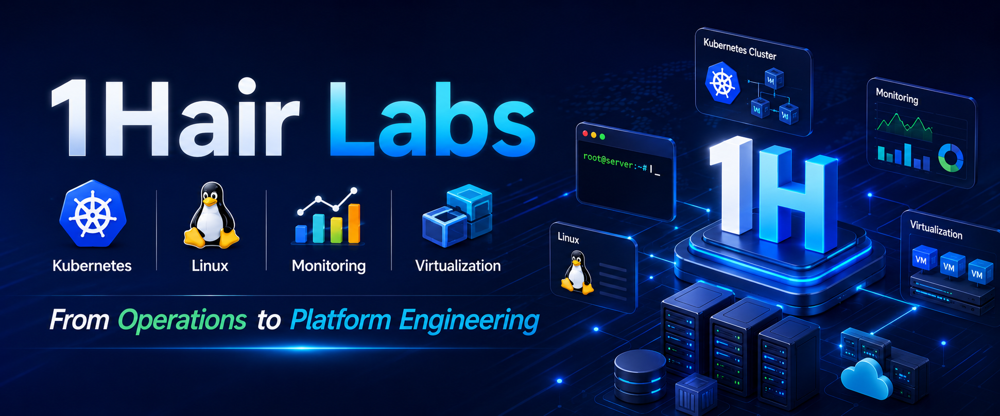

# 1HairLabs · 一根头发丝的宽度

## 云原生 · Kubernetes · Linux 技术实践实验室

专注于 **Linux、Kubernetes、Docker、云原生、可观测性（Observability）** 等技术方向，致力于打造一个**系统化、可持续更新的技术知识库**。

不同于零散的技术博客，本站更加关注知识之间的关联性，通过完整的学习路线、实践教程和故障案例，帮助读者真正理解技术背后的原理，而不仅仅是完成一次部署。

---

## 学习专题

### Linux 基础

Linux 是云原生技术体系的基础。

本专题包括：Linux 安装部署、文件系统、用户与权限、systemd、网络基础、存储管理、Shell 基础、常用运维命令。

👉 [进入 Linux 专题](linux/index.md)

---

### Kubernetes

本站核心专题，涵盖 Kubernetes 从入门到生产环境的完整知识体系。

包括：架构原理、Pod、Deployment、StatefulSet、Service、Ingress、ConfigMap、Secret、Scheduler、Storage、Network、Resource 管理、Troubleshooting。

👉 [进入 Kubernetes 专题](kubernetes/index.md)

---

### 可观测性

围绕 Prometheus、Grafana、Alertmanager、OpenTelemetry 构建完整的监控与告警体系。

👉 [进入可观测性专题](observability/index.md)

---

### 故障实验室

收录真实生产环境中经常遇到的问题及排查过程。

例如：Pod OOMKilled、CrashLoopBackOff、ImagePullBackOff、CPU Throttling、Node NotReady、PersistentVolume 故障、etcd 故障分析。

希望帮助读者不仅知道"如何解决"，更理解"为什么会发生"。

👉 [进入故障实验室](lab/index.md)

---

## 关于 1HairLabs

互联网从来不缺教程，真正稀缺的是：

- 为什么这样设计？
- 底层原理是什么？
- 企业生产环境是如何实践的？
- 遇到故障时应该如何定位和分析？

本站坚持以下原则：

- 📖 注重底层原理，而非命令堆砌
- 🧪 所有教程均经过实际验证
- 🔍 结合官方文档与生产实践持续更新
- 🚀 从基础到进阶，构建完整学习路径

---

> **持续学习，持续实践，持续分享。**
>
> —— 1HairLabs · 一根头发丝的宽度