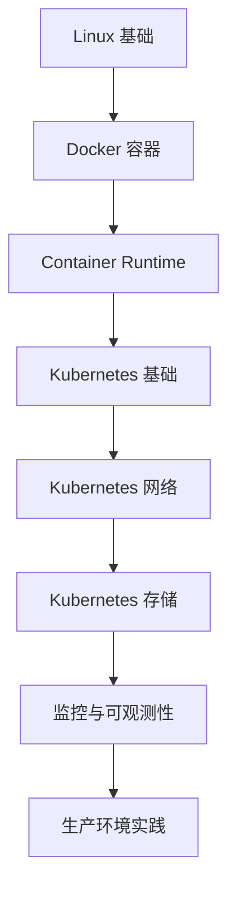

# 1HairLabs · 一根头发丝的宽度

## 云原生 · Kubernetes · Linux 技术实践实验室

专注于 **Linux、Kubernetes、Docker、云原生、可观测性（Observability）** 等技术方向，致力于打造一个**系统化、可持续更新的技术知识库**。

不同于零散的技术博客，本站更加关注知识之间的关联性，通过完整的学习路线、实践教程和故障案例，帮助读者真正理解技术背后的原理，而不仅仅是完成一次部署。

---

## 推荐学习路线

如果你刚开始学习 Linux 或 Kubernetes，建议按照下面的顺序学习。

未来每一个阶段都会持续补充完整的专题文章。

---

## 学习专题

### Linux 基础

Linux 是云原生技术体系的基础。

本专题包括：

- Linux 安装部署
- 文件系统
- 用户与权限
- systemd
- 网络基础
- 存储管理
- Shell 基础
- 常用运维命令

---

### Kubernetes

本站核心专题。

涵盖 Kubernetes 从入门到生产环境的完整知识体系。

包括：

- Kubernetes 架构
- Pod
- Deployment
- StatefulSet
- Service
- Ingress
- ConfigMap
- Secret
- Scheduler
- Storage
- Network
- Resource 管理
- Troubleshooting

---

### 云原生

围绕 CNCF 生态持续更新。

主要包括：

- Docker
- containerd
- Helm
- Harbor
- Prometheus
- Grafana
- Alertmanager
- OpenTelemetry
- Argo CD
- GitOps

未来还将持续补充更多生产实践内容。

---

### 故障实验室

这里收录真实生产环境中经常遇到的问题及排查过程。

例如：

- Pod OOMKilled
- CrashLoopBackOff
- ImagePullBackOff
- CPU Throttling
- Node NotReady
- PersistentVolume 故障
- etcd 故障分析

希望帮助读者不仅知道"如何解决"，更理解"为什么会发生"。

---

## 推荐阅读

如果你是第一次访问本站，可以优先阅读以下内容：

1. [Linux 系统部署教程](./deployment/linux/ubuntu-22.04.md)
2. Docker 入门实践
3. Kubernetes 基础架构
4. Kubernetes 核心资源对象
5. Kubernetes 网络模型
6. Kubernetes 存储体系
7. Prometheus + Grafana 监控体系
8. Kubernetes 故障排查实践

按照以上学习路线，可以逐步建立完整的云原生知识体系。

---

## 关于 1HairLabs

### 网站特色

- 系统化学习：所有文章按照知识体系组织，而不是简单按照发布时间排列。

- 注重原理：不仅介绍操作步骤，更关注底层设计思想和实现机制。

- 实践驱动：所有实验均来源于真实环境验证，尽可能还原企业生产场景。

- 持续更新：随着 Kubernetes、Linux 和云原生生态的发展，本站内容也将持续维护和完善。

互联网从来不缺教程。

真正稀缺的是：

- 为什么这样设计？
- 底层原理是什么？
- 企业生产环境是如何实践的？
- 遇到故障时应该如何定位和分析？

因此，1HairLabs 希望构建的不只是一个记录技术的博客，而是一套能够长期积累和持续完善的知识体系。

本站坚持以下原则：

- 📖 注重底层原理，而非命令堆砌
- 🧪 所有教程均经过实际验证
- 🔍 结合官方文档与生产实践持续更新
- 🚀 从基础到进阶，构建完整学习路径

1HairLabs 是一个专注于 **Linux、Kubernetes 与云原生技术** 的实践实验室。

希望通过持续输出高质量原创内容，帮助更多开发者、运维工程师和云原生学习者，从理解原理到掌握实践，构建属于自己的技术能力体系。

如果本站内容对你有所帮助，欢迎收藏本站，并关注微信公众号，与更多技术爱好者一起交流学习。

---

> **持续学习，持续实践，持续分享。**
>
> —— 1HairLabs · 一根头发丝的宽度