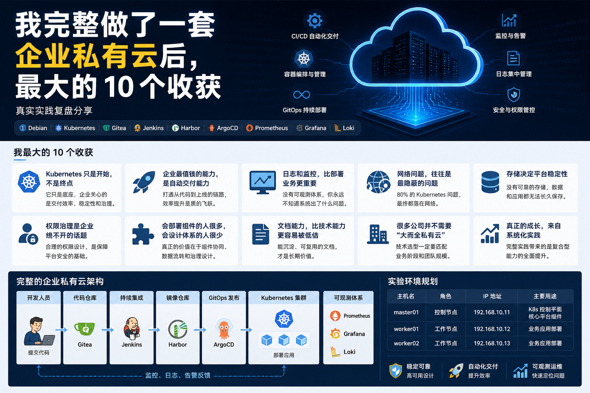

## 一、为什么写这篇文章

过去这段时间，我从零开始，完整做了一套企业私有云实验环境，整个链路包含：

```text
Debian
Kubernetes
Gitea
Jenkins
Harbor
ArgoCD
Prometheus
Grafana
Loki
```

从底层系统，到容器平台，再到 DevOps 与可观测体系，全部亲自部署、调试、踩坑、验证了一遍。

做完之后，我最大的感受是：

> 真正难的，从来不是部署软件。

而是理解企业平台背后的运行逻辑。

今天分享这次实践后，我最真实的 **10 个收获**。

---

# 收获一：Kubernetes 只是开始，不是终点

很多人学习云原生，第一目标就是把 Kubernetes 装起来。

但真正做完后你会发现：

```text
Kubernetes 只是底座
```

它解决的是：

- 应用运行
- 调度编排
- 自动恢复

但企业真正关心的是：

- 如何上线更快
- 如何减少故障
- 如何提高交付效率
- 如何控制权限
- 如何降低成本

也就是说：

> K8s 很重要，但它只是平台的一部分。

---

# 收获二：企业最值钱的能力，是自动交付能力

当我把整条链路打通：

```text
Gitea → Jenkins → Harbor → ArgoCD → Kubernetes
```

那一刻才真正理解：

> 为什么企业愿意投入大量资源做 DevOps。

因为这意味着：

开发提交代码后，可以自动：

- 构建
- 打包
- 推镜像
- 发布上线

这不是炫技，而是效率革命。

---

# 收获三：日志和监控，比部署业务更重要

很多人把业务跑起来就结束了。

但真实环境里，你迟早会遇到：

- Pod 重启
- 节点异常
- 服务超时
- CPU 飙高
- 内存泄漏

如果没有：

```text
Prometheus
Grafana
Loki
```

你根本不知道发生了什么。

所以我现在越来越认同一句话：

> 能运行，不代表能运维。

---

# 收获四：网络问题，往往是最隐蔽的问题

做实验过程中，我越来越理解为什么很多人说：

> Kubernetes 问题，多数最后都落在网络。

例如：

- Pod 无法互通
- DNS 解析异常
- Ingress 访问失败
- Service 转发异常
- MTU 导致偶发超时

网络问题往往最难定位，因为它不像报错那样直接。

---

# 收获五：存储决定平台稳定性

如果只是部署 Demo，存储无所谓。

但一旦进入真实场景：

- Jenkins 要保存任务数据
- Harbor 要保存镜像
- Grafana 要保存配置
- 数据库要持久化

你就会明白：

> 没有可靠存储的平台，只是临时平台。

---

# 收获六：权限治理是企业绕不开的话题

个人实验时，大家都喜欢 admin。

但企业环境里这是灾难。

真实需求是：

```text
开发只能发 dev
测试只能操作 test
运维才能动 prod
老板只能看报表
```

这就是为什么：

- RBAC
- Namespace
- 审计日志

这些能力如此重要。

---

# 收获七：会部署组件的人很多，会设计体系的人很少

这次做完整套环境后，我最大的认知变化之一是：

> 部署单个组件并不稀缺。

网上教程很多：

- Jenkins 安装
- Harbor 安装
- ArgoCD 安装

但真正有价值的是：

```text
这些组件如何协同工作？
数据如何流转？
权限如何设计？
故障如何处理？
如何持续扩展？
```

这叫平台思维。

---

# 收获八：文档能力，比技术能力更容易被低估

做完实验后，如果没有整理：

- 架构图
- 部署流程
- 踩坑记录
- 变更说明

几周后可能自己都忘了。

企业里更是如此。

所以我越来越重视：

> 能做出来很重要，能沉淀下来更重要。

---

# 收获九：很多公司并不需要“大而全私有云”

做完整套后，我也更理性了。

不是所有公司都适合：

```text
Kubernetes
Jenkins
ArgoCD
Harbor
多集群
服务网格
```

很多中小团队其实：

```text
Docker + 简单 CI/CD
```

就够了。

技术选型一定要匹配业务阶段。

---

# 收获十：真正的成长，来自系统化实践

单独学一个命令，一个组件，成长有限。

但当你完整做一套平台时，你会同时提升：

- Linux 能力
- 网络能力
- 存储能力
- Kubernetes 能力
- DevOps 能力
- 运维能力
- 架构思维

这类成长是复合型的，也是最有价值的。

---

# 最后总结一句话

做完这套企业私有云后，我最大的认知变化是：

> 技术的价值，不在于装了多少软件。
> 而在于是否解决了组织效率问题。

---

# 如果让我重新做一次，我会更重视这三件事

```text
1. 架构规划先行
2. 自动化优先
3. 可观测体系同步建设
```
