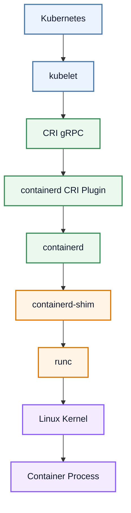
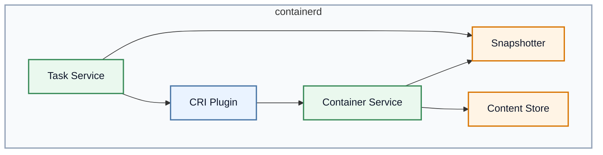
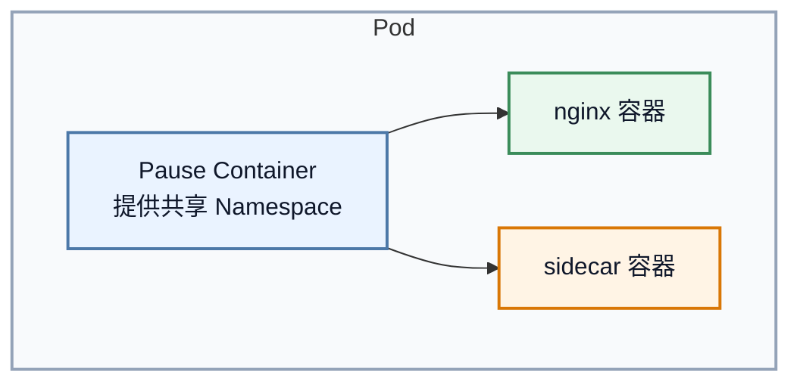
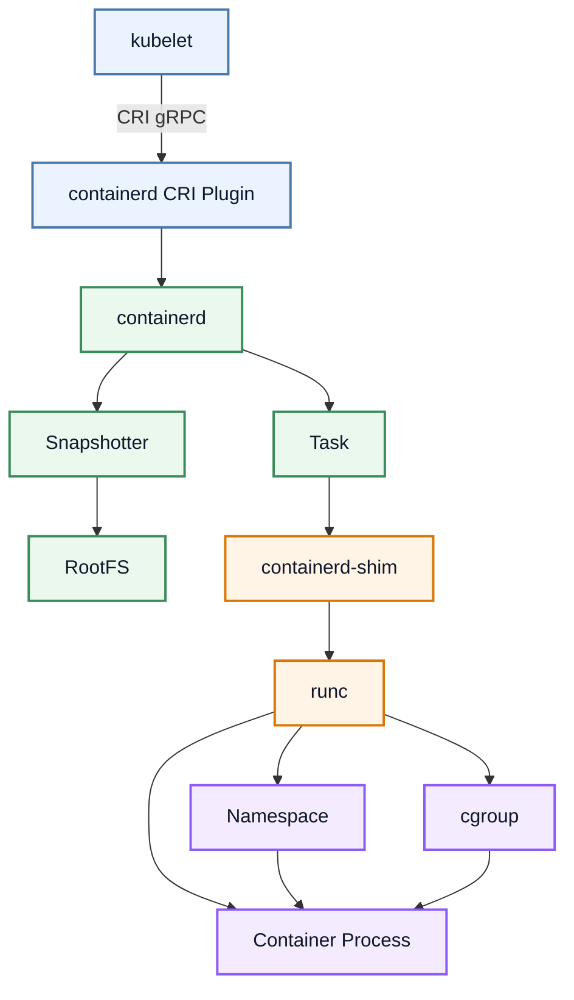

# Kubernetes containerd 原理：从 CRI 请求到 runc 启动容器全过程

## 文章摘要

前一篇文章讲到，kubelet 在创建 Pod 时，会通过 CRI gRPC 依次调用：

```text
RunPodSandbox()
CreateContainer()
StartContainer()
```

但这几个调用到底在 containerd 内部是怎么被处理的？containerd 收到这些请求后，究竟做了哪些事？

本文继续往下走一层，回答一个很多 Kubernetes 使用者真正想知道的问题：

> containerd 收到 kubelet 的 CRI 请求之后，到底发生了什么？

读完本文，你将理解：

- containerd 为什么是 Kubernetes 与 Linux 内核之间的重要桥梁
- `Container` 和 `Task` 的区别
- Snapshotter、Image Layer、rootfs 是怎样被拼装出来的
- `containerd-shim` 为什么存在
- `runc` 如何真正创建 Namespace、cgroup 和容器进程

---

## 一、引言：CRI 调用成功之后，容器真的创建了吗？

前一篇我们已经看到，kubelet 并不会亲手去执行 `runc`、创建 `namespace`、挂 `cgroup`。

它只是把“我想创建这个容器”的意图，通过 CRI gRPC 发送给 containerd。

但这里还有一个关键问题：

> containerd 收到请求以后，究竟做了什么？

很多人脑中这个链路会停留在一种非常粗糙的理解：

```text
kubelet
  ↓
containerd
  ↓
Container
```

但实际上，真正发生的事情要复杂得多：

```text
kubelet
  ↓
CRI gRPC
  ↓
containerd CRI Plugin
  ↓
containerd
  ↓
containerd-shim
  ↓
runc
  ↓
Linux Kernel
  ↓
Container
```

这条链路就是本文要讲清楚的核心内容。

---

## 二、containerd 在 Kubernetes 中的位置

先把定位说清楚：

containerd 不是 Kubernetes 的组件，它是一个独立的通用容器运行时。

它在 Kubernetes 中扮演的是：

- 作为 CRI 的一个实现者，接收 kubelet 的请求
- 作为容器生命周期管理器，负责创建、启动、停止、删除容器
- 作为 OCI Runtime 的执行者，把容器配置翻译成 runc 能执行的内容

典型关系如下：



所以可以把它理解成：

> kubelet 负责“决定创建什么”，CRI 负责“标准化请求”，containerd 负责“执行生命周期”，runc 负责“真正落地到 Linux”。

---

## 三、containerd 的整体架构：不是一个巨型单体

containerd 的设计思想非常值得学习：它不是一个被塞满所有功能的大而全程序，而是一个基于插件和服务拆分的系统。

从高层看，containerd 由几个关键模块组成：



### 3.1 CRI Plugin

这是 Kubernetes 接入的入口。

它负责把 kubelet 发来的 CRI 请求转换成 containerd 内部的对象和操作。

### 3.2 Container Service

这是容器对象管理层，负责：

- 管理 Container 元数据
- 管理 Sandbox
- 维护 containerd 内部的任务状态

### 3.3 Snapshotter

负责处理容器文件系统快照。

例如：OverlayFS、native snapshotter 等。

### 3.4 Content Store

负责镜像层内容的存储与分发。

如果把镜像理解成“多层压缩包”，那么 Content Store 就是这些层数据的仓库。

### 3.5 Task Service

这一层和“真正正在运行的容器进程”相关。

它会把 Container 对象变成一个正在运行的 Task。

---

## 四、containerd 为什么设计成插件化架构？

这个问题非常重要，因为它帮助我们理解 containerd 不是“一个大黑盒”。

containerd 的设计目标是：

- 让不同功能按模块解耦
- 支持不同的文件系统、镜像存储、runtime 方案
- 对 Kubernetes、Docker、CRI 等上层使用者提供统一接口

例如：

- `CRI Plugin`：给 Kubernetes 接入
- `Snapshotter`：负责 rootfs 的分层快照
- `Runtime Plugin`：负责调用 OCI runtime
- `Content Store`：负责镜像层缓存

这种设计的好处是：

- 维护成本低
- 扩展性强
- 能支持不同场景下的容器运行时实现

所以你可以把 containerd 理解为：

> 一套面向容器生命周期管理的“可插拔运行时基础设施”。

---

## 五、CRI 请求进入 containerd 的第一站：CRI Plugin

当 kubelet 调用 `CreateContainer()`、`StartContainer()` 等方法时，实际进入的是：

```text
containerd CRI Plugin
```

它通常暴露在：

```text
io.containerd.grpc.v1.cri
```

也就是说，CRI Plugin 是 kubelet 与 containerd 内部复杂逻辑之间的“翻译器”。

它做的事情包括：

- 将 CRI 请求转换成 containerd 内部对象
- 维护 Sandbox 与 Container 的关系
- 调用 Snapshotter 处理 rootfs
- 调用 Task Service 去启动运行中的进程

一句话概括：

> kubelet 只知道“我要创建一个容器”，CRI Plugin 会把它变成 containerd 能理解的内部操作。

---

## 六、Pod Sandbox 创建全过程：RunPodSandbox 是什么？

在 Kubernetes 里，Pod 并不是一个“普通容器”这么简单。

Pod 内多个容器共享一些基础的 Linux Namespace，例如：

- Network Namespace
- IPC Namespace
- UTS Namespace

因此在 Pods 的创建过程中，通常先需要一个基础环境，也就是 Sandbox。

### 6.1 为什么需要 Sandbox？

一个 Pod 的多个容器往往需要共享：

- 同一个网络命名空间
- 同一个 IPC 视图
- 同一个基础隔离边界

实现方式通常是先创建一个最小化的 Pause 容器，然后让业务容器共享它的 Namespace。



### 6.2 RunPodSandbox 做了什么？

当 kubelet 调用 `RunPodSandbox()` 时，containerd 会开始做下面这些动作：

1. 创建 Sandbox 对象
2. 创建一个最小容器（通常是 Pause 容器）
3. 生成相关 Namespace 配置
4. 调用 CNI 为其分配网络
5. 获取 Pod IP
6. 把这个 Sandbox 作为后续容器的基础环境

这就是为什么在 Pod 创建流程里，Sandbox 会先于业务容器出现。

---

## 七、CreateContainer：真正创建“容器配置对象”

当 `RunPodSandbox()` 完成后，kubelet 会继续执行：

```text
CreateContainer()
```

这里很容易混淆的一点是：

> `CreateContainer()` 并不等于“容器已经开始运行”。

它更像是：

- 准备容器配置
- 准备 rootfs
- 生成 OCI Spec
- 生成 containerd 内部对象

但此时还没有真正启动 Linux 进程。

### 7.1 Container 与 Task 的区别

containerd 里常常会把两个概念混在一起，但它们并不相同：

| 概念 | 含义 |
| --- | --- |
| Container | 容器的配置对象、元数据、运行时描述 |
| Task | 真正运行起来的进程实例 |

可以把它理解为：

```text
Container = 设计图
Task = 真实运行的实例
```

### 7.2 CreateContainer 的本质

`CreateContainer()` 的关键工作是：

- 根据镜像构建容器文件系统视图
- 生成容器的 OCI 配置
- 关联 Sandbox
- 准备挂载点、环境变量、资源约束
- 为后续 `StartContainer()` 提供基础对象

这个阶段，它并不会真正执行 `clone()`、`exec()`，也不会让进程真的开始跑。

---

## 八、Snapshotter：容器文件系统从哪里来？

容器镜像并不是“一个目录”，而是由多层文件系统组成的。

例如一个镜像可能包含：

- base layer
- app layer
- runtime layer

containerd 会把镜像层和容器可写层组合成一个新的文件系统视图，这一步靠的是 Snapshotter。

### 8.1 镜像层与可写层

典型流程是：

```text
Image Layer 1
Image Layer 2
Image Layer 3
+
Writable Layer
=
Container RootFS
```

### 8.2 OverlayFS 的意义

在 Linux 上，常用的做法是使用 OverlayFS 来做分层挂载。

这样可以做到：

- 镜像只读层复用
- 每个容器拥有自己的可写层
- 节省磁盘空间
- 提高容器启动和创建效率

所以你可以把 Snapshotter 理解为：

> 负责把镜像层和可写层拼成容器真正可使用的 rootfs 的那一层。

---

## 九、Task：真正运行起来的容器

当 containerd 完成 `CreateContainer()` 之后，下一步就是：

```text
StartContainer()
```

这一阶段，containerd 才会把之前准备好的配置真正交给运行时层。

### 9.1 Task 是什么？

Task 是一个“已经被创建出来并处于运行状态的进程实例”。

它有自己的：

- PID
- IO
- Exit status
- stdio
- lifecycle 状态

所以从理解上看：

```text
CreateContainer() -> 生成容器对象和配置
StartContainer() -> 生成 Task，并让它开始执行
```

---

## 十、containerd-shim 为什么存在？

这是本文最值得重点理解的部分之一。

很多初学者会问：

> containerd 不是已经在管理容器了吗？为什么还要多一个 `shim`？

原因很简单：

如果 containerd 直接把容器进程作为它自己的子进程管理，那么一旦 containerd 重启、崩溃、升级，容器进程可能会受到影响。

因此 containerd 设计了一个中间层：

```text
containerd
  ↓
containerd-shim
  ↓
runc
  ↓
container process
```

### 10.1 shim 的作用

`containerd-shim` 的作用主要有四个：

1. 作为容器进程与 containerd 的中间代理
2. 负责保存 stdio（标准输入输出）
3. 负责收集容器退出状态
4. 让 containerd 和容器进程解耦，提升稳定性

### 10.2 为什么要解耦？

因为容器进程本质上是一个 Linux 进程。

如果 containerd 直接持有它，那么 containerd 一旦重启，进程生命周期管理就会变得很脆弱。

shim 的引入，使得：

- containerd 只负责调度
- shim 负责和具体容器进程打交道
- 容器即使在父进程重启后也能继续稳定工作

这就是 containerd 设计中很关键的一层抽象。

---

## 十一、runc：真正创建 Linux 容器的人

很多人以为“docker 创建容器”，或者“containerd 创建容器”。

但更底层地看，真正做事的是：

```text
runc
```

runc 是 OCI Runtime 的代表实现。它负责把容器配置真正变成一个 Linux 进程。

### 11.1 Namespace：隔离基础

runc 会调用 Linux Kernel 创建各种 Namespace：

- PID Namespace
- Network Namespace
- Mount Namespace
- UTS Namespace
- IPC Namespace

这些 Namespace 使得容器看起来像一个“独立的系统环境”。

### 11.2 cgroup：资源限制

runc 还会设置 cgroup，限制容器占用的：

- CPU
- Memory
- IO
- Device

### 11.3 RootFS：挂载文件系统

runc 最终会把容器的 rootfs 挂到容器进程视角下，让进程看到一个完整的文件系统层次。

所以你可以把 runc 理解为：

> 把 OCI Spec 翻译成 Linux 内核调用的执行器。

---

## 十二、完整流程图：从 CRI 到 Linux 容器

把整个链路串起来，核心流程如下：



更贴近 Kubernetes 的视角，链路可以概括为：

```text
kubelet
  ↓
CRI gRPC
  ↓
containerd CRI Plugin
  ↓
containerd
  ↓
containerd-shim
  ↓
runc
  ↓
Linux Namespace + cgroup
  ↓
Container Process
```

---

## 十三、实践验证：建议在你自己的环境中测试

下面这些内容非常适合你在自己的实验环境中实操。它们不需要复杂的业务部署，就能帮助你把“概念”真正变成“可观察现象”。

> 下面的命令建议在你自己的 Kubernetes Worker Node 或单机 containerd 环境中执行，具体输出会因环境而不同。

### 13.1 查看 containerd 运行状态

```bash
systemctl status containerd
```

如果 containerd 正常，说明 kubelet 与 runtime 之间的通信基础是通的。

### 13.2 查看容器运行时信息

```bash
crictl info
```

这条命令会展示当前 runtime 的配置、CNI 配置以及 runtime 的基本状态。

### 13.3 查看当前 Pod Sandbox

```bash
sudo crictl pods
```

你会看到 kube-system 里的 pause 容器对应的 Sandbox，以及业务 Pod 的 Sandbox。

### 13.4 查看容器列表

```bash
sudo crictl ps -a
```

这一步可以观察到哪些容器已经创建、正在运行、已经退出。

### 13.5 查看容器详情

```bash
sudo crictl inspect <container-id>
```

从这里可以看到容器的 metadata、mounts、linux 配置以及 runtime 相关信息。

### 13.6 查看 containerd 自己管理的容器对象

```bash
sudo ctr containers ls
sudo ctr tasks ls
```

这两个命令很适合用来对照 `crictl` 的结果：

- `ctr containers ls`：查看 containerd 里注册的容器对象
- `ctr tasks ls`：查看当前运行中的 task

### 13.7 查看 containerd 日志

```bash
sudo journalctl -u containerd -f
```

如果 Pod 卡在 `ContainerCreating`，这一步往往最能直接看到问题根因。

### 13.8 查看 kubelet 与 runtime 的通信端点

```bash
sudo ls -l /run/containerd/containerd.sock
```

这说明 kubelet 与 containerd 之间的 gRPC 通信通道是存在的。

### 13.9 若安装了 runc，查看 runc 进程信息

```bash
sudo runc list
```

这一步能让你看到底有哪些容器已经被真正交给 runc 运行。

---

## 十四、故障排查：从哪里定位问题？

在实际环境中，如果 Pod 一直卡在 `ContainerCreating`，问题往往就出在这条链路的某一步。

### 14.1 Pod 卡在 ContainerCreating

常见原因：

- `CreateContainer` 失败
- Snapshotter 处理失败
- rootfs 创建失败
- CNI 配置错误
- 镜像拉取失败

### 14.2 看 containerd 日志

```bash
sudo journalctl -u containerd -f
```

### 14.3 看 kubelet 日志

```bash
sudo journalctl -u kubelet -f
```

### 14.4 看 Pod 事件

```bash
kubectl describe pod <pod-name>
```

这三者结合起来，基本就能把问题定位到：

- CRI 请求阶段
- containerd 内部阶段
- runc 启动阶段

---

## 十五、总结：containerd 是 Kubernetes 与 Linux 内核之间的桥梁

这篇文章真正想传递的核心理解是：

> kubelet 负责“决定创建什么”，CRI 负责“标准化请求”，containerd 负责“组织和执行容器生命周期”，runc 负责“把配置真正变成 Linux 进程”。

完整链路可以概括为：

```text
Kubernetes YAML
  ↓
API Server / Scheduler
  ↓
kubelet SyncPod
  ↓
CRI gRPC
  ↓
containerd CRI Plugin
  ↓
containerd
  ↓
containerd-shim
  ↓
runc
  ↓
Linux Namespace + cgroup
  ↓
Container Process
```

这条链路中，最容易被忽视的是：

- `CreateContainer` 只是“准备好容器对象”
- `StartContainer` 才是真正把进程启动起来
- `containerd-shim` 解决的是稳定性和生命周期解耦
- `runc` 才是真正落地到 Linux 的执行器

---

## 十六、相关阅读

| 文章 | 说明 |
| --- | --- |
| [Kubelet SyncLoop 原理](kubelet-syncloop.md) | 了解 kubelet 如何把 Pod 变成一系列 CRI 调用 |
| [Kubernetes CRI gRPC 调用详解](cri-grpc-deep.md) | 了解 kubelet 与 containerd 之间的 gRPC 请求结构 |
| [CRI 容器运行时接口](cri.md) | 理解 CRI、OCI、Docker、containerd 的整体关系 |
| [Kubernetes Worker Node 架构原理](worker-node.md) | 从全局视角理解 Worker Node 的执行链路 |

---

## 后续推荐路线

完成这篇后，Worker Node 深度系列已经基本把从 kubelet 到容器进程的链路串起来了。

下一篇最自然的衔接方向就是：

> Kubernetes Pod 生命周期源码解析：从 Pending 到 Running 到底经历了什么？

如果你继续往下走，后面再进入：

- Pod 生命周期
- CNI 网络初始化
- CSI 存储挂载
- 容器启动失败排查

这会让你从“组件介绍”真正升级为“完整运行链路解析”。
