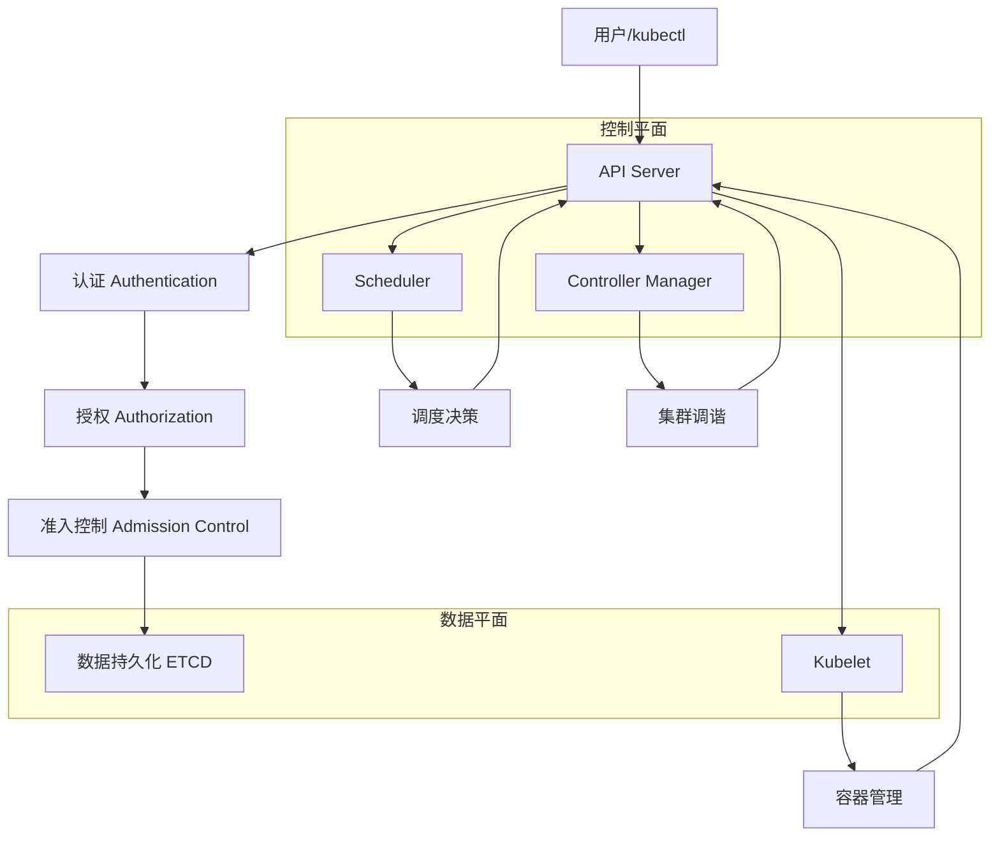
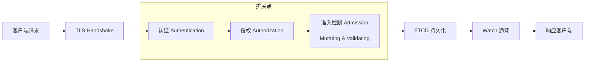
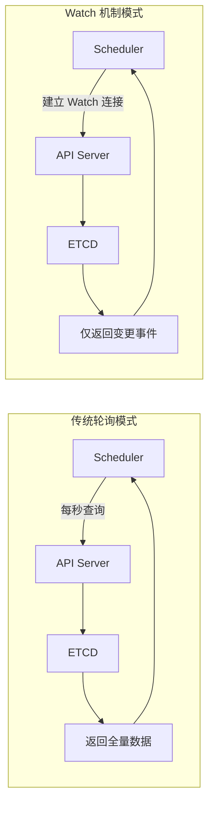
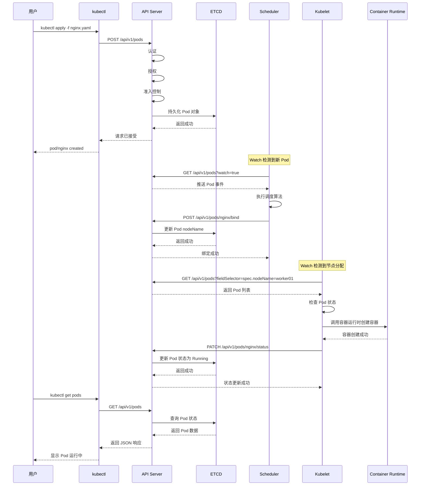
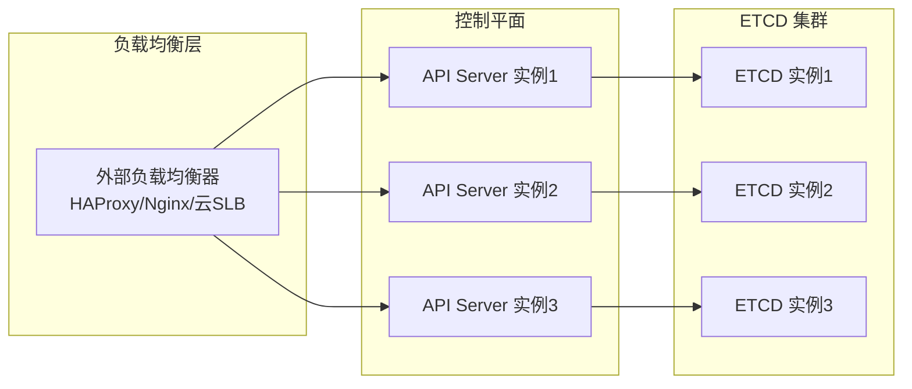

# Kubernetes API Server 详解：集群的神经中枢与统一入口


## 📌 文章摘要
API Server 是 Kubernetes 控制平面的**核心枢纽**和**唯一入口**，承担着认证、授权、准入控制、数据持久化等关键职责。本文将深入解析其架构设计、工作原理、Watch 机制、高可用方案及生产实践，帮助你全面掌握这个 Kubernetes 的“神经中枢”。

## 🎯 学习目标
阅读本文后，你将能够：

- 理解 API Server 在 Kubernetes 架构中的核心地位与设计哲学
- 掌握 API Server 的六大核心职责及其实现机制
- 深入理解 Watch 机制的工作原理与性能优势
- 分析 Pod 创建的完整流程与组件交互时序
- 设计并实施 API Server 的高可用架构
- 排查生产环境中的常见故障并优化性能

## 👥 适用人群
- Kubernetes 初学者与运维工程师
- 云原生架构师与平台开发者
- DevOps 工程师与 SRE 从业者
- 准备 CKA/CKS 认证考试的考生

---

## 🔍 一、API Server 是什么？设计哲学与核心价值

### 1.1 定义与角色
API Server 是 Kubernetes 控制平面的**前端接口**和**统一入口**，所有组件（kubectl、Scheduler、Controller Manager、Kubelet）和外部用户均通过其与集群交互。它类似于操作系统的“系统调用接口”，为 Kubernetes 集群提供了统一的 RESTful API。

### 1.2 设计哲学：为什么需要 API Server？
Kubernetes 采用“**中心化通信**”设计，而非组件间直接互联，主要基于以下考量：

| 设计目标 | 问题与挑战 | API Server 的解决方案 |
|---------|-----------|---------------------|
| **数据一致性** | 多组件直接访问 ETCD 易导致数据竞争与不一致 | 作为唯一 ETCD 访问者，提供事务性操作与乐观并发控制 |
| **安全性** | 直接暴露 ETCD 会增加攻击面与权限管理复杂度 | 统一认证授权层，实现细粒度访问控制（RBAC） |
| **可扩展性** | 组件耦合导致集群扩展困难 | 通过 API 聚合层支持自定义资源与扩展 |
| **可观测性** | 分散的组件难以统一监控与审计 | 集中记录所有操作日志与审计事件 |
| **稳定性** | 组件故障可能引发级联崩溃 | 作为中介，隔离组件故障影响范围 |

> 💡 **核心价值**：API Server 将“**存储**”（ETCD）与“**逻辑**”（其他控制平面组件）解耦，通过统一入口实现集群状态的原子性、一致性与隔离性管理。

---

## 🏗️ 二、架构位置与组件交互

### 2.1 整体架构视图




### 2.2 API Server 与其他组件的通信模式
所有 Kubernetes 组件均通过 API Server 进行通信，形成**星型拓扑**结构：

| 组件 | 与 API Server 交互方式 | 主要操作 |
|------|---------------------|---------|
| **kubectl** | HTTP/HTTPS REST 调用 | CRUD 操作、日志查询、端口转发 |
| **Scheduler** | Watch 机制 | 监听未调度 Pod，执行调度决策并绑定节点 |
| **Controller Manager** | Watch 机制 + 定期同步 | 监听资源状态变化，执行调谐操作 |
| **Kubelet** | 定期上报 + Watch 机制 | 汇报节点状态、接收 Pod 执行指令 |
| **Proxy** | Watch 机制 | 监听 Service/Endpoints 变化，更新 iptables/IPVS 规则 |

!!! warnning "注意"
    ETCD 仅被 API Server 直接访问，其他组件均通过 API Server 间接读写集群状态，确保了数据一致性与安全性

---

## ⚙️ 三、核心职责深度解析

### 3.1 请求处理流水线
API Server 的请求处理流程是一个**多阶段流水线**，每个阶段都有明确的职责与扩展点：




### 3.2 六大核心职责详解

#### 1️⃣ 请求接收与路由
- **功能**：接收所有 HTTP/HTTPS 请求，路由至对应处理逻辑
- **实现**：基于 Go 的 `net/http` 包，支持 RESTful 风格的 API 路由
- **默认端口**：`6443`（HTTPS）与 `8080`（HTTP，已废弃）
- **查看方式**：`ss -lntp | grep 6443`

#### 2️⃣ 认证
- **问题**：“你是谁？”
- **机制**：支持多种认证插件，可组合使用
    - **客户端证书**：最常用，基于 X.509 证书
    - **Bearer Token**：用于 ServiceAccount
    - **OIDC**：集成外部身份提供商（如 Keycloak、Auth0）
    - **Webhook Token**：对接外部认证服务
- **配置示例**：
```yaml
# /etc/kubernetes/manifests/kube-apiserver.yaml
–client-ca-file=/etc/kubernetes/pki/ca.crt
–tls-cert-file=/etc/kubernetes/pki/apiserver.crt
–tls-private-key-file=/etc/kubernetes/pki/apiserver.key
–oidc-issuer-url=https://accounts.google.com
–oidc-client-id=kubernetes
```

#### 3️⃣ 授权
- **问题**：“你能做什么？”
- **模式**：主要基于 **RBAC**（Role-Based Access Control）
- **核心概念**：
    - **Role/ClusterRole**：定义权限规则
    - **RoleBinding/ClusterRoleBinding**：将角色绑定到用户/组
- **示例策略**：

```yaml
# 允许 default 命名空间的 Pod 读权限
apiVersion: rbac.authorization.k8s.io/v1
kind: Role
metadata:
  namespace: default
  name: pod-reader
rules:
  - apiGroups: [“”]
    resources: [“pods”]
    verbs: [“get”, “watch”, “list”]
```


#### 4️⃣ 准入控制
- **阶段**：在资源对象持久化到 ETCD 前的最后检查
- **类型**：
    - **Mutating Admission Webhook**：可修改对象（如注入 sidecar、添加默认标签）
    - **Validating Admission Webhook**：仅验证对象（如检查资源限制、镜像来源）
- **内置准入控制器**：
    - `NamespaceLifecycle`：防止在正在删除的命名空间中创建对象
    - `LimitRanger`：确保资源使用不超过 LimitRange 限制
    - `ServiceAccount`：自动为 Pod 添加 ServiceAccount
    - `DefaultStorageClass`：自动为 PVC 添加默认 StorageClass
- **自定义示例**：使用 OPA Gatekeeper 实现策略即代码

#### 5️⃣ 数据持久化
- **存储后端**：ETCD（分布式键值存储）
- **数据模型**：
    - 以 `/registry/{resource}/{namespace}/{name}` 格式存储
    - 使用乐观并发控制（基于 ResourceVersion）
- **性能优化**：
    - 启用 ETCD 自动压缩与碎片整理
    - 合理设置 `--default-watch-cache-size`（默认 100）
    - 监控 ETCD 磁盘 IOPS 与延迟

#### 6️⃣ 统一查询接口
- **功能**：提供集群资源的统一查询入口
- **特性**：
    - **分页**：支持 `limit` 与 `continue` 参数
    - **过滤**：基于标签选择器与字段选择器
    - **Watch**：支持长轮询监听资源变化
    - **缓存**：内置 Watch 缓存，减少 ETCD 访问压力

---

## 🔔 四、Watch 机制：高性能的关键

### 4.1 传统轮询 vs Watch 机制




### 4.2 Watch 的工作原理
1. **客户端**（如 Scheduler）向 API Server 发起 Watch 请求
2. **API Server** 将请求转发至 ETCD 的 Watch 接口
3. **ETCD** 返回当前资源状态作为初始事件
4. **API Server** 将事件缓存至本地 Watch Cache
5. **后续变更**：ETCD 通知 API Server，API Server 转发给相关 Watch 客户端

### 4.3 Watch 的优势
| 指标 | 传统轮询 | Watch 机制 | 优势 |
|------|---------|-----------|------|
| **网络开销** | 高（每次全量传输） | 低（仅增量传输） | 减少 90%+ 网络流量 |
| **CPU 消耗** | 高（频繁序列化/反序列化） | 低（仅处理事件） | 降低 API Server 负载 |
| **响应延迟** | 秒级（依赖轮询间隔） | 毫秒级（事件驱动） | 实时响应集群变化 |
| **ETCD 压力** | 高（频繁全量查询） | 低（仅初始查询+变更监听） | 保护 ETCD 性能 |

### 4.4 Watch 实现细节
- **资源版本**：每个资源对象有 `ResourceVersion`，表示其版本号
- **Watch Cache**：API Server 本地缓存，减少 ETCD 访问
- **Bookmark 事件**：定期发送，防止客户端超时断开
- **容错机制**：网络中断后自动重新建立 Watch，从最后接收的 ResourceVersion 继续

> 💡 **性能影响**：合理配置 `--default-watch-cache-size`（默认 100）可显著提升 Watch 性能，尤其在高规模集群中。

---

## 🚀 五、Pod 创建完整流程：端到端解析

### 5.1 流程时序图




### 5.2 关键阶段解析

1. **请求提交**：用户通过 kubectl 提交 Pod 定义至 API Server
2. **认证授权**：API Server 验证用户身份与权限
3. **准入控制**：检查资源配额、命名空间存在性等
4. **持久化**：将 Pod 对象写入 ETCD，此时状态为 `Pending`
5. **调度触发**：Scheduler 通过 Watch 机制检测到新 Pod
6. **调度决策**：Scheduler 根据资源请求、亲和性等策略选择节点
7. **节点绑定**：将 Pod 与节点绑定，更新 `nodeName` 字段
8. **容器创建**：Kubelet 检测到节点分配，调用容器运行时创建容器
9. **状态更新**：Kubelet 将 Pod 状态更新为 `Running`
10. **结果查询**：用户通过 kubectl 查看最终状态

> ⚠️ **常见误区**：Pod 写入 ETCD 后并不意味着容器立即启动，必须经过调度与 Kubelet 处理。

---

## 🛡️ 六、高可用架构设计

### 6.1 多实例部署架构



### 6.2 负载均衡方案对比
| 方案 | 优点 | 缺点 | 适用场景 |
|------|------|------|---------|
| **HAProxy + Keepalived** | 开源、成熟、支持健康检查 | 需额外部署 Keepalived | 自建机房 |
| **Nginx Plus** | 高性能、支持主动健康检查 | 商业授权 | 企业级部署 |
| **云厂商 SLB** | 全托管、自动扩缩容 | 云厂商绑定 | 公有云环境 |
| **MetalLB** | 开源、支持 BGP 模式 | 配置复杂 | 裸金属 Kubernetes |

### 6.3 关键配置要点
1. **API Server 参数**：
```bash
API Server 参数：--bind-address=0.0.0.0
--secure-port=6443
--advertise-address=<节点IP>
--allow-privileged=true
--enable-aggregator-routing=true
```

2. **ETCD 集群配置**：
    - 至少 3 个节点，保证奇数个节点
    - 启用 TLS 加密
    - 合理设置 `--quota-backend-bytes`（默认 2GB）
3. **负载均衡配置**：
    - 健康检查：`/healthz` 端点
    - 会话保持：基于客户端 IP
    - 超时设置：read timeout > 30s

---

## 🩺 七、生产环境运维与故障排查

### 7.1 常见故障与排查

#### 故障 1：API Server 无法访问
- **现象**：`kubectl get nodes` 返回 `connection refused`
- **排查步骤**：
    1. 检查 API Server 进程：`ps aux | grep kube-apiserver`
    2. 检查端口监听：`ss -lntp | grep 6443`
    3. 检查证书有效性：`openssl s_client -connect 127.0.0.1:6443`
    4. 查看日志：`journalctl -u kube-apiserver -n 100`

#### 故障 2：资源创建失败
- **现象**：`kubectl apply` 卡住或返回错误
- **排查步骤**：
    1. 检查准入控制器：`kubectl get validatingwebhookconfigurations`
    2. 检查资源配额：`kubectl describe resourcequota -n <namespace>`
    3. 检查命名空间状态：`kubectl get namespace <namespace>`
    4. 查看详细错误：`kubectl apply -f pod.yaml --v=6`

#### 故障 3：Pod 长时间 Pending
- **现象**：Pod 一直处于 `Pending` 状态
- **排查步骤**：
    1. 检查调度器状态：`kubectl get pods -n kube-system | grep scheduler`
    2. 查看 Pod 事件：`kubectl describe pod <pod-name>`
    3. 检查资源请求：`kubectl get nodes -o yaml | grep -A 10 allocatable`
    4. 检查亲和性规则：`kubectl get pod <pod-name> -o yaml | grep -A 10 affinity`

### 7.2 性能监控指标
| 指标 | 含义 | 告警阈值 |
|------|------|---------|
| `apiserver_request_duration_seconds` | 请求处理延迟 | P99 > 1s |
| `apiserver_request_total` | 请求总数 | 异常增长 |
| `etcd_request_duration_seconds` | ETCD 操作延迟 | P99 > 100ms |
| `apiserver_storage_size_bytes` | ETCD 存储大小 | > 2GB |
| `apiserver_watch_cache_size` | Watch 缓存大小 | 持续增长 |

### 7.3 运维最佳实践
1. **证书管理**：
    - 使用 cert-manager 自动管理证书
    - 设置证书过期告警
2. **备份策略**：
    - 定期备份 ETCD：`etcdctl snapshot save`
    - 测试恢复流程
3. **版本升级**：
    - 先升级 ETCD，再升级 API Server
    - 使用 `kubeadm upgrade` 工具
4. **安全加固**：
    - 禁用匿名访问：`--anonymous-auth=false`
    - 启用审计日志：`--audit-log-path`
    - 限制 API 访问源

---

## ❓ 八、面试常见问题与深度解答
??? info "面试常见问题与解答"
    #### Q1: Kubernetes 的统一入口是什么？为什么需要统一入口？
    **A**: API Server 是 Kubernetes 的统一入口。需要统一入口的原因包括：

    1. **数据一致性**：避免多组件直接访问 ETCD 导致数据竞争
    2. **安全性**：集中实现认证授权，减少攻击面
    3. **可扩展性**：通过 API 聚合支持自定义扩展
    4. **可观测性**：集中记录审计日志与监控指标

    #### Q2: Scheduler 如何获取 Pod 信息？为什么使用 Watch 而非轮询？
    **A**: Scheduler 通过 API Server 的 Watch 机制获取 Pod 信息。使用 Watch 的原因：

    1. **性能优势**：减少 90%+ 网络流量与 CPU 消耗
    2. **实时性**：毫秒级响应，优于秒级轮询
    3. **降低 ETCD 压力**：仅初始查询+变更监听，避免频繁全量查询
    4. **扩展性**：支持大规模集群（1000+ 节点）下高效运行
    
    #### Q3: API Server 宕机会怎样？如何保证高可用？
    **A**: API Server 宕机会导致：

    - 无法创建/删除/修改资源
    - 调度器无法调度新 Pod
    - 控制器无法执行调谐操作
    - Kubelet 无法上报状态（但已运行 Pod 继续运行）
    
    高可用方案：

    1. **多实例部署**：部署 3 个或更多 API Server 实例
    2. **负载均衡**：使用外部 LB 分发请求
    3. **ETCD 集群**：保证数据存储高可用
    4. **健康检查**：LB 定期检查 `/healthz` 端点
    
    #### Q4: 解释 API Server 的准入控制阶段
    **A**: 准入控制是在资源持久化前最后检查阶段，分为：

    1. **Mutating 阶段**：可修改对象（如注入 sidecar、添加默认标签）
    2. **Validating 阶段**：仅验证对象（如检查资源限制、镜像来源）
    
    > 内置准入控制器包括 `NamespaceLifecycle`、`LimitRanger`、`ServiceAccount` 等，可通过 Webhook 扩展自定义逻辑。
    
    #### Q5: 如何优化 API Server 性能？
    **A**: 优化方向包括：

    1. **Watch 缓存**：增大 `--default-watch-cache-size`（默认 100）
    2. **请求限流**：配置 `--max-requests-inflight`（默认 400）
    3. **ETCD 优化**：启用自动压缩、碎片整理、SSD 存储
    4. **资源清理**：定期清理已完成 Pod、无用 ConfigMap/Secret
    5. **证书优化**：使用较短的证书有效期，减少 OCSP 验证延迟

---

## 🔧 九、高级特性与扩展

### 9.1 API 聚合层
- **功能**：允许扩展 Kubernetes API，添加自定义资源
- **实现**：通过 `APIService` 对象注册自定义 API 聚合器
- **应用场景**：
    - Service Mesh（如 Istio）
    - 自定义控制器（如 Operator）
    - 第三方资源管理（如 Cert-Manager）

### 9.2 自定义资源定义（CRD）
- **定义**：通过 CRD 扩展 Kubernetes 原生资源类型
- **示例**：
```bash
kind: CustomResourceDefinition
metadata:
  name: crontabs.example.com
spec:
  group: example.com
  versions:
    - name: v1
      served: true
      storage: true
      schema:
        openAPIV3Schema:
          type: object
          properties:
            spec:
              type: object
              properties:
                cronSpec:
                  type: string
                image:
                  type: string
```


### 9.3 优先级与公平性
- **功能**：防止低优先级请求耗尽 API Server 资源
- **配置**：通过 `--enable-priority-and-fairness=true` 启用
- **队列管理**：基于优先级类划分请求队列

---

## 📚 十、总结与最佳实践

### 10.1 核心要点回顾
1. **统一入口**：API Server 是 Kubernetes 控制平面的唯一入口
2. **多阶段处理**：认证→授权→准入控制→持久化→Watch 通知
3. **Watch 机制**：事件驱动，高性能关键
4. **高可用设计**：多实例+负载均衡+ETCD 集群
5. **扩展性**：支持 CRD、API 聚合、Webhook 等扩展机制

### 10.2 生产环境最佳实践
1. **部署架构**：
    - 至少 3 个 API Server 实例
    - 外部负载均衡器分发请求
    - ETCD 集群独立部署（或混部但资源隔离）

2. **安全配置**：
```bash
# 禁用匿名访问
--anonymous-auth=false
# 启用 RBAC
--authorization-mode=Node,RBAC
# 启用审计日志
--audit-log-path=/var/log/kubernetes/audit.log
--audit-log-maxage=30
--audit-log-maxbackup=10
--audit-log-maxsize=100
```

3. **性能调优**：
```bash
性能调优：
# 增大 Watch 缓存
--default-watch-cache-size=200
# 限制并发请求
--max-requests-inflight=600
--max-mutating-requests-inflight=300
# 启用优先级与公平性
--enable-priority-and-fairness=true
```


4. **监控告警**：
    - 监控 API Server 请求延迟与错误率
    - 监控 ETCD 性能与存储大小
    - 设置证书过期告警
    - 监控 Watch 缓存命中率

### 10.3 延伸学习
- **官方文档**：[Kubernetes API Server 官方文档](https://kubernetes.io/docs/reference/command-line-tools-reference/kube-apiserver/)
- **深度阅读**：《Kubernetes 权威指南》第 4 版
- **实践项目**：使用 kubeadm 搭建多节点集群并模拟故障
- **社区资源**：Kubernetes SIG API Machinery 项目

---

## 📖 附录：常用运维命令速查
```bash
# 查看 API Server 状态
kubectl get pod -n kube-system -l component=kube-apiserver
# 查看组件日志
kubectl logs -n kube-system kube-apiserver-master01
# 健康检查
curl -k https://127.0.0.1:6443/healthz
# 查看指标
curl -k https://127.0.0.1:6443/metrics | grep apiserver_request_duration_seconds
# 查看审计日志
tail -f /var/log/kubernetes/audit.log | grep -i error
# 检查证书过期时间
openssl x509 -in /etc/kubernetes/pki/apiserver.crt -noout -dates
# 备份 ETCD
ETCDCTL_API=3 etcdctl snapshot save /backup/etcd-snapshot.db
# 查看 API 资源列表
kubectl api-resources
# 查看特定资源 API 版本
kubectl explain pod.spec
```

---

!!! info "🎯 最后建议"
    理解 API Server 不仅是掌握 Kubernetes 的关键，更是云原生架构的基础。  
    建议通过实际部署、故障模拟和性能测试，深入理解其设计哲学与实现原理。在生产环境中，始终遵循“最小权限原则”和“防御性编程”思想，确保集群安全与稳定。

## 相关阅读

* [Kubernetes Scheduler 工作原理](scheduler.md)
* [Kubernetes Controller Manager 工作原理](controller-manager.md)
* [Kubernetes Kubelet 工作原理](../node/kubelet.md)
* [Kubernetes ETCD 工作原理](etcd.md)
* [Kubernetes CNI 网络模型解析](../network/cni.md)
* [Kubernetes CSI 存储架构解析](../storage/csi-nfs-components.md)
