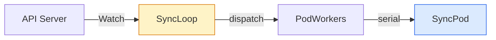
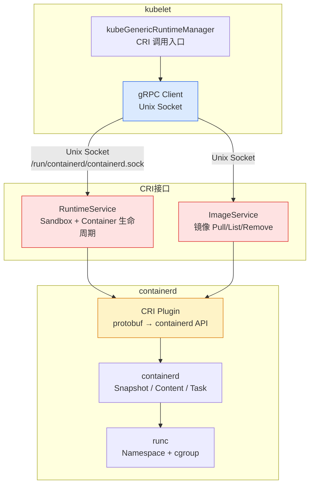
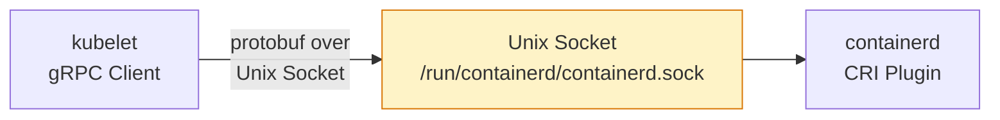
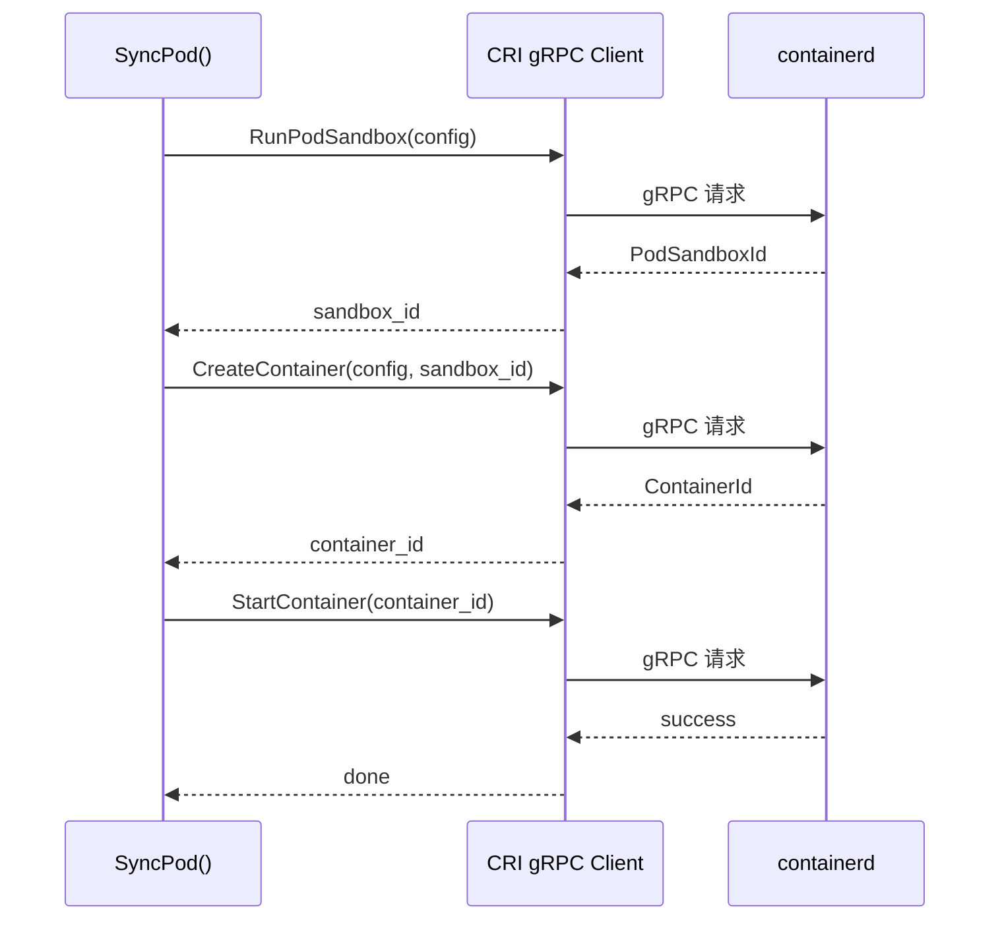
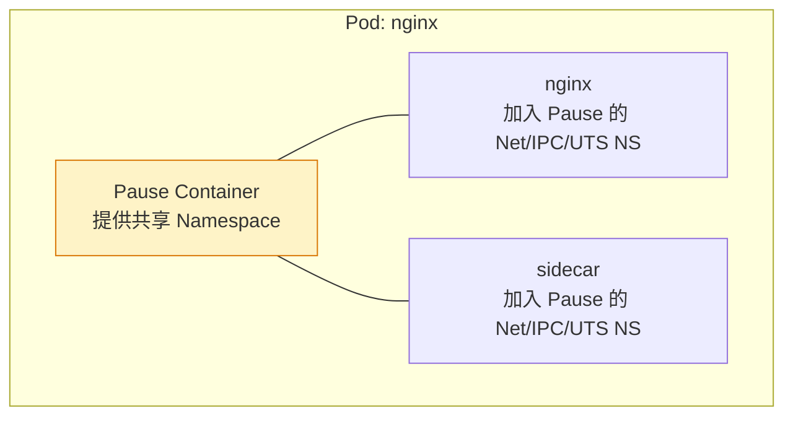
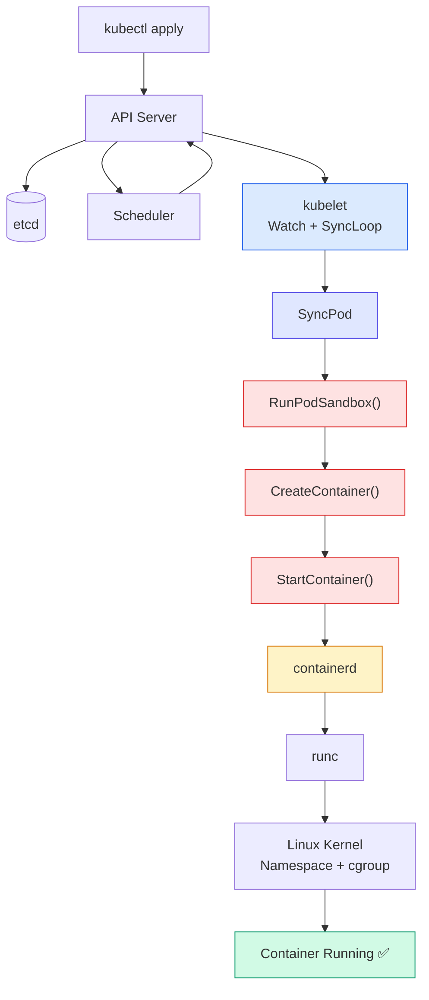
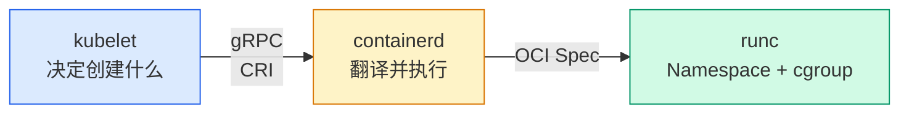

# Kubernetes CRI gRPC 调用详解：kubelet 如何调 containerd 创建 Pod？

## 文章摘要

上一篇 [Kubelet SyncLoop 原理](kubelet-syncloop.md) 讲到 `SyncPod()` 最终通过 CRI 调用 containerd，但没说 CRI 这一层具体长什么样。本文往下再钻一层：**kubelet 通过 gRPC 向 containerd 发了哪些请求？每个请求的参数和返回值是什么？**

读完你会理解：kubelet 自己不创建容器——它只是通过一条 Unix Socket 上的 gRPC 连接，向 containerd 依次发送 `RunPodSandbox` → `CreateContainer` → `StartContainer` 三个核心请求。

!!! info "与 CRI 概念文章的关系"
    本站已有 [CRI 容器运行时接口](cri.md) 全面介绍 CRI 的来龙去脉、OCI/Docker/containerd 生态对比。本文聚焦其中一层——**gRPC 协议层的具体调用**，是 SyncLoop 文章的深度延续。建议按顺序阅读：Worker Node 架构 → SyncLoop 原理 → CRI gRPC 调用。

---

## 一、引言：kubelet 创建 Pod 的最后一步是什么？

回顾前面的链路：



`SyncPod()` 决定「我要创建这个 Pod」。但 kubelet 自己不会创建容器——它不会调 runc、不会创建 Namespace、不会设 cgroup、不会拉镜像。

这些工作交给 **Container Runtime（containerd）**。kubelet 和 containerd 之间不是 shell 命令调用，也不是 Docker API，而是一条 **Unix Socket 上的 gRPC 连接**。

---

## 二、前置概念速览

!!! info "CRI 与 containerd 的基础概念请参考已发布的 [CRI 容器运行时接口](cri.md)"
    本文不再重复 CRI 的定义、OCI/Docker/containerd 生态对比等内容。这里仅做最简回顾：

-   **CRI**：Kubernetes 定义的容器运行时标准 gRPC 接口
-   **containerd**：实现了 CRI 的主流容器运行时（内置 CRI Plugin）
-   **kubelet ↔ containerd**：通过 Unix Socket（`/run/containerd/containerd.sock`）上的 gRPC 连接通信

下面直接进入 CRI 的协议层架构。

---

## 三、CRI 整体架构



| 层 | 组件 | 职责 |
| :---: | --- | --- |
| kubelet | `kubeGenericRuntimeManager` | SyncPod 中调 CRI 的入口 |
| CRI 接口 | `RuntimeService` + `ImageService` | protobuf 定义的标准 gRPC Service |
| containerd | CRI Plugin | 将 gRPC 请求转换为 containerd 内部 API |

!!! note "源码出处"
    `kubeGenericRuntimeManager` 及 `SyncPod()` 定义于：
    [`pkg/kubelet/kuberuntime/kuberuntime_manager.go`](https://github.com/kubernetes/kubernetes/blob/master/pkg/kubelet/kuberuntime/kuberuntime_manager.go)

---

## 四、CRI 为什么用 gRPC？

gRPC（Google Remote Procedure Call）让你**像调用本地函数一样调用远程服务**。在 CRI 场景中：

-   kubelet 调用 `RunPodSandbox()`——看起来像本地函数调用
-   实际上通过网络（Unix Socket）把请求序列化成 protobuf，发给 containerd
-   containerd 处理后返回 protobuf 响应

为什么不用 REST/HTTP？

| | gRPC | REST/HTTP |
| --- | :---: | :---: |
| **序列化** | Protobuf（二进制，体积小） | JSON（文本，体积大） |
| **传输** | HTTP/2（多路复用） | HTTP/1.1 |
| **流式** | 原生支持（Server/Client/Bidirectional Streaming） | 不支持 |
| **性能** | 高 | 中等 |
| **代码生成** | 从 `.proto` 自动生成客户端/服务端 | 无 |

对于 kubelet 和 containerd 这种高频调用的内部组件通信，gRPC 是最佳选择。

---

## 五、kubelet 如何连接 containerd？

查看 kubelet 的 Runtime 配置：

```bash
# kubeadm 部署
cat /var/lib/kubelet/kubeadm-flags.env
# --container-runtime-endpoint=unix:///run/containerd/containerd.sock

# 或查看 config.yaml
cat /var/lib/kubelet/config.yaml | grep containerRuntimeEndpoint
```

通信模型：



kubelet 启动时通过这个 Socket 建立 gRPC 长连接，后续所有 CRI 调用都复用这个连接。

---

## 六、CRI 核心接口：RuntimeService 与 ImageService

CRI 协议定义在 Kubernetes 源码的 `k8s.io/cri-api` 包中，核心是两个 gRPC Service：

| Service | 职责 | 核心方法 |
| --- | --- | --- |
| **RuntimeService** | 容器生命周期管理 | `RunPodSandbox` / `CreateContainer` / `StartContainer` / `StopContainer` / `RemoveContainer` |
| **ImageService** | 镜像管理 | `PullImage` / `ListImages` / `RemoveImage` / `ImageStatus` |

!!! note "源码出处"
    以下 protobuf 定义来源于 Kubernetes 源码仓库：
    [`staging/src/k8s.io/cri-api/pkg/apis/runtime/v1/api.proto`](https://github.com/kubernetes/kubernetes/blob/master/staging/src/k8s.io/cri-api/pkg/apis/runtime/v1/api.proto)
    本文对其做了简化，仅保留核心字段以说明原理。

```protobuf
// 简化版 CRI protobuf 定义
service RuntimeService {
    rpc RunPodSandbox(RunPodSandboxRequest) returns (RunPodSandboxResponse);
    rpc CreateContainer(CreateContainerRequest) returns (CreateContainerResponse);
    rpc StartContainer(StartContainerRequest) returns (StartContainerResponse);
    rpc StopContainer(StopContainerRequest) returns (StopContainerResponse);
    rpc RemoveContainer(RemoveContainerRequest) returns (RemoveContainerResponse);
    rpc ListPodSandbox(ListPodSandboxRequest) returns (ListPodSandboxResponse);
    rpc ListContainers(ListContainersRequest) returns (ListContainersResponse);
    rpc ContainerStatus(ContainerStatusRequest) returns (ContainerStatusResponse);
}

service ImageService {
    rpc PullImage(PullImageRequest) returns (PullImageResponse);
    rpc ListImages(ListImagesRequest) returns (ListImagesResponse);
    rpc RemoveImage(RemoveImageRequest) returns (RemoveImageResponse);
    rpc ImageStatus(ImageStatusRequest) returns (ImageStatusResponse);
}
```

---

## 七、SyncPod 内部到底调用哪些 CRI 方法？

回顾 [SyncLoop 文章](kubelet-syncloop.md)，SyncPod 执行时按顺序调三个核心 CRI 方法：



| 步骤 | CRI 方法 | 做了什么 | 返回 |
| :---: | --- | --- | --- |
| 1 | `RunPodSandbox` | 创建 Pod Sandbox（Pause 容器 + 网络命名空间） | `PodSandboxId` |
| 2 | `CreateContainer` | 创建业务容器（准备 rootfs、挂载卷） | `ContainerId` |
| 3 | `StartContainer` | 启动容器进程 | `success` |

下面逐个拆解每个调用。

---

## 八、RunPodSandbox：创建 Pod 基础环境

### 9.1 为什么需要 Sandbox？

Kubernetes 中 **Pod ≠ Container**。Pod 是多个容器共享的运行环境——它们共享同一个 Network Namespace、IPC Namespace 和 UTS Namespace。

实现方式是 Containerd 先创建一个 **Pause Container**（极简容器，只做一件事：永远 sleep），然后其他业务容器加入 Pause 容器的 Namespace：

!!! note "源码出处"
    Pause 容器镜像源码：`registry.k8s.io/pause`，GitHub 仓库：
    [kubernetes/kubernetes — `build/pause/`](https://github.com/kubernetes/kubernetes/tree/master/build/pause)



### 9.2 请求结构

```protobuf
message RunPodSandboxRequest {
    PodSandboxConfig config = 1;
    string runtime_handler = 2;
}

message PodSandboxConfig {
    PodSandboxMetadata metadata = 1;      // name, namespace, uid
    string hostname = 2;
    string log_directory = 3;
    DNSConfig dns_config = 4;
    repeated PortMapping port_mappings = 5;
    map<string, string> labels = 6;
    map<string, string> annotations = 7;
    LinuxPodSandboxConfig linux = 8;      // cgroup_parent, sysctls
    WindowsPodSandboxConfig windows = 9;
}
```

关键字段：

| 字段 | 作用 | 示例值 |
| --- | --- | --- |
| `metadata.name` | Pod 名称 | `nginx` |
| `metadata.namespace` | 命名空间 | `default` |
| `metadata.uid` | Pod UID | `c9c0a757-...` |
| `linux.cgroup_parent` | cgroup 父节点 | `kubepods-besteffort-...` |
| `labels` | Pod 标签 | `app: nginx` |

### 9.3 返回值

```protobuf
message RunPodSandboxResponse {
    string pod_sandbox_id = 1;
}
```

返回一个唯一的 Sandbox ID，后续 `CreateContainer` 时必须关联这个 ID——告诉 containerd「我创建的这个容器属于这个 Sandbox」。

---

## 九、CreateContainer：创建业务容器

### 10.1 请求结构

```protobuf
message CreateContainerRequest {
    string pod_sandbox_id = 1;             // 关联的 Sandbox
    ContainerConfig config = 2;            // 容器配置
    PodSandboxConfig sandbox_config = 3;   // Sandbox 配置（某些 Runtime 需要）
}

message ContainerConfig {
    ContainerMetadata metadata = 1;        // name
    ImageSpec image = 2;                   // image
    repeated string command = 3;           // ENTRYPOINT 覆盖
    repeated string args = 4;              // CMD 覆盖
    string working_dir = 5;
    repeated KeyValue envs = 6;            // 环境变量
    repeated Mount mounts = 7;             // 挂载点
    repeated Device devices = 8;
    map<string, string> labels = 9;
    map<string, string> annotations = 10;
    LinuxContainerConfig linux = 11;       // resources, security_context
}
```

关键字段：

| 字段 | 作用 | 示例值 |
| --- | --- | --- |
| `pod_sandbox_id` | 关联的 Sandbox | `ccf4b42657982` |
| `image.image` | 镜像地址 | `nginx:latest` |
| `command` | 覆盖 ENTRYPOINT | `["nginx", "-g", "daemon off;"]` |
| `envs` | 环境变量 | `PORT=80` |
| `mounts` | 卷挂载 | `/var/lib/data → /data` |
| `linux.resources` | CPU/内存限制 | `cpu.quota: 50000` |

### 10.2 返回值

```protobuf
message CreateContainerResponse {
    string container_id = 1;
}
```

返回 Container ID。注意：此时容器**还没启动**——只是创建了 rootfs、准备好了挂载点、生成了 OCI Spec。

!!! tip "CreateContainer vs StartContainer"
    `CreateContainer` 类似于 `fork()`——准备好了进程运行所需的一切，但进程还没开始执行。`StartContainer` 才相当于 `exec()`——真正启动进程。

---

## 十、StartContainer：启动容器

```protobuf
message StartContainerRequest {
    string container_id = 1;
}

message StartContainerResponse {}
```

这是最简单的 CRI 调用——只需要 Container ID。containerd 收到后，把之前 CreateContainer 准备好的 OCI Spec 交给 runc，runc 创建 Namespace、设置 cgroup、启动容器进程。

---

## 十一、完整调用链

从 kubectl 到容器进程的完整路径：



---

## 十二、实验验证

### 查看 Runtime 信息

```bash
crictl info
# {
#   "status": { ... },
#   "config": { ... },
#   "cniconfig": { ... }
# }
```

### 查看所有 Sandbox

```bash
sudo crictl pods
# POD ID              STATE     NAME                          NAMESPACE
# ccf4b42657982        Ready     nginx-test                    default
# bc4219b4ba4b6        Ready     kube-proxy-npt2l              kube-system
```

`crictl pods` 本质是调用 CRI 的 `ListPodSandbox`。

### 查看所有容器

```bash
sudo crictl ps
# CONTAINER           POD ID              STATE     NAME
# 012ced3c3b740       ccf4b42657982        Running   nginx-test
```

`crictl ps` 本质是调用 CRI 的 `ListContainers`。

### 查看容器详细信息

```bash
sudo crictl inspect <container_id>
```

可以看到完整的 OCI Spec——就是 `CreateContainer` 请求经过 containerd 处理后生成的最终配置，包含 Namespace、cgroup、挂载点等。

### 查看 kubelet 与 Runtime 的通信端

```bash
cat /var/lib/kubelet/kubeadm-flags.env | grep runtime
# --container-runtime-endpoint=unix:///run/containerd/containerd.sock

# 确认 Socket 存在
ls -la /run/containerd/containerd.sock
# srw-rw---- 1 root root 0 Jul 28 10:00 /run/containerd/containerd.sock
```

---

## 十三、常见故障排查

### Pod 一直卡在 ContainerCreating

CRI 调用链中某一步失败，Pod 就卡住。`kubectl describe pod` 看 Events：

| Events 关键字 | 失败的 CRI 调用 | 常见根因 |
| --- | :---: | --- |
| `Failed to create pod sandbox` | `RunPodSandbox` | CNI 插件异常、网络配置错误 |
| `Failed to pull image` | `PullImage`（ImageService） | 镜像仓库不通 / 认证失败 |
| `Failed to create container` | `CreateContainer` | 容器配置错误（挂载/环境变量） |
| `failed to start container` | `StartContainer` | runc 启动失败（资源不足） |

### kubelet 日志报 `failed to create pod sandbox`

```bash
journalctl -u kubelet -f | grep -i sandbox
```

通常原因：CNI 插件配置错误（`/etc/cni/net.d/` 下配置不全）或网络插件 Pod 未就绪。

### `rpc error: code = Unknown`

gRPC 调用层面报错。可能原因：

-   containerd 未运行：`systemctl status containerd`
-   containerd Socket 不可达：`ls -la /run/containerd/containerd.sock`
-   containerd 版本与 kubelet 不兼容（极少）

---

## 十四、总结：CRI 是 Kubernetes 与容器世界之间的桥梁

三层分工：



| 层 | 职责 |
| :---: | --- |
| **kubelet** | 决定：我要创建一个 Pod，配置如下…… |
| **CRI gRPC** | 翻译：通过 RunPodSandbox / CreateContainer / StartContainer 告诉 containerd |
| **containerd** | 执行：把 CRI 请求转成 OCI Spec，交给 runc |
| **runc** | 落地：Namespace + cgroup → 容器进程 |

最终链路：

```
声明式 YAML → API Server → Scheduler → kubelet SyncPod
    → CRI gRPC → containerd → runc → Linux Kernel → Container
```

---

## 十五、相关阅读

| 文章 | 说明 |
| --- | --- |
| [Worker Node 架构原理](worker-node.md) | 全局视角：六层执行链路 |
| [Kubelet SyncLoop 原理](kubelet-syncloop.md) | SyncPod 内部机制——本文是它的续篇 |
| [CRI 容器运行时接口](cri.md) | CRI/O CI/Docker/containerd 生态全貌 |
| [Kubelet 工作原理详解](kubelet.md) | kubelet 组件级深度解析 |
| [容器底层原理](../../linux/base-system/container-internals.md) | Linux Namespace + cgroup 动手实验 |

---

## 参考源码

本文涉及的 protobuf 定义、函数名和包路径均来源于 Kubernetes 源码仓库（`kubernetes/kubernetes`）：

| 引用内容 | 源码路径 |
| --- | --- |
| CRI protobuf 定义（`RuntimeService` / `ImageService` / 所有 message 定义） | [`staging/src/k8s.io/cri-api/pkg/apis/runtime/v1/api.proto`](https://github.com/kubernetes/kubernetes/blob/master/staging/src/k8s.io/cri-api/pkg/apis/runtime/v1/api.proto) |
| `kubeGenericRuntimeManager` / `SyncPod` | [`pkg/kubelet/kuberuntime/kuberuntime_manager.go`](https://github.com/kubernetes/kubernetes/blob/master/pkg/kubelet/kuberuntime/kuberuntime_manager.go) |
| Pause 容器 | [`build/pause/`](https://github.com/kubernetes/kubernetes/tree/master/build/pause) |
| SyncLoop 入口 | [`pkg/kubelet/kubelet.go`](https://github.com/kubernetes/kubernetes/blob/master/pkg/kubelet/kubelet.go) |

本文基于 Kubernetes v1.36.1 源码阅读整理，protobuf 定义做了简化（省略部分字段和 `Windows*` 等平台特定配置），仅保留核心结构以说明原理。

---

## 后续阅读建议

本文是 Worker Node 系列的第三篇。下一篇自然衔接：

> [Kubernetes containerd 原理：从 CRI 请求到 runc 启动容器全过程](containerd-from-cri-to-runc.md)

回答读者追问：containerd 收到 `CreateContainer` 后，到底发生了什么？形成完整链路：

```
kubelet → CRI gRPC → containerd → containerd-shim → runc → Linux Kernel
```
