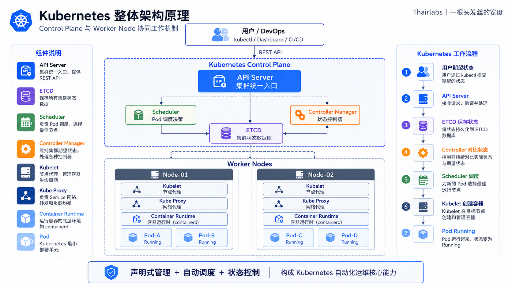

# Kubernetes 架构原理总览

## 概述

Kubernetes 是一个开源的容器编排平台，采用分布式的微服务架构。整个系统分为 **Control Plane（控制平面）** 和 **Worker Nodes（工作节点）** 两大部分，通过分布式设计、声明式配置和自动化管理，实现容器应用的高可用和自动扩展。

## 整体架构图



## 架构核心组件

### Control Plane（控制平面）
控制平面是 Kubernetes 集群的"大脑"，负责集群的全局决策、资源调度和状态维护。主要组件包括：

| 组件 | 功能 | 高可用方案 |
|------|------|----------|
| **API Server** | 集群资源的唯一入口，处理所有 REST 请求 | 多副本 + 负载均衡 |
| **Scheduler** | 监听新 Pod，选择合适的 Node 进行调度 | 单副本选举 |
| **Controller Manager** | 运行各种控制器，管理资源的声明状态 | 单副本选举 |
| **Etcd** | 分布式键值存储，保存所有集群数据 | 多副本分布式共识 |

### Worker Node（工作节点）
工作节点是实际运行容器的地方，每个节点包含：

| 组件 | 功能 |
|------|------|
| **Kubelet** | 节点代理，管理 Pod 的创建、运行和销毁 |
| **Kube Proxy** | 网络代理，维护网络规则，实现服务的负载均衡 |
| **Container Runtime** | 容器运行时（Docker、containerd 等），实际运行容器 |

### 扩展接口与插件

| 接口 | 功能 | 常见实现 |
|------|------|--------|
| **CNI** | 容器网络接口，处理 Pod 网络连接 | Calico、Flannel、Weave |
| **CSI** | 容器存储接口，提供动态存储卷管理 | Ceph、NFS、AWS EBS |
| **CRI** | 容器运行时接口，支持多种容器运行时 | Docker、containerd、CRI-O |

## 请求流程示例

### 创建 Pod 的完整流程

```
用户 kubectl apply -f pod.yaml
         ↓
    API Server（认证、授权、校验）
         ↓
    存储到 Etcd
         ↓
    Webhook 触发（如准入控制器）
         ↓
    Controller Manager（观察变化，触发相应控制器）
         ↓
    Scheduler（选择合适的 Node）
         ↓
    Kubelet（在 Node 上拉取镜像、启动容器）
         ↓
    Pod 运行，Kube Proxy 配置网络规则
         ↓
    用户可访问服务
```

## Kubernetes 的关键设计原则

1. **声明式配置**：用户声明期望状态，Kubernetes 自动调整现状达到期望。
2. **分布式架构**：无单点故障，支持高可用部署。
3. **自愈机制**：故障检测、自动重启、自动替换。
4. **可扩展性**：通过 CRD、Operator、Webhook 等机制扩展功能。
5. **多租户隔离**：通过 Namespace、RBAC、NetworkPolicy 等实现资源隔离。

## 常见高可用架构

### 单 Master 集群（开发测试用）
```
Master Node（API Server, Scheduler, Controller Manager, Etcd）
    ↓
Worker Nodes（Kubelet, Kube Proxy, Runtime）
```

### 高可用集群（生产推荐）
```
Load Balancer
    ↓
┌─────────────────────────────────┐
│  Master 1, Master 2, Master 3   │（API Server, Scheduler, Controller Manager）
│  Etcd 1, Etcd 2, Etcd 3         │（分布式共识）
└─────────────────────────────────┘
    ↓
┌───-──────────────────────────────┐
│ Worker 1, Worker 2, ..., Worker N│
└────-─────────────────────────────┘
```

## 深入学习路线

### Control Plane 组件
- [API Server](control-plane/api-server.md)：理解如何安全地提供集群接口
- [Scheduler](control-plane/scheduler.md)：掌握 Pod 调度决策过程
- [Controller Manager](control-plane/controller-manager.md)：了解控制器如何维护声明状态
- [Etcd](control-plane/etcd.md)：掌握数据一致性和高可用方案

### Worker Node 组件
- [Kubelet](node/kubelet.md)：深入节点级别的容器管理
- [Kube Proxy](network/kube-proxy.md)：理解服务网络实现

### 扩展接口
- [CNI](network/cni.md)：容器网络接口
- [CSI](storage/csi-nfs-components.md)：容器存储接口
- [CRI](node/cri.md)：容器运行时接口

### Kubernetes 资源
- [API 资源](resources/api-resources.md)：理解 API 分组和资源模型
- [工作负载资源](resources/workloads.md)：掌握 Deployment、StatefulSet、DaemonSet 等
- [服务资源](resources/server-resources.md)：理解 Service、Ingress 等网络资源
- [存储资源](storage/storage.md)：掌握 PVC、StorageClass、ConfigMap 等
- 网络资源：详见 [Network 专题](network/index.md)
- [安全资源](resources/security.md)：掌握 RBAC、SecurityContext 等
- [其他资源](resources/other-resources.md)：Namespace、ResourceQuota、HPA 等

## 常见问题

**Q：为什么需要分离 Control Plane 和 Worker Node？**

A：分离可以让控制平面专注于管理和决策，工作节点专注于运行应用，提高安全性和可靠性。

**Q：为什么 Kubernetes 要用 Etcd 而不是 SQL 数据库？**

A：Etcd 是分布式 KV 存储，支持强一致性、watch 机制、高可用等特性，特别适合 Kubernetes 的需求。

**Q：如何保证 Kubernetes 的高可用？**

A：通过 Etcd 分布式共识、API Server 多副本 + 负载均衡、Scheduler 和 Controller Manager 的选举机制实现。
