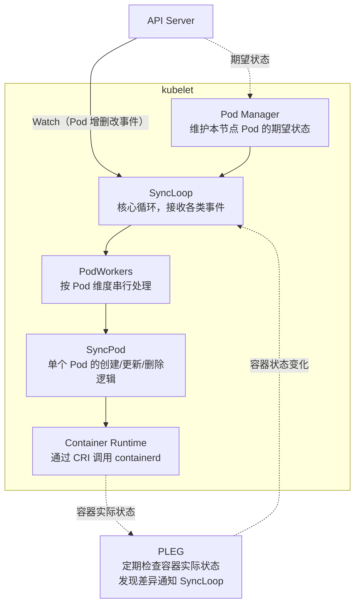
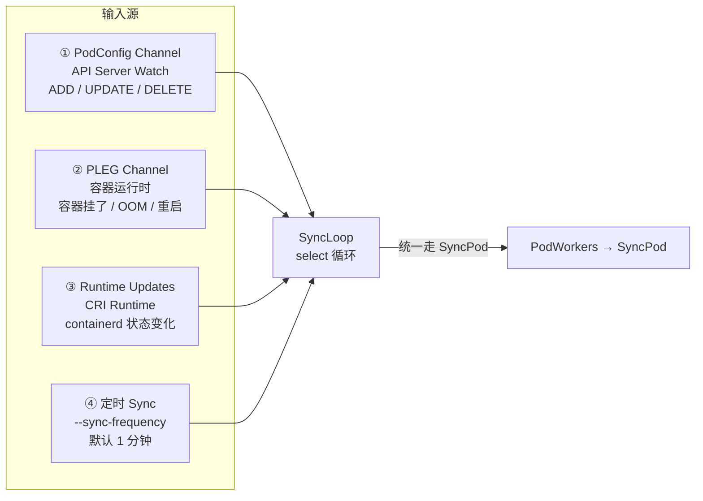
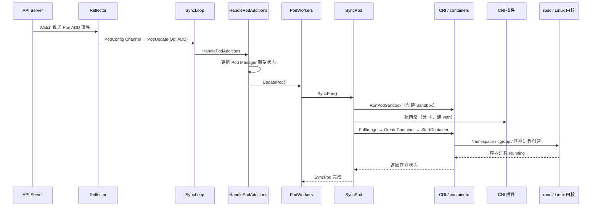
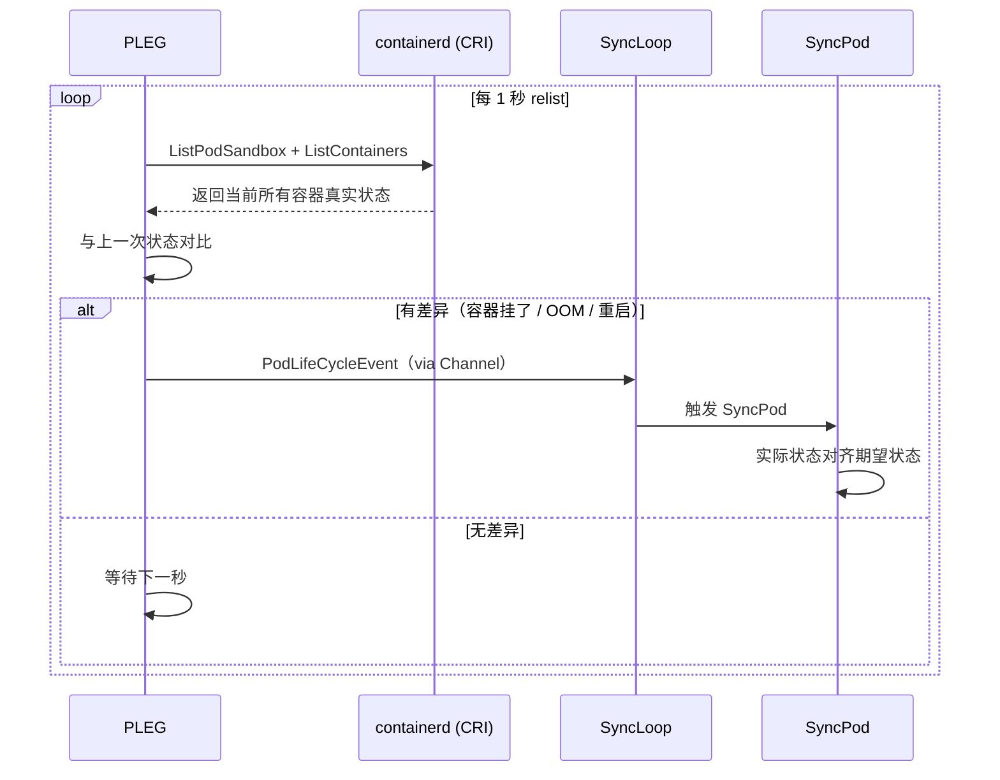
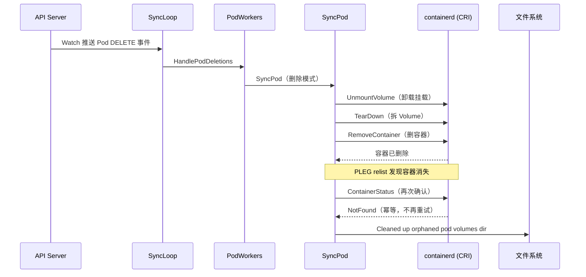
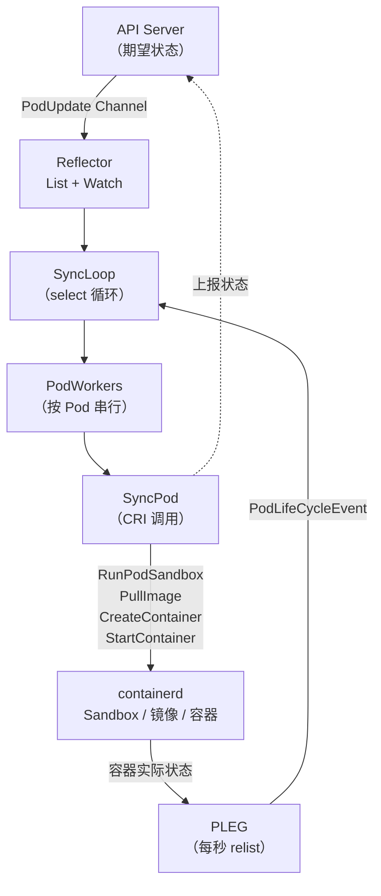

# Kubelet SyncLoop 工作原理：Pod 从 Watch 到容器创建的完整过程

## 文章摘要

上一篇 [Worker Node 架构原理](worker-node.md) 从全局视角讲了 API Server → Scheduler → kubelet → CRI → containerd → Linux 这条六层链路。但 kubelet 内部是怎么运转的？它怎么知道有新 Pod 分配给自己？知道之后又怎么一步步把容器跑起来？

本文往下钻一层——拆解 kubelet 的核心循环 SyncLoop，从 Reflector 的 List + Watch 发现任务，到 PodWorkers 的串行调度，到 SyncPod 的实际执行，再到 PLEG 的持续监控，把 kubelet 内部机制讲透。

Kubelet 的源码不像 API Server 那样有清晰的请求处理链路——它更像一个大循环，不断看、不断比、不断干。社区管这个叫 SyncLoop，是 kubelet 的心脏。

!!! info "阅读前建议"
    本文假设你已理解 [Worker Node 架构](worker-node.md) 中讲到的 kubelet → CRI → containerd → runc 执行链路。如果没有，建议先读那篇再看本文。本文以 K8s 1.36.1 源码为基准。

---

## Scheduler 只管选位，活儿都是 kubelet 的

回顾上一篇的核心结论：Scheduler 干的事就两件——选一个 Node，把 `spec.nodeName` 写回 API Server。它不拉镜像、不建容器、不配网络。一个 Pod 从 YAML 变成运行进程，Scheduler 只负责了「去哪里」这一步。

那「谁来干」呢？答案是 kubelet。

当 Scheduler 把绑定结果写回 API Server 之后，Pod 的 `spec.nodeName` 就变成了具体值（比如 `worker01`）。但这时候容器还没影——镜像没拉、Sandbox 没建、网络没配。接下来要发生的事情，全靠 `worker01` 上那个 kubelet。

那 kubelet 怎么知道有活来了？它不会每秒去轮询 API Server——那节点多了 API Server 早就扛不住了。它用的是 **Watch 机制**。

---

## 声明式系统的心脏：Reconcile Loop

在讲 Watch 之前，得先说一个更根本的东西。

Kubernetes 是声明式系统。你写一个 YAML 说「我要 3 个 nginx 副本」，API Server 把这个期望状态存进 etcd。然后有一堆组件负责让「实际状态」靠近期望状态。Controller Manager 干这事，kubelet 也干这事。

kubelet 的工作模式可以简化成一句话：**不断比较期望状态和实际状态，有差异就去消除差异。**

-   **期望状态**来自 API Server——PodSpec 说要一个 nginx 容器、资源限制多少、挂什么卷
-   **实际状态**来自容器运行时——containerd 报告容器在跑还是挂了

这个「不断比较、不断消除差异」的循环，社区叫 **Reconcile Loop（调谐循环）**。它是 Kubernetes 的核心设计思想——不只是 kubelet 在用，每一个 Controller 都有自己的调谐循环。区别在于 kubelet 的调谐对象是本节点的 Pod，粒度更细、实时性要求更高。

理解了这个，后面 SyncLoop 的设计就顺理成章了。

---

## kubelet 的整体架构：一个循环连着两头



两头：上面是 API Server，提供期望状态；下面是 Container Runtime（containerd），提供实际状态。中间的 SyncLoop 不停地把两边对齐。

PLEG 是右下角那个独立模块，全称 Pod Lifecycle Event Generator，专门负责感知容器侧的变化——这个后面会单独讲。

---

## kubelet 怎么发现 Pod：List + Watch

kubelet 启动时，会通过一个叫 **Reflector** 的组件跟 API Server 建立连接。Reflector 这个名字来自 `client-go` 的 `k8s.io/client-go/tools/cache` 包，它的工作模式是两步：**先 List，后 Watch**。

| 步骤 | 操作 | 目的 |
| :---: | --- | --- |
| **List** | kubelet 启动时调一次 List 接口 | 全量拉取本节点已分配的 Pod → 建立基准 |
| **Watch** | List 之后建立 HTTP/2 长连接 | 从本次 ResourceVersion 开始监听增量变更 |

Watch 推过来的事件类型很直接：

| 事件 | 触发条件 |
| :---: | --- |
| **ADD** | 新 Pod 被调度到本节点 |
| **UPDATE** | Pod 配置变了（镜像版本、资源限制等） |
| **DELETE** | Pod 被删除 |

这些事件被封装成 `PodUpdate` 结构，通过一个 Channel 传给 SyncLoop。到这一步，「发现任务」的环节就完成了。

!!! tip "为什么不轮询？"
    如果 kubelet 每秒轮询一次 API Server——100 个节点就是每秒 100 次 HTTP 请求。用 Watch 只需要 100 条长连接，有变化推送，没变化安静等待。省资源得多。

---

## SyncLoop：kubelet 的核心循环

这是全文重点。

SyncLoop 的入口在 kubelet 源码的 `pkg/kubelet/kubelet.go` 里。它是一个 `select` 循环，同时盯着**四路输入**：



| 输入源 | 来源 | 触发内容 |
| :---: | --- | --- |
| **① PodConfig Channel** | API Server Watch | ADD / UPDATE / DELETE 事件 |
| **② PLEG Channel** | 容器运行时 | 容器挂了、重启了、OOM 了 |
| **③ Runtime Updates** | CRI Runtime | containerd 侧状态变化 |
| **④ 定时 Sync** | `--sync-frequency` | 周期性全量同步（默认 1 分钟） |

四路输入汇总到 SyncLoop 的 `select` 里，谁来了处理谁。不管事件来自 API Server 还是容器运行时，处理逻辑是统一的——都走 SyncPod 这条路。

---

## 从 Watch 事件到容器创建：完整链路

拿一个新建 Pod 的 ADD 事件走一遍完整流程。



### 实验验证

在集群上跑一遍创建 → 删除，看 Events 的完整生命周期：

```bash
kubectl run nginx-test --image=nginx:alpine --restart=Never
kubectl delete pod nginx-test
kubectl get events --sort-by='.lastTimestamp' --field-selector involvedObject.name=nginx-test
```

```
LAST SEEN   TYPE     REASON      OBJECT           MESSAGE
7m7s        Normal   Scheduled   pod/nginx-test   Successfully assigned default/nginx-test to worker01
7m6s        Normal   Pulled      pod/nginx-test   Container image "..." already present on machine
7m6s        Normal   Created     pod/nginx-test   Container created
7m6s        Normal   Started     pod/nginx-test   Container started
11s         Normal   Killing     pod/nginx-test   Stopping container nginx-test
```

这五行事件刚好对应了 kubelet 的完整工作流：

-   `Scheduled` → Scheduler 选了 worker01
-   `Pulled` → SyncPod 里调了 `PullImage`（镜像本地已有则跳过）
-   `Created` → `CreateContainer` 完成
-   `Started` → `StartContainer` 完成
-   `Killing` → 删除流程

注意时间戳——Pulled、Created、Started 三步几乎在同一秒完成。

---

## 为什么不让 SyncLoop 直接创建容器？

核心原因是**并发控制**。

假设一个 Pod 同时收到 UPDATE 和 DELETE 两个事件——先更新配置再删除。如果 SyncLoop 直接处理，可能 UPDATE 还没创建完新容器，DELETE 就来了，两个操作交叉执行，状态就乱了。

**PodWorkers** 的设计解决了这个问题：

| 设计 | 说明 |
| --- | --- |
| **每 Pod 一个 Worker Goroutine** | 同一 Pod 的事件按顺序排队处理 |
| **不同 Pod 并行** | Pod A 和 Pod B 的 Worker 互不干扰 |
| **事件去重（Dedup）** | 快速更新 10 次镜像 → 只处理最新的那次 |

所以 SyncLoop 和 PodWorkers 的分工是：**SyncLoop 负责收事件和派活，PodWorkers 负责按 Pod 维度串行执行**。一个调度，一个执行。

---

## SyncPod：真正干活的函数

PodWorkers 的 Worker goroutine 拿到事件后，最终调用的就是 `SyncPod`。这个函数是真正执行 Pod 创建/更新/删除逻辑的地方。

### 第一步：创建 Pod Sandbox

kubelet 通过 CRI 调用 `RunPodSandbox`，让 containerd 创建基础容器（Pause 容器）。这个 Sandbox 提供了 Pod 级别共享的 Network Namespace、IPC Namespace 和 UTS Namespace。CNI 插件也在这阶段介入——给 Pod 分 IP、建 veth pair、配路由。

### 第二步：创建 Init Container

如果 PodSpec 里定义了 Init 容器，kubelet 会严格按顺序逐个创建和启动。每个 Init 容器必须成功退出（exit code 0），才会创建下一个。任何一个 Init 容器失败，整个流程卡住。

### 第三步：创建业务容器

Init 容器全部就绪后，kubelet 对 `containers` 数组中的每个容器执行三步：

| 步骤 | CRI 调用 | 说明 |
| :---: | --- | --- |
| 1 | `PullImage` | 拉镜像（本地已有 + imagePullPolicy 非 Always → 跳过） |
| 2 | `CreateContainer` | 准备 rootfs 和挂载 |
| 3 | `StartContainer` | 启动容器进程 |

containerd 拿到这些 CRI 请求后，把镜像转换成 OCI Runtime Spec，交给 runc。runc 才是真正调 Linux 系统调用的那一层——创建 Namespace、设 cgroup、启动容器进程。这跟 [Worker Node 架构](worker-node.md) 里讲的链路一致。

### 容器底层验证

在 worker01 上用 `crictl` 看看跑着的容器：

```bash
sudo crictl ps
```

```
CONTAINER           IMAGE               CREATED             STATE     NAME             POD ID
012ced3c3b740       ea51152ef8c48       4 minutes ago       Running   nginx-test       ccf4b42657982
298150763592b       78282b5844742       4 weeks ago         Running   kube-proxy       bc4219b4ba4b6
```

注意 Container ID 和 Pod ID 不是一回事。`crictl pods` 能看到 Sandbox 层面：

```bash
sudo crictl pods
```

```
POD ID              STATE     NAME                          NAMESPACE
ccf4b42657982        Ready     nginx-test                    default
bc4219b4ba4b6        Ready     kube-proxy-npt2l              kube-system
4a0ac310d069a        NotReady  calico-node-8tp5d             kube-system
```

最后一个 calico-node 的 Sandbox 状态是 NotReady——这是之前重启留下的旧 Sandbox，新的已经 Running 了。kubelet 的 PLEG 循环会发现这种「幽灵 Sandbox」并清理掉。

### 看 SyncPod 设的 cgroup 限制

一个没配 resource limits 的 Pod，kubelet 给了它什么默认设置？

```bash
sudo crictl inspect <CONTAINER_ID> | jq .info.runtimeSpec.linux.resources
```

```json
{
  "cpu": { "period": 100000, "shares": 2 },
  "devices": [{ "access": "rwm", "allow": false }],
  "memory": {},
  "unified": {
    "memory.oom.group": "1",
    "memory.swap.max": "0"
  }
}
```

| 字段 | 值 | 含义 |
| --- | --- | --- |
| `cpu.shares` | `2` | 最低权重——CPU 竞争中几乎拿不到资源 |
| `memory` | `{}` | 没设上限（无 resource limits 时） |
| `memory.swap.max` | `0` | 关掉 swap |
| `devices.allow` | `false` | 默认禁止访问所有设备 |

如果你在 YAML 里写了 `resources.limits.cpu: 500m`，这里会变成 `cpu.quota: 50000` / `cpu.period: 100000`（50ms/100ms = 0.5 核）。

到这里，Pod 的容器就算跑起来了。但 kubelet 的工作没完——它还得持续监控这些容器的状态。这就引出了 PLEG。

---

## PLEG：kubelet 的「眼睛」

创建完容器之后，kubelet 面临一个问题：**怎么知道容器还活着？**

API Server 推送的事件只反映「期望状态」的变化。但容器自己挂了、OOM 了、被手动 kill 了——这些是容器运行时那边发生的事，API Server 不会主动通知。

kubelet 需要一双眼睛盯着容器侧。这就是 **PLEG（Pod Lifecycle Event Generator）**。



### PLEG 的工作机制

| 阶段 | 操作 |
| :---: | --- |
| **① Relist** | 每隔 1 秒（源码硬编码）调用 CRI 的 `ListPodSandbox` + `ListContainers` |
| **② 对比** | 与内存中上一次记录的状态做 diff |
| **③ 生成事件** | 有差异 → 生成 `PodLifeCycleEvent` → 塞进 Channel → SyncLoop 收到通知 → 触发 SyncPod |

例如一个 nginx 容器 OOM 挂了，PLEG 发现它从 Running → Exited，通知 SyncLoop → SyncLoop 触发 SyncPod → SyncPod 发现「期望 = Running，实际 = Exited」→ 重新拉镜像、创建容器、启动。这就是**容器自动重启的底层机制**——不是 Controller Manager 远程重启的，是本节点 kubelet 通过 PLEG 感知后自己处理的。

### 为什么看不到 PLEG 日志？

```bash
sudo journalctl -u kubelet --since "5 min ago" | grep -i pleg
# 空的
```

默认日志级别（`--v=0`）下 PLEG 不输出日常操作日志。这很正常——PLEG 每秒 relist 一次，如果每次都输出日志，一天就是 86400 行无意义的日志。只有异常时（如 relist 超时）才会输出 `PLEG is not healthy`。

---

## PLEG 不健康会怎样？

生产环境里你可能见过这种告警：

```text
KubeletNotReady    PLEG is not healthy: pleg was last checked ...
```

PLEG 的 relist 循环每秒执行一次，但 containerd 响应 `ListContainers` 的速度不是 kubelet 能控制的。如果容器数量多、containerd 负载高、底层存储卡顿（containerd 要读 overlayfs 的状态），一次 relist 可能要好几秒甚至几十秒。

| 阈值 | 行为 |
| :---: | --- |
| **单次 relist > 几秒** | 正常延迟——不告警 |
| **连续 3 分钟无成功 relist** | kubelet 标记 PLEG 不健康 → Node → NotReady |

Node 一旦 NotReady：

-   Scheduler 不再往此节点调度新 Pod
-   已有 Pod 继续运行（容器没挂，只是 kubelet 失去感知能力）
-   Pod 手动 `crictl ps` 看起来都正常，但 kubelet 上报的状态已不正常

**排查方向**：看 kubelet 日志和 containerd 日志，不是去看 API Server。根因通常是容器运行时层面的问题。

---

## Pod 删除时 kubelet 在干什么？

删除 nginx-test 后，worker01 上的 kubelet 日志：

```bash
sudo journalctl -u kubelet --since "10 min ago" | grep -E "RemoveContainer|orphaned"
```

```
I0724 22:38:50.306  scope.go:122] "RemoveContainer" containerID="731ceb..."
I0724 22:38:50.313  scope.go:122] "RemoveContainer" containerID="731ceb..."
E0724 22:38:50.314  remote_runtime.go:569] "ContainerStatus failed"
    err="rpc error: code = NotFound desc = ... not found"
I0724 22:38:50.623  kubelet_volumes.go:161] "Cleaned up orphaned pod volumes dir"
```



| 步骤 | 操作 | 说明 |
| :---: | --- | --- |
| 1 | UnmountVolume | 卸载 Volume 挂载 |
| 2 | TearDown | 拆除 Volume |
| 3 | RemoveContainer | 删除容器 |
| 4 | ContainerStatus（二次确认） | PLEG relist 发现容器消失 → 再查一次 → 返回 NotFound → 幂等，不再重试 |
| 5 | Clean up orphaned volumes | 清理 Pod 的 Volume 目录 |

注意 RemoveContainer 出现了两次——第二次是 PLEG relist 发现的，但返回了 NotFound，kubelet 知道已经清理完了，不再重试。这不算错误。

从删除到清理完毕通常不到 1 秒。如果 Volume 用的网络存储（NFS、Ceph），这个时间可能拉长，这时候 PLEG relist 就可能超时。

---

## 生产环境故障排查

### Pod 一直卡在 ContainerCreating

Pod 卡在 ContainerCreating 意味着 SyncPod 流程里某一步走不下去了。`kubectl describe pod` 的 Events 部分会告诉你卡在哪：

| Events 中的关键字 | 卡在哪一步 | 常见根因 |
| --- | --- | --- |
| `Failed to pull image` | ImagePull | 镜像仓库不通 / Tag 错误 / 认证失败 |
| `MountVolume.SetUp failed` | Volume 挂载 | PVC 未绑定 / StorageClass 不匹配 / CSI 问题 |
| CNI related error | 网络配置 | CNI 插件异常——需看 Node 上 kubelet 日志 |

!!! warning "kubelet 日志 vs 控制面日志"
    控制面组件（API Server、Controller Manager、Scheduler）是静态 Pod，不走 systemd，所以 `journalctl -u kube-apiserver` 查不到日志。但 kubelet 自己是 systemd 服务，`journalctl -u kubelet` 可以直接用。

### Node 突然变 NotReady

| 日志关键信息 | 可能原因 | 排查命令 |
| --- | --- | --- |
| `PLEG is not healthy` | 容器运行时响应慢 | `systemctl status containerd` + containerd 日志 |
| `container runtime not ready` | kubelet 与 containerd 通信异常 | `systemctl status containerd` |
| 无特殊日志、心跳超时 | 网络问题或 kubelet 挂了 | `systemctl status kubelet` |

---

## 回顾整条链路

从 Watch 到容器创建到 PLEG 监控，完整链路串起来：



1. API Server 存了 Pod 的期望状态
2. kubelet 通过 Reflector 的 List + Watch 拿到本节点 Pod 事件
3. 事件进入 SyncLoop → 派给 PodWorkers
4. PodWorkers 按 Pod 维度串行调用 SyncPod
5. SyncPod 通过 CRI 让 containerd 创建 Sandbox → 拉镜像 → 建容器
6. 容器跑起来后，PLEG 每秒轮询容器状态，发现变化通知 SyncLoop → 触发新一轮 SyncPod
7. 循环不停运转，Pod 的实际状态持续向期望状态对齐

---

## 总结

上一篇 [Worker Node 架构](worker-node.md) 停在六层链路的架构理解层面。本文往下钻了一层——kubelet 内部怎么运转：

1. **Reflector（List + Watch）**：发现任务——不轮询，用长连接监听 Pod 变更
2. **SyncLoop（select 四路输入）**：核心调度——API Server 事件、PLEG 事件、Runtime 事件、定时 Sync，统一走 SyncPod
3. **PodWorkers**：并发控制——每 Pod 串行、Pod 间并行、事件去重
4. **SyncPod**：真正执行——Sandbox → Init → 容器三步，每步对应 CRI 调用
5. **PLEG（每秒 relist）**：容器的眼睛——从 containerd 拉真实状态，发现偏差通知 SyncLoop

再往下就是 CRI 的具体接口实现了——kubelet 调 containerd 的那层 gRPC 接口长什么样，SyncPod 里那些 CRI 调用的参数和返回值是什么意思。

---

## 相关阅读

| 文章 | 说明 |
| --- | --- |
| [Worker Node 架构原理](worker-node.md) | 全局视角——六层执行链路 |
| [Kubelet 工作原理详解](kubelet.md) | kubelet 组件级深度解析 |
| [CRI 容器运行时接口](cri.md) | kubelet 与 Runtime 之间的标准接口 |
| [Kubernetes 架构总览](index.md) | 控制面与 Node 全景图 |
| [容器底层原理](../../linux/base-system/container-internals.md) | Linux Namespace + cgroup 动手实验 |

