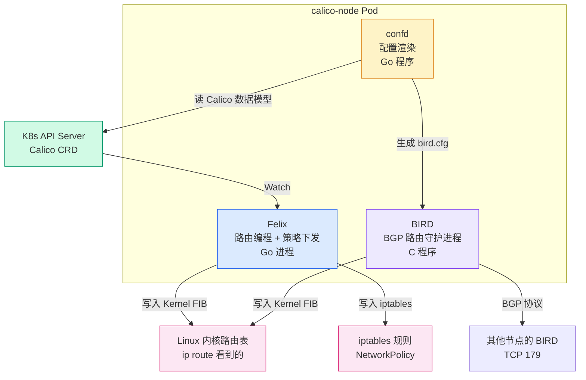
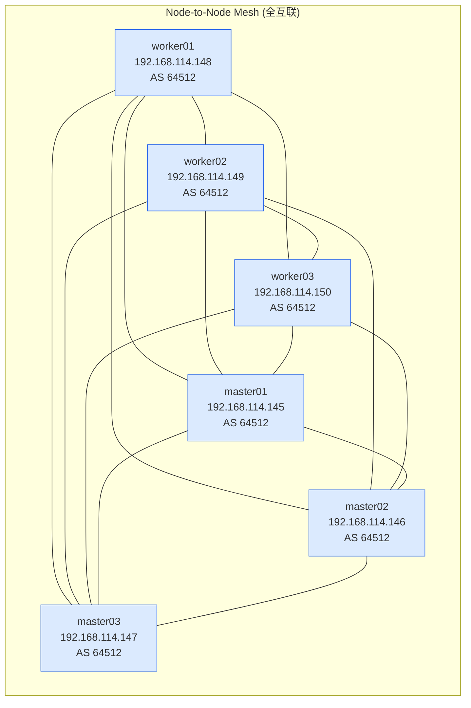
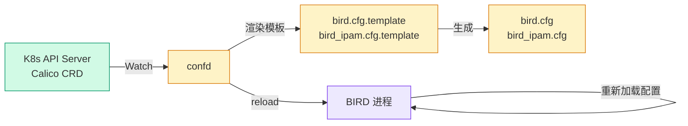
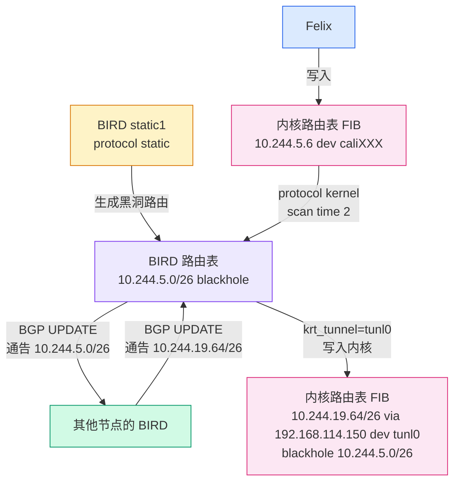
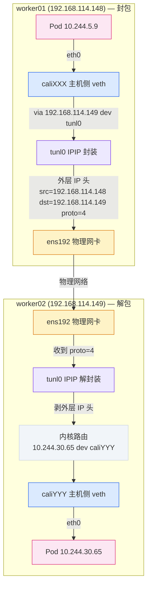
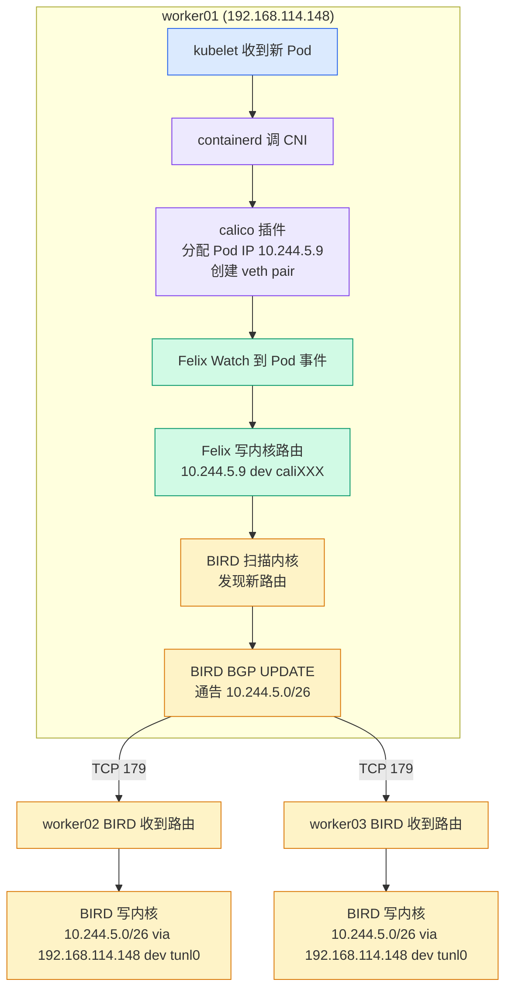
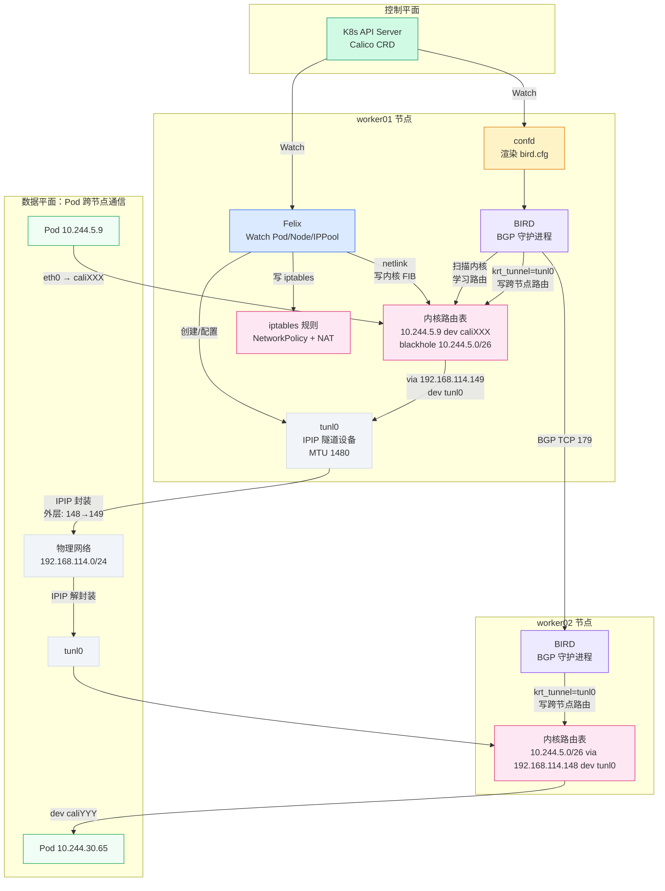

# Calico 跨节点通信：BGP 路由、BIRD 与 IPIP 隧道拆解

## 一、上一篇留下的坑

上一篇拆 Pod 网络创建全过程时，在路由表里留了几个问题。worker01 上的 `ip route` 输出是这样的：

```
default via 192.168.114.254 dev ens192 onlink
blackhole 10.244.5.0/26 proto bird
10.244.5.6 dev cali75a92f45e54 scope link
10.244.5.8 dev calibf2489e928a scope link
10.244.5.9 dev cali1cb4c5d100f scope link
10.244.19.64/26 via 192.168.114.150 dev tunl0 proto bird onlink
10.244.30.64/26 via 192.168.114.149 dev tunl0 proto bird onlink
10.244.59.192/26 via 192.168.114.146 dev tunl0 proto bird onlink
10.244.235.0/26 via 192.168.114.147 dev tunl0 proto bird onlink
10.244.241.64/26 via 192.168.114.145 dev tunl0 proto bird onlink
192.168.114.0/24 dev ens192 proto kernel scope link src 192.168.114.148
```

本节点的 Pod 路由（`10.244.5.x dev caliXXX`）上一篇文章已经拆完了——CNI 插件创建 veth pair 时配好的。但那五行 `via xxx dev tunl0 proto bird` 的跨节点路由，当时说"留到下一篇拆"，这篇就来填这个坑。

这些路由回答的核心问题是：**worker01 上的 Pod 要访问 worker02 上的 Pod，包怎么走？**

答案涉及三个关键组件：Felix（路由编程）、BIRD（BGP 路由交换）、IPIP 隧道（跨子网封装）。这篇逐一拆解。

## 二、Calico 组件架构总览

先看 Calico 在每个节点上跑了什么。Calico 不是一个单一进程，而是一组协作的组件，全部运行在 `calico-node` Pod 里。

```bash
kubectl get pods -n kube-system -l k8s-app=calico-node -o wide
```

```
NAME                READY   STATUS    RESTARTS      AGE   IP                NODE       NOMINATED NODE   READINESS GATES
calico-node-2dzjp   1/1     Running   2 (77d ago)   89d   192.168.114.145   master01   <none>           <none>
calico-node-746zp   1/1     Running   1 (77d ago)   89d   192.168.114.150   worker03   <none>           <none>
calico-node-8gfgp   1/1     Running   1 (77d ago)   89d   192.168.114.149   worker02   <none>           <none>
calico-node-8tp5d   1/1     Running   1 (77d ago)   89d   192.168.114.148   worker01   <none>           <none>
calico-node-bd5l6   1/1     Running   1 (77d ago)   89d   192.168.114.146   master02   <none>           <none>
calico-node-nwx29   1/1     Running   1 (77d ago)   89d   192.168.114.147   master03   <none>           <none>
```

每个节点一个 `calico-node` Pod，DaemonSet 部署。这个 Pod 里跑着几个核心进程：



各组件职责：

| 组件 | 语言 | 职责 | 不做的事 |
|------|------|------|---------|
| Felix | Go | 编程内核路由表和 iptables 规则、管理 IPIP 隧道设备 | BGP 路由交换 |
| BIRD | C | 运行 BGP 协议，和其他节点的 BIRD 交换路由信息 | 编程内核路由表（只管 BGP 层面） |
| confd | Go | 监听 Calico 数据模型变化，生成 BIRD 配置文件 | 路由编程、BGP 协议 |

!!! note "BIRD 名字由来"
    BIRD 全称 BIRD Internet Routing Daemon，是个开源的 BGP 路由守护进程。Calico 没有自己写 BGP 实现，而是直接用 BIRD。BIRD 本来是给传统网络路由器设计的，Calico 把它塞进了每个节点的 Pod 里，让每个 K8s 节点都变成一台"BGP 路由器"。

这里有个容易搞混的点：Felix 和 BIRD 都往内核路由表写东西，但分工不同。

- **Felix** 写的是本节点的 Pod 路由（`10.244.5.x dev caliXXX`）
- **BIRD** 写的是两类路由：从其他节点学来的跨节点路由（`10.244.19.64/26 via 192.168.114.150 dev tunl0`），以及本节点 Pod CIDR 的黑洞路由（`blackhole 10.244.5.0/26 proto bird`）——这个黑洞路由是 BIRD 的 `protocol static`（static1）生成的，不是 Felix 写的

两类路由都标记为 `proto bird`，容易混淆。但仔细看：本节点 Pod 路由的 `dev` 是 `caliXXX` 接口，跨节点路由的 `dev` 是 `tunl0` 隧道接口。

## 三、BGP 协议基础

要理解 BIRD 在做什么，得先理解 BGP 协议。不需要啃 RFC 4271，知道几个核心概念就够用。

### 什么是 BGP

BGP（Border Gateway Protocol）是互联网的路由协议——你家的路由器不知道百度的 IP 在哪，但它通过 BGP 从上游 ISP 学到了"发往百度的 IP 段走哪个网关"。Calico 把同样的机制搬到了 K8s 集群里：每个节点通过 BGP 告诉其他节点"我这里有哪些 Pod IP"。

### AS 号

BGP 用 AS（Autonomous System）号标识路由域。互联网上 AS 号是花钱申请的（比如 AS4134 是中国电信），Calico 默认用 `64512`——这是 RFC 6996 规定的私网 AS 号范围（64512-65534），跟 192.168.x.x 一样，不会和公网冲突。

所有 Calico 节点默认使用同一个 AS 号 `64512`，这叫 iBGP（内部 BGP）。也可以给每个节点配不同的 AS 号，叫 eBGP（外部 BGP），但默认不需要。

可以在集群上直接验证。

先看 calico-node DaemonSet 有没有显式配 AS 号：

```bash
kubectl get ds calico-node -n kube-system -o jsonpath='{.spec.template.spec.containers[0].env[*]}' | tr ' ' '\n' | grep -i as
```

```
{"name":"DATASTORE_TYPE","value":"kubernetes"}
{"name":"WAIT_FOR_DATASTORE","value":"true"}
```

环境变量里没有 `AS_NUMBER`——没有显式覆盖。

再看 BGPConfiguration CRD 有没有：

```bash
kubectl get bgpconfiguration default -o yaml
```

```
Error from server (NotFound): bgpconfigurations.crd.projectcalico.org "default" not found
```

CRD 对象不存在。这说明 Calico 连 BGPConfiguration 资源都没创建，完全用代码内置的默认值。

那默认值到底是多少？直接看 confd 渲染出来的 bird.cfg：

```bash
# 📸 查看 BIRD 配置里渲染出来的 AS 号
kubectl exec -n kube-system <calico-node-pod> -- cat /etc/calico/confd/config/bird.cfg | grep -i "as "
```

```
  local as 64512;
  neighbor 192.168.114.145 as 64512;
  neighbor 192.168.114.146 as 64512;
  neighbor 192.168.114.147 as 64512;
  neighbor 192.168.114.148 as 64512;
  neighbor 192.168.114.149 as 64512;
```

`local as 64512` 是本节点的 AS 号，5 个 `neighbor xxx as 64512` 是所有 BGP Peer 的 AS 号——全部一样，这就是 iBGP。

confd 没有从任何配置文件读到 AS 号，直接用了 Calico 代码里的默认值 `64512`。官方文档 [BGP configuration](https://docs.tigera.io/calico/latest/reference/resources/bgpconfig) 里写得很清楚：

> **asNumber** — The default local AS Number that Calico should use when speaking with BGP peers. A valid AS Number, may be specified in dotted notation. integer/string, **64512**.

[Configure BGP peering](https://docs.tigera.io/calico/latest/networking/configuring/bgp) 文档里也有一句：

> By default, all Calico nodes use the 64512 autonomous system, unless a per-node AS has been specified for the node.

### BGP Peer

BGP 是 TCP 协议，端口 179。两个 BGP 路由器之间建立 TCP 连接后，互相交换路由信息。这个连接叫 BGP Peer（对等体）。

Calico 默认使用 node-to-node mesh 模式——每个节点和所有其他节点都建立 BGP 连接，形成全互联拓扑。6 个节点就是 6×5/2 = 15 条 BGP 连接。



!!! warning "全互联的扩展性"
    node-to-node mesh 在节点数 < 50 时没问题，但 BGP 连接数是 O(n²) 增长的。100 个节点就有 4950 条 BGP 连接，BIRD 的 CPU 和内存开销会明显上升。大规模集群要用 Route Reflector 模式——选几个节点当路由反射器，其他节点只和 RR 建 BGP 连接，降到 O(n)。Calico 通过 `BGPConfiguration` 资源配置 RR。

### BGP 路由更新

BGP 交换的不是完整路由表，而是增量更新。当 worker01 上新建了一个 Pod，Felix 把路由写入内核后，BIRD 会通过 BGP 把"10.244.5.0/26 可达"这个消息发给所有 Peer。其他节点的 BIRD 收到后，也把这条路由写入自己的内核路由表。

如果一个节点 30 秒没发 Keepalive 消息，BGP 连接断开，该节点之前通告的路由会被撤回。这就是为什么节点宕机后，其他节点上的 Pod 到该节点 Pod 的流量会很快切走。

## 四、confd：从数据模型到 BIRD 配置

BIRD 需要一个配置文件才知道要和谁建 BGP 连接、通告哪些路由。这个配置文件不是手动写的，是 confd 自动生成的。

confd 监听 Calico 的数据模型（存在 K8s CRD 里），当数据变化时重新渲染 BIRD 配置文件，然后让 BIRD 重新加载。

### 配置文件在哪

在 calico-node Pod 里，BIRD 配置文件在 `/etc/calico/confd/config/` 目录下：

```bash
# 📸 在 worker01 的 calico-node Pod 里执行
kubectl exec -n kube-system <calico-node-pod> -- ls /etc/calico/confd/config/
```

```
bird.cfg
bird6.cfg
bird_aggr.cfg
bird_ipam.cfg
```

四个文件：

- `bird.cfg` — 主配置，定义 BGP Peer、路由过滤器
- `bird_aggr.cfg` — 聚合路由配置（默认空）
- `bird_ipam.cfg` — IPAM 相关的路由过滤器和 IPIP 隧道配置
- `bird6.cfg` — IPv6 版本（不用 IPv6 的话可以忽略）

### bird.cfg 长什么样

Calico 源码仓库里有编译好的示例配置（`confd/tests/compiled_templates/mesh/ipip-always/bird.cfg`），我们来看关键部分。以下是从 Calico v3.28 源码中提取的 IPIP Always 模式的示例配置：

```birdcfg
# Generated by confd
include "bird_aggr.cfg";
include "bird_ipam.cfg";

router id 10.192.0.2;

# Configure synchronization between routing tables and kernel.
protocol kernel {
  learn;             # Learn all alien routes from the kernel
  persist;           # Don't remove routes on bird shutdown
  scan time 2;       # Scan kernel routing table every 2 seconds
  import all;
  export filter calico_kernel_programming; # Default is export none
  graceful restart;  # Turn on graceful restart to reduce potential flaps
  merge paths on;    # Allow export multipath routes (ECMP)
}

protocol device {
  scan time 2;    # Scan interfaces every 2 seconds
}

protocol direct {
  interface -"cali*", -"kube-ipvs*", "*"; # Exclude cali* and kube-ipvs*
}

# Template for all BGP clients
template bgp bgp_template {
  local as 64512;
  gateway recursive;
  add paths on;
  graceful restart;
  connect delay time 2;
  connect retry time 5;
  error wait time 5,30;
}

# For peer /bgp/v1/host/kube-node-1/ip_addr_v4
protocol bgp Mesh_10_192_0_3 from bgp_template {
  neighbor 10.192.0.3 as 64512;
  source address 10.192.0.2;  # The local address we use for the TCP connection
  import all;        # Import all routes from peer
  export filter {
    calico_export_to_bgp_peers(true);
    reject;
  };
  passive on; # Mesh is unidirectional, peer will connect to us.
}
```

逐段拆解：

**`protocol kernel`** — 这是 BIRD 和 Linux 内核路由表的交互通道。`learn` 表示从内核学习路由，`export filter calico_kernel_programming` 表示 BIRD 写入内核时要经过过滤。`scan time 2` 每 2 秒扫一次内核路由表。

**`protocol device`** — 监控网卡接口状态，也是每 2 秒扫一次。

**`protocol direct`** — 学习直连路由，但排除 `cali*` 接口（Pod veth）和 `kube-ipvs*` 接口（kube-proxy 创建的虚拟接口）。

**`template bgp bgp_template`** — BGP Peer 模板，所有 Peer 配置都继承它。`local as 64512` 就是默认 AS 号。

**`protocol bgp Mesh_10_192_0_3`** — 一个具体的 BGP Peer。`neighbor 10.192.0.3 as 64512` 表示对端 IP 和 AS 号。`passive on` 表示这一侧被动等待连接（因为 mesh 是单向的，只让一端主动连）。

每个 Peer 对应一个 `protocol bgp` 块。6 个节点的全互联 mesh，每个节点的 bird.cfg 里会有 5 个 Peer 块。

### bird_ipam.cfg 里的 IPIP 逻辑

`bird_ipam.cfg` 是最关键的部分——它定义了 IPIP 隧道路由的过滤逻辑：

```birdcfg
# Generated by confd
function reject_tunnel_routes () {
  # Don't export tunnel routes to other nodes, Felix programs them.
  # IPIP routes are handled by Bird, and it does not re-advertise them.
  if (defined(ifname)) then {
     if ((ifname ~ "*.cali") || (ifname ~ "*.calico")) then {
        reject;
     }
  }
}

function calico_export_to_bgp_peers(bool internal_peer) {
  reject_disabled_pools();
  if (internal_peer) then {
    reject_tunnel_routes();
  }
  apply_communities();
  calico_aggr();

  if ( net ~ 192.168.0.0/16 ) then {
    accept;
  }
}

filter calico_kernel_programming {
  if ( net ~ 192.168.0.0/16 ) then {
    krt_tunnel = "tunl0";
    accept;
  }
  accept;
}
```

> 源码位置：`confd/etc/calico/confd/templates/bird_ipam.cfg.template`，可在 [GitHub](https://github.com/projectcalico/calico/blob/v3.28.0/confd/etc/calico/confd/templates/bird_ipam.cfg.template) 查看。示例编译结果在 `confd/tests/compiled_templates/mesh/ipip-always/bird_ipam.cfg`。

最后一段 `calico_kernel_programming` 是 IPIP 的核心：

```birdcfg
filter calico_kernel_programming {
  if ( net ~ 192.168.0.0/16 ) then {
    krt_tunnel = "tunl0";
    accept;
  }
  accept;
}
```

`krt_tunnel = "tunl0"` 是 BIRD 的内核路由表编程语法——告诉内核："写入这条路由时，下一跳要走 `tunl0` 隧道接口"。这就是为什么 `ip route` 看到跨节点路由的 `dev tunl0`。

> 源码中的 `192.168.0.0/16` 是测试模板里的 Pod CIDR，实际运行时会被替换为你的集群的 Pod CIDR（本文测试环境是 `10.244.0.0/16`）。

### confd 的工作流程



confd 的 TOML 配置文件（`bird.toml`）定义了这个渲染流程：

```toml
[template]
src = "bird.cfg.template"
dest = "/etc/calico/confd/config/bird.cfg"
prefix = "/calico/"
keys = [
    "/bgp/v1/host",
    "/bgp/v1/global",
    "/resources/v3/projectcalico.org/bgpfilters",
]
check_cmd = "bird -p -c {{.src}}"
reload_cmd = "sv hup bird || true"
```

> 源码位置：`confd/etc/calico/confd/conf.d/bird.toml`，[GitHub 链接](https://github.com/projectcalico/calico/blob/v3.28.0/confd/etc/calico/confd/conf.d/bird.toml)

两个关键命令：

- `check_cmd` — 生成新配置后先跑 `bird -p` 语法检查，语法错了不应用
- `reload_cmd` — 检查通过后跑 `sv hup bird`（runit 的 reload 命令）让 BIRD 重新加载

## 五、BIRD：BGP 路由守护进程

confd 生成好配置后，BIRD 就按照配置工作。

### BIRD 的数据流

BIRD 做三件事：

1. **从内核路由表学习路由** — 每 2 秒扫描一次内核路由表，发现 Felix 写入的新路由
2. **通过 BGP 通告路由** — 把学到的本节点 Pod CIDR 路由通告给所有 BGP Peer
3. **从 BGP Peer 学习路由** — 收到其他节点通告的路由后，写入内核路由表
4. **static1 生成黑洞路由** — BIRD 的 `protocol static` 生成 `blackhole 10.244.5.0/26`，通过 `protocol kernel` 写入内核，也通过 BGP 通告给其他节点



### 查看 BIRD 状态

BIRD 有个命令行工具 `birdcl`，可以在 calico-node Pod 里直接查 BIRD 的运行状态。以下命令在 worker03 的 calico-node Pod 里执行：

```bash
# 📸 查看 BIRD 的 BGP Peer 状态
kubectl exec -n kube-system <calico-node-pod> -- birdcl show protocols
```

```
Defaulted container "calico-node" out of: calico-node, upgrade-ipam (init), install-cni (init), mount-bpffs (init)
BIRD v0.3.3+birdv1.6.8 ready.
name     proto    table    state  since       info
static1  Static   master   up     2026-05-24  
kernel1  Kernel   master   up     2026-05-24  
device1  Device   master   up     2026-05-24  
direct1  Direct   master   up     2026-05-24  
Mesh_192_168_114_145 BGP      master   up     2026-05-24  Established   
Mesh_192_168_114_146 BGP      master   up     2026-05-24  Established   
Mesh_192_168_114_147 BGP      master   up     2026-05-24  Established   
Mesh_192_168_114_148 BGP      master   up     2026-06-08  Established   
Mesh_192_168_114_149 BGP      master   up     2026-05-24  Established   
```

!!! note "BIRD 版本说明"
    Calico 用的是 BIRD 1.6.8 的 fork（`v0.3.3+birdv1.6.8`），不是 BIRD 2.x。两者输出格式有差异：BIRD 1.x 的列名是小写（`name proto table state`），路由表格式也不同。Calico fork BIRD 1.x 是因为 BIRD 2.x 的某些行为变化不兼容 Calico 的配置模板。

输出里有四类协议：

- `static1` — 静态路由协议，本节点 Pod CIDR 的黑洞路由就是它生成的
- `kernel1` — 内核路由表交互通道，BIRD 通过它学习 Felix 写入的路由、也把路由写回内核
- `device1` — 网卡接口监控
- `direct1` — 直连路由，学习分配给物理接口和 tunl0 的 IP

下面 5 个 `Mesh_xxx` 就是 BGP Peer——worker03 和其他 5 个节点各建了一条 BGP 连接，全部 `Established`。如果看到 `Connect` 或 `Active`，说明 BGP 连接没建起来——可能是防火墙挡了 TCP 179 端口。

!!! tip "排查 Calico 跨节点不通"
    Pod 跨节点不通时，第一时间看 BIRD 的 BGP 状态。如果某个 Peer 不是 `Established`，跨节点路由就不会下发，`ip route` 里也看不到对应的 `via xxx dev tunl0` 路由。

### 查看 BIRD 路由表

```bash
# 📸 查看 BIRD 学到的所有路由
kubectl exec -n kube-system <calico-node-pod> -- birdcl show route
```

以下输出来自 worker03（Pod CIDR 10.244.19.64/26）：

```
BIRD v0.3.3+birdv1.6.8 ready.
0.0.0.0/0          via 192.168.114.254 on ens192 [kernel1 2026-05-24] * (10)
192.168.114.0/24   dev ens192 [direct1 2026-05-24] * (240)
10.244.241.64/26   via 192.168.114.145 on ens192 [Mesh_192_168_114_145 2026-05-24] * (100/0) [i]
10.244.19.126/32   dev calia6e5dad4b62 [kernel1 2026-06-25] * (10)
10.244.235.0/26    via 192.168.114.147 on ens192 [Mesh_192_168_114_147 2026-05-24] * (100/0) [i]
10.244.19.127/32   dev calie0c31f7144d [kernel1 2026-06-25] * (10)
10.244.19.124/32   dev cali71469f40b38 [kernel1 2026-06-25] * (10)
10.244.19.125/32   dev cali9b259260f0c [kernel1 2026-06-25] * (10)
10.244.19.66/32    dev calid0125c5aa3e [kernel1 2026-06-25] * (10)
10.244.30.64/26    via 192.168.114.149 on ens192 [Mesh_192_168_114_149 2026-05-24] * (100/0) [i]
10.244.19.64/26    blackhole [static1 2026-05-24] * (200)
10.244.19.64/32    dev tunl0 [direct1 2026-05-24] * (240)
10.244.5.0/26      via 192.168.114.148 on ens192 [Mesh_192_168_114_148 2026-06-08] * (100/0) [i]
10.244.59.192/26   via 192.168.114.146 on ens192 [Mesh_192_168_114_146 2026-05-24] * (100/0) [i]
```

这里有个反直觉的发现：**BIRD 路由表里跨节点路由的出口接口是 `ens192`（物理网卡），不是 `tunl0`**。

但 `ip route` 看到的内核路由表里，同样这条路由是 `via 192.168.114.148 dev tunl0`。为什么不一样？

因为 BIRD 和内核路由表是两个东西。BIRD 通过 BGP 学到路由时，下一跳是 192.168.114.148（对端节点的物理 IP），BIRD 查自己的路由表知道这个 IP 走 `ens192`。但 BIRD 把路由写入内核时，经过 `calico_kernel_programming` 过滤器，`krt_tunnel = "tunl0"` 告诉内核"写这条路由时下一跳出接口设为 tunl0"。

| 视角 | 路由表示 | 出接口 |
|------|---------|--------|
| BIRD 路由表 | `10.244.5.0/26 via 192.168.114.148 on ens192` | `ens192`（BGP next-hop 可达接口） |
| 内核路由表 | `10.244.5.0/26 via 192.168.114.148 dev tunl0 proto bird` | `tunl0`（krt_tunnel 指定的隧道接口） |

再看 BIRD 路由表的其他行：

- `0.0.0.0/0 via 192.168.114.254 on ens192 [kernel1]` — 默认网关，从内核学来的
- `192.168.114.0/24 dev ens192 [direct1]` — 物理子网直连路由
- `10.244.19.126/32 dev calia6e5dad4b62 [kernel1]` — 本节点 Pod /32 路由，Felix 写到内核后被 BIRD 学走
- `10.244.19.64/26 blackhole [static1]` — 本节点 Pod CIDR 黑洞路由，BIRD 的 static1 协议生成
- `10.244.19.64/32 dev tunl0 [direct1]` — tunl0 接口的 IP（worker03 的 Pod CIDR 首地址）
- `10.244.5.0/26 via 192.168.114.148 [Mesh_192_168_114_148]` — 从 BGP Peer 学来的跨节点路由，`[i]` 表示 iBGP

!!! note "BIRD 只通告 /26 不通告 /32"
    BIRD 路由表里有本节点每个 Pod 的 /32 路由（从内核学来的），但 BGP 只通告 /26 的 CIDR 块。这是 `bird_ipam.cfg` 里 `reject_tunnel_routes()` 过滤器的功劳——它拒绝了 `cali*` 接口上的路由被导出给 BGP Peer。只有 static1 生成的 /26 黑洞路由才通过 BGP 通告。

!!! note "BIRD 路由表 vs 内核路由表"
    BIRD 有自己的路由表（BIRD Table），和内核路由表是两个东西。BIRD 通过 `protocol kernel` 把自己的路由同步到内核。所以你在 `ip route` 看到的路由，是 Felix 和 BIRD 分别写入内核的合并结果。

## 六、Felix：路由编程的核心

Felix 是 Calico 的核心 agent，每个节点一个。它做两件事：

1. **编程内核路由表** — 把本节点的 Pod 路由写入内核 FIB
2. **编程 iptables 规则** — 实现 NetworkPolicy 和 NAT 规则

### Felix 怎么知道要配什么路由

Felix 通过 K8s API Server Watch 以下资源：

- `Pod` — 知道哪些 Pod 在本节点，IP 是什么
- `IPPool` — 知道 Pod CIDR 范围
- `Node` — 知道每个节点的 IP 和 Pod CIDR
- `NetworkPolicy` — 知道要配什么防火墙规则
- `FelixConfiguration` — 全局配置参数

当有新 Pod 调度到本节点时，Felix 收到 Pod 事件，提取 Pod IP，往内核路由表写一条 `10.244.5.9 dev cali1cb4c5d100f scope link`。

注意：本节点 Pod CIDR 的黑洞路由（`blackhole 10.244.5.0/26 proto bird`）不是 Felix 写的，是 BIRD 的 `protocol static`（static1）生成的，然后通过 `protocol kernel` 同步到内核。这个黑洞路由的作用是：如果有包要发往本节点 Pod CIDR 但没有匹配到具体的 Pod /32 路由（比如 Pod 还没创建或已删除），内核直接丢弃而不是走默认路由。

### Felix 的路由编程源码

Felix 的路由编程代码在 `felix/routetable/route_table.go`：

```go
// Source: felix/routetable/route_table.go
// ApplyRouteUpdates applies the pending route updates to the dataplane.
func (r *RouteTable) ApplyRouteUpdates() {
    // ... 
    for _, ifaceName := range r.ifacesToSync {
        r.syncInterface(ifaceName, activeRoutes)
    }
}
```

Felix 通过 netlink 库（`github.com/vishvananda/netlink`）和内核通信，调用 `netlink.RouteAdd` / `netlink.RouteReplace` 写路由。这不是 `ip route add` 命令调用——是直接走内核 netlink 套接字，性能比命令行高几个数量级。

> 源码位置：[felix/routetable/route_table.go](https://github.com/projectcalico/calico/blob/v3.28.0/felix/routetable/route_table.go)，核心函数 `ApplyRouteUpdates` 和 `syncInterface`。

### IPIP 隧道设备管理

Felix 还负责创建和配置 `tunl0` 隧道设备。这部分代码在 `felix/dataplane/linux/ipip_mgr.go`：

```go
// Source: felix/dataplane/linux/ipip_mgr.go
// configureIPIPDevice ensures the IPIP tunnel device is up and configured correctly.
func (d *ipipManager) configureIPIPDevice(mtu int, address net.IP) error {
    link, err := d.dataplane.LinkByName("tunl0")
    if err != nil {
        // tunl0 不存在，用 "ip tunnel add" 创建
        err := d.dataplane.RunCmd("ip", "tunnel", "add", "tunl0", "mode", "ipip")
        if err != nil {
            return err
        }
        link, err = d.dataplane.LinkByName("tunl0")
    }
    // 设置 MTU
    if oldMTU := link.Attrs().MTU; oldMTU != mtu {
        d.dataplane.LinkSetMTU(link, mtu)
    }
    // 设置接口为 UP 状态
    if attrs.Flags&net.FlagUp == 0 {
        d.dataplane.LinkSetUp(link)
    }
    // 设置隧道源 IP
    d.setLinkAddressV4("tunl0", address)
    return nil
}
```

> 源码位置：[felix/dataplane/linux/ipip_mgr.go L92-L130](https://github.com/projectcalico/calico/blob/v3.28.0/felix/dataplane/linux/ipip_mgr.go#L92)，函数 `configureIPIPDevice`。

Felix 起一个 goroutine 循环调用 `KeepIPIPDeviceInSync`，每 10 秒检查一次 `tunl0` 是否存在、MTU 是否正确、状态是否 UP。如果 `tunl0` 被误删了，Felix 会重新创建它。

## 七、IPIP 隧道：封包与解包

前面一直在说 IPIP 隧道，但没解释它到底是什么。这部分用真实命令拆解封包解包过程。

### IPIP 协议是什么

IPIP（IP-in-IP）是一种最简单的 IP 隧道协议——把一个 IP 包整个塞进另一个 IP 包的 payload 里。协议号是 4（IPv4 encapsulation），定义在 RFC 2003。

和 VXLAN 对比：

| 特性 | IPIP | VXLAN |
|------|------|-------|
| 封装协议 | IP 协议号 4 | UDP 端口 4789 |
| 额外开销 | 20 字节 | 50 字节 |
| 支持多播 | 否 | 是 |
| 支持广播 | 否 | 是 |
| 加密 | 否 | 否 |
| 复杂度 | 极简 | 中等 |

Calico 选择 IPIP 是因为它开销小（20 字节 vs VXLAN 的 50 字节），内核实现简单，性能接近原生。代价是不支持多租户隔离（所有 Pod 共享一个隧道），但 K8s 场景下一般不需要。

### tunl0 接口

在 worker01 上看 `tunl0` 的状态：

```bash
# 📸 查看 IPIP 隧道接口
ip addr show tunl0
```

```
3: tunl0@NONE: <NOARP,UP,LOWER_UP> mtu 1480 qdisc noqueue state UNKNOWN group default qlen 1000
    link/ipip 0.0.0.0 brd 0.0.0.0
    inet 10.244.5.0/32 scope global tunl0
       valid_lft forever preferred_lft forever
```

关键信息：

- `link/ipip` — 接口类型是 IPIP 隧道
- `mtu 1480` — 1500 - 20 = 1480，减去了 IPIP 外层 IP 头
- `inet 10.244.5.0/32` — 隧道接口 IP 是本节点 Pod CIDR 的首地址（worker01 的 Pod CIDR 是 10.244.5.0/26）

!!! note "tunl0 的 IP 不是物理 IP"
    一个容易搞混的点：tunl0 的 IP 是 `10.244.5.0`（Pod CIDR 首地址），不是节点的物理 IP `192.168.114.148`。这个 IP 是 Felix 的 `ipipManager` 在创建 tunl0 时设置的（`setLinkAddressV4` 函数）。它的作用是让内核在 IPIP 封装时有一个源 IP 可用，以及让 BIRD 的 `protocol direct` 能学到 `10.244.5.0/32 dev tunl0` 这条直连路由。

`ip tunnel show` 看隧道配置：

```bash
# 📸 查看隧道配置
ip tunnel show
```

```
tunl0: any/ip remote any local any ttl inherit nopmtudisc
```

`remote any` 和 `local any` 表示这不是点对点隧道——隧道两端的目标和源 IP 都不固定，由路由表决定每条路由走哪个下一跳。`ttl inherit` 表示外层 IP 头的 TTL 从内层包继承。

### 封包过程

假设 worker01（192.168.114.148）上的 Pod 10.244.5.9 要访问 worker02（192.168.114.149）上的 Pod 10.244.30.65。

**第 1 步：Pod 发包**

Pod netns 里，包从 `eth0` 发出，源 IP 10.244.5.9，目的 IP 10.244.30.65。包到达主机侧的 `cali1cb4c5d100f` 接口。

**第 2 步：内核查路由**

内核查路由表，匹配到：

```
10.244.30.64/26 via 192.168.114.149 dev tunl0 proto bird onlink
```

下一跳是 192.168.114.149，走 `tunl0` 接口。`onlink` 标志告诉内核"虽然下一跳 IP 不在 tunl0 的子网里，但直接发"。

**第 3 步：IPIP 封装**

内核的 IPIP 隧道模块在包外面套一层 IP 头：

```
原始包：
[IP头: src=10.244.5.9 dst=10.244.30.65] [TCP/UDP payload]

封装后：
[外层IP头: src=192.168.114.148 dst=192.168.114.149 proto=4] [原始IP头: src=10.244.5.9 dst=10.244.30.65] [TCP/UDP payload]
```

外层 IP 头的 `proto=4` 表示"这个包的 payload 是另一个 IP 包"。这就是 IPIP 协议号 4 的含义。

**第 4 步：物理网卡发送**

封装后的包走正常的物理网络，从 `ens192` 发出去，经过交换机到达 192.168.114.149。

### 解包过程

**第 5 步：worker02 收包**

worker02 的 `ens192` 收到一个 `proto=4` 的 IP 包。内核看到协议号 4，知道这是 IPIP 封装包，交给 IPIP 隧道模块处理。

**第 6 步：IPIP 解封装**

内核剥掉外层 IP 头，露出内层原始包：

```
解封装前：
[外层IP头: src=192.168.114.148 dst=192.168.114.149 proto=4] [原始IP头: src=10.244.5.9 dst=10.244.30.65] [payload]

解封装后：
[IP头: src=10.244.5.9 dst=10.244.30.65] [payload]
```

**第 7 步：内核查路由转发**

解封装后的包重新进入内核路由决策。worker02 查路由表：

```
10.244.30.65 dev caliYYYYYYYY scope link
```

匹配到本节点的 Pod 路由，从 `caliYYYYYYYY` 接口发出，到达目标 Pod。

### 完整封包解包流程



### 用 tcpdump 验证 IPIP 封装

可以用 tcpdump 抓包验证 IPIP 封装过程。关键前提：**tcpdump 必须跑在参与通信的节点上**——IPIP 封装包只出现在源节点和目标节点的物理网卡上，不会经过第三方节点。

我第一次跑的时候直接 `sudo tcpdump -i ens192 -n proto 4`，抓到 0 个包——因为当时没有跨节点 Pod 流量。

下面是完整步骤，需要两个终端：

!!! tip "tcpdump 可能没装"
    Debian 13 最小安装不带 tcpdump，需要先 `sudo apt install -y tcpdump`。

**第一步：在 worker01 和 worker02 各创建一个测试 Pod**

```bash
# 在 worker01 上创建测试 Pod
kubectl run nettest-w1 --image=m.daocloud.io/docker.io/busybox --restart=Never \
  --overrides='{"spec":{"nodeName":"worker01"}}' -- sleep 600

# 在 worker02 上创建测试 Pod
kubectl run nettest-w2 --image=m.daocloud.io/docker.io/busybox --restart=Never \
  --overrides='{"spec":{"nodeName":"worker02"}}' -- sleep 600

# 等待 Pod 就绪
kubectl wait --for=condition=Ready pod/nettest-w1 pod/nettest-w2 --timeout=60s

# 获取 Pod IP
kubectl get pods -o wide | grep nettest
```

```
NAME         READY   STATUS    RESTARTS   AGE   IP            NODE      NOMINATED NODE   READINESS GATES
nettest-w1   1/1     Running   0          20m   10.244.5.10    worker01   <none>           <none>
nettest-w2   1/1     Running   0          20m   10.244.30.118  worker02   <none>           <none>
```

记下两个 Pod IP，下面要用。

!!! tip "镜像拉不下来"
    如果 `docker.io/busybox` 拉取超时导致 `ImagePullBackOff`，换成国内镜像源：`m.daocloud.io/docker.io/busybox`。国内环境拉 Docker Hub 镜像经常超时，用 DaoCloud 的镜像代理可以解决。

**第二步：在 worker01 上启动 tcpdump（终端 A）**

SSH 到 worker01，抓 `proto 4`（IPIP 协议号）的包：

```bash
# 📸 在 worker01 上抓 IPIP 封装包
sudo tcpdump -i ens192 -n proto 4 -c 10
```

```
tcpdump: verbose output suppressed, use -v[v]... for full protocol decode
listening on ens192, link-type EN10MB (Ethernet), snapshot length 262144 bytes
```

tcpdump 会阻塞等待包进来。先别管它，开第二个终端。

**第三步：从 worker01 的 Pod ping worker02 的 Pod（终端 B）**

```bash
# 用第一步拿到的 worker02 Pod IP
kubectl exec nettest-w1 -- ping -c 5 10.244.30.118
```

```
PING 10.244.30.118 (10.244.30.118): 56 data bytes
64 bytes from 10.244.30.118: seq=0 ttl=62 time=0.765 ms
64 bytes from 10.244.30.118: seq=1 ttl=62 time=0.455 ms
64 bytes from 10.244.30.118: seq=2 ttl=62 time=0.427 ms
64 bytes from 10.244.30.118: seq=3 ttl=62 time=0.399 ms
64 bytes from 10.244.30.118: seq=4 ttl=62 time=0.593 ms

--- 10.244.30.118 ping statistics ---
5 packets transmitted, 5 packets received, 0% packet loss
round-trip min/avg/max = 0.399/0.527/0.765 ms
```

**第四步：回到终端 A 看 tcpdump 输出**

Pod ping 发出后，终端 A 的 tcpdump 会立刻打印抓到的 IPIP 封装包：

```
14:26:02.592427 IP 192.168.114.148 > 192.168.114.149: IP 10.244.5.10 > 10.244.30.118: ICMP echo request, id 7, seq 0, length 64
14:26:02.592824 IP 192.168.114.149 > 192.168.114.148: IP 10.244.30.118 > 10.244.5.10: ICMP echo reply, id 7, seq 0, length 64
14:26:03.592546 IP 192.168.114.148 > 192.168.114.149: IP 10.244.5.10 > 10.244.30.118: ICMP echo request, id 7, seq 1, length 64
14:26:03.592802 IP 192.168.114.149 > 192.168.114.148: IP 10.244.30.118 > 10.244.5.10: ICMP echo reply, id 7, seq 1, length 64
14:26:04.592679 IP 192.168.114.148 > 192.168.114.149: IP 10.244.5.10 > 10.244.30.118: ICMP echo request, id 7, seq 2, length 64
14:26:04.592918 IP 192.168.114.149 > 192.168.114.148: IP 10.244.30.118 > 10.244.5.10: ICMP echo reply, id 7, seq 2, length 64
14:26:05.592909 IP 192.168.114.148 > 192.168.114.149: IP 10.244.5.10 > 10.244.30.118: ICMP echo request, id 7, seq 3, length 64
14:26:05.593141 IP 192.168.114.149 > 192.168.114.148: IP 10.244.30.118 > 10.244.5.10: ICMP echo reply, id 7, seq 3, length 64
14:26:06.593138 IP 192.168.114.148 > 192.168.114.149: IP 10.244.5.10 > 10.244.30.118: ICMP echo request, id 7, seq 4, length 64
14:26:06.593479 IP 192.168.114.149 > 192.168.114.148: IP 10.244.30.118 > 10.244.5.10: ICMP echo reply, id 7, seq 4, length 64
10 packets captured
10 packets received by filter
0 packets dropped by kernel
```

每一行里能看到两层 IP 头：

| 层 | 字段 | 值 |
|----|------|----|
| 外层 IP 头 | src | `192.168.114.148`（worker01 物理 IP） |
| 外层 IP 头 | dst | `192.168.114.149`（worker02 物理 IP） |
| 内层 IP 头 | src | `10.244.5.10`（worker01 上的 Pod IP） |
| 内层 IP 头 | dst | `10.244.30.118`（worker02 上的 Pod IP） |

外层 IP 头是节点之间的物理 IP，内层 IP 头是 Pod 之间的 IP。这就是 IPIP 封装——Pod 原始的 IP 包被完整塞进了一个新的 IP 包里传输。reply 方向反过来，外层 src/dst 对调。

还有个细节值得注意：ping 输出里 `ttl=62`。原始 ICMP 包的 TTL 起始值是 64（Linux 默认），经过 IPIP 封装后，外层 IP 头的 TTL 是 64，内层 IP 头的 TTL 在经过 worker01 tunl0 封装时减 1，到达 worker02 tunl0 解封装时再减 1，所以 Pod 收到时 TTL=62。可以对照 [Pod 网络创建全过程](../pod-network) 里 `caliXXX` 接口的 TTL 配置来理解。

!!! note "为什么 tcpdump 必须在源或目标节点上"
    IPIP 封装包只出现在通信两端的节点物理网卡上。如果 Pod 在 worker02、Pod 在 worker03，它们的 IPIP 流量直接走 worker02 → worker03 的物理链路，不会经过 worker01。所以想抓哪条链路的包，就得在哪个节点上跑 tcpdump。

**第五步：清理测试 Pod**

```bash
kubectl delete pod nettest-w1 nettest-w2
```

### MTU 计算

IPIP 的 20 字节开销直接影响 MTU 设置。链路层 MTU 1500，减去 IPIP 外层头 20 字节，Pod 接口 MTU 就是 1480。这就是为什么上一篇看到 `caliXXX` 接口的 MTU 是 1480 而不是 1500。

```
物理网卡 ens192: MTU 1500
    └── tunl0 隧道: MTU 1480 (1500 - 20)
        └── caliXXX Pod veth: MTU 1480
            └── Pod eth0: MTU 1480
```

如果 Pod 里跑的应用发了一个 1500 字节的包，经过 IPIP 封装后变成 1520 字节，超过物理网卡 MTU 会被分片。分片会降低性能，所以 Calico 自动把 Pod 接口 MTU 设为 1480，避免分片。

## 八、从 Pod IP 到跨节点路由：完整链路

把前面的内容串起来，看一条跨节点路由从无到有的完整链路。

### 场景：worker01 新建 Pod，其他节点如何学到路由



步骤拆解：

1. **CNI 分配 Pod IP** — calico-ipam 从 worker01 的 Pod CIDR 10.244.5.0/26 中分配 10.244.5.9
2. **Felix 写路由** — Felix Watch 到 Pod 事件，写 `10.244.5.9 dev caliXXX scope link` 到内核 FIB
3. **BIRD 学习路由** — BIRD 每 2 秒扫描内核路由表，发现 Felix 写的新路由
4. **BIRD BGP 通告** — BIRD 通过 BGP UPDATE 消息，把 10.244.5.0/26 可达的信息发给所有 Peer
5. **其他节点 BIRD 收到路由** — worker02 的 BIRD 收到 BGP UPDATE
6. **BIRD 写内核路由** — BIRD 通过 `protocol kernel` 的 `export filter calico_kernel_programming`，把路由写入内核，设置 `krt_tunnel = "tunl0"`
7. **内核路由表更新** — worker02 的 `ip route` 多了一行 `10.244.5.0/26 via 192.168.114.148 dev tunl0 proto bird`

整个过程在 Pod 创建后几秒内完成（Felix 响应事件 < 1s，BIRD 扫描间隔 2s，BGP 传播 < 1s）。

### 验证：用 route get 看路由决策

在 master01 上查看到 worker02 上某个 Pod IP 的路由决策：

```bash
# 📸 查看到 worker02 上 Pod IP 的路由
ip route get 10.244.30.118
```

```
10.244.30.118 via 192.168.114.149 dev tunl0 src 10.244.241.64 uid 1000
    cache
```

`via 192.168.114.149 dev tunl0` 确认包要走 IPIP 隧道到 worker02。`src 10.244.241.64` 是 master01 的 tunl0 接口 IP（master01 的 Pod CIDR 10.244.241.64/26 首地址），内核用它作为 IPIP 封装时隧道接口的源地址。

!!! note "这条命令在哪个节点跑都行"
    `ip route get` 查的是当前节点的路由决策。在 master01 上跑，`src` 是 master01 的 tunl0 IP（10.244.241.64）；在 worker01 上跑，`src` 会是 worker01 的 tunl0 IP（10.244.5.0）。每个节点的 tunl0 IP 都是自己 Pod CIDR 的首地址，但 `via` 和 `dev` 是一样的——跨节点路由通过 BGP 同步到所有节点，出口都是 `dev tunl0`。

## 九、Calico IPPool 配置

IPIP 模式是通过 IPPool 资源配置的：

```bash
# 📸 查看 IPPool 配置
kubectl get ippool default-ipv4-ippool -o yaml
```

```yaml
apiVersion: crd.projectcalico.org/v1
kind: IPPool
metadata:
  annotations:
    projectcalico.org/metadata: '{"creationTimestamp":"2026-05-12T15:08:40Z"}'
  creationTimestamp: "2026-05-12T15:08:40Z"
  generation: 1
  name: default-ipv4-ippool
  resourceVersion: "537"
  uid: e117393c-67ab-4883-aed6-13ed4fea319f
spec:
  allowedUses:
  - Workload
  - Tunnel
  blockSize: 26
  cidr: 10.244.0.0/16
  ipipMode: Always
  natOutgoing: true
  nodeSelector: all()
  vxlanMode: Never
```

关键字段：

| 字段 | 值 | 含义 |
|------|-----|------|
| `cidr` | 10.244.0.0/16 | 整个集群的 Pod CIDR 范围 |
| `ipipMode` | Always | IPIP 封装模式：始终封装 |
| `vxlanMode` | Never | 不使用 VXLAN |
| `natOutgoing` | true | Pod 访问集群外部时做 SNAT |
| `blockSize` | 26 | 每个节点分配的 Pod CIDR 块大小（/26 = 64 个 IP） |
| `allowedUses` | [Workload, Tunnel] | IP 池同时用于 Pod IP 分配和隧道接口 IP |

`ipipMode` 有三个选项：

| 值 | 含义 | 适用场景 |
|------|------|---------|
| `Always` | 始终用 IPIP 封装 | 节点跨子网，底层网络不支持 Pod IP 路由 |
| `CrossSubnet` | 同子网直连，跨子网才封装 | 节点部分同子网、部分跨子网 |
| `Never` | 不用 IPIP，走纯 BGP 路由 | 所有节点同子网，底层网络支持 Pod IP 路由 |

!!! note "CrossSubnet 模式"
    如果所有节点在同一个子网（如本文测试环境的 192.168.114.0/24），`CrossSubnet` 效果等同于 `Never`——不会封装，直接走 BGP 路由。只有跨子网的节点对才走 IPIP。这个模式在多机柜集群里很实用：同机柜直连省开销，跨机柜封装保证可达。

## 十、三种路由模式对比

Calico 支持三种跨节点路由模式，对应不同的底层网络要求：

### IPIP 模式（本文测试环境）

```
Pod 包 → tunl0 封装 → 物理网络 → tunl0 解封装 → Pod
```

- 优点：不依赖底层网络支持 Pod IP 路由，节点可以跨任意子网
- 缺点：20 字节封装开销，性能比直连路由略低
- 适用：大多数 K8s 集群，尤其是节点跨子网的环境

### BGP 直连模式（Direct/NoEncap）

```
Pod 包 → 内核路由 → 物理网络直接转发 → Pod
```

- 优点：零封装开销，性能最优
- 缺点：要求底层网络设备支持转发 Pod IP 段的路由（需要交换机配静态路由或和 Calico 建 BGP）
- 适用：底层网络可控的数据中心，所有节点同子网

### VXLAN 模式

```
Pod 包 → VXLAN 封装（UDP 4789）→ 物理网络 → VXLAN 解封装 → Pod
```

- 优点：不依赖底层网络支持 Pod IP 路由，支持多租户
- 缺点：50 字节封装开销（比 IPIP 多 30 字节）
- 适用：底层网络不可控的云环境（AWS/GCP 等），或需要多租户隔离

### 对比表

| 维度 | IPIP | BGP 直连 | VXLAN |
|------|------|---------|-------|
| 封装开销 | 20B | 0B | 50B |
| 性能 | 中（~95% 原生） | 最优（100%） | 低（~90% 原生） |
| 底层网络要求 | 无（IP 可达即可） | 需支持 Pod IP 路由 | 无（IP 可达即可） |
| 多租户隔离 | 不支持 | 不支持 | 支持 |
| BGP 路由交换 | 需要 | 需要 | 不需要 |
| Calico 默认 | 否（但常见） | 否 | 新版本默认 |

!!! note "新版本 Calico 默认 VXLAN"
    Calico v3.20+ 的新安装默认使用 VXLAN 模式而不是 IPIP，因为 VXLAN 更通用（不需要内核 IPIP 模块支持）。但本文测试环境是 IPIP 模式，所以文章以 IPIP 为主展开。

## 十一、完整链路总结

把本篇所有组件和流程串成一张图：



一句话总结：**Felix 负责把本节点 Pod 路由写进内核，BIRD 通过 BGP 把路由通告给其他节点，IPIP 隧道负责跨节点数据包的封装传输。三者协作，让每个节点都知道所有 Pod IP 在哪，并且能把包送过去。**

## 十二、相关阅读

- [Pod 网络创建全过程](../pod-network)——单节点内的 Pod 网络创建：veth pair、IP 分配、路由表配置，本文从其中的跨节点路由展开
- [Kubernetes Pod 生命周期源码解析](../pod-lifecycle)——Pod 从 Pending 到 Running 的完整链路
- [Kubernetes kubelet SyncLoop 原理](../kubelet-syncloop)——SyncLoop 四路输入、PodWorkers 串行设计
- [Kubernetes CRI 原理](../cri-grpc)——三个 gRPC 请求的 protobuf 定义
- [containerd 创建容器全过程](../containerd)——containerd 内部五个模块、Snapshotter 机制
- [Service + kube-proxy](../service-kube-proxy)（计划中）——iptables/ipvs 规则、Service ClusterIP 的实现原理

---

下一篇：**Service + kube-proxy：iptables 规则怎么实现 Service ClusterIP**

本文拆完了 Calico 跨节点通信的完整链路——BGP 路由交换、BIRD 守护进程、confd 配置渲染、Felix 路由编程、IPIP 隧道封包解包。但只覆盖了 Pod 到 Pod 的直连通信。Service ClusterIP 是虚拟 IP，没有对应的 Pod，kube-proxy 怎么用 iptables/ipvs 规则把 Service IP 映射到后端 Pod？ conntrack 怎么保证会话粘性？这些留到下一篇拆。
