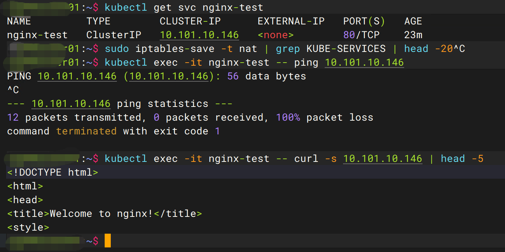
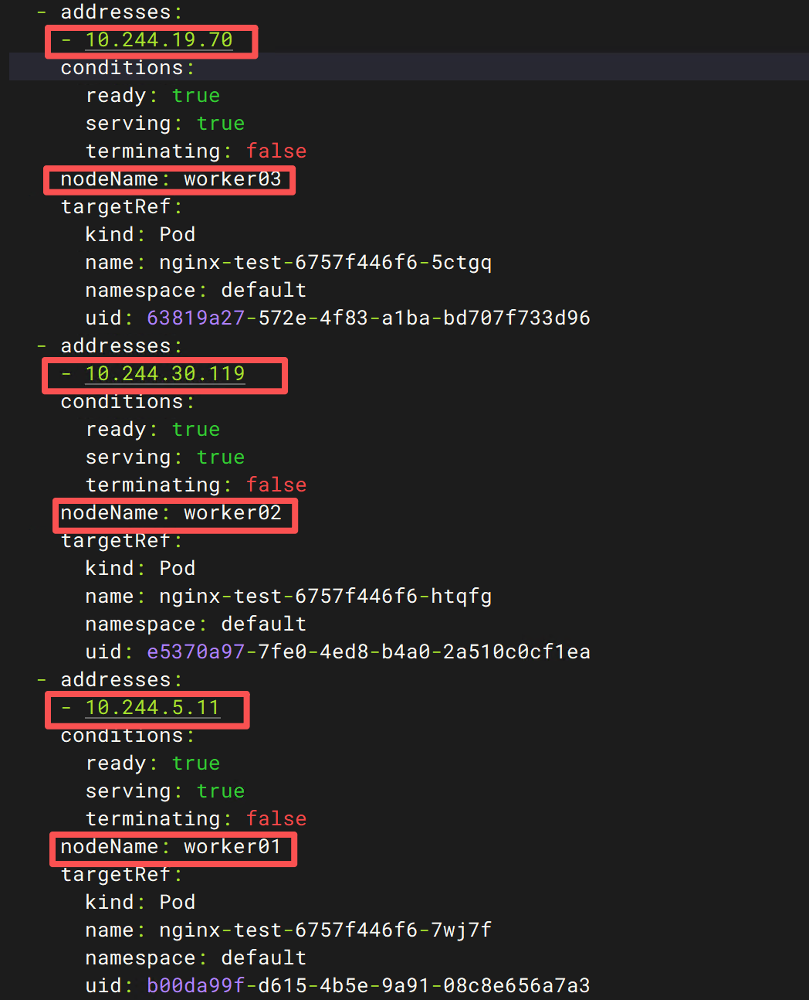
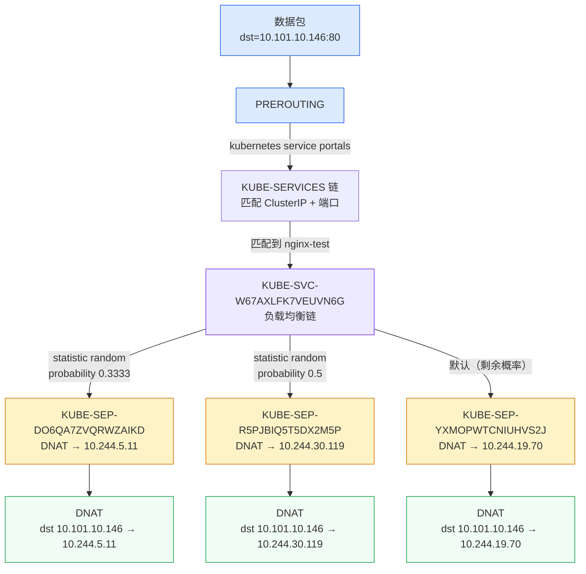
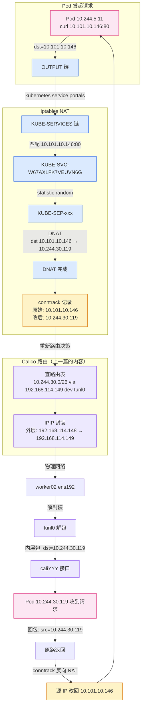

# Service ClusterIP 为什么 ping 不通？kube-proxy + iptables 链路拆解

## 一、上一篇留下的坑

上一篇拆 Calico BGP 跨节点通信时，结尾留了个问题：Service ClusterIP 是虚拟 IP，没有对应的 Pod，kube-proxy 怎么把 Service IP 映射到后端 Pod？跟 Calico 的路由又是什么关系？

这篇继续。拆开以后发现，Service 的核心不是 kube-proxy 这个进程本身，而是它往内核写的 iptables 规则。而且有个反直觉的发现：**ClusterIP 在节点上 ping 不通，但 curl 可以访问**——这个现象的背后是 iptables NAT 链的工作机制。

!!! note "前置阅读"
    站点已有一篇 [kube-proxy 工作原理详解](./kube-proxy.md)，讲的是 kube-proxy 的基本概念、iptables 与 IPVS 模式对比、常见故障排查。如果你对 Service 还不熟悉，建议先读那篇。本文是它的深度补充——拆真实的 iptables 规则、conntrack 连接表、DNAT 改写过程，需要你跟着命令在集群上跑一遍。

## 二、ClusterIP 是个"假" IP

先做一个实验。创建一个 Service：

```bash
# 📸 创建测试 Service 和 Deployment
kubectl create deployment nginx-test --image=m.daocloud.io/docker.io/nginx:alpine --replicas=3
kubectl expose deployment nginx-test --port=80 --target-port=80
```

```
deployment.apps/nginx-test created
service/nginx-test exposed
```

```bash
# 📸 查看 Service
kubectl get svc nginx-test
```

```
NAME         TYPE        CLUSTER-IP      EXTERNAL-IP   PORT(S)   AGE
nginx-test   ClusterIP   10.101.10.146   <none>        80/TCP    12s
```

ClusterIP 是 `10.101.10.146`。现在从 Pod 里 ping 它：

```bash
# 📸 ping ClusterIP（预期失败）
kubectl exec -it nginx-test -- ping 10.101.10.146
```

```
PING 10.101.10.146 (10.101.10.146): 56 data bytes
^C
--- 10.101.10.146 ping statistics ---
3 packets transmitted, 0 packets received, 100% packet loss
```

100% 丢包。但 curl 可以访问：

```bash
# 📸 curl ClusterIP（预期成功）
kubectl exec -it nginx-test -- curl -s 10.101.10.146 | head -5
```

```
<!DOCTYPE html>
<html>
<head>
<title>Welcome to nginx!</title>
<style>
```

**同一个 IP，ping 不通但 curl 可以。** 为什么？

因为 ping 发的是 ICMP 包，走的是内核网络栈的 raw socket 路径，不经过 iptables NAT 链。而 curl 发的是 TCP 包，经过 PREROUTING 或 OUTPUT 链时被 iptables 规则拦截，目标 IP 从 ClusterIP 改写成后端 Pod 的真实 IP（DNAT），然后包才被路由出去。

ClusterIP 这个 IP 地址没有任何网卡接口在监听——它只存在于 iptables 规则里。没有 ARP 响应，没有 ICMP echo reply，但 iptables 会在包到达之前把目标 IP 改掉。



## 三、Service 和 EndpointSlice：控制面

Service 对象本身不"转发"流量，它只是个声明：告诉集群"这个虚拟 IP 对应哪些 Pod"。真正干活的控制面是 EndpointSlice。

```bash
# 📸 查看 EndpointSlice
kubectl get endpointslice -l kubernetes.io/service-name=nginx-test -o yaml
```

```yaml
addressType: IPv4
apiVersion: discovery.k8s.io/v1
endpoints:
- addresses:
  - 10.244.19.70
  conditions:
    ready: true
    serving: true
    terminating: false
  nodeName: worker03
  targetRef:
    kind: Pod
    name: nginx-test-6757f446f6-5ctgq
    namespace: default
- addresses:
  - 10.244.30.119
  conditions:
    ready: true
    serving: true
    terminating: false
  nodeName: worker02
  targetRef:
    kind: Pod
    name: nginx-test-6757f446f6-htqfg
    namespace: default
- addresses:
  - 10.244.5.11
  conditions:
    ready: true
    serving: true
    terminating: false
  nodeName: worker01
  targetRef:
    kind: Pod
    name: nginx-test-6757f446f6-7wj7f
    namespace: default
kind: EndpointSlice
metadata:
  labels:
    kubernetes.io/service-name: nginx-test
  name: nginx-test-fhhbf
ports:
- port: 80
  protocol: TCP
```

一个 EndpointSlice 对象包含了 3 个 Pod 的地址，分布在三个 worker 节点上。kube-proxy Watch 的就是 EndpointSlice——当 Pod 创建/删除时，EndpointSlice Controller 自动更新这个对象，kube-proxy 感知到变化后更新 iptables 规则。

!!! note "为什么从 Endpoints 迁移到 EndpointSlice"
    旧版 Kubernetes 用的是 Endpoints 对象（单对象包含所有 Pod IP）。当 Service 后端 Pod 数量达到数千个时，单个 Endpoints 对象太大，每次更新都要全量传输，API Server 压力很大。EndpointSlice 把一个 Service 的端点拆成多个 Slice（默认每个 Slice 最多 100 个端点），增量更新，还支持拓扑感知提示（Topology Hints）——可以告诉 kube-proxy 优先把流量转发到同节点的 Pod，减少跨节点流量。

    `conditions` 字段里 `ready` 和 `serving` 的区别也值得注意：`ready=true` 表示 Pod 通过了 readinessProbe，`serving=true` 表示 Pod 还在正常处理请求。Pod 被删除时 `terminating=true` 但 `serving` 可能还是 `true`——允许正在进行中的请求继续处理完。

EndpointSlice 里三个 Pod IP 的分布：

| Pod                         | IP            | 节点     |
| ----------------------------- | --------------- | ---------- |
| nginx-test-6757f446f6-7wj7f | 10.244.5.11   | worker01 |
| nginx-test-6757f446f6-htqfg | 10.244.30.119 | worker02 |
| nginx-test-6757f446f6-5ctgq | 10.244.19.70  | worker03 |

这三个 IP 就是 iptables 规则里 DNAT 的目标地址。



## 四、iptables 链结构拆解

kube-proxy 在 iptables 的 nat 表里建了一套三级链结构。从入口到出口依次是：KUBE-SERVICES → KUBE-SVC-xxx → KUBE-SEP-xxx。



### 第一级：KUBE-SERVICES（入口链）

KUBE-SERVICES 挂在 PREROUTING 和 OUTPUT 链上，拦截所有进来的和本地产生的流量：

```bash
# 📸 查看 KUBE-SERVICES 入口规则
sudo iptables-save -t nat | grep KUBE-SERVICES | head -20
```

```
:KUBE-SERVICES - [0:0]
-A PREROUTING -m comment --comment "kubernetes service portals" -j KUBE-SERVICES
-A OUTPUT -m comment --comment "kubernetes service portals" -j KUBE-SERVICES
-A KUBE-SERVICES -d 10.96.0.10/32 -p tcp -m comment --comment "kube-system/kube-dns:dns-tcp cluster IP" -m tcp --dport 53 -j KUBE-SVC-ERIFXISQEP7F7OF4
-A KUBE-SERVICES -d 10.110.76.187/32 -p tcp -m comment --comment "monitoring/prometheus-grafana:http-web cluster IP" -m tcp --dport 80 -j KUBE-SVC-L5JLFDCUFDUOSAFE
-A KUBE-SERVICES -d 10.108.239.29/32 -p tcp -m comment --comment "monitoring/prometheus-kube-prometheus-alertmanager:http-web cluster IP" -m tcp --dport 9093 -j KUBE-SVC-FP56U3IB7O2NDDFT
...
-A KUBE-SERVICES -d 10.101.10.146/32 -p tcp -m comment --comment "default/nginx-test cluster IP" -m tcp --dport 80 -j KUBE-SVC-W67AXLFK7VEUVN6G
...
-A KUBE-SERVICES -m comment --comment "kubernetes service nodeports; NOTE: this must be the last rule in this chain" -m addrtype --dst-type LOCAL -j KUBE-NODEPORTS
```

每条规则匹配一个 ClusterIP + 端口，跳到对应的 KUBE-SVC-xxx 链。找到我们创建的 nginx-test：

```
-A KUBE-SERVICES -d 10.101.10.146/32 -p tcp -m comment --comment "default/nginx-test cluster IP" -m tcp --dport 80 -j KUBE-SVC-W67AXLFK7VEUVN6G
```

匹配条件：目标 IP 是 `10.101.10.146`、TCP 协议、目标端口 `80`。匹配到后跳到 `KUBE-SVC-W67AXLFK7VEUVN6G` 链。这就是"转发规则"的第一跳。

最后一条规则是 NodePort 的兜底：如果目标 IP 是本机 IP（LOCAL），跳到 KUBE-NODEPORTS 链处理 NodePort 流量。

!!! note "PREROUTING 和 OUTPUT 的区别"
    PREROUTING 处理从其他节点或 Pod 进来的流量，OUTPUT 处理本节点产生的流量。两个链都挂了 KUBE-SERVICES，所以不管流量从哪来，只要目标是 ClusterIP，都会被 iptables 拦截。这就是为什么从 Pod 里 curl ClusterIP 可以——包从 Pod 的 veth 进来走 PREROUTING，被 DNAT。

### 第二级：KUBE-SVC-xxx（负载均衡链）

```bash
# 📸 查看 KUBE-SVC 链（负载均衡规则）
sudo iptables-save -t nat | grep KUBE-SVC-W67AXLFK7VEUVN6G
```

```
:KUBE-SVC-W67AXLFK7VEUVN6G - [0:0]
-A KUBE-SERVICES -d 10.101.10.146/32 -p tcp -m comment --comment "default/nginx-test cluster IP" -m tcp --dport 80 -j KUBE-SVC-W67AXLFK7VEUVN6G
-A KUBE-SVC-W67AXLFK7VEUVN6G ! -s 10.244.0.0/16 -d 10.101.10.146/32 -p tcp -m comment --comment "default/nginx-test cluster IP" -m tcp --dport 80 -j KUBE-MARK-MASQ
-A KUBE-SVC-W67AXLFK7VEUVN6G -m comment --comment "default/nginx-test -> 10.244.19.70:80" -m statistic --mode random --probability 0.33333333349 -j KUBE-SEP-YXMOPWTCNIUHVS2J
-A KUBE-SVC-W67AXLFK7VEUVN6G -m comment --comment "default/nginx-test -> 10.244.30.119:80" -m statistic --mode random --probability 0.50000000000 -j KUBE-SEP-R5PJBIQ5T5DX2M5P
-A KUBE-SVC-W67AXLFK7VEUVN6G -m comment --comment "default/nginx-test -> 10.244.5.11:80" -j KUBE-SEP-DO6QA7ZVQRWZAIKD
```

这里是 kube-proxy 负载均衡的核心：**用 iptables 的** **`statistic`** **模块做随机选择**。

第一条 `! -s 10.244.0.0/16` 规则：如果包的源 IP 不在 Pod CIDR 范围内（比如从节点本身发起的请求），打上 MASQ 标记做 SNAT。

三条 statistic 规则的概率分别是 0.3333、0.5、默认（剩余概率 ≈ 1）。实际执行过程是顺序匹配：

1. 第一条规则：33.33% 概率命中 → 跳到 `KUBE-SEP-DO6QA7ZVQRWZAIKD`（10.244.5.11，worker01）
2. 如果没命中，第二条：50% 概率命中 → 跳到 `KUBE-SEP-R5PJBIQ5T5DX2M5P`（10.244.30.119，worker02）
3. 如果还没命中，第三条：默认匹配（剩余概率 ≈ 33.33%）→ 跳到 `KUBE-SEP-YXMOPWTCNIUHVS2J`（10.244.19.70，worker03）

最终三个 Pod 被选中的概率都是 1/3。但实现方式不是"等概率随机"，而是"递减条件概率"——iptables 规则是顺序匹配的，不能一次选一个，只能逐条"掷骰子"。

!!! note "iptables 负载均衡的性能代价"
    这种递减概率方式在 Pod 数量少时没问题，但当后端 Pod 达到几十上百个时，iptables 规则线性增长，每个包要遍历所有规则才能选中目标，O(n) 复杂度。这就是大规模集群用 IPVS 模式的原因——IPVS 用哈希表，O(1) 查找。


### 第三级：KUBE-SEP-xxx（端点链，DNAT）

```bash
# 📸 查看 KUBE-SEP 链（DNAT 规则）
sudo iptables-save -t nat | grep -E 'KUBE-SEP-(DO6QA7ZVQRWZAIKD|R5PJBIQ5T5DX2M5P|YXMOPWTCNIUHVS2J)'
```

```
:KUBE-SEP-DO6QA7ZVQRWZAIKD - [0:0]
:KUBE-SEP-R5PJBIQ5T5DX2M5P - [0:0]
:KUBE-SEP-YXMOPWTCNIUHVS2J - [0:0]
-A KUBE-SEP-DO6QA7ZVQRWZAIKD -s 10.244.5.11/32 -m comment --comment "default/nginx-test" -j KUBE-MARK-MASQ
-A KUBE-SEP-DO6QA7ZVQRWZAIKD -p tcp -m comment --comment "default/nginx-test" -m tcp -j DNAT --to-destination 10.244.5.11:80
-A KUBE-SEP-R5PJBIQ5T5DX2M5P -s 10.244.30.119/32 -m comment --comment "default/nginx-test" -j KUBE-MARK-MASQ
-A KUBE-SEP-R5PJBIQ5T5DX2M5P -p tcp -m comment --comment "default/nginx-test" -m tcp -j DNAT --to-destination 10.244.30.119:80
-A KUBE-SEP-YXMOPWTCNIUHVS2J -s 10.244.19.70/32 -m comment --comment "default/nginx-test" -j KUBE-MARK-MASQ
-A KUBE-SEP-YXMOPWTCNIUHVS2J -p tcp -m comment --comment "default/nginx-test" -m tcp -j DNAT --to-destination 10.244.19.70:80
```

每个 KUBE-SEP 链有两条规则：

1. `KUBE-MARK-MASQ` — 如果包的源 IP 是这个 Pod IP（说明是 Pod 自己发起的请求访问 Service），打上 MASQ 标记，后面 POSTROUTING 做 SNAT（源 IP 改成节点 IP）。这是为了让 Pod 访问自己所在的 Service 时也能正确处理
2. `DNAT --to-destination 10.244.5.11:80` — **这是核心动作**：把目标 IP 从 ClusterIP 改写成 Pod IP，目标端口不变（都是 80）

DNAT 做完之后，包的目标 IP 已经从 `10.101.10.146` 变成了 `10.244.5.11`。接下来内核重新做路由决策——查路由表，发现 `10.244.5.11` 是本节点的 Pod IP（走 cali 接口）或者跨节点的 Pod IP（走 tunl0 隧道）。这就跟上一篇拆的 Calico 路由接上了。

### 看流量统计

```bash
# 📸 查看 iptables 链的流量统计
sudo iptables -t nat -L -n -v | grep KUBE | head -30
```

```
  13M  859M KUBE-SERVICES  all  --  *      *       0.0.0.0/0            0.0.0.0/0            /* kubernetes service portals */
  26M 1576M KUBE-SERVICES  all  --  *      *       0.0.0.0/0            0.0.0.0/0            /* kubernetes service portals */
  25M 1489M KUBE-POSTROUTING  all  --  *      *       0.0.0.0/0            0.0.0.0/0            /* kubernetes postrouting rules */
...
```

第一列是包数，第二列是字节数。`13M` 表示 PREROUTING 链挂载的 KUBE-SERVICES 处理了 1300 万个包，`26M` 是 OUTPUT 链挂载的。这个数据可以用来判断流量分布是否均匀——如果某个 KUBE-SEP 链的包数明显偏少，说明负载均衡可能有问题。

## 五、DNAT 和 conntrack：回包怎么回来

DNAT 把目标 IP 从 ClusterIP 改成了 Pod IP，包成功到达 Pod。但 Pod 回包时，源 IP 是 Pod IP，目标 IP 是发起方的 IP——没有 ClusterIP 了。发起方收到包后发现"我没请求过这个 Pod IP"，包会被丢弃。

这就是 conntrack 的作用。

### conntrack 连接表

Linux 内核的 conntrack（Connection Tracking）模块记录每一条 NAT 过的连接。DNAT 执行时，conntrack 在连接表里创建一条记录：

```
原始方向: src=10.244.X.X  dst=10.101.10.146  (ClusterIP)
DNAT 后:  src=10.244.X.X  dst=10.244.5.11    (Pod IP)
```

当回包回来时（`src=10.244.5.11 dst=10.244.X.X`），conntrack 查到这条连接记录，执行**反向 NAT**：把源 IP 从 Pod IP 改回 ClusterIP。发起方收到的包看起来就像是从 ClusterIP 直接回的。

```bash
# 📸 安装 conntrack 工具
sudo apt install -y conntrack
# 让 Pod 访问 Service 产生连接
kubectl exec -it nginx-test -- curl -s 10.101.10.146 > /dev/null
# 立刻查看 conntrack 表
sudo conntrack -L | grep 10.101.10.146
```

```bash
# 安装输出
Installing:
  conntrack
Summary:
  Upgrading: 0, Installing: 1, Removing: 0, Not Upgrading: 92
  Download size: 35.6 kB
  Space needed: 119 kB / 44.6 GB available
...
Setting up conntrack (1:1.4.8-2) ...
```

```
conntrack v1.4.8 (conntrack-tools): 199 flow entries have been shown.
```

!!! warning "conntrack -L 可能看不到 Service 连接"
    我跑的时候 `conntrack -L | grep 10.101.10.146` 返回空——199 条流没有一条匹配 ClusterIP。原因是 `curl` 产生的 TCP 连接非常短命，请求完成后 conntrack 条目可能已经过了 ESTABLISHED 状态进入 TIME_WAIT 或被回收。

    要抓到真实的 conntrack 条目，需要让连接保持活跃。方法是在一个终端跑 `kubectl exec -it nginx-test -- curl -s 10.101.10.146` 的同时，另一个终端立刻跑 `sudo conntrack -L | grep 10.101.10.146`。或者用 `curl --keepalive-time 60` 保持连接。

    如果还是看不到，可以查所有 conntrack 条目中跟 Pod IP 相关的：`sudo conntrack -L | grep 10.244`——DNAT 后的目标 IP 会出现在 conntrack 表的 `dport` 字段里。

conntrack 表里每条记录的关键字段：

```
原始方向: src=10.244.5.11  dst=10.101.10.146  (ClusterIP)
DNAT 后:  src=10.244.5.11  dst=10.244.30.119  (Pod IP)
```

当回包回来时（`src=10.244.30.119 dst=10.244.5.11`），conntrack 查到这条连接记录，执行**反向 NAT**：把源 IP 从 Pod IP 改回 ClusterIP。发起方收到的包看起来就像是从 ClusterIP 直接回的。

### 完整包流转链路

把 iptables DNAT 和上一篇的 Calico 路由串起来，完整的包流转过程：



七个步骤：

1. Pod 发起 TCP 请求，目标 IP 是 ClusterIP `10.101.10.146`
2. 包进入 OUTPUT 链，跳到 KUBE-SERVICES
3. KUBE-SERVICES 匹配到 ClusterIP+端口，跳到 KUBE-SVC 链
4. KUBE-SVC 用 statistic 随机选中一个 KUBE-SEP，执行 DNAT，目标 IP 改成 Pod IP（比如 `10.244.30.119`）
5. conntrack 记录这条 NAT 连接
6. 内核重新做路由决策——查路由表，`10.244.30.0/26` 走 `tunl0` 到 worker02（上一篇拆的 Calico 路由）
7. Pod 回包时，conntrack 反向 NAT，源 IP 从 Pod IP 改回 ClusterIP

**DNAT 在前，Calico 路由在后。**  iptables 先把目标 IP 从 ClusterIP 改成 Pod IP，然后内核根据新的目标 IP 查路由表，决定走哪个接口。如果 Pod 在本节点，走 cali 接口；如果 Pod 在其他节点，走 tunl0 隧道——就是上一篇拆的 Calico BGP + IPIP 链路。

## 六、kube-proxy 的三种模式

kube-proxy 有三种数据面模式：iptables、ipvs、nftables。先看你自己的集群用的是哪种：

```bash
# 📸 查看 kube-proxy 模式
kubectl -n kube-system get configmap kube-proxy -o jsonpath='{.data.config\.conf}' | grep 'mode:'
```

```
mode: ""
```

`mode: ""` 表示未显式指定，kube-proxy 默认走 iptables 模式。确认一下：

```bash
# 📸 确认 kube-proxy 模式
kubectl -n kube-system logs $(kubectl get pods -n kube-system -l k8s-app=kube-proxy -o jsonpath='{.items[0].metadata.name}') | grep -i proxier
```

```
I0810 15:12:43.749698       1 server.go:394] "Using iptables Proxier"
```

`Using iptables Proxier` 确认了 iptables 模式。

!!! note "ipvs 模式被废弃了"
    Kubernetes v1.37 开始对 ipvs 模式打 deprecation warning，计划 v1.40 默认禁用、v1.43 彻底移除。原因是 ipvs 模式底层还是依赖 iptables 实现部分 Service 语义，没有真正独立。新集群不要再用 ipvs 模式。如果你的集群在用，参考 [v1.37 Sneak Peek 那篇文章](../../practice/)里的迁移建议。

    nftables 模式从 v1.26 开始 Alpha，v1.29 进入 Beta。它是 iptables 的替代品——规则用 BPF 而不是线性遍历，性能更好。但截至目前（v1.36）还不是默认模式，生产环境还是 iptables 为主。

## 七、kube-proxy 规则更新机制

kube-proxy 不是每次有流量才去查 iptables，而是 Watch Service 和 EndpointSlice 变化后主动更新规则。

```bash
# 📸 查看 kube-proxy 同步性能指标
# kube-proxy 容器是 distroless 镜像，没有 curl/wget，但 metrics 端口暴露在宿主机上
curl -s http://localhost:10249/metrics | grep kubeproxy_sync
```

输出很长，挑关键指标看：

```bash
# 只看规则数量和同步耗时
curl -s http://localhost:10249/metrics | grep -E 'iptables_(last|total)|duration_seconds_sum|duration_seconds_count|changes_(pending|total)'
```

```
kubeproxy_sync_proxy_rules_duration_seconds_sum{ip_family="IPv4"} 98.33785027299986
kubeproxy_sync_proxy_rules_duration_seconds_count{ip_family="IPv4"} 1267
kubeproxy_sync_proxy_rules_iptables_total{ip_family="IPv4",table="filter"} 6
kubeproxy_sync_proxy_rules_iptables_total{ip_family="IPv4",table="nat"} 134
kubeproxy_sync_proxy_rules_endpoint_changes_pending 0
kubeproxy_sync_proxy_rules_endpoint_changes_total 61224
kubeproxy_sync_proxy_rules_service_changes_pending 0
kubeproxy_sync_proxy_rules_service_changes_total 103434
```

逐行解读：

- **`iptables_total{table="nat"} 134`** — kube-proxy 在 master01 上写了 134 条 nat 表规则。这就是前面 `iptables-save -t nat` 看到的那一大堆 KUBE-* 规则的总数。
- **`duration_seconds_count 1267`** — 从 kube-proxy 启动以来做了 1267 次规则同步。每次 Service 或 EndpointSlice 变化都会触发一次同步。
- **`duration_seconds_sum 98.34`** — 1267 次同步总共花了 98.34 秒，平均每次约 78 毫秒。
- **`endpoint_changes_total 61224`** — 累计 6 万多次 Endpoint 变化（Pod 创建/删除/迁移都会触发）。对比 `service_changes_total 103434`，Endpoint 变化比 Service 变化少——Service 创建后很少动，但 Pod 经常重建。
- **`changes_pending 0`** — 当前没有积压的变更，规则已经全部同步完毕。如果这个值大于 0，说明 kube-proxy 跟不上变化速度，新 Service 可能几秒内不可达。

再看同步耗时的分布（直方图）：

```bash
curl -s http://localhost:10249/metrics | grep 'duration_seconds_bucket' | grep 'IPv4' | grep -v full | grep -v partial
```

```
kubeproxy_sync_proxy_rules_duration_seconds_bucket{ip_family="IPv4",le="0.001"} 0
kubeproxy_sync_proxy_rules_duration_seconds_bucket{ip_family="IPv4",le="0.032"} 1
kubeproxy_sync_proxy_rules_duration_seconds_bucket{ip_family="IPv4",le="0.064"} 98
kubeproxy_sync_proxy_rules_duration_seconds_bucket{ip_family="IPv4",le="0.128"} 1263
kubeproxy_sync_proxy_rules_duration_seconds_bucket{ip_family="IPv4",le="0.256"} 1267
kubeproxy_sync_proxy_rules_duration_seconds_bucket{ip_family="IPv4",le="+Inf"} 1267
```

绝大部分同步（1263/1267 = 99.7%）在 128 毫秒内完成，最快 1 次 32-64 毫秒，最慢的也在 256 毫秒内。对这个规模的集群（134 条 nat 规则），这个性能没问题。

!!! note "kube-proxy 容器里没有 curl 和 wget"
    我第一次用 `kubectl exec ... -- curl localhost:10249/metrics` 查指标，报错 `curl: executable file not found`。换 `wget` 也报同样的错——kube-proxy 容器基于 distroless 镜像构建，curl 和 wget 都没有。

    正确方法：kube-proxy 的 `--metrics-bind-address` 默认绑定 `0.0.0.0:10249`，在节点上直接 `curl http://localhost:10249/metrics` 就行，不需要进容器。

kube-proxy 的更新逻辑是：

1. Watch 到 Service 或 EndpointSlice 变化
2. 计算新的 iptables 规则集合
3. 调用 `iptables-restore` 原子性替换规则（不是逐条增删）
4. 更新完毕

!!! note "iptables-restore vs iptables -A"
    kube-proxy 用 `iptables-restore` 而不是 `iptables -A` 逐条添加，是因为 restore 是原子操作——一次性替换整个表，不会出现规则更新到一半时新连接走错规则的情况。这也是为什么 kube-proxy 重启时会有短暂的服务中断——规则在重建。

## 八、sessionAffinity 和 externalTrafficPolicy

### sessionAffinity：会话粘性

默认情况下每次请求都随机选 Pod，同一个客户端的多次请求可能到不同 Pod。有些应用需要会话粘性（比如有状态的 session）：

```bash
# 📸 修改 sessionAffinity
kubectl patch svc nginx-test -p '{"spec":{"sessionAffinity":"ClientIP","sessionAffinityConfig":{"clientIP":{"timeoutSeconds":10800}}}}'
```

```
service/nginx-test patched
```

patch 后，kube-proxy 会在 KUBE-SVC 链最前面加一条规则：用 `recent` 模块记录最近访问过的客户端 IP，如果同一个 ClientIP 在 10800 秒（3 小时）内再次访问，直接跳到上次的 KUBE-SEP，不再走 statistic 随机。

### externalTrafficPolicy：外部流量策略

```bash
# 📸 查看 externalTrafficPolicy（从 Service YAML 看）
kubectl get svc nginx-test -o yaml | grep trafficPolicy
```

输出为空——`externalTrafficPolicy` 字段不存在，说明用的是默认值 `Cluster`。ClusterIP 类型的 Service 只有 `internalTrafficPolicy`，从 Service YAML 里可以看到：

```yaml
spec:
  internalTrafficPolicy: Cluster
  ...
```

`internalTrafficPolicy: Cluster` 是默认值——集群内部流量可以转发到任意节点的 Pod。还有 `Local` 选项——只转发到本节点的 Pod，不做跨节点转发。

`externalTrafficPolicy`（NodePort/LoadBalancer 专用）更有意思：

- `Cluster`（默认）：外部流量进来后可以转发到任意节点的 Pod，会做 SNAT（源 IP 变成节点 IP），客户端真实 IP 丢失
- `Local`：只转发到本节点的 Pod，不做 SNAT，保留客户端真实 IP，但如果本节点没有 Pod 就直接拒绝

```bash
# 📸 确认 externalTrafficPolicy 行为——查 KUBE-SEP 的 MASQ 规则
sudo iptables-save -t nat | grep KUBE-SEP | grep -i masq | grep nginx-test
```

从真实输出中可以看到 nginx-test 的三个 KUBE-SEP 链都有 MASQ 规则：

```
-A KUBE-SEP-DO6QA7ZVQRWZAIKD -s 10.244.5.11/32 -m comment --comment "default/nginx-test" -j KUBE-MARK-MASQ
-A KUBE-SEP-R5PJBIQ5T5DX2M5P -s 10.244.30.119/32 -m comment --comment "default/nginx-test" -j KUBE-MARK-MASQ
-A KUBE-SEP-YXMOPWTCNIUHVS2J -s 10.244.19.70/32 -m comment --comment "default/nginx-test" -j KUBE-MARK-MASQ
```

`KUBE-MARK-MASQ` 给包打上标记，后面 POSTROUTING 链看到这个标记就做 SNAT。规则含义是：如果包的**源 IP** 是 Pod IP（说明是 Pod 自己发起的请求访问 Service），做 SNAT 把源 IP 改成节点 IP。这是为了处理 Pod 访问自己所在 Service 的特殊场景——如果不做 SNAT，回包可能走错路。

## 九、清理测试资源

```bash
kubectl delete svc nginx-test
kubectl delete deployment nginx-test
```

## 十、相关阅读

- [kube-proxy 工作原理详解](./kube-proxy.md)——站点已有的入门文章，讲 kube-proxy 基本概念、iptables 与 IPVS 对比、常见故障排查。本文是它的深度补充
- [Calico 跨节点通信原理](./calico-bgp.md)——BGP 路由、BIRD、IPIP 隧道。本文的 DNAT 在前，Calico 路由在后，两者串联完成 Service 到 Pod 的跨节点通信
- [Pod 网络创建全过程](./pod-network-creation.md)——veth pair、IP 分配、路由表配置。本文的 Pod IP 就是通过 CNI 分配的
- [Kubernetes Pod 生命周期源码解析](../node/pod-lifecycle.md)——Pod 从 Pending 到 Running 的完整链路
- [Kubernetes kubelet SyncLoop 原理](../node/kubelet-syncloop.md)——SyncLoop 四路输入、PodWorkers 串行设计
- CoreDNS：服务发现链路（计划中）——Service 域名解析，ClusterIP 怎么被 DNS 发现

---

下一篇：**CoreDNS：Service 域名怎么解析成 ClusterIP**

本文拆完了 kube-proxy 怎么把 ClusterIP 映射到 Pod IP。但 Pod 访问 Service 时一般不直接写 ClusterIP——写的是域名（`nginx-test.default.svc.cluster.local`）。CoreDNS 怎么把 Service 域名解析成 ClusterIP？DNS 查询在 Pod 网络里走什么路径？CoreDNS 的 ConfigMap 怎么影响解析行为？这些问题留到下一篇拆。