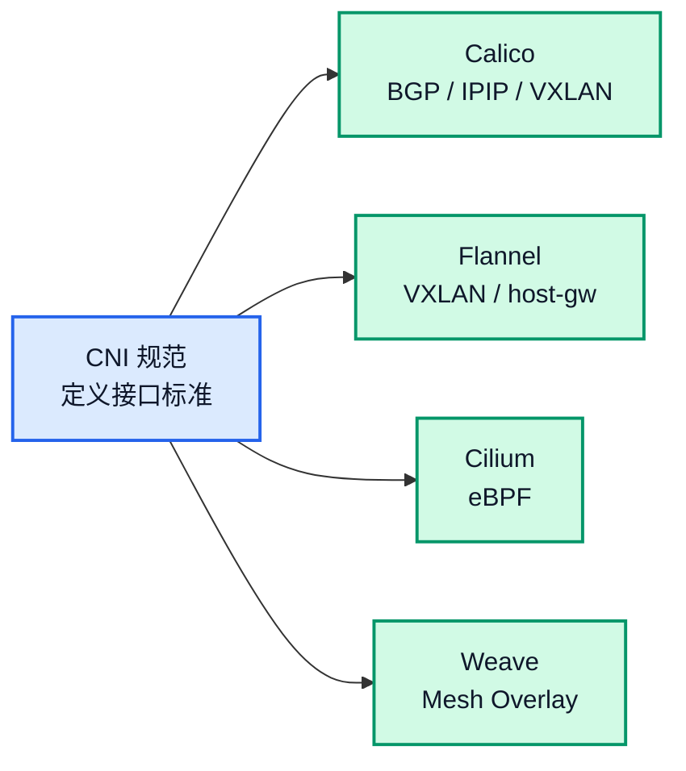
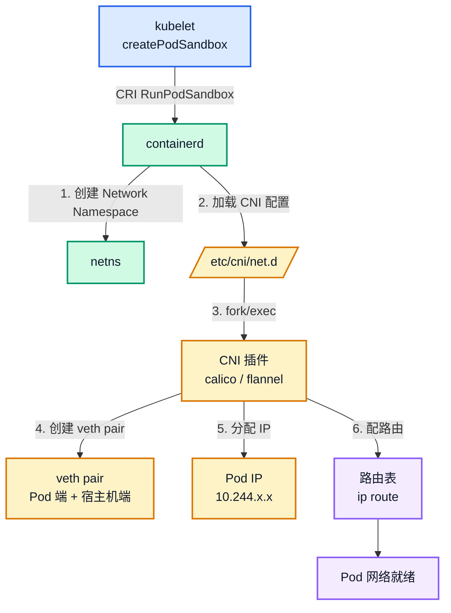
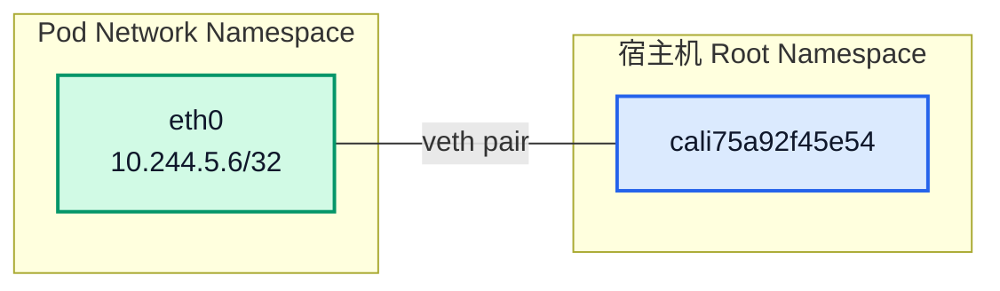
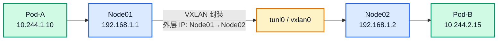
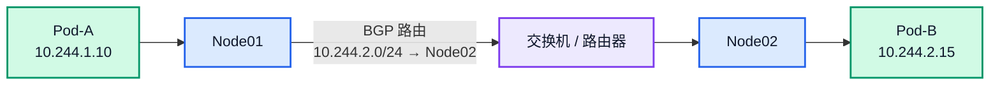

# Kubernetes CNI 工作原理详解：Pod 网络通信是如何实现的？

## 文章摘要

在 Kubernetes 中，每个 Pod 都有独立 IP，Pod 之间可以直接通信——不需要 NAT，不需要代理。这看似简单的能力，背后是一整套网络规范的支撑。

CNI（Container Network Interface）就是这套规范。它定义了一个标准接口，让不同的网络插件（Calico、Flannel、Cilium 等）可以以统一的方式接入 Kubernetes，为 Pod 创建网络。

本文从 CNI 规范本身讲起，到具体的插件执行机制，再到 Overlay 和 Underlay 两种网络模型的实现原理，最后给出生产环境常见的故障排查方法。

!!! note "深度文章推荐"
    CNI 的具体执行过程——containerd 如何 `fork/exec` CNI 插件、veth pair 如何创建、Pod IP 如何分配——在 [Pod 网络创建全过程](./pod-network-creation.md) 中有逐步骤的拆解。本文聚焦 CNI 的整体架构和不同插件的实现原理。

---

## 一、CNI 是什么：规范，不是产品

CNI 全称 Container Network Interface，和 CRI（Container Runtime Interface）一样，是 **接口规范**，不是具体产品。



类比一下：USB 是接口标准，U 盘、键盘、鼠标是基于这个标准的具体产品。CNI 也是如此——Calico、Flannel、Cilium、Weave 都是基于 CNI 规范的具体网络插件。

### 1.1 CNI 插件是二进制文件

这是很多人忽略的关键点：**CNI 插件不是 daemon，不是 .so 库，就是一个个可执行文件**。

在生产节点上：

```bash
ls /opt/cni/bin/
```

```
bandwidth  calico       dhcp   firewall  host-device  ipvlan   loopback  portmap  sbr     static  tuning  vrf
bridge     calico-ipam  dummy  flannel   host-local   LICENSE  macvlan   ptp       README.md  tap     vlan
```

当 containerd 需要给 Pod 配网络时，它会 `fork + exec` 对应的二进制文件，通过 **stdin 传 JSON 配置，从 stdout 读返回结果**。这和 CRI 的 gRPC 长连接通信完全不同。

### 1.2 CNI 配置文件

插件列表和调用顺序定义在 `/etc/cni/net.d/` 下的配置文件中：

```bash
sudo ls -la /etc/cni/net.d/
```

```
-rw-r--r-- 1 root root  659 May 24 21:30 10-calico.conflist
-rw------- 1 root root 2796 Aug  5 09:29 calico-kubeconfig
```

`10-calico.conflist` 声明了要调用哪些插件以及调用顺序——先 calico（创建 veth + 分配 IP + 配路由），再 portmap（端口映射），最后 bandwidth（流量限速）。

### 1.3 kubelet 不直接调 CNI

一个反直觉的结论：

```text
kubelet → CRI gRPC → containerd → CNI 插件
```

kubelet 发的是 CRI 的 `RunPodSandbox` 请求给 containerd，containerd 内部加载 CNI 配置、调用 CNI 插件。kubelet 根本不知道 CNI 的存在。详细拆解见 [Pod 网络创建全过程](./pod-network-creation.md)。

---

## 二、Kubernetes 网络模型：四条规则

Kubernetes 官方定义了网络模型，只有四条核心规则：

| # | 规则 | 含义 |
|:---:|---|---|
| 1 | 每个 Pod 有独立 IP | 不存在端口冲突，Pod 之间 IP 唯一 |
| 2 | Pod 之间直接通信，不需 NAT | Pod-A 访问 Pod-B，源 IP 和目标 IP 都不变 |
| 3 | Node 与 Pod 直接通信，不需 NAT | 节点可以直接访问本节点上的 Pod |
| 4 | Pod 看到自己的 IP = 别人看到它的 IP | 没有类似 Docker 的端口映射概念 |

这四条规则简单，但 Kubernetes **自己不实现**——它只定义模型，具体怎么配网络交给 CNI。

---

## 三、Pod 创建时的网络初始化

当 Scheduler 完成调度、kubelet 开始创建 Pod 时，网络初始化大致经历以下步骤：



每一步的详细源码和命令验证见 [Pod 网络创建全过程](./pod-network-creation.md)。本文重点讲第 3~6 步在不同 CNI 插件下的实现差异。

---

## 四、veth Pair：Pod 网络的物理基础

不管用 Calico 还是 Flannel，Pod 网络都有一个共同的底层机制——**veth pair**。

veth pair 是 Linux 内核提供的虚拟以太网设备对，可以理解为一根两端连通的虚拟网线。一端放入 Pod 的 Network Namespace 成为 `eth0`，另一端留在宿主机上，名称通常是 `caliXXXX` 或 `vethXXXX`。



在节点上可以直接看到：

```bash
ip link | grep cali
```

```
cali75a92f45e54@if3: <BROADCAST,MULTICAST,UP,LOWER_UP>
calibf2489e928a@if3: <BROADCAST,MULTICAST,UP,LOWER_UP>
```

每一个 `caliXXX` 对应一个本节点上的 Pod。所有 CNI 插件最终都离不开 veth pair——差异在于跨节点通信的方式。

---

## 五、Overlay 与 Underlay：两种网络模型

跨节点 Pod 通信是所有 CNI 插件需要解决的核心问题。目前主流方案分为两大类：

### 5.1 Overlay 网络：隧道封装

在现有物理网络之上再建一层虚拟网络。Pod 的数据包先被封装（如 VXLAN），再通过宿主机网络传输，到达目标节点后解封装，最后送入目标 Pod。



**代表插件**：Flannel VXLAN、Calico IPIP/VXLAN

| 优点 | 缺点 |
|------|------|
| 对底层网络无要求，二层可达即可 | 封装/解封装有 CPU 开销（约 5%~15%） |
| 部署简单，云环境兼容好 | MTU 减小，需要调整 |
| 物理网络设备无需额外配置 | 调试时多一层封装，抓包复杂 |

### 5.2 Underlay 网络：直接路由

Pod IP 直接作为物理网络中的可路由地址，路由器/交换机知道如何转发 Pod 网段的数据包，无需隧道封装。



**代表插件**：Calico BGP

| 优点 | 缺点 |
|------|------|
| 无隧道开销，性能最优 | 需要物理网络设备支持 Pod 网段路由 |
| 延迟更低 | 网络规划和运维成本更高 |
| 故障排查直接 | 云环境通常不支持 BGP |

---

## 六、Calico：生产环境最主流的 CNI 插件

Calico 是目前生产环境使用最多的 CNI 插件之一。它的核心设计理念是：**把 Pod IP 当作一等公民，通过标准路由协议在整个集群中通告**。

### 6.1 IP 分配

Calico 为每个节点分配一个 Pod CIDR 子网（如 `10.244.5.0/26`），该节点上的所有 Pod 从这个子网内分配 IP。这种方式天然支持路由聚合——路由器只需要知道网段到节点的映射，不需要为每个 Pod IP 维护单独路由条目。

```bash
kubectl get nodes -o custom-columns="NAME:.metadata.name,POD-CIDR:.spec.podCIDR"
```

```
NAME       POD-CIDR
worker01   10.244.5.0/26
worker02   10.244.19.0/26
```

### 6.2 路由同步：BGP

Calico 在每个节点上运行 BIRD（一个 BGP 守护进程），通过 BGP 协议在节点之间交换路由信息：

```text
worker01 通告: "10.244.5.0/26 在我这里，下一跳是 192.168.114.148"
worker02 通告: "10.244.19.0/26 在我这里，下一跳是 192.168.114.150"
```

每个节点都会学到所有其他节点的 Pod CIDR 路由。BGP 的详细拆解见 [Calico 跨节点通信：BGP 路由、BIRD 与 IPIP 隧道](./calico-bgp.md)。

### 6.3 IPIP 隧道：BGP + Overlay 的混合模式

纯 BGP 模式要求物理网络支持 Pod 网段路由，在生产环境中不总是可行的。Calico 的 IPIP 模式将 BGP 和隧道结合起来：

```bash
ip route | grep bird
```

```
10.244.19.64/26 via 192.168.114.150 dev tunl0 proto bird onlink
```

BIRD 通过 BGP 学到目标 Pod 网段 → 下一跳是对方节点 IP → 出接口是 `tunl0`（IPIP 隧道接口）。数据包经 IPIP 封装后，以 Node IP 为外层地址在物理网络中传输。

### 6.4 Calico 核心组件

| 组件 | 职责 |
|------|------|
| Felix | 编程内核路由表、iptables 规则、管理隧道设备 |
| BIRD | BGP 路由交换，节点间同步 Pod 网段 |
| confd | 监听 Calico 数据模型，渲染 BIRD 配置文件 |

---

## 七、Flannel：简单易用的入门选择

Flannel 是历史上非常流行的 CNI 插件，设计理念是越简单越好。它不关心路由协议，只做一件事：**给每个节点分配一个子网，Pod 间通信通过 Overlay 隧道**。

### 7.1 VXLAN 模式

Flannel 最常见的模式是 VXLAN。节点之间建立 VXLAN 隧道：

```text
Node01 (10.244.1.0/24)
    ↓ VXLAN tunnel
Node02 (10.244.2.0/24)
```

通信时，Pod 发出的数据包被 Flannel 封装成 VXLAN 包（外层 IP 是 Node IP），通过物理网络传输，到达目标节点后解封装还原原始数据包。

### 7.2 host-gw 模式

如果集群节点在同一个二层网络中，Flannel 也可以使用 host-gw 模式——直接写静态路由表，不封装数据包，性能优于 VXLAN。但要求所有节点二层可达。

### 7.3 Flannel vs Calico

| 维度 | Calico | Flannel |
|------|--------|---------|
| 性能 | 高（BGP 无封装） | 中（VXLAN 有开销） |
| 网络策略 | 支持 NetworkPolicy | 不支持 |
| 部署复杂度 | 中等 | 低 |
| 对网络要求 | BGP 模式要求较高 | 低，二层可达即可 |
| 生产推荐 | 中大规模集群首选 | 小规模 / 测试环境 |

---

## 八、其他 CNI 插件简介

### 8.1 Cilium：基于 eBPF 的新一代

Cilium 使用 eBPF（Extended Berkeley Packet Filter）在 Linux 内核中直接编程数据路径。相比 iptables，eBPF 的性能更好，而且不依赖 kube-proxy 来实现 Service 转发。

### 8.2 Weave：Mesh Overlay

Weave 在节点之间建立全互联的 Mesh Overlay 网络，自动发现和加密。部署最简单——一条命令即可——但在大规模集群中全互联的流量会带来比较明显的开销。

### 8.3 选型建议总结

| 场景 | 推荐 |
|------|------|
| 生产大规模集群 | Calico（BGP 或 IPIP）或 Cilium |
| 快速测试 / 小规模 | Flannel VXLAN |
| 高性能 + 可观测性 | Cilium（eBPF） |
| 多集群 / 加密通信 | Cilium 或 Weave |

---

## 九、NetworkPolicy：CNI 的网络隔离能力

很多人误以为 Pod 之间默认是隔离的，实际上恰恰相反——**Kubernetes 默认允许所有 Pod 之间互通**。

NetworkPolicy 是在这个默认允许之上做拒绝规则——你可以定义哪些 Pod 可以访问哪些 Pod。但需要注意的是：**NetworkPolicy 需要 CNI 插件支持才能生效**。Flannel 不支持 NetworkPolicy，如果你用了 Flannel，写的 NetworkPolicy YAML 不会产生任何效果。

Calico 和 Cilium 都完整支持 NetworkPolicy，且都扩展了更丰富的策略表达能力（如 Calico 的 GlobalNetworkPolicy、Cilium 的 CiliumNetworkPolicy）。

```bash
kubectl get networkpolicy -A
```

---

## 十、CNI 与 Kube-Proxy 的分工

| 流量类型 | 负责组件 | 说明 |
|----------|----------|------|
| Pod → Pod（直连 IP） | CNI | veth pair + 路由 / 隧道 |
| Pod → Service ClusterIP | kube-proxy | iptables / IPVS 做 DNAT |
| 外部 → Service（NodePort / LB） | kube-proxy | 同上 |

简单区分：

> CNI 负责 Pod 到 Pod 的直达通信，kube-proxy 负责 Service 虚拟 IP 到 Pod 的映射转发。

---

## 十一、生产环境常见故障排查

### 11.1 Pod 无法跨节点通信

从最底层查起——路由表：

```bash
ip route | grep 10.244
```

如果缺少对应的 `proto bird` 条目，说明 BGP 路由同步有问题。检查 Calico BIRD 状态：

```bash
sudo calicoctl node status
```

### 11.2 CNI 插件未正确调用

Pod 卡在 `ContainerCreating`，Events 显示网络相关错误。检查 containerd 日志：

```bash
sudo journalctl -u containerd -f
```

常见问题：CNI 配置文件路径错误、插件二进制缺失、IPAM 无法分配 IP。

### 11.3 CNI 配置文件不生效

CNI 配置目录 `/etc/cni/net.d/` 中的文件按字母序加载，如果有多个配置文件，只有第一个会被使用。配置冲突时检查：

```bash
ls -la /etc/cni/net.d/
```

### 11.4 NetworkPolicy 阻断预期流量

如果你发现某个 Pod 突然无法被访问，检查是否被 NetworkPolicy 命中：

```bash
kubectl get networkpolicy -A
kubectl describe networkpolicy <name> -n <namespace>
```

---

## 十二、运维排查命令速查

```bash
# Pod IP 分布
kubectl get pod -A -o wide

# 节点路由表（关键）
ip route

# 节点上的 veth 设备
ip link | grep cali

# CNI 插件列表
ls /opt/cni/bin/

# CNI 配置文件
ls -la /etc/cni/net.d/

# Calico 节点状态
sudo calicoctl node status

# Calico BGP Peer 状态
sudo calicoctl get bgpPeer -A

# kube-proxy 模式
kubectl -n kube-system get cm kube-proxy -o yaml | grep mode
```

---

## 十三、总结

CNI 是 Kubernetes Pod 网络的基础框架。整个网络体系的完整分工可以概括为：

```text
Kubelet 创建 Pod → CNI 赋予网络能力 → kube-proxy 实现 Service 转发
```

核心要点：

- **CNI 是规范**，不是产品——Calico、Flannel、Cilium 是具体实现
- **CNI 插件是二进制文件**，containerd 通过 `fork/exec` 调用，stdin/stdout 通信
- **veth pair** 是所有 CNI 插件的底层共同机制
- **跨节点通信**分为 Overlay（VXLAN/IPIP 隧道）和 Underlay（BGP 直接路由）两大模型
- **NetworkPolicy** 需要 CNI 插件支持才能生效

---

## 十四、相关阅读

- [Pod 网络创建全过程](./pod-network-creation.md)——从 RunPodSandbox 到 veth pair，CNI 插件执行的全过程拆解
- [Calico 跨节点通信：BGP 路由、BIRD 与 IPIP 隧道](./calico-bgp.md)——BGP 协议基础、BIRD 配置渲染、Felix 路由编程与 IPIP 封装
- [Kube-Proxy 工作原理详解](./kube-proxy.md)——Service ClusterIP 流量转发，iptables / IPVS 规则链
- [Service ClusterIP 为什么 ping 不通？](./clusterip-link-deep.md)——iptables 三级链跳转、DNAT、conntrack 深度拆解
- [Kubernetes Kubelet 工作原理](../node/kubelet.md)——kubelet 如何调度 Pod 创建流程
