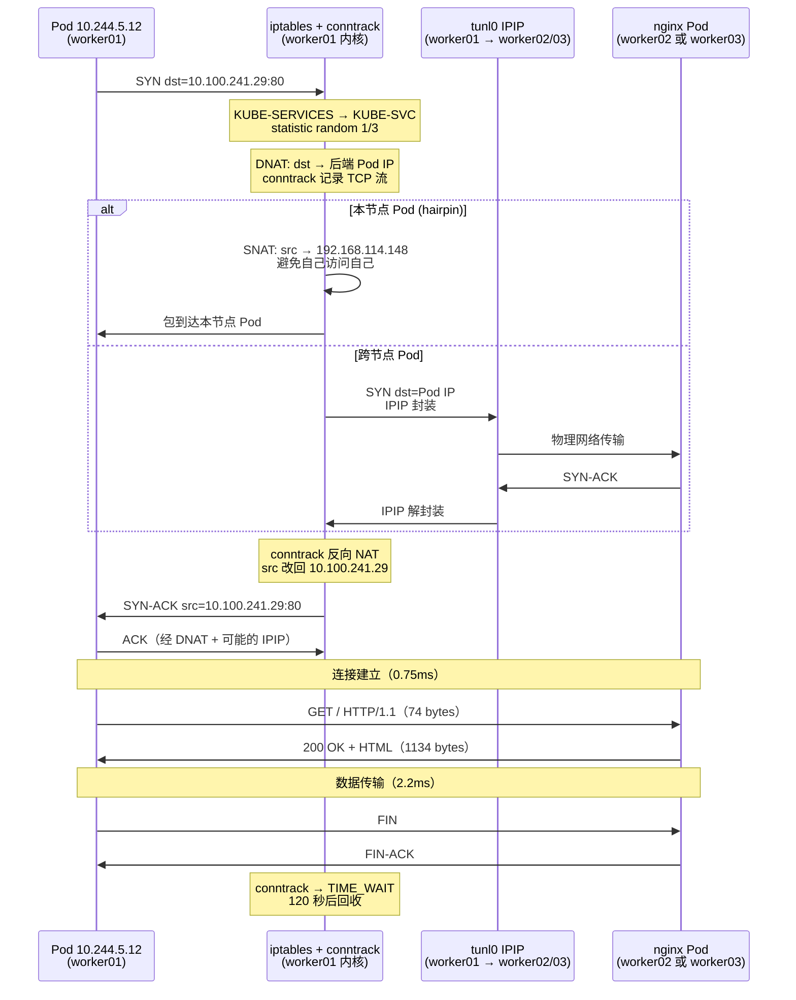
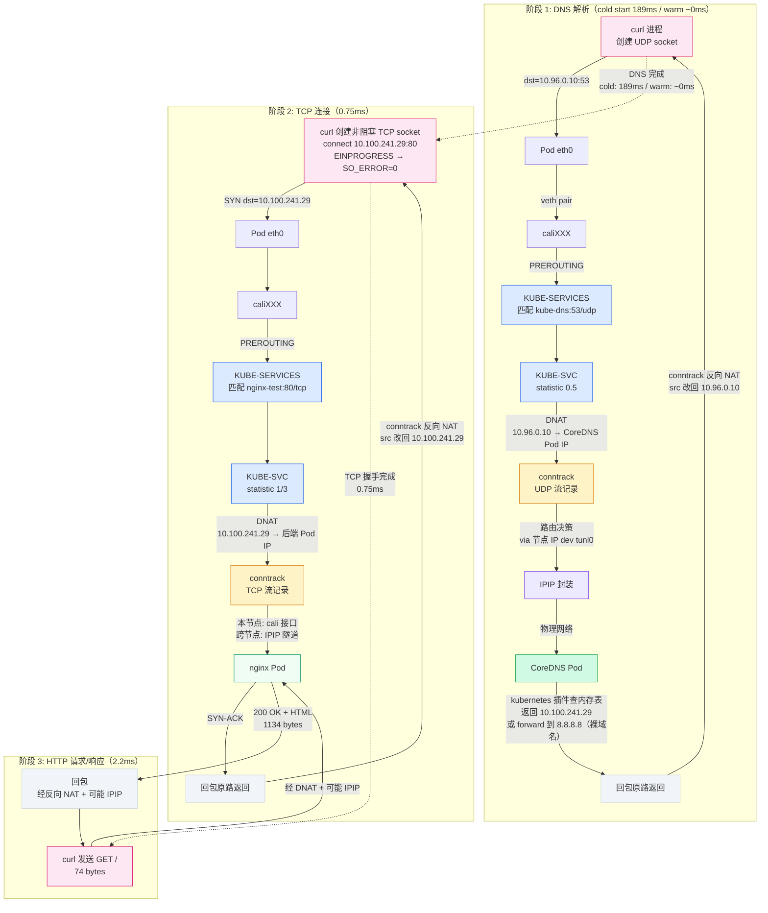
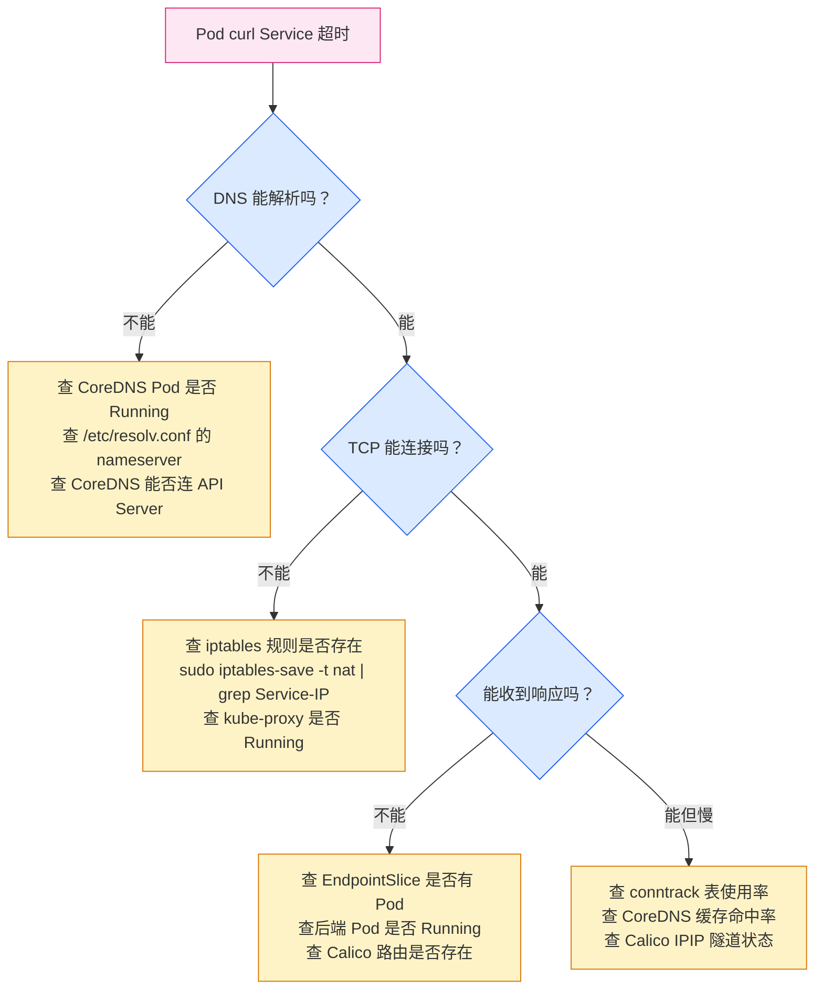

# 一行 curl 的完整旅程：DNS → iptables → conntrack → Calico 全链路拆解

## 一、问题：一行 curl 背后发生了什么

前面八篇文章，每篇拆一个组件：kubelet SyncLoop、CRI gRPC、containerd、Pod 生命周期、Pod 网络创建、Calico BGP、kube-proxy iptables、CoreDNS。每篇拆完都在结尾说"下一篇串联"，但一直没串。

这篇就来串。

问题很简单：在 Pod 里执行一行 `curl nginx-test`，从敲下回车到收到 HTML 响应，中间到底发生了什么？涉及多少个组件？包流转了哪些路径？

拆之前以为答案很清晰——前面每篇都拆过了，拼起来就行。实际写的时候发现拼不上。原因是这样：前面每篇拆的是一个组件的内部机制，但组件之间的**时序关系**和**数据传递**没有展开。比如：

- DNS 查询和 TCP 连接共享同一个 conntrack 表吗？
- iptables 对 DNS 查询（UDP）和 HTTP 请求（TCP）的处理有什么区别？
- CoreDNS 返回 ClusterIP 之后，curl 怎么发起 TCP 连接？是先 DNS 完成再 TCP，还是有重叠？
- 整条链路的耗时分布是什么样的？DNS 慢还是 iptables 慢还是 Calico 路由慢？

这些问题在单篇里回答不了，需要站在全局视角看。这篇做的就是这件事。

!!! note "前置阅读"
    本文是 Worker Node 深度系列的收束篇，串联以下文章的内容：

    - [CoreDNS：Service 域名怎么解析成 ClusterIP](service-dns-to-clusterip.md) — DNS 解析链路
    - [Service ClusterIP 为什么 ping 不通？kube-proxy + iptables 链路拆解](clusterip-link-deep.md) — iptables 三级链
    - [Calico 跨节点通信：BGP 路由、BIRD 与 IPIP 隧道拆解](calico-bgp.md) — 跨节点路由
    - [Pod 网络创建全过程](pod-network-creation.md) — veth pair、Pod netns

    如果还没读过，建议先读至少 CoreDNS 和 kube-proxy 两篇，因为本文直接复用它们的结论。

## 二、实验环境与测试方法

### 测试环境

沿用前面文章的集群：

| 项目 | 值 |
|------|-----|
| K8s 版本 | 1.36.1 |
| 架构 | 3 Master + 3 Worker |
| CNI | Calico IPIP 模式 |
| Pod CIDR | 10.244.0.0/16，每节点 /26 |
| 测试 Service | nginx-test（ClusterIP），3 副本分布在 worker01/02/03 |

```bash
kubectl get svc nginx-test
kubectl get pods -l app=nginx-test -o wide
```

```
NAME         TYPE        CLUSTER-IP      EXTERNAL-IP   PORT(S)   AGE
nginx-test   ClusterIP   10.100.241.29   <none>        80/TCP    2d1h

NAME                          READY   STATUS    RESTARTS   AGE    IP              NODE       NOMINATED NODE   READINESS GATES
nginx-test-6757f446f6-49hbh   1/1     Running   0          2d1h   10.244.5.12     worker01   <none>           <none>
nginx-test-6757f446f6-sxptr   1/1     Running   0          2d1h   10.244.30.120   worker02   <none>           <none>
nginx-test-6757f446f6-hl5ss   1/1     Running   0          2d1h   10.244.19.69    worker03   <none>           <none>
```

记几个关键 IP，后面全程要用：

| 对象 | IP | 所在节点 |
|------|-----|---------|
| nginx-test Service ClusterIP | 10.100.241.29 | 虚拟 IP |
| nginx-test Pod 1 | 10.244.5.12 | worker01 (192.168.114.148) |
| nginx-test Pod 2 | 10.244.30.120 | worker02 (192.168.114.149) |
| nginx-test Pod 3 | 10.244.19.69 | worker03 (192.168.114.150) |
| kube-dns Service ClusterIP | 10.96.0.10 | 虚拟 IP |
| CoreDNS Pod 1 | 10.244.19.127 | worker03 |
| CoreDNS Pod 2 | 10.244.30.116 | worker02 |

### 测试方法

从 worker01 上的 nginx-test Pod（IP 10.244.5.12）发起 `curl nginx-test`。这个 Pod 同时是 Service 的后端之一——它访问自己所在的 Service。这种场景在生产中很常见（Pod 访问同命名空间的 Service）。

用三种工具配合：

| 工具 | 看什么 | 怎么跑 |
|------|--------|--------|
| `strace` | curl 进程的 syscall 序列（DNS + TCP + HTTP 全程） | `kubectl debug` 注入 netshoot 容器 |
| `conntrack -L` | 内核连接跟踪表（DNS UDP 流 + TCP 流） | worker01 上直接跑，curl 同时在跑 |
| `curl -w` | 各阶段耗时分解（DNS/TCP/TTFB/Total） | `kubectl exec` 在 Pod 内跑 |

!!! warning "nsenter -n 的陷阱：只切网络命名空间，不切挂载命名空间"
    一开始用 `nsenter -n` 进入 Pod 网络命名空间跑 strace/tcpdump，DNS 查询全部发给了宿主机 DNS（61.128.128.68）而不是 CoreDNS（10.96.0.10），所有输出看起来像"DNS 配置坏了"。

    **根因：`nsenter -n` 只切了网络命名空间，没切挂载命名空间。** curl 读到的 `/etc/resolv.conf` 是宿主机的，不是 Pod 的。

    | nsenter 选项 | resolv.conf | strace/tcpdump 二进制 |
    |-------------|-------------|----------------------|
    | `-n` 只切网络 | ❌ 宿主机的 | ✅ 宿主机的 |
    | `-n -m` 切网络+挂载 | ✅ Pod 的 | ❌ 容器里没有 |

    正确做法：用 `kubectl exec` 直接在 Pod 内执行命令，或者用 `kubectl debug` 注入包含调试工具的临时容器。本文的 strace 数据全部通过 `kubectl debug --image=m.daocloud.io/docker.io/nicolaka/netshoot` 获取。

    **教训：看到反直觉的调试输出时，先用 `kubectl exec` 交叉验证，不要急着下结论。**

## 三、先看结果：192ms vs 3ms

先不拆细节，直接看耗时。在 Pod 内跑 `curl -w`：

```bash
POD_NAME=$(kubectl get pod -l app=nginx-test -o jsonpath='{.items[0].metadata.name}')
kubectl exec -it $POD_NAME -- curl -s -o /dev/null -w \
  "dns:%{time_namelookup}s\nconnect:%{time_connect}s\nttfb:%{time_starttransfer}s\ntotal:%{time_total}s\n" \
  nginx-test
```

第一次（cold start）：

```
dns:0.189300s
connect:0.190052s
ttfb:0.192247s
total:0.192356s
```

**DNS 解析花了 189ms。** TCP 连接 0.75ms，TTFB 2.2ms，总共 192ms。DNS 占了 98% 的总耗时。

再跑 10 次：

```bash
for i in $(seq 1 10); do
  kubectl exec -it $POD_NAME -- curl -s -o /dev/null -w "%{time_total}\n" nginx-test
done
```

```
0.003461
0.208058
0.002624
0.003255
0.004007
0.004297
0.002910
0.002750
0.003636
0.003904
```

第 2 次又是 208ms，其余 9 次在 2.6-4.3ms 之间。再跑 20 次排序看看：

```bash
for i in $(seq 1 20); do
  kubectl exec -it $POD_NAME -- curl -s -o /dev/null -w "%{time_total}\n" nginx-test
done | sort -n
```

```
0.002359
0.002456
0.002475
0.002543
0.002603
0.002611
0.002638
0.002655
0.002717
0.003085
0.003144
0.003297
0.003328
0.003398
0.003505
0.003554
0.003744
0.003822
0.004017
0.004086
```

20 次全部在 2.3-4.1ms，没有异常值。DNS 缓存完全预热后，总耗时稳定在 3ms 级别。

**192ms 到 3ms，差了 64 倍。** 差的全部在 DNS。后面的 strace 会揭示 189ms 花在了哪里。

## 四、strace 拆解：DNS 阶段

用 `kubectl debug` 注入 netshoot 容器，在 Pod 的 network namespace 内跑 strace：

```bash
POD_NAME=$(kubectl get pod -l app=nginx-test -o jsonpath='{.items[0].metadata.name}')
kubectl debug -it $POD_NAME --image=m.daocloud.io/docker.io/nicolaka/netshoot -- \
  strace -f -e trace=network,read,write curl -s nginx-test 2>&1 | head -80
```

strace 输出很长，按阶段拆开看。先看 DNS 阶段——这是 189ms 的来源：

```c
// ① 创建 UDP socket，连接 CoreDNS ClusterIP
socket(AF_INET6, SOCK_DGRAM, IPPROTO_IP) = 4          // 先试 IPv6
socket(AF_INET, SOCK_DGRAM, IPPROTO_IP)  = 4          // 回退 IPv4
connect(4, {sa_family=AF_INET, sin_port=htons(53),
            sin_addr=inet_addr("10.96.0.10")}, 16) = 0 // 连接 kube-dns
getsockname(4, {sin_addr="10.244.5.12", sin_port=58412}, ...)  // 源 IP:Port

// ② 发送 A + AAAA 查询（nginx-test.default.svc.cluster.local）
sendto(4, "\x21\xc2\x01\x00...\x0anginx-test\x07default\x03svc\x07cluster\x05local\x00\x00\x01\x00\x01", 77, ...) = 77
sendto(4, "\x08\x07\x01\x00...\x0anginx-test\x07default\x03svc\x07cluster\x05local\x00\x00\x1c\x00\x01", 77, ...) = 77

// ③ 收到 A 响应（170 bytes，含 ClusterIP）
recvfrom(4, "\x21\xc2\x85\x00...\xc0\x0c\x00\x01\x00\x01\x00\x00\x00\x1e\x00\x04\n\x64\xf1\x1d", 2048, ...) = 170
//                                                                   \n  \x64 \xf1 \x1d = 10.100.241.29 ←

// ④ 收到 AAAA 响应（129 bytes，NODATA——域存在但无 AAAA 记录）
recvfrom(4, "\x08\x07\x85\x00...", 2048, ...) = 129

// ⑤ 继续尝试剩余搜索域（AAAA 查询）
sendto(4, "...\x0anginx-test\x03svc\x07cluster\x05local\x00...", 57, ...) = 57
recvfrom(4, "...\x85\x03...", 2048, ...) = 150        // NXDOMAIN

sendto(4, "...\x0anginx-test\x07cluster\x05local\x00...", 53, ...) = 53
recvfrom(4, "...\x85\x03...", 2048, ...) = 146        // NXDOMAIN

// ⑥ 裸域名查询——被 CoreDNS forward 到上游 DNS
sendto(4, "...\x0anginx-test\x00...", 39, ...) = 39
recvfrom(4, "...\x81\x83...", 2048, ...) = 114        // NXDOMAIN（AA=0，转发到上游）
```

### 5 次 DNS 查询的完整分解

glibc resolver 对 `nginx-test`（0 个 dot < ndots:5）的处理：

| # | 查询域名 | 类型 | 响应大小 | AA 标志 | RCODE | 耗时 |
|---|---------|------|---------|---------|-------|------|
| 1 | nginx-test.default.svc.cluster.local | A | 170 bytes | AA=1 | NOERROR | ~1ms |
| 2 | nginx-test.default.svc.cluster.local | AAAA | 129 bytes | AA=1 | NOERROR (NODATA) | ~1ms |
| 3 | nginx-test.svc.cluster.local | AAAA | 150 bytes | AA=1 | NXDOMAIN | ~1ms |
| 4 | nginx-test.cluster.local | AAAA | 146 bytes | AA=1 | NXDOMAIN | ~1ms |
| 5 | nginx-test（裸域名） | AAAA | 114 bytes | **AA=0** | NXDOMAIN | **~185ms** |

**关键发现：第 5 次查询是 189ms 的元凶。**

前 4 次查询的响应都带 `AA=1`（Authoritative Answer），说明 CoreDNS 的 kubernetes 插件直接从内存表回答，每次不到 1ms。第 5 次查询的响应带 `AA=0`，说明 CoreDNS 没有权威答案——裸域名 `nginx-test` 不匹配 kubernetes 插件的 `cluster.local` 域，走 `forward . 8.8.8.8 8.8.4.4` 转发到上游 DNS，上游 DNS 也找不到，返回 NXDOMAIN。**185ms 就是 CoreDNS → 8.8.8.8 → CoreDNS 的往返时间。**

### glibc 为什么要发 5 次查询

`nginx-test` 有 0 个 dot，小于 `ndots:5`，glibc 先拼搜索域再查裸域名。但这里有个容易忽略的细节：glibc 在第一次搜索域（`nginx-test.default.svc.cluster.local`）就拿到了 A 记录，为什么还继续发 3 次查询？

因为 glibc 同时在找 **AAAA 记录**（IPv6 地址）。第一次搜索域的 A 查询命中了（返回 10.100.241.29），但 AAAA 查询返回 NODATA（域存在但无 IPv6 记录）。glibc 不死心，继续在剩余搜索域 + 裸域名上找 AAAA：

```
nginx-test.default.svc.cluster.local  → A ✅ (10.100.241.29), AAAA ❌ (NODATA)
nginx-test.svc.cluster.local          → AAAA ❌ (NXDOMAIN)
nginx-test.cluster.local              → AAAA ❌ (NXDOMAIN)
nginx-test                            → AAAA ❌ (NXDOMAIN, forwarded to 8.8.8.8, 185ms)
```

最后那次裸域名 AAAA 查询，CoreDNS 的 forward 插件把它转发到 8.8.8.8——这就是 185ms 的来源。

### 为什么 warm cache 只有 3ms

CoreDNS 的 `cache 30` 插件会缓存 NXDOMAIN 响应 30 秒。裸域名 `nginx-test` 的 NXDOMAIN 不属于 `cluster.local` 域（`disable denial cluster.local` 只禁用 cluster.local 的缓存），所以它的 NXDOMAIN 会被缓存。

- **第 1 次 curl**：裸域名 AAAA 查询 → forward 到 8.8.8.8 → 185ms → NXDOMAIN 缓存 30 秒
- **30 秒内的 curl**：裸域名 AAAA 查询 → 从缓存直接返回 → 0ms
- **30 秒后的 curl**：缓存过期 → 又 forward 到 8.8.8.8 → 185ms

这解释了 10 次测试中第 2 次的 208ms 异常值——第 1 次和第 2 次之间间隔超过 30 秒，缓存过期了。20 次连续测试没有异常值，因为每次间隔不到 30 秒，缓存一直有效。

!!! note "CoreDNS cache 配置回顾"
    这个集群的 CoreDNS cache 配置：

    ```
    cache 30 {
        disable success cluster.local
        disable denial cluster.local
    }
    ```

    `disable denial cluster.local` 禁用了 `cluster.local` 域的 NXDOMAIN 缓存。但裸域名 `nginx-test` 不属于 `cluster.local`，它的 NXDOMAIN 会被正常缓存。详见 [CoreDNS 文章](service-dns-to-clusterip.md)的 metrics 分析。

## 五、strace 拆解：TCP 连接阶段

DNS 拿到 ClusterIP `10.100.241.29` 后，curl 开始建立 TCP 连接。strace 输出：

```c
// ① 创建非阻塞 TCP socket
socket(AF_INET, SOCK_STREAM|SOCK_CLOEXEC|SOCK_NONBLOCK, IPPROTO_TCP) = 4

// ② 设置 socket 选项
setsockopt(4, SOL_TCP, TCP_NODELAY, [1], 4)              // 禁用 Nagle 算法
setsockopt(4, SOL_SOCKET, SO_KEEPALIVE, [1], 4)           // 启用 keepalive
setsockopt(4, SOL_TCP, TCP_KEEPIDLE, [60], 4)             // 60 秒后开始发 keepalive
setsockopt(4, SOL_TCP, TCP_KEEPINTVL, [60], 4)            // 每 60 秒发一次
setsockopt(4, SOL_TCP, TCP_KEEPCNT, [9], 4)               // 最多发 9 次

// ③ 非阻塞 connect
connect(4, {sa_family=AF_INET, sin_port=htons(80),
            sin_addr=inet_addr("10.100.241.29")}, 16) = -1 EINPROGRESS  // 非阻塞，立即返回

// ④ 获取源地址
getsockname(4, {sin_addr="10.244.5.12", sin_port=53250}, ...)  // 源 IP:Port

// ⑤ 等待连接完成
recvfrom(3, ..., 2048, 0, ...) = -1 EAGAIN       // poll 等待
getsockopt(4, SOL_SOCKET, SO_ERROR, [0], [4]) = 0  // SO_ERROR=0 → 连接成功！
```

**curl 用的是非阻塞 connect。** `SOCK_NONBLOCK` 标志让 socket 一创建就是非阻塞模式，`connect()` 立即返回 `EINPROGRESS`（连接进行中），然后 curl 用 `poll`/`epoll` 等待连接完成，最后通过 `getsockopt(SO_ERROR)` 检查连接是否成功。

从 curl 视角看，`connect()` 的目标是 `10.100.241.29:80`（nginx-test 的 ClusterIP）。但这个虚拟 IP 没有网卡在监听——SYN 包从 Pod eth0 发出后，到达主机侧 cali 接口，进入内核网络栈，iptables 在 PREROUTING 链把目标 IP DNAT 成后端 Pod 的真实 IP。curl 不知道这件事，它以为自己在跟 ClusterIP 通信。

curl -w 报告 TCP 连接耗时 0.75ms（`connect - dns = 0.190052 - 0.189300`）。这比 DNS 快了 250 倍。

## 六、strace 拆解：HTTP 请求/响应

TCP 连接建立后，curl 立刻发送 HTTP 请求：

```c
// ① 发送 HTTP GET
sendto(4, "GET / HTTP/1.1\r\nHost: nginx-test\r\n"
           "User-Agent: curl/8.7.0\r\nAccept: */*\r\n\r\n", 74, ...) = 74

// ② 等待响应
recvfrom(4, ..., 2048, 0, ...) = -1 EAGAIN       // 还没收到数据，继续 poll

// ③ 收到 HTTP 响应
recvfrom(4, "HTTP/1.1 200 OK\r\nServer: nginx/1.27.1\r\n"
            "Date: ...\r\nContent-Type: text/html\r\n"
            "Content-Length: 615\r\n\r\n<!DOCTYPE html>...", 1134, ...) = 1134

// ④ 关闭连接
close(4) = 0
```

74 字节的 HTTP 请求，1134 字节的 HTTP 响应（含 615 字节 HTML body）。TTFB（Time To First Byte）= 2.2ms，数据传输在微秒级完成。

strace 视角下，curl 的完整流程只有三步——DNS 查询、TCP 连接、HTTP 收发。但每一步背后都有内核网络栈在做透明代理。接下来用 conntrack 看内核做了什么。

## 七、conntrack 证据：DNAT + round-robin + hairpin

strace 展示的是 curl 进程视角——它看到的是 ClusterIP，不是后端 Pod。conntrack 展示的是内核视角——DNAT 的真实记录。

在 worker01 上，Pod 内持续跑 curl 的同时查 conntrack：

### DNS 流：DNAT 到两个 CoreDNS Pod

```bash
# worker01 上执行，curl 同时在跑
sudo conntrack -L | grep 10.96.0.10
```

```
udp  17  26  src=10.244.5.12 dst=10.96.0.10 sport=46929 dport=53  src=10.244.30.116 dst=10.244.5.12 sport=53 dport=46929  mark=0 use=1
udp  17  24  src=10.244.5.12 dst=10.96.0.10 sport=37820 dport=53  src=10.244.19.127 dst=10.244.5.12 sport=53 dport=37820  mark=0 use=1
udp  17  28  src=10.244.5.12 dst=10.96.0.10 sport=33225 dport=53  src=10.244.19.127 dst=10.244.5.12 sport=53 dport=33225  mark=0 use=1
udp  17  25  src=10.244.5.12 dst=10.96.0.10 sport=50653 dport=53  src=10.244.30.116 dst=10.244.5.12 sport=53 dport=50653  mark=0 use=1
udp  17  22  src=10.244.5.12 dst=10.96.0.10 sport=34020 dport=53  src=10.244.19.127 dst=10.244.5.12 sport=53 dport=34020  mark=0 use=1
udp  17  16  src=10.244.5.12 dst=10.96.0.10 sport=34706 dport=53  src=10.244.19.127 dst=10.244.5.12 sport=53 dport=34706  [ASSURED] mark=0 use=1
...
```

所有 DNS 流的原始目标都是 `10.96.0.10:53`（kube-dns ClusterIP），DNAT 后的目标分布在两个 CoreDNS Pod：

| CoreDNS Pod | 所在节点 | conntrack 条目数 |
|------------|---------|----------------|
| 10.244.30.116 | worker02 | ~50% |
| 10.244.19.127 | worker03 | ~50% |

iptables KUBE-SVC 链的 `statistic --mode random --probability 0.5` 把 DNS 查询均匀分到两个 CoreDNS Pod。`udp 17` 是协议号，`26` 是剩余超时秒数（UDP 流默认 30 秒超时）。部分条目带 `[ASSURED]` 标志——表示回包已经收到，连接被确认。

### TCP 流：DNAT 到三个后端 Pod + hairpin NAT

```bash
sudo conntrack -L | grep 10.100.241.29
```

```
tcp  6  81  TIME_WAIT src=10.244.5.12 dst=10.100.241.29 sport=58290 dport=80  src=10.244.19.69  dst=10.244.5.12 sport=80 dport=58290  [ASSURED] mark=0 use=1
tcp  6  29  TIME_WAIT src=10.244.5.12 dst=10.100.241.29 sport=37504 dport=80  src=10.244.30.120 dst=10.244.5.12 sport=80 dport=37504  [ASSURED] mark=0 use=1
tcp  6  40  TIME_WAIT src=10.244.5.12 dst=10.100.241.29 sport=34188 dport=80  src=10.244.5.12  dst=192.168.114.148 sport=80 dport=50055  [ASSURED] mark=0 use=1
tcp  6  36  TIME_WAIT src=10.244.5.12 dst=10.100.241.29 sport=33916 dport=80  src=10.244.19.69  dst=10.244.5.12 sport=80 dport=33916  [ASSURED] mark=0 use=1
tcp  6  80  TIME_WAIT src=10.244.5.12 dst=10.100.241.29 sport=58252 dport=80  src=10.244.19.69  dst=10.244.5.12 sport=80 dport=58252  [ASSURED] mark=0 use=1
tcp  6  114 TIME_WAIT src=10.244.5.12 dst=10.100.241.29 sport=32830 dport=80  src=10.244.30.120 dst=10.244.5.12 sport=80 dport=32830  [ASSURED] mark=0 use=1
...
```

12 条 TCP 流，原始目标全部是 `10.100.241.29:80`（nginx-test ClusterIP），DNAT 后分布到三个后端 Pod：

| 后端 Pod | 所在节点 | conntrack 条目数 | 特征 |
|---------|---------|----------------|------|
| 10.244.19.69 | worker03（跨节点） | 5 | 正常 DNAT |
| 10.244.30.120 | worker02（跨节点） | 3 | 正常 DNAT |
| 10.244.5.12 | worker01（**本节点**） | 4 | **hairpin NAT** |

5/4/3 的分布大致均匀——iptables statistic 模块的随机负载均衡生效了。不是严格均匀是因为 conntrack 条目有 TTL，部分已过期回收。

### hairpin NAT 实锤

本节点 Pod 的条目特别有意思：

```
src=10.244.5.12 dst=10.100.241.29 sport=34188 dport=80
src=10.244.5.12 dst=192.168.114.148 sport=80 dport=34188 [ASSURED]
```

ORIGINAL 方向：`10.244.5.12 → 10.100.241.29:80`（Pod → ClusterIP）
REPLY 方向：`10.244.5.12:80 → 192.168.114.148`（Pod:80 → **节点 IP**）

回包的源 IP 不是 `10.244.5.12`（Pod IP），而是 `192.168.114.148`（worker01 节点 IP）。这就是 **hairpin NAT**（也叫 loopback SNAT）。

为什么需要 hairpin NAT？当 Pod 10.244.5.12 访问 nginx-test Service，iptables DNAT 选中了 10.244.5.12 自己作为后端。如果不做 SNAT：

1. Pod 发出包：src=10.244.5.12, dst=10.100.241.29
2. DNAT 后：src=10.244.5.12, dst=10.244.5.12（自己访问自己）
3. 内核看到 dst=自己的 IP，直接走 loopback，包不会经过 Service 的 iptables 规则
4. 回包 src=10.244.5.12, dst=10.244.5.12——Pod 收到"自己发给自己的包"

kube-proxy 的 `KUBE-MARK-MASQ` 规则在 DNAT 后发现源 IP 和目标 IP 都是同一个 Pod IP，打标做 SNAT，把源 IP 改成节点 IP `192.168.114.148`。这样：

1. Pod 发出包：src=10.244.5.12, dst=10.100.241.29
2. DNAT 后：src=10.244.5.12, dst=10.244.5.12
3. SNAT 后：src=192.168.114.148, dst=10.244.5.12（源 IP 改成节点 IP）
4. 回包：src=10.244.5.12, dst=192.168.114.148
5. conntrack 反向 NAT：dst 改回 10.244.5.12（Pod 收到回包）

conntrack 条目里的 `dst=192.168.114.148 sport=80` 就是 SNAT 后的回包方向——**节点 IP 出现在 REPLY 方向的 dst 字段，是 hairpin NAT 的铁证**。

### UDP vs TCP conntrack 对比

| 字段 | UDP（DNS） | TCP（HTTP） |
|------|-----------|------------|
| 协议号 | `udp 17` | `tcp 6` |
| 超时 | 15-29 秒 | 29-114 秒（TIME_WAIT） |
| 状态 | 无状态 | `TIME_WAIT` |
| 原始 dst | 10.96.0.10（kube-dns） | 10.100.241.29（nginx-test） |
| DNAT 后 dst | CoreDNS Pod IP | nginx Pod IP（含节点 IP 的 hairpin） |
| ASSURED 标志 | 部分有 | 全部有 |

TCP 流的 conntrack 条目已经进入 `TIME_WAIT` 状态——说明 curl 的 TCP 连接已经关闭（curl 发完请求收到响应就 close 了）。TIME_WAIT 默认持续 120 秒后回收。UDP 流没有状态机，conntrack 只记录"最近见过这个流的包"，30 秒没新包就回收。

!!! note "一次 curl 产生多少条 conntrack 条目"
    一次 `curl nginx-test` 在 conntrack 表里创建了**至少 6 条**条目：

    1. **5 条 UDP 流**（DNS）：5 次 DNS 查询，每次创建一条 UDP conntrack 条目。其中部分查询复用了同一个源端口，会更新已有条目而不是创建新的。
    2. **1 条 TCP 流**（HTTP）：TCP 连接的 conntrack 条目，连接关闭后进入 TIME_WAIT。

    这就是为什么高并发场景下 conntrack 表容易满——每个 Pod 的每次 Service 访问都至少产生 2 条 conntrack 条目（1 UDP + 1 TCP），ndots:5 的 DNS 行为把 UDP 条目放大到 5 条。

## 八、TCP 三次握手与数据传输

把 strace、conntrack、Calico 路由的信息拼起来，完整的 TCP 握手和数据传输路径：



从 Pod 视角看，它在跟 `10.100.241.29` 通信——发送的包目标 IP 是 ClusterIP，收到的包源 IP 也是 ClusterIP。iptables 和 conntrack 对 Pod 完全透明。

从 nginx Pod 视角看，它在跟 `10.244.5.12`（或 `192.168.114.148`，hairpin 场景）通信——收到的包源 IP 是发起方的真实 IP，回包也直接发给这个 IP。nginx Pod 不知道 ClusterIP 的存在。

两个 Pod 看到的是不同的 IP，但它们在通信。conntrack 就是做这个"翻译"的。

## 九、完整链路总图

把所有阶段拼成一张图——从 curl 敲回车到收到响应的完整路径：



几个值得注意的点：

**iptables 是共享的。** DNS 查询和 TCP 连接都经过 PREROUTING → KUBE-SERVICES → KUBE-SVC → KUBE-SEP 这同一条链路。区别只是匹配的规则不同（kube-dns 的 53/udp vs nginx-test 的 80/tcp）。

**conntrack 是共享的。** 一次 curl 产生 6+ 条 conntrack 条目——5 条 UDP（DNS）+ 1 条 TCP（HTTP）。两条流经过同一个 KUBE-SERVICES 链，但匹配不同的 KUBE-SVC 规则。

**Calico 路由是共享的。** DNS 查询和 TCP 连接的包都走 `tunl0` IPIP 隧道——但去往不同节点（DNS 到 worker02/03，TCP 到 worker02/03 或本节点）。Calico 的路由表对所有流量一视同仁。

**Pod 看到的始终是 ClusterIP。** curl 发出的包目标 IP 是 ClusterIP，收到的包源 IP 也是 ClusterIP。DNAT 和反向 NAT 对 Pod 完全透明。

## 十、耗时分解与性能分析

把 cold-start 和 warm cache 的耗时放在一起对比：

### Cold start（第一次 curl）

| 阶段 | 耗时 | 占比 | 来源 |
|------|------|------|------|
| DNS | 189.3ms | 98.4% | 5 次查询，其中裸域名 AAAA forward 到 8.8.8.8 花 185ms |
| TCP 连接 | 0.75ms | 0.4% | 非阻塞 connect + 三次握手 |
| TTFB | 2.20ms | 1.1% | 发 HTTP 请求到收到第一个字节 |
| 数据传输 | 0.11ms | 0.1% | 接收完整响应 + 关闭连接 |
| **Total** | **192.4ms** | | |

### Warm cache（DNS 缓存预热后）

| 阶段 | 耗时 | 占比 | 来源 |
|------|------|------|------|
| DNS | ~0ms | ~0% | CoreDNS 缓存命中（裸域名 NXDOMAIN 缓存 30 秒） |
| TCP 连接 | ~0.7ms | ~23% | 非阻塞 connect + 三次握手 |
| TTFB | ~2.0ms | ~67% | 发 HTTP 请求到收到第一个字节 |
| 数据传输 | ~0.3ms | ~10% | 接收完整响应 + 关闭连接 |
| **Total** | **~3ms** | | |

### 20 次连续测试的延迟分布

```
2.359 ─ 2.456 ─ 2.475 ─ 2.543 ─ 2.603 ─ 2.611 ─ 2.638 ─ 2.655 ─ 2.717 ─ 3.085
3.144 ─ 3.297 ─ 3.328 ─ 3.398 ─ 3.505 ─ 3.554 ─ 3.744 ─ 3.822 ─ 4.017 ─ 4.086
```

全部在 2.3-4.1ms 之间。分布有层次感（不是正态分布），可能反映了 round-robin 选中不同后端 Pod 的路由差异——本节点 Pod（~2.3ms）vs 跨节点 Pod（~4ms），差值约 1.7ms，是 IPIP 封装/解封装 + 物理网络往返的开销。

### 10 次测试中的间歇性异常值

```
0.003461  ← run 1
0.208058  ← run 2，208ms！
0.002624  ← run 3，恢复正常
...
```

run 2 的 208ms 是因为 CoreDNS 的 NXDOMAIN 缓存（30 秒 TTL）在 run 1 和 run 2 之间过期了。run 2 的裸域名 AAAA 查询又被 forward 到 8.8.8.8，花了 185ms。run 2 之后缓存刷新，后续全部正常。

**这就是 ndots:5 + CoreDNS forward 的真实代价：** 看起来只有 3ms 的请求，每 30 秒会出现一次 200ms 的毛刺。如果你的应用对延迟敏感（比如微服务间调用），这个毛刺可能触发超时重试。

!!! tip "如何消除 185ms 毛刺"
    三个方案，按推荐程度排序：

    1. **调低 ndots**（推荐）：在 Pod spec 里设 `dnsConfig.options: [{name: ndots, value: "2"}]`。`nginx-test` 有 0 个 dot < 2，仍然会拼搜索域，但 `nginx-test.default.svc.cluster.local` 有 3 个 dot ≥ 2，直接当完整域名查，不拼搜索域。关键是：**不查裸域名 `nginx-test`，就不会触发 forward 到 8.8.8.8**。

    2. **用完整域名 + 尾点**：`curl nginx-test.default.svc.cluster.local.`（末尾的 `.`）。尾点让 resolver 当绝对域名处理，1 次查询搞定。但代码里写域名加尾点容易忘。

    3. **CoreDNS forward 换近的 DNS**：把 `forward . 8.8.8.8 8.8.4.4` 改成 `forward . 223.5.5.5`（阿里 DNS）或内网 DNS。185ms → 30ms，毛刺还在但小很多。

    详见 [CoreDNS 文章](service-dns-to-clusterip.md)的 ndots 陷阱分析。

## 十一、全链路排查思路

实际生产中遇到"Pod 访问 Service 超时"或"间歇性不通"，按链路顺序逐段检查。

### 排查路径



### 每个阶段的验证命令

**DNS 阶段：**

```bash
# 1. Pod 的 resolv.conf 对不对
POD_NAME=$(kubectl get pod -l app=nginx-test -o jsonpath='{.items[0].metadata.name}')
kubectl exec -it $POD_NAME -- cat /etc/resolv.conf
# nameserver 应该是 kube-dns ClusterIP（10.96.0.10）

# 2. CoreDNS Pod 是否正常
kubectl get pods -n kube-system -l k8s-app=kube-dns

# 3. 手动查一下
kubectl exec -it $POD_NAME -- nslookup nginx-test

# 4. 检查 dnsPolicy（不是 ClusterFirst 就有问题）
kubectl get pod -l app=nginx-test -o jsonpath='{range .items[*]}{.metadata.name}{"  "}{.spec.dnsPolicy}{"  hostNetwork="}{.spec.hostNetwork}{"\n"}{end}'

# 5. CoreDNS 能不能连上 API Server
kubectl -n kube-system logs <coredns-pod> | grep -i "Failed to list"
```

**iptables 阶段：**

```bash
# 1. iptables 规则存不存在
sudo iptables-save -t nat | grep <service-cluster-ip>

# 2. KUBE-SVC 链有没有后端
sudo iptables-save -t nat | grep <KUBE-SVC-xxx>

# 3. kube-proxy 是否正常
kubectl -n kube-system get pods -l k8s-app=kube-proxy

# 4. kube-proxy 同步是否有积压
curl -s http://localhost:10249/metrics | grep changes_pending
```

**Calico 路由阶段：**

```bash
# 1. Pod IP 的路由存不存在
ip route get <pod-ip>

# 2. tunl0 接口是否 UP
ip addr show tunl0

# 3. BIRD BGP 连接是否 Established
kubectl exec -n kube-system <calico-node-pod> -- birdcl show protocols

# 4. 目标 Pod 是否在 EndpointSlice 里
kubectl get endpointslice -l kubernetes.io/service-name=<service> -o yaml
```

**conntrack 阶段：**

```bash
# 1. conntrack 表使用率
echo "used: $(sudo cat /proc/sys/net/netfilter/nf_conntrack_count)"
echo "max:  $(sudo cat /proc/sys/net/netfilter/nf_conntrack_max)"

# 2. 有没有丢包
sudo conntrack -S  # 看 drop 列

# 3. 看具体连接
sudo conntrack -L | grep <pod-ip>
```

!!! tip "95% 的 Service 不通问题出在这三个地方"
    根据前面的拆解经验，排查 Service 不通时优先检查：

    1. **EndpointSlice 为空** — Pod 没 Ready 或 readinessProbe 失败，kube-proxy 没有后端可转发
    2. **iptables 规则缺失** — kube-proxy 挂了或没同步完，`changes_pending > 0`
    3. **Calico 路由缺失** — BIRD BGP 连接断开，跨节点路由没下发

    conntrack 表满导致的间歇性不通也有，但概率低得多，通常在高并发场景才出现。

## 十二、相关阅读

本文串联了以下文章的完整链路：

- [CoreDNS：Service 域名怎么解析成 ClusterIP](service-dns-to-clusterip.md) — 阶段一 DNS 解析的详细拆解：ndots 陷阱、Corefile 配置、缓存指标、forward 转发延迟
- [Service ClusterIP 为什么 ping 不通？kube-proxy + iptables 链路拆解](clusterip-link-deep.md) — 阶段二 iptables DNAT 的详细拆解：三级链结构、statistic 负载均衡、conntrack 原理
- [Calico 跨节点通信：BGP 路由、BIRD 与 IPIP 隧道拆解](calico-bgp.md) — 阶段二 Calico 路由的详细拆解：BGP 协议、IPIP 封装、tcpdump 验证
- [Pod 网络创建全过程](pod-network-creation.md) — Pod eth0 和 caliXXX 接口是怎么来的：veth pair、IP 分配
- [Kubernetes Pod 生命周期源码解析](../node/pod-lifecycle.md) — Pod 从 YAML 到 Running 的完整链路
- [Kubelet SyncLoop 原理](../node/kubelet-syncloop.md) — kubelet 怎么感知 Pod 变化
- [CRI gRPC 调用详解](../node/cri-grpc-deep.md) — kubelet 调 containerd 的 gRPC 接口
- [containerd 创建容器全过程](../node/containerd-from-cri-to-runc.md) — containerd 内部怎么创建容器

---

Worker Node 深度系列到这里告一段落。从 kubelet SyncLoop 收到新 Pod 事件开始，经过 CRI gRPC、containerd、Pod 生命周期、Pod 网络创建、Calico、kube-proxy iptables、CoreDNS，到现在串成完整的包流转链路——一条 `curl nginx-test` 背后涉及了 8 个组件的协作，一次 curl 在 conntrack 表里留下 6+ 条记录，DNS 阶段发了 5 次查询。

如果你跟着这个系列从第一篇读到这里，应该能在脑子里画出从 YAML 到 HTTP 响应的完整路径了。下次遇到 K8s 网络问题，不用再猜——按链路顺序逐段验证，定位到具体哪个组件出了问题。
