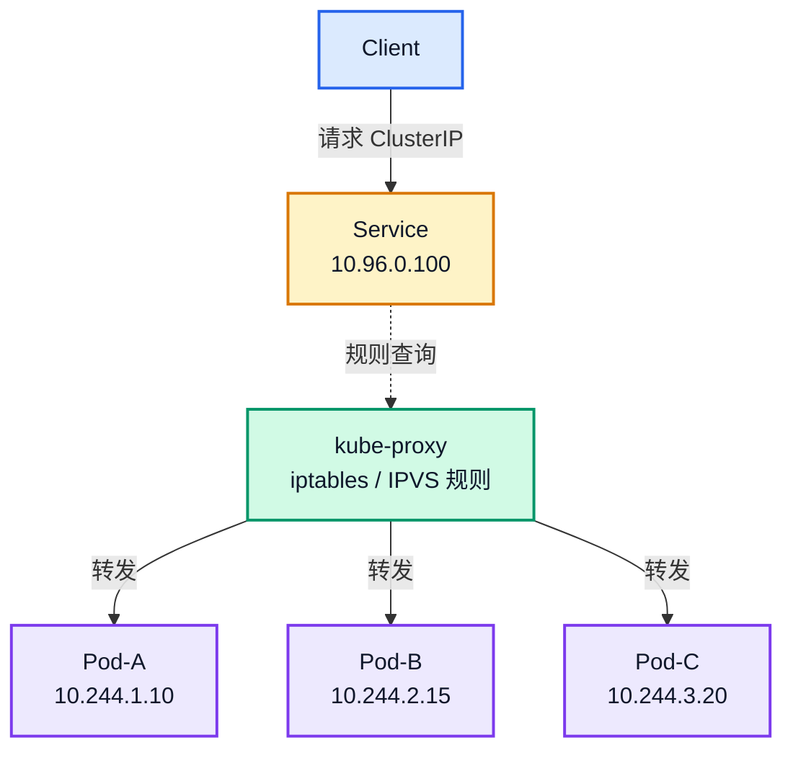
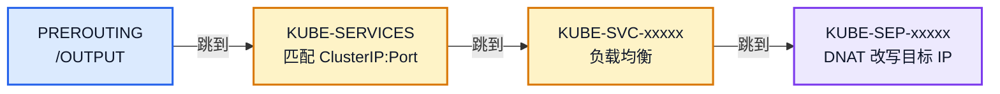
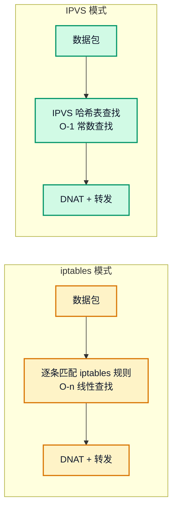

# Kubernetes Kube-Proxy 工作原理详解：Service 流量转发的核心组件

## 文章摘要

在 Kubernetes 中，每个 Pod 都有独立 IP，但 Pod 可能随时被重建、迁移甚至销毁——IP 是不稳定的。

为了让业务能稳定访问后端，Kubernetes 引入了 Service 资源。但 Service 本身只是一个"规则声明"——它不会转发流量。真正把访问 Service 的请求送到 Pod 的，是每个 Node 上都跑着的 **kube-proxy**。

本文从控制面（Service → Endpoint → EndpointSlice）到数据面（iptables / IPVS 规则链），完整拆解 kube-proxy 的工作机制，并给出生产环境常见的排查手段。

!!! note "深度补充"
    本文讲的是 kube-proxy 的整体工作机制。如果你已经读过本文，想进一步拆解真实的 iptables 规则链、conntrack 连接表、DNAT 改写过程，请继续阅读 [Service ClusterIP 为什么 ping 不通？kube-proxy + iptables 链路拆解](./clusterip-link-deep.md)。

---

## 一、为什么需要 Service？

假设你部署了三个 Nginx Pod：

```text
Pod-A  10.244.1.10
Pod-B  10.244.2.15
Pod-C  10.244.3.20
```

如果 Pod-B 被删除重建，新 Pod 的 IP 可能变成 `10.244.2.99`。所有依赖 `10.244.2.15` 的服务都会中断。

Kubernetes 的解法是引入 Service——一个**不会随 Pod 变化而变化的稳定入口**：

```text
Service ClusterIP: 10.96.0.100  ← 永远不变
         ↓
    kube-proxy 维护转发规则
         ↓
   Pod-A / Pod-B / Pod-C  ← 可以随时变化
```

客户端只需要访问 `10.96.0.100`，kube-proxy 负责把流量送到当前存活的后端 Pod。

---

## 二、Kube-Proxy 在集群中的位置



关键理解：**Service 本身不转发流量**。它只是一个逻辑概念，真正干活的是 kube-proxy 写进内核的规则。

---

## 三、Kube-Proxy 的核心工作流程

kube-proxy 的工作可以概括为五步：

### 3.1 监听 API Server

kube-proxy 持续 Watch 三类资源：

| 资源 | 作用 |
|------|------|
| Service | 获取 ClusterIP 和端口映射 |
| Endpoint / EndpointSlice | 获取后端 Pod IP 列表 |
| Node | 感知节点变化（部分模式需要） |

### 3.2 发现 Service 变更

当一个 Service 被创建或更新，kube-proxy 收到事件，提取关键信息：

```yaml
spec:
  clusterIP: 10.96.0.100
  ports:
    - port: 80
      targetPort: 8080
```

### 3.3 发现后端 Pod

kube-proxy 从 EndpointSlice 中读到当前可用的后端 Pod：

```text
10.244.1.10:8080
10.244.2.15:8080
10.244.3.20:8080
```

### 3.4 生成转发规则

根据配置的模式（iptables 或 IPVS），kube-proxy 调用内核接口写入转发规则。

### 3.5 流量到达

客户端发请求到 `10.96.0.100:80`，内核根据 kube-proxy 写入的规则，把流量 DNAT 改写为目标 Pod 的 IP 和端口。

---

## 四、控制面：Endpoint 与 EndpointSlice

很多人容易忽略这个细节——**Service 并不直接知道 Pod，它只知道 Endpoint**。

### 4.1 传统 Endpoint

当你创建一个 Service 并指定 `selector`：

```yaml
spec:
  selector:
    app: nginx
```

Kubernetes 会自动创建一个同名 Endpoint 对象，里面记录了匹配到的 Pod IP + 端口：

```bash
kubectl get endpoints nginx-test
```

```
NAME         ENDPOINTS                                      AGE
nginx-test   10.244.1.10:80,10.244.2.15:80,10.244.3.20:80   1d
```

### 4.2 EndpointSlice：大规模集群的优化

当单个 Service 后端有数千个 Pod 时，一个 Endpoint 对象会变得极其庞大。API Server 每次推送这个对象都会消耗大量带宽和内存。

Kubernetes 从 v1.21 开始用 EndpointSlice 替代 Endpoint。它将后端 Pod 列表拆分成多个 Slice（每个最多 100 个），Watch 推送时只发送变化的 Slice 而不是整个列表：

```bash
kubectl get endpointslice -l kubernetes.io/service-name=nginx-test
```

```
NAME               ADDRESSTYPE   PORTS   ENDPOINTS                        AGE
nginx-test-abcde   IPv4          80      10.244.1.10,10.244.2.15,10.244.3.20   1d
```

!!! info "版本说明"
    EndpointSlice 在 v1.21 起 GA，v1.31 起默认不再自动创建传统 Endpoint 对象。新集群建议直接使用 EndpointSlice。

---

## 五、iptables 模式：最经典的数据面

这是 kube-proxy 使用最广泛的模式。核心思想是：**把 Service 到 Pod 的映射，翻译成 iptables 的 DNAT 规则链**。

### 5.1 查看当前模式

```bash
kubectl -n kube-system get cm kube-proxy -o yaml | grep mode
```

```
mode: iptables
```

也可以直接看 kube-proxy 日志确认：

```bash
kubectl logs -n kube-system kube-proxy-xxxxx | head
```

```
I0812 01:00:00.123456   1 server_others.go:72] "Using iptables Proxier"
```

### 5.2 规则链结构

kube-proxy 生成的 iptables 规则是一条三级跳转链：



- **KUBE-SERVICES**：匹配目标 IP 是否是一个 Service ClusterIP，命中后跳转到对应的 Service 子链
- **KUBE-SVC-xxxxx**：用 `statistic` 模块随机选一个后端，跳转到对应的 Endpoint 链
- **KUBE-SEP-xxxxx**：执行真正的 DNAT，把目标 IP 从 ClusterIP 改写成 Pod IP

### 5.3 在生产节点上查看

```bash
iptables -t nat -L KUBE-SERVICES -n | head -20
```

你会看到类似这样的输出（以下为示例结构）：

```
Chain KUBE-SERVICES (2 references)
target     prot opt source     destination
KUBE-SVC-XXXXX  tcp  --  0.0.0.0/0  10.96.0.100  tcp dpt:80
```

### 5.4 iptables 模式的优缺点

| 维度 | 评价 |
|------|------|
| 稳定性 | 极好，Linux 内核原生支持，社区验证多年 |
| 部署复杂度 | 零，内核自带，无需额外安装 |
| 小规模性能 | 足够，几百个 Service 完全没问题 |
| 大规模性能 | 下降明显——规则是线性遍历，Service 越多越慢 |
| 规则更新 | 全量替换，Service 频繁变更时 CPU 开销高 |

---

## 六、IPVS 模式：更高性能的替代方案

IPVS（IP Virtual Server）是 Linux 内核内置的四层负载均衡模块，比 iptables 更适合大规模 Service 场景。

### 6.1 与 iptables 的本质区别



iptables 规则是链式线性匹配，5000 条规则就意味每个数据包最多匹配 5000 次。IPVS 用哈希表实现 O(1) 查找，Service 数量对转发性能几乎没有影响。

### 6.2 查看当前模式

```bash
kubectl -n kube-system get cm kube-proxy -o yaml | grep mode
```

```
mode: ipvs
```

### 6.3 调度算法

IPVS 支持多种负载均衡算法：

| 算法 | 行为 |
|------|------|
| rr（Round Robin） | 轮询，默认 |
| lc（Least Connection） | 最少连接数优先 |
| sh（Source Hash） | 同源 IP 始终到同一后端 |
| dh（Destination Hash） | 目标地址哈希 |

### 6.4 在生产节点上查看

```bash
ipvsadm -Ln
```

```
IP Virtual Server version 1.2.1 (size=4096)
Prot LocalAddress:Port Scheduler Flags
  -> RemoteAddress:Port           Forward Weight ActiveConn InActConn
TCP  10.96.0.100:80 rr
  -> 10.244.1.10:8080             Masq    1      0          0
  -> 10.244.2.15:8080             Masq    1      0          0
  -> 10.244.3.20:8080             Masq    1      0          0
```

### 6.5 IPVS 的优缺点

| 维度 | 评价 |
|------|------|
| 转发性能 | 远超 iptables，O(1) vs O(n) |
| 调度算法 | 丰富，rr/lc/sh/dh 等 |
| 部署复杂度 | 需要加载 ip_vs 内核模块 |
| 大规模场景 | 非常适合 1000+ Service |

!!! warning "IPVS 模式正在被废弃"
    Kubernetes v1.37 开始对 IPVS 模式打 deprecation warning，计划 v1.40 默认禁用、v1.43 彻底移除。原因是 IPVS 底层仍然依赖 iptables 实现部分 Service 语义（如 `externalTrafficPolicy`），没有真正独立。新集群不建议再使用 IPVS 模式，等待社区推荐的 nftables 模式成熟。

---

## 七、iptables vs IPVS：选型建议

| 对比维度 | iptables | IPVS |
|----------|----------|------|
| 转发性能 | 规则线性匹配，大规模慢 | 哈希表 O(1)，大规模快 |
| 调度算法 | 仅随机 | rr / lc / sh / dh 等多种 |
| 部署要求 | 内核自带 | 需加载 ip_vs 等模块 |
| 社区趋势 | 稳定首选 | 正在废弃 |
| 适用规模 | < 500 Service | 曾经适合 1000+，现不推荐新用 |

**当前建议**：新集群使用 iptables 模式。关注 nftables 模式的成熟进度，届时迁移。

---

## 八、流量转发全过程

以一个具体请求为例，走一遍完整链路：

```text
Client 发出请求: curl 10.96.0.100:80
```

| 步骤 | 发生了什么 | 负责方 |
|:---:|---|---|
| 1 | DNS 解析 Service 域名 → 得到 ClusterIP `10.96.0.100` | CoreDNS |
| 2 | 数据包到达内核 netfilter | Linux 内核 |
| 3 | PREROUTING 链 → 跳入 KUBE-SERVICES | iptables |
| 4 | 匹配目标 `10.96.0.100:80` → 跳到 KUBE-SVC-xxxxx | kube-proxy 规则 |
| 5 | statistic 模块随机选后端 → 跳到 KUBE-SEP-yyyyy | kube-proxy 规则 |
| 6 | DNAT：目标 IP 从 `10.96.0.100` 改写为 `10.244.2.15:8080` | iptables |
| 7 | conntrack 记录连接状态 | Linux conntrack |
| 8 | Pod 处理请求并返回 | 业务容器 |
| 9 | 回包到达，conntrack 根据记录还原源地址 | Linux conntrack |
| 10 | Client 收到响应，整个过程对业务透明 | — |

这里有一个反直觉的现象：**ClusterIP 在节点上 ping 不通，但 curl 可以**。原因很简单——ClusterIP 是虚拟 IP，没有对应的网络接口，iptables 只匹配 TCP/UDP 端口，ICMP 不在规则范围内。详细拆解见 [ClusterIP 深度文章](./clusterip-link-deep.md)。

---

## 九、生产环境常见故障排查

### 9.1 Service 无法访问

先从最外层排查：

```bash
kubectl get svc -A
kubectl get endpoints <svc-name>
```

如果 Endpoint 显示 `<none>`，说明没有 Pod 匹配到 Service 的 selector。

### 9.2 Selector 不匹配

这是最常见的问题：

Service 写了：

```yaml
selector:
  app: nginx
```

但 Pod 的 label 是：

```yaml
labels:
  app: web
```

两者不一致，Endpoint 为空。用 `kubectl describe svc` 看 Events 可以确认。

### 9.3 kube-proxy 本身异常

```bash
kubectl get pod -n kube-system -l k8s-app=kube-proxy
```

看是否有 CrashLoopBackOff 或长时间未 Ready 的 Pod。

```bash
kubectl logs -n kube-system kube-proxy-xxxxx
```

常见错误：连接 API Server 超时、iptables 规则写入失败（内核模块未加载）。

### 9.4 iptables 规则异常

```bash
iptables -t nat -L KUBE-SERVICES -n | grep <ClusterIP>
```

如果 ClusterIP 对应的规则不存在，说明 kube-proxy 没有正确写入。

### 9.5 IPVS 规则异常

```bash
ipvsadm -Ln | grep <ClusterIP>
```

如果 Virtual Service 存在但 Real Server 为空，说明后端 Pod 全部不健康或 EndpointSlice 未更新。

---

## 十、Kube-Proxy 与 CNI 的分工

这是很多初学者容易混淆的地方：

| 流量类型 | 负责组件 | 说明 |
|----------|----------|------|
| Pod → Pod（直连 IP） | CNI（Calico / Flannel 等） | Pod 网络通信，基于路由或 Overlay |
| Pod → Service ClusterIP | kube-proxy | iptables / IPVS 规则做 DNAT 转发 |
| 外部 → Service（NodePort / LoadBalancer） | kube-proxy | 同样走 iptables / IPVS |

简单区分：

> Pod 之间直接用 IP 通信，走 CNI；访问 Service（ClusterIP、NodePort），走 kube-proxy。

---

## 十一、总结

kube-proxy 的定位可以概括为：

> Service 提供稳定入口，kube-proxy 负责把流量转发到后端 Pod。

核心要点：

- **控制面**：Watch Service + EndpointSlice，感知变化
- **数据面**：在 Linux 内核写入 iptables 或 IPVS 规则
- **转发原理**：DNAT 改目标 IP + conntrack 保证回包正确
- **选型**：当前首选 iptables，IPVS 正在被废弃，关注 nftables

---

## 十二、相关阅读

- [Service ClusterIP 为什么 ping 不通？kube-proxy + iptables 链路拆解](./clusterip-link-deep.md)——本文的深度补充，拆真实 iptables 规则链、conntrack、DNAT
- [Calico 跨节点通信：BGP 路由、BIRD 与 IPIP 隧道](./calico-bgp.md)——DNAT 之后，包怎么跨节点到达目标 Pod
- [Pod 网络创建全过程](./pod-network-creation.md)——veth pair、IP 分配、路由表配置
- [Kubernetes Kubelet 工作原理](../node/kubelet.md)——kubelet 组件级深度解析
- [Kubernetes CNI 工作原理](./cni.md)——CNI 规范与插件机制
