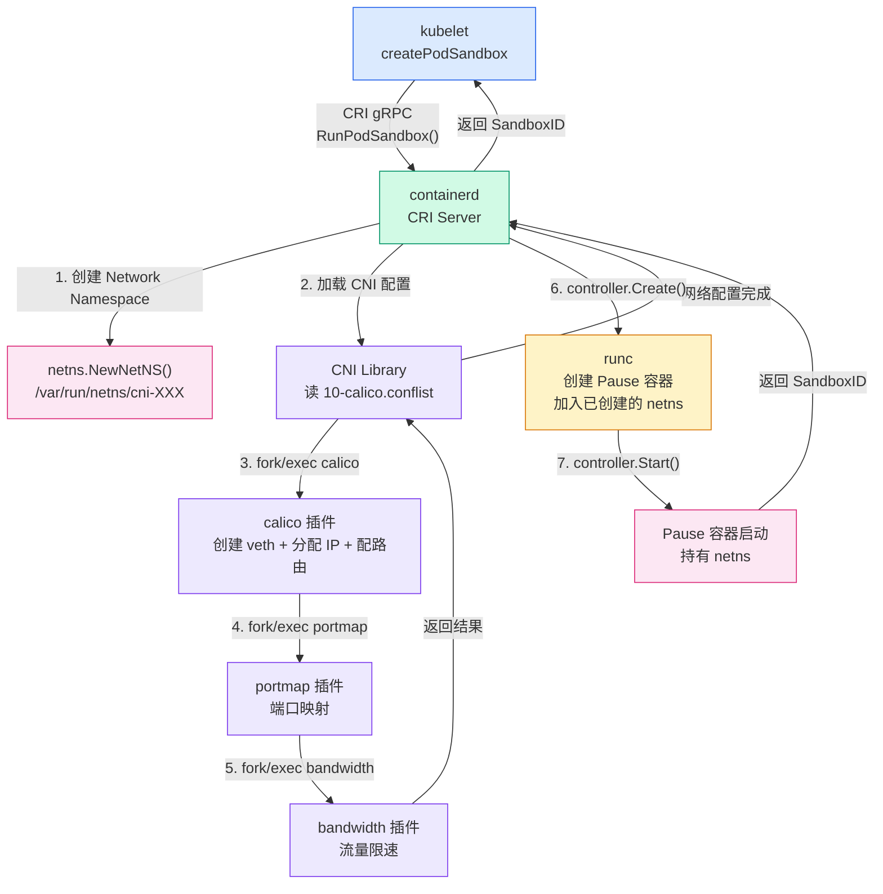
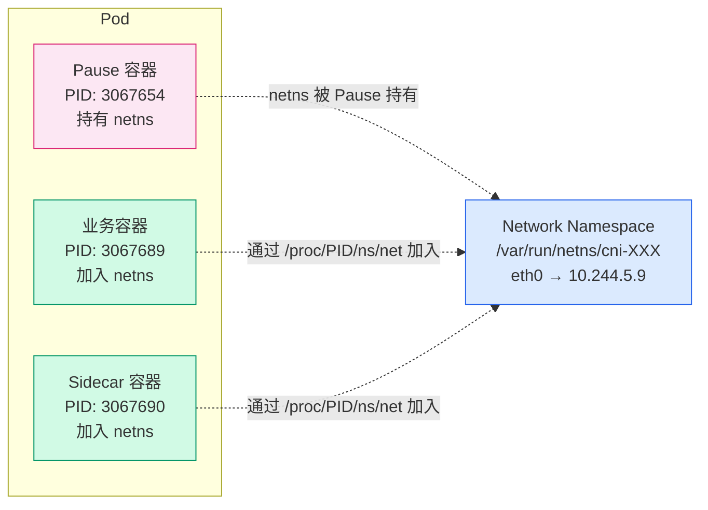
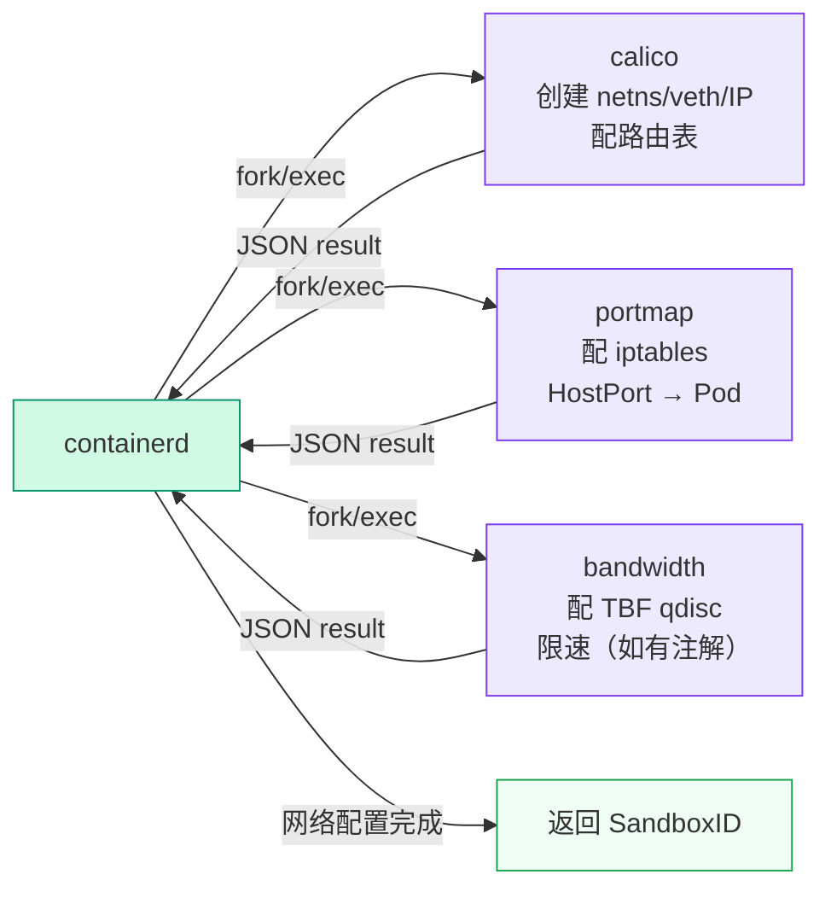
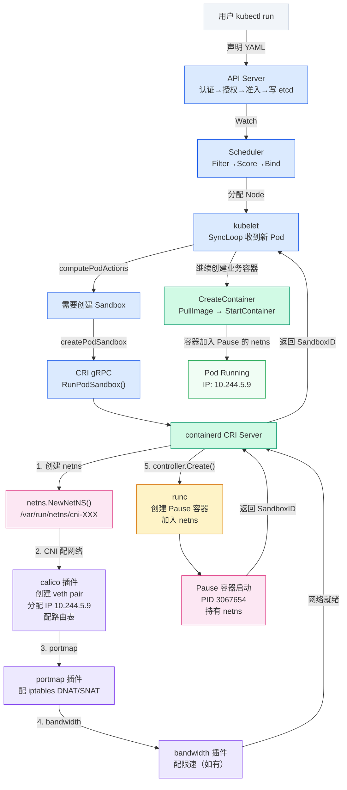

# Pod 网络创建全过程：从 RunPodSandbox 到 veth pair，CNI 到底做了什么？

## 一、上一篇留下的坑

上一篇拆 Pod 生命周期时，`createPodSandbox` 的源码走到第 4 步——`m.runtimeService.RunPodSandbox()`，时序图画了个框写着"CNI 配网络"，然后就直接跳到 PullImage 了。

当时一笔带过，因为网络这部分展开来又是一整篇。这篇就来填这个坑。

写之前我以为 CNI 就是"给 Pod 分配个 IP"，翻完源码跑完命令才发现远不止——netns 创建、veth pair、路由表配置、多插件链式调用，每一步都有具体的行为。而且有个反直觉的发现：**kubelet 根本不直接调 CNI**，真正调 CNI 的是 containerd。

## 二、Kubernetes 网络模型（简述）

Kubernetes 网络模型只有四条规则：

1. 每个 Pod 有独立 IP
2. Pod 之间可以直接通信，不需要 NAT
3. Pod 和 Node 之间可以直接通信，不需要 NAT
4. Pod 看到的自己的 IP，和其他 Pod 看到它的 IP 是同一个

这四条规则看起来简单，但 Kubernetes 自己不实现——它只定义模型，具体怎么配网络交给 CNI。

## 三、CNI 是什么：规范不是产品

CNI 全称 Container Network Interface，和 CRI 一样是接口规范，不是具体产品。

类比一下：USB 是接口标准，U 盘、键盘、鼠标是基于这个标准的具体实现。CNI 也是如此——Calico、Flannel、Cilium、Weave 都是基于 CNI 规范实现的网络插件。

### CNI 插件是可执行文件

这是很多人忽略的一个关键点：**CNI 插件不是 daemon，不是 .so 库，就是一个个二进制文件**。

在 worker01 上看：

```bash
ls /opt/cni/bin/
```

```
bandwidth  calico       dhcp   firewall  host-device  ipvlan   loopback  portmap  README.md  static  tuning  vrf
bridge     calico-ipam  dummy  flannel   host-local   LICENSE  macvlan   ptp      sbr        tap     vlan
```

这些文件就是 CNI 插件。当 containerd 需要给 Pod 配网络时，它会 `fork + exec` 对应的二进制文件，通过 stdin 传 JSON 配置，从 stdout 读返回结果。这跟 CRI 的 gRPC 通信完全不同。

CNI 配置文件在另一个目录：

```bash
sudo ls -la /etc/cni/net.d/
```

```
total 16
drwx------ 2 root root 4096 May 12 22:50 .
drwxr-xr-x 3 root root 4096 May 10 13:40 ..
-rw-r--r-- 1 root root  659 May 24 21:30 10-calico.conflist
-rw------- 1 root root 2796 Aug  5 09:29 calico-kubeconfig
```

`10-calico.conflist` 是主配置文件，`calico-kubeconfig` 是 Calico 连 API Server 的 kubeconfig。文件内容后面拆解。

### kubelet 不直接调 CNI

这是个反直觉的结论。很多人以为调用链是：

```
kubelet → CNI 插件
```

实际是：

```
kubelet → CRI gRPC → containerd → CNI 插件
```

kubelet 发的是 CRI 的 `RunPodSandbox` 请求给 containerd，containerd 内部先创建 Network Namespace、调 CNI 配网络，然后再创建 Pause 容器。kubelet 根本不知道 CNI 的存在。

## 四、从 SyncPod 到 CNI：调用链路

### kubelet 侧：回顾上一篇

上一篇已经贴过 `createPodSandbox` 的源码（`pkg/kubelet/kuberuntime/kuberuntime_sandbox.go`），核心是第 4 步：

```go
// Source: pkg/kubelet/kuberuntime/kuberuntime_sandbox.go
func (m *kubeGenericRuntimeManager) createPodSandbox(
    ctx context.Context, pod *v1.Pod, attempt uint32,
) (string, string, error) {
    // 1. 生成 Sandbox 配置
    podSandboxConfig, err := m.generatePodSandboxConfig(ctx, pod, attempt)
    // 2. 创建 Pod 日志目录
    err = m.osInterface.MkdirAll(podSandboxConfig.LogDirectory, 0755)
    // 3. 查找 RuntimeClass handler
    runtimeHandler := ""
    if m.runtimeClassManager != nil {
        runtimeHandler, err = m.runtimeClassManager.LookupRuntimeHandler(
            pod.Spec.RuntimeClassName)
    }
    // 4. 调用 CRI RunPodSandbox
    podSandBoxID, err := m.runtimeService.RunPodSandbox(ctx, podSandboxConfig, runtimeHandler)
    return podSandBoxID, "", nil
}
```

`m.runtimeService.RunPodSandbox()` 是一个 CRI gRPC 调用，发给 containerd 的 CRI Server。从这行开始，控制权从 kubelet 转移到 containerd。

### containerd 侧：收到 RunPodSandbox

containerd 的 CRI Server 收到 `RunPodSandbox` 请求后，大致做四件事：

1. 创建 Network Namespace（containerd 自己创建，不是 Pause 容器创建的）
2. **调用 CNI 插件配置网络**（在 Pause 容器创建之前）
3. 创建 Pause 容器（传入 netns path，让 Pause 加入已创建的 netns）
4. 启动 Pause 容器

其中第 2 步是本篇的核心。containerd 通过内部的 CNI 库（containernetworking/cni）加载 `/etc/cni/net.d/` 下的配置文件，然后按顺序 `fork/exec` 配置中声明的插件。

> 源码位置：`pkg/cri/sbserver/sandbox_run.go`，`RunPodSandbox` 函数（L53）。关键调用顺序：L157 `netns.NewNetNS()` → L206 `setupPodNetwork()` → L228 `controller.Create()` → L232 `controller.Start()`。可在 GitHub 查看 containerd v1.7.x 的 `pkg/cri/sbserver/sandbox_run.go`。

整个过程可以用一张图概括：



注意图中的调用方式：CNI 插件不是常驻进程，而是每次创建 Pod 时被 fork/exec 调起的短命进程。calico 插件执行完退出，portmap 插件接着被调起，依次执行。

### CNI 插件的输入输出

CNI 插件的调用方式很特别——不是 gRPC，不是 HTTP，是**标准输入输出**：

- **stdin**：JSON 格式的 CNI 配置 + 环境变量（如 `CNI_COMMAND=ADD`、`CNI_NETNS=/var/run/netns/xxx`、`CNI_CONTAINERID=xxx`）
- **stdout**：JSON 格式的执行结果（包含分配的 IP、接口列表等）

这意味着你可以手动调用 CNI 插件来调试网络问题。只要构造正确的环境变量和 JSON 输入，直接执行 `/opt/cni/bin/calico` 就能看到完整输出。

## 五、CNI 插件做了什么：四步配网络

这是本篇的实操核心。创建一个测试 Pod：

```bash
kubectl run nginx-net --image=m.daocloud.io/docker.io/library/nginx:alpine --restart=Never
```

等 Pod 进入 Running 后，到 worker01 上观察 CNI 到底做了什么。

### 第 1 步：创建 Network Namespace

CNI 插件（实际上是 containerd 先创建好 netns，再传给 CNI 插件）为 Pod 创建一个独立的 Network Namespace。

用 `crictl inspectp` 查看 Sandbox 的 namespace 信息：

```bash
sudo crictl inspectp 7b4ddf2304a61 | jq .info.runtimeSpec.linux.namespaces
```

```json
[
  {
    "type": "pid"
  },
  {
    "type": "ipc"
  },
  {
    "type": "uts"
  },
  {
    "type": "mount"
  },
  {
    "path": "/var/run/netns/cni-326a3f93-d997-f9da-b756-06e46c0ac89d",
    "type": "network"
  },
  {
    "type": "cgroup"
  }
]
```

注意 `network` 类型的 Namespace 有 `path` 字段，指向 `/var/run/netns/cni-326a3f93-d997-f9da-b756-06e46c0ac89d`。这就是 CNI 创建的 Pod 网络命名空间文件。

其他四种 Namespace（pid、ipc、uts、mount、cgroup）没有 `path`，说明 Pause 容器自己创建了这些 Namespace，不共享。

### 第 2 步：创建 veth pair

veth pair 是 Linux 内核提供的一对虚拟网络接口，一端收到的数据会从另一端发出，就像一根网线的两头。

CNI 在 Pod netns 里创建 `eth0`，在主机上创建对应的 `caliXXX` 接口：

```bash
ip link | grep cali
```

```
127: calibf2489e928a@if3: <BROADCAST,MULTICAST,UP,LOWER_UP> mtu 1480 qdisc noqueue state UP mode DEFAULT group default qlen 1000
128: cali75a92f45e54@if3: <BROADCAST,MULTICAST,UP,LOWER_UP> mtu 1480 qdisc noqueue state UP mode DEFAULT group default qlen 1000
130: cali1cb4c5d100f@if3: <BROADCAST,MULTICAST,UP,LOWER_UP> mtu 1480 qdisc noqueue state UP mode DEFAULT group default qlen 1000
```

worker01 上有 3 个 `cali` 接口，说明这个节点上运行着 3 个 Pod。接口编号从 127 开始，说明这个节点启动以来创建过不少接口。

!!! note "veth 命名规则"
    Calico 的 veth 主机端接口名固定以 `cali` 开头，后面跟 11 个字符（是 Pod 容器 ID 的前 11 位做 hash）。Pod 端固定叫 `eth0`。这个命名规则在排查网络问题时很有用——看到 `cali` 开头的接口就知道是 Calico 创建的 Pod 网络。

注意 MTU 值是 1480，不是常见的 1500。这是因为 Calico 使用了 IPIP 隧道（`tunl0`）做跨节点通信，IPIP 头部占用 20 字节，所以 Pod 接口 MTU 要减 20。

### 第 3 步：分配 Pod IP

Calico 通过自己的 IPAM 插件（`calico-ipam`）从 Pod CIDR 中分配 IP。worker01 的 Pod CIDR 是 `10.244.5.0/26`，可用 IP 范围是 10.244.5.1 ~ 10.244.5.62。

从路由表可以反推出每个 Pod 的 IP：

```bash
ip route
```

```
default via 192.168.114.254 dev ens192 onlink
blackhole 10.244.5.0/26 proto bird
10.244.5.6 dev cali75a92f45e54 scope link
10.244.5.8 dev calibf2489e928a scope link
10.244.5.9 dev cali1cb4c5d100f scope link
10.244.19.64/26 via 192.168.114.150 dev tunl0 proto bird onlink
10.244.30.64/26 via 192.168.114.149 dev tunl0 proto bird onlink
10.244.59.192/26 via 192.168.114.146 dev tunl0 proto bird onlink
10.244.235.0/26 via 192.168.114.147 dev tunl0 proto bird onlink
10.244.241.64/26 via 192.168.114.145 dev tunl0 proto bird onlink
192.168.114.0/24 dev ens192 proto kernel scope link src 192.168.114.148
```

这张路由表信息量很大，逐行拆：

**本节点 Pod 路由：**

```
10.244.5.6 dev cali75a92f45e54 scope link
10.244.5.8 dev calibf2489e928a scope link
10.244.5.9 dev cali1cb4c5d100f scope link
```

这三行说明：发往 10.244.5.9 的包，直接走 `cali1cb4c5d100f` 接口。后面用 `ip addr` 在 Pod netns 内确认了 nginx-net 的 Pod IP 正是 10.244.5.9。

**本节点 Pod CIDR 黑洞路由：**

```
blackhole 10.244.5.0/26 proto bird
```

`blackhole` 表示 10.244.5.0/26 这个网段不在主机路由表里直接可达，只有分配了 IP 的那几个地址（.6、.8、.9）才通过 veth 可达。`proto bird` 说明这条路由是 Calico 的 BIRD（BGP 路由守护进程）下发的。

**跨节点 Pod 路由：**

```
10.244.19.64/26 via 192.168.114.150 dev tunl0 proto bird onlink
10.244.30.64/26 via 192.168.114.149 dev tunl0 proto bird onlink
10.244.59.192/26 via 192.168.114.146 dev tunl0 proto bird onlink
10.244.235.0/26 via 192.168.114.147 dev tunl0 proto bird onlink
10.244.241.64/26 via 192.168.114.145 dev tunl0 proto bird onlink
```

这五行是其他节点的 Pod CIDR 路由。发往 10.244.19.64/26 的包，通过 `tunl0`（IPIP 隧道）发到 192.168.114.150（另一个节点）。这部分是跨节点通信的核心，下一篇拆 Calico 时会详细展开。

**主机网络路由：**

```
default via 192.168.114.254 dev ens192 onlink
192.168.114.0/24 dev ens192 proto kernel scope link src 192.168.114.148
```

这是 worker01 本身的物理网络——IP 192.168.114.148，网关 192.168.114.254，走 `ens192` 物理网卡。

!!! tip "用路由表排查 Pod 网络问题"
    当 Pod 无法通信时，先在 Pod 所在节点上 `ip route` 看路由表：
    - 找不到对应的 `dev caliXXX scope link` → CNI 没配好网络
    - 跨节点路由缺失（没有 `via xxx dev tunl0`） → Calico BIRD 没下发路由
    - `tunl0` 接口不存在 → Calico IPIP 模式没配好

### 第 4 步：配置 Pod 内路由

前三步都是主机侧的操作。在 Pod netns 内部，CNI 还配了路由规则。直接进入 Pod 的 Network Namespace 查看：

```bash
sudo ip netns exec cni-326a3f93-d997-f9da-b756-06e46c0ac89d ip route
```

```
default via 169.254.1.1 dev eth0
169.254.1.1 dev eth0 scope link
```

两条路由：一条默认路由走 `eth0`，网关是 `169.254.1.1`；另一条链路本地路由，让 169.254.1.1 本身也走 `eth0`。

再看 Pod 内的接口：

```bash
sudo ip netns exec cni-326a3f93-d997-f9da-b756-06e46c0ac89d ip addr
```

```
1: lo: <LOOPBACK,UP,LOWER_UP> mtu 65536 qdisc noqueue state UNKNOWN group default qlen 1000
    link/loopback 00:00:00:00:00:00 brd 00:00:00:00:00:00
    inet 127.0.0.1/8 scope host lo
       valid_lft forever preferred_lft forever
    inet6 ::1/128 scope link proto kernel_lo
       valid_lft forever preferred_lft forever
2: tunl0@NONE: <NOARP> mtu 1480 qdisc noop state DOWN group default qlen 1000
    link/ipip 0.0.0.0 brd 0.0.0.0
3: eth0@if130: <BROADCAST,MULTICAST,UP,LOWER_UP> mtu 1480 qdisc noqueue state UP group default qlen 1000
    link/ether 1a:7c:2d:ce:34:84 brd ff:ff:ff:ff:ff:ff link-netnsid 0
    inet 10.244.5.9/32 scope global eth0
       valid_lft forever preferred_lft forever
    inet6 fe80::187c:2dff:fece:3484/64 scope link proto kernel_ll
       valid_lft forever preferred_lft forever
```

三个接口：

- `lo` — 回环接口，127.0.0.1，标准配置
- `tunl0@NONE` — IPIP 隧道接口，状态 DOWN。Calico IPIP 模式下每个 Pod netns 里都会创建这个接口，但实际跨节点通信走的是主机侧的 `tunl0`，Pod 内这个接口处于 DOWN 状态不参与数据转发
- `eth0@if130` — veth pair 的 Pod 端，IP 是 `10.244.5.9/32`。`@if130` 对应主机侧的接口编号 130，正是前面 `ip link` 看到的 `cali1cb4c5d100f`

注意 Pod IP 的掩码是 `/32`——不是 `/26`（虽然 Pod CIDR 是 10.244.5.0/26）。Calico 给每个 Pod 分配的是单个 IP 而不是子网，路由通过 Proxy ARP 而不是子网直连来完成。

!!! note "169.254.1.1 是什么"
    169.254.0.0/16 是 IPv4 链路本地地址段。Calico 用 169.254.1.1 作为 Pod 的默认网关，配合 Proxy ARP 实现——主机端的 `caliXXX` 接口会响应 Pod 的 ARP 请求，让 Pod 以为 169.254.1.1 是一个真实的设备，实际上数据包直接到了主机网络栈。

## 六、Pause 容器：网络共享的基石

### 一个 Pod 内为什么能共享网络

上一篇已经用 `crictl inspect` 展示过业务容器的 Namespace，当时发现 `network` 类型的 Namespace 有 `path`，指向 `/proc/3067654/ns/net`。但没解释这个 PID 是谁的。

这次有了 Sandbox 和业务容器的完整对比数据：

```bash
# Sandbox（Pause 容器）的 PID
sudo crictl inspectp 7b4ddf2304a61 | jq .info.pid
```

```
3067654
```

```bash
# 业务容器的 PID
sudo crictl inspect 831fc475cc90e | jq .info.pid
```

```
3067689
```

PID 差 35——Pause 容器先启动（PID 3067654），业务容器稍后启动（PID 3067689）。

再看两者的 Namespace 对比：

**Sandbox（Pause 容器）：**

```bash
sudo crictl inspectp 7b4ddf2304a61 | jq .info.runtimeSpec.linux.namespaces
```

```json
[
  {"type": "pid"},
  {"type": "ipc"},
  {"type": "uts"},
  {"type": "mount"},
  {
    "path": "/var/run/netns/cni-326a3f93-d997-f9da-b756-06e46c0ac89d",
    "type": "network"
  },
  {"type": "cgroup"}
]
```

**业务容器：**

```bash
sudo crictl inspect 831fc475cc90e | jq .info.runtimeSpec.linux.namespaces
```

```json
[
  {"type": "pid"},
  {
    "path": "/proc/3067654/ns/ipc",
    "type": "ipc"
  },
  {
    "path": "/proc/3067654/ns/uts",
    "type": "uts"
  },
  {"type": "mount"},
  {
    "path": "/proc/3067654/ns/net",
    "type": "network"
  },
  {"type": "cgroup"}
]
```

对比两张表：

| Namespace | Pause（Sandbox） | 业务容器 |
|----------|------------------|---------|
| pid | 独立创建 | 独立创建 |
| ipc | 独立创建 | → `/proc/3067654/ns/ipc` |
| uts | 独立创建 | → `/proc/3067654/ns/uts` |
| network | → `/var/run/netns/cni-326a3f93-...` | → `/proc/3067654/ns/net` |
| mount | 独立创建 | 独立创建 |
| cgroup | 独立创建 | 独立创建 |

业务容器的 `network`、`ipc`、`uts` 三种 Namespace 都指向 `/proc/3067654/ns/xxx`——而 3067654 正是 Pause 容器的 PID。业务容器通过 `path` 字段加入了 Pause 容器的这三个 Namespace。

这就解释了 Kubernetes 文档里那句"Pod 内所有容器共享网络 Namespace"在底层的真正含义。

### Pause 容器的真正作用

很多人以为 Pause 容器只是个占位符，没什么实际用途。实际上它的核心作用是**持有 Network Namespace**。

注意，netns 不是 Pause 容器创建的——上面源码分析过，是 containerd 在创建 Pause 容器之前通过 `netns.NewNetNS()` 创建的。Pause 容器创建时加入了这个已存在的 netns，之后业务容器再通过 `/proc/<pause-pid>/ns/net` 加入同一个 netns。



如果业务容器崩溃重启，Pause 容器不受影响，netns 不会丢失，Pod IP 不会变。但如果 Pause 容器死了，整个 Pod 的网络就要重建——这正是 `PodSandboxChanged` 判断的逻辑（上一篇 `computePodActions` 源码里看到的）。

Pause 容器的进程是 `/pause`，它的代码就几百行，做的事情很简单：注册 SIGCHLD 信号处理函数，然后 `pause()` 永久等待。它存在的唯一目的就是作为 PID 1 僵在 netns 里，不让 netns 被内核回收。

## 七、CNI 配置文件拆解

现在来看 CNI 配置文件的具体内容：

```bash
sudo cat /etc/cni/net.d/10-calico.conflist
```

```json
{
  "name": "k8s-pod-network",
  "cniVersion": "0.3.1",
  "plugins": [
    {
      "type": "calico",
      "log_level": "info",
      "log_file_path": "/var/log/calico/cni/cni.log",
      "datastore_type": "kubernetes",
      "nodename": "worker01",
      "mtu": 0,
      "ipam": {
          "type": "calico-ipam"
      },
      "policy": {
          "type": "k8s"
      },
      "kubernetes": {
          "kubeconfig": "/etc/cni/net.d/calico-kubeconfig"
      }
    },
    {
      "type": "portmap",
      "snat": true,
      "capabilities": {"portMappings": true}
    },
    {
      "type": "bandwidth",
      "capabilities": {"bandwidth": true}
    }
  ]
}
```

逐字段拆解：

**顶层字段：**

- `name: "k8s-pod-network"` — 这个 CNI 网络的名字，随便取，不影响功能
- `cniVersion: "0.3.1"` — CNI 规范版本。0.3.1 是比较稳定的版本，支持链式调用
- `plugins: [...]` — 插件数组，按顺序执行

!!! note "为什么是 .conflist 不是 .conf"
    CNI 规范规定：

    - `.conf` 文件只包含**单个插件**配置
    - `.conflist` 文件包含**插件链**（plugins 数组）
    
    如果只有一个插件，用 `.conf` 或 `.conflist` 都行。多个插件必须用 `.conflist`。Calico 默认用 conflist，即使只有一个插件也用数组格式。

**calico 插件配置：**

- `type: "calico"` — 调用 `/opt/cni/bin/calico` 二进制
- `log_level: "info"` — 日志级别，对应 `/var/log/calico/cni/cni.log`
- `datastore_type: "kubernetes"` — 用 K8s API Server 存储网络数据（不是 etcd 直连）
- `nodename: "worker01"` — 节点名，Calico 用它区分不同节点的 Pod CIDR
- `mtu: 0` — 0 表示自动检测物理网卡 MTU 并减去 IPIP 开销（1480）
- `ipam.type: "calico-ipam"` — 用 Calico 自己的 IPAM，不是 `host-local`（host-local 会用完不回收）
- `policy.type: "k8s"` — 用 K8s NetworkPolicy 做网络策略
- `kubernetes.kubeconfig` — Calico 连 API Server 的凭证

**portmap 插件配置：**

- `type: "portmap"` — 调用 `/opt/cni/bin/portmap`
- `snat: true` — 做 Source NAT，让 Pod 访问外部网络时源 IP 转成 Node IP
- `capabilities.portMappings: true` — 声明这个插件支持端口映射功能

**bandwidth 插件配置：**

- `type: "bandwidth"` — 调用 `/opt/cni/bin/bandwidth`
- `capabilities.bandwidth: true` — 声明支持流量限速功能

bandwidth 插件平时不做什么，只有当 Pod 定义了 `metadata.annotations` 里的 ingress/egress 限速注解时才会生效。但它始终在插件链里——CNI 会把它加载进来，执行时根据是否有限速注解决定是否做事。

Calico CNI 插件的执行日志在 `/var/log/calico/cni/cni.log`，可以查看每次 Pod 创建时的 IPAM 分配记录。不过这个日志只在 CNI 插件执行时写入，不是常驻日志。

## 八、CNI 插件链式调用

CNI 规范的插件链机制：containerd 按配置文件中 `plugins` 数组的顺序，依次 fork/exec 每个插件。前一个插件的输出作为后一个插件的输入。



三个插件各司其职：

| 插件 | 职责 | 不做的事 |
|------|------|---------|
| calico | 创建 veth pair、分配 Pod IP、配置路由表、配置 NetworkPolicy 规则 | 端口映射、流量限速 |
| portmap | 配置 iptables DNAT 规则（HostPort → Pod IP）、配置 SNAT 规则（Pod 出站源 IP 转换） | 分配 IP、创建 veth |
| bandwidth | 配置 Linux TBF qdisc 规则（ingress/egress 限速） | 其他所有事 |

!!! warning "插件顺序很重要"
    CNI 插件必须按顺序执行：先 calico 配好基础网络，再 portmap 配端口映射，最后 bandwidth 配限速。如果顺序反了，portmap 在没有 veth 和 IP 的情况下配 iptables 规则会失败。
    
    配置文件中 `plugins` 数组的顺序就是执行顺序，不要随意调整。

### 链式调用的数据传递

每个插件执行完后，通过 stdout 返回一个 JSON 结果，格式大致是：

```json
{
  "cniVersion": "0.3.1",
  "interfaces": [
    {"name": "cali75a92f45e54", "mac": "ee:ee:ee:ee:ee:ee"},
    {"name": "eth0", "mac": "aa:bb:cc:dd:ee:ff", "sandbox": "/var/run/netns/cni-326a3f93-..."}
  ],
  "ips": [
    {
      "interface": 1,
      "address": "10.244.5.9/32",
      "gateway": "169.254.1.1"
    }
  ],
  "routes": [
    {"dst": "0.0.0.0/0", "gw": "169.254.1.1"}
  ]
}
```

这个结果会被传给下一个插件。portmap 插件读到 `ips[0].address` 后才知道要给哪个 IP 配端口映射规则。

## 九、完整链路总结

把本篇和上一篇的内容串起来，从用户声明 YAML 到 Pod 网络就绪的完整链路：



一句话总结：**Pod 网络不是 Kubernetes 配的，也不是 kubelet 配的，是 containerd 在创建 Pause 容器之前，先创建 netns、调 CNI 插件配好的。** kubelet 只管发 `RunPodSandbox` 请求，CNI 做什么、怎么做，全由 `/etc/cni/net.d/` 下的配置文件决定。

跨节点路由怎么来的——`10.244.19.64/26 via 192.168.114.150 dev tunl0` 这条路由是 BIRD 通过 BGP 协议从其他节点学来的——这是下一篇的内容。

## 十、相关阅读

- [Kubernetes Pod 生命周期源码解析](../node/pod-lifecycle.md)——Pod 从 Pending 到 Running 的完整链路，本文从其中的 `RunPodSandbox` 步骤展开
- [Kubernetes kubelet SyncLoop 原理](../node/kubelet-syncloop.md)——SyncLoop 四路输入、PodWorkers 串行设计、PLEG relist 机制详解
- [Kubernetes CRI 原理](../node/cri-grpc-deep.md)——三个 gRPC 请求的 protobuf 定义、参数和返回值
- [containerd 创建容器全过程](../node/containerd-from-cri-to-runc.md)——containerd 内部五个模块、Snapshotter、containerd-shim 机制
- [Calico 跨节点通信原理](calico-bgp.md)（计划中）——BGP 路由、IPIP 隧道、Felix 详解

---

下一篇：**Calico 跨节点通信：BGP 路由与 Felix 源码拆解**

本文拆完了单节点内的 Pod 网络创建——veth pair、IP 分配、路由表配置。但路由表里那些 `via 192.168.114.150 dev tunl0` 的跨节点路由是怎么来的？BIRD 是什么？BGP 协议怎么在节点之间传递路由？tunl0 的 IPIP 隧道封包解包过程长什么样？这些问题留到下一篇拆。
