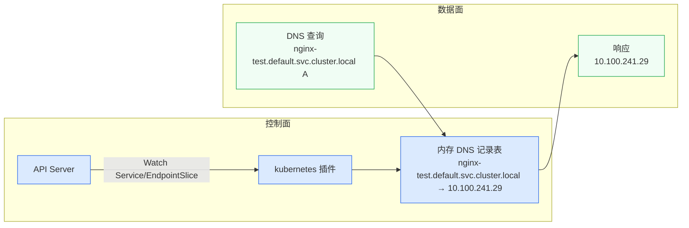
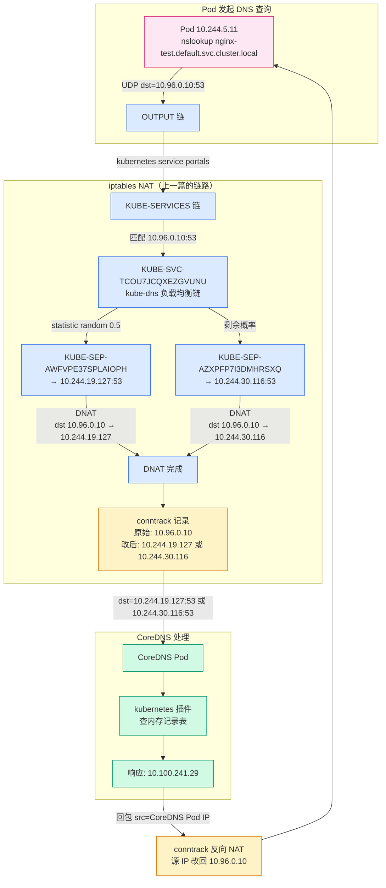

# CoreDNS：Service 域名怎么解析成 ClusterIP

## 一、上一篇留下的坑

上一篇拆 kube-proxy + iptables 时，结尾留了个问题：Pod 访问 Service 时一般不直接写 ClusterIP——写的是域名（`nginx-test.default.svc.cluster.local`）。CoreDNS 怎么把 Service 域名解析成 ClusterIP？DNS 查询走什么路径？

这篇就来拆这条链路。拆开以后发现现象：**第一，用"完整域名"反而比用"短域名"触发更多 DNS 查询**——这跟直觉完全相反；**第二，DNS 查询本身也要经过上一篇拆的 iptables DNAT**——CoreDNS 也是一个 Service，kube-dns 的 ClusterIP 同样是虚拟 IP。

!!! note "前置阅读"
    本文是 [Service ClusterIP 为什么 ping 不通？kube-proxy + iptables 链路拆解](kube-proxy.md) 的续篇。上一篇拆的是"拿到 ClusterIP 之后包怎么到 Pod"，这篇拆的是"域名怎么变成 ClusterIP"。如果你还没读上一篇，建议先读，因为 DNS 查询的包流转也会经过 iptables KUBE-SERVICES 链。

## 二、从 Pod 的 /etc/resolv.conf 说起

先看 Pod 眼里的 DNS 世界是什么样的。上一篇创建的 nginx-test Service 还在（如果删了，重新创建即可）：

```bash
kubectl get svc nginx-test
```

```
NAME         TYPE        CLUSTER-IP      EXTERNAL-IP   PORT(S)   AGE
nginx-test   ClusterIP   10.100.241.29   <none>        80/TCP    25m
```

随便进一个 Pod，看它的 `/etc/resolv.conf`：

```bash
kubectl exec -it nginx-test -- cat /etc/resolv.conf
```

```
search default.svc.cluster.local svc.cluster.local cluster.local
nameserver 10.96.0.10
options ndots:5
```

三行配置，每行都值得拆。

**`nameserver 10.96.0.10`** — Pod 的 DNS 查询发往这个 IP。如果你还记得上一篇的 iptables 规则，`10.96.0.10` 就是 `kube-system/kube-dns` 这个 Service 的 ClusterIP。它跟 nginx-test 的 `10.100.241.29` 一样，是个虚拟 IP——没有网卡在监听，只存在于 iptables 规则里。

**`search default.svc.cluster.local svc.cluster.local cluster.local`** — 搜索域列表。当 Pod 查询一个不以 `.` 结尾的短域名时，resolver 会依次把搜索域追加到后面尝试解析。搜索域的顺序有讲究：先试 `<name>.default.svc.cluster.local`（当前命名空间的 Service），再试 `<name>.svc.cluster.local`（所有命名空间的 Service），最后试 `<name>.cluster.local`（集群内的其他记录）。

**`options ndots:5`** — 这行是后面要拆的重点。它决定了 resolver 什么时候把名字当"短域名"处理（先试搜索域），什么时候当"完整域名"处理（直接查询）。规则是：如果名字里的 dot 数量少于 5，先试搜索域；大于等于 5，直接查。

!!! note "谁写了这个 resolv.conf"
    Pod 的 `/etc/resolv.conf` 不是镜像自带的，是 kubelet 在创建 Pod 时写入的。kubelet 根据 Pod 的 `dnsPolicy` 生成不同配置：

    - **`ClusterFirst`**（默认）：nameserver 指向 kube-dns，search 域包含集群域。大部分 Pod 用这个。
    - **`Default`**：继承节点宿主机的 resolv.conf。CoreDNS 自己的 Pod 用这个——它需要查上游 DNS 而不是查自己。
    - **`ClusterFirstWithHostNet`**：跟 ClusterFirst 一样，但用于 hostNetwork 的 Pod。hostNetwork Pod 默认继承宿主机 DNS，需要显式指定这个策略才能用集群 DNS。
    - **`None`**：完全自定义，通过 Pod 的 `dnsConfig` 字段指定。K8s 1.14+ 支持。

    `ndots:5` 的默认值来自 kubelet 配置，可以通过 `--cluster-dns` 和 `--cluster-domain` 参数修改。大部分集群不碰这个默认值。

## 三、CoreDNS 在集群里长什么样

`10.96.0.10` 是 kube-dns Service 的 ClusterIP。这个 Service 背后是什么？

```bash
kubectl get svc -n kube-system kube-dns
```

```
NAME       TYPE        CLUSTER-IP   EXTERNAL-IP   PORT(S)                  AGE
kube-dns   ClusterIP   10.96.0.10   <none>        53/UDP,53/TCP,9153/TCP   93d
```

三个端口：

| 端口 | 协议 | 用途 |
|------|------|------|
| 53 | UDP | DNS 查询（大部分查询走这个） |
| 53 | TCP | DNS 查询（响应超过 512 字节时走 TCP，或 AXFR 区域传输） |
| 9153 | TCP | Prometheus metrics |

```bash
kubectl get pods -n kube-system -l k8s-app=kube-dns -o wide
```

```
NAME                       READY   STATUS    RESTARTS   AGE   IP              NODE       NOMINATED NODE   READINESS GATES
coredns-6b5f954497-6h4cg   1/1     Running   0          50d   10.244.19.127   worker03   <none>           <none>
coredns-6b5f954497-xt4vw   1/1     Running   0          50d   10.244.30.116   worker02   <none>           <none>
```

CoreDNS 以 Deployment 方式运行，默认 2 个副本，分布在不同节点上。跟普通 Pod 一样有真实 IP——DNS 查询最终到达这些 Pod。

```bash
kubectl get endpointslice -n kube-system -l kubernetes.io/service-name=kube-dns
```

```
NAME             ADDRESSTYPE   PORTS        ENDPOINTS                     AGE
kube-dns-qpdpk   IPv4          53,53,9153   10.244.30.116,10.244.19.127   93d
```

跟上一篇的 nginx-test 一样的结构——EndpointSlice 记录 CoreDNS Pod 的真实 IP，kube-proxy Watch 这个对象维护 iptables 规则。当 DNS 查询到达 `10.96.0.10:53` 时，iptables 把目标 IP DNAT 成某个 CoreDNS Pod 的真实 IP。

**CoreDNS 自己也是个 Service，也走 iptables DNAT。** 这是上一篇内容的直接复用。

<!-- 📷 截图位置：kube-dns Service + CoreDNS Pod + EndpointSlice 的输出截图 -->

## 四、Corefile 配置逐行拆解

CoreDNS 的配置不在命令行参数里，在一个叫 Corefile 的配置文件里，通过 ConfigMap 挂载进容器：

```bash
kubectl get configmap -n kube-system coredns -o yaml
```

```yaml
apiVersion: v1
kind: ConfigMap
metadata:
  name: coredns
  namespace: kube-system
data:
  Corefile: |
    .:53 {
        errors
        health {
           lameduck 5s
        }
        ready
        kubernetes cluster.local in-addr.arpa ip6.arpa {
           pods insecure
           fallthrough in-addr.arpa ip6.arpa
           ttl 30
        }
        prometheus :9153
        forward . 8.8.8.8 8.8.4.4 {
           max_concurrent 1000
        }
        cache 30 {
           disable success cluster.local
           disable denial cluster.local
        }
        loop
        reload
        loadbalance
    }
```

Corefile 的语法是 CoreDNS 特有的 DSL。`.:53` 表示监听所有 IP 的 53 端口，`{}` 内是插件链。CoreDNS 的设计哲学是**插件式**——每个功能是一个插件，按顺序执行。逐行看：

**`errors`** — 把 DNS 查询错误输出到 stdout。可以在 `kubectl logs` 里看到解析失败的记录。

**`health { lameduck 5s }`** — 暴露 `/health` HTTP 端点给 kubelet 做 liveness probe。`lameduck 5s` 表示收到停止信号后先等 5 秒再退出——让 kube-proxy 有时间更新 iptables 规则把流量切走，避免请求打到正在关闭的 CoreDNS 实例上。

**`ready`** — 暴露 `/ready` HTTP 端点给 readiness probe。CoreDNS 启动时需要先从 API Server 同步 Service 和 Endpoint 数据，同步完成前 `/ready` 返回 503，kubelet 不会把流量路由过来。

**`kubernetes cluster.local in-addr.arpa ip6.arpa { ... }`** — 这是核心插件。`cluster.local` 是集群域，`in-addr.arpa` 和 `ip6.arpa` 是 PTR 反向解析域。这个插件做三件事：

1. Watch API Server 的 Service 和 Endpoint 对象，在内存里维护 DNS 记录
2. 收到 `nginx-test.default.svc.cluster.local` 的 A 查询时，返回 Service 的 ClusterIP
3. 收到 `29.241.100.10.in-addr.arpa` 的 PTR 查询时，返回 `nginx-test.default.svc.cluster.local`

里面三个子指令：

- `pods insecure` — Pod DNS 记录模式。`insecure` 表示可以查询任意 Pod 的 DNS 记录（`<pod-ip>.default.pod.cluster.local`），不做命名空间校验。`verified` 模式更严格，只返回有对应 Endpoint 的 Pod 记录。`disabled` 关闭 Pod DNS。默认是 `insecure`，大部分集群不改。
- `fallthrough in-addr.arpa ip6.arpa` — 如果 PTR 查询在 K8s 记录里没找到，不要返回 NXDOMAIN，而是让后面的插件继续处理（交给 `forward` 转发到上游 DNS）。
- `ttl 30` — DNS 记录的 TTL 设为 30 秒。客户端收到响应后会缓存 30 秒，过期后重新查询。

**`prometheus :9153`** — 在 9153 端口暴露 Prometheus 指标。这就是前面 kube-dns Service 的 9153 端口的来源。

**`forward . 8.8.8.8 8.8.4.4 { max_concurrent 1000 }`** — 把 CoreDNS 无法回答的查询（比如外部域名 `www.google.com`）转发到显式指定的上游 DNS `8.8.8.8` 和 `8.8.4.4`（Google Public DNS）。`max_concurrent 1000` 限制并发转发数，防止 DNS 放大攻击把 CoreDNS 打爆。

!!! note "forward 的两种写法"
    kubeadm 默认安装的 CoreDNS，forward 插件用的是 `forward . /etc/resolv.conf`——读取 CoreDNS Pod 的 `/etc/resolv.conf`（因为 `dnsPolicy: Default`，继承宿主机 DNS 配置）。而这个集群改成了显式指定 `8.8.8.8 8.8.4.4`——不依赖宿主机 DNS，直接走 Google DNS。
    
    两种写法的区别：`/etc/resolv.conf` 方式灵活（改宿主机 DNS 就行），但不可控（宿主机配了内网 DNS 就可能解析不了外网）；显式指定 IP 可控但写死在 ConfigMap 里。如果你的集群在内网环境，`8.8.8.8` 可能不通，需要换成内网 DNS。

**`cache 30 { disable success cluster.local, disable denial cluster.local }`** — 缓存所有 DNS 响应 30 秒，但有一个关键配置：**对 `cluster.local` 域的成功响应和 NXDOMAIN 响应都禁用缓存**。这意味着所有集群内部 Service 域名查询每次都直接打到 kubernetes 插件，不走缓存。这个配置的影响后面用 metrics 数据拆。

!!! note "为什么对 cluster.local 禁用缓存"
    这不是 kubeadm 的默认配置——默认的 CoreDNS 只写 `cache 30`，不加 `disable`。这个集群的 Corefile 被改过。禁用 cluster.local 缓存的好处是 Service 和 Endpoint 变化能立即反映到 DNS 响应中，不会因为缓存导致脏数据。代价是每次内部域名查询都要走 kubernetes 插件查内存表，虽然有缓存的情况下也是查内存，但多了一层缓存命中检查的开销。后面的 metrics 数据会揭示这个代价有多大。

**`loop`** — 检测转发循环。如果 CoreDNS 转发的上游 DNS 最终又转发回 CoreDNS 自己，会形成无限循环。这个插件检测到循环后让 CoreDNS panic 退出，防止 CPU 打满。

**`reload`** — 热加载 Corefile。修改 ConfigMap 后，CoreDNS 不需要重启 Pod 就能生效。kubelet 会把更新后的 ConfigMap 文件同步到容器里，`reload` 插件检测到文件变化后重新加载配置。

**`loadbalance`** — 对返回的 A 记录做 round-robin 轮转。如果一个 Service 有多个 ClusterIP（不常见，但 Headless Service 的 Endpoints 会有多个 Pod IP），每次查询返回的 IP 顺序不同，客户端会选第一个，实现简单的负载均衡。

!!! note "Corefile 改了怎么生效"
    `kubectl edit configmap -n kube-system coredns` 改完配置后，`reload` 插件会在几秒内热加载。但如果改的是 `kubernetes` 插件的集群域（`cluster.local`），需要重启 CoreDNS Pod 才能生效——因为集群域是插件初始化时读的，热加载不覆盖。

    改完配置后可以验证：
    ```bash
    kubectl -n kube-system logs <coredns-pod> | grep -i reload
    ```
    应该能看到 reload 日志。

## 五、Kubernetes 插件：Service 怎么变成 DNS 记录

CoreDNS 的 `kubernetes` 插件不读文件，它直接 Watch API Server。工作机制：



CoreDNS 启动时通过 ServiceAccount 认证连上 API Server，Watch `Service` 和 `EndpointSlice` 资源。每收到一个事件，就在内存里更新 DNS 记录表。DNS 查询进来时直接查内存，不走 API Server——所以查询速度很快。

Service 在 DNS 里的记录格式：

| 类型 | 格式 | 示例 |
|------|------|------|
| A 记录 | `<service>.<namespace>.svc.cluster.local` | `nginx-test.default.svc.cluster.local → 10.100.241.29` |
| SRV 记录 | `_<port-name>._<protocol>.<service>.<namespace>.svc.cluster.local` | `_http._tcp.nginx-test.default.svc.cluster.local` |
| PTR 记录 | `<reversed-ip>.in-addr.arpa` | `29.241.100.10.in-addr.arpa → nginx-test.default.svc.cluster.local` |

用 nslookup 验证：

```bash
kubectl exec -it nginx-test -- nslookup nginx-test.default.svc.cluster.local
```

```
Server:         10.96.0.10
Address:        10.96.0.10:53

Name:   nginx-test.default.svc.cluster.local
Address: 10.100.241.29
```

返回的 `10.100.241.29` 就是 Service 的 ClusterIP。注意 `Server: 10.96.0.10` ——查询发往 kube-dns Service IP，CoreDNS 收到后查内存表返回结果。

试一下短域名：

```bash
kubectl exec -it nginx-test -- nslookup nginx-test
```

```
Server:         10.96.0.10
Address:        10.96.0.10:53

** server can't find nginx-test.svc.cluster.local: NXDOMAIN

Name:   nginx-test.default.svc.cluster.local
Address: 10.100.241.29

** server can't find nginx-test.svc.cluster.local: NXDOMAIN
** server can't find nginx-test.cluster.local: NXDOMAIN

command terminated with exit code 1
```

输出比预想的有意思。nslookup 先拼了第二个搜索域 `nginx-test.svc.cluster.local`——NXDOMAIN。然后拼第一个搜索域 `nginx-test.default.svc.cluster.local`——命中，返回 `10.100.241.29`。最后又试了 `nginx-test.svc.cluster.local` 和 `nginx-test.cluster.local`——都 NXDOMAIN。

注意 nslookup 的搜索域尝试顺序不一定是列表顺序，不同 resolver 实现行为有差异。但核心逻辑不变：短域名被拼了多个搜索域，只要有一个命中就能解析。

最终 `exit code 1` 是因为 nslookup 在有 NXDOMAIN 时返回非零退出码——即使最终解析成功。如果你在脚本里用 nslookup 做健康检查，不能只看退出码，要看输出里有没有 `Address:`。

跨命名空间查询：

```bash
kubectl exec -it nginx-test -- nslookup kube-dns.kube-system.svc.cluster.local
```

```
Server:         10.96.0.10
Address:        10.96.0.10:53

Name:   kube-dns.kube-system.svc.cluster.local
Address: 10.96.0.10
```

查到了 kube-dns 自己的 ClusterIP `10.96.0.10`——CoreDNS 查自己。

!!! note "Headless Service 的 DNS 行为不一样"
    普通的 ClusterIP Service，A 记录返回的是 ClusterIP（一个虚拟 IP）。Headless Service（`clusterIP: None`）没有 ClusterIP，A 记录直接返回所有 Pod 的 IP——客户端拿到多个 IP 自己选。这就是 CoreDNS `loadbalance` 插件的作用：轮转返回顺序，让不同客户端选到不同 Pod。

    ```bash
    # Headless Service 的 A 记录返回多个 Pod IP
    kubectl exec -it nginx-test -- nslookup headless-svc.default.svc.cluster.local
    # 返回：
    # Name: headless-svc.default.svc.cluster.local
    # Address: 10.244.19.127
    # Address: 10.244.30.116
    # Address: 10.244.5.11
    ```

## 六、DNS 查询的完整路径

把 DNS 查询的包流转和上一篇的 iptables 链路串起来：



DNS 查询走的是跟 HTTP 请求完全一样的 iptables 链路——KUBE-SERVICES 匹配 kube-dns 的 ClusterIP `10.96.0.10`，KUBE-SVC 做随机负载均衡选一个 CoreDNS Pod，KUBE-SEP 做 DNAT。

可以在 iptables 规则里验证：

```bash
sudo iptables-save -t nat | grep '10.96.0.10'
```

```
-A KUBE-SERVICES -d 10.96.0.10/32 -p udp -m comment --comment "kube-system/kube-dns:dns udp" -m udp --dport 53 -j KUBE-SVC-TCOU7JCQXEZGVUNU
-A KUBE-SERVICES -d 10.96.0.10/32 -p tcp -m comment --comment "kube-system/kube-dns:dns-tcp tcp" -m tcp --dport 53 -j KUBE-SVC-ERIFXISQEP7F7OF4
-A KUBE-SERVICES -d 10.96.0.10/32 -p tcp -m comment --comment "kube-system/kube-dns:metrics tcp" -m tcp --dport 9153 -j KUBE-SVC-JD5MR3NA4I4DYORP
```

三条规则分别匹配 UDP 53、TCP 53、TCP 9153。大部分 DNS 查询走 UDP，所以第一条规则是流量最大的。

```bash
sudo iptables-save -t nat | grep 'KUBE-SVC-TCOU7JCQXEZGVUNU'
```

```
:KUBE-SVC-TCOU7JCQXEZGVUNU - [0:0]
-A KUBE-SVC-TCOU7JCQXEZGVUNU -m comment --comment "kube-system/kube-dns:dns udp" -m statistic --mode random --probability 0.50000000000 -j KUBE-SEP-AWFVPE37SPLAIOPH
-A KUBE-SVC-TCOU7JCQXEZGVUNU -m comment --comment "kube-system/kube-dns:dns udp" -j KUBE-SEP-AZXPFP7I3DMHRSXQ
```

跟上一篇 nginx-test 的结构完全一样——两个 CoreDNS Pod，各 50% 概率。DNS 查询被 DNAT 到其中一个 CoreDNS Pod 的真实 IP。

!!! note "每个 DNS 查询都会创建 conntrack 条目"
    DNS 查询虽然走 UDP，但 conntrack 同样会记录。每次 `nslookup` 或 `curl` 触发 DNS 查询时，iptables DNAT 都会在 conntrack 表里创建一条 UDP 流记录。这条记录在超时后回收（默认 30 秒）。

    在高并发场景下，DNS 查询产生的 conntrack 条目可能成为瓶颈——如果 conntrack 表满了，新的 DNS 查询会被丢弃，表现为偶发的域名解析失败。这是 NodeLocal DNS 解决的核心问题之一。

## 七、ndots:5 陷阱：为什么"完整域名"反而更慢

这是拆 CoreDNS 时最有意思的发现。

先看 `ndots:5` 的规则：resolver 收到一个名字后，数名字里的 dot 数量。如果 dot 数 **≥ 5**，直接当完整域名查询；如果 **< 5**，先依次拼搜索域查询，全失败后才当完整域名查。

用 `nginx-test`（0 个 dot）举例：

| 尝试顺序 | 拼接结果 | 预期 |
|---------|---------|------|
| 1 | `nginx-test.default.svc.cluster.local` | ✅ 命中，返回 10.100.241.29 |

1 次查询就搞定了。搜索域的第一个就是当前命名空间，短域名直接命中。

再看 `nginx-test.default.svc.cluster.local`（3 个 dot < 5）：

| 尝试顺序 | 拼接结果 | 预期 |
|---------|---------|------|
| 1 | `nginx-test.default.svc.cluster.local.default.svc.cluster.local` | ❌ NXDOMAIN |
| 2 | `nginx-test.default.svc.cluster.local.svc.cluster.local` | ❌ NXDOMAIN |
| 3 | `nginx-test.default.svc.cluster.local.cluster.local` | ❌ NXDOMAIN |
| 4 | `nginx-test.default.svc.cluster.local`（作为绝对域名） | ✅ 命中 |

**4 次查询。** 你写了"完整域名"，反而比短域名多了 3 次无用查询。

这就是 `ndots:5` 的陷阱。`ndots` 的默认值在 K8s 里是 5，这个数字来自 [resolv.conf man page](https://man7.org/linux/man-pages/man5/resolv.conf.5.html) 的传统默认值。RFC 1034 建议 ndots 的默认值是 1，但 glibc 历史上用的 5，K8s 继承了这个值。

问题在于，`cluster.local` 只有 1 个 dot，`default.svc.cluster.local` 有 3 个 dot，`nginx-test.default.svc.cluster.local` 有 3 个 dot——都不到 5。这意味着**集群内的所有 Service 域名，不管你写多长，只要不带尾点，都会先被拼搜索域试 3 遍**。

用 `dig` 验证：

```bash
# dig 不在 nginx:alpine 镜像里，用 dnstools 镜像
kubectl run -it --rm --image=m.daocloud.io/docker.io/infoblox/dnstools dnstools
```

!!! note "dnstools 镜像拉取"
    `m.daocloud.io` 拉取 `infoblox/dnstools` 可能超时。如果超时，换华为云镜像：
    ```bash
    kubectl run -it --rm --image=swr.cn-north-4.myhuaweicloud.com/infoblox/dnstools dnstools
    ```

```bash
# 在 dnstools 容器内
# 短域名查询
dig nginx-test +stats
```

```
;; Query time: 185 msec
;; SERVER: 10.96.0.10#53(10.96.0.10)
;; WHEN: ...

;; QUESTION SECTION:
;nginx-test.            IN A

;; ANSWER SECTION:
(空——NXDOMAIN)
```

等一下——`dig nginx-test` 返回了 NXDOMAIN？而且 query time 185 msec？

这说明 **dig 不走 glibc 的搜索域拼接**。它把 `nginx-test` 当成绝对域名直接查，CoreDNS 的 kubernetes 插件找不到 `nginx-test.` 这个记录，走 forward 转发到 `8.8.8.8`，Google DNS 也找不到，返回 NXDOMAIN。185 msec 就是转发到 Google DNS 的往返时间。

```bash
# "完整"域名查询（不带尾点）
dig nginx-test.default.svc.cluster.local +stats
```

```
;; Query time: 1 msec
;; SERVER: 10.96.0.10#53(10.96.0.10)
;; WHEN: ...

;; QUESTION SECTION:
;nginx-test.default.svc.cluster.local. IN A

;; ANSWER SECTION:
nginx-test.default.svc.cluster.local. 30 IN A 10.100.241.29
```

完整域名 1 msec 搞定——kubernetes 插件直接命中内存表。注意还有一个 warning：`WARNING: .local is reserved for Multicast DNS`，这是 dig 对 `.local` 域名的提示，不影响解析结果。

!!! warning "dig 和 glibc resolver 行为完全不同"
    `dig` 是独立 DNS 工具，**不读 `/etc/resolv.conf` 的 search 和 ndots 配置**。它把查询名当绝对域名处理。所以 `dig nginx-test` 直接 NXDOMAIN，而 `nslookup nginx-test` 能通过搜索域命中。
    
    要看应用真实的 DNS 行为（走 glibc resolver），用 `nslookup` 或 `getent hosts`：
    ```bash
    kubectl exec -it nginx-test -- getent hosts nginx-test.default.svc.cluster.local
    ```
    
    或者直接看 CoreDNS 的 query log——在 Corefile 里加 `log` 插件后看 CoreDNS Pod 日志，数实际收到几次查询。这是最准确的方法。

解决 ndots 问题有三个方案：

**方案一：加尾点。** `nginx-test.default.svc.cluster.local.`（末尾的 `.`）——尾点让 resolver 把它当绝对域名，不拼搜索域，1 次查询搞定。但代码里写域名加尾点很丑，且容易忘。

**方案二：用短域名。** `nginx-test`（同命名空间内）——搜索域第一个就命中，1 次查询。但跨命名空间不适用。

**方案三：调低 ndots。** 在 Pod spec 里设 `dnsConfig.options: [{name: ndots, value: "2"}]`——`nginx-test.default.svc.cluster.local` 有 3 个 dot ≥ 2，直接当完整域名查，1 次查询。

```yaml
spec:
  dnsConfig:
    options:
      - name: ndots
        value: "2"
  containers:
    - ...
```

但调低 ndots 有副作用：如果你在 Pod 里查 `www.google.com`（1 个 dot < 2），会先拼搜索域试 3 遍再查——外部域名查询变慢。`ndots:1` 会让 `www.google.com` 直接查（1 个 dot ≥ 1），但 `google` 这种单词域名还是会先拼搜索域。

没有完美方案，取决于集群里内部域名和外部域名的查询比例。

!!! note "NodeLocal DNS 怎么解决 ndots 问题"
    NodeLocal DNS 不直接解决 ndots 问题——它解决的是 DNS 查询经过 iptables DNAT 产生的 conntrack 条目过多问题。但 NodeLocal DNS 可以配本地缓存，即使 ndots 导致多次查询，大部分查询都能在本地缓存命中，不需要每次都打到 CoreDNS。

    NodeLocal DNS 的部署方式：在每个节点跑一个 DNS 缓存 Pod，监听节点 IP 的 53 端口。Pod 的 `/etc/resolv.conf` 里 nameserver 从 kube-dns 的 ClusterIP 改成节点 IP。DNS 查询直接到本节点的缓存 Pod，不经过 iptables DNAT，不产生 conntrack 条目。

## 八、CoreDNS 缓存与性能指标

前面拆 Corefile 时提到 `cache 30` 里有两行 `disable`：

```
cache 30 {
    disable success cluster.local
    disable denial cluster.local
}
```

这意味着 **cluster.local 域的 DNS 响应不走缓存**。所有 Service 域名查询每次都直接打到 kubernetes 插件。这个配置的实际影响有多大？看 metrics。

```bash
# 在节点上直接访问 CoreDNS Pod IP 的 9153 端口
COREDNS_IP=$(kubectl get pods -n kube-system -l k8s-app=kube-dns -o jsonpath='{.items[0].status.podIP}')
curl -s http://${COREDNS_IP}:9153/metrics | grep -E '^coredns_(dns|cache|forward)_' | head -30
```

```
# DNS 查询延迟分布
coredns_dns_request_duration_seconds_bucket{server="dns://:53",le="0.001"} 23653
coredns_dns_request_duration_seconds_bucket{server="dns://:53",le="0.002"} 23653
coredns_dns_request_duration_seconds_bucket{server="dns://:53",le="0.004"} 23653
coredns_dns_request_duration_seconds_bucket{server="dns://:53",le="0.008"} 23653
coredns_dns_request_duration_seconds_bucket{server="dns://:53",le="0.016"} 23653
coredns_dns_request_duration_seconds_bucket{server="dns://:53",le="0.032"} 23808
coredns_dns_request_duration_seconds_bucket{server="dns://:53",le="0.064"} 23811
coredns_dns_request_duration_seconds_bucket{server="dns://:53",le="0.128"} 23811
coredns_dns_request_duration_seconds_bucket{server="dns://:53",le="0.256"} 30644
coredns_dns_request_duration_seconds_bucket{server="dns://:53",le="0.512"} 30685
coredns_dns_request_duration_seconds_bucket{server="dns://:53",le="1.024"} 30685
coredns_dns_request_duration_seconds_bucket{server="dns://:53",le="2.048"} 30814
coredns_dns_request_duration_seconds_bucket{server="dns://:53",le="4.096"} 31264
coredns_dns_request_duration_seconds_bucket{server="dns://:53",le="8.192"} 31316
coredns_dns_request_duration_seconds_bucket{server="dns://:53",le="+Inf"} 31316

# 缓存条目数
coredns_cache_entries{server="dns://:53",type="denial"} 2
coredns_cache_entries{server="dns://:53",type="success"} 7

# 缓存命中和未命中
coredns_cache_hits_total{server="dns://:53",type="success"} 23
coredns_cache_misses_total{server="dns://:53"} 31293
coredns_cache_requests_total{server="dns://:53"} 31316
```

先看缓存命中率：

```
命中率 = hits / requests = 23 / 31316 = 0.07%
未命中率 = misses / requests = 31293 / 31316 = 99.93%
```

**99.93% 的查询没命中缓存。** 这个数字看起来很吓人，但原因就是我们前面拆的：`disable success cluster.local` 让所有集群内部域名查询绕过缓存。31316 次查询里，绝大部分是 Service 域名查询，全部不缓存。只有 23 次外部域名查询命中了缓存（`cache_hits_total` 里只有 `type="success"` 的一行，说明只有外部域名的成功响应被缓存了）。

但看延迟分布，**75% 的查询（23653/31316）在 1 毫秒内完成**。没有缓存也很快——因为 kubernetes 插件查的是内存表，不涉及网络 I/O。真正的性能瓶颈不在 kubernetes 插件，而在 forward 转发：`le="0.256"` 处跳到 30644（比 `le="0.128"` 的 23811 多了 6833），说明有约 6800 次查询花了 128ms~256ms——这些是转发到 `8.8.8.8` 的外部域名查询。

| 延迟区间 | 累计查询数 | 增量 | 含义 |
|---------|-----------|------|------|
| ≤1ms | 23653 | 23653 | kubernetes 插件内存查询 |
| 1ms~32ms | 23653→23808 | 155 | 边界情况，可能是 cache 命中 |
| 32ms~256ms | 23808→30644 | 6836 | forward 转发到 8.8.8.8 |
| 256ms~4s | 30644→31264 | 620 | 慢速 forward，可能是网络抖动 |
| 4s~8s | 31264→31316 | 52 | 超慢查询，可能 DNS 超时重试 |

**结论：即使禁用了 cluster.local 缓存，CoreDNS 的性能依然够用——内部域名查询全在 1ms 内。** 真正慢的是外部域名转发（8.8.8.8 的往返延迟），而外部域名是走缓存的。

如果你发现 CoreDNS CPU 占用高，或者外部域名查询慢，关注两个方向：

1. **forward 上游 DNS 响应慢**——把 `8.8.8.8` 换成更近的 DNS（如内网 DNS 或国内 DNS `223.5.5.5`），减少往返延迟
2. **cache TTL 太短**——如果外部域名查询量大，可以把 cache TTL 从 30 调到 60 或 120。但不要对 cluster.local 开启缓存——Service 变化可能产生脏数据

```bash
curl -s http://${COREDNS_IP}:9153/metrics | grep '^coredns_forward_'
```

forward 指标可以看上游 DNS 的响应延迟和错误率。如果 `coredns_forward_errors_total` 增长，说明上游 DNS 不可达或响应异常。

## 九、调试 DNS 问题的常用命令

### nslookup：最基本的验证

```bash
kubectl exec -it nginx-test -- nslookup nginx-test.default.svc.cluster.local
kubectl exec -it nginx-test -- nslookup -type=srv _http._tcp.nginx-test.default.svc.cluster.local
kubectl exec -it nginx-test -- nslookup 10.100.241.29
```

nslookup 在 busybox 和 nginx:alpine 镜像里都有，不需要额外安装。

### dig：更详细的输出

```bash
# 用 dnstools 镜像（包含 dig）
kubectl run -it --rm --image=swr.cn-north-4.myhuaweicloud.com/infoblox/dnstools dnstools -- dig nginx-test.default.svc.cluster.local

# 查查询路径（+trace 从根域开始逐级查）
dig +trace nginx-test.default.svc.cluster.local

# 查指定 DNS 服务器
dig @10.96.0.10 nginx-test.default.svc.cluster.local
```

### CoreDNS 日志

```bash
kubectl -n kube-system logs <coredns-pod> --tail=50
```

默认只输出错误日志。如果要看所有查询日志，在 Corefile 里加 `log` 插件：

```yaml
.:53 {
    errors
    log      # 加这行，所有查询都会输出到 stdout
    health {
       lameduck 5s
    }
    # ... 其他插件
}
```

```bash
# 改完 ConfigMap 后看日志
kubectl -n kube-system logs -f <coredns-pod>
```

```
[INFO] 10.244.5.11:54321 - 41458 "A IN nginx-test.default.svc.cluster.local. udp 54 false 512" NOERROR qr,aa,rd 106 0.000123456s
[INFO] 10.244.5.11:54322 - 41459 "A IN nginx-test.default.svc.cluster.local.default.svc.cluster.local. udp 78 false 512" NXDOMAIN qr,aa,rd 171 0.000234567s
```

每条日志包含：客户端 IP:端口、查询 ID、查询类型和域名、协议、响应码、耗时。如果你想验证 ndots 导致了多少次无用查询，开 `log` 插件然后跑一次 `nslookup`，数日志行数。

!!! warning "生产环境不要长期开 log 插件"
    `log` 插件会对每个 DNS 查询输出一行日志，在高 QPS 场景下会产生大量日志输出，影响 CoreDNS 性能。调试完记得去掉。

### 常见 DNS 问题排查思路

**Pod 无法解析 Service 域名**：先查 `/etc/resolv.conf` 的 nameserver 是不是 kube-dns ClusterIP，再查 CoreDNS Pod 是否 Running，最后查 CoreDNS 是否能连上 API Server（看日志里有没有 `Failed to list services` 之类的错误）。

**间歇性解析失败**：大概率是 conntrack 表满了或 CoreDNS Pod 资源不足。查 `coredns_dns_responses_total` 里 SERVFAIL 的数量是否异常，查节点 conntrack 表使用率（`cat /proc/sys/net/netfilter/nf_conntrack_count` vs `cat /proc/sys/net/netfilter/nf_conntrack_max`）。

**外部域名解析慢**：查 `coredns_forward_requests_total` 和 `coredns_forward_errors_total`，看上游 DNS 是否响应正常。这个集群的 forward 上游是 `8.8.8.8` 和 `8.8.4.4`（在 Corefile 里显式配置），如果在国内环境访问 Google DNS 延迟高，换成 `223.5.5.5`（阿里 DNS）或内网 DNS 能显著降低外部域名解析延迟。

## 十、相关阅读

- [Service ClusterIP 为什么 ping 不通？kube-proxy + iptables 链路拆解](kube-proxy.md)——上一篇。本文的 DNS 查询路径直接复用了那篇拆的 iptables KUBE-SERVICES → KUBE-SVC → KUBE-SEP 链路
- [Calico 跨节点通信原理](calico-bgp.md)——BGP 路由、IPIP 隧道。CoreDNS Pod 之间的跨节点通信也走这条路
- [Pod 网络创建全过程](pod-network-creation.md)——veth pair、IP 分配。CoreDNS Pod 的 IP 就是通过 CNI 分配的
- [kube-proxy 工作原理详解](https://1hairlabs.cn/kubernetes/architecture/network/kube-proxy/)——站点入门文章，kube-dns Service 的 iptables 规则跟普通 Service 完全一样
- [Kubernetes Pod 生命周期源码解析](../node/pod-lifecycle.md)——Pod 从 Pending 到 Running 的完整链路

---

下一篇：**从一个 HTTP 请求到 Pod 的完整链路总结**

这篇拆完了 DNS 域名解析成 ClusterIP 的过程。从 Pod 发起 DNS 查询，到 iptables DNAT 到 CoreDNS Pod，到 kubernetes 插件查内存返回 ClusterIP，再到应用拿到 IP 后发起 TCP 请求经过 iptables DNAT 到业务 Pod——整个链路已经拆完了。下一篇做一个完整串联，从 `curl nginx-test` 一行命令开始，把 DNS 解析、iptables DNAT、conntrack、Calico 路由全部串起来，画一张完整的包流转图。
