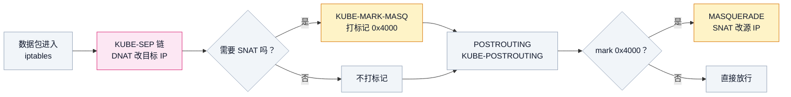
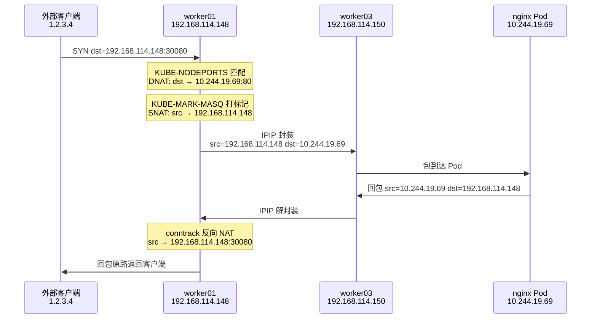
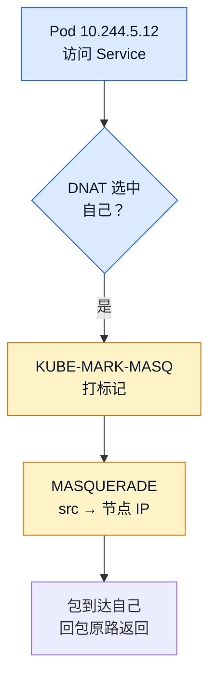
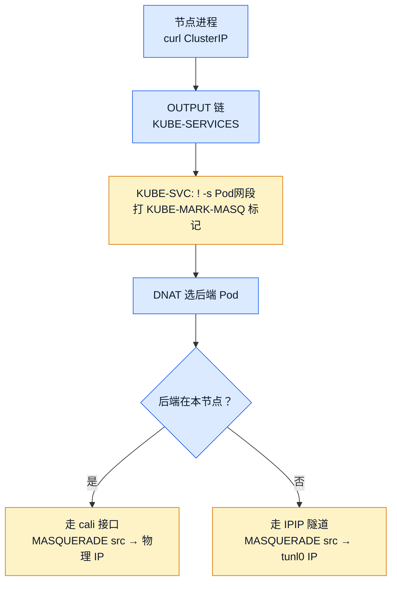
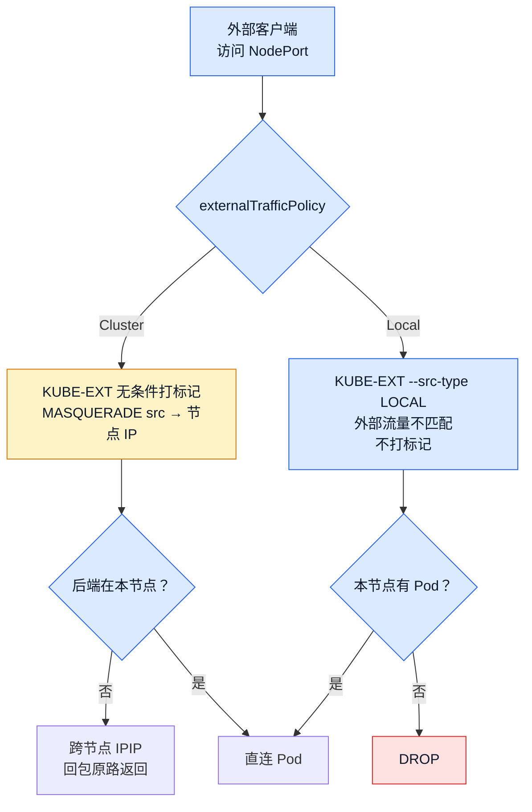

# Kubernetes SNAT 三种场景：从 hairpin 到 NodePort 的源地址改写

## 文章摘要

kube-proxy 的 iptables 规则主要做 DNAT（改目标 IP），但有三类场景必须同时做 SNAT（改源 IP）。这篇文章拆解三种 SNAT 的触发条件、iptables 规则链、conntrack 证据，以及 externalTrafficPolicy 对 NodePort 流量的影响。

## 一、为什么 DNAT 不够用

kube-proxy 的核心工作是 DNAT——把目标 IP 从 ClusterIP 改写成后端 Pod IP。大部分场景下 DNAT 就够了：Pod 发请求到 ClusterIP，iptables DNAT 改目标地址，包到达后端 Pod，回包原路返回，conntrack 反向 NAT 把源 IP 改回 ClusterIP。整个过程对 Pod 透明。

但有三种场景，只做 DNAT 会出问题：

1. **Pod 访问 Service，DNAT 选中了自己**——包变成自己访问自己，回包走 loopback，conntrack 记录对不上
2. **节点上的进程访问 Service**——回包直接走本地路由到节点，绕过 conntrack 反向 NAT，源 IP 是 Pod IP 而不是 ClusterIP
3. **外部流量通过 NodePort 进入**——回包如果走 SNAT，源 IP 变成节点 IP，后端 Pod 看不到真实客户端 IP

三种场景，三种 SNAT 策略，对应不同的 iptables 规则链。这篇文章逐一拆解。

!!! info "前置阅读"
    - [Kube-Proxy 工作原理](./kube-proxy.md)——iptables 三级跳转链（KUBE-SERVICES → KUBE-SVC → KUBE-SEP）、DNAT 机制
    - [一行 curl 的完整旅程](./curl-full-link.md)——hairpin NAT 的完整实测数据（strace + conntrack）

## 二、SNAT 的 iptables 基础设施：KUBE-MARK-MASQ

在拆具体场景之前，先理解 kube-proxy 做 SNAT 的通用机制。

kube-proxy 不会在每条 KUBE-SEP 链里直接写 SNAT 规则。它用了一个更聪明的做法——**打标记，统一处理**。

### 2.1 KUBE-MARK-MASQ 链

```bash
# 在 Worker Node 上执行
sudo iptables -t nat -L KUBE-MARK-MASQ -n
```

输出：

```
Chain KUBE-MARK-MASQ (0 references)
target     prot opt source     destination
MARK       all  --  0.0.0.0/0  0.0.0.0/0  MARK or 0x4000
```

这条链只做一件事：给包打上 `0x4000` 标记。它本身不做 SNAT，只是一个"待会要做 MASQUERADE"的标记。

### 2.2 POSTROUTING 链统一处理

```bash
# 在 Worker Node 上执行
sudo iptables -t nat -S KUBE-POSTROUTING
```

输出：

```
-N KUBE-POSTROUTING
-A KUBE-POSTROUTING -m mark ! --mark 0x4000/0x4000 -j RETURN
-A KUBE-POSTROUTING -j MARK --set-xmark 0x4000/0x0
-A KUBE-POSTROUTING -m comment --comment "kubernetes service traffic requiring SNAT" -j MASQUERADE --random-fully
```

三条规则，逻辑很清晰：

1. 没有 `0x4000` 标记 → RETURN（跳过，不做 SNAT）
2. 有标记 → 清除标记（`set-xmark 0x4000/0x0` 把标记位清零，避免重复处理）
3. → MASQUERADE（做 SNAT，源 IP 改成出接口 IP）

所以 kube-proxy 的 SNAT 机制是两步走：



这个设计的好处是：KUBE-SEP 链只管 DNAT + 打标记，SNAT 统一在 POSTROUTING 处理。规则数量少，维护简单。

### 2.3 什么时候打标记

kube-proxy 在两个位置放打标记规则，分别覆盖两个 SNAT 场景。以 `nginx-test` Service（ClusterIP `10.100.241.29`）为例：

**位置一：KUBE-SVC 链第一条规则**

```bash
# 在 Worker Node 上执行
sudo iptables -t nat -S KUBE-SVC-W67AXLFK7VEUVN6G
```

输出：

```
-N KUBE-SVC-W67AXLFK7VEUVN6G
-A KUBE-SVC-W67AXLFK7VEUVN6G ! -s 10.244.0.0/16 -d 10.100.241.29/32 -p tcp -m comment --comment "default/nginx-test cluster IP" -m tcp --dport 80 -j KUBE-MARK-MASQ
-A KUBE-SVC-W67AXLFK7VEUVN6G -m comment --comment "default/nginx-test -> 10.244.19.69" -m statistic --mode random --probability 0.333 -j KUBE-SEP-6PDWQRDBUEP5HVBT
-A KUBE-SVC-W67AXLFK7VEUVN6G -m comment --comment "default/nginx-test -> 10.244.30.120" -m statistic --mode random --probability 0.500 -j KUBE-SEP-FHKNY3MFLBZWZGVU
-A KUBE-SVC-W67AXLFK7VEUVN6G -m comment --comment "default/nginx-test -> 10.244.5.12" -j KUBE-SEP-OO34H6TCD4WVYNCR
```

第一条规则的关键条件是 `! -s 10.244.0.0/16`——**源 IP 不在 Pod 网段**时才打标记。这精确命中了"节点本机进程访问 Service"的场景：节点 IP（如 `192.168.114.148`）不在 `10.244.0.0/16` 里，会匹配这条规则被打标记。而 Pod 流量的源 IP 在 `10.244.0.0/16` 里，不匹配，直接跳过。

**位置二：KUBE-SEP 链第一条规则**

```bash
# 在 Worker Node 上执行
sudo iptables -t nat -S KUBE-SEP-OO34H6TCD4WVYNCR
```

输出：

```
-N KUBE-SEP-OO34H6TCD4WVYNCR
-A KUBE-SEP-OO34H6TCD4WVYNCR -s 10.244.5.12/32 -m comment --comment "default/nginx-test" -j KUBE-MARK-MASQ
-A KUBE-SEP-OO34H6TCD4WVYNCR -p tcp -m comment --comment "default/nginx-test" -m tcp -j DNAT --to-destination 10.244.5.12:80
```

第一条规则：`-s 10.244.5.12/32 -j KUBE-MARK-MASQ`——如果包的**源 IP 等于这个后端 Pod IP**，打标记。这就是 hairpin 的触发条件：Pod 访问 Service，DNAT 选中了自己。

第二条规则才是 DNAT：`-j DNAT --to-destination 10.244.5.12:80`。

注意打标记在 DNAT **之前**执行——此时包还是 `src=10.244.5.12, dst=10.100.241.29`，源 IP 还是原始发起方。打完标记后 DNAT 把 dst 改成 `10.244.5.12`，到 POSTROUTING 时发现带了 `0x4000` 标记，做 MASQUERADE。

**两层规则形成精确的 SNAT 触发矩阵：**

| 规则位置 | 触发条件 | 命中场景 | Pod 跨节点访问 Service |
|---------|---------|---------|----------------------|
| KUBE-SVC 第一条 | `! -s 10.244.0.0/16` | 节点本机访问 Service | 不命中（源在 Pod 网段） |
| KUBE-SEP 第一条 | `-s <后端PodIP>` | Hairpin（选中自己） | 不命中（源 ≠ 目标 Pod IP） |

Pod 正常访问跨节点 Service 时，两条规则都不命中——KUBE-SVC 的 `! -s 10.244.0.0/16` 不匹配（源在 Pod 网段），KUBE-SEP 的 `-s <PodIP>` 也不匹配（源 IP 是发起方 Pod IP，不等于后端 Pod IP）。所以**不做 SNAT，源 IP 保持 Pod IP 不变**。

下面逐一拆解三个场景。

## 三、场景一：Hairpin NAT（Pod 访问自己后面的 Service）

### 3.1 问题

Pod `10.244.5.12` 访问 Service `nginx-test`（ClusterIP `10.100.241.29`），iptables DNAT 随机选中了 `10.244.5.12` 自己作为后端。如果只做 DNAT 不做 SNAT：

- 包变成 `src=10.244.5.12, dst=10.244.5.12`（自己访问自己）
- 内核看到 dst 是自己的 IP，走 loopback
- 回包 `src=10.244.5.12, dst=10.244.5.12`，直接走本地，不经过 iptables
- conntrack 记录的 ORIGINAL 方向是 `dst=10.100.241.29`，回包的 `dst=10.244.5.12` 对不上
- conntrack 反向 NAT 失败，Pod 收到的包源 IP 是 Pod IP 而不是 ClusterIP

### 3.2 解决方案

kube-proxy 在 KUBE-SEP 链里加了一条规则：如果包的**源 IP** 等于这个后端 Pod IP，打 KUBE-MARK-MASQ 标记。

```bash
# 在 Worker Node 上执行
sudo iptables -t nat -S KUBE-SEP-OO34H6TCD4WVYNCR
```

输出：

```
-N KUBE-SEP-OO34H6TCD4WVYNCR
-A KUBE-SEP-OO34H6TCD4WVYNCR -s 10.244.5.12/32 -m comment --comment "default/nginx-test" -j KUBE-MARK-MASQ
-A KUBE-SEP-OO34H6TCD4WVYNCR -p tcp -m comment --comment "default/nginx-test" -m tcp -j DNAT --to-destination 10.244.5.12:80
```

iptables 规则的执行顺序：

1. PREROUTING → KUBE-SERVICES：匹配 ClusterIP `10.100.241.29:80`，跳到 KUBE-SVC
2. KUBE-SVC：statistic 随机选后端，跳到 KUBE-SEP-OO34H6TCD4WVYNCR
3. KUBE-SEP：
   - `-s 10.244.5.12/32 -j KUBE-MARK-MASQ`——如果源 IP 是 `10.244.5.12`（自己），打标记
   - `-j DNAT --to-destination 10.244.5.12:80`——DNAT 改目标 IP

打标记发生在 DNAT **之前**——此时包还是 `src=10.244.5.12, dst=10.100.241.29`。打完标记后 DNAT 把 dst 改成 `10.244.5.12`，到 POSTROUTING 时发现带了 `0x4000` 标记，做 MASQUERADE 把 src 改成节点 IP `192.168.114.148`。

### 3.3 conntrack 证据

在 curl 全链路文章中已经实测过 hairpin NAT 的 conntrack 条目：

```
src=10.244.5.12 dst=10.100.241.29 sport=34188 dport=80
src=10.244.5.12 dst=192.168.114.148 sport=80 dport=34188 [ASSURED]
```

ORIGINAL 方向：`src=Pod, dst=ClusterIP`
REPLY 方向：`src=Pod:80, dst=节点IP`——注意这里的 dst 是节点 IP 而不是 Pod IP，说明回包经过了 SNAT（conntrack 的 REPLY 方向记录的是 NAT 改写后的真实地址，详见 [第六节](#62-conntrack-snat)的解释）。

!!! tip "详细实测数据"
    hairpin NAT 的完整 strace + conntrack 实测数据见 [一行 curl 的完整旅程](./curl-full-link.md#conntrack-dnat-round-robin-hairpin)，`conntrack -L` 的条目字段与 ORIGINAL/REPLY 判读见 [conntrack 命令详解](../../../linux/network/conntrack-command-guide.md)，这里不重复展开。

## 四、场景二：节点访问 Service

### 4.1 问题

worker01 上的进程（不是 Pod，是节点本身）执行 `curl 10.100.241.29:80`。包从节点的 OUTPUT 链进入 iptables：

- PREROUTING 不经过（包不是从外部接口进来的，是本机产生的）
- OUTPUT → KUBE-SERVICES → KUBE-SVC → KUBE-SEP：DNAT 改 dst 为后端 Pod IP
- 假设选中 `10.244.19.69`（worker03 上的 Pod）

如果只做 DNAT 不做 SNAT，包变成 `src=192.168.114.148, dst=10.244.19.69`（假设选中 worker03 上的 Pod），经过 Calico IPIP 隧道到达 worker03，nginx Pod 回包 `src=10.244.19.69, dst=192.168.114.148`，原路返回。

看起来能通？但如果不做 SNAT，后端 Pod 看到的源 IP 是节点 IP，而不是 Pod IP。这在某些场景下会导致问题——比如后端 Pod 做源 IP 白名单校验时，期望看到 Pod 网段的地址。

更重要的是，kube-proxy 的设计逻辑是：**节点本机流量不属于 Pod 网段，需要做 SNAT 统一处理**。这不是"不做也行"的可选项，而是 kube-proxy 主动为之的策略。

### 4.2 规则分析

节点本机进程访问 Service 时，包从 OUTPUT 链进入 KUBE-SERVICES。KUBE-SERVICES 没有通用的 ClusterIP 范围打标记规则，它只是逐条匹配具体 Service，跳到对应的 KUBE-SVC 链。

打标记发生在 KUBE-SVC 链的第一条规则：

```
-A KUBE-SVC-W67AXLFK7VEUVN6G ! -s 10.244.0.0/16 -d 10.100.241.29/32 -p tcp --dport 80 -j KUBE-MARK-MASQ
```

条件是 `! -s 10.244.0.0/16`——**源 IP 不在 Pod 网段**。节点本机进程的源 IP 是物理 IP（如 `192.168.114.145`）或 tunl0 IP，不在 `10.244.0.0/16` 里，所以匹配这条规则，被打上 MASQ 标记。

而 Pod 流量的源 IP 在 `10.244.0.0/16` 里，不匹配这条规则，不会被打标记。这就是为什么 Pod 访问 Service 不做 SNAT、节点访问 Service 做 SNAT——**区分逻辑就在 `! -s 10.244.0.0/16` 这一个条件里**。

### 4.3 实测：master01 访问 nginx-test

在 master01（`192.168.114.145`）上执行：

```bash
curl -s -o /dev/null http://10.100.241.29
sudo conntrack -L | grep '10.100.241'
```

conntrack 输出：

```
tcp  6 112 TIME_WAIT src=192.168.114.145 dst=10.100.241.29 sport=44302 dport=80
          [ASSURED] src=10.244.5.12 dst=10.244.241.64 sport=80 dport=21506 use=1
```

- ORIGINAL: `src=192.168.114.145, dst=10.100.241.29`（master01 → ClusterIP）
- REPLY: `src=10.244.5.12, dst=10.244.241.64`（nginx Pod → ?）

REPLY 方向的 `dst=10.244.241.64` 不是 master01 的物理 IP（`192.168.114.145`），而是 master01 的 **tunl0 接口 IP**：

```bash
# 在 master01 上执行
ip addr show tunl0
```

输出：

```
3: tunl0@NONE: <NOARP,UP,LOWER_UP> mtu 1480 qdisc noqueue state UNKNOWN group default qlen 1000
    link/ipip 0.0.0.0 brd 0.0.0.0
    inet 10.244.241.64/32 scope global tunl0
       valid_lft forever preferred_lft forever
```

**MASQUERADE 的行为是"用出接口的 IP 做源地址"**。master01 访问 Service 时，DNAT 选中了 worker01 上的 Pod（`10.244.5.12`），包需要通过 tunl0 IPIP 隧道发到 worker01，所以 MASQUERADE 用 tunl0 的 IP（`10.244.241.64`）作为源 IP，而不是物理网卡的 IP。

这个发现说明：**SNAT 改写的源 IP 不一定是物理 IP，而是包实际离开节点时使用的接口 IP**。在 IPIP 隧道模式下，这个接口是 tunl0。

!!! tip "对比 hairpin 场景"
    Hairpin 场景中 REPLY 的 dst 是 `192.168.114.148`（worker01 物理 IP），因为 hairpin 包不出节点，走本地 cali 接口，MASQUERADE 用的是物理接口 IP。
    
    节点访问跨节点 Pod 时 REPLY 的 dst 是 `10.244.241.64`（tunl0 IP），因为包走 IPIP 隧道出节点，MASQUERADE 用的是 tunl0 接口 IP。
    
    **接口不同，SNAT 地址不同。**

## 五、场景三：NodePort 外部流量

### 5.1 NodePort 基本原理

NodePort 是 Service 的一种类型，在每个节点上开放一个端口（默认 30000-32767），外部客户端可以通过 `节点IP:NodePort` 访问 Service。

```bash
# 查看现有 NodePort Service
kubectl get svc | grep NodePort
```

当前测试环境的 NodePort Service：

```
nginx        NodePort    10.105.172.12   <none>        80:31330/TCP   34d
nginx-np     NodePort    10.104.20.136   <none>        80:31667/TCP   8m
```

### 5.2 externalTrafficPolicy: Cluster（默认）

默认情况下，NodePort Service 的 `externalTrafficPolicy` 是 `Cluster`。这意味着：

- 外部客户端访问 `worker01:30080`
- iptables DNAT 选中任意后端 Pod（可能在任何节点上）
- 如果选中的 Pod 在其他节点，包需要跨节点转发

跨节点转发时，如果**不做 SNAT**：

- 包 `src=客户端IP, dst=后端PodIP`（DNAT 后）发到 worker03
- worker03 上的 Pod 收到包，回包 `src=PodIP, dst=客户端IP`
- 客户端不在集群网络里，回包路由可能出问题——worker03 的路由表不知道客户端 IP 怎么走，可能走默认路由到另一个网关

这就是为什么 NodePort Cluster 模式要做 SNAT：把源 IP 改成**接收流量的节点 IP**，这样回包一定回到这个节点，conntrack 能正确反向 NAT。



### 5.3 externalTrafficPolicy: Local

如果后端 Pod 需要看到真实客户端 IP（比如日志统计、访问控制），可以设 `externalTrafficPolicy: Local`。

Local 模式下：

- 外部客户端访问 `worker01:30080`
- iptables **只在本节点的后端 Pod 之间**做 DNAT
- 如果本节点没有后端 Pod，**直接 DROP**（不是转发到其他节点）
- 外部流量**不做 SNAT**，后端 Pod 看到的源 IP 是真实客户端 IP
- 但节点本机进程访问 NodePort 仍然做 SNAT（用 `--src-type LOCAL` 精确匹配，详见 [5.5 节](#55-iptables)）

```bash
# 切换 nginx-np 为 Local 模式
kubectl patch svc nginx-np -p '{"spec":{"externalTrafficPolicy":"Local"}}'
```

### 5.4 Cluster vs Local 对比

| 维度 | Cluster（默认） | Local |
|------|----------------|-------|
| 后端 Pod 选择范围 | 所有节点 | 仅本节点 |
| 本节点无 Pod 时 | 转发到其他节点 | DROP（连接失败） |
| SNAT | 做（源 IP → 节点 IP） | 不做 |
| 后端 Pod 看到的源 IP | 节点 IP | 真实客户端 IP |
| 负载均衡 | 均匀（跨所有 Pod） | 不均匀（取决于 Pod 分布） |
| 适用场景 | 通用 | 需要保留客户端 IP（如 Ingress） |

### 5.5 iptables 规则差异

KUBE-NODEPORTS 链不直接做 DNAT 或打标记，而是跳到 KUBE-EXT 链（`externalTrafficChain`）。masquerade 逻辑在 KUBE-EXT 链里，根据 externalTrafficPolicy 不同而不同。

**Cluster 模式**（`externalTrafficPolicy: Cluster`）：

```bash
# 在 Worker Node 上执行
sudo iptables -t nat -S KUBE-NODEPORTS | grep nginx-np
sudo iptables -t nat -S KUBE-EXT-O5BZVH4OHNQ6VESY
```

KUBE-NODEPORTS：

```
-A KUBE-NODEPORTS -p tcp --dport 31667 -j KUBE-EXT-O5BZVH4OHNQ6VESY
```

KUBE-EXT（Cluster 模式）：

```
-A KUBE-EXT-O5BZVH4OHNQ6VESY -j KUBE-MARK-MASQ          # 所有外部流量打标记
-A KUBE-EXT-O5BZVH4OHNQ6VESY -j KUBE-SVC-O5BZVH4OHNQ6VESY   # 跳到 SVC 链做 DNAT
```

第一条规则无条件打 MASQ 标记——**所有从 NodePort 进来的外部流量都做 SNAT**。这就是 Cluster 模式下后端 Pod 看到节点 IP 而非客户端 IP 的原因。

**Local 模式**（`externalTrafficPolicy: Local`）：

将 nginx-np 切换为 Local 模式后：

```bash
kubectl patch svc nginx-np -p '{"spec":{"externalTrafficPolicy":"Local"}}'
sudo iptables -t nat -S KUBE-EXT-O5BZVH4OHNQ6VESY
```

KUBE-EXT（Local 模式）：

```
-A KUBE-EXT-O5BZVH4OHNQ6VESY -s 10.244.0.0/16 -j KUBE-SVC-O5BZVH4OHNQ6VESY                    # 规则1: Pod 流量，跳 SVC，不打标记
-A KUBE-EXT-O5BZVH4OHNQ6VESY -m addrtype --src-type LOCAL -j KUBE-MARK-MASQ                    # 规则2: 节点本机流量，打标记
-A KUBE-EXT-O5BZVH4OHNQ6VESY -m addrtype --src-type LOCAL -j KUBE-SVC-O5BZVH4OHNQ6VESY          # 规则3: 节点本机流量，跳 SVC
-A KUBE-EXT-O5BZVH4OHNQ6VESY -j KUBE-SVL-O5BZVH4OHNQ6VESY                                     # 规则4: 其他流量（外部），跳 SVL
```

四条规则，精确区分三种来源：

| 规则 | 匹配条件 | 命中场景 | 打标记？ |
|------|---------|---------|---------|
| 1 | `-s 10.244.0.0/16` | 本节点 Pod 访问 NodePort | 否 |
| 2 | `--src-type LOCAL`（非 Pod 网段） | 节点本机进程访问 NodePort | 是 |
| 3 | `--src-type LOCAL`（非 Pod 网段） | 同上，打标记后跳 SVC | — |
| 4 | 默认（不匹配以上） | 外部客户端访问 NodePort | 否 |

规则 2 和 3 看起来重复——都匹配 `--src-type LOCAL`。但实际上 iptables 是顺序执行的：规则 1 先匹配 Pod 网段流量（跳走），剩下的非 Pod 流量里，规则 2 给节点本机流量打标记，规则 3 让它跳到 KUBE-SVC 做 DNAT。规则 4 是兜底，处理既不在 Pod 网段也不是本机地址的外部流量。

**外部流量命中规则 4，不匹配任何 MASQ 规则，所以不做 SNAT——客户端 IP 被保留。**

`--src-type LOCAL` 是 `addrtype` 模块的匹配条件，判断源 IP 是否是本机地址（绑定在某个本地接口上的 IP）。外部客户端的 IP 不会绑定在节点任何接口上，所以不匹配。

## 六、conntrack 视角：三种 SNAT 的对比

### 6.1 对比表

| 场景 | ORIGINAL 方向 | REPLY 方向 | SNAT 证据 |
|------|-------------|-----------|----------|
| Hairpin | `src=PodIP, dst=ClusterIP` | `src=PodIP:80, dst=物理IP` | REPLY 的 dst 是物理 IP（包走本地 cali 接口） |
| 节点访问 Service | `src=物理IP, dst=ClusterIP` | `src=PodIP, dst=tunl0 IP` | REPLY 的 dst 是 tunl0 IP（包走 IPIP 隧道） |
| NodePort Cluster | `src=客户端IP, dst=节点IP:NodePort` | `src=PodIP, dst=接收节点IP` | REPLY 的 dst 是接收节点的物理 IP，不是客户端 IP |
| NodePort Local | `src=客户端IP, dst=节点IP:NodePort` | `src=PodIP, dst=客户端IP` | REPLY 的 dst 是客户端真实 IP，没有 SNAT |

### 6.2 怎么从 conntrack 条目判断是否发生了 SNAT

conntrack 条目分 ORIGINAL（NAT 之前）与 REPLY（NAT 之后）两行，判断 SNAT 只需看 **REPLY 方向的 dst 字段**：出现节点 IP（或 tunl0 IP）就是做了 SNAT，是客户端真实 IP 就是没做 SNAT。完整的判读规则、字段含义与更多示例见 [conntrack 命令详解](../../../linux/network/conntrack-command-guide.md)。

**Hairpin 场景的 conntrack 条目（来自 curl 全链路实测）：**

```
tcp  6 114 TIME_WAIT src=10.244.5.12 dst=10.100.241.29 sport=34188 dport=80
          [ASSURED] src=10.244.5.12 dst=192.168.114.148 sport=80 dport=34188 use=1
```

- ORIGINAL: `src=10.244.5.12, dst=10.100.241.29`（Pod → ClusterIP）
- REPLY: `src=10.244.5.12:80, dst=192.168.114.148`（Pod:80 → 节点IP）

REPLY 方向的 `dst=192.168.114.148`（节点 IP）就是 SNAT 的铁证。

### 6.3 NodePort 两种模式的 conntrack 实测对比

从 master01（`192.168.114.145`）访问 worker01（`192.168.114.148`）上的 nginx-np NodePort：

**Cluster 模式**（做了 SNAT）：

```
tcp  6 111 TIME_WAIT src=192.168.114.145 dst=192.168.114.148 sport=49076 dport=31667
          [ASSURED] src=10.244.5.15 dst=192.168.114.148 sport=80 dport=24420 use=1
```

- ORIGINAL: master01 → worker01:31667
- REPLY: nginx Pod → **worker01**（SNAT 把源 IP 改成了 worker01 的 IP）

**Local 模式**（没有 SNAT）：

```
tcp  6 111 TIME_WAIT src=192.168.114.145 dst=192.168.114.148 sport=38414 dport=31667
          [ASSURED] src=10.244.5.15 dst=192.168.114.145 sport=80 dport=38414 use=1
```

- ORIGINAL: master01 → worker01:31667
- REPLY: nginx Pod → **master01**（客户端 IP 保留，没有 SNAT）

唯一区别是 REPLY 方向的 dst：Cluster 模式是 `192.168.114.148`（接收节点），Local 模式是 `192.168.114.145`（客户端真实 IP）。

### 6.4 nginx access.log 交叉验证

Local 模式下 nginx Pod 的 access.log：

```
192.168.114.145 - - [19/Aug/2026:03:33:01 +0000] "GET / HTTP/1.1" 200 896 "-" "curl/8.14.1" "-"
```

源 IP 是 `192.168.114.145`（master01），和 conntrack 的 REPLY dst 一致。conntrack 和应用层日志互相印证。

## 七、三种场景的 Mermaid 总图

### 场景 1：Hairpin NAT
 

 
### 场景 2：节点访问 Service
 

 
### 场景 3：NodePort 外部流量
 


## 八、验证命令清单

### 8.1 查看 SNAT 相关的 iptables 规则

```bash
# KUBE-MARK-MASQ 链
sudo iptables -t nat -L KUBE-MARK-MASQ -n

# KUBE-POSTROUTING 链（SNAT 实际执行点）
sudo iptables -t nat -L KUBE-POSTROUTING -n

# KUBE-SERVICES 链开头几条（具体 Service 匹配，跳到 KUBE-SVC）
sudo iptables -t nat -S KUBE-SERVICES | head -5

# KUBE-SVC 链（masquerade 非 Pod 网段流量 + DNAT 负载均衡）
sudo iptables -t nat -S KUBE-SVC-XXXXX | head -5

# KUBE-NODEPORTS 链（NodePort 入口）
sudo iptables -t nat -S KUBE-NODEPORTS

# 某个 Service 的 KUBE-SEP 链（hairpin 打标记规则）
sudo iptables -t nat -S | grep 'KUBE-SEP' | grep 'KUBE-MARK-MASQ'
```

### 8.2 查看 conntrack 证据

```bash
# Hairpin 场景：Pod 内跑 curl，同时查 conntrack
# REPLY 方向出现节点 IP = 发生了 SNAT
kubectl exec -it $POD_NAME -- curl -s -o /dev/null nginx-test &
sudo conntrack -L | grep 'dport=80' | head -5

# 节点访问 Service 场景
curl -s -o /dev/null http://10.100.241.29 &
sudo conntrack -L | grep '10.100.241' | head -5

# NodePort 场景
curl -s -o /dev/null http://192.168.114.148:30080 &
sudo conntrack -L | grep '30080' | head -5
```

`conntrack -L` 的完整选项、过滤参数与条目字段解析见 [conntrack 命令详解](../../../linux/network/conntrack-command-guide.md)。

### 8.3 验证 externalTrafficPolicy 差异

```bash
# Cluster 模式：后端 Pod 看到的源 IP
kubectl exec -it <nginx-pod> -- cat /var/log/nginx/access.log | tail -1

# Local 模式：后端 Pod 看到的源 IP
# 切换 externalTrafficPolicy 后重新访问，对比 access.log 里的源 IP
```

## 九、常见问题排查

### 9.1 后端 Pod 看到的源 IP 全是节点 IP

**原因**：externalTrafficPolicy 是 Cluster（默认），所有 NodePort 流量都做了 SNAT。

**解决**：如果需要保留客户端 IP，改 `externalTrafficPolicy: Local`。但注意 Local 模式下，如果本节点没有后端 Pod，连接会直接失败。

### 9.2 NodePort 访问超时

排查顺序：

1. `kubectl get endpoints <svc>` —— Endpoint 是否为空
2. `sudo iptables -t nat -L KUBE-NODEPORTS -n` —— NodePort 规则是否存在
3. 如果是 Local 模式：本节点有没有后端 Pod？`kubectl get pods -o wide | grep <node>`

### 9.3 conntrack 表满

每个访问 Service 的连接至少 1 条 conntrack 条目。如果 NodePort 外部流量大 + 短连接多，conntrack 表可能满。

```bash
# 查看 conntrack 表使用量
sudo cat /proc/sys/net/netfilter/nf_conntrack_count
sudo cat /proc/sys/net/netfilter/nf_conntrack_max

# 如果接近 max，需要调大限制
echo 262144 | sudo tee /proc/sys/net/netfilter/nf_conntrack_max
```

## 十、相关阅读

    - [Kube-Proxy 工作原理](./kube-proxy.md)——iptables 三级链、DNAT 机制、iptables vs IPVS
    - [一行 curl 的完整旅程](./curl-full-link.md)——hairpin NAT 的完整实测数据（strace + conntrack）
    - [Calico 跨节点通信](./calico-bgp.md)——SNAT 后的跨节点包怎么走 IPIP 隧道
    - [CoreDNS：Service 域名解析](./service-dns-to-clusterip.md)——DNS 查询也经过 KUBE-SERVICES → KUBE-SEP DNAT
