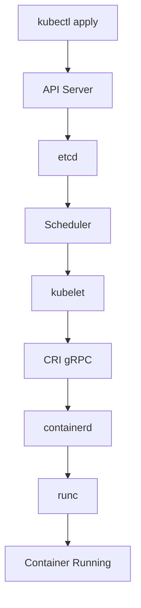
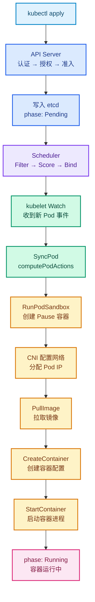
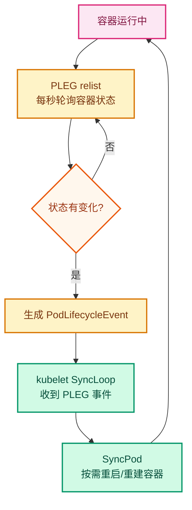
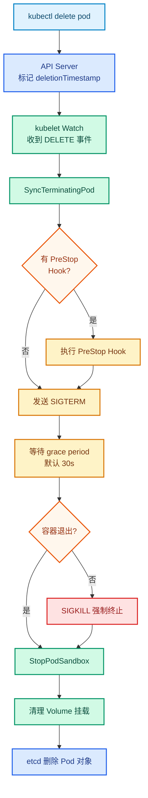
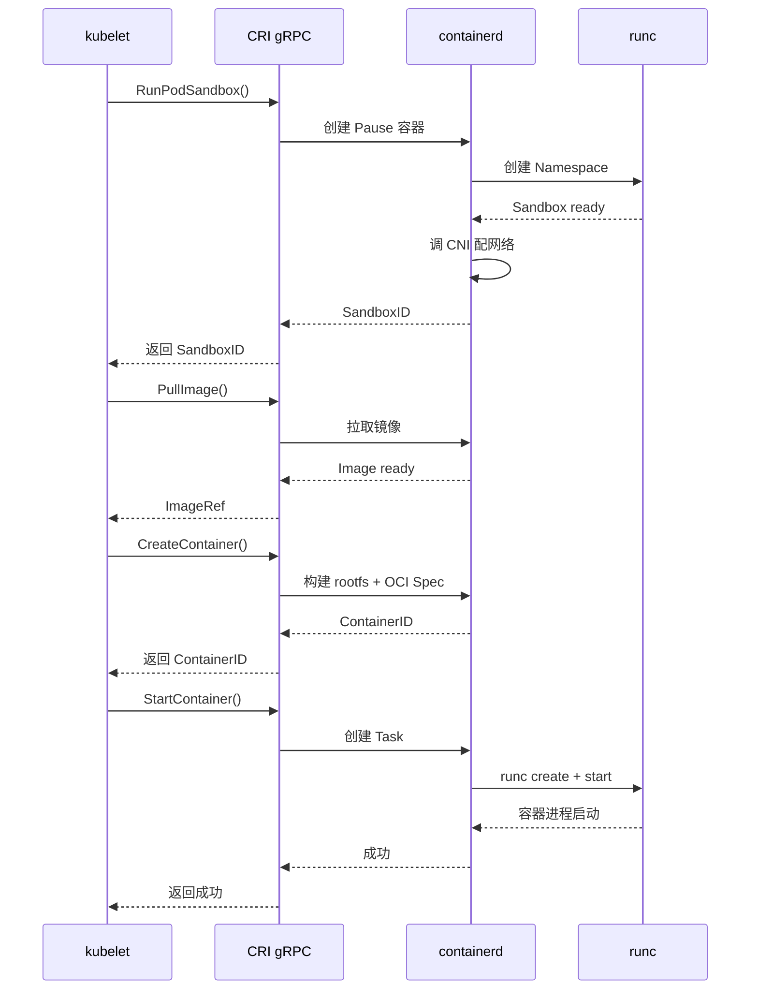
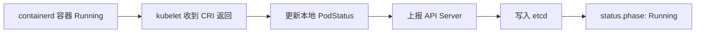
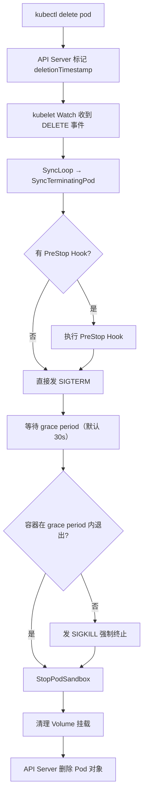
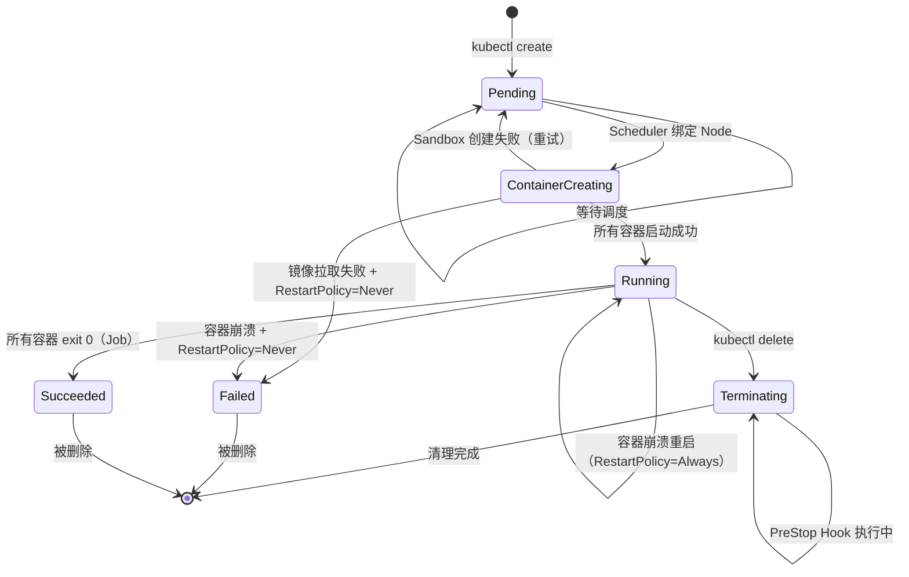
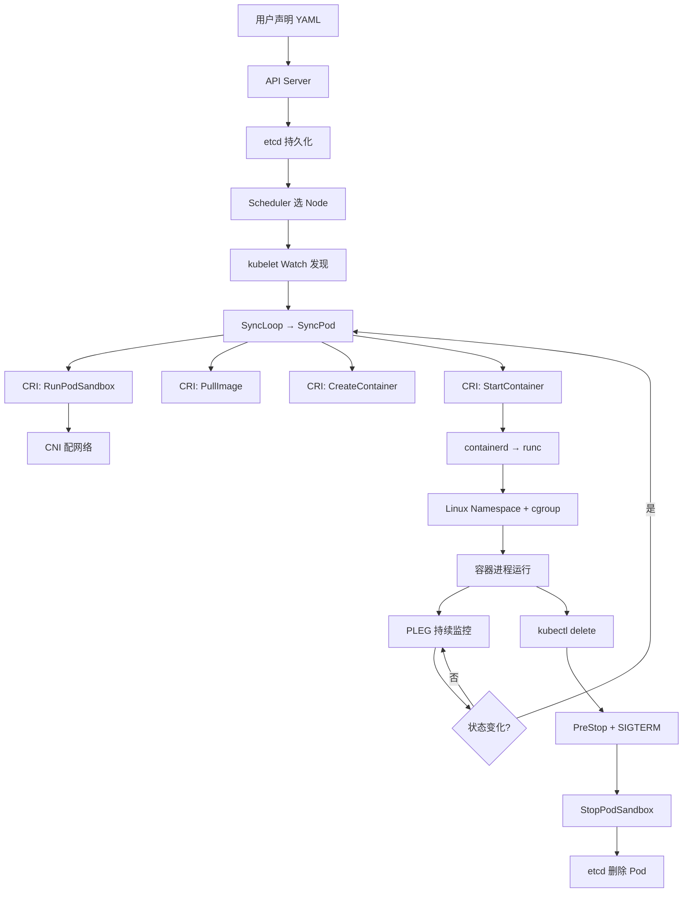

# Kubernetes Pod 生命周期源码解析：从 Pending 到 Running 到底经历了什么？

## 一、为什么 Pod 不是创建后马上 Running

很多 Kubernetes 初学者第一次写 YAML 时都会经历这个困惑：

```bash
kubectl run nginx --image=nginx --restart=Never
```

然后马上 `kubectl get pods`，看到的不是 Running，而是：

```
NAME    READY   STATUS              RESTARTS   AGE
nginx   0/1     ContainerCreating   0          2s
```

过几秒再查，才变成 Running。如果镜像没拉过，还会先经历一个 Pending 阶段。

实际上，一个 Pod 从 YAML 声明到真正运行在 Linux 上，中间经历了一条很长的链路：



每一个环节背后都有 Kubernetes 控制组件参与。本文沿着这条链路，把 Pod 从创建到删除的完整生命周期拆开，结合 K8s 1.36.1 源码和 3 Master + 3 Worker 测试环境上的真实验证来讲。

!!! info "系列文章关系"
    本文是 Worker Node 深度系列的第四篇。前三篇分别拆了 kubelet SyncLoop、CRI gRPC 接口、containerd 内部架构。本文把它们串成一条时间线——Pod 从诞生到消亡的完整过程。如果还没看前三篇，建议先过一遍，本文对前三篇已详细解释的机制只做简要引用。

## 二、Pod 状态模型：Phase 不等于 Container State

在讲流程之前，先厘清一个容易混淆的概念。

### Pod Phase

Kubernetes 官方定义了 5 个 Pod Phase：

| Phase | 含义 | 何时出现 |
|-------|------|----------|
| `Pending` | Pod 已被 API Server 接收，但尚未完全调度或容器未全部创建好 | 刚创建 / 调度失败 / 镜像拉取中 |
| `Running` | Pod 已绑定到 Node，且至少一个容器正在运行（或正在重启） | 容器启动成功 |
| `Succeeded` | Pod 中所有容器都成功退出（exit code 0），且不会再重启 | Job/CronJob 完成 |
| `Failed` | Pod 中所有容器都已终止，且至少一个容器失败退出 | 容器崩溃且 RestartPolicy 为 Never |
| `Unknown` | 无法获取 Pod 状态，通常是 API Server 与 Node 通信失败 | Node 失联 |

### Container State

Phase 是 Pod 级别的粗粒度状态。容器级别有三种状态：

| Container State | 含义 |
|-----------------|------|
| `Waiting` | 容器正在等待某个条件满足（如镜像拉取） |
| `Running` | 容器正在运行 |
| `Terminated` | 容器已退出（正常或异常） |

**关键区分**：Pod Phase 为 `Running` 不代表所有容器都正常。一个 Pod 可能 Phase=Running，但容器状态是 `CrashLoopBackOff`（反复崩溃重启）。

在测试环境上验证——创建一个会崩溃的 Pod：

```bash
kubectl run crash-test --image=m.daocloud.io/docker.io/busybox --restart=Always --command -- sh -c "exit 1"
```

等几秒后查看 Pod 状态：

```bash
kubectl get pod crash-test
```

```
NAME         READY   STATUS             RESTARTS        AGE
crash-test   0/1     CrashLoopBackOff   6 (2m46s ago)   8m23s
```

STATUS 列显示 `CrashLoopBackOff`，这是 kubectl 根据重启次数和退避策略计算出来的展示值。再看容器级别的详细状态：

```bash
kubectl get pod crash-test -o jsonpath='{.status.phase}{"\n"}{.status.containerStatuses[0].state}'
```

```
Running
{"terminated":{"containerID":"containerd://d6347011...","exitCode":1,"finishedAt":"2026-08-04T03:06:26Z","reason":"Error",...}}
```


这里有个容易混淆的地方：`kubectl get pod` 的 STATUS 列显示 `CrashLoopBackOff`，但 jsonpath 查出来的容器状态却是 `terminated` 而不是 `waiting/CrashLoopBackOff`。这是因为容器状态在崩溃循环期间会经历 `running` → `terminated` → `waiting(CrashLoopBackOff)` → `running` 的循环，抓到哪个取决于查询时机。而 Pod Phase 始终是 `Running`——因为 `restartPolicy: Always` 意味着 kubelet 还在尝试重启它，Kubernetes 认为 Pod 仍然"在运行中"。

这就是为什么排查问题时不能只看 `kubectl get pods` 的 STATUS 列，要结合 `kubectl describe pod` 的 Events 和 `kubectl logs` 看具体原因。

## 三、Pod 生命周期全链路

Pod 生命周期分三个阶段：创建、运行监控、删除。下面用三张图分别展示，每张图按组件着色——蓝色是 API Server，紫色是 Scheduler，绿色是 kubelet，琥珀色是容器运行时（CRI/containerd），粉色是状态节点。

### 创建流程：从 kubectl 到 Running



### 运行监控：PLEG 持续调谐



PLEG 每秒做一次 relist，对比上一次的容器状态快照。发现差异就生成事件推给 SyncLoop，触发新一轮 SyncPod——这就是"不断让实际状态靠近期望状态"的闭环。

### 删除流程：从 kubectl delete 到 etcd 清除



下面按时间线逐阶段拆解。

## 四、阶段一：API Server 接收创建请求

### 请求处理三步走

`kubectl apply -f nginx.yaml` 发送的 HTTP 请求到达 API Server 后，要经过三个关卡才能写入 etcd：

1. **Authentication（认证）**：验证调用者身份。kubeconfig 里的证书或 Token 在这里校验。
2. **Authorization（授权）**：检查该用户是否有权创建 Pod。通过 RBAC 规则匹配。
3. **Admission（准入）**：对 Pod 对象做最终检查和修改。包括 `MutatingAdmissionWebhook`（可修改对象，如注入 sidecar）和 `ValidatingAdmissionWebhook`（只验证不修改）。

通过三关后，Pod 对象被序列化为 protobuf，写入 etcd。此时 Pod 的状态是：

```yaml
status:
  phase: Pending
  conditions:
    - type: PodScheduled
      status: "False"
```

**注意**：此时 Pod 只有 `spec`（用户声明的期望状态），没有 `nodeName`（还没调度），没有 `podIP`（还没配网络），没有任何容器存在。它只是 etcd 里的一条记录。

### 在测试环境上观察

创建一个 Pod 并立即查看其 YAML：

```bash
kubectl run nginx-test --image=m.daocloud.io/docker.io/library/nginx:alpine --restart=Never
# 立刻执行（手速要快，或者用 --watch）
kubectl get pod nginx-test -o yaml
```


如果动作够快，你会看到 `phase: Pending`，`nodeName: ""`（空），`podIP: ""`（空）。但如果镜像本地已有（`imagePullPolicy: IfNotPresent` 时命中缓存），Pod 可能一两秒就跳到 Running，Pending 窗口极短。实际测试中，第一次 `kubectl get pod nginx-test -o yaml` 拿到的已经是 Running 状态：

```yaml
status:
  phase: Running
  podIP: 10.244.5.6
  hostIP: 192.168.114.148
  nodeName: worker01
  containerStatuses:
  - containerID: containerd://67aca40f558b6b47bb0b2841709e96ee98c49d73e68f99fe5e2251d628068be3
    image: m.daocloud.io/docker.io/library/nginx:alpine
    state:
      running:
        startedAt: "2026-08-04T03:32:37Z"
    ready: true
    restartCount: 0
  conditions:
  - type: PodScheduled
    status: "True"
    lastTransitionTime: "2026-08-04T03:32:36Z"
  - type: Ready
    status: "True"
    lastTransitionTime: "2026-08-04T03:32:37Z"
```

!!! note "为什么抓不到 Pending"
    如果镜像本地已有，从 Pod 写入 etcd 到容器启动只需要 1 秒左右。`kubectl get` 的往返延迟通常就超过这个窗口。想观察 Pending 阶段，可以用一个本地不存在的镜像（比如带一个不存在的 tag），让 Pull 阶段拖长时间；或者用 `kubectl get pod nginx-test -o yaml -w` 持续 watch。

从上面的 YAML 也能看到 Pod 的 conditions 字段——`PodScheduled`、`Ready`、`ContainersReady` 都是 `True`，说明调度完成且容器已就绪。注意 `PodReadyToStartContainers` 这个 condition（K8s 1.32+ alpha 特性），它表示 Sandbox 已就绪、可以开始创建容器了。

## 五、阶段二：Scheduler 让 Pod 离开 Pending

### 两阶段调度机制

Scheduler 通过 Watch 机制监听 API Server 上所有 `spec.nodeName=""` 的 Pod。发现新的未调度 Pod 后，执行两阶段调度：

**阶段一：Filter（过滤）**

遍历所有 Node，排除不满足条件的节点。过滤规则包括：

- 资源是否足够（CPU、Memory、Ephemeral Storage）
- NodeSelector / NodeAffinity 是否匹配
- Taints / Tolerations 是否容忍
- Volume 是否冲突（同一 PVC 不能挂到两个 Node 上做 ReadWriteOnce）

**阶段二：Score（评分）**

对过滤后剩余的 Node 打分，选分数最高的。评分因素包括：

- 资源均衡度（优先选资源利用率低的 Node）
- 亲和性/反亲和性
- 拓扑分布（Topology Spread Constraints）
- Pod 间亲和/反亲和

选好 Node 后，Scheduler 调用 API Server 的 Bind 接口，把 `spec.nodeName` 写回 Pod 对象。

### 状态变化

```yaml
# 调度前
spec:
  nodeName: ""        # 空
status:
  phase: Pending
  conditions:
    - type: PodScheduled
      status: "False"

# 调度后
spec:
  nodeName: "worker01"  # 有了
status:
  phase: Pending        # 还是 Pending
  conditions:
    - type: PodScheduled
      status: "True"    # 变成 True
```

注意 Phase 还是 Pending——调度完成不等于容器启动了。

### 源码入口

Scheduler 核心代码在 `kubernetes/pkg/scheduler/` 目录：

```
pkg/scheduler/
├── scheduler.go          # 入口，scheduleOne() 循环
├── framework/
│   ├── runtime/
│   │   └── framework.go  # 调度框架
│   └── plugins/          # 内置插件（NodeResourcesFit、InterPodAffinity 等）
└── cache/                # 调度缓存
```

`scheduleOne()` 是主循环，每次从队列取一个未调度的 Pod，执行 Filter → Score → Bind。

### 验证调度结果

```bash
kubectl get pod nginx-test -o wide
```

```
NAME         READY   STATUS    RESTARTS   AGE   IP           NODE       NOMINATED NODE   READINESS GATES
nginx-test   1/1     Running   0          74s   10.244.5.6   worker01   <none>           <none>
```


NODE 列从创建时的空变为具体节点名，说明 Scheduler 已经完成了绑定。如果创建后立刻查，NODE 列是空的（还没调度），过一两秒就有值了。

再看 Events 里的调度记录：

```bash
kubectl describe pod nginx-test | grep -A5 Events
```

```
Events:
  Type    Reason     Age   From               Message
  ----    ------     ----  ----               -------
  Normal  Scheduled  89s   default-scheduler  Successfully assigned default/nginx-test to worker01
  Normal  Pulled     88s   kubelet            spec.containers{nginx-test}: Container image "m.daocloud.io/docker.io/library/nginx:alpine" already present on machine and can be accessed by the pod
  Normal  Created    88s   kubelet            spec.containers{nginx-test}: Container created
```

第一行 `Scheduled` 是 Scheduler 写的，后两行 `Pulled` 和 `Created` 是 kubelet 写的——从 From 列就能看出组件分工。

## 六、阶段三：kubelet 接管——从 Watch 到 SyncPod

### kubelet 怎么发现有新 Pod

Scheduler 把 `nodeName` 写回 API Server 之后，目标节点上的 kubelet 通过 Reflector 的 List + Watch 机制收到了这个变更。Watch 推送的是一个 ADD 事件，封装成 `PodUpdate` 通过 Channel 传给 SyncLoop。

这部分在[SyncLoop 那篇文章](kubelet-syncloop.md)里详细拆过，这里只引用结论：SyncLoop 收到 ADD 事件后，把 Pod 交给 PodWorkers，PodWorkers 按 Pod 维度串行调用 `SyncPod()`。

### SyncPod 源码解析

`SyncPod` 是 kubelet 真正执行 Pod 创建/更新逻辑的函数。源码在 `pkg/kubelet/kuberuntime/kuberuntime_manager.go`：

```go
// Source: pkg/kubelet/kuberuntime/kuberuntime_manager.go L1450
func (m *kubeGenericRuntimeManager) SyncPod(
    ctx context.Context,
    pod *v1.Pod,
    podStatus *kubecontainer.PodStatus,
    pullSecrets []v1.Secret,
    backOff *flowcontrol.Backoff,
    restartAllContainers bool,
) (result kubecontainer.PodSyncResult) {
    // Step 1: Compute sandbox and container changes.
    podContainerChanges := m.computePodActions(ctx, pod, podStatus, restartAllContainers)

    // Step 2: Kill the pod if the sandbox has changed.
    if podContainerChanges.KillPod {
        killResult := m.killPodWithSyncResult(ctx, pod, ...)
        // ...
        if podContainerChanges.CreateSandbox {
            m.purgeInitContainers(ctx, pod, podStatus)
        }
    } else {
        // Step 3: Kill any running containers which are not to keep.
        for containerID, containerInfo := range podContainerChanges.ContainersToKill {
            m.killContainer(ctx, pod, containerID, containerInfo.name, ...)
        }
    }

    // Step 4: Create a sandbox for the pod if necessary.
    podSandboxID := podContainerChanges.SandboxID
    if podContainerChanges.CreateSandbox {
        podSandboxID, msg, err = m.createPodSandbox(ctx, pod, podContainerChanges.Attempt)
        // ...
    }

    // Step 5: start init containers (if any).
    // Step 6: start regular containers.
    // (后续步骤在 startContainer() 中实现)
}
```

SyncPod 内部分 6 个步骤（源码注释标注了 Step 1 到 Step 6），核心逻辑是先计算差异（`computePodActions`），决定要杀什么、建什么，然后按顺序执行。

### computePodActions：决策引擎

`computePodActions` 是 SyncPod 的"大脑"——它对比期望状态（PodSpec）和实际状态（容器运行时报告的状态），决定接下来要干什么：

```go
// Source: pkg/kubelet/kuberuntime/kuberuntime_manager.go L1175
func (m *kubeGenericRuntimeManager) computePodActions(
    ctx context.Context,
    pod *v1.Pod,
    podStatus *kubecontainer.PodStatus,
    restartAllContainers bool,
) podActions {
    // 判断 Sandbox 是否需要重建
    createPodSandbox, attempt, sandboxID := runtimeutil.PodSandboxChanged(pod, podStatus)
    changes := podActions{
        KillPod:           createPodSandbox,
        CreateSandbox:     createPodSandbox,
        SandboxID:         sandboxID,
        Attempt:           attempt,
        ContainersToStart: []int{},
        ContainersToKill:  make(map[kubecontainer.ContainerID]containerToKillInfo),
    }

    // 如果需要重建 Sandbox，所有容器都要重来
    if createPodSandbox {
        // 返回需要启动的容器列表
        // ...
        return changes
    }

    // Sandbox 没变，逐个检查容器
    for idx, container := range pod.Spec.Containers {
        containerStatus := podStatus.FindContainerStatusByName(container.Name)
        // 容器变了？需要重启？
        expectedHash, currentHash, changed := containerChanged(container, containerStatus)
        if changed {
            changes.ContainersToKill[containerStatus.ID] = containerToKillInfo{...}
            changes.ContainersToStart = append(changes.ContainersToStart, idx)
        }
    }

    return changes
}
```

`podActions` 结构体是决策结果，包含：是否杀 Pod、是否建 Sandbox、要启动哪些容器、要杀哪些容器。

## 七、阶段四：ContainerCreating——容器创建的五个子步骤

Pod 进入 ContainerCreating 阶段后，kubelet 通过 CRI 依次调用 containerd，执行五个子步骤。这部分在[CRI 那篇文章](cri-grpc-deep.md)和[containerd 那篇文章](containerd-from-cri-to-runc.md)里详细拆过，这里按时间线串联。

### 子步骤时间线



### startContainer 源码

`startContainer` 是单个容器创建的核心函数，源码在 `pkg/kubelet/kuberuntime/kuberuntime_container.go`：

```go
// Source: pkg/kubelet/kuberuntime/kuberuntime_container.go L199
// startContainer starts a container and returns a message indicates why it is failed on error.
// It starts the container through the following steps:
// * pull the image
// * create the container
// * start the container
// * run the post start lifecycle hooks (if applicable)
func (m *kubeGenericRuntimeManager) startContainer(
    ctx context.Context,
    podSandboxID string,
    podSandboxConfig *runtimeapi.PodSandboxConfig,
    spec *startSpec,
    pod *v1.Pod,
    podStatus *kubecontainer.PodStatus,
    pullSecrets []v1.Secret,
    podIP string,
    podIPs []string,
    imageVolumes kubecontainer.ImageVolumes,
) (string, error) {
    container := spec.container

    // Step 1: pull the image.
    imageRef, msg, err := m.imagePuller.EnsureImageExists(
        ctx, ref, pod, container.Image, pullSecrets, podSandboxConfig, ...)
    if err != nil {
        return msg, err
    }

    // Step 2: create the container.
    containerConfig, cleanupAction, err := m.generateContainerConfig(
        ctx, container, pod, restartCount, podIP, imageRef, podIPs, ...)
    if err != nil {
        return s.Message(), ErrCreateContainerConfig
    }

    containerID, err := m.runtimeService.CreateContainer(
        ctx, podSandboxID, containerConfig, podSandboxConfig)
    if err != nil {
        return s.Message(), ErrCreateContainer
    }
    m.recordContainerEvent(ctx, pod, container, containerID,
        v1.EventTypeNormal, events.CreatedContainer, "Container created")

    // Step 3: start the container.
    err = m.runtimeService.StartContainer(ctx, containerID)
    if err != nil {
        return s.Message(), kubecontainer.ErrRunContainer
    }
    m.recordContainerEvent(ctx, pod, container, containerID,
        v1.EventTypeNormal, events.StartedContainer, "Container started")

    // Step 4: execute the post start hook.
    if container.Lifecycle != nil && container.Lifecycle.PostStart != nil {
        msg, handlerErr := m.runner.Run(ctx, kubeContainerID, pod, container,
            container.Lifecycle.PostStart)
        if handlerErr != nil {
            // PostStart 失败，杀掉容器
            m.killContainer(ctx, pod, kubeContainerID, container.Name,
                "FailedPostStartHook", reasonFailedPostStartHook, nil, nil)
            return msg, ErrPostStartHook
        }
    }

    return "", nil
}
```

源码注释明确标注了 4 个步骤：`Step 1: pull the image` → `Step 2: create the container` → `Step 3: start the container` → `Step 4: execute the post start hook`。

!!! note "PostStart Hook 的执行时机"
    PostStart Hook 在容器启动后、状态变为 Running 之前执行。如果 Hook 失败，容器会被立即杀掉。这就是为什么有时候容器启动成功了但又 Crash——可能是 PostStart Hook 执行失败。

### createPodSandbox 源码

Sandbox 创建是容器创建的前提：

```go
// Source: pkg/kubelet/kuberuntime/kuberuntime_sandbox.go L38
func (m *kubeGenericRuntimeManager) createPodSandbox(
    ctx context.Context,
    pod *v1.Pod,
    attempt uint32,
) (string, string, error) {
    // 1. 生成 Sandbox 配置
    podSandboxConfig, err := m.generatePodSandboxConfig(ctx, pod, attempt)
    if err != nil {
        return "", message, err
    }

    // 2. 创建 Pod 日志目录
    err = m.osInterface.MkdirAll(podSandboxConfig.LogDirectory, 0755)

    // 3. 查找 RuntimeClass handler
    runtimeHandler := ""
    if m.runtimeClassManager != nil {
        runtimeHandler, err = m.runtimeClassManager.LookupRuntimeHandler(
            pod.Spec.RuntimeClassName)
    }

    // 4. 调用 CRI RunPodSandbox
    podSandBoxID, err := m.runtimeService.RunPodSandbox(ctx, podSandboxConfig, runtimeHandler)
    if err != nil {
        return "", message, err
    }

    return podSandBoxID, "", nil
}
```

### 在测试环境上验证

创建一个 Pod 并观察完整事件链：

```bash
kubectl run nginx-test --image=m.daocloud.io/docker.io/library/nginx:alpine --restart=Never
kubectl get events --sort-by='.lastTimestamp' --field-selector involvedObject.name=nginx-test
```


```
LAST SEEN   TYPE     REASON      OBJECT           MESSAGE
102s        Normal   Scheduled   pod/nginx-test   Successfully assigned default/nginx-test to worker01
101s        Normal   Pulled      pod/nginx-test   Container image "m.daocloud.io/docker.io/library/nginx:alpine" already present on machine and can be accessed by the pod
101s        Normal   Created     pod/nginx-test   Container created
101s        Normal   Started     pod/nginx-test   Container started
```

这四行事件刚好对应：Scheduled（Scheduler 干的）→ Pulled（镜像已存在，跳过拉取）→ Created（kubelet 调 CRI 建容器）→ Started（kubelet 调 CRI 启动容器）。注意时间戳——镜像本地已有时，Pulled/Created/Started 几乎在同一秒完成。

### 容器运行时层面验证

到 worker01 上看 Sandbox 和容器：

```bash
sudo crictl pods | grep nginx-test
sudo crictl ps | grep nginx-test
```

```
# crictl pods 输出
POD ID              CREATED         STATE    NAME          NAMESPACE    ATTEMPT   RUNTIME
5bf1e11f42767       2 minutes ago   Ready    nginx-test    default      0         (default)

# crictl ps 输出
CONTAINER           IMAGE          CREATED         STATE      NAME          ATTEMPT   POD ID              POD NAME
67aca40f558b6       ea51152ef8c48  2 minutes ago  Running    nginx-test    0         5bf1e11f42767       nginx-test
```


注意 Sandbox 的 POD ID（`5bf1e11f...`）和业务容器的 CONTAINER ID（`67aca40f...`）不同，但业务容器的 POD ID 列指向 Sandbox——这就是"Pod 内所有容器共享同一个 Sandbox"的体现。

用 `crictl inspect` 看容器的 Namespace 详情：

```bash
sudo crictl inspect 67aca40f558b6 | jq .info.runtimeSpec.linux.namespaces
```

```json
[
  { "type": "pid" },
  { "path": "/proc/2568950/ns/ipc", "type": "ipc" },
  { "path": "/proc/2568950/ns/uts", "type": "uts" },
  { "path": "/proc/2568950/ns/net", "type": "network" },
  { "type": "mount" },
  { "type": "cgroup" }
]
```

这里有个关键细节：`pid`、`mount`、`cgroup` 三种 Namespace 没有 `path` 字段——它们是每个容器独立创建的。而 `ipc`、`uts`、`network` 有 `path`，指向 `/proc/2568950/ns/...`——这个 PID 就是 Pause 容器的进程。业务容器通过 `path` 字段加入了 Pause 容器的 IPC、UTS、Network Namespace，实现了 Pod 内网络和 IPC 共享。这就是"Pod 是一组共享网络 Namespace 的容器"在底层的真正含义。

## 八、阶段五：Running——状态回写与持续调谐

### 状态回写链路

容器启动成功后，containerd 返回成功给 kubelet，kubelet 更新 PodStatus 并上报 API Server：



此时 etcd 里 Pod 的状态变为：

```yaml
status:
  phase: Running
  podIP: 10.244.1.25
  containerStatuses:
    - name: nginx
      state:
        running:
          startedAt: "2026-08-04T01:23:45Z"
      ready: true
```

### PLEG：持续监控

容器跑起来后，kubelet 不能撒手不管——它得知道容器是否还活着。API Server 不会通知容器侧的变化（它只管期望状态），kubelet 需要自己去探查。

这就是 PLEG（Pod Lifecycle Event Generator）的工作。PLEG 每秒调一次 CRI 的 `ListContainers`，跟上次记录的状态对比，有变化就生成事件塞进 Channel 通知 SyncLoop，触发新一轮 `SyncPod`。

比如一个容器 OOM 挂了：

1. PLEG relist 发现容器状态从 Running → Exited
2. 生成 `PodLifecycleEvent`，通知 SyncLoop
3. SyncLoop 触发 SyncPod
4. `computePodActions` 发现"期望 Running，实际 Exited"
5. 决定重启容器 → `startContainer` → 容器重新跑起来

这就是 K8s 容器自动重启的底层机制——不是 Controller Manager 在远程重启，是本节点 kubelet 通过 PLEG 感知后自己处理的。

!!! tip "PLEG 与 SyncLoop 的详细机制"
    PLEG 的 relist 循环、SyncLoop 的四路输入、PodWorkers 的串行设计，在 [SyncLoop 那篇文章](kubelet-syncloop.md)里详细拆过。这里只引用结论：PLEG 是 kubelet 感知真实世界变化的"眼睛"。

## 九、阶段六：Pod 删除——反向流程

### 删除链路

`kubectl delete pod nginx` 触发的删除流程跟创建是反过来的：



### killContainer 源码

容器终止的核心逻辑在 `killContainer` 函数，源码在 `pkg/kubelet/kuberuntime/kuberuntime_container.go`：

```go
// Source: pkg/kubelet/kuberuntime/kuberuntime_container.go L860
func (m *kubeGenericRuntimeManager) killContainer(
    ctx context.Context,
    pod *v1.Pod,
    containerID kubecontainer.ContainerID,
    containerName string,
    message string,
    reason containerKillReason,
    gracePeriodOverride *int64,
    ordering *terminationOrdering,
) error {
    // 1. 获取 grace period（来自 Pod 的 terminationGracePeriodSeconds）
    gracePeriod := setTerminationGracePeriod(ctx, pod, containerSpec, ...)

    if gracePeriodOverride != nil {
        gracePeriod = *gracePeriodOverride
    }

    // 2. 执行 PreStop Hook（如果有且时间允许）
    if containerSpec.Lifecycle != nil && containerSpec.Lifecycle.PreStop != nil && gracePeriod > 0 {
        gracePeriod = gracePeriod - m.executePreStopHook(ctx, pod, containerID, ...)
    }

    // 3. 最低保留 2 秒 grace period
    if gracePeriod < minimumGracePeriodInSeconds {
        gracePeriod = minimumGracePeriodInSeconds
    }

    // 4. 调 CRI StopContainer——先 SIGTERM，超时后 SIGKILL
    err := m.runtimeService.StopContainer(ctx, containerID.ID, gracePeriod)
    if err != nil && !crierror.IsNotFound(err) {
        return err
    }

    return nil
}
```

!!! warning "grace period 的实际值"
    `terminationGracePeriodSeconds` 默认 30 秒。PreStop Hook 执行会消耗 grace period 的时间。如果 PreStop 执行了 20 秒，容器在收到 SIGTERM 后只有 10 秒来优雅退出。如果 PreStop 执行了 35 秒（超过 grace period），容器可能还没收到 SIGTERM 就被 SIGKILL 了。

### killPodWithSyncResult 源码

Pod 级别的删除入口：

```go
// Source: pkg/kubelet/kuberuntime/kuberuntime_manager.go L1953
func (m *kubeGenericRuntimeManager) killPodWithSyncResult(
    ctx context.Context,
    pod *v1.Pod,
    runningPod kubecontainer.Pod,
    gracePeriodOverride *int64,
) (result kubecontainer.PodSyncResult) {
    // 1. 杀所有容器（含 PreStop Hook + grace period）
    killContainerResults := m.killContainersWithSyncResult(ctx, pod, runningPod, gracePeriodOverride)

    // 2. 停止 Sandbox（Sandbox 会在 GarbageCollect 时被真正删除）
    for _, podSandbox := range runningPod.Sandboxes {
        if err := m.runtimeService.StopPodSandbox(ctx, podSandbox.ID.ID); err != nil && !crierror.IsNotFound(err) {
            killSandboxResult.Fail(kubecontainer.ErrKillPodSandbox, err.Error())
        }
    }

    return
}
```

### 在测试环境上验证删除流程

```bash
kubectl run nginx-delete --image=m.daocloud.io/docker.io/library/nginx:alpine --restart=Never
# 等 Running 后删除
kubectl delete pod nginx-delete
# 立刻看 kubelet 日志
sudo journalctl -u kubelet --since "30 sec ago" | grep -E "RemoveContainer|orphaned|Killing"
```

输出如下（在 Pod 所在的 worker 节点上执行）：

```
Aug 04 11:37:47 worker01 kubelet[2972481]: I0804 11:37:47.884828 2972481 scope.go:122] "RemoveContainer" containerID="4e0a84699c70ba4816ab95e88d76f542372267dea2203666ea863c5b0b3759de"
Aug 04 11:37:47 worker01 kubelet[2972481]: I0804 11:37:47.892342 2972481 scope.go:122] "RemoveContainer" containerID="4e0a84699c70ba4816ab95e88d76f542372267dea2203666ea863c5b0b3759de"
Aug 04 11:37:48 worker01 kubelet[2972481]: I0804 11:37:48.623933 2972481 kubelet_volumes.go:161] "Cleaned up orphaned pod volumes dir" podUID="67dc4cfb-813d-4188-973e-6c359d435d2c" path="/var/lib/kubelet/pods/67dc4cfb-813d-4188-973e-6c359d435d2c/volumes"
```


注意 `RemoveContainer` 对同一个容器 ID 执行了两次（间隔不到 10ms）——第一次是 kubelet 主动删除，第二次是 PLEG relist 发现容器没了又触发了一轮清理。最后 `kubelet_volumes.go` 清理了 Pod 的 Volume 目录，`podUID` 对应被删除的 Pod。整个删除流程从 RemoveContainer 到 Volume 清理完成，大约 1 秒。

## 十、Pod 状态转换图

把前面所有阶段的状态变化汇总成一张完整的状态机：



### Phase 与各阶段对应关系

| Phase | 对应阶段 | 参与组件 |
|-------|----------|----------|
| Pending（未调度） | API Server 接收 → 写入 etcd | API Server、etcd |
| Pending（已调度） | Scheduler 选好 Node | Scheduler |
| ContainerCreating | kubelet 通过 CRI 创建容器 | kubelet、CRI、containerd、CNI |
| Running | 容器启动成功 | kubelet（状态回写）、PLEG（持续监控） |
| Terminating | 删除流程中 | kubelet（PreStop、SIGTERM）、API Server |
| Succeeded | 所有容器 exit 0 | kubelet（检测退出状态） |
| Failed | 容器失败且不重启 | kubelet（检测退出状态） |

## 十一、常见故障与生命周期阶段对应

### 故障排查矩阵

| 症状 | 卡在哪个阶段 | 常见原因 | 排查命令 |
|------|-------------|----------|----------|
| Pod 一直 Pending | Scheduler 没选到 Node | 资源不足、NodeSelector 不匹配、Taints 未容忍 | `kubectl describe pod` 看 Events |
| Pod 卡在 ContainerCreating | kubelet SyncPod 某步失败 | 镜像拉取失败、CNI 异常、Volume 挂载失败 | `kubectl describe pod` 看 Events |
| CrashLoopBackOff | 容器启动后退出 | 应用崩溃、配置错误、依赖缺失 | `kubectl logs <pod>` |
| Pod 卡在 Terminating | 删除流程走不完 | finalizer 未移除、Volume 卸载失败、kubelet 异常 | `kubectl get pod -o yaml` 看 finalizers |
| Node NotReady | kubelet 失联或 PLEG 不健康 | PLEG 超时、containerd 卡死、网络问题 | `kubectl describe node` 看 conditions |

### Pending 排查

```bash
kubectl describe pod <pod-name> | tail -20
```

Events 部分会告诉你为什么没调度成功：

- `FailedScheduling` + `0/6 nodes are available` → 资源不足
- `FailedScheduling` + `node(s) didn't match node selector` → NodeSelector 不匹配
- `FailedScheduling` + `node(s) had taints that the pod didn't tolerate` → Taints 未容忍

### ContainerCreating 排查

```bash
kubectl describe pod <pod-name> | grep -A10 Events
```

不同报错对应不同环节：

- `Failed to create pod sandbox` → CNI 插件异常
- `Failed to pull image` → 镜像仓库不通或认证没配
- `Failed to create container` → 挂载路径不对或配置有误
- `failed to start container` → runc 启动失败，多半是资源不足

到 Node 上看 kubelet 日志：

```bash
sudo journalctl -u kubelet --since "5 min ago" | grep -i error
```

!!! note "控制面组件日志查看方式"
    控制面组件（API Server、Controller Manager、Scheduler、etcd）是静态 Pod，不是 systemd 服务。`journalctl -u kube-apiserver` 查不到日志。正确方式：`crictl logs $(sudo crictl ps | grep kube-apiserver | awk '{print $1}')`。kubelet 自己是 systemd 服务，`journalctl -u kubelet` 可以直接用。

### Terminating 卡住排查

```bash
kubectl get pod <pod-name> -o jsonpath='{.metadata.finalizers}'
```

如果 finalizers 列表不为空，说明有 Controller 注册了 finalizer 但没执行清理。常见的有：

- `kubernetes.io/pv-protection`：PVC 还在用
- `foregroundDeletion`：有子资源还没删完

手动移除 finalizer（谨慎操作）：

```bash
kubectl patch pod <pod-name> -p '{"metadata":{"finalizers":[]}}' --type=merge
```

!!! warning "不要随意移除 finalizer"
    finalizer 存在是为了确保资源被正确清理。手动移除可能导致残留资源（如 Volume、网络规则）泄漏。只在确认 Controller 已挂且无法恢复时使用。

## 十二、源码入口索引

| 组件 | 源码路径 | 关键函数 |
|------|----------|----------|
| Scheduler | `pkg/scheduler/scheduler.go` | `scheduleOne()` |
| Scheduler Filter | `pkg/scheduler/framework/runtime/framework.go` | `RunFilterPlugins()` |
| Scheduler Score | `pkg/scheduler/framework/runtime/framework.go` | `RunScorePlugins()` |
| kubelet SyncLoop | `pkg/kubelet/kubelet.go` | `syncLoop()` |
| PodWorkers | `pkg/kubelet/pod_workers.go` | `UpdatePod()` |
| SyncPod | `pkg/kubelet/kuberuntime/kuberuntime_manager.go` | `SyncPod()` L1450 |
| computePodActions | `pkg/kubelet/kuberuntime/kuberuntime_manager.go` | `computePodActions()` L1175 |
| createPodSandbox | `pkg/kubelet/kuberuntime/kuberuntime_sandbox.go` | `createPodSandbox()` L38 |
| startContainer | `pkg/kubelet/kuberuntime/kuberuntime_container.go` | `startContainer()` L199 |
| killContainer | `pkg/kubelet/kuberuntime/kuberuntime_container.go` | `killContainer()` L860 |
| killPod | `pkg/kubelet/kuberuntime/kuberuntime_manager.go` | `killPodWithSyncResult()` L1953 |
| PLEG | `pkg/kubelet/pleg/generic.go` | `relist()` |
| CRI Proto | `staging/src/k8s.io/cri-api/pkg/apis/runtime/v1/api.proto` | `RuntimeService` / `ImageService` |

!!! info "源码版本"
    以上路径基于 Kubernetes v1.36.1。不同版本的行号可能有变化，但函数名和文件路径基本稳定。GitHub 链接格式：`github.com/kubernetes/kubernetes/blob/v1.36.1/<path>#L<line>`

## 十三、完整链路总结

把 Pod 从创建到删除的完整链路串起来：



一句话总结：**Kubernetes 不是"创建一个 Pod"，而是在不断让实际状态靠近期望状态。** Pod 生命周期就是一场持续的状态协调——API Server 存期望，kubelet 调实际，中间的 Scheduler、CRI、containerd、runc 都是这条协调链路上的执行者。

## 十四、相关阅读

- [Kubernetes kubelet SyncLoop 原理](kubelet-syncloop.md)——SyncLoop 四路输入、PodWorkers 串行设计、PLEG relist 机制详解
- [Kubernetes CRI 原理](cri-grpc-deep.md)——三个 gRPC 请求的 protobuf 定义、参数和返回值
- [containerd 创建容器全过程](containerd-from-cri-to-runc.md)——containerd 内部五个模块、Snapshotter、containerd-shim 机制
- [Kubernetes CNI 网络原理](../network/cni.md)（计划中）——Pod IP 是怎么来的
- [Kubernetes CSI 存储机制](../storage/csi.md)（计划中）——Volume 挂载和卸载流程

---

下一篇：**Kubernetes CNI 网络原理：Pod 创建后网络到底如何建立？**

容器创建出来了，但 Pod IP 是怎么来的？CNI 插件在 `RunPodSandbox` 阶段做了什么？veth pair 怎么建、路由怎么配？这些问题在 Pod 生命周期里是最后一个还没拆的关键环节。
