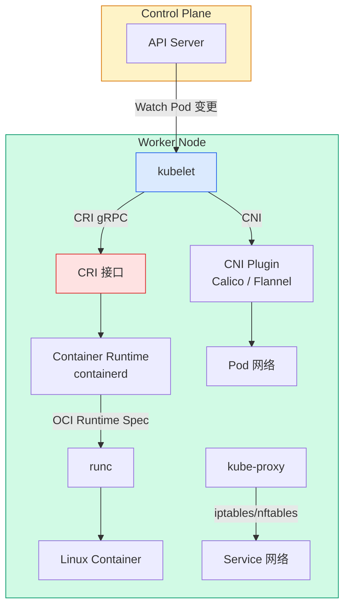
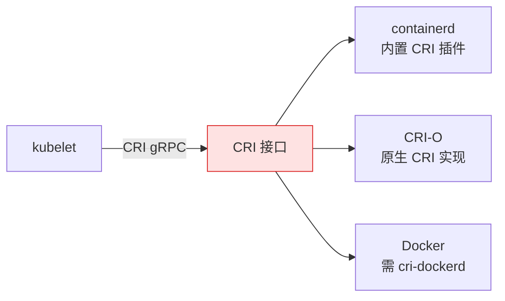
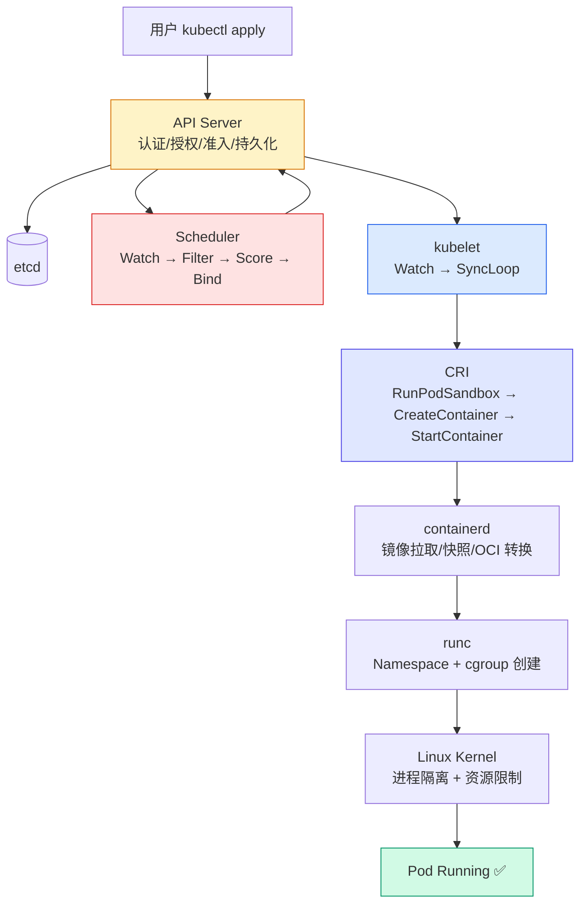

# Kubernetes Worker Node 架构原理：Pod 到底是谁创建的？

## 文章摘要

在 Kubernetes 架构中，控制面负责**决定应该运行什么**——API Server 接收请求、Scheduler 选择节点、Controller Manager 维护期望状态。但真正让 Pod 从 YAML 变成运行的容器进程的，是 **Worker Node**。

本文聚焦 Worker Node 的完整执行链路——从 kubelet 接收 PodSpec 到 Linux 内核创建容器——帮你理清「Pod 到底是谁创建的」这个看似简单实则涉及六层组件协作的问题。

---

## 学习目标

-   理解 Worker Node 在 Kubernetes 架构中的定位
-   掌握 kubelet → CRI → containerd → runc 的执行链路
-   还原一个 Pod 从 Scheduler 绑定到容器运行的完整过程
-   澄清「Pod 是 kubelet 创建的吗？」等常见误解

---

## 一、引言：Scheduler 决定之后，Pod 真的运行了吗？

在前面的文章中，我们介绍了 Kubernetes 控制面的核心组件——[API Server](control-plane/api-server.md)、[Scheduler](control-plane/scheduler.md)、[Controller Manager](control-plane/controller-manager.md)、[Etcd](control-plane/etcd.md)。控制面的职责可以概括为一句话：

> **维护 Kubernetes 集群的期望状态（Desired State）。**

例如，用户创建一个 Deployment：

```yaml
apiVersion: apps/v1
kind: Deployment
metadata:
  name: nginx
spec:
  replicas: 3
```

Kubernetes 记录下「我希望集群中运行 3 个 nginx Pod」。Scheduler 经过 Filter 和 Score 两阶段调度，为每个 Pod 选择了一个合适的 Node，并将绑定信息写回 API Server。

**但 Pod 真的运行了吗？**

答案是没有。Scheduler 只做了两件事：

-   选择哪个 Node
-   将 `spec.nodeName` 写入 Pod 对象

它不会下载镜像、创建容器、挂载网络、挂载存储。真正执行这些工作的，是 **Worker Node**。

---

## 二、什么是 Kubernetes Worker Node？

### 2.1 Worker Node 的职责

Worker Node 是 Kubernetes 集群中**执行工作负载的计算节点**。它负责：

-   接收 PodSpec 并创建 Pod
-   管理容器生命周期（启动、健康检查、重启、销毁）
-   上报节点状态和 Pod 状态给控制面
-   提供 Pod 网络能力（通过 CNI 插件）
-   提供存储挂载能力（通过 CSI 插件）

简单对照：

| 组件 | 职责 |
| :---: | --- |
| **Control Plane** | 决定运行什么 |
| **Worker Node** | 负责真正运行 |

### 2.2 Worker Node 整体架构



Worker Node 包含三个核心组件——kubelet、Container Runtime、kube-proxy——加上 CNI/CSI 插件。

---

## 三、Worker Node 核心组件

### 3.1 kubelet：Node 上的核心代理

kubelet 是运行在每个 Node 上的 **Kubernetes 节点代理**。详细工作原理见 [Kubelet 工作原理详解](node/kubelet.md)，这里聚焦它在执行链路中的角色：

| 职责 | 说明 |
| --- | --- |
| **接收 PodSpec** | 通过 Watch API Server 获取绑定到本节点的 Pod |
| **管理 Pod 生命周期** | 创建 Pod 所需的容器、卷、网络 |
| **调用 CRI** | 通过 CRI gRPC 接口调用 Container Runtime |
| **上报状态** | 定期向 API Server 上报 Node 和 Pod 状态 |
| **健康检查** | 执行 Liveness / Readiness / Startup Probe |

**kubelet 与 API Server 的关系**需要特别澄清——很多人误以为 API Server 直接创建容器。实际流程是：

```text
API Server（保存状态 + 通知）
        │
        ▼
kubelet（接收 PodSpec + 调用 Runtime）
        │
        ▼
Container Runtime（真正创建容器）
```

API Server 只是**保存状态并通知**，真正执行的是 kubelet。

---

### 3.2 Container Runtime：真正运行容器的地方

Container Runtime 是**负责创建和运行容器的软件**。常见的实现：

| Runtime | 说明 |
| --- | --- |
| **containerd** | CNCF 毕业项目，Kubernetes 默认推荐 |
| **CRI-O** | 专为 Kubernetes 设计的轻量 Runtime |
| **Docker Engine** | 1.24 后不再直接支持（通过 cri-dockerd 适配） |

!!! info "Docker 还在 Kubernetes 中吗？"
    Kubernetes 1.24 移除了内置的 Dockershim，不再直接支持 Docker Engine 作为 Container Runtime。但 Docker 构建的 **OCI 镜像格式**仍然是行业标准。现代架构中，Kubernetes → containerd → runc → Linux Kernel 是主流路径。

---

### 3.3 CRI：kubelet 与 Runtime 之间的桥梁

早期 Kubernetes 直接硬编码支持 Docker。但不同 Runtime（Docker、containerd、CRI-O）接口不同，每接入一种 Runtime 就要修改 kubelet 代码。

Kubernetes 引入了 **Container Runtime Interface（CRI）**——一套标准的 gRPC API：



| CRI 操作 | 说明 |
| --- | --- |
| `RunPodSandbox` | 创建 Pod Sandbox（共享网络/IPC 命名空间） |
| `CreateContainer` | 创建单个容器 |
| `StartContainer` | 启动容器 |
| `StopContainer` | 停止容器 |
| `RemoveContainer` | 删除容器 |
| `ListPodSandbox` | 列出所有 Pod Sandbox |

CRI 的详细工作机制见 [CRI 容器运行时接口](node/cri.md)。

---

## 四、一个 Pod 从创建到运行的完整流程

这是全文核心——还原一条完整的执行链路。

### Step 1：用户提交 YAML

```bash
kubectl apply -f nginx.yaml
```

```text
kubectl → API Server（认证/授权/准入） → etcd（持久化）
```

此时 Pod 只是一个存储在 etcd 中的对象。`spec.nodeName` 为空。

---

### Step 2：Scheduler 选择节点

Scheduler 的 Watch 机制发现未调度的 Pod，经过两阶段处理：

| 阶段 | 做了什么 |
| :---: | --- |
| **Filter** | 过滤掉不满足条件的节点（资源不足、Taint 不匹配、NodeSelector） |
| **Score** | 对剩余节点打分（LeastRequestedPriority、BalancedResourceAllocation） |

选出最优节点后，Scheduler 通过 API Server 将 `spec.nodeName` 设为 `worker-node-01`。

!!! tip "调度细节"
    完整的调度流程（NodeSelector、Affinity、Taint/Toleration、TopologySpreadConstraints）见 [Scheduler 工作原理详解](control-plane/scheduler.md)。

---

### Step 3：kubelet 发现任务

`worker-node-01` 上的 kubelet 通过 Watch API Server，发现自己被分配了一个新 Pod：

```text
Pod: nginx-7d4b8c9f-abcde
Node: worker-node-01
Status: Pending
```

kubelet 开始执行 **Pod 同步循环（SyncLoop）**。

---

### Step 4：kubelet 创建 Pod Sandbox

kubelet 首先通过 CRI 调用 `RunPodSandbox`，创建 Pod 的基础设施容器（Infra Container/Pause Container）：

| Pod Sandbox 提供的资源 | 说明 |
| --- | --- |
| **Network Namespace** | 该 Pod 内所有容器共享同一个网络命名空间 |
| **IPC Namespace** | 容器间进程通信 |
| **UTS Namespace** | 共享主机名 |
| **cgroup** | Pod 级别的资源限制 |

CNI 插件在此阶段被调用，为 Pod 分配 IP、创建 veth pair、配置路由。

---

### Step 5：kubelet 调用 CRI 创建容器

Sandbox 就绪后，kubelet 逐个创建 Pod 中的容器（Init 容器先，普通容器后）：

```text
kubelet → CRI → containerd → runc → Linux Namespace + cgroup
```

CRI 调用链：

| 步骤 | CRI 调用 | containerd 操作 |
| :---: | --- | --- |
| 1 | `PullImage` | 从 Registry 拉取镜像 |
| 2 | `CreateContainer` | 创建容器快照、准备 rootfs |
| 3 | `StartContainer` | 调用 runc 启动容器进程 |
| 4 | `ListContainers` | 持续监控容器状态 |

---

### Step 6：Linux 内核创建真正的容器环境

最底层是 Linux 内核的两大特性：

| 特性 | 作用 | Pod 中的体现 |
| --- | --- | --- |
| **Namespace** | 隔离 | PID Namespace 让容器内 `ps` 只看到自己的进程；Network Namespace 让 Pod 有独立 IP |
| **cgroup** | 限制 | `resources.limits.cpu` → `cpu.max`；`resources.limits.memory` → `memory.max` |

```bash
# 在 Node 上查看实际运行的容器进程
crictl ps

# 查看某个容器的 Namespace
ls -la /proc/<PID>/ns/

# 查看容器的 cgroup 限制
cat /sys/fs/cgroup/kubepods.slice/kubepods-besteffort.slice/.../memory.max
```

深入理解 Linux Namespace 和 cgroup 见 [容器底层原理](../../linux/base-system/container-internals.md)。

---

### Step 7：kubelet 上报状态

容器运行后，kubelet 持续：

-   向 API Server 上报 Pod 状态（`Pending → Running`）
-   执行 Liveness/Readiness Probe
-   上报 Node 心跳（`node-status-update-frequency`，默认 10s）

```bash
# 观察 Pod 状态变化
kubectl get pod -w
# NAME                     READY   STATUS              RESTARTS   AGE
# nginx-7d4b8c9f-abcde     0/1     Pending             0          0s
# nginx-7d4b8c9f-abcde     0/1     ContainerCreating   0          1s
# nginx-7d4b8c9f-abcde     1/1     Running             0          5s
```

---

## 五、完整执行链路总结



一句话总结：

> Kubernetes 控制面负责决定「应该运行什么」，Worker Node 负责让这些期望状态变成现实。Pod 不是 Scheduler 创建的，也不是 kubelet 单独创建的——它是 API Server → Scheduler → kubelet → CRI → containerd → runc → Linux Kernel 六层协作的结果。

---

## 六、常见误解澄清

### 6.1 Pod 是 kubelet 创建的吗？

严格来说，**不是**。kubelet 是「项目经理」——它接收任务、分解任务、调用 CRI 要求 Runtime 执行。真正调用 Linux 系统调用创建 Namespace 和 cgroup 的是 **runc**。

### 6.2 kubelet 挂了，Pod 会停止吗？

**不一定**。kubelet 停止后：

-   已运行的容器**不会立即停止**——它们由 containerd + runc 管理，独立于 kubelet
-   新 Pod **无法创建**，因为没人接收 PodSpec
-   Node 状态在 API Server 中变为 `NotReady`（心跳超时，默认 40s）
-   Control Plane 在宽限期（`pod-eviction-timeout`，默认 5 分钟）后，将该 Node 上的 Pod 标记为 `Terminating`，在其他健康 Node 上重建——前提是 Pod 属于 ReplicaSet/Deployment 等控制器

```bash
# 实验：停止 kubelet 观察
sudo systemctl stop kubelet
kubectl get node          # 几分钟后变为 NotReady
crictl ps                 # 容器仍在运行
```

### 6.3 Docker 还在 Kubernetes 中吗？

不在。Kubernetes 1.24+ 不再内置支持 Docker Engine。但 Docker 生态的 OCI 镜像格式、Dockerfile 构建方式、镜像仓库仍然通用。现在容器运行的完整链路是：

```text
Kubernetes → containerd → runc → Linux Kernel
```

---

## 七、生产环境 Worker Node 最佳实践

### 7.1 节点资源规划

| 资源 | 建议 |
| --- | --- |
| **OS 预留** | 为系统保留 10~15% CPU 和内存（`--system-reserved` / `--kube-reserved`） |
| **驱逐阈值** | `--eviction-hard=memory.available<500Mi` 防止 OOM |
| **maxPods** | 默认 110，按节点规格调整 |

### 7.2 kubelet 关键参数

```bash
# /var/lib/kubelet/config.yaml
maxPods: 110
evictionHard:
  memory.available: "500Mi"
  nodefs.available: "10%"
imageGCHighThresholdPercent: 85
imageGCLowThresholdPercent: 80
```

### 7.3 容器运行时选择

| Runtime | 特点 | 推荐场景 |
| --- | --- | --- |
| **containerd** | 主流推荐，CNCF 毕业，Docker 镜像兼容 | 所有新集群 |
| **CRI-O** | 轻量，专为 K8s 设计，OpenShift 默认 | 纯 K8s 环境 |
| **cri-dockerd** | Docker Engine 适配层 | 遗留环境过渡 |

---

## 八、实验验证

```bash
# 1. 查看 kubelet 状态
systemctl status kubelet

# 2. 查看 CRI 运行时中的容器
crictl ps
crictl pods

# 3. 观察 Pod 创建过程
kubectl run test --image=nginx --restart=Never --dry-run=client -o yaml | kubectl apply -f -
kubectl get pod test -w

# 4. 查看 Pod 在 Node 上的底层容器
crictl pods --name test
crictl ps --pod <POD_ID>

# 5. 查看容器的 cgroup 限制
crictl inspect <CONTAINER_ID> | jq .info.runtimeSpec.linux.resources
```

---

## 九、总结

Kubernetes Worker Node 是「声明式配置」落地为「实际运行容器」的执行面。完整链路是：

```
用户请求 → API Server → etcd
         → Scheduler（选择节点）
         → kubelet（Watch + SyncLoop）
         → CRI（RunPodSandbox → CreateContainer）
         → containerd（拉镜像/快照/OCI）
         → runc（Namespace + cgroup）
         → Linux Kernel
         → Pod Running ✅
```

理解这条链路，你就真正理解了 Kubernetes 从「声明」到「运行」的完整过程。

---

## 十、相关阅读

| 文章 | 说明 |
| --- | --- |
| [Kubernetes 架构总览](index.md) | 控制面与 Node 的全景图 |
| [Kubelet 工作原理详解](node/kubelet.md) | 节点代理的深度解析 |
| [Scheduler 工作原理详解](control-plane/scheduler.md) | Pod 调度全流程 |
| [CRI 容器运行时接口](node/cri.md) | kubelet 与 Runtime 之间的标准接口 |
| [容器底层原理](../../linux/base-system/container-internals.md) | Linux Namespace + cgroup 动手实验 |
