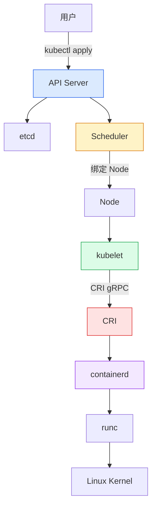
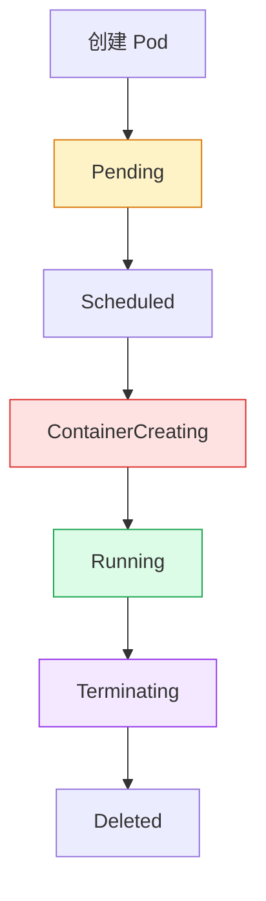

# Kubernetes Pod 生命周期源码解析：Pod 从 Pending 到 Running 到底经历了什么？

## 文章摘要

很多 Kubernetes 初学者会有一个非常直观但却容易误解的想法：

> 我执行了 kubectl apply，Pod 不是应该马上跑起来吗？

实际上，Pod 从 YAML 文件变成真正运行在 Node 上的容器进程，中间要经过一整条复杂而有序的链路。

这个链路并不是“某一个组件一步到位完成的”，而是由多个组件共同协作完成的：

- API Server 负责接收和存储用户声明
- Scheduler 负责选择合适的 Node
- kubelet 负责把 Pod 真正落地到本节点
- CRI 负责定义 kubelet 和运行时之间的标准接口
- containerd 负责创建和管理容器
- runc 负责调用 Linux 内核能力启动进程

这篇文章会带你把这个链路完整串起来，重点解释一个 Pod 从 Pending 到 Running 的过程中，每个阶段到底发生了什么，以及这些步骤背后对应的源码思想是什么。

---

## 一、引言：Pod 为什么不是创建后马上 Running？

如果你第一次接触 Kubernetes，最容易产生的误解就是：

执行：

```bash
kubectl apply -f nginx.yaml
```

之后，Pod 就应该立刻变成：

```text
Running
```

但现实情况往往不是这么简单。一个 Pod 从“被声明”到“实际运行”会经历很多步骤：

```text
Pending
  ↓
Scheduling
  ↓
Scheduled
  ↓
ContainerCreating
  ↓
Running
```

每一个阶段都不是“默认发生”的，而是由 Kubernetes 的控制组件在不断做协调。

换句话说，Kubernetes 不是一股脑把容器创建起来，而是通过一条不断调谐的控制链路，让“实际状态”逐步靠近“期望状态”。

---

## 二、Pod 生命周期整体架构图

把整个链路先看成一张总图，会更容易理解：



这个图可以概括为一句话：

> 用户声明期望状态，控制平面负责决策，Node 上的 kubelet 和容器运行时负责真正执行。

---

## 三、Pod 状态到底是什么？

很多人会把 Pod 的状态理解成“它是不是 Running”。但实际上，Pod 的生命周期远不止一个布尔值。

### 3.1 Pod 的 Phase

Pod 最常见的状态是 Phase，它表示 Pod 的大致生命周期阶段：

| Phase | 含义 |
| --- | --- |
| Pending | Pod 已经被创建，但还没有被调度或容器创建完成 |
| Running | 至少有一个容器正在运行 |
| Succeeded | 所有容器成功终止，并且不会再重启 |
| Failed | 至少有一个容器失败退出 |
| Unknown | 状态无法获取 |

注意，这个 Phase 是 Pod 级别的状态，并不是容器级别的状态。

### 3.2 容器状态和 Pod 状态不是一回事

一个 Pod 可能是 Running，但其中某个容器已经 CrashLoopBackOff。

例如：

```text
Pod: Running
  └─ Container: CrashLoopBackOff
```

这说明：

- Pod 的 Phase 反映的是整个 Pod 的整体状态
- 容器的状态反映的是某一个具体容器实例的情况

这也是 Kubernetes 里“看 Pod”与“看容器”要区分清楚的地方。

---

## 四、阶段一：kubectl 创建 Pod

当你执行：

```bash
kubectl apply -f nginx.yaml
```

整个流程的第一步不是“立刻创建容器”，而是“把你声明的对象提交给 API Server”。

### 4.1 先经过一串控制面处理

请求会先经过：

```text
kubectl
  ↓
API Server
  ↓
Authentication / Authorization
  ↓
Admission
  ↓
etcd
```

这几个步骤分别负责：

- 认证：确认你是谁
- 鉴权：确认你有没有权限创建这个资源
- 准入控制：检查对象是否满足策略要求
- 写入 etcd：把 Pod 对象永久化存储

### 4.2 此时 Pod 只是一个对象

在这个阶段，Pod 还只是一个 API 对象。它还没有：

- Node 绑定
- IP 地址
- 容器运行时创建的 Sandbox
- 业务容器进程

所以它的状态通常是：

```yaml
status:
  phase: Pending
```

一句话概括：

> 这个阶段的 Pod 是“被声明的对象”，不是“已经运行起来的实例”。

---

## 五、阶段二：Scheduler 如何让 Pod 离开 Pending？

Pod 一旦写入 etcd，调度器就会开始关注它。

### 5.1 Scheduler 是怎么发现它的？

Scheduler 通过 Watch API Server 中的 Pod 变化，及时发现“还没有被调度的 Pod”。

### 5.2 Scheduler 的两阶段机制

Scheduler 的核心思想就是：

- 先筛掉不合适的节点
- 再给剩下的节点打分，挑最合适的

#### 1. Filtering：过滤节点

例如：

- CPU 不够
- 内存不够
- NodeSelector 不匹配
- Taint / Toleration 不满足
- PodAntiAffinity 不满足

如果某个节点不满足要求，就会被排除。

#### 2. Scoring：打分

剩下的节点会进行打分。例如：

- 资源均衡
- 亲和性
- 拓扑分布
- 负载情况

最后 Scheduler 会找出一个最优节点，并把它写回 Pod 对象：

```yaml
spec:
  nodeName: worker01
```

### 5.3 状态变化

这一步的本质是：

```text
Pending → Scheduled
```

它并没有真正创建容器，而只是决定“Pod 应该运行在哪个 Node 上”。

---

## 六、阶段三：kubelet 如何发现属于自己的 Pod？

Scheduler 只完成了“去哪儿运行”的决策，真正开始执行创建容器的，是当前节点上的 kubelet。

### 6.1 kubelet 不是直接轮询，而是通过 Watch 机制感知变化

kubelet 会持续监听 API Server 上与本节点相关的 Pod 变化。这个机制和前面讲到的 SyncLoop 思想是一致的：

```text
API Server
  ↓
Watch Pod 变更
  ↓
kubelet SyncLoop
  ↓
Pod Update Event
```

当 kubelet 看到一个 Pod 的 `spec.nodeName` 等于自己所在节点时，就会把这个 Pod 纳入自己管理范围。

### 6.2 kubelet 进入 SyncPod

如果 Pod 已经绑定到当前 Node，那么 kubelet 会进入它的核心执行逻辑：

```text
SyncPod()
```

这也是 kubelet 真正“把 Pod 从想象变成现实”的入口。

---

## 七、阶段四：Pod 进入 ContainerCreating

这是很多人容易误解的阶段。许多人以为“调度完成后，Pod 就直接 Running”。

实际上，调度只是“安排好了去哪里”，真正的创建过程还在继续。

### 7.1 先创建 Sandbox

kubelet 首先会调用 CRI 的接口，创建 Pod Sandbox。

```text
RunPodSandbox()
```

这个 Sandbox 的作用是：

- 为 Pod 提供一个“共享的基础环境”
- 包含网络、IPC、PID 等命名空间的基础设施
- 可以把多个容器放到同一个 Pod 里共享这些资源

在容器运行时里，这往往对应一个 Pause 容器。它不是业务容器，而是“基础容器”。

### 7.2 配置网络：CNI 开始工作

在 Sandbox 创建后，kubelet 会调用 CNI 插件，为 Pod 配置网络：

- 创建 veth pair
- 进入 Pod 网络 namespace
- 配置 IP 地址
- 将 Pod 接入集群网络

这一步是 Pod 能真正“有网络”前提条件。

### 7.3 拉取镜像

接着 kubelet 会调用 CRI 的拉镜像接口：

```text
PullImage()
```

镜像拉取成功后，容器运行时才能从镜像中创建出业务容器。

### 7.4 创建业务容器

随后会执行：

```text
CreateContainer()
```

这一步是“生成容器对象”，但还没有真正启动它。

### 7.5 启动容器

最后会执行：

```text
StartContainer()
```

这一步才是容器真正开始跑起来。

所以 ContainerCreating 其实是一个“准备并启动中”的阶段，包含：

- 创建 Sandbox
- 配置网络
- 拉镜像
- 创建容器
- 启动容器

它并不只是“显示一个状态字”，而是一个实际的执行流水线。

---

## 八、阶段五：Container Running

当 containerd、CRI 和 kubelet 完成一轮协作后，容器进程已经被真正启动。

此时会发生以下过程：

```text
containerd
  ↓
CRI Status
  ↓
kubelet
  ↓
API Server
  ↓
etcd
```

kubelet 会把获取到的容器实际状态同步回 API Server。最终 Pod 会被更新为：

```yaml
status:
  phase: Running
```

这一步意味着：

- 容器进程已经存在
- kubelet 认为它目前处于可运行状态
- Pod 已经从“准备中”进入“已经在工作中”

---

## 九、Pod 生命周期核心控制循环：Kubernetes 的本质不是一步创建，而是不断调谐

这是理解 Kubernetes 最核心的一点。

Kubernetes 不是一次性把一个 Pod “创建好”，而是不断对比：

```text
Desired State（期望状态）
        vs
Current State（当前状态）
```

然后不断地让两者接近。

### 9.1 期望状态来自声明

例如你声明：

```yaml
spec:
  replicas: 3
```

这意味着：

> 我希望集群里永远是 3 个 Pod。

### 9.2 当前状态来自实际运行

比如当前只有 2 个 Pod 在运行，那么控制器就会补一个出来。

这就是 Kubernetes 控制循环的本质。

Pod 生命周期也是同样的逻辑：

- 用户声明了一个 Pod
- Scheduler 决定它去哪里
- kubelet 执行创建/更新/删除动作
- 运行时反馈实际状态
- kubelet 再次调谐

所以你要理解 Pod 生命周期，不是“看一个流程图”，而是“看一个持续调谐的控制系统”。

---

## 十、kubelet SyncPod 内部生命周期：从源码视角看真正的创建链路

上一篇我们讲过 kubelet 的 SyncLoop，这里继续把它和 Pod 生命周期串起来。

一个 Pod 最终进入 kubelet 的创建链路，通常是这样的：

```text
SyncPod()
  ↓
GeneratePodSandboxConfig()
  ↓
RunPodSandbox()
  ↓
CreateContainer()
  ↓
StartContainer()
  ↓
UpdateStatus()
```

这条链路可以理解为：

1. 先生成 Pod Sandbox 的配置
2. 创建 Sandbox
3. 创建业务容器
4. 启动它
5. 把状态回写给 API Server

这也是为什么 kubelet 往往被认为是“真正让 Pod 运行起来的组件”。

### 10.1 代码层面的入口

从源码角度看，kubelet 的主要入口主要集中在下面几个部分：

- [pkg/kubelet/kubelet.go](https://github.com/kubernetes/kubernetes/tree/master/pkg/kubelet/kubelet.go)：kubelet 主循环与调谐逻辑
- [pkg/kubelet/pod_workers.go](https://github.com/kubernetes/kubernetes/tree/master/pkg/kubelet/pod_workers.go)：PodWorkers 负责串行处理 Pod 的更新
- [pkg/kubelet/kuberuntime](https://github.com/kubernetes/kubernetes/tree/master/pkg/kubelet/kuberuntime)：真正和 CRI / runtime 交互的 runtime 管理层

这几个模块一起构成了 kubelet 的“执行中枢”。

---

## 十一、PLEG 如何参与生命周期？

Pod 不只是“创建一次”，它还要持续“被监控”。

当容器已经启动后，kubelet 该如何知道容器是不是挂了、重启了、被 OOM 了？

答案是：**PLEG**。

PLEG 的全称是：

```text
Pod Lifecycle Event Generator
```

它负责监听容器运行时的事件并生成生命周期事件。

### 11.1 它的作用

例如：

- 容器从 Running 变成 Exit
- 容器重启
- 容器被 OOMKilled
- 容器状态变化

PLEG 会把这些变化汇报给 kubelet 的 SyncLoop。

### 11.2 事件流转

```text
containerd
  ↓
PLEG relist
  ↓
发现变化
  ↓
PodLifecycleEvent
  ↓
kubelet SyncLoop
  ↓
重新同步
```

这也是为什么 kubelet 能够做到“容器挂了之后自动重启、状态变化实时更新”。

---

## 十二、Pod 删除生命周期：反向看生命周期

理解“创建”很重要，但“删除”同样值得看。

当你执行：

```bash
kubectl delete pod nginx
```

会发生一个反向流程：

```text
API Server
  ↓
kubelet Watch
  ↓
SyncTerminatingPod
  ↓
PreStop Hook
  ↓
SIGTERM
  ↓
grace period
  ↓
SIGKILL
  ↓
删除 Sandbox
```

### 12.1 删除不是立即 kill

Kubernetes 删除 Pod 时，通常会先触发：

- PreStop Hook
- 优雅终止
- grace period

只有在等待时间结束后，才会真正强制杀掉容器。

这也是为什么你在删除 Pod 时，有时会看到它先进入 Terminating 状态。

---

## 十三、完整状态转换图

把整个生命周期串成一张完整图，会更容易记忆：



这张图看似简单，但它背后承载的是一整套控制逻辑：

- 从对象创建到调度
- 从调度到容器启动
- 从容器运行到最终退出

---

## 十四、常见故障对应生命周期阶段

这部分非常适合做排障时使用。

### 14.1 Pending

常见原因：

- 没有可用节点
- 资源不够（CPU / Memory）
- PVC 没绑定完成
- 调度失败

排查方式：

```bash
kubectl describe pod <pod-name>
```

### 14.2 ContainerCreating

常见原因：

- 镜像拉取失败
- CNI 配置失败
- Volume 挂载失败
- 容器运行时异常

排查方式：

```bash
kubectl describe pod <pod-name>
kubectl get events --sort-by='.lastTimestamp'
```

### 14.3 CrashLoopBackOff

这种情况说明：

容器已经启动了一段时间，但很快又退出了。

排查方式：

```bash
kubectl logs <pod-name>
```

### 14.4 Terminating 卡住

常见原因：

- Finalizer 未清理
- Volume 卸载失败
- kubelet 异常
- PreStop Hook 阻塞

---

## 十五、源码入口分析：从代码组织看 Pod 生命周期

如果你已经开始阅读 Kubernetes 源码，这条链路的入口可以按如下思路理解：

### 1. Scheduler 入口

```text
kubernetes/pkg/scheduler
```

这里负责：

- 发现未调度 Pod
- 执行 Filter 和 Score
- 选择 Node

### 2. kubelet 入口

```text
pkg/kubelet/kubelet.go
```

这里负责：

- SyncLoop
- 事件调度
- Pod 的持续同步

### 3. PodWorkers

```text
pkg/kubelet/pod_workers.go
```

这里负责：

- 把 Pod 的更新串行化处理
- 避免多个事件并发冲突

### 4. Runtime Manager

```text
pkg/kubelet/kuberuntime
```

这里负责：

- 调用 CRI
- 管理容器生命周期
- 上报状态

如果你把这些模块串起来，就会明白：

> Kubernetes 不是单一组件“干完一件事”，而是多个组件在不同层次协作。

---

## 十六、总结：Pod 生命周期就是一场“状态协调”

一句话概括：

> Kubernetes 并不是“创建一个 Pod”，而是在不断让“实际状态”靠近期望状态。

整个 Pod 生命周期可以归纳为这样一条链路：

```text
用户声明
  ↓
API Server
  ↓
Scheduler
  ↓
kubelet
  ↓
CRI
  ↓
containerd
  ↓
runc
  ↓
Linux Kernel
  ↓
Container Process
```

这条链路中，最值得记住的不是某一个命令，而是这套控制思想：

- 声明式系统
- 控制循环
- 逐步收敛
- 通过 Watch 和 Reconcile 驱动状态变化

对于 Kubernetes 体系的学习者来说，Pod 生命周期是理解整个集群运行机制的“主线”。

---

## 十七、相关阅读

如果你已经读完这篇文章，建议继续看这些系列内容：

- [Kubelet SyncLoop 工作原理](kubelet-syncloop.md)
- [Worker Node 架构原理](worker-node.md)
- [CRI gRPC 调用详解](cri-grpc-deep.md)
- [containerd 创建容器全过程](containerd-from-cri-to-runc.md)
- [Kubernetes CNI 网络原理](cni.md)
- [Kubernetes CSI 存储机制](csi.md)

---

## 后续文章推荐顺序

如果你想继续沿着这条主线往下走，我建议下一篇可以是：

### 《Kubernetes CNI 网络原理：Pod 创建后网络到底如何建立？》

因为当 Pod 生命周期走到 ContainerCreating 阶段后，真正的“网络”问题就会出现。一个 Pod 能不能真正通信，背后同样是这套链路中不可缺少的一部分。
