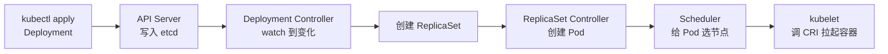

# Kubernetes API 资源体系：GVK、API Group 与一次 apply 的完整旅程

## 一切皆资源，这是 Kubernetes 和传统运维最大的分水岭

传统运维里，"部署一个 Nginx" 和 "配置一个负载均衡" 是两套完全不同的操作，走不同的工具、不同的脚本。Kubernetes 把这两件事统一成了一个动作：

```bash
kubectl apply -f nginx.yaml
```

你提交的永远是同一种东西——**资源对象（Resource）**。Pod、Deployment、Service、ConfigMap、PV，本质没有区别：都是 API Server 里的一种数据，有固定的 schema，被对应的控制器持续地"调平"。

这也是为什么说 Kubernetes 是"声明式、资源驱动"的平台：它不是 shell 那样"执行一条命令、产生一个结果"，而是"声明一个期望状态，控制器把现实改造成期望状态"。这个调平机制在 [Controller Manager 详解](../control-plane/controller-manager.md) 里拆过，这里先记住结论：**所有资源都受控于一个 reconcile 循环**。

## GVK 与 GVR：一个对象的两个名字

写 YAML 时，你面对的是 GVK：

```yaml
apiVersion: apps/v1   # Group + Version
kind: Deployment      # Kind
```

但 API Server 的 REST 路径用的是 GVR：

```text
/apis/apps/v1/namespaces/default/deployments/nginx
                       ↑ 这里用的是 Resource（复数）
```

- **GVK**（Group/Version/Kind）是人写 YAML 时用的身份；
- **GVR**（Group/Version/Resource）是 REST 路径上的身份。

两者的映射由 API Server 的 discovery 机制维护，这也是 `kubectl api-resources` 能列出所有资源的原因：

```text
NAME                SHORTNAMES   APIVERSION            NAMESPACED   KIND
deployments         deploy       apps/v1               true         Deployment
statefulsets        sts          apps/v1               true         StatefulSet
daemonsets          ds           apps/v1               true         DaemonSet
jobs                             batch/v1              true         Job
cronjobs            cj           batch/v1              true         CronJob
services            svc          v1                    true         Service
ingresses           ing          networking.k8s.io/v1  true         Ingress
persistentvolumes   pv           v1                    false        PersistentVolume
```

三个值得注意的列：

1. **APIVERSION**：`v1` 是核心组（core group），没有 group 前缀；`apps/v1`、`batch/v1`、`networking.k8s.io/v1` 是命名组。资源多了以后按 group 分家，是为了避免 API 路径互相踩踏。
2. **NAMESPACED**：Pod、Service 是命名空间内的；Node、PV、StorageClass 是集群级的。这个布尔值决定了 REST 路径里有没有 `/namespaces/<ns>` 这一段。
3. **SHORTNAMES**：`kubectl get deploy` 能缩写，靠的就是 discovery 返回的 shortNames。

想看一个资源在 API 树里的完整位置，`kubectl api-versions` 看版本，或 `kubectl get --raw /apis` 直接看 discovery 原始文档。请求从 kubectl 一路走到 etcd 的完整链路在 [API Server 详解](../control-plane/api-server.md)，这里不重复。

## API 版本：alpha / beta / stable 三段式

apiVersion 不是随便编的，它反映一个 API 的成熟度。Kubernetes 约定俗成三段：

| 版本 | 含义 | 默认开启 | 稳定性承诺 |
|---|---|---|---|
| v1alpha1 | 早期实验 | 否 | 随时可改、可删 |
| v1beta1 | 接近成熟 | 通常开 | 可能改动，升级需注意 |
| v1 | 稳定 GA | 是 | 长期兼容 |

一个著名例子是 Ingress：早期只有 `extensions/v1beta1` 和 `networking.k8s.io/v1beta1`，1.22 起这两个都被废弃，只剩 `networking.k8s.io/v1`。很多老教程还写着 `extensions/v1beta1` 的 Ingress，在新集群上 apply 会直接报 `no matches for kind`。所以**看教程先核对 apiVersion**——API 版本和 K8s 版本是强绑定的。

`kubectl explain` 能看到一个字段属于哪个版本、什么类型：

```text
$ kubectl explain deployment.spec.strategy.rollingUpdate
KIND:       Deployment
VERSION:    apps/v1

RESOURCE: rollingUpdate <Object>

DESCRIPTION:
     Rolling update config params. Present only if DeploymentStrategyType =
     RollingUpdate.

FIELDS:
   maxSurge        <string>
   maxUnavailable  <string>
```

## 五个字段：所有对象的公共骨架

把任意对象的 YAML 剥到最简，就剩五块：

```yaml
apiVersion: apps/v1          # 1. 属于哪个 group/version
kind: Deployment             # 2. 是什么类型
metadata:                    # 3. 身份信息
  name: nginx
  namespace: default
  labels:
    app: nginx
spec:                        # 4. 期望状态（你声明）
  replicas: 3
status:                      # 5. 实际状态（系统回写）
  replicas: 3
  readyReplicas: 3
```

`spec` 和 `status` 的分工，是理解声明式模型的关键：

- **spec 是你说的话**：`replicas: 3`，你提交的期望；
- **status 是系统答的话**：`readyReplicas: 3`，控制器观察现实后回写。

你永远只改 spec，status 由控制器维护。`status` 是一个独立子资源（subresource），这也是为什么 `kubectl edit` 对象时 status 段的改动常常不生效——API Server 对 spec 和 status 的写权限是分开的。

## metadata：不只是 name 和 labels

`kubectl get pod -o yaml` 里，metadata 有几个不起眼但极其重要的字段：

```yaml
metadata:
  name: nginx-7b8f9d5c4-abc12
  namespace: default
  uid: 1a2b3c4d-...            # 全集群唯一，重建后变化
  resourceVersion: "1234567"   # etcd 版本号，乐观并发控制用
  generation: 3                # spec 被改的次数（Deployment 有）
  ownerReferences:             # 谁创建了我（垃圾回收依赖）
    - apiVersion: apps/v1
      kind: ReplicaSet
      name: nginx-7b8f9d5c4
      uid: ...
  finalizers:                  # 删除前要执行的收尾逻辑
    - kubernetes.io/pvc-protection
```

- **resourceVersion**：watch 机制和乐观并发控制的基石。client 拿它做条件更新，写冲突时 API Server 返回 409；
- **ownerReferences**：GC 靠它级联删除。Deployment 删了，RS 和 Pod 因为 ownerReferences 指向它而被一起回收；
- **finalizers**：删除对象时 API Server 不会立刻删，而是等 finalizer 跑完（比如 PVC 被 Pod 引用时的 `pvc-protection`）。对象卡在 `Terminating` 不消失，多半是 finalizer 没跑完。

## 声明式 vs 命令式：apply 和 create 不是一回事

```bash
kubectl create -f nginx.yaml     # 命令式：只创建，重复执行报 AlreadyExists
kubectl apply  -f nginx.yaml     # 声明式：创建或更新，幂等
```

`apply` 的幂等性靠 `kubectl.kubernetes.io/last-applied-configuration` 这个 annotation：它记录你上次 apply 的完整 YAML，下次 apply 时做三方合并（你手改的 + 上次的 + 当前的），从而知道哪些字段是你声明过、现在要删掉的。

生产上坚持用 `apply` 而不是 `create`/`run`，原因就在这里：声明式对象可以被反复提交而结果一致，这也是 GitOps 的地基。

## 一次 apply 之后，对象是怎么"活"起来的

以 Deployment 为例：



每一步都是一个控制器 watch 一种资源、写入另一种资源。Deployment Controller 不知道容器怎么拉起来，它只负责"副本数不够就补 ReplicaSet"；真正拉容器的是 kubelet。这条链路的细节分别写在 [Pod 生命周期源码解析](../node/pod-lifecycle.md) 和 [Kubelet SyncLoop](../node/kubelet-syncloop.md)。

这引出一个容易被忽视的事实：**kubectl apply 返回成功，不代表 Pod 已经 Running，只代表对象被 etcd 接受了**。真正的创建是异步的。

## watch 与 informer：控制器怎么"感知"变化

控制器不是轮询 etcd 的。它通过 watch 订阅资源变化，client-go 的 informer 在本地缓存一份、增量接收事件——这也是 [API Server 详解](../control-plane/api-server.md) 里强调 watch 是控制平面关键机制的原因。

你可以自己 watch 看看：

```bash
kubectl get pods --watch
# 另一个终端 create / delete 一个 Pod，这里会实时滚出 ADDED / MODIFIED / DELETED
```

资源一旦变化，watch 连接立刻推送事件，控制器收到事件后进入 reconcile。这也是为什么"改了 YAML 后要等一会儿才生效"——中间隔着 watch 推送和控制器处理两段延迟。

## 资源分类地图

站点把这些资源按职能分成五类，分别有专题：

| 分类 | 代表资源 | 站点文章 |
|---|---|---|
| 工作负载 | Pod、Deployment、StatefulSet、DaemonSet、Job、CronJob | [工作负载资源](workloads.md) |
| 服务与网络 | Service、EndpointSlice、Ingress、IngressClass、Gateway API | [服务资源](server-resources.md) |
| 存储 | PV、PVC、StorageClass、VolumeSnapshot | [存储资源](../storage/storage.md) |
| 安全 | ServiceAccount、Role、ClusterRole、Secret、NetworkPolicy | [安全资源](security.md) |
| 辅助 / 管理 | Namespace、Label、ResourceQuota、HPA、PDB、Event、Lease | [辅助资源](other-resources.md) |

每类背后都有一组控制器和一个明确要解决的问题。单篇读迷路了，回这张表定位即可。

## 排错时最被低估的三个命令

```bash
kubectl api-resources               # 列出全部资源（含 shortNames、是否命名空间级）
kubectl explain deployment.spec     # 看字段文档，比查官网快
kubectl get --raw /api/v1           # 直接打 discovery 原始接口
```

`kubectl explain` 读本地缓存的 OpenAPI schema，能告诉你字段名拼错没有、类型对不对。`kubectl get --raw` 适合确认"这个 API 到底存不存在"，例如排查某个 CRD 没装好：

```bash
kubectl get --raw /apis/example.com/v1 2>&1 | head
# 404 说明这个 group 根本没注册，先查 CRD 装没装
```

## 自定义资源（CRD）：资源模型的可扩展性

Kubernetes 内置资源再多也是有限的，但它允许你定义自己的资源：

```yaml
apiVersion: apiextensions.k8s.io/v1
kind: CustomResourceDefinition
metadata:
  name: mysqls.example.com
spec:
  group: example.com
  names:
    kind: MySQL
    plural: mysqls
  scope: Namespaced
  versions:
    - name: v1
      served: true
      storage: true
```

装完 CRD，`kubectl api-resources` 里就多出一行 `mysqls`，从此能 `kubectl get mysqls`。但 CRD 只定义"这种数据长什么样"，要让 `MySQL` 对象真的管起一个数据库，还得有人写控制器——这就是 Operator 模式，本质是"自定义资源 + 自定义控制器"。

CRD 还能带上 OpenAPI schema 做字段校验，以及声明子资源：

```yaml
spec:
  versions:
    - name: v1
      served: true
      storage: true
      schema:
        openAPIV3Schema:
          type: object
          properties:
            spec:
              type: object
              properties:
                replicas:
                  type: integer
                  minimum: 1
              required: ["replicas"]
      subresources:
        status: {}     # 让 status 也走独立子资源
        scale:         # 声明支持 kubectl scale
          specReplicasPath: .spec.replicas
          statusReplicasPath: .status.replicas
```

有了 `subresources.status`，你的 CRD 才和其他内置资源一样"spec 与 status 分离"；有了 `scale`，`kubectl scale mysqls my-db --replicas=3` 才可用。

[为什么不能直接改 etcd](../control-plane/why-not-directly-modify-etcd.md) 从另一个角度解释了这套模型的设计意图：所有变更都必须走 API Server 的校验、审计和 watch，这是 Kubernetes 可扩展性的来源，也是它可靠性的代价。

## 推荐阅读

- [API Server 详解](../control-plane/api-server.md) — 请求从认证、鉴权到写入 etcd 的完整链路
- [为什么不能直接改 etcd](../control-plane/why-not-directly-modify-etcd.md) — API Server 存在的真正意义
- [Controller Manager 详解](../control-plane/controller-manager.md) — reconcile 循环与各控制器的分工
- [Pod 生命周期源码解析](../node/pod-lifecycle.md) — 一次 apply 之后对象如何变成运行中的容器
- [工作负载资源](workloads.md) — 本系列的运行载体篇