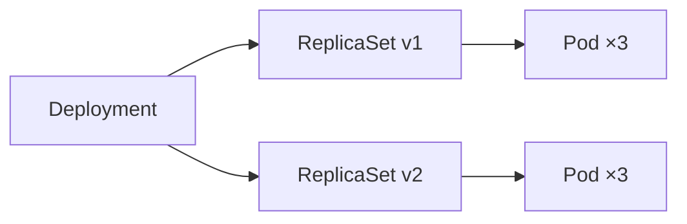

# Kubernetes 工作负载：从 Pod 到 CronJob，控制器是怎么管住它们的

## 只有 Pod 真的会"跑"

Kubernetes 里一堆"工作负载"资源——Deployment、StatefulSet、DaemonSet、Job、CronJob——但它们自己都不会跑容器。真正被调度到节点、被 kubelet 和 CRI 拉起来的是 Pod。这些资源的工作只有一个：**决定 Pod 以什么形态存在（几个、叫什么名字、什么时候起、什么时候灭），剩下的交给 Pod**。

所以理解工作负载要先理解 Pod，而 Pod 从创建到 Running 的完整过程，[Pod 生命周期源码解析](../node/pod-lifecycle.md) 拆到了源码级，这里只给结论：

- Pod 是调度的最小单位，同一 Pod 的容器共享一个网络命名空间（一个 IP）和一组 volume；
- Pod 是临时的：节点故障、Pod 被删，它不会自己复活——这正是"生产上不直接建 Pod"的原因；
- 替 Pod 续命、管理副本的，是各种控制器。

## Pod 的组成：不只一个容器

一个 Pod 可以装多个容器，而且有三种角色：

```yaml
apiVersion: v1
kind: Pod
metadata:
  name: webapp
spec:
  initContainers:              # 1. 先跑，跑完才轮到主容器
    - name: init-db
      image: busybox
      command: ["sh", "-c", "until nc -z db 3306; do sleep 1; done"]
  containers:                  # 2. 主容器
    - name: app
      image: myapp:1.0
      ports:
        - containerPort: 8080
      livenessProbe:           # 3. 探针：决定要不要重启容器
        httpGet:
          path: /healthz
          port: 8080
        initialDelaySeconds: 5
        periodSeconds: 10
      readinessProbe:          # 4. 探针：决定要不要接流量
        httpGet:
          path: /ready
          port: 8080
      resources:
        requests:
          cpu: 250m
          memory: 256Mi
        limits:
          cpu: "1"
          memory: 512Mi
  restartPolicy: Always        # Always / OnFailure / Never
```

三个探针各管一件事：

| 探针 | 回答的问题 | 失败后果 |
|---|---|---|
| livenessProbe | 容器还活着吗？ | 杀掉容器重启 |
| readinessProbe | 容器能接流量吗？ | 从 Service 的 EndpointSlice 里摘掉 |
| startupProbe | 启动完成了吗？ | 在此之前不跑另外两个探针 |

很多人把 liveness 和 readiness 搞混，或者干脆只配 liveness。实际上 readiness 失败**不会重启容器**，只是短暂停流——这才是"应用还没预热好"应该用的。startupProbe 专门给启动慢的应用兜底，避免 liveness 在应用还没起来时就把它误杀了。

`initContainers` 是"先序任务"：主容器启动前按顺序跑完，适合等依赖就绪、做数据初始化。sidecar 容器（1.28 起，`restartPolicy: Always` 的 initContainer）则相反，是跟着主容器一起活着的辅助进程，典型如服务网格的 Envoy。

## Deployment：无状态应用的默认答案

Deployment 不直接管 Pod，它管 ReplicaSet，ReplicaSet 再管 Pod：



为什么要隔一层 ReplicaSet？为了**滚动更新**。Deployment 的 spec 一改（比如换镜像），Deployment Controller 会新建一个 ReplicaSet，按 `maxSurge` / `maxUnavailable` 的节奏逐步把流量从旧 Pod 切到新 Pod；旧 ReplicaSet 缩到 0 后保留，这就是 `kubectl rollout undo` 能秒级回滚的原因。

```yaml
apiVersion: apps/v1
kind: Deployment
metadata:
  name: nginx
spec:
  replicas: 3
  strategy:
    type: RollingUpdate
    rollingUpdate:
      maxSurge: 1        # 更新期间最多多出 1 个 Pod
      maxUnavailable: 0  # 更新期间不许有 Pod 不可用
  selector:
    matchLabels:
      app: nginx
  template:
    metadata:
      labels:
        app: nginx
    spec:
      containers:
        - name: nginx
          image: nginx:1.27
```

滚动更新的完整命令链：

```bash
kubectl set image deploy/nginx nginx=nginx:1.28   # 触发一次滚动
kubectl rollout status deploy/nginx                 # 盯住滚动进度
kubectl rollout history deploy/nginx                # 看历史版本
kubectl rollout undo deploy/nginx --to-revision=2   # 回滚到某个版本
```

`rollout history` 能列版本，是因为 Deployment 保留了缩到 0 的旧 ReplicaSet——回滚就是把这些旧 RS 重新扩起来，所以秒级完成。

三个容易踩的点：

1. **selector 必须和 template.labels 对上**，否则 apply 直接报错；
2. **template 是 Pod 模板**，改 template 里任何字段都会触发一次滚动；改 `replicas` 只伸缩、不换版本；
3. **requests/limits 写在 template.spec.containers 里**，不是 Deployment 顶层。关于它们的语义（调度保证 vs 内核限制），见 [Requests vs Limits](../../practice/requests-vs-limits.md)。

想一次改多个字段却只滚一次，用 `kubectl rollout pause` 暂停、改完再 `resume`。

Deployment 适合无状态应用：Nginx、API 服务、Web 应用。判断标准就一条——**这个 Pod 挂了换个新的，业务能不能无差别接手**。

## StatefulSet：名字和数据都不能丢

有些服务换个 Pod 就出事：MySQL、Kafka、ZooKeeper。它们需要三样东西：

- **稳定的网络身份**：`mysql-0`、`mysql-1` 这种有序名字，重建后不变；
- **独立的存储**：每个 Pod 一块自己的 PVC，重建后还挂原来那块；
- **有序的启停**：0 号起来再起 1 号。

StatefulSet 就是为这三件事设计的：

```yaml
apiVersion: apps/v1
kind: StatefulSet
metadata:
  name: mysql
spec:
  serviceName: mysql        # 必须指向一个 headless Service
  replicas: 3
  selector:
    matchLabels:
      app: mysql
  template:
    metadata:
      labels:
        app: mysql
    spec:
      containers:
        - name: mysql
          image: mysql:8.0
          volumeMounts:
            - name: data
              mountPath: /var/lib/mysql
  volumeClaimTemplates:      # 每个 Pod 自动生成独立 PVC
    - metadata:
        name: data
      spec:
        accessModes: ["ReadWriteOnce"]
        storageClassName: nfs-client
        resources:
          requests:
            storage: 10Gi
```

`volumeClaimTemplates` 是 StatefulSet 独有：它为每个 Pod 自动建一个 PVC（`data-mysql-0`、`data-mysql-1`...），Pod 被删重建后同名 PVC 还在，数据不丢。StatefulSet 的存储与 PVC/SC 强相关，细节在 [存储资源专题](../storage/storage.md)。

`serviceName` 指向一个 headless Service（`clusterIP: None`），配合 StatefulSet 才能给每个 Pod 稳定的 DNS 名（`mysql-0.mysql.default.svc.cluster.local`）。普通 Service 给所有 Pod 共享一个 ClusterIP，headless 则直接返回每个 Pod 的 IP，让每个 Pod 都有自己的 DNS 记录——这就是"稳定身份"的底层来源。

StatefulSet 还有两个 Deployment 没有的保证：

- **有序**：0 号不 Ready，1 号不会起来；缩容从最大号开始，扩容从最小号开始；
- **更新策略**：`OnDelete`（手删一个才更新一个）或 `RollingUpdate`（从最大号往前滚，`partition` 可以做金丝雀——只更新序号 ≥ partition 的）。

## DaemonSet：每个节点恰好一个

日志采集、节点监控、网络插件这类组件，诉求是"**每个节点恰好跑一个**"，而不是"跑 N 个副本"。DaemonSet 直接绕过副本数：

```yaml
apiVersion: apps/v1
kind: DaemonSet
metadata:
  name: node-exporter
spec:
  selector:
    matchLabels:
      app: node-exporter
  template:
    metadata:
      labels:
        app: node-exporter
    spec:
      containers:
        - name: node-exporter
          image: prom/node-exporter
```

节点加入集群，DaemonSet 自动补一个；节点下线，对应 Pod 跟着走。Calico、Flannel、Node Exporter、Fluent Bit 都这么部署——[CNI 详解](../network/cni.md) 里每个节点上的 CNI 插件，就是 DaemonSet 拉起来的。

DaemonSet 默认调度到所有节点，但可以收窄范围。只想跑在有 GPU 的节点上，用 nodeSelector 或 nodeAffinity；反过来，控制面节点默认有 taint，DaemonSet 想上去要加 toleration：

```yaml
spec:
  template:
    spec:
      tolerations:
        - key: node-role.kubernetes.io/control-plane
          operator: Exists
          effect: NoSchedule
```

## Job 和 CronJob：跑完就走的任务

不是所有负载都要常驻。数据库迁移、批量计算、一次性初始化，跑完就该退出。Job 管的是"**跑满 N 个成功的 Pod 就收工**"：

```yaml
apiVersion: batch/v1
kind: Job
metadata:
  name: migrate
spec:
  completions: 1          # 需要成功完成几次
  parallelism: 1          # 同时跑几个
  backoffLimit: 4         # 失败重试几次才放弃
  template:
    spec:
      restartPolicy: Never   # Job 的 Pod 通常 Never 或 OnFailure
      containers:
        - name: migrate
          image: migrate-tool
```

批处理型的 Job 会用上另外几个字段：

```yaml
spec:
  completions: 100             # 总共成功 100 次才算完成
  parallelism: 5               # 每次并行跑 5 个
  activeDeadlineSeconds: 300   # Job 总超时，到了强制结束
  ttlSecondsAfterFinished: 60  # 完成后 60 秒自动删除 Job 对象
```

CronJob 再包一层，加个 cron 表达式定时创建 Job：

```yaml
apiVersion: batch/v1
kind: CronJob
metadata:
  name: backup
spec:
  schedule: "0 2 * * *"        # 每天凌晨 2 点
  concurrencyPolicy: Forbid    # Allow/Forbid/Replace：上一轮没跑完怎么办
  startingDeadlineSeconds: 200 # 错过窗口多久内还补跑
  successfulJobsHistoryLimit: 3 # 保留几个成功历史（默认 3）
  failedJobsHistoryLimit: 1    # 保留几个失败历史
  jobTemplate:
    spec:
      template:
        spec:
          restartPolicy: OnFailure
          containers:
            - name: backup
              image: backup-tool
```

cron 表达式是 5 段：分 时 日 月 周。`*/5 * * * *` 是每 5 分钟，`0 2 * * *` 是每天凌晨 2 点。**写错了不会报错，只会在错误的时间跑、或者永远不跑**——这是定时任务最常见的坑。另外 `concurrencyPolicy` 没设成 Forbid 时，任务跑得慢于调度周期就会堆积并发实例。

## 排错：工作负载不正常的三个起点

```bash
kubectl get deploy,rs,pod -o wide     # 一层层看下去
kubectl describe pod <pod>            # 看 Events：调度失败/拉镜像失败/OOM
kubectl logs <pod> --previous         # 容器崩了，看上一个实例的日志
```

- Pod 一直 Pending → 看 Events 是资源不足还是调度不上（[Scheduler 详解](../control-plane/scheduler.md)）；
- Pod 一直 CrashLoopBackOff → `logs --previous` 看它临死前说了什么；
- Pod Running 但服务不通 → 查 readinessProbe 有没有把 Pod 从 EndpointSlice 里摘掉（[服务资源](server-resources.md)）。

## 一张表选型

| 场景 | 选型 | 判断依据 |
|---|---|---|
| 无状态 Web / API | Deployment | 副本可替换，身份无所谓 |
| 数据库 / 消息队列 | StatefulSet | 需要稳定身份 + 独立存储 |
| 节点级组件 | DaemonSet | 每节点恰好一个 |
| 一次性任务 | Job | 跑完即止 |
| 定时任务 | CronJob | 按时间表触发 |

## 推荐阅读

- [Pod 生命周期源码解析](../node/pod-lifecycle.md) — 从 Pending 到 Running 的完整链路
- [Kubelet SyncLoop](../node/kubelet-syncloop.md) — kubelet 如何 watch 到 Pod 并拉起容器
- [Controller Manager 详解](../control-plane/controller-manager.md) — Deployment/ReplicaSet 控制器背后的 reconcile 循环
- [Scheduler 详解](../control-plane/scheduler.md) — Pod 如何被选到节点上
- [Requests vs Limits](../../practice/requests-vs-limits.md) — 副本调度的保证与 cgroup 的限制
- [CNI 详解](../network/cni.md) — DaemonSet 部署的节点网络插件