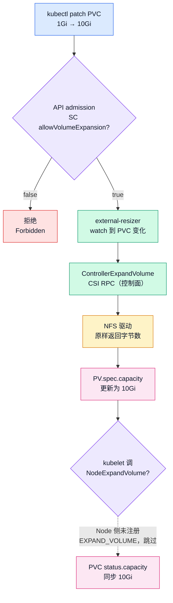

 
# K8s 存储第 7 篇：allowVolumeExpansion——PVC 扩容的完整链路，和 NFS 没做的那部分

> 存储系列第 7 篇。继续承接[上篇](volume-binding-mode.md)的结尾：PVC 建小了想扩容，第一关是 SC 里的 `allowVolumeExpansion` 开关；而 NFS 驱动的 `ControllerExpandVolume` ——它把请求的字节数原样返回，扩容约等于假装扩容。这次拉了 raw 源码对行号，还翻出一个预告里没发现的细节：**Node 侧压根没注册扩容 capability，kubelet 从头到尾没被叫来**。1Gi 的 PVC 申请 10Gi 到底发生什么，一组实验跑完。

## 结论先行

`allowVolumeExpansion` 是 **StorageClass 的字段**，默认 false。它是扩容请求的第一道闸门，而且这道闸门装的位置很讲究——不在 CSI 驱动里，不在 kubelet 里，在 **API server 的 admission 校验**里。开关没开，你的扩容请求根本出不了 API server，后端存储连动静都听不见。

开关打开之后，一个 PVC 扩容请求要走完整条链：



三关在图上只落成两个菱形：第一关的 admission 判断有 true/false  两条分支；中间的第二关（控制面扩容）是条直线，resizer 到驱动一笔带过；第三关的菱形（kubelet 调  NodeExpandVolume）对 NFS 只剩一条虚线出口。NFS 的实际路径最短：第二关是回声，第三关压根不响。**在块存储上，第三关才是真正干活的地方**——ext4 要在线扩文件系统，xfs 要 `xfs_growfs`，卷设备要通知云厂商扩物理盘。NFS 是共享文件系统，没有块设备没有文件系统边界，所以驱动直接把这一关"注销"了。

分工一句话概括：**API server 管准入（扩不扩由 SC 说了算），external-resizer 管调度（对后端喊一嗓子），kubelet 管落地（文件系统真的变大）** 。NFS 的特殊情况：喊的那嗓子是回声，落地那步天然免修。

下面用三组实验把这张图逐段走一遍。

- A 组：开关没开，看 API server 怎么把门焊死。
- B 组：开关打开，逐环观察链路上每个组件的动作和时间戳。
- C 组：边界测试——扩出来的容量能不能装下超出声明的东西，缩容又为什么永远不行。

## 动手：先建一套 1Gi 的基线

实验环境依然是那套：1.36.1 三 master 三 worker，NFS 服务器 192.168.114.155（50G 数据盘），csi-driver-nfs v4.13.4。SC 用 `volumeBindingMode: Immediate`——本篇和绑定模式无关，选最简单的。注意清单里**故意不写** **`allowVolumeExpansion`**：这个字段默认就是 false，A 组要测的就是默认态下的行为。

三个对象三个文件。SC：

```yaml
# expansion-sc.yaml
apiVersion: storage.k8s.io/v1
kind: StorageClass
metadata:
  name: nfs-expand
provisioner: nfs.csi.k8s.io
parameters:
  server: 192.168.114.155
  share: /nfs/k8s
reclaimPolicy: Delete
volumeBindingMode: Immediate
```

PVC，1Gi——扩容的起点：

```yaml
# expansion-pvc.yaml
apiVersion: v1
kind: PersistentVolumeClaim
metadata:
  name: pvc-expand
spec:
  storageClassName: nfs-expand
  accessModes: ["ReadWriteMany"]
  resources:
    requests:
      storage: 1Gi
```

Pod 用 busybox 挂上，它是后面"实测容量"环节的主角：

```yaml
# expansion-pod.yaml
apiVersion: v1
kind: Pod
metadata:
  name: pod-expand
spec:
  terminationGracePeriodSeconds: 1
  containers:
    - name: main
      image: m.daocloud.io/docker.io/busybox
      command: ["sleep", "3600"]
      volumeMounts:
        - name: data
          mountPath: /mnt
  volumes:
    - name: data
      persistentVolumeClaim:
        claimName: pvc-expand
```

master01 上分行 apply（`kubectl apply -f` 一次只接一个文件，多文件写法直接报 Unexpected args）：

```bash
kubectl apply -f expansion-sc.yaml
kubectl apply -f expansion-pvc.yaml && kubectl get pvc pvc-expand
kubectl apply -f expansion-pod.yaml && kubectl wait --for=jsonpath='{.status.phase}'=Running pod/pod-expand --timeout=120s
```

实测输出：

```
storageclass.storage.k8s.io/nfs-expand created
persistentvolumeclaim/pvc-expand created
NAME         STATUS    VOLUME   CAPACITY   ACCESS MODES   STORAGECLASS   VOLUMEATTRIBUTESCLASS   AGE
pvc-expand   Pending                                      nfs-expand     <unset>                 0s
pod/pod-expand created
pod/pod-expand condition met
```

这里有个细节和我预测的不一样：我原以为 `apply pvc && get pvc` 会输出 Bound——实际是 **Pending，AGE 0s**。原因就是 [lab6](volume-binding-mode.md) 讲过的观察者延迟的另一面：`&&` 消灭了敲命令的间隔，get 是在 PVC 创建的同一秒执行的，Immediate 模式的绑定还没来得及完成。第二次查询它就是 Bound 了（B 组的三连查里可见）。Pod 的 wait 命令等到 condition met 才返回——绑定在 Pod 创建前已经完成。

```bash
kubectl exec pod-expand -- df -h /mnt
```

实测输出：

```
Filesystem                Size      Used Available Use% Mounted on
192.168.114.155:/nfs/k8s/pvc-6fb804bc-fc23-469b-97e1-b7e64977ab51
                         48.9G      2.0M     46.4G   0% /mnt
```

看这个输出。**PVC 声明的是 1Gi，Pod 里 df 显示 48.9G**——正好是 NFS 服务器那块 50G 数据盘的可用空间。这不是 bug，这是 NFS 卷的本性：CSI 驱动在共享导出上 mkdir 一个子目录当作卷，`df` 看到的是整个底层文件系统。1Gi 从来没被强制执行过，它只是 API 对象里的一个数字。

这个细节就是本篇的底色。记住这个 48.9G，后面 C 组扩容完再回来对比——你会发现"扩容"改的从来不是这里的数字。

## 第一关：开关没开，API server 直接把门焊死

A 组测默认态。SC 没写 `allowVolumeExpansion`，直接把 PVC patch 成 10Gi：

```bash
kubectl patch pvc pvc-expand --type merge -p '{"spec":{"resources":{"requests":{"storage":"10Gi"}}}}'
```

实测输出：

```bash
Error from server (Forbidden): persistentvolumeclaims "pvc-expand" is forbidden: only dynamically provisioned pvc can be resized and the storageclass that provisions the pvc must support resize
```

以为会是 `The PersistentVolumeClaim "pvc-expand" is invalid: ...` 那种 validation 格式，实测是 `Error from server (Forbidden): ... is forbidden: ...`——**这是两种不同的拒绝机制**。前者是 API server 内置的字段校验（后面 C 组缩容时见到的就是它），后者是 admission 插件在请求进入存储层之前的独立拦截。K8s 给同一个"扩容被拒"准备了两道关卡，报错的措辞和格式都不一样。

更迷惑的是文案本身。前半句"only dynamically provisioned pvc can be resized"——我们的 PVC 就是动态供给的，为什么还这么说？把重点放到后半句就通了： **"the storageclass that provisions the pvc must support resize"** ，真正的原因是 SC 不支持扩容。前半句只是这条合并报错里的背景条款，第一次读很容易被它带偏去检查供给方式。报错文案的解读顺序：先找"and"后面的真正原因，再回头读前半句。

补一个对照观察，确认集群没有任何"部分执行"：

```bash
kubectl get pvc pvc-expand -o custom-columns='SPEC:.spec.resources.requests.storage,STATUS:.status.capacity.storage'
```

实测输出——spec 还是 1Gi，什么都没变：

```
SPEC   STATUS
1Gi    1Gi
```

这就是第一关的形态：**门焊死在 API server，请求连集群内部都没进**。顺带说一句这个设计的合理性：扩容是不可逆的（C 组会实测缩容被拒），把开关控制权放在 SC 上、把校验放在入口处，意味着集群管理员能在"要不要允许扩容"这个层面统一决策，而不是被各个业务方 patch 到驱动报错才追悔。

!!! note " true 获取开关资格"
    那开关是给谁开的？集群管理员。`kubectl patch sc nfs-expand --type merge -p '{"allowVolumeExpansion":true}'`——这个动作不需要重启任何组件，SC 是 API 对象，改完即生效。已有 PVC 立刻获得扩容资格（资格检查发生在扩容请求进来的那一刻，不缓存）。

## 源码预读：扩容请求进来之后，各组件领到什么活

开关打开后，链路上真正动起来的组件有三个。先把它们的源码摆出来，B 组的实测输出才有对照。

**第一件事：调 ControllerExpandVolume 的不是 external-provisioner，是另一个 sidecar——external-resizer**。csi-driver-nfs 的 controller Pod 里挂了五个容器，B 组实测的容器名清单是：`csi-provisioner csi-resizer csi-snapshotter liveness-probe nfs`。provisioner 管 CreateVolume，**resizer 管扩容**——注意清单里没有 attacher：NFS 卷不经过 attach 环节（驱动连 NodeStageVolume 都是 Unimplemented），这和块存储驱动的 controller 组成不一样。

resizer 干的活是把扩容请求翻译成 CSI RPC。csi-driver-nfs 里接这个 RPC 的函数在 `pkg/nfs/controllerserver.go`（v4.13.4 tag，我把 raw 文件拉下来核对的行号，[上一篇](volume-binding-mode.md)预告里写的 L475-482 差了 5 行，实际是 L470-482）：

```go
// controllerserver.go L470-482
func (cs *ControllerServer) ControllerExpandVolume(_ context.Context, req *csi.ControllerExpandVolumeRequest) (*csi.ControllerExpandVolumeResponse, error) {
        if len(req.GetVolumeId()) == 0 {
                return nil, status.Error(codes.InvalidArgument, "Volume ID missing in request")
        }

        if req.GetCapacityRange() == nil {
                return nil, status.Error(codes.InvalidArgument, "Capacity Range missing in request")
        }

        volSizeBytes := int64(req.GetCapacityRange().GetRequiredBytes())
        klog.V(2).Infof("ControllerExpandVolume(%s) successfully, currentQuota: %d bytes", req.VolumeId, volSizeBytes)

        return &csi.ControllerExpandVolumeResponse{CapacityBytes: req.GetCapacityRange().GetRequiredBytes()}, nil
}
```

十行代码，读下来是这样的：检查参数（volumeId 非空、capacityRange 非空），把请求的字节数读出来，打个日志，然后**把同一个数字原样塞回响应**。中间没有对 NFS 服务器的任何调用——没有 mkdir、没有 quota 设置、没有大小校验。`currentQuota` 这个日志词甚至有点幽默：驱动压根没有实现任何 quota。

对比一下块存储驱动同位置的代码会做什么：调云 API 扩物理盘、等扩盘完成、可能还要等待文件系统感知。NFS 驱动在这里是**回声壁**——你喊多大，它就还给你多大。

**第二个要源码确认的是 Node 侧**。CSI 扩容协议是两段的：控制面扩完（ControllerExpandVolume），节点面还要落地（NodeExpandVolume，把文件系统真的 resize 掉）。csi-driver-nfs 的 Node 侧是什么状态？`pkg/nfs/nfs.go` L106-118，驱动启动时注册自己的能力清单：

```go
// nfs.go L106-118
n.AddControllerServiceCapabilities([]csi.ControllerServiceCapability_RPC_Type{
        csi.ControllerServiceCapability_RPC_CREATE_DELETE_VOLUME,
        csi.ControllerServiceCapability_RPC_SINGLE_NODE_MULTI_WRITER,
        csi.ControllerServiceCapability_RPC_CLONE_VOLUME,
        csi.ControllerServiceCapability_RPC_CREATE_DELETE_SNAPSHOT,
        csi.ControllerServiceCapability_RPC_EXPAND_VOLUME,       // ← 控制面：声称支持扩容
})

n.AddNodeServiceCapabilities([]csi.NodeServiceCapability_RPC_Type{
        csi.NodeServiceCapability_RPC_GET_VOLUME_STATS,
        csi.NodeServiceCapability_RPC_SINGLE_NODE_MULTI_WRITER,
        csi.NodeServiceCapability_RPC_UNKNOWN,
})
```

看清这个不对称：**Controller 侧注册了** **`EXPAND_VOLUME`** **，Node 侧的清单里没有它**——只有查容量统计和多写者能力，外加一个兜底的 UNKNOWN。而 NodeExpandVolume 这个 RPC 本身在 `pkg/nfs/nodeserver.go` L321-323：

```go
// nodeserver.go L321-323
func (ns *NodeServer) NodeExpandVolume(_ context.Context, _ *csi.NodeExpandVolumeRequest) (*csi.NodeExpandVolumeResponse, error) {
        return nil, status.Error(codes.Unimplemented, "")
}
```

即使有人来调，答案也是 Unimplemented。对 NFS 这是合理设计：**没有块设备、没有文件系统边界，"节点面扩容"这个概念不存在**——子目录天生就是整个文件系统的一部分，扩个声明它就"是"那么大了。驱动作者把两层都砍成数字游戏，诚实且高效。

但这个不对称有一个实打实的推论，也是 B 组我最想验证的预测：**kubelet 在整个扩容过程中不会被调用**。kubelet 的 resize 流程会先查驱动的 Node 能力清单，清单里没有 EXPAND_VOLUME，NodeExpandVolume 这一步直接跳过。链路图里那个"第三关"，对 NFS 来说是被拆除的，不是被跳过的。

## B 组实测：不到一秒的数字游戏

先开开关，再计时扩容。两个 patch 串联打时间戳，看整条链路耗时：

```bash
kubectl patch sc nfs-expand --type merge -p '{"allowVolumeExpansion":true}'
date +%H:%M:%S && kubectl patch pvc pvc-expand --type merge -p '{"spec":{"resources":{"requests":{"storage":"10Gi"}}}}' && date +%H:%M:%S
```

实测输出：

```
storageclass.storage.k8s.io/nfs-expand patched
18:04:02
persistentvolumeclaim/pvc-expand patched
18:04:02
```

patch 本身是同秒的。但 patch 只代表 API server 收了请求——resizer 处理、PV 更新还要一点时间。紧跟三连查（`&&` 串联免得人工敲命令的间隔污染时序）：

```bash
kubectl get pvc pvc-expand -o custom-columns='SPEC:.spec.resources.requests.storage,STATUS:.status.capacity.storage' && PV_EXP=$(kubectl get pvc pvc-expand -o jsonpath='{.spec.volumeName}') && kubectl get pv $PV_EXP -o custom-columns='NAME:.metadata.name,CAP:.spec.capacity.storage' && kubectl describe pvc pvc-expand | tail -6
```

实测输出：

```
SPEC   STATUS
10Gi   10Gi
NAME                                       CAP
pvc-6fb804bc-fc23-469b-97e1-b7e64977ab51   10Gi
  Normal  ExternalExpanding       11s   volume_expand                    waiting for an external controller to expand this PVC
  Normal  Resizing                11s   external-resizer nfs.csi.k8s.io  External resizer is resizing volume pvc-6fb804bc-fc23-469b-97e1-b7e64977ab51
  Normal  VolumeResizeSuccessful  11s   external-resizer nfs.csi.k8s.io  Resize volume succeeded
```

spec 和 status 都是 10Gi，扩容完成。describe 尾部送了三个预测之外的礼物——PVC 的事件区把扩容链路的参与方全交代了：

- `ExternalExpanding`，来源 **volume_expand**——这是 kube-controller-manager 里的 PV 控制器组件，它先宣布"有一个外部控制器要来扩容了"；
- `Resizing`，来源 **external-resizer**——sidecar 接单开工；
- `VolumeResizeSuccessful`，还是 resizer——收工。

三个事件的时间戳都是 11s（扩容后 11 秒内查的 describe），三步推进快到 describe 只能给出同一个秒级戳。整条"数字游戏"链路在不到一秒内走完：API admission 通过 → volume_expand 控制器发通知 → external-resizer watch 到变化 → 调 ControllerExpandVolume（回声）→ 更新 PV.spec.capacity → PVC.status.capacity 同步。没有任何一环涉及真实的存储操作，全是 API 对象之间的数字流转。

然后是本篇最重要的观察——**谁在干活，谁压根没被叫来**：

**resizer 的日志**。controller Pod 五个 sidecar 里，扩容的日志应该在 csi-resizer 容器（容器名以 `kubectl get pod` 实际输出为准）：

```bash
CSI_CTRL=$(kubectl -n kube-system get pod -o wide | grep csi-nfs-controller | awk '{print $1}')
kubectl -n kube-system get pod $CSI_CTRL -o jsonpath='{.spec.containers[*].name}' && echo
kubectl -n kube-system logs $CSI_CTRL -c csi-resizer --tail=30 | grep -iE 'expand|resize'
```

实测输出（`--tail=30` 里混着 8 月 24 日部署时的 leader 选举老日志，只截扩容相关的两行）：

```
csi-provisioner csi-resizer csi-snapshotter liveness-probe nfs
I0902 10:04:02.196668       1 event.go:389] "Event occurred" object="default/pvc-expand" fieldPath="" kind="PersistentVolumeClaim" apiVersion="v1" type="Normal" reason="Resizing" message="External resizer is resizing volume pvc-6fb804bc-fc23-469b-97e1-b7e64977ab51"
I0902 10:04:02.217549       1 event.go:389] "Event occurred" object="default/pvc-expand" fieldPath="" kind="PersistentVolumeClaim" apiVersion="v1" type="Normal" reason="VolumeResizeSuccessful" message="Resize volume succeeded"
```

日志时间戳是 `10:04:02`，kubectl patch 打的是 `18:04:02`——差了整整 8 小时，**这不是时钟漂移，是时区**：master01 宿主机在 UTC+8，容器里跑的 resizer 输出 UTC。换算之后严丝合缝：18:04:02 CST 就是 10:04:02 UTC。更有信息量的是毫秒戳——`10:04:02.196` 到 `10:04:02.217`，**resizer 从接单到宣布成功只用了 21 毫秒**。这就是"回声壁"的速度：一次本地 gRPC 调用加两次 API 写入，中间没有存储设备什么事。

!!! note "8 小时时间差"
    跨节点/跨容器对时间戳，先确认时区。宿主机 `date` 显示本地时区（这台是 CST），容器日志里 klog/event 输出 UTC，差 8 小时是常态不是异常。归一之后才能对表，不然会出现"事件在发生前 8 小时就跑完了"的鬼故事。

**驱动（nfs 容器）的日志**。预测它一片安静——`ControllerExpandVolume` 里的 klog 是 V(2) 级别，[第 4 篇](static-vs-dynamic-provisioning.md)连 NodePublish 都没记过，扩容更轮不上。计数先跑：

```bash
kubectl -n kube-system logs $CSI_CTRL -c nfs --tail=50 | grep -icE 'expand|resize|quota'
```

输出 `6`，不是 0。打开看行，6 行里有 4 行是冒牌货：

```
I0902 10:01:51.047660       1 utils.go:112] GRPC request: {"capacity_range":{"required_bytes":1073741824},"name":"pvc-6fb804bc-fc23-469b-97e1-b7e64977ab51","parameters":{"csi.storage.k8s.io/pv/name":"pvc-6fb804bc-fc23-469b-97e1-b7e64977ab51","csi.storage.k8s.io/pvc/name":"pvc-expand","csi.storage.k8s.io/pvc/namespace":"default","server":"192.168.114.155","share":"/nfs/k8s"},"volume_capabilities":[{"AccessType":{"Mount":{}},"access_mode":{"mode":5}}]}
I0902 10:01:51.149206       1 utils.go:118] GRPC response: {"volume":{"volume_context":{"csi.storage.k8s.io/pv/name":"pvc-6fb804bc-fc23-469b-97e1-b7e64977ab51","csi.storage.k8s.io/pvc/name":"pvc-expand","csi.storage.k8s.io/pvc/namespace":"default","server":"192.168.114.155","share":"/nfs/k8s","subdir":"pvc-6fb804bc-fc23-469b-97e1-b7e64977ab51"},"volume_id":"192.168.114.155#nfs/k8s#pvc-6fb804bc-fc23-469b-97e1-b7e64977ab51##"}}
I0902 10:01:51.168358       1 utils.go:112] GRPC request: {"capacity_range":{"required_bytes":1073741824},"name":"pvc-6fb804bc-fc23-469b-97e1-b7e64977ab51","parameters":{"csi.storage.k8s.io/pv/name":"pvc-6fb804bc-fc23-469b-97e1-b7e64977ab51","csi.storage.k8s.io/pvc/name":"pvc-expand","csi.storage.k8s.io/pvc/namespace":"default","server":"192.168.114.155","share":"/nfs/k8s"},"volume_capabilities":[{"AccessType":{"Mount":{}},"access_mode":{"mode":5}}]}
I0902 10:01:51.273383       1 utils.go:118] GRPC response: {"volume":{"volume_context":{"csi.storage.k8s.io/pv/name":"pvc-6fb804bc-fc23-469b-97e1-b7e64977ab51","csi.storage.k8s.io/pvc/name":"pvc-expand","csi.storage.k8s.io/pvc/namespace":"default","server":"192.168.114.155","share":"/nfs/k8s","subdir":"pvc-6fb804bc-fc23-469b-97e1-b7e64977ab51"},"volume_id":"192.168.114.155#nfs/k8s#pvc-6fb804bc-fc23-469b-97e1-b7e64977ab51##"}}
```

这 4 行是 10:01:51 的 **CreateVolume** 调用（创建卷时的 GRPC 请求/响应，1073741824 = 1Gi；同一秒打了两对，provisioner 的重试或并发调用，没细查），命中 grep 的原因不是扩容动作，是 parameters 里的  **"pvc-expand"** ——我们自己给 PVC 起的名字撞了关键词。`grep -c` 报 6，三分之二是假阳性。

真正的扩容日志是后两行，时间戳 10:04:02：

```
I0902 10:04:02.197755       1 utils.go:111] GRPC call: /csi.v1.Controller/ControllerExpandVolume
I0902 10:04:02.197900       1 controllerserver.go:480] ControllerExpandVolume(192.168.114.155#nfs/k8s#pvc-6fb804bc-fc23-469b-97e1-b7e64977ab51##) successfully, currentQuota: 10737418240 bytes
```

驱动不仅记了，还自带源码行号：`controllerserver.go:480`，正是上一节拉出来看的那个"回声"函数的收尾处。10737418240 bytes = 10Gi；`currentQuota` 这个词还顺手解释了 grep quota 为什么命中。

现在可以把 resizer 和驱动的毫秒戳拼成完整时间线（两边都在 master01，klog 都输出 UTC）：

- `10:04:02.196668` — resizer 发出 Resizing 事件
- `10:04:02.197755` — GRPC call 到达驱动（+1.1ms）
- `10:04:02.197900` — 驱动返回成功（ **+0.145ms**，RPC 本身就这点时间——return 个数字）
- `10:04:02.217549` — resizer 发出 VolumeResizeSuccessful（+19.6ms）

resizer 那"21ms"的正确拆法：**真正调驱动的 RPC 只占 0.145ms，其余 19.6ms 花在 resizer 把结果写回 API server**。扩容链路里最慢的一步是 API server 的对象更新，驱动本体可以忽略不计——"回声壁"有了精确的刻度。

也顺手修正一个印象：[第 4 篇](static-vs-dynamic-provisioning.md)说"驱动连 NodePublish 都不记日志"，那说的是 **node 侧**（csi-nfs-node DaemonSet）的行为；**controller 侧的 nfs 容器日志并不安静**——utils.go 的 GRPC interceptor 把每个请求/响应原样打了出来。同一个驱动，controller 和 node 的日志习惯完全不同，查日志前先分清自己在查哪一侧。

!!! warning "注意 grep 过滤结果"
    `grep -c` 的数字不能直接当结论。这次 6 里有 4 个假阳性（pvc-expand 撞了 expand 关键词）——计数器只回答"有几个匹配"，不回答"匹配的是什么"。先 grep 看行再谈数量，尤其当你的实验资源命名里本来就藏着搜索词时。

**kubelet 的日志**。Pod 落在哪个节点就查哪个节点（`-o wide` 看落点，别想当然）：

```bash
kubectl get pod pod-expand -o wide
# 落点节点上（本例 worker01）。窗口必须用绝对时间覆盖扩容时刻：
sudo journalctl -u kubelet --since '2026-09-02 17:50' --until '2026-09-02 18:30' | grep -iE 'expand|resize'
```

我一开始给的指令是 `--since '-3 hours'`，第二天早上补跑时这个窗口只覆盖当天早晨——**够不到昨晚的扩容时刻，零命中是假的**。相对窗口从"现在"起算，取证用绝对时间才稳。

输出 4 行。计数器又亮了个非零——但和 nfs 容器那边一样，是假阳性：

```
Sep 02 18:01:51 worker01 kubelet[1097]: I0902 18:01:51.437311    1097 reconciler_common.go:251] "operationExecutor.VerifyControllerAttachedVolume started for volume \"kube-api-access-9sbxk\" ... pod \"pod-expand\" (UID: \"ab75d4b5-...\") " pod="default/pod-expand"
Sep 02 18:01:51 worker01 kubelet[1097]: I0902 18:01:51.437371    1097 reconciler_common.go:251] "operationExecutor.VerifyControllerAttachedVolume started for volume \"pvc-6fb804bc-...\" ..." pod="default/pod-expand"
Sep 02 18:01:51 worker01 kubelet[1097]: I0902 18:01:51.541109    1097 operation_generator.go:558] "MountVolume.MountDevice succeeded for volume \"pvc-6fb804bc-...\" ... device mount path \"/var/lib/kubelet/plugins/kubernetes.io/csi/.../globalmount\"" pod="default/pod-expand"
Sep 02 18:07:09 worker01 kubelet[1097]: I0902 18:07:09.107850    1097 pod_startup_latency_tracker.go:148] "Observed pod startup duration" pod="default/pod-expand" podStartE2EDuration="5m18.1s" ...
```

（第 4 行原样更长，中间截了；5m18s 是 kubelet 自己 startup tracker 的闭环口径，跟扩容无关，不展开。）

4 行命中的全是 **pod-expand 这个 Pod 名**：两行 VerifyControllerAttachedVolume、一行 MountVolume.MountDevice succeeded，都发生在 18:01:51——Pod 创建、卷挂载的时刻；最后一行 18:07:09 是启动统计。**扩容真正发生的 18:04:02 前后，一条都没有**。块存储上这里会有 resize2fs 之类的文件系统扩容记录，NFS 上就是干净地什么都没有——"kubelet 没被叫来"的结论保住了。

但注意这个结论是**靠看行保住的**，不是靠计数器。如果只看 `grep -c` 输出的 4，反而会得出"kubelet 参与了扩容"的反向误判。两次 grep（nfs 容器的 6、kubelet 的 4）都被自家资源命名污染——实验里 PVC 叫 pvc-expand、Pod 叫 pod-expand，grep expand 必中。起实验资源名时避开搜索关键词，能省一轮"计数器诈尸"。

顺带一个时间戳细节：kubelet 是宿主机进程，它的 klog 跟着本地时区走（I0902 **18**:01:51）；容器里的 klog 用 UTC（I0902 **10**:01:51）。18:01:51 CST 和 10:01:51 UTC 是同一瞬间——Pod 创建和 CreateVolume 的 RPC 正好同秒对上。前面 note 里说的"容器日志输出 UTC"只覆盖容器；跨宿主机进程对表时，还要多一层时区换算。

## C 组：扩出来的 10Gi 能装 11Gi 吗

B 组结束时，API 世界的数字全对齐了：PVC 10Gi，PV 10Gi。现在问一个物理世界的问题：这个卷真的"变大"了吗？往里写一个超过原声明 1Gi 的文件——2Gi，看它收不收：

```bash
kubectl exec pod-expand -- dd if=/dev/zero of=/mnt/bigfile bs=1M count=2048
kubectl exec pod-expand -- ls -lh /mnt/bigfile
```

实测输出（比预测快得多——本机网络远超千兆）：

```
2048+0 records in
2048+0 records out
2147483648 bytes (2.0GB) copied, 5.791941 seconds, 353.6MB/s
-rw-r--r--    1 root     root        2.0G Sep  2 10:05 /mnt/bigfile
```

2Gi 写进了"1Gi 就该装满"的卷——当然，因为基线阶段已经说过，NFS 卷从来就没有容量边界。注意 `ls` 显示的时间戳是 10:05：容器里是 UTC，和宿主机的 18 点对应，跟 resizer 日志同一套时区逻辑。去 NFS 服务器上确认文件真实落盘（目录名用 PVC 的实际 UID）：

```bash
# k8s-nfs 上：
ls /nfs/k8s/ | grep pvc
du -sh /nfs/k8s/pvc-6fb804bc-fc23-469b-97e1-b7e64977ab51
```

实测输出：

```
pvc-6fb804bc-fc23-469b-97e1-b7e64977ab51
2.1G    /nfs/k8s/pvc-6fb804bc-fc23-469b-97e1-b7e64977ab51
```

再回 Pod 里量一次 df，和基线对比：

```bash
kubectl exec pod-expand -- df -h /mnt
```

实测输出：

```
Filesystem                Size      Used Available Use% Mounted on
192.168.114.155:/nfs/k8s/pvc-6fb804bc-fc23-469b-97e1-b7e64977ab51
                         48.9G      2.0G     44.4G   4% /mnt
```

**Size 还是 48.9G，和扩容前完全一样**——变化的只有 Used（2.0M → 2.0G，被 bigfile 吃掉）和 Available。扩容改的是 API 对象里的数字，不是这块盘的大小；从"物理视角"看，扩容前后什么都没发生。

**这就是"假装扩容"的完整含义**：不是扩容失败，也不是驱动有 bug——是 NFS 卷的容量从来只是一个记账数字。1Gi 时能写 2Gi，"扩"到 10Gi 后能写的还是那块 50G 盘的剩余空间。块存储上这组实验的结果完全不同：PVC 声明 1Gi，写 2Gi 会把文件系统撑爆（no space left on device），因为每一字节都真实落在容量受限的块设备上。

!!! warning "如果 NFS 底层盘满了"
    一个容易联想错的点：如果 NFS 服务器磁盘真写满了呢？那 Pod 写入会收到 NFS 的 ENOSPC——但这是**底层盘满了**，不是"某个 PVC 用完了自己的额度"。所有 NFS 卷共享同一块盘，一个卷吃掉 48G，其他卷跟着遭殃。NFS 驱动没有目录级 quota，K8s 的 capacity 数字拦不住这种事故。生产上要硬隔离得靠 NFS 服务端的项目配额（export 目录 quota）或者干脆换块存储。

## 缩容：永远不行，这是特性不是缺陷

C 组最后一测，patch 回 1Gi：

```bash
kubectl patch pvc pvc-expand --type merge -p '{"spec":{"resources":{"requests":{"storage":"1Gi"}}}}'
```

实测输出：

```
The PersistentVolumeClaim "pvc-expand" is invalid: spec.resources.requests.storage: Forbidden: field can not be less than status.capacity
```

两个观察点：

- 第一，这个报错的格式和 A 组扩容被拒的那条**不一样**——A 组是 `Error from server (Forbidden): ... is forbidden: ...`（admission 插件格式），这条是 `The PersistentVolumeClaim ... is invalid: ...`（字段校验格式），正好印证了 A 组说的"两道关卡、两种措辞"：扩容的资格检查走 admission 插件，缩容的禁止走字段校验，在 API server 里是不同的代码路径。
- 第二，我预测的措辞是"less than previous value"，实测写的是"**less than status.capacity**"——校验对象不是你上一次请求的数字，而是 PVC 当前状态里记录的实际容量。语义更精确：status.capacity 是 10Gi，所以任何小于 10Gi 的申请都拒绝，跟你从哪个数字改下来无关。

缩容在 K8s 的 PVC 体系里**没有任何开关可开**——`allowVolumeExpansion` 这个名字里就写着 Expansion，没有 Shrink 版本。原因是物理的：文件系统只能在线长大，缩小要先把数据搬走，这不是"在线操作"能干的事。所以 API 层面直接禁止，无论什么驱动、什么 SC 配置，1Gi→10Gi 一路绿灯，10Gi→1Gi 永远 Forbidden。

扩容前想清楚，是这个 feature 唯一的使用须知。

## 给 NFS 用户的实用结论

三组实验跑完，把零散的发现归拢成几条能直接用的。

**1.**  **`df`** **的 48.9G 才是真相，PVC 的 1Gi/10Gi 是账本。**  监控 NFS 卷的剩余空间，盯 NFS 服务器那块盘，别盯 PVC 数字——后者永远是"对的"（它只是记账），前者才决定 ENOSPC 什么时候来。这和块存储的监控思路完全相反：块存储的 PVC 数字就是物理边界，监控 PVC 用量就够；NFS 两个数字是两张皮。

**2. 扩容随便扩，但它解决不了容量问题。**  `allowVolumeExpansion: true` 给的是"改账本"的资格。如果业务的诉求是"这个卷的写入量被约束在 10Gi 以内"，NFS 的答案是做不到——要硬约束，用 NFS 服务端的项目 quota（挂在导出子目录上），或者在应用层自己管。PVC 扩容在这条路上只是个陪跑的。

**3. 扩容是无损、在线、毫秒级的——前提是你开的不是块存储的等待。**  NFS 上 1Gi→10Gi 不到 0.1 秒完成（resizer 日志实测 21ms，回声壁+免修的 Node 面换来零成本），而云盘的同类操作可能要分钟级（等云厂商扩物理盘）。这也是 NFS 在开发测试场景里好用的原因之一：容量焦虑不存在，磁盘焦虑转移到了 NFS 服务器那台机器上。

**4. 三关架构记一下，排查时用得上。**  扩容不动弹，按链路查：先看 patch 有没有被 API server 拒（SC 开关）——这是最常见的坑；再查 external-resizer 日志（`-c csi-resizer`）；最后才轮到 kubelet（NFS 卷不会有，块存储卷才有）。[第 4 篇](static-vs-dynamic-provisioning.md)排查 NodePublish 时的分层思路，扩容这边完全复用。

## 验证命令清单

跑完本篇所有实验后，一次性复查集群状态（输出应全部干净）：

```bash
kubectl get sc nfs-expand
kubectl get pvc pvc-expand
kubectl get pod pod-expand
PV_EXP=$(kubectl get pvc pvc-expand -o jsonpath='{.spec.volumeName}')
kubectl get pv $PV_EXP -o custom-columns='NAME:.metadata.name,CAP:.spec.capacity.storage,CLAIM:.spec.claimRef.name,PHASE:.status.phase'
```

实测输出（扩容和 dd 测试之后跑的终检）：

```
NAME         PROVISIONER      RECLAIMPOLICY   VOLUMEBINDINGMODE   ALLOWVOLUMEEXPANSION   AGE
nfs-expand   nfs.csi.k8s.io   Delete          Immediate           true                   4m53s
NAME         STATUS   VOLUME                                     CAPACITY   ACCESS MODES   STORAGECLASS   VOLUMEATTRIBUTESCLASS   AGE
pvc-expand   Bound    pvc-6fb804bc-fc23-469b-97e1-b7e64977ab51   10Gi       RWX            nfs-expand     <unset>                 4m52s
NAME         READY   STATUS    RESTARTS   AGE
pod-expand   1/1     Running   0          4m52s
NAME                                       CAP    CLAIM        PHASE
pvc-6fb804bc-fc23-469b-97e1-b7e64977ab51   10Gi   pvc-expand   Bound
```

SC 的 `ALLOWVOLUMEEXPANSION: true`，PVC/PV 都是 10Gi，Pod 正常 Running——API 世界一切都对齐了，而物理世界那块 48.9G 的盘从头到尾没被惊动。

## 清理

```bash
# master01：
kubectl delete pod pod-expand
kubectl delete pvc pvc-expand
kubectl delete sc nfs-expand
# NFS 服务器（k8s-nfs）上，只删本篇实验的子目录（UID 用自己的实际值）：
sudo rm -rf /nfs/k8s/pvc-6fb804bc-fc23-469b-97e1-b7e64977ab51
# 复查归零：
kubectl get sc,pvc,pod | grep -E 'expand' || echo 'clean'
```

> **下一篇预告**：存储系列第 8 篇——CSI 快照。翻驱动 capability 清单的时候撞见了 `CREATE_DELETE_SNAPSHOT`：NFS 驱动居然支持 VolumeSnapshot？块存储的快照是写时复制，NFS 这个"快照"是什么——tar 归档吗？`CreateSnapshot` 和 `DeleteSnapshot` 的源码我已经粗翻过，实验方案在脑子里了。一个 PVC 的快照和回滚实测。

---

## 推荐阅读

- [K8s 存储第 6 篇：volumeBindingMode——PVC Pending 不一定是错的](volume-binding-mode.md) — 上篇，SC 的 volumeBindingMode 与 WaitForFirstConsumer
- [K8s 存储第 5 篇：reclaimPolicy 和 onDelete，两层回收逻辑谁说了算](ondelete-two-layer-reclaim.md) — 系列第 5 篇，reclaimPolicy 与 onDelete 两层回收逻辑
- [K8s 存储第 4 篇：动态供应 vs 静态供应，谁在删你的数据](static-vs-dynamic-provisioning.md) — 系列第 4 篇，动态/静态供应与回收策略矩阵
- [PVC 毫秒级时间线拆解](pvc-timeline-ms-breakdown.md) — 系列第 3 篇，一个 PVC 的毫秒级全链路时间线
- [CSI 到底拆了什么？](csi-nfs-components.md) — 系列第 2 篇，NFS CSI 存储层搭建
- [PV、PVC、StorageClass 三对象](pv-pvc-storageclass.md) — 系列第 1 篇，PV/PVC 基础概念与生命周期
- [Kubernetes 存储资源](storage.md) — PV / PVC / StorageClass / VolumeSnapshot 概念总览
- [Linux NFS 服务安装（Debian 13）](../../../linux/storage/nfs-server-debian13.md) — 本实验的 NFS 服务端环境准备