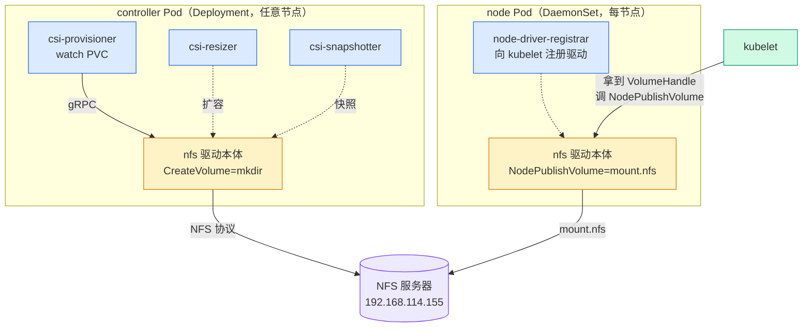
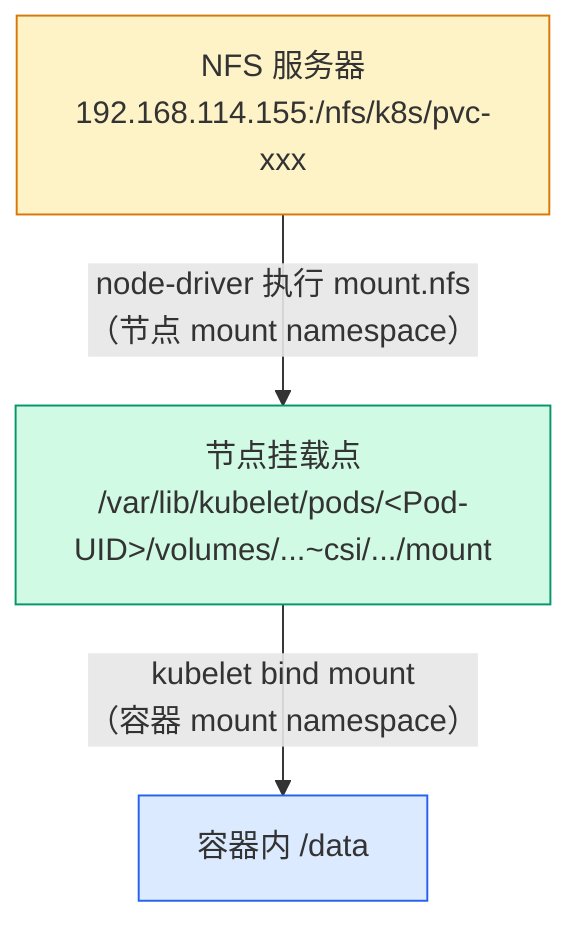
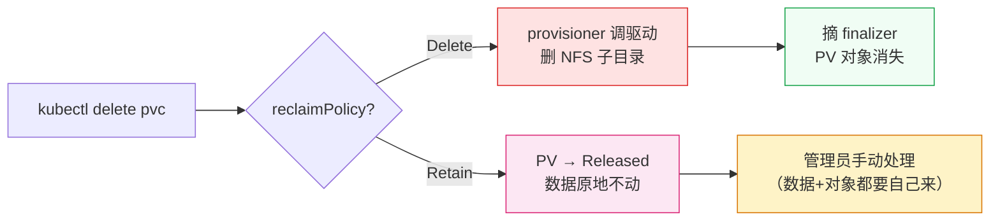

# CSI 到底拆了什么：部署一个 NFS 驱动，数数里面有几个容器

## 从第一篇的钩子说起

上一篇结尾留了个钩子：local-path-provisioner 不是 CSI driver——集群里没有任何 CSI Pod，provisioner 名字也不是 `xxx.csi.k8s.io` 格式。它走的是 K8s 内置的 Provisioner 接口，收到 PVC 需求建个目录、创建 PV 对象，完事。

这篇就装一个真的 CSI driver——NFS CSI（csi-driver-nfs），看看 CSI 到底把存储拆成了什么样。

先剧透一个数字：装完之后 `kubectl get pods -n kube-system | grep csi-nfs` 会看到 7 个 Pod，加起来 **23 个容器**。第一篇的 local-path 一个 Deployment 一个容器就干完了所有活，CSI 为什么要摆这么大阵仗？

还有一个反着的：有一个人人都说该有的容器，在这个驱动里**不存在**。往下看。

## 环境：NFS 服务器 + CSI 驱动

### NFS 服务器

独立虚拟机 k8s-nfs（192.168.114.155），Debian 13，50G 数据盘：

```
xxx@k8s-nfs:~$ df -h /nfs/k8s
Filesystem      Size  Used Avail Use% Mounted on
/dev/sdb1        47G  1.2G   44G   3% /nfs/k8s
```

导出配置一行：

```
/nfs/k8s *(rw,sync,no_subtree_check,no_root_squash)
```

注意 `no_root_squash`——默认的 root_squash 会把 root 映射成 nobody，CSI node-driver 以 root 身份挂载时会被权限挡住。这是 NFS CSI 部署的第一个高频翻车点。

六台 K8s 节点全部安装 `nfs-common`（node-driver 最终调用的是系统的 `mount.nfs`，宿主机没有 NFS 客户端就是 ContainerCreating 卡到天荒地老），并手动验证过 NFSv4.1 挂载——CSI 默认走 4.1，先把协议层的变量排除掉。

### 部署 csi-driver-nfs v4.13.4

四个 manifest：rbac、CSIDriver 对象、controller、node DaemonSet。国内环境的老三样：GitHub 拉不下来手动拷、镜像 `registry.k8s.io` 换成 `k8s.m.daocloud.io` 前缀、apply。

## 部署踩的三个坑

### 坑一：镜像漏改一个，Pod 起不来

controller 的 yaml 里有 **5 处镜像地址**（5 个容器各一处），我一个一个手动改，漏了 csi-resizer 那处。结果 controller Pod 起不来，`kubectl describe pod` 的 Events 拿到一份天然的对照实验——同一个 Pod 里 5 个容器，4 个走 daocloud 镜像全部拉取成功（provisioner 25.7 秒、snapshotter 2 分 23 秒、livenessprobe 本地已有），唯一没改的 csi-resizer 重试 11 次，次次超时：

```
Warning  Failed   8m18s   kubelet   spec.containers{csi-resizer}: Failed to pull image
         "registry.k8s.io/sig-storage/csi-resizer:v2.2.0": rpc error: code = DeadlineExceeded
         desc = failed to do request: Head
         "https://europe-west4-docker.pkg.dev/v2/k8s-artifacts-prod/...":
         dial tcp 142.250.99.82:443: i/o timeout

Warning  Failed   39s (x11 over 4m9s)   kubelet   spec.containers{csi-resizer}:
         Error: ImagePullBackOff
```

这条报错自己就把"国内为什么拉不动 registry.k8s.io"讲完了：它背后的制品库是 Google 的 `europe-west4-docker.pkg.dev`，解析出来的 142.250.x.x、74.125.x.x 全是 Google 网段的 IP——直接拨号，超时，没有悬念。教训：批量替换镜像后跑一句 `grep -n 'registry.k8s.io' *.yaml`，**输出为空才算干净**——4 个文件 8 处镜像（controller 5 处 + node 3 处），漏 1 处就是 ImagePullBackOff。

改法也值得一提：我在 k9s 里直接进入 Pod 所属的资源，跳到配置文件里把 live 对象的镜像改掉了——Pod 立刻重建成功。生产环境不推荐直接改 live 对象（下次 apply 原文件会打回去），但实验环境这是最快的验证方式。

### 坑二：一个 Pending 的 DaemonSet Pod，牵出四周前停掉的 kubelet

镜像全改完，controller Running，node DaemonSet 的 6 个 Pod 里 5 个都 Running，唯独 master01 上那个 `csi-nfs-node-ckplw` 永远 Pending，一躺就是十几分钟。

describe 输出里三处细节，指向同一个结论——**kubelet 根本没接手这个 Pod**：

1. `Node: master01/`——斜杠后面是空的。对照组：正常 Pod 显示 `Node: worker01/192.168.114.148`，这个 IP 是 kubelet 认领 Pod 时填的
2. Events 只有一条 `SuccessfulCreate`（来自 default-scheduler），没有任何 kubelet 的拉镜像/建容器事件
3. Conditions 只有 `PodScheduled=True`

它为什么能躺着没人管？DaemonSet 的 toleration 是全量通配（`operator: Exists`），节点出什么问题都不驱逐它。普通 Deployment Pod 早被重新调度了，DaemonSet Pod 的设计就是"节点恢复时自动回来"——代价是节点死了它就永远躺在那。

那 master01 出了什么问题？`kubectl get nodes`——**NotReady**。

这就怪了：我天天在 master01 上跑 kubectl，毫无异常。上节点查 journalctl，真相有点哭笑不得：

```
Jul 23 22:14:23 master01 systemd[1]: Stopping kubelet.service - kubelet: The Kubernetes Node Agent...
Jul 23 22:14:23 master01 kubelet[2417769]: I0723 22:14:23.122513 volume_manager.go:316] "Shutting down Kubelet Volume Manager"
Jul 23 22:14:23 master01 kubelet[2417769]: I0723 22:14:23.122548 tlsconfig.go:258] "Shutting down DynamicServingCertificateController"
Jul 23 22:14:23 master01 systemd[1]: kubelet.service: Deactivated successfully.
Jul 23 22:14:23 master01 systemd[1]: Stopped kubelet.service - kubelet: The Kubernetes Node Agent.
Jul 23 22:14:23 master01 systemd[1]: kubelet.service: Consumed 13h 28min 30.786s CPU time, 312.4M memory peak.
```

**kubelet 是我自己停的**——7 月 23 日晚上写《我停了 kubelet，Pod 居然没挂》那篇文章，做实验停的，写完忘了重启。这一停就是**四个星期**。

日志本身也是一份"教科书式优雅停止"的标本：systemd 收到 stop 指令 → kubelet 依次关闭 Volume Manager、证书控制器 → `Deactivated successfully` 干净退出。没有崩溃，没有 OOM，没有重启——就是有人按了停键，然后忘了。最后一句还挺扎心：systemd 给这段 kubelet 的一生做了结算——累计 CPU 13 小时 28 分，内存峰值 312.4M。像句墓志铭。

更讽刺的是，那篇文章的论点被过度证明了：kubelet 停了四周，整个集群居然毫无感知——

- master01 的 apiserver/etcd/scheduler/controller-manager 四个静态 Pod 一直在跑（kubelet 只是协调者，容器由 containerd 直接托管，kubelet 死了容器不死）
- 3 master HA，kubectl 走 VIP 到健康节点，天天用也发现不了
- master 节点本来就 NoSchedule，没有业务 Pod 受影响

一个 master 的 kubelet 心脏停跳 28 天，集群零感知。直到部署 csi-nfs-node DaemonSet，调度器把一个 Pod 派给 master01，kubelet 无人认领——**DaemonSet 意外充当了死节点探针**。

顺带一提，journal 再往前翻还有个陈年彩蛋：7 月 15-16 日 master01 的 apiserver manifest 一度是空文件（kubelet 报 `couldn't parse as pod... 'Kind' is missing in 'null'`），VIP 拒连近 20 个小时——那是我在测 master 崩溃场景：关进程、移走 manifest 文件、关节点，专挑要害下手。集群扛住了，和这次一样毫无声张。

区别在于：那次我知道自己在测 HA，沉默是测试结果；这次没人知道 kubelet 已经死了一个月，沉默是排障盲区。

```bash
sudo systemctl start kubelet
# master01 回到 Ready，ckplw 自动转 Running，零干预
```

一个 Pending 背后能挖出三件事：DaemonSet 全量 toleration 会让故障 Pod 躺平、静态 Pod 在 kubelet 死后继续运行、HA 集群里单个 master 静默降级不可见。这个坑踩得值。

## 数容器：controller 5 个，node 3 个

环境就绪，回到正题。CSI 驱动部署完是两个工作负载：

```
csi-nfs-controller-864d9f965c-f9fzg   5/5   Running   worker01
csi-nfs-node-4q79m                    3/3   Running   worker02
csi-nfs-node-7cnvr                    3/3   Running   worker03
csi-nfs-node-ckplw                    3/3   Running   master01
csi-nfs-node-rrscc                    3/3   Running   worker01
csi-nfs-node-rtfqh                    3/3   Running   master03
csi-nfs-node-tx8cd                    3/3   Running   master02
```

- **controller**（Deployment，1 副本）：管"集群级"的事，跑在任意节点
- **node**（DaemonSet，每节点一个）：管"本节点"的事，哪台节点要挂卷，哪台就必须有它

```bash
$ kubectl get deployment csi-nfs-controller -n kube-system \
    -o jsonpath='{.spec.template.spec.containers[*].name}'
csi-provisioner csi-resizer csi-snapshotter liveness-probe nfs

$ kubectl get daemonset csi-nfs-node -n kube-system \
    -o jsonpath='{.spec.template.spec.containers[*].name}'
liveness-probe node-driver-registrar nfs
```

controller 里 5 个容器，node 里 3 个。逐个数：

### controller 侧

| 容器 | 角色 | 干什么 |
|------|------|--------|
| csi-provisioner | sidecar | watch PVC，需要新卷时调驱动的 `CreateVolume`，删卷时调 `DeleteVolume` |
| csi-resizer | sidecar | watch PVC 容量变化，调 `ControllerExpandVolume` 在线扩容 |
| csi-snapshotter | sidecar | 处理 VolumeSnapshot，调驱动的快照接口 |
| liveness-probe | sidecar | 探测驱动容器是否活着 |
| nfs | **驱动本体** | 唯一真正实现 CSI 接口的容器，对 NFS 来说 CreateVolume 就是 mkdir |

### node 侧

| 容器 | 角色 | 干什么 |
|------|------|--------|
| node-driver-registrar | sidecar | 向本节点 kubelet 注册"我这个驱动叫 nfs.csi.k8s.io" |
| liveness-probe | sidecar | 健康检查 |
| nfs | **驱动本体** | 执行 `NodePublishVolume`——真正跑 `mount.nfs` 的地方 |

看出模式了吗？**每个 Pod 里只有一个驱动本体，其余全是 sidecar**。sidecar 是"翻译官"：盯着 K8s API 世界的事件（PVC 出现了、容量变了、快照请求来了），翻译成 CSI gRPC 调用打给驱动容器。

驱动本体只讲 CSI 协议，完全不需要懂 K8s API——这就是 CSI 的核心设计：**存储驱动的代码从 K8s 主仓库里解放出来，K8s 只定义接口（CSI spec），实现归驱动作者**。kubeadm 时代的 in-tree 存储插件每加一个都要改 K8s 源码发版本，CSI 驱动想发版就发版，跟 K8s 版本解耦。

全景图（记住它，后面每条链路都在这张图上走）：



## attacher 去哪了：attachRequired: false

数完容器，回到开头说的"不存在的容器"。

CSI controller 的标配 sidecar 里有一个 **external-attacher**：负责把卷"attach"到节点（块存储的概念——把云盘挂到虚拟机的块设备层，Pod 才能对它做文件系统挂载）。大多数 CSI 教程会把它列进三大件：provisioner、attacher、node-driver。

但这个集群里：

```bash
$ kubectl get volumeattachment
No resources found
```

没有 external-attacher 容器，没有 VolumeAttachment 对象。为什么？

答案在 CSIDriver 对象里——部署 yaml 中的 csi-nfs-driverinfo.yaml：

```yaml
apiVersion: storage.k8s.io/v1
kind: CSIDriver
metadata:
  name: nfs.csi.k8s.io
spec:
  attachRequired: false
  volumeLifecycleModes:
  - Persistent
  fsGroupPolicy: File
```

验证：

```bash
$ kubectl get csidriver nfs.csi.k8s.io -o jsonpath='{.spec.attachRequired}'
false
```

**`attachRequired: false` 是驱动自己向 K8s 声明"我不需要 attach 环节"**。kube-controller-manager 里的 attach/detach 控制器看到这个声明，直接跳过这个驱动的 attach 流程——不创建 VolumeAttachment 对象，也不需要 external-attacher 来处理它。kubelet 也不等 attach 完成信号，直接进行 mount。

这不是代码里硬编码的特例，而是声明式的申报机制：块存储（Ceph RBD、云盘）需要 attach，网络文件系统（NFS）不需要——NFS 卷没有"块设备"形态，mount 一步到位。K8s 不假设所有存储长一样，让驱动自己说。

顺便修正一个我自己的错误：我最初规划这篇文章时的说法是"三大组件：external-provisioner、external-attacher、node-driver"——拉了官方部署文件才发现 NFS 驱动里根本没有 attacher。教学素材里广为流传的"三大件"是块存储视角的总结，套在 NFS 上就是错的。

## 供给链路：从 PVC 到 NFS 子目录

现在让这些容器动起来。StorageClass：

```yaml
apiVersion: storage.k8s.io/v1
kind: StorageClass
metadata:
  name: nfs-csi
provisioner: nfs.csi.k8s.io
parameters:
  server: 192.168.114.155
  share: /nfs/k8s
reclaimPolicy: Delete
volumeBindingMode: Immediate
mountOptions:
  - nfsvers=4.1
```

两个对比第一篇的细节：

1. **后端参数写在 SC 的 `parameters` 里**——local-path 的行为配置写在它自己的 ConfigMap 里（集群全局一份），NFS CSI 的后端信息跟着 SC 走（可以建多个 SC 指向不同 NFS 服务器）
2. **`volumeBindingMode: Immediate`**——NFS 是网络存储，Pod 调度到哪台节点都能挂（不存在 local-path"目录建在节点 A、Pod 调度到节点 B"的问题），所以不需要等消费者

建 PVC（注意 AccessModes 是 **ReadWriteMany**，为后面跨节点共享埋线）：

```bash
$ kubectl apply -f pvc-nfs.yaml
persistentvolumeclaim/pvc-nfs created

$ kubectl get pvc pvc-nfs
NAME      STATUS   VOLUME                                     CAPACITY   ACCESS MODES   STORAGECLASS   AGE
pvc-nfs   Bound    pvc-1089f532-cffb-454f-91bc-ac19948dc89d   200Mi      RWX            nfs-csi        107s
```

**没有 Pod 消费它，107 秒前创建，直接 Bound**。第一篇里同样的动作，PVC 躺在 Pending 等 Pod（WaitForFirstConsumer）；这里 Immediate 模式下 csi-provisioner 立刻开工。

链路：csi-provisioner（sidecar）watch 到新 PVC → gRPC 调驱动本体的 `CreateVolume` → 驱动通过 NFS 协议在 192.168.114.155 的 `/nfs/k8s` 下创建子目录 → 返回成功 → sidecar 替驱动创建 PV 对象 → PVC 绑定。

NFS 服务器侧的证据（部署验证轮的输出，机制相同）：

```
xxx@k8s-nfs:~$ ls -la /nfs/k8s/
total 28
drwxr-xr-x 4 root root  4096 Aug 21 19:19 .
drwxr-xr-x 3 root root  4096 Aug 21 16:24 ..
drwx------ 2 root root 16384 Aug 21 15:47 lost+found
drwxr-xr-x 2 root root  4096 Aug 21 19:19 pvc-24e8f8eb-6e5a-455e-837b-c9d739b6e8ae
```

子目录名就是 PVC 的 UID。驱动创建 PV 时把这些信息编码进 `volumeAttributes`：

```bash
$ kubectl describe pv pvc-1089f532-cffb-454f-91bc-ac19948dc89d
Name:            pvc-1089f532-cffb-454f-91bc-ac19948dc89d
Finalizers:      [external-provisioner.volume.kubernetes.io/finalizer kubernetes.io/pv-protection]
StorageClass:    nfs-csi
Status:          Bound
Claim:           default/pvc-nfs
Reclaim Policy:  Delete
Access Modes:    RWX
Source:
    Type:          CSI
    Driver:        nfs.csi.k8s.io
    VolumeHandle:  192.168.114.155#nfs/k8s#pvc-1089f532-cffb-454f-91bc-ac19948dc89d##
    VolumeAttributes:
        server=192.168.114.155
        share=/nfs/k8s
        subdir=pvc-1089f532-cffb-454f-91bc-ac19948dc89d
```

三样东西值得看：

- **VolumeHandle**：`192.168.114.155#nfs/k8s#pvc-1089f532...##`——server#share#subdir 用井号拼成的字符串，是这个卷在 CSI 世界里的身份证。后面 node-driver 挂载时，kubelet 就是拿这个 Handle 调它的
- **VolumeAttributes**：server/share/subdir 三元组，mount 需要的全部信息
- **Finalizers**：`external-provisioner.volume.kubernetes.io/finalizer`——供给者在自己创建的 PV 上放了"删除锁"，回收链路的关键伏笔，后面用

对比第一篇：local-path 的 PV 里是 `local.path` 类型、`path: /opt/local-path-provisioner/pvc-xxx`——本地路径；CSI PV 是 `CSI` 类型、VolumeHandle——自描述的远程卷。PV 对象把"这块存储是什么、在哪"完整编码了进去。

## 挂载链路：node-driver 的 mount 三层结构

创建两个 Pod，分别钉在 worker01 和 worker02（为 RWX 实验准备）：

```bash
$ kubectl get pod pod-nfs-1 pod-nfs-2 -o wide
NAME        READY   STATUS    IP              NODE
pod-nfs-1   1/1     Running   10.244.5.29     worker01
pod-nfs-2   1/1     Running   10.244.30.123   worker02
```

Pod 内看挂载：

```bash
$ kubectl exec pod-nfs-1 -- df -h /data
Filesystem                Size      Used Available Use% Mounted on
192.168.114.155:/nfs/k8s/pvc-1089f532-cffb-454f-91bc-ac19948dc89d
                          48.9G      2.0M     46.4G   0% /data

$ kubectl exec pod-nfs-1 -- mount | grep /data
192.168.114.155:/nfs/k8s/pvc-1089f532-cffb-454f-91bc-ac19948dc89d on /data type nfs4
  (rw,relatime,vers=4.1,rsize=1048576,wsize=1048576,namlen=255,hard,proto=tcp,
   timeo=600,retrans=2,sec=sys,clientaddr=192.168.114.148,local_lock=none,addr=192.168.114.155)
```

又是熟悉的"账面 vs 实际"：申请 200Mi，df 出来 **48.9G**——NFS 服务器那块 50G 数据盘的容量。第一篇 local-path 的 100Mi 出来 91G（节点根盘），好歹数据还落在节点盘上受根盘约束；NFS CSI 的 200Mi 连配额都不是——**PVC 容量对 NFS CSI 只是元数据，实际约束是整个 export 目录的容量**。生产环境用 NFS CSI，容量监控必须做在 NFS 服务器侧，别指望 PVC 里的数字。

mount 输出里藏着一个关键角色：

```
clientaddr=192.168.114.148
```

这是 **worker01 节点的 IP**，不是 Pod 的 IP（Pod 是 10.244.5.29）。NFS 协议层面的客户端是**节点**——node-driver 在节点的 mount namespace 里执行 `mount.nfs`，Pod 只是通过 bind mount"借用"这个挂载点。这直接解释了为什么每台节点都要装 nfs-common：mount.nfs 是节点系统命令，不是容器里的。

节点侧看 mount 表，kubelet 的目录结构一目了然：

```bash
# worker01 上
$ mount | grep nfs
192.168.114.155:/nfs/k8s/pvc-1089f532-cffb-454f-91bc-ac19948dc89d on \
  /var/lib/kubelet/pods/61398f94-94e3-4986-a31f-9615b04805f8/volumes/kubernetes.io~csi/pvc-1089f532-cffb-454f-91bc-ac19948dc89d/mount \
  type nfs4 (rw,relatime,vers=4.1,...,clientaddr=192.168.114.148,...)

# worker02 上
$ mount | grep nfs
192.168.114.155:/nfs/k8s/pvc-1089f532-cffb-454f-91bc-ac19948dc89d on \
  /var/lib/kubelet/pods/9e458d42-93ed-4ce9-8f0c-68b706bab54e/volumes/kubernetes.io~csi/pvc-1089f532-cffb-454f-91bc-ac19948dc89d/mount \
  type nfs4 (rw,relatime,vers=4.1,...,clientaddr=192.168.114.149,...)
```

两行输出对照着读，信息量很大：

- 路径是 `/var/lib/kubelet/pods/<Pod-UID>/volumes/kubernetes.io~csi/<PV名>/mount`——kubelet 给每个 Pod 的每个 CSI 卷留的专用挂载点。worker01 上的 `61398f94...` 是 pod-nfs-1 的 UID，worker02 上的 `9e458d42...` 是 pod-nfs-2 的 UID
- **同一个远端子目录（pvc-1089f532）同时挂在两台节点上**，各自的 clientaddr 是各自的节点 IP——这就是 ReadWriteMany 的底层实现：NFS 本来就是多客户端文件系统，两台节点各自 mount 同一个 export，共享自然成立
- 容器里的 `/data` 是在这层之上再 bind mount 进容器 namespace 的（和第一篇 local-path 的第二层一样）

所以 NFS CSI 的挂载是**三层结构**：



谁在哪层干活：**node-driver（驱动本体的 node Pod）跑第一层的 mount.nfs；kubelet 负责第二层 bind mount**；第一篇 local-path 没有第一层（本地目录直接 bind mount），这是 in-tree 和 CSI 在挂载路径上的本质差异。

## ReadWriteMany：两台节点读写同一份文件

AccessMode 的实验，第一篇没做的部分：

```bash
$ kubectl exec pod-nfs-1 -- sh -c 'echo "hello from pod-nfs-1" > /data/shared.txt'
$ kubectl exec pod-nfs-2 -- cat /data/shared.txt
hello from pod-nfs-1
```

worker01 上的 Pod 写，worker02 上的 Pod 读——**跨节点共享同一份文件**。上一层的 mount 表已经解释了为什么：两台节点 mount 的是同一个远端子目录，共享是 NFS 的天然属性，CSI 只是把这个能力透传出来（SC/PVC 里声明 RWX，驱动不拦着，就成立）。

第一篇的 local-path 是 ReadWriteOnce——数据在单个节点的目录上，跨节点无解。两种供给器的能力边界，由它们背后的存储形态决定：**本地目录 vs 网络文件系统**。这也是生产里选 StorageClass 的第一问：你的负载需要几个节点同时读写？（数据库通常 RWO 就够，多副本共享配置/数据集就要 RWX。）

## 回收链路：finalizer 的两步删除

```bash
$ kubectl delete pod pod-nfs-1 pod-nfs-2
$ kubectl delete pvc pvc-nfs
persistentvolumeclaim "pvc-nfs" deleted

$ kubectl get pv
No resources found
```

PV 消失了。但"删除"不是一步完成的——回看 describe PV 时的 Finalizers：

```
Finalizers: [external-provisioner.volume.kubernetes.io/finalizer kubernetes.io/pv-protection]
```

删 PVC 触发的完整链路：

1. PVC 删除 → PV 进入 `Released`，但因 `external-provisioner.volume.kubernetes.io/finalizer` 在，**PV 对象删不掉**
2. csi-provisioner（sidecar）watch 到 PV 要删且回收策略是 Delete → gRPC 调驱动本体的 `DeleteVolume`
3. 驱动删除 NFS 服务器上的子目录（就是一句 `rm -rf` 的 RPC 等价物）
4. sidecar 摘掉自己的 finalizer → PV 对象才真正从 etcd 里消失

NFS 服务器侧验证（部署验证轮）：

```
xxx@k8s-nfs:~$ ls /nfs/k8s/
lost+found
```

子目录没了。**删除远端数据、删除 PV 对象，两步由两个角色完成**：驱动删数据，sidecar 删对象。finalizer 就是这两个角色之间的接力棒——没有它，PV 对象可能先于数据被删，NFS 服务器上就会留下孤儿目录（第一篇 Retain 手动删 PV 的场景，数据目录就是这么留下来的——没有 finalizer 拦着你，因为"保护数据"本来就是 Retain 的语义）。

### Retain 对比



## 侧边栏：为什么 K8s 不需要 autofs

传统单机时代，按需挂载网络文件系统的方案是 autofs：访问路径时触发挂载，空闲超时自动卸载。有读者问过：K8s 节点上要不要用 autofs 挂 NFS？

答案是**两个都不用——autofs 不需要，fstab 永久挂载也不需要**。因为"什么时候挂载、什么时候卸载"这个问题在 K8s 里已经有人管了，而且是管得更好的版本：

| | autofs | CSI node-driver |
|---|---|---|
| 挂载触发 | 进程访问路径 | Pod 调度到本节点且引用该 PV |
| 卸载触发 | 空闲超时 | 最后一个引用 Pod 删除 |
| 感知 Pod | 否 | **是**（kubelet 按容器树管理） |

autofs 的触发条件是"路径被访问"，它不知道 Pod 是什么；CSI 的触发条件是"Pod 需要它"——挂载生命周期跟着 Pod 生死走。在 CSI 之上垫一层 autofs，等于两个按需挂载引擎叠加：kubelet 检查挂载点时 autofs 可能还没触发，看到的是空挂载点，产生竞态；NFS 服务器宕机时 autofs 让访问进程陷入 D state 假死。零收益，纯风险。

一句话：**CSI 就是带 Pod 感知的 autofs**。把这个类比记住，CSI node-driver 的价值一句话就说清了。

## 容器清单和它的启示

回到开头的问题：7 个 Pod 23 个容器，去掉两边重复的角色后是 6 种容器。这个阵仗值不值？

| 容器 | 出现位置 | 一句话职责 |
|------|---------|-----------|
| nfs 驱动本体 | controller + node 各一 | 唯一实现 CSI 接口的容器 |
| csi-provisioner | controller | PVC → CreateVolume/DeleteVolume |
| csi-resizer | controller | PVC 扩容 → ControllerExpandVolume |
| csi-snapshotter | controller | 快照 CRD → 快照接口 |
| external-attacher | **没有** | NFS 声明了不需要（attachRequired: false） |
| node-driver-registrar | node | 向 kubelet 注册驱动 |
| liveness-probe | controller + node 都有 | 健康检查 |

这个结构就是 CSI 的设计哲学：**驱动本体之外全是翻译官**，每个 sidecar 把一类 K8s API 事件翻译成 CSI 调用。K8s 主仓库从此不用关心任何具体存储——它只定义 gRPC 接口（CreateVolume、DeleteVolume、ControllerPublishVolume、NodePublishVolume……）和这些 sidecar 的协作规范。

作为对照，第一篇 local-path 一个容器干所有事，靠的是它直接讲 K8s API（in-tree 思路的延续）。简单，但永远进不了 K8s 主流生态——树外代码没人替它维护与 K8s 版本的兼容性。CSI 复杂的容器阵仗，换来的是"驱动与 K8s 版本解耦"这个生态级收益。

下一篇把这条链路按时间线串起来：从 `kubectl apply -f pvc.yaml` 那一刻起，apiserver、csi-provisioner、驱动、scheduler、kubelet、node-driver、mount.nfs 谁先谁后、各花多少毫秒——类似网络系列那篇 curl 全链路，存储版的"一条 PVC 的旅程"。

---

下一篇：**PVC 创建全链路：从 apply 到挂载成功的时间线**
