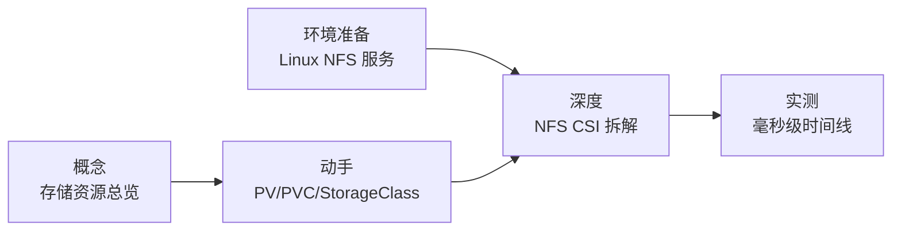

# Storage 专题

存储是 Kubernetes 让容器应用「可持续运行」的关键能力：Pod 是临时的，删除重建后容器内的数据就没了，持久化数据必须落到 Pod 之外。

本专题按「**先搞懂对象 → 再动手验证 → 最后拆开 CSI**」组织，读完既能上手，也能讲清每一步为什么。

## 系列文章

| 文章 | 定位 | 读完你能收获 |
| --- | --- | --- |
| [Kubernetes 存储资源](storage.md) | 概念总览 | PV / PVC / StorageClass / VolumeSnapshot 各自是什么、什么关系 |
| [PV、PVC、StorageClass 三对象](pv-pvc-storageclass.md) | 动手实战 | local-path 动态供给、WaitForFirstConsumer、Delete vs Retain |
| [CSI 到底拆了什么？](csi-nfs-components.md) | 深度拆解 | 部署 NFS CSI，数清 23 个容器、attachRequired 为什么缺席 |
| [PVC 毫秒级时间线拆解](pvc-timeline-ms-breakdown.md) | 性能实测 | 一个 PVC 从创建到删除的 563ms 全链路时间线 |
| [Linux NFS 服务安装（Debian 13）](../../../linux/storage/nfs-server-debian13.md) | 环境准备 | CSI 实战依赖的 NFS 服务端怎么搭 |

## 推荐阅读顺序

- 第一次接触，从 [Kubernetes 存储资源](storage.md) 开始理清概念。
- 想动手验证绑定流程，读 [PV、PVC、StorageClass 三对象](pv-pvc-storageclass.md)。
- 要跑 CSI 实战，先按 [Linux NFS 服务安装（Debian 13）](../../../linux/storage/nfs-server-debian13.md) 搭好 NFS 服务端，再读 [CSI 到底拆了什么？](csi-nfs-components.md)。
- 想追毫秒级细节，读 [PVC 毫秒级时间线拆解](pvc-timeline-ms-breakdown.md)。

## 前置知识

- [Linux 存储基础概览](../../../linux/storage/index.md) — 磁盘、分区、文件系统、LVM
- [Linux 磁盘挂载与 LVM 配置实战](../../../linux/storage/disk-mount-lvm.md) — 数据盘分区与格式化
