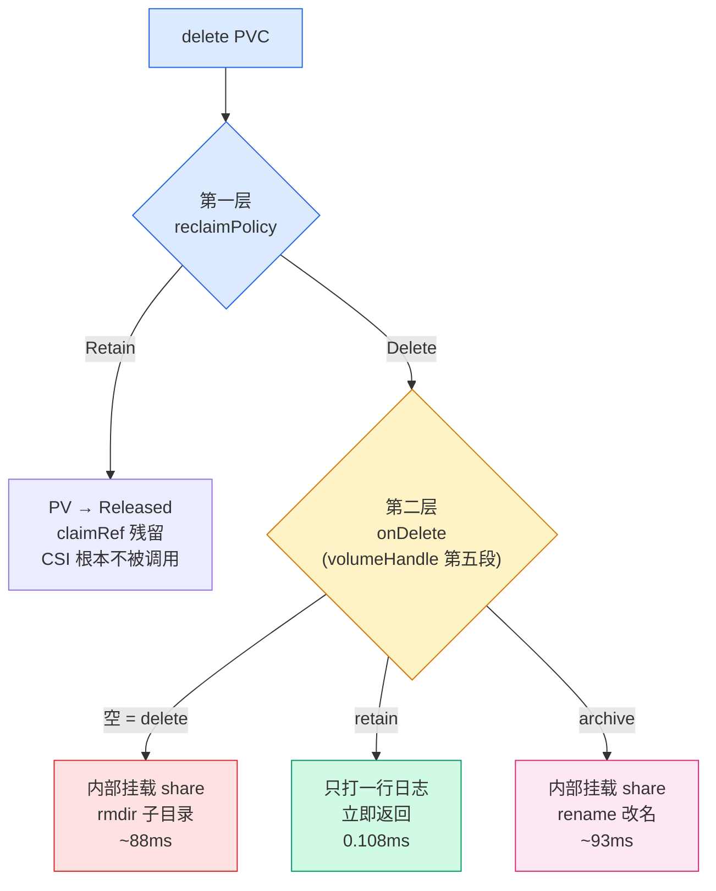
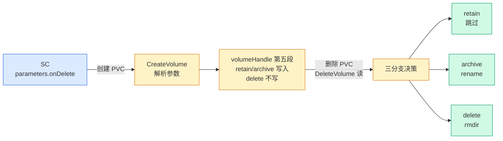
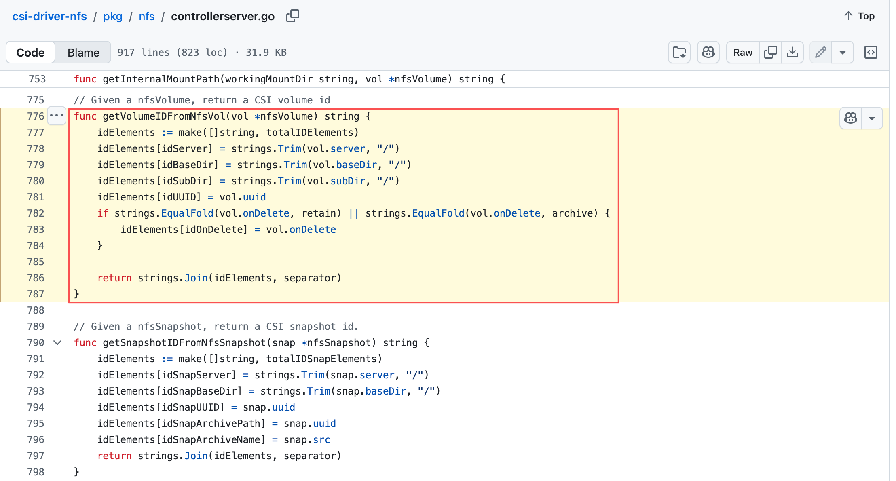
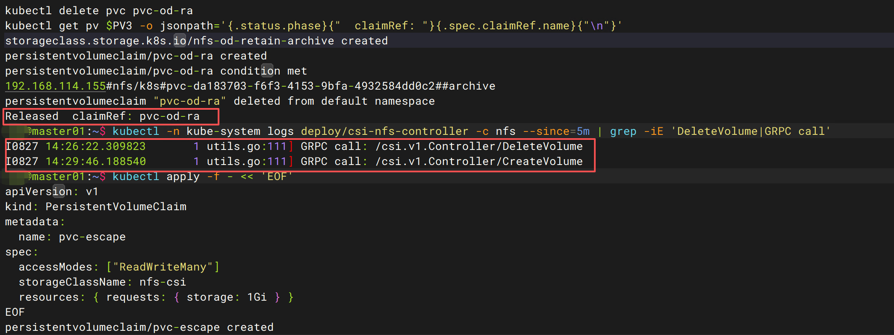
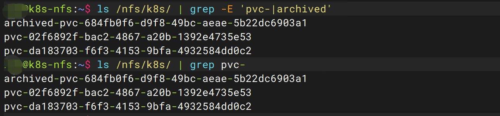
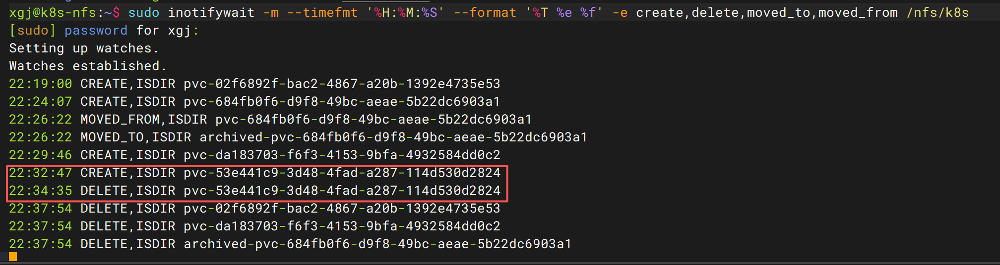
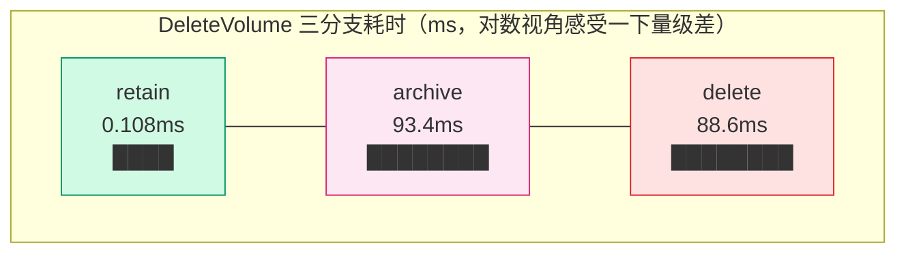

# K8s 存储第 5 篇：reclaimPolicy 和 onDelete，两层回收逻辑谁说了算

> 存储系列第 5 篇。[第 1 篇](pv-pvc-storageclass.md)讲了 PV/PVC 基础，[第 2 篇](csi-nfs-components.md)搭了 NFS CSI，[第 3 篇](pvc-timeline-ms-breakdown.md)把 PVC 生命周期拆到毫秒级，[第 4 篇](static-vs-dynamic-provisioning.md)对比了动态/静态供应和回收策略矩阵。这篇拆一个第 2 篇搭 SC 时完全没提的参数：`onDelete`。它和 reclaimPolicy 是两层不同的回收逻辑——一个管"要不要调 CSI 删除"，一个管"CSI 对 NFS 子目录做什么"。顺手回收一个伏笔：第 3 篇 volume_id 末尾那两个 `##`，谜底在这篇。

## 第 3 篇埋的伏笔：volume_id 末尾那两个井号

[第 3 篇](pvc-timeline-ms-breakdown.md)抓 CSI 日志时见过这个 volume_id：

```
192.168.114.155#nfs/k8s#pvc-bc16032a-4cfd-4c4c-88eb-c16239743c5c##
```

当时只拆了前三段：server、baseDir、subDir。但末尾那两个 `#` 一直没解释——按 `#` 分隔，后面还有两个**空段**。[第 4 篇](static-vs-dynamic-provisioning.md)把 volumeHandle 讲成三段寻址信息，其实不完整，真实的 volumeHandle 是五段：

```
192.168.114.155 # nfs/k8s # pvc-bc16032a-... # (空) # (空)
     server        baseDir     subDir        uuid   onDelete
```

第四段是 uuid（动态供应时不填，留空），第五段是 **onDelete 策略位**。两个 `##` 就是两个空段：uuid 空、onDelete 空。

第五段为什么是空的？翻源码（[`pkg/nfs/controllerserver.go`](https://github.com/kubernetes-csi/csi-driver-nfs/blob/v4.13.4/pkg/nfs/controllerserver.go#L776-L787)[ L776-787，v4.13.4](https://github.com/kubernetes-csi/csi-driver-nfs/blob/v4.13.4/pkg/nfs/controllerserver.go#L776-L787)）：

```go
// L776-787（v4.13.4）
// Given a nfsVolume, return a CSI volume id
func getVolumeIDFromNfsVol(vol *nfsVolume) string {
        idElements := make([]string, totalIDElements)   // 固定 5 个槽位
        idElements[idServer] = strings.Trim(vol.server, "/")
        idElements[idBaseDir] = strings.Trim(vol.baseDir, "/")
        idElements[idSubDir] = strings.Trim(vol.subDir, "/")
        idElements[idUUID] = vol.uuid                   // 动态供应时为空
        if strings.EqualFold(vol.onDelete, retain) || strings.EqualFold(vol.onDelete, archive) {
                idElements[idOnDelete] = vol.onDelete       // 只有 retain/archive 写入第五槽
        }

        return strings.Join(idElements, separator)
}
```

两个设计细节，一个比一个关键：

**`make([]string, totalIDElements)`**  **开的是固定 5 槽数组**，`strings.Join` 按槽位拼——空槽也占一个 `#` 的位置。所以 volumeHandle 永远是 5 段：uuid 空占第四段，onDelete 空占第五段，`##` 就这么来的。不是残留，是占位。

**第五段空的原因**：`EqualFold` 那行判断——只有 retain 和 archive 会写进 volumeHandle，**delete 不写**。delete 是"没写"，不是"写了 delete"。顺带一提，`EqualFold` 是大小写不敏感比较，SC 里写 `onDelete: Retain` 也能识别。

那没设 onDelete 的 SC 走什么策略？DeleteVolume 开头有补位逻辑（[L225-227](https://github.com/kubernetes-csi/csi-driver-nfs/blob/v4.13.4/pkg/nfs/controllerserver.go#L225-L227)）：

```go
if nfsVol.onDelete == "" {
    nfsVol.onDelete = cs.Driver.defaultOnDeletePolicy
}
```

第五段空 → 删除时用 driver 启动参数 `defaultOnDeletePolicy` 补上——[第 2 篇](csi-nfs-components.md) helm 装的 driver，chart 默认值就是 `delete`（values.yaml 的 `defaultOnDeletePolicy: delete`）。所以那两个 `##` 的完整解读是："策略没写进 id，删除时按默认 delete 处理"。

为什么这么设计？往下看两层回收逻辑就明白了。

## 两层回收逻辑：一个管"要不要删"，一个管"怎么删"

删一个 PVC，存储数据的命运由两层逻辑接力决定：

**第一层：reclaimPolicy（K8s 层，external-provisioner 执行）**

PVC 删除 → PV 进入 Released → external-provisioner 看 reclaimPolicy：

- `Retain`：什么都不做。PV 停在 Released，claimRef 残留，NFS 子目录原封不动。[第 4 篇](static-vs-dynamic-provisioning.md)实验 B 验证过复活流程。
- `Delete`：调用 CSI 的 DeleteVolume，然后删掉 PV 对象。

**第二层：onDelete（CSI driver 层，csi-driver-nfs 的 DeleteVolume 执行）**

只有第一层放行（reclaimPolicy=Delete）、DeleteVolume 被真正调用时，第二层才有发言权。它看的是 volumeHandle 第五段：

- `retain`（或空）：不动 NFS 子目录，直接返回
- `archive`：把子目录改名成 `archived-<原名>`，数据搬家保留
- `delete`（空段的语义，即默认）：挂载基础 share，rmdir 子目录



注意两条"retain 路径"的微妙区别：

| 路径                                           | PV 对象          | NFS 子目录 | CSI 被调用?  |
| ------------------------------------------------ | ------------------ | ------------ | -------------- |
| reclaimPolicy=Retain                           | 保留（Released） | 保留       | 否           |
| reclaimPolicy=Delete + onDelete=retain         | **删除**                 | 保留       | 是（但秒回） |
| reclaimPolicy=Delete + onDelete=archive        | **删除**                 | 改名保留   | 是           |
| reclaimPolicy=Delete + onDelete=delete（默认） | **删除**                 | **删除**           | 是           |

第一种和第二种最终效果（数据都在），但 **PV 对象的命运完全不同**：Retain 留着 PV 等管理员处置，onDelete=retain 连 PV 对象都删了，只留一个没人认领的裸目录在 NFS 上。这个区别[第 4 篇](static-vs-dynamic-provisioning.md)的矩阵里没拆——因为当时还没引入第二层。

## onDelete 从哪来：SC parameters 直通 volumeHandle

onDelete 是写在 SC 的 `parameters` 里的：

```yaml
apiVersion: storage.k8s.io/v1
kind: StorageClass
metadata:
  name: nfs-od-retain
provisioner: nfs.csi.k8s.io
parameters:
  server: 192.168.114.155
  share: /nfs/k8s
  onDelete: retain        # ← 就是它
reclaimPolicy: Delete
volumeBindingMode: Immediate
```

创建 PVC 时，external-provisioner 把 SC parameters 原样塞进 CreateVolume 请求。这轮实验的 CSI 日志里看得清清楚楚（GRPC request 的 parameters 字段带着 `onDelete: retain`）：

```
GRPC request: {"capacity_range":{...},"name":"pvc-02f6892f-...",
  "parameters":{"csi.storage.k8s.io/pv/name":"pvc-02f6892f-...",
    "csi.storage.k8s.io/pvc/name":"pvc-od-retain",
    "csi.storage.k8s.io/pvc/namespace":"default",
    "onDelete":"retain",        ← SC 参数直达
    "server":"192.168.114.155","share":"/nfs/k8s"},...}
```

csi-driver-nfs 的 CreateVolume 收到后做两件事：

1. 解析参数，把 onDelete 值存进 volume 对象（`newNFSVolume`）
2. 生成 volumeHandle 时按上面的规则决定写不写第五段

于是"策略"以字符串的形式烙进了 PV 对象的 `spec.csi.volumeHandle` 字段——**删除时刻的 CSI 只信这个字段，不再回头看 SC**。这也是后面"逃生舱"实验翻车的根源：策略在创建时刻就定了，落在 PV 里。





## DeleteVolume 源码：三个分支长什么样

v4.13.4 的 [`controllerserver.go`](https://github.com/kubernetes-csi/csi-driver-nfs/blob/v4.13.4/pkg/nfs/controllerserver.go#L213-L302)[，DeleteVolume 全文 L213-302](https://github.com/kubernetes-csi/csi-driver-nfs/blob/v4.13.4/pkg/nfs/controllerserver.go#L213-L302)。开头三步：解析 volumeHandle 回结构体（L218 `getNfsVolFromID`）→ 空策略补默认值（L225-227，上面引过）→ 走到最外层分岔口（L235）：

```go
// L235（v4.13.4）
if !strings.EqualFold(nfsVol.onDelete, retain) {
    // 挂载基础 share → 按 archive/delete 操作目录 → 卸载
    // （整个挂载块都圈在这个 if 里）
} else {
    klog.V(2).Infof("DeleteVolume: volume(%s) is set to retain, not deleting/archiving subdirectory", volumeID)
    // ↑ L297，实验 1 日志的出处
}
```

retain 分支"什么都不做"的精确含义是：**跳过整个挂载块**。挂载、目录操作、卸载全被 L235 那个 `!EqualFold(onDelete, retain)` 圈在 if 里，retain 直接走 else 打一行日志。这就是 0.108ms 的全部秘密——不是删得快，是根本不碰 NFS。

进了挂载块之后再分 archive / delete。archive 分支（L257 起）要多做点事——NFS 协议没有"远程 rename"，必须先挂载才能操作目录：

```go
// L268：先打日志，然后 rename（都在内部挂载点里）
klog.V(2).Infof("archiving subdirectory %s --> %s", internalVolumePath, archivedInternalVolumePath)
...
if err = os.Rename(internalVolumePath, archivedInternalVolumePath); err != nil {  // L276，改成 archived-<原名>
    return nil, status.Errorf(...)
}
// L280：rename 完还要确认旧路径真消失了（最多等 1 分钟）
if err = waitForPathNotExistWithTimeout(internalVolumePath, time.Minute); err != nil {
```

delete 分支（L284 起）在同一个挂载块里，把 Rename 换成 `os.RemoveAll`（L287）。[第 4 篇](static-vs-dynamic-provisioning.md) C2 实验里见过它的日志。

三个分支的公共部分：**内部挂载基础 share → 操作目录 → 内部卸载**（defer 卸载在 L249-253）。挂载和卸载是 NFS 删除操作的成本大头——retain 分支之所以快到离谱，就是因为它把这三步全省了。

下面用四个实验验证这套逻辑。实验不需要跑 Pod——从创建到删除，全程和 kubelet 无关，这就是纯控制面实验的好处。

## 实验 1：Delete + retain —— PV 删了，0.108ms 演完全部动作

SC 用 `reclaimPolicy: Delete` + `onDelete: retain` 的组合——第一层放行，第二层拦截：

```bash
kubectl apply -f - << 'EOF'
apiVersion: storage.k8s.io/v1
kind: StorageClass
metadata:
  name: nfs-od-retain
provisioner: nfs.csi.k8s.io
parameters:
  server: 192.168.114.155
  share: /nfs/k8s
  onDelete: retain
reclaimPolicy: Delete
volumeBindingMode: Immediate
---
apiVersion: v1
kind: PersistentVolumeClaim
metadata:
  name: pvc-od-retain
spec:
  accessModes: ["ReadWriteMany"]
  storageClassName: nfs-od-retain
  resources: { requests: { storage: 1Gi } }
EOF
kubectl wait --for=jsonpath='{.status.phase}'=Bound pvc/pvc-od-retain --timeout=60s
```

Bound 之后先看 volumeHandle——第五段真的写进去了：

```bash
PV=$(kubectl get pvc pvc-od-retain -o jsonpath='{.spec.volumeName}')
kubectl get pv $PV -o jsonpath='{.spec.csi.volumeHandle}'; echo
# 192.168.114.155#nfs/k8s#pvc-02f6892f-bac2-4867-a20b-1392e4735e53##retain
#                                                              ^^retain！
```

📸  **[截图位置：kubectl get pv 的 volumeHandle 输出——以**  **`##retain`** **结尾，和第 3 篇的**  **`##`**  **空段对比]**


删 PVC，然后三路验证：

```bash
kubectl delete pvc pvc-od-retain
kubectl get pv $PV
# Error from server (NotFound): persistentvolumes "pvc-02f6892f-..." not found   ← PV 对象删了
```

NFS 服务器上：

```bash
ls /nfs/k8s/ | grep pvc-
# pvc-02f6892f-bac2-4867-a20b-1392e4735e53    ← 子目录还在
```

CSI 日志（时间戳是 UTC，22:19 CST = 14:19 UTC）：

```
I0827 14:20:27.028025  utils.go:111] GRPC call: /csi.v1.Controller/DeleteVolume
I0827 14:20:27.028103  controllerserver.go:297] DeleteVolume: volume(192.168.114.155#nfs/k8s#pvc-02f6892f-...##retain) is set to retain, not deleting/archiving subdirectory
I0827 14:20:27.028133  utils.go:118] GRPC response: {}
```

`.028025` → `.028133`，**0.108ms**。源码 L297 那行日志实锤，行号都对上了。0.108 毫秒里它做了什么？打了一行日志，返回一个空响应。没有挂载、没有 NFS 操作、连到 NFS 服务器的网络连接都没建立。

对照[第 4 篇](static-vs-dynamic-provisioning.md)：reclaimPolicy=Retain 时 PV 停 Released + claimRef 残留，管理员要手动清；现在 reclaimPolicy=Delete + onDelete=retain，PV 对象干净地消失了，只剩一个没人认领的目录在 NFS 上。**K8s 侧零残留，NFS 侧数据保留**——这是"我只想保数据、不在乎 PV 对象"场景的最优解。

## 实验 2：Delete + archive —— rename 改名，数据搬家

archive 策略：不删，改名为 `archived-<原名>`。SC 把 onDelete 改成 archive 即可，PVC 流程一样：

```yaml
# SC 名 nfs-od-archive，parameters.onDelete: archive，其余同上
```

这次在删除前先往 NFS 子目录里放个文件（NFS 服务器上）：

```bash
echo "data before archive" | sudo tee /nfs/k8s/pvc-684fb0f6-d9f8-49bc-aeae-5b22dc6903a1/pre-archive.txt
```

然后删 PVC，看 CSI 日志：

```
I0827 14:26:22.309823  utils.go:111] GRPC call: /csi.v1.Controller/DeleteVolume
I0827 14:26:22.310255  nodeserver.go:153] NodePublishVolume: volumeID(...) source(192.168.114.155:/nfs/k8s) targetPath(/tmp/pvc-684fb0f6-...)  ← 内部挂载开始
I0827 14:26:22.365562  nodeserver.go:177] mount succeeded                   ← 55ms
I0827 14:26:22.365615  controllerserver.go:268] archiving subdirectory /tmp/pvc-684fb0f6-.../pvc-684fb0f6-... --> /tmp/pvc-684fb0f6-.../archived-pvc-684fb0f6-...
I0827 14:26:22.367813  controllerserver.go:283] archived subdirectory ... --> .../archived-pvc-684fb0f6-...    ← rename 完成
I0827 14:26:22.367920  nodeserver.go:198] NodeUnpublishVolume: unmounting volume ...
I0827 14:26:22.403145  nodeserver.go:211] unmount volume ... successfully    ← 35ms
I0827 14:26:22.403182  utils.go:118] GRPC response: {}                      ← 全程 93.4ms
```

耗时拆解：

```
93.4ms = 内部挂载 55ms + rename 2.2ms + 内部卸载 35ms + 零头
```

**rename 本身只要 2.2ms**——archive 的"归档"动作其实便宜得惊人，93ms 里 90ms 是挂载/卸载的仪式性开销。

NFS 侧的 inotifywait 抓到了改名瞬间（这次必须监听 `moved_to,moved_from` 事件——archive 是 rename，create/delete 监听列表看不见它）：

```
22:26:22 MOVED_FROM,ISDIR pvc-684fb0f6-d9f8-49bc-aeae-5b22dc6903a1
22:26:22 MOVED_TO,ISDIR archived-pvc-684fb0f6-d9f8-49bc-aeae-5b22dc6903a1
```

同秒、成对——`MOVED_FROM`（原路径消失）+ `MOVED_TO`（archived 路径出现），这是 inotify 对 rename 的标准表达。CSI 日志的 14:26:22 UTC 和 inotifywait 的 22:26:22 CST 是同一瞬间，两侧证据互相咬合。

数据验证：

```bash
cat /nfs/k8s/archived-pvc-684fb0f6-d9f8-49bc-aeae-5b22dc6903a1/pre-archive.txt
# data before archive          ← 文件跟着目录一起搬家了
```


archive 和 retain 的区别现在很清楚了：retain 留的是**原名原路径**的裸目录（下次同名 PVC 还能撞上它）；archive 改名后**永远不会被复用**——新 PVC 的子目录名带新 UUID，和 `archived-` 前缀的旧目录天然隔离。要恢复就是把目录名改回去（NFS 上 `mv`），再走静态供应绑定。

## 实验 3：Retain + archive —— 第一层短路，CSI 根本不知道你要删

现在把两层都设上：`reclaimPolicy: Retain` + `onDelete: archive`。第二层的 archive 会执行吗？

```bash
kubectl delete pvc pvc-od-ra
kubectl get pv $PV3 -o jsonpath='{.status.phase}{"  claimRef: "}{.spec.claimRef.name}{"\n"}'
# Released  claimRef: pvc-od-ra       ← PV 停 Released
```

CSI 日志：

```bash
kubectl -n kube-system logs deploy/csi-nfs-controller -c nfs --since=5m | grep -iE 'DeleteVolume|GRPC call'
# I0827 14:26:22.309823  utils.go:111] GRPC call: /csi.v1.Controller/DeleteVolume   ← 实验 2 的旧日志
# I0827 14:29:46.188540  utils.go:111] GRPC call: /csi.v1.Controller/CreateVolume   ← 实验 3 的创建
# （没有任何新的 DeleteVolume 调用）
```

**DeleteVolume 根本没被调用。**  NFS 侧的 inotifywait 同样静默——没有 MOVED 事件，子目录原名原样躺着。

第一层（reclaimPolicy=Retain）直接短路了第二层。onDelete 写得再花哨，reclaimPolicy 不放行，CSI 永远看不到这个删除请求。两层是**串联开关**，不是并行选项。





这个实验也解释了[第 4 篇](static-vs-dynamic-provisioning.md)实验 D 的"CSI 静默"：当时只设了 reclaimPolicy=Retain，现在知道了，那不是"CSI 忍住没删"，是"CSI 压根没收到通知"。

## 计划外发现：CreateVolume 干的私活

实验 1 的 CreateVolume 日志里混着一段让人愣住的东西：

```
I0827 14:19:00.405738  utils.go:111] GRPC call: /csi.v1.Controller/CreateVolume
I0827 14:19:00.405777  utils.go:115] GRPC request: {...parameters 带 onDelete:retain...}
I0827 14:19:00.406249  nodeserver.go:153] NodePublishVolume: volumeID(...) source(192.168.114.155:/nfs/k8s) targetPath(/tmp/pvc-02f6892f-...)
I0827 14:19:00.469125  nodeserver.go:177] mount succeeded              ← 63ms
I0827 14:19:00.470859  nodeserver.go:198] NodeUnpublishVolume: unmounting volume ...
I0827 14:19:00.505427  nodeserver.go:211] unmount volume ... successfully  ← 35ms
I0827 14:19:00.505444  utils.go:118] GRPC response: {...}              ← 全程 99.7ms
```

NodePublishVolume？Controller 服务怎么会调 Node 服务的方法？**这是 controller 容器自己挂载 NFS share**——内部挂载、在挂载点里建子目录、再卸载，全程 ~100ms。

为什么必须挂载才能建目录？**NFS 协议没有"远程 mkdir"** ——它是文件系统协议不是管理协议，要操作服务器上的目录树，唯一办法就是把它挂载过来，通过挂载点操作。所以 CreateVolume 的真实流程是：

```
内部挂载基础 share（63ms）→ MkdirAll 子目录（就在 mount succeeded 和 unmounting 之间那 1.7ms 窗口里）→ 内部卸载（35ms）
```

子目录的创建发生在 `.469125` 和 `.470859` 之间——1.7ms，一次 NFS MKDIR RPC 的合理耗时。inotifywait 的 `22:19:00 CREATE,ISDIR pvc-02f6892f-...` 和这一瞬间互相咬合。

还有一个源码细节：CreateVolume 挂载完会做 chmod，但**只在 mountPermissions > 0 时**（[controllerserver.go L188-193](https://github.com/kubernetes-csi/csi-driver-nfs/blob/v4.13.4/pkg/nfs/controllerserver.go#L188-L193)，源码注释写明是修 umask 问题）：

```go
if mountPermissions > 0 {
    // Reset directory permissions because of umask problems
    if err := chmodIfPermissionMismatch(internalVolumePath, uint32(mountPermissions)); err != nil {
        klog.Warningf("failed to chmod subdirectory: %v", err)
    }
}
```

而 helm chart 的默认值是 `mountPermissions: 0`（values.yaml L44）——**默认 chmod 根本不执行**，目录权限就是 MkdirAll 的 0777 减 umask。想让子目录有特定权限，要么在 SC parameters 里写 `mountpermissions: "0770"`，要么改 controller 的启动参数。日志里没有 chmod warning 也反证了它没跑。

!!! note "为什么日志看起来像 Node 服务在干活"
    controller 复用了 nodeserver.go 里的挂载辅助函数，所以日志的文件名是 nodeserver.go。第一次在 controller 日志里看到 NodePublishVolume 别慌——那不是 worker 节点上的挂载，是 controller 自己的内部挂载。

## 逃生舱实验翻车：volumeHandle 创建后不可改

设计这个实验时的想法很美好：SC 是 Delete（第五段空），PVC 已经建好，突然要保数据——**删 PVC 前热改 volumeHandle 第五段**，把 `##` 改成 `##retain`，DeleteVolume 不就按 retain 走了？

```bash
PV4=pvc-53e441c9-3d48-4fad-a287-114d530d2824
HANDLE=$(kubectl get pv $PV4 -o jsonpath='{.spec.csi.volumeHandle}')
kubectl patch pv $PV4 --type json -p "[{\"op\":\"replace\",\"path\":\"/spec/csi/volumeHandle\",\"value\":\"${HANDLE}retain\"}]"
```

API server 的回答：

```
The PersistentVolume "pvc-53e441c9-3d48-4fad-a287-114d530d2824" is invalid:
spec.persistentvolumesource: Forbidden: spec.persistentvolumesource is immutable after creation
@@ -22,7 +22,7 @@
   "StorageOS": null,
   "CSI": {
    "Driver": "nfs.csi.k8s.io",
-   "VolumeHandle": "192.168.114.155#nfs/k8s#pvc-53e441c9-3d48-4fad-a287-114d530d2824##",
+   "VolumeHandle": "192.168.114.155#nfs/k8s#pvc-53e441c9-3d48-4fad-a287-114d530d2824##retain",
    "ReadOnly": false,
```

diff 都生成好了（`##` → `##retain`），然后被 API 拒了——**`spec.persistentvolumesource`** **创建后不可变**，这是 API 层焊死的校验，连 `--force` 都绕不过（K8s 没有这个 flag）。

volumeHandle 保持 `##` 不变，接着删 PVC：

```bash
kubectl delete pvc pvc-escape
kubectl get pv $PV4
# Error from server (NotFound)    ← PV 对象删除
```

inotifywait：

```
22:32:47 CREATE,ISDIR pvc-53e441c9-3d48-4fad-a287-114d530d2824
22:34:35 DELETE,ISDIR pvc-53e441c9-3d48-4fad-a287-114d530d2824     ← 子目录真被删了
```

**逃生舱不存在，数据真的没了。** （这个 PVC 没跑过 Pod，目录是空的，正好当耗材。）




这个翻车把结论钉死了：**onDelete 没有事后后悔药**。策略在创建 PVC 那一刻烙进 volumeHandle，之后 SC 怎么改、PV 怎么 patch 都改变不了已创建卷的删除行为。想事后保数据的正确姿势只有两个：

1. 删 PVC 前把数据拷走（`kubectl cp` 或 NFS 侧直接备份目录）
2. 删 PVC 前先改 SC 的 onDelete，然后……也没用——SC 参数只影响**新创建**的 PV，已存在的 PV 里第五段已经定了

所以第三条路才是唯一的路：**创建前想清楚**。

## 三个分支的耗时账本

| onDelete       | NFS 子目录   | 耗时           | 构成                                 |
| ---------------- | -------------- | ---------------- | -------------------------------------- |
| retain         | 保留（原名） | **0.108ms**               | 打一行日志                           |
| archive        | 保留（改名） | **93.4ms**               | 挂载 55ms + rename 2.2ms + 卸载 35ms |
| delete（空段） | 删除         | **88.6ms**（[第 4 篇](static-vs-dynamic-provisioning.md) C2） | 挂载 51ms + rmdir 5ms + 清理 32ms    |



retain 比另外两个分支**快三个数量级**——因为它连 NFS 服务器都不用碰。archive 和 delete 耗时相当（都付挂载税），区别只在挂载后那一个动作：rename 2.2ms vs rmdir 5ms，都便宜。**NFS 删除操作的成本大头永远是挂载/卸载，不是目录操作本身。**

还有个隐藏推论：archive 只比 delete 贵 5ms（rename vs rmdir），但一个保数据一个毁数据。**想不出理由不选 archive**——数据保留 + 天然防复用隔离，代价几乎为零。生产上真要省这 93ms 的人，大概也不在乎数据了。

## 一条原则保命

[第 4 篇](static-vs-dynamic-provisioning.md)的保命原则是"不确定就用 Retain"。有了 onDelete 之后，原则可以更精细：

!!! warning "两条铁律"
    **创建前**：SC 的 onDelete 想清楚再建 PVC。没有后悔药——volumeHandle 创建后不可变（实验 4 翻车实锤），SC 后改只影响新 PV。拿不准就 onDelete: archive，比 delete 只贵 5ms，数据保留。

    **删除前**：看一眼 volumeHandle 第五段再删。`##retain` 结尾→数据保留；`##archive`→会改名归档；`##` 结尾→**子目录会被真删**。5 秒钟的检查，比恢复数据便宜一万倍。

reclaimPolicy 和 onDelete 的关系一句话：**reclaimPolicy 是总开关（决定 CSI 是否被调用），onDelete 是分支开关（决定 CSI 对目录做什么）** 。总开关关着（Retain），分支开关随便设；总开关开着（Delete），分支开关才是真正决定数据生死的那只手。

## 验证命令清单

所有命令在 master01（kubectl）和 k8s-nfs（NFS 侧）上跑，全流程不需要 Pod。

**1. inotifywait（k8s-nfs 上，全程开着）——这次必须加 move 事件：**

```bash
sudo inotifywait -m --timefmt '%H:%M:%S' --format '%T %e %f' -e create,delete,moved_to,moved_from /nfs/k8s
```

!!! warning "archive 是 rename，create/delete 监听看不见它"
    系列前几篇的 inotifywait 命令只监听 `-e create,delete`。archive 的改名动作触发的是 `MOVED_FROM`/`MOVED_TO` 事件，不加 `moved_to,moved_from` 会眼睁睁看着目录"消失"却抓不到证据。

**2. 实验 1：Delete + retain：**

```bash
kubectl apply -f - << 'EOF'
apiVersion: storage.k8s.io/v1
kind: StorageClass
metadata:
  name: nfs-od-retain
provisioner: nfs.csi.k8s.io
parameters:
  server: 192.168.114.155
  share: /nfs/k8s
  onDelete: retain
reclaimPolicy: Delete
volumeBindingMode: Immediate
---
apiVersion: v1
kind: PersistentVolumeClaim
metadata:
  name: pvc-od-retain
spec:
  accessModes: ["ReadWriteMany"]
  storageClassName: nfs-od-retain
  resources: { requests: { storage: 1Gi } }
EOF
kubectl wait --for=jsonpath='{.status.phase}'=Bound pvc/pvc-od-retain --timeout=60s
PV=$(kubectl get pvc pvc-od-retain -o jsonpath='{.spec.volumeName}')
kubectl get pv $PV -o jsonpath='{.spec.csi.volumeHandle}'; echo    # ##retain 结尾

kubectl delete pvc pvc-od-retain
kubectl get pv $PV                                  # NotFound
# k8s-nfs：ls /nfs/k8s/ | grep pvc-                 # 子目录还在
kubectl -n kube-system logs deploy/csi-nfs-controller -c nfs --since=5m | grep -E 'DeleteVolume|GRPC'
```

**3. 实验 2：Delete + archive：**

```bash
# SC 同上但 onDelete: archive，PVC 名 pvc-od-archive
# Bound 后在 k8s-nfs 上预置数据：
echo "data before archive" | sudo tee /nfs/k8s/<子目录名>/pre-archive.txt
# master01 上删除 PVC 后验证：
kubectl -n kube-system logs deploy/csi-nfs-controller -c nfs --since=5m | grep -iE 'archiv'
# k8s-nfs：
cat /nfs/k8s/archived-<子目录名>/pre-archive.txt    # 数据完整
```

**4. 实验 3：Retain + archive（短路验证）：**

```bash
# SC 同上但 reclaimPolicy: Retain, onDelete: archive
kubectl delete pvc pvc-od-ra
kubectl get pv $PV3 -o jsonpath='{.status.phase}{"  claimRef: "}{.spec.claimRef.name}{"\n"}'
# Released  claimRef: pvc-od-ra
kubectl -n kube-system logs deploy/csi-nfs-controller -c nfs --since=5m | grep DeleteVolume
# 没有新调用——第一层短路第二层
```

**5. 逃生舱验证（会翻车，翻车本身就是结论）：**

```bash
HANDLE=$(kubectl get pv $PV4 -o jsonpath='{.spec.csi.volumeHandle}')
kubectl patch pv $PV4 --type json -p "[{\"op\":\"replace\",\"path\":\"/spec/csi/volumeHandle\",\"value\":\"${HANDLE}retain\"}]"
# spec.persistentvolumesource is immutable after creation
```

**6. 收尾清理：**

```bash
# master01：
kubectl delete sc nfs-od-retain nfs-od-archive nfs-od-retain-archive
kubectl get pv,pvc,sc | grep -E 'od-|escape' || echo "无残留"
# k8s-nfs：
sudo rm -rf /nfs/k8s/pvc-* /nfs/k8s/archived-*
```

---

> **下一篇预告**：存储系列第 6 篇——volumeBindingMode。SC 里还有一个和 reclaimPolicy 同级、[第 2 篇](csi-nfs-components.md)搭环境时一笔带过的参数：`volumeBindingMode: Immediate`。它还有个孪生兄弟 `WaitForFirstConsumer`——PVC 创建后一直 Pending，不是出错，是在等第一个 Pod 被调度。两种绑定模式的时机差异、为什么 NFS 感知不到但拓扑型存储必须用 WFFC，下篇用实验说话。

---

## 推荐阅读

- [PV、PVC、StorageClass 三对象](pv-pvc-storageclass.md) — 系列第 1 篇，PV/PVC 基础概念与生命周期
- [CSI 到底拆了什么？](csi-nfs-components.md) — 系列第 2 篇，NFS CSI 存储层搭建
- [PVC 毫秒级时间线拆解](pvc-timeline-ms-breakdown.md) — 系列第 3 篇，一个 PVC 的毫秒级全链路时间线
- [K8s 存储第 4 篇：动态供应 vs 静态供应，谁在删你的数据](static-vs-dynamic-provisioning.md) — 系列第 4 篇，动态/静态供应与回收策略矩阵
- [Kubernetes 存储资源](storage.md) — PV / PVC / StorageClass / VolumeSnapshot 概念总览
- [Linux NFS 服务安装（Debian 13）](../../../linux/storage/nfs-server-debian13.md) — 本实验的 NFS 服务端环境准备