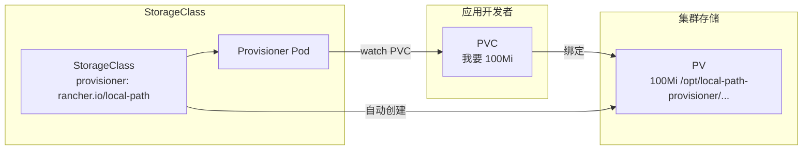
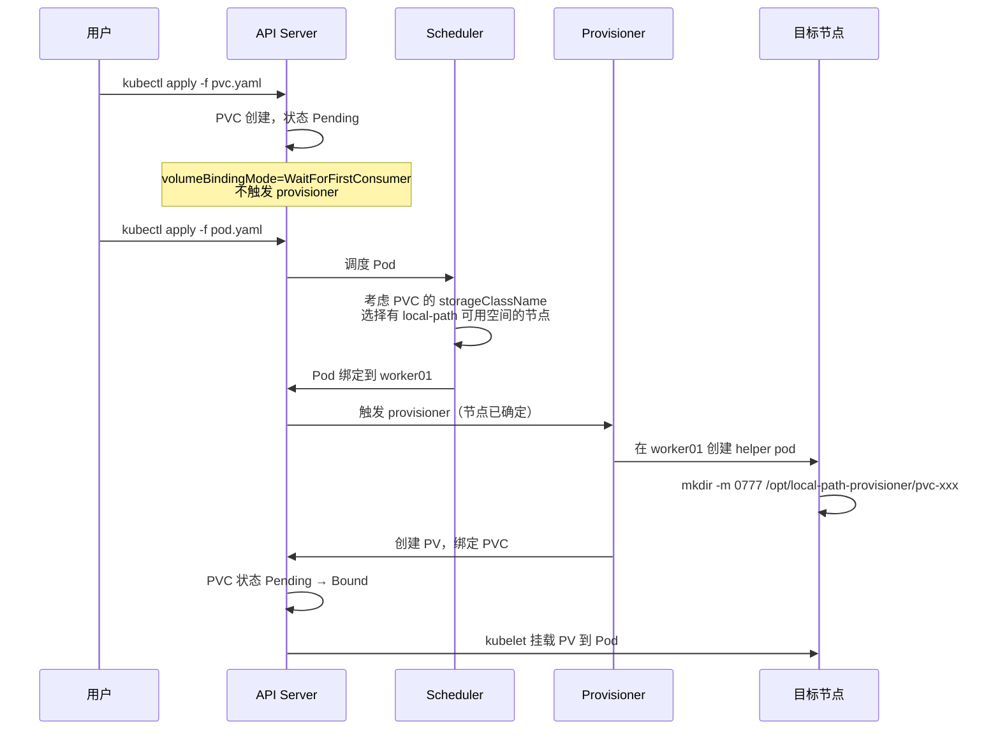
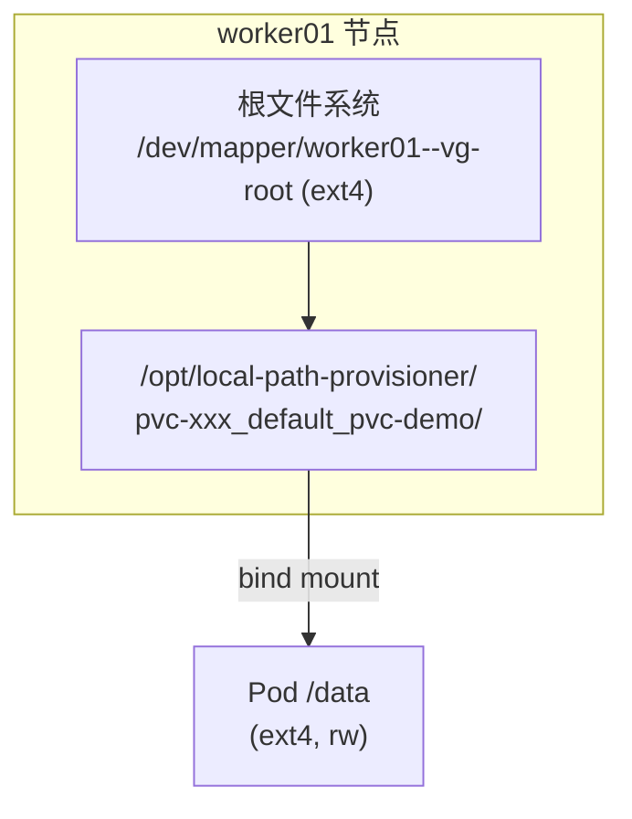

# PV、PVC、StorageClass：K8s 存储三个对象到底谁管谁

## 一个 PVC Pending 引发的问题

故事从一个 Pending 的 PVC 开始。我在集群上创建了这样一个声明：

```yaml
apiVersion: v1
kind: PersistentVolumeClaim
metadata:
  name: pvc-demo
spec:
  accessModes:
    - ReadWriteOnce
  storageClassName: local-path
  resources:
    requests:
      storage: 100Mi
```

`kubectl apply` 之后，PVC 创建成功，但状态是 Pending：

```
NAME       STATUS    VOLUME   CAPACITY   ACCESS MODES   STORAGECLASS   VOLUMEATTRIBUTESCLASS   AGE
pvc-demo   Pending                                      local-path     <unset>                 24s
```

没有 VOLUME 绑定，没有容量分配，就是干等着。为什么？

因为 StorageClass 的 `volumeBindingMode` 是 `WaitForFirstConsumer`——消费者（Pod）没来，PVC 就不绑定 PV。这个设计是为了避免一种情况：PVC 在节点 A 上创建了 PV，但 Pod 被调度到节点 B，跨节点挂载本地存储是做不到的。

先记住这个结论，后面会拆开讲。

## K8s 存储的三个对象

先把三个核心对象的关系理清楚。

**PersistentVolume（PV）**：集群级别的存储资源。一块磁盘、一个目录、一个 NFS 共享，抽象成 PV 就是"这块存储可以被用了"。PV 是集群管理员视角的东西。

**PersistentVolumeClaim（PVC）**：命名空间级别的存储声明。应用说"我要 100Mi、ReadWriteOnce 的存储"，就是 PVC。PVC 是应用开发者视角的东西。

**StorageClass（SC）**：PV 的工厂。管理员不想手动创建 PV，就配一个 StorageClass，让 provisioner 自动创建。SC 定义了"用什么方式创建 PV"。

三者的关系：



应用创建 PVC → Provisioner 监听到 PVC → 调用 StorageClass 配置创建 PV → PV 和 PVC 绑定 → Pod 通过 PVC 挂载 PV。

## StorageClass：谁负责创建 PV

先看看我们集群里的 StorageClass 长什么样：

```
NAME         PROVISIONER             RECLAIMPOLICY   VOLUMEBINDINGMODE      ALLOWVOLUMEEXPANSION   AGE
local-path   rancher.io/local-path   Delete          WaitForFirstConsumer   false                  26s
```

`kubectl describe sc local-path` 看细节：

```
Name:            local-path
IsDefaultClass:  No
Provisioner:     rancher.io/local-path
Parameters:      <none>
AllowVolumeExpansion:  <unset>
ReclaimPolicy:         Delete
VolumeBindingMode:     WaitForFirstConsumer
```

几个关键字段：

- **Provisioner**：`rancher.io/local-path`。这个字符串标识了谁来干活。Provisioner 是一个运行在集群里的 Pod，它 watch PVC 资源，发现有需要创建的 PVC 就动手。注意，这不是 CSI driver——local-path-provisioner 走的是 Kubernetes 内置的 provisioner 接口，不是 CSI 标准。这个区别下一篇 [CSI 原理](csi.md) 会拆。
- **ReclaimPolicy**：`Delete`。PVC 被删后，PV 和底层数据也跟着删。
- **VolumeBindingMode**：`WaitForFirstConsumer`。等 Pod 来了才绑定 PV。
- **AllowVolumeExpansion**：不支持扩容。

### Provisioner Pod 在干什么

看一下 provisioner 的运行状态：

```
kubectl get pods -n local-path-storage
NAME                                      READY   STATUS    RESTARTS   AGE
local-path-provisioner-5b97bf5956-fnflg   1/1     Running   0          39s
```

这个 Pod 一直在 watch API Server 的 PVC 资源。当它看到一个 `storageClassName: local-path` 且没绑定 PV 的 PVC，就会：

1. 在目标节点上创建一个目录（通过 helper pod）
2. 创建一个 PV 对象指向这个目录
3. 让 PV 和 PVC 绑定

Provisioner 怎么知道在哪个节点上创建目录？看 Pod 调度到哪，就在哪创建。这就是 `WaitForFirstConsumer` 的意义——先等 Pod 调度决定节点，再在那个节点上创建存储。

### local-path 的配置

ConfigMap `local-path-config` 里有 provisioner 的具体配置：

```yaml
apiVersion: v1
data:
  config.json: |-
    {
            "nodePathMap":[
            {
                    "node":"DEFAULT_PATH_FOR_NON_LISTED_NODES",
                    "paths":["/opt/local-path-provisioner"]
            }
            ]
    }
  helperPod.yaml: |-
    apiVersion: v1
    kind: Pod
    metadata:
      name: helper-pod
    spec:
      priorityClassName: system-node-critical
      tolerations:
        - key: node.kubernetes.io/disk-pressure
          operator: Exists
          effect: NoSchedule
      containers:
      - name: helper-pod
        image: m.daocloud.io/docker.io/busybox
        imagePullPolicy: IfNotPresent
  setup: |-
    #!/bin/sh
    set -eu
    mkdir -m 0777 -p "$VOL_DIR"
  teardown: |-
    #!/bin/sh
    set -eu
    rm -rf "$VOL_DIR"
```

几个关键信息：

- `nodePathMap` 配置了存储路径：`/opt/local-path-provisioner`。所有没有被单独配置的节点都用这个路径。
- `setup` 脚本就是 `mkdir -m 0777 -p "$VOL_DIR"`——创建一个 0777 权限的目录。
- `teardown` 脚本是 `rm -rf "$VOL_DIR"`——删除 PVC 时清理目录。
- `helperPod` 是 provisioner 用来在目标节点上执行 setup/teardown 的工具 Pod，用的是 busybox 镜像，带了 `system-node-critical` 优先级和 disk-pressure 容忍。

所以 local-path 的"创建 PV"本质上就是：**在节点的 `/opt/local-path-provisioner/` 下创建一个目录，然后把这个目录 bind-mount 进 Pod**。

## WaitForFirstConsumer：等消费者来了再绑定

回到开头那个 Pending 的 PVC。现在能解释了：

`WaitForFirstConsumer` 模式下，PVC 创建后不会立刻绑定 PV。因为 provisioner 还不知道该在哪个节点上创建存储——Pod 没调度，节点没确定。

如果用 `Immediate` 模式呢？PVC 创建后立刻创建 PV 并绑定。但对于 local-path 这种节点本地存储，如果 PV 创建在 worker01，而 Pod 被调度到 worker02，Pod 就永远挂不上这个卷。

所以 `WaitForFirstConsumer` 的流程是：



Scheduler 在 `WaitForFirstConsumer` 模式下有一个额外的职责：它会过滤掉没有对应存储可用空间的节点。对于 local-path 来说，只要节点上配了 `nodePathMap`，就被认为有可用空间。

## PVC Bound：PV 自动出现

现在创建一个 Pod 来消费这个 PVC：

```yaml
apiVersion: v1
kind: Pod
metadata:
  name: pod-with-pvc
spec:
  containers:
  - name: nginx
    image: m.daocloud.io/docker.io/nginx:alpine
    volumeMounts:
    - name: data
      mountPath: /data
  volumes:
  - name: data
    persistentVolumeClaim:
      claimName: pvc-demo
```

Pod 创建后，PVC 立刻从 Pending 变成 Bound：

```
NAME       STATUS   VOLUME                                     CAPACITY   ACCESS MODES   STORAGECLASS   VOLUMEATTRIBUTESCLASS   AGE
pvc-demo   Bound    pvc-4aaa90a5-9f0c-4112-8ff8-255620a56bf0   100Mi      RWO            local-path     <unset>                 2m11s
```

PV 也自动出现了：

```
NAME                                       CAPACITY   ACCESS MODES   RECLAIM POLICY   STATUS   CLAIM              STORAGECLASS   VOLUMEATTRIBUTESCLASS   REASON   AGE
pvc-4aaa90a5-9f0c-4112-8ff8-255620a56bf0   100Mi      RWO            Delete           Bound    default/pvc-demo   local-path     <unset>                          88s
```

注意 PV 的名字就是 `pvc-{PVC的UID}`，这是动态 provisioner 的命名规则。RECLAIM POLICY 是 Delete，来自 StorageClass 的配置。STATUS 是 Bound，表示已经被 PVC 绑定了。

Pod 也 Running 了：

```
NAME           READY   STATUS    RESTARTS   AGE
pod-with-pvc   1/1     Running   0          86s
```

整个过程：PVC Pending 2 分钟 → 创建 Pod → PVC Bound + PV 出现 + Pod Running，全自动。

## 进 Pod 看挂载：数据到底存在哪

在 Pod 里面看挂载点：

```bash
kubectl exec pod-with-pvc -- df -h /data
```

```
Filesystem                Size      Used Available Use% Mounted on
/dev/mapper/worker01--vg-root
                         91.0G     13.2G     73.2G  15% /data
```

第一个反直觉发现：`/data` 挂的是 `/dev/mapper/worker01--vg-root`——这是 worker01 节点的根盘（LVM），91G，已用 13.2G。

也就是说，**local-path 没有创建独立的块设备、没有分区、没有格式化，就是在节点根文件系统上建了个目录**。

再看 mount 信息：

```bash
kubectl exec pod-with-pvc -- mount | grep /data
```

```
/dev/mapper/worker01--vg-root on /data type ext4 (rw,relatime,errors=remount-ro)
```

ext4，读写，relatime。和节点根盘的挂载参数一模一样——因为它就是根盘的一个子目录被 bind-mount 进来了。

看一下目录内容：

```bash
kubectl exec pod-with-pvc -- ls -la /data
```

```
total 8
drwxrwxrwx    2 root     root          4096 Aug 20 02:09 .
drwxr-xr-x    1 root     root          4096 Aug 20 02:09 ..
```

空目录，权限 0777——就是 ConfigMap 里 setup 脚本 `mkdir -m 0777` 创建的。

## 节点上看真相：就是一个目录

在 worker01 节点上看实际的存储路径：

```bash
ssh xgj@worker01 "sudo ls -la /opt/local-path-provisioner/"
```

```
total 16
drwxr-xr-x 4 root root 4096 Aug 20 10:38 .
drwxr-xr-x 5 root root 4096 Aug 20 10:09 ..
drwxrwxrwx 2 root root 4096 Aug 20 10:38 pvc-0a3931f5-3648-4136-a0cf-232e63be9059_default_pvc-debug
drwxrwxrwx 2 root root 4096 Aug 20 10:25 pvc-abd61b6f-65c1-4aff-80c1-86cbb624abf0_default_pvc-retain
```

目录命名规则是 `pvc-{PV-UID}_{namespace}_{PVC名称}`。

注意第二个目录 `pvc-abd61b6f-..._default_pvc-retain`——这是前面 Retain 实验留下的，PVC 和 PV 都已经删了，但节点上的目录还在。后面讲回收策略时会展开。

看一下节点上有没有对应的 mount 条目：

```bash
ssh xgj@worker01 "sudo mount | grep local-path-provisioner"
```

没有输出。因为 local-path-provisioner 创建的只是一个普通目录，不是 mount point。kubelet 在挂载到 Pod 时做的是 bind mount（把宿主机目录绑定到容器路径），这个 bind mount 只在容器运行时存在。

所以 local-path 的存储栈非常简单：



没有 iSCSI、没有 NFS、没有块设备映射。就是宿主机根盘上的一个目录，bind-mount 进容器。

## 数据持久性：删 Pod 重建，文件还在

验证一下数据是不是真的持久化了。先写个文件：

```bash
kubectl exec pod-with-pvc -- sh -c 'echo "hello from $(hostname)" > /data/test.txt'
kubectl exec pod-with-pvc -- cat /data/test.txt
```

```
hello from pod-with-pvc
```

删掉 Pod，重建一个新的 Pod 挂载同一个 PVC：

```bash
kubectl delete pod pod-with-pvc
```

```yaml
# 重建 Pod（名字改成 pod-with-pvc-2，挂同一个 PVC）
apiVersion: v1
kind: Pod
metadata:
  name: pod-with-pvc-2
spec:
  containers:
  - name: nginx
    image: m.daocloud.io/docker.io/nginx:alpine
    volumeMounts:
    - name: data
      mountPath: /data
  volumes:
  - name: data
    persistentVolumeClaim:
      claimName: pvc-demo
```

Pod Running 后读文件：

```bash
kubectl exec pod-with-pvc-2 -- cat /data/test.txt
```

```
hello from pod-with-pvc
```

文件还在。数据确实持久化了——存在 worker01 的 `/opt/local-path-provisioner/pvc-xxx/` 目录里，Pod 删了目录不删，新 Pod 挂同一个 PVC 就能读到。

## 回收策略：Delete vs Retain

### Delete：PVC 删了，PV 和数据都没了

先看默认的 Delete 策略。删 Pod、删 PVC：

```bash
kubectl delete pod pod-with-pvc-2
kubectl delete pvc pvc-demo
```

再看 PV：

```bash
kubectl get pv
```

```
No resources found
```

PV 直接没了。provisioner 执行了 teardown 脚本 `rm -rf "$VOL_DIR"`，PV 对象和数据目录都清理了。

### Retain：PVC 删了，PV 变 Released

创建一个 Retain 策略的 StorageClass 做对比：

```yaml
apiVersion: storage.k8s.io/v1
kind: StorageClass
metadata:
  name: local-path-retain
provisioner: rancher.io/local-path
reclaimPolicy: Retain
volumeBindingMode: WaitForFirstConsumer
```

创建 PVC 和 Pod：

```yaml
apiVersion: v1
kind: PersistentVolumeClaim
metadata:
  name: pvc-retain
spec:
  accessModes:
    - ReadWriteOnce
  storageClassName: local-path-retain
  resources:
    requests:
      storage: 100Mi
---
apiVersion: v1
kind: Pod
metadata:
  name: pod-retain
spec:
  containers:
  - name: nginx
    image: m.daocloud.io/docker.io/nginx:alpine
    volumeMounts:
    - name: data
      mountPath: /data
  volumes:
  - name: data
    persistentVolumeClaim:
      claimName: pvc-retain
```

PVC Bound、PV 出现：

```
NAME         STATUS   VOLUME                                     CAPACITY   ACCESS MODES   STORAGECLASS        VOLUMEATTRIBUTESCLASS   AGE
pvc-retain   Bound    pvc-abd61b6f-65c1-4aff-80c1-86cbb624abf0   100Mi      RWO            local-path-retain   <unset>                 85s
```

```
NAME                                       CAPACITY   ACCESS MODES   RECLAIM POLICY   STATUS   CLAIM                STORAGECLASS        VOLUMEATTRIBUTESCLASS   REASON   AGE
pvc-abd61b6f-65c1-4aff-80c1-86cbb624abf0   100Mi      RWO            Retain           Bound    default/pvc-retain   local-path-retain   <unset>                          22s
```

RECLAIM POLICY 是 Retain。现在删 Pod、删 PVC：

```bash
kubectl delete pod pod-retain
kubectl delete pvc pvc-retain
```

看 PV：

```
NAME                                       CAPACITY   ACCESS MODES   RECLAIM POLICY   STATUS     CLAIM                STORAGECLASS        VOLUMEATTRIBUTESCLASS   REASON   AGE
pvc-abd61b6f-65c1-4aff-80c1-86cbb624abf0   100Mi      RWO            Retain           Released   default/pvc-retain   local-path-retain   <unset>                          50s
```

PV 还在，STATUS 从 Bound 变成了 **Released**。CLAIM 列还保留着 `default/pvc-retain` 的引用，但 PVC 已经不存在了。

Retain 的含义是：**PVC 删了，PV 保留，数据保留，管理员手动决定怎么处理**。

### Retain 的坑：PV 删了数据还在

那手动删掉 PV 呢？

```bash
kubectl delete pv pvc-abd61b6f-65c1-4aff-80c1-86cbb624abf0
```

```
persistentvolume "pvc-abd61b6f-65c1-4aff-80c1-86cbb624abf0" deleted
```

PV 对象从 API Server 消失了。但是——回到前面那个 `ls` 的输出：

```
drwxrwxrwx 2 root root 4096 Aug 20 10:25 pvc-abd61b6f-65c1-4aff-80c1-86cbb624abf0_default_pvc-retain
```

**节点上的数据目录还在**。

因为 Retain 策略下，provisioner 不会执行 teardown 脚本。PV 对象虽然从 etcd 里删了，但 worker01 上 `/opt/local-path-provisioner/pvc-abd61b6f-...` 这个目录没人清理。

这是 Retain 策略的隐藏代价：它保护了数据不被误删，但也意味着**清理数据需要管理员手动登录节点 `rm -rf`**。

两种策略的对比：

| 维度 | Delete | Retain |
|------|--------|--------|
| 删 PVC 后 PV 状态 | PV 被删除 | PV 变 Released |
| 数据目录 | provisioner 执行 `rm -rf` 清理 | 保留在节点上 |
| 手动删 PV 后 | — | 数据目录仍在 |
| 适用场景 | 测试、临时数据 | 生产、重要数据 |
| 清理成本 | 全自动 | 需要手动登录节点清理 |

## 这套 provisioner 不是 CSI

local-path-provisioner 跑起来了，但有一个关键细节：**它不是 CSI driver**。

证据：

1. **没有 CSI 相关 Pod**。`kubectl get pods -A | grep -i csi` 是空的。
2. **provisioner 字段是 `rancher.io/local-path`**，不是 `xxx.csi.k8s.io` 格式。
3. **没有 attach/detach 流程**。local-path 是节点本地存储，不需要 attach。
4. **没有 CSI 三件套**（external-provisioner、external-attacher、node-driver）。

local-path-provisioner 走的是 Kubernetes 内置的 Provisioner 接口（通过 `StorageClass.provisioner` 字段注册），不经过 CSI 标准。这意味着：

- 没有 `ControllerPublishVolume` / `ControllerUnpublishVolume`（CSI 的 attach/detach 阶段）
- 没有 `NodeStageVolume` / `NodePublishVolume`（CSI 的挂载阶段）
- provisioner 直接创建目录 + 创建 PV 对象，kubelet 直接 bind mount

这恰恰是 local-path 简单的原因——它跳过了 CSI 的所有中间步骤。但也意味着它无法演示完整的存储链路。

下一篇 [CSI 原理](csi.md) 会拆 CSI 架构：external-provisioner 怎么 watch PVC、external-attacher 怎么做 attach、node-driver 怎么做 mount。为此需要搭建一个真正的 CSI driver 环境（NFS CSI）。

---

下一篇：[CSI 三大组件：provisioner、attacher、node-driver 到底各干什么](csi.md)
