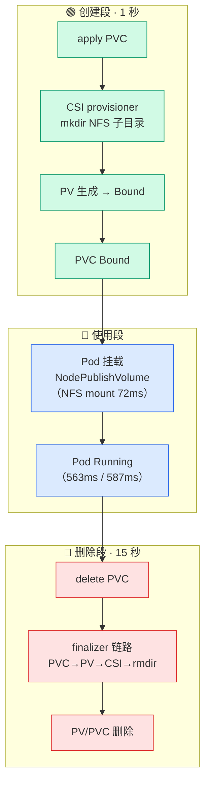
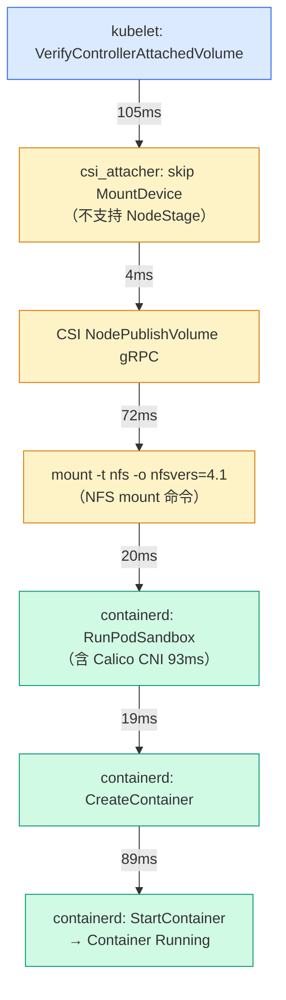

# K8s 存储毫秒级拆解：一个 PVC 的 563 毫秒全链路时间线

> 存储系列第 3 篇。第 1 篇讲了 PV/PVC 基础概念和生命周期，第 2 篇搭好了 NFS CSI 存储层（StorageClass + csi-driver-nfs + 动态供应）。这篇用它跑一个最简单的 Pod——1Gi PVC + busybox——然后用三个数据源把从 PVC 创建到 Pod 启动到 PVC 删除的每一步拆到毫秒级。

## Pod 冷启 563ms，kubectl wait 骗了你 15 秒

我一开始以为 K8s 启动一个 Pod 要 15 秒。

apply 一个 Pod，用 `kubectl wait` 等 Ready，返回时距 apply 已过去 15 秒：

```bash
kubectl apply -f pod-timeline.yaml && kubectl wait --for=condition=ready pod/pod-timeline --timeout=120s && date '+%H:%M:%S'
# 15 秒后返回
```

"K8s 挺慢的"——我是这么想的。

直到我换了个方式计时。不看 `kubectl wait` 什么时候返回，而是看 Pod 对象里 apiserver 记录的 `startedAt`：

```bash
kubectl get pod pod-timeline -o jsonpath='{.status.containerStatuses[0].state.running.startedAt}{"\n"}'
# 2026-08-24T03:25:14Z（= 北京时间 11:25:14）
```

apply 发起是 11:25:13，容器真正启动是 11:25:14——**不到 1 秒**。那 15 秒去哪了？

答案是 `kubectl wait` 当天的返回时刻出了问题。初版这里把那 15 秒归因于 jsonpath 模式的"定期轮询"——这个归因在存储系列第 4 篇的复测里被推翻了：同样的 `apply && wait && date` 链式命令，后续实验 1 秒返回。翻了 kubectl 源码（v1.36 wait.go）：整个 wait 命令只有 `--for=create` 是轮询（500ms，源码里还留着 TODO 自嘲"not ideal solution"），condition 和 jsonpath 两种模式都走 watch，没有 15 秒级的机制差异。那 15 秒更像当天 VIP 后面某条 apiserver 请求路径的一次性滞后。K8s 本身不慢，慢的是我用来观测它的"秒表"。

做时间线只信 apiserver 记录的对象时间戳（`startedAt`、`lastPhaseTransitionTime`），不要信 kubectl 的返回时刻——它既包含 watch 事件传递延迟，也可能踩中慢路径。

这篇文章就用三个数据源把这个问题拆到底，把一个 PVC 从创建到 Pod 启动到删除的每一步都精确到毫秒。结论先放这：**Pod 冷启只要 563ms，其中 NFS mount 占 72ms，真正的瓶颈是 Calico CNI（93ms）和 RunPodSandbox（247ms）。**

## 三个数据源

要拆毫秒级时间线，单一数据源不够。`kubectl get events` 只到秒级，`kubectl wait` 有观测延迟。我用了三个数据源交叉验证：

| 数据源 | 能看到什么 | 精度 |
|---|---|---|
| kubelet journal | VerifyControllerAttachedVolume / MountDevice skip / volume manager 状态 | 毫秒（klog 时间戳，UTC） |
| containerd journal | RunPodSandbox / CreateContainer / StartContainer 的 gRPC 调用 | 毫秒（containerd 时间戳，CST） |
| csi-nfs-node gRPC 日志 | NodePublishVolume gRPC 调用全链路（含 mount 命令执行） | 毫秒（klog 时间戳，UTC） |

再加一个 NFS 服务器侧的 `inotifywait`，监控 `/nfs/k8s` 目录的 create/delete 事件，精确到秒——作为 CSI provisioner 真的在 NFS 上做了 mkdir/rmdir 的实锤证据。

环境信息：

| 组件 | 版本 |
|---|---|
| K8s | 1.36.1（kubeadm，3 master + 3 worker） |
| CNI | Calico（IPIP 隧道模式） |
| CSI | csi-driver-nfs（nfs.csi.k8s.io） |
| NFS 服务器 | 192.168.114.155，Debian 13，导出 `/nfs/k8s` |
| Pod | busybox:1.36，挂载 1Gi PVC 到 `/data` |

关键命令：

```bash
# NFS 服务器上：监控目录创建/删除
sudo inotifywait -m --timefmt '%H:%M:%S' --format '%T %e %f' -e create,delete /nfs/k8s

# worker01 上：抓 kubelet journal（时间窗精确到秒）
sudo journalctl -u kubelet --since "2026-08-24 11:25:13" --until "2026-08-24 11:25:15" --no-pager -o short-iso \
  | grep -iE 'bc16032a|MountVolume|NodeStage|NodePublish'

# worker01 上：抓 containerd journal
sudo journalctl -u containerd --since "2026-08-24 11:25:13" --until "2026-08-24 11:25:15" --no-pager -o short-iso \
  | grep -iE 'pod-timeline|RunPodSandbox|CreateContainer|StartContainer'

# master01 上：抓 csi-nfs-node 的 NFS driver 容器日志
kubectl -n kube-system logs csi-nfs-node-rrscc -c nfs --since=3h | grep -E '03:25:1[3-5]|03:33:1[7-9]'
```

!!! warning "grep 关键词用 PV UID 片段，不要用 Pod 名"
    kubelet volume 日志引用的是 PV 名 `pvc-bc16032a-...`，不是 Pod 名 `pod-timeline`。grep `pod-timeline` 在 kubelet journal 里会空手而归。用 PV UID 片段 `bc16032a` 作为关键词。

!!! note "csi-nfs-node 日志要 -c nfs 指定容器"
    `kubectl logs csi-nfs-node-rrscc` 默认选第一个容器（liveness-probe），不是 NFS driver。要加 `-c nfs` 才能看 NodePublishVolume gRPC 日志。这个坑我踩过——第一次跑出来是空的，还以为 CSI driver 没打日志。

每行日志可能出现两个时间戳：journalctl 行首的是本地时间（CST，UTC+8），日志内容里 klog 自带的是 UTC。做时间线时以 klog 的时间戳为准（毫秒级精确），journal 行首只当定位用。对应关系：`03:25:13.855 UTC` = `11:25:13.855 CST`。

## PVC 创建：一秒完成，kubectl wait 晚了十五秒

先创建 PVC：

```bash
kubectl apply -f pvc-timeline.yaml && date '+%H:%M:%S'
kubectl wait --for=jsonpath='{.status.phase}'=Bound pvc/pvc-timeline --timeout=120s && date '+%H:%M:%S'
```

把所有时间戳对齐到北京时间：

```
11:24:20  apply PVC（kubectl 返回 created）
11:24:20  NFS inotifywait: CREATE,ISDIR pvc-bc16032a-...     ← provisioner 在 NFS 上 mkdir
11:24:20  事件: ProvisioningSucceeded                          ← PV 已生成
11:24:20  PV creationTimestamp / lastPhaseTransitionTime       ← PV 进 Bound
11:24:20  PVC creationTimestamp（bound-by-controller annotation）
11:24:35  kubectl wait 返回 condition met                      ← 整整晚了 15 秒
```

CSI provisioner 从 PVC 创建到 PV Bound、NFS mkdir、PVC 绑定——**全在 11:24:20 这一秒内完成**。但 `kubectl wait` 到 11:24:35 才返回。差的 15 秒不是 K8s 控制面慢。

为什么 kubectl wait 那天慢了 15 秒？初版归因于 jsonpath 模式的"定期轮询"——**这个归因是错的**。存储系列第 4 篇复测时同样的 `apply && wait && date` 链式命令 1 秒返回，翻了 kubectl 源码（v1.36 wait.go）确认：wait 命令只有 `--for=create` 是轮询（500ms，源码 TODO 自嘲），condition 和 jsonpath 两种 mode 都走 watch，没有 15 秒级的机制差异。那 15 秒更像当天 VIP 后面某条 apiserver 请求路径的一次性滞后。

!!! tip "做时间线用对象时间戳，不要用 kubectl wait 返回时刻"
    `startedAt`、`lastPhaseTransitionTime`、`creationTimestamp` 这些是 apiserver 记录的对象时间戳，精确到秒（部分到毫秒）。`kubectl wait` 返回时刻是客户端"秒表"，既包含 watch 事件传递延迟，也可能踩中慢路径——0 到 15 秒的观测误差都见过。做时间线时优先用对象时间戳。

PVC 的完整生命周期是这样的：



创建 1 秒，删除 15 秒——为什么差这么多？后面 PVC 删除段会拆。

## Pod 启动：563ms 全链路拆解

PVC Bound 后创建 Pod，用 `apply && wait && date` 连成一行消除敲命令间隔：

```bash
kubectl apply -f pod-timeline.yaml && kubectl wait --for=condition=ready pod/pod-timeline --timeout=120s && date '+%H:%M:%S'
```

先看全貌。Pod 冷启从 kubelet 发现 volume 到容器启动，经过六个阶段：



蓝色是 kubelet，琥珀色是 CSI，绿色是 containerd。每条边上的数字是耗时。

### 冷启 563ms 毫秒级时间线

T+0 = `VerifyControllerAttachedVolume` 时刻（11:25:13.855222 CST）：

```
T+0      13.855222  kubelet: VerifyControllerAttachedVolume（pvc + kube-api-access）
T+105ms  13.960063  csi_attacher: STAGE_UNSTAGE_VOLUME not set. Skipping MountDevice
T+105ms  13.960108  MountVolume.MountDevice "succeeded"（实际跳过）
T+109ms  13.964130  CSI: GRPC call NodePublishVolume 开始
T+110ms  13.964941  CSI: mount 命令开始执行
T+182ms  14.036972  CSI: mount 命令返回（72ms）
T+182ms  14.037001  CSI: gRPC response 返回
T+202ms  14.056700  containerd: RunPodSandbox 开始
T+257ms  14.112     Calico CNI: found existing endpoint
T+296ms  14.151     Calico IPAM: 分配 IP 10.244.5.35/32
T+350ms  14.205     Calico CNI: wrote endpoint to datastore
T+449ms  14.303737  RunPodSandbox 返回（247ms）
T+455ms  14.309697  CreateContainer 开始
T+474ms  14.328891  CreateContainer 返回（19ms）
T+474ms  14.329301  StartContainer 开始
T+563ms  14.418714  StartContainer 返回成功（89ms）
```

563ms，从 kubelet 发现 volume 到容器启动完成。六步耗时分解：

| 步骤 | 冷启 | 暖启 | 占比（冷启） |
|---|---|---|---|
| csi_attacher 检查 + skip MountDevice | 105ms | ~105ms | 19% |
| CSI NodePublishVolume gRPC（含 NFS mount） | 73ms | 71ms | 13% |
| kubelet 过渡（NodePublish → RunPodSandbox） | 20ms | 48ms | 4% |
| RunPodSandbox（含 Calico CNI 93ms） | 247ms | 252ms | 44% |
| CreateContainer | 19ms | 17ms | 3% |
| StartContainer | 89ms | 83ms | 16% |
| **总计** | **563ms** | **587ms** | 100% |

### MountDevice "succeeded" 但什么都没做

kubelet journal 打了这行日志：

```
I0824 03:25:13.960063 csi_attacher.go:354] kubernetes.io/csi: attacher.MountDevice
  STAGE_UNSTAGE_VOLUME capability not set. Skipping MountDevice...
I0824 03:25:13.960108 operation_generator.go:558] "MountVolume.MountDevice succeeded
  for volume \"pvc-bc16032a-...\""
```

我第一次看到这行日志时以为 MountDevice 做完了。实际不是。

csi-driver-nfs **没有声明 `STAGE_UNSTAGE_VOLUME` capability**（即不支持 NodeStageVolume gRPC 方法），attacher 检查完 capability 后直接跳过了 MountDevice 步骤，然后打了 "succeeded" 日志。这行日志是**误导性**的——succeeded 不代表真做了 mount，只是 attacher 标记"这步过了"。真正的 NFS mount 发生在后面的 NodePublishVolume 阶段。

!!! warning "MountDevice succeeded 是误导性日志"
    CSI 的两段式设计（NodeStage → NodePublish）不是所有 driver 都实现的。csi-driver-nfs 选择了只实现 NodePublish，每次 Pod 挂载时直接把 NFS 挂到 Pod 容器路径——不走 globalmount 缓存。简化但代价是每次 Pod 创建都要做一次完整的 NFS mount。看到 "MountDevice succeeded" 时不能假设 mount 真的做完了，要看 driver 是否支持 NodeStage。

### NFS mount 只要 72ms

csi-nfs-node 的 gRPC 日志记录了完整的 NodePublishVolume 调用链：

```
I0824 03:25:13.964130  utils.go:111] GRPC call: /csi.v1.Node/NodePublishVolume
I0824 03:25:13.964921  Detected OS without systemd
I0824 03:25:13.964941  Mounting cmd: mount -t nfs -o nfsvers=4.1
  192.168.114.155:/nfs/k8s/pvc-bc16032a-... /var/lib/kubelet/pods/.../mount
I0824 03:25:14.036972  skip chmod on targetPath (mountPermissions=0)
I0824 03:25:14.037001  GRPC response: {}
```

`mount` 命令从执行到返回：13.964941 → 14.036972 = **72.031ms**。gRPC 总耗时 72.871ms（多了不到 1ms 的 gRPC 框架开销）。

NFS 的"慢"名声在这里被彻底翻案——`mount -t nfs -o nfsvers=4.1` 只要 72ms，这包括了 NFS 协议握手、挂载点注册、内核 NFS 客户端初始化。

### 瓶颈是 Calico CNI 不是 NFS

RunPodSandbox 耗时 247ms，是六步中最大的块（44%）。拆开看：

```
14.112  Calico CNI: found existing endpoint
14.151  Calico IPAM: 分配 IP 10.244.5.35/32        ← 39ms
14.205  Calico CNI: wrote endpoint to datastore     ← 54ms
14.304  RunPodSandbox 返回                           ← 99ms（sandbox 容器创建）
```

Calico CNI 小计 93ms（found endpoint → wrote endpoint），containerd sandbox 容器创建 154ms。**网络配置（CNI 93ms + sandbox 154ms = 247ms）比存储挂载（NFS mount 72ms）还慢 3.4 倍。** 如果要优化 Pod 启动速度，该看的是 CNI 不是 CSI。

### 暖启 587ms，暖启不暖

删掉 Pod 后重新 apply（PVC 还在，NFS 子目录还在），测暖启。和冷启对比：

| 步骤 | 冷启 | 暖启 | 差异 |
|---|---|---|---|
| csi_attacher 检查 + skip | 105ms | ~105ms | 0 |
| CSI NodePublish gRPC | 73ms | 71ms | -2ms |
| kubelet 过渡 | 20ms | 48ms | +28ms |
| RunPodSandbox | 247ms | 252ms | +5ms |
| CreateContainer | 19ms | 17ms | -2ms |
| StartContainer | 89ms | 83ms | -6ms |
| **总计** | **563ms** | **587ms** | **+24ms** |

暖启反而比冷启慢 24ms。差异主要在 kubelet 过渡时间（20ms → 48ms），这是系统负载波动。

"暖启"这个名字有误导性——每次 Pod 创建都要重新走 CNI（分配 IP、设置 veth）+ CSI NodePublish（NFS mount）+ 容器创建启动，没有真正可以复用的"热"状态。所谓的"暖"只是镜像在本地有缓存（`Pulled: already present on machine`），省掉的只是镜像拉取时间。对 busybox 这种 4MB 镜像来说，这个省略几乎看不出差异。

## PVC 删除：十五秒，创建快删除慢

```bash
kubectl delete pod pod-timeline && date '+%H:%M:%S'
kubectl delete pvc pvc-timeline && date '+%H:%M:%S'
```

### Pod 删除：31 秒

```
11:32:06  events: Killing: Stopping container main
11:32:37  kubectl delete pod 返回
```

31 秒 = 30s grace period + 1s 处理开销。busybox 的 `sh -c "sleep 3600"` 让 sh 当 PID 1，SIGTERM 不会转发给 sleep 子进程，sh 自己也不退出，等到 30s grace period 到期后被 SIGKILL 强杀。这是经典的 PID 1 信号问题——如果容器用 `sleep 3600` 直接当 command（而不是 `sh -c "sleep 3600"`），SIGTERM 会直接发给 sleep 进程，Pod 删除只要不到 1 秒。

### PVC 删除：15 秒

```
11:35:39  kubectl delete pod 返回（Pod 先删完）
11:35:39+ kubectl delete pvc 发起
11:35:54  kubectl delete pvc 返回
11:35:54  NFS inotifywait: DELETE,ISDIR pvc-bc16032a-...     ← 同秒 rmdir
```

PVC 删除花了 15 秒，而创建只要 1 秒。NFS rmdir 本身是同秒完成（11:35:54），15 秒花在了 finalizer 多 controller 协作链路上：

```
delete pvc
  → PVC 进入 Terminating，finalizer:kubernetes.io/pvc-protection 阻止删除
  → pv-controller 等待 PV 释放（claimRef 清除）
  → PV 进入 Released，finalizer:external-provisioner.volume.kubernetes.io/finalizer 阻止删除
  → CSI provisioner 收到删除请求，通过 NFS 协议 rmdir 子目录（同秒完成）
  → PV finalizer 清除，PV 被删除
  → PVC finalizer 清除，PVC 被删除
  → kubectl delete pvc 返回
```

创建是 provisioner 单跳直连（CSI gRPC → NFS mkdir → PV 生成 → PVC 绑定，一气呵成），删除要走 finalizer 多 controller 协作链路（PVC finalizer → pv-controller → PV finalizer → CSI provisioner → rmdir → 清理 finalizer → 删除对象），每一步都有控制循环的轮询延迟。

`kubectl get pv -w` 终端实时看到了 PV 状态转换：

```
pvc-bc16032a-...   Bound      default/pvc-timeline   nfs-csi   10m
pvc-bc16032a-...   Released   default/pvc-timeline   nfs-csi   11m
pvc-bc16032a-...   Terminating default/pvc-timeline   nfs-csi   11m
pvc-bc16032a-...   Terminating default/pvc-timeline   nfs-csi   11m
```

!!! warning "kubectl get pv,pvc -w 不支持"
    `kubectl get pv,pvc -w` 会报 `you may only specify a single resource type`。kubectl 不支持同时 watch 多个资源类型。要同时看 PV 和 PVC 的状态变化，得开两个终端分别 `kubectl get pv -w` 和 `kubectl get pvc -w`。

## 六个反直觉发现 + 验证命令

一路拆下来，有六个发现和我最初的直觉相反：

| # | 发现 | 真相 | 证据 |
|---|---|---|---|
| 1 | `kubectl wait` 返回要 15s，K8s 好慢 | Pod 实际 563ms 就启动完了，15s 是 kubectl wait 客户端观测延迟 | startedAt vs wait 返回时刻 |
| 2 | MountDevice "succeeded" 说明挂载完成了 | csi-driver-nfs 不支持 NodeStage，MountDevice 被跳过，succeeded 是误导性日志 | csi_attacher.go:354 日志 |
| 3 | NFS mount 很慢 | `mount -t nfs` 命令只要 72ms | csi-nfs-node gRPC 日志 |
| 4 | 存储挂载是 Pod 启动的瓶颈 | CNI 网络配置（247ms）比 NFS mount（72ms）慢 3.4 倍 | containerd journal |
| 5 | 暖启应该比冷启快 | 暖启 587ms vs 冷启 563ms，没有可以复用的"热"状态 | 毫秒级时间线对比 |
| 6 | 删除应该比创建快（对象更小了） | PVC 创建 1s、删除 15s，删除走 finalizer 多 controller 协作链路 | NFS inotifywait + delete 返回时刻 |

### 验证命令

以下命令在本实验中全部实际执行过，输出已验证。按顺序执行可以复现整条时间线。

**1. 实验清单（pvc-timeline.yaml）：**

```yaml
apiVersion: v1
kind: PersistentVolumeClaim
metadata:
  name: pvc-timeline
  namespace: default
spec:
  accessModes: ["ReadWriteMany"]
  resources:
    requests:
      storage: 1Gi
  storageClassName: nfs-csi
```

**2. 实验清单（pod-timeline.yaml）：**

```yaml
apiVersion: v1
kind: Pod
metadata:
  name: pod-timeline
  namespace: default
spec:
  containers:
  - name: main
    image: m.daocloud.io/docker.io/busybox:1.36
    command: ["sh", "-c", "sleep 3600"]
    volumeMounts:
    - name: data
      mountPath: /data
  volumes:
  - name: data
    persistentVolumeClaim:
      claimName: pvc-timeline
```

**3. NFS 服务器侧 inotifywait：**

```bash
# 在 NFS 服务器上执行，监控 /nfs/k8s 的目录创建/删除事件
sudo inotifywait -m --timefmt '%H:%M:%S' --format '%T %e %f' -e create,delete /nfs/k8s
```

**4. PVC 创建 + Bound 等待：**

```bash
kubectl apply -f pvc-timeline.yaml && date '+%H:%M:%S'
kubectl wait --for=jsonpath='{.status.phase}'=Bound pvc/pvc-timeline --timeout=120s && date '+%H:%M:%S'
```

**5. Pod 创建 + Ready 等待（apply 和 wait 用 && 连一行消除敲命令间隔）：**

```bash
kubectl apply -f pod-timeline.yaml && kubectl wait --for=condition=ready pod/pod-timeline --timeout=120s && date '+%H:%M:%S'
kubectl get pod pod-timeline -o jsonpath='{.status.containerStatuses[0].state.running.startedAt}{"\n"}'
```

**6. kubelet journal（worker01 上，时间窗精确到秒）：**

```bash
# 冷启段
sudo journalctl -u kubelet --since "2026-08-24 11:25:13" --until "2026-08-24 11:25:15" --no-pager -o short-iso \
  | grep -iE 'bc16032a|MountVolume|NodeStage|NodePublish'

# 暖启段
sudo journalctl -u kubelet --since "2026-08-24 11:33:18" --until "2026-08-24 11:33:19" --no-pager -o short-iso \
  | grep -iE 'bc16032a|MountVolume|NodeStage|NodePublish'
```

**7. containerd journal（worker01 上）：**

```bash
sudo journalctl -u containerd --since "2026-08-24 11:25:13" --until "2026-08-24 11:25:15" --no-pager -o short-iso \
  | grep -iE 'pod-timeline|RunPodSandbox|CreateContainer|StartContainer'
```

**8. csi-nfs-node gRPC 日志（master01 上，-c nfs 指定容器）：**

```bash
# 先找 csi-nfs-node 在目标 worker 上的 Pod
kubectl -n kube-system get pods -o wide | grep csi-nfs-node | grep worker01

# 看日志（注意 csi 日志时间戳是 UTC）
kubectl -n kube-system logs <csi-nfs-node-pod> -c nfs --since=3h | grep -E '03:25:1[3-5]|03:33:1[7-9]'
```

**9. PVC/PV 状态实时 watch（开第二个终端）：**

```bash
# 注意：kubectl 不支持 pv,pvc 多资源 watch，只能分开
kubectl get pv -w
# 另一个终端
kubectl get pvc -w
```

**10. 反向段（先开 watch 终端，再执行删除）：**

```bash
kubectl delete pod pod-timeline && date '+%H:%M:%S'
kubectl delete pvc pvc-timeline && date '+%H:%M:%S'
```

---

> **下一篇预告**：存储系列第 4 篇——[动态供应 vs 静态供应](static-vs-dynamic-provisioning.md)。第 2 篇[搭 NFS CSI](csi-nfs-components.md)时已经用了动态供应（创建 PVC 自动生成 PV），但 K8s 还有另一种模式：先手建 PV 再建 PVC 绑定。两种模式有什么区别？什么时候该用哪个？回收策略（Retain / Delete / Recycle）在两种模式下表现一样吗？下篇用实验说话。

---

## 相关阅读

- [PV、PVC、StorageClass 三对象](pv-pvc-storageclass.md) — 系列第 1 篇，PV/PVC 基础概念与生命周期
- [CSI 到底拆了什么？](csi-nfs-components.md) — 系列第 2 篇，NFS CSI 存储层搭建
- [Kubernetes 存储资源](storage.md) — PV / PVC / StorageClass / VolumeSnapshot 概念总览
- [Linux NFS 服务安装（Debian 13）](../../../linux/storage/nfs-server-debian13.md) — 本实验的 NFS 服务端环境准备
