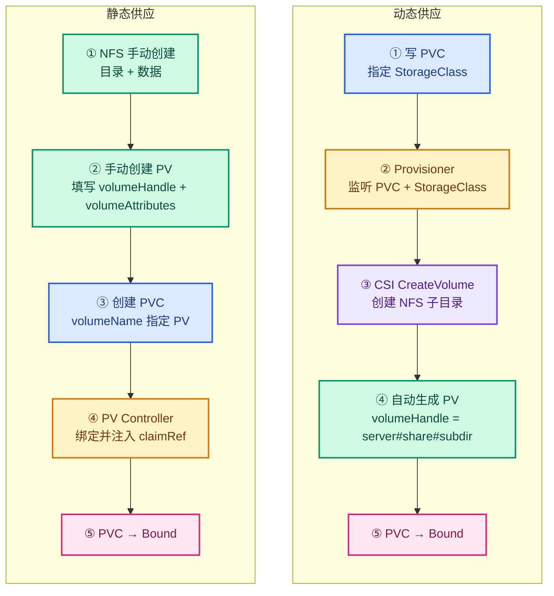

# K8s 存储第 4 篇：动态供应 vs 静态供应，谁在删你的数据

> 存储系列第 4 篇。[第 1 篇](pv-pvc-storageclass.md)讲了 PV/PVC 基础概念和生命周期，[第 2 篇](csi-nfs-components.md)搭好了 NFS CSI 存储层，[第 3 篇](pvc-timeline-ms-breakdown.md)把一个 PVC 从创建到删除拆到了毫秒级。这篇回到一个更基础的问题：动态供应和静态供应到底差在哪？以及——回收策略 Retain 和 Delete 在两种模式下表现一样吗？拆的过程中第 3 篇的一个结论被打脸了，先说这个。

## 两种供应模式：谁写 PV

一句话区分：**PV 谁写的**。你写的（或运维提前造好的）是静态，CSI provisioner 写的是动态。

第 2 篇搭的 NFS CSI 那套是动态供应：你只写 PVC，指定 StorageClass，K8s 发现没有匹配的空闲 PV，就调 CSI provisioner 自动创建 PV + 在 NFS 上建子目录。第 3 篇里 `pvc-bc16032a-...` 子目录自动冒出来就是它干的。

静态供应反着来：你先在 NFS 服务器上手建目录、放数据，然后手写 PV yaml 把这个目录描述给 K8s，再写 PVC 绑定它。K8s 只负责配对，不负责创建。



!!! note "storageClassName: 空字符串的语义"
    静态 PVC 里写 `storageClassName: ""` 不是"没指定"，是**明确禁止动态供应**——告诉 K8s 只找现成 PV，不要调 provisioner。如果留空（不写这个字段），K8s 会用集群默认 SC 去试动态供应。两个字段的区别：不写 = 用默认 SC，写空字符串 = 不用任何 SC。

静态 PV 的 yaml 长这样：

```yaml
apiVersion: v1
kind: PersistentVolume
metadata:
  name: pv-static
spec:
  capacity:
    storage: 1Gi
  accessModes:
    - ReadWriteMany
  persistentVolumeReclaimPolicy: Retain
  storageClassName: ""
  mountOptions:
    - nfsvers=4.1
  csi:
    driver: nfs.csi.k8s.io
    volumeHandle: "192.168.114.155#nfs/k8s#static-data"
    volumeAttributes:
      server: 192.168.114.155
      share: /nfs/k8s
      subdir: static-data
```

两个关键字段：`volumeHandle` 和 `volumeAttributes`。大部分教程告诉你"volumeHandle 随便写个唯一 ID 就行"——技术上能跑，但埋了删除行为的雷。后面拆。

## 静态供应全流程：存量数据直接可用

先跑通最基本的事：手建 PV 能不能让 Pod 读到 NFS 上已有的数据。

NFS 服务器上手动建目录、放一个文件：

```bash
# k8s-nfs 上
sudo mkdir -p /nfs/k8s/static-data
echo "hello from static pv, created $(date '+%H:%M:%S')" | sudo tee /nfs/k8s/static-data/before-k8s.txt
# 输出：hello from static pv, created 10:31:16
```

apply PV → Available，apply PVC（`volumeName: pv-static` + `storageClassName: ""`）→ Bound，claimRef 注入。然后跑 Pod 挂这个 PVC：

```bash
# master01 上
kubectl apply -f pv-static.yaml
kubectl get pv pv-static        # Available
kubectl apply -f pvc-static.yaml
kubectl get pv pv-static       # Bound, claimRef 指向 default/pvc-static
kubectl apply -f pod-static.yaml
kubectl logs pod-static
# 输出：hello from static pv, created 10:31:16
```

Pod 读到了 K8s 之前就存在的文件。这就是静态供应的核心价值：**存量数据不用迁移，直接挂进集群**。动态供应做不到这一点——provisioner 建的是空目录。

Pod 往 NFS 上写了个文件，验证读写双向通：

```bash
# NFS 服务器上
ls /nfs/k8s/static-data/
# before-k8s.txt  from-k8s.txt
cat /nfs/k8s/static-data/from-k8s.txt
# hello from pod-static
```

两个文件都在：NFS 预置的 + Pod 写的。

## volumeHandle 的两副面孔

这是这篇最反直觉的发现。同一个字段 `volumeHandle`，挂载时和删除时扮演完全不同的角色。

### 挂载时：只用 volumeAttributes，volumeHandle 不参与

翻 csi-driver-nfs v4.13.4 的源码，`nodeserver.go` L79-121 是 NodePublishVolume 的实现：

```go
// nodeserver.go L79-105
for k, v := range req.GetVolumeContext() {
    switch strings.ToLower(k) {
    case paramServer:   // "server"
        server = v
    case paramShare:    // "share"
        baseDir = v
    case paramSubDir:  // "subdir"
        subDir = v
    // ...
    }
}
if server == "" { return error }
if baseDir == "" { return error }
source := fmt.Sprintf("%s:%s", server, baseDir)
if subDir != "" {
    source = fmt.Sprintf("%s/%s", source, subDir)
}
// mount source 到 Pod 容器路径
```

mount 的 source 是 `server:share/subdir`——全从 `volumeAttributes` 来。`volumeHandle`（gRPC 请求里的 `volume_id`）只用来做锁 key 和打日志：

```go
// nodeserver.go L55
volumeID := req.GetVolumeId()
lockKey := fmt.Sprintf("%s-%s", volumeID, targetPath)  // 只用于锁
```

第 3 篇的 gRPC 日志实锤：动态供应的 `volume_id` 是 `192.168.114.155#nfs/k8s#pvc-bc16032a-...##`，但 mount 命令用的是 `192.168.114.155:/nfs/k8s/pvc-bc16032a-...`——后者来自 volumeAttributes 的 server/share/subdir，不是 volumeHandle。

### 删除时：volumeHandle 是 CSI 的寻址信息

DeleteVolume 的源码在 `controllerserver.go` L213-300：

```go
// controllerserver.go L218-222
nfsVol, err := getNfsVolFromID(volumeID)   // 解析 volumeHandle
if err != nil {
    klog.Warningf("failed to get nfs volume for volume id %v deletion: %v", volumeID, err)
    return &csi.DeleteVolumeResponse{}, nil  // 返回成功，什么都不删
}
// 解析成功 → mount base share → rmdir 子目录 → unmount
```

`getNfsVolFromID` 从 volumeHandle 里拆出 server / baseDir / subDir，然后挂载 base share、rmdir 子目录。**如果解析失败，直接返回成功——PV 对象会被删，但 NFS 数据原封不动。**

volumeHandle 的标准格式（源码 L91 注释 + utils.go L39 定义分隔符）：

```
新格式: server#baseDir#subDir[#uuid][#onDelete]    分隔符是 #
旧格式: server/baseDir/subDir                      分隔符是 /（兼容遗留）
```

### 两次解析尝试：# 失败了试 /

`getNfsVolFromID` 的完整逻辑（L809-820）：

```go
// controllerserver.go L809-820
segments := strings.Split(id, separator)          // separator = "#"
if len(segments) < 3 {
    klog.V(2).Infof("could not split %s ... separator(%s)", id, separator)  // 日志说 #
    // try with separator "/"
    volRegex := regexp.MustCompile("^([^/]+)/(.*)/([^/]+)$")
    tokens := volRegex.FindStringSubmatch(id)
    if len(tokens) < 4 {
        return nil, fmt.Errorf("could not split %s ... separator(%s)", id, "/")  // 报错说 /
    }
    server, baseDir, subDir = tokens[1], tokens[2], tokens[3]
}
```

先按 `#` 拆，拆不开再按旧格式 `/` 正则拆。两次都失败才报错。源码注释里两种格式的样例都有写。

### 实验 C1：假 handle，PV 删了数据活了

第一个验证：给静态 PV 一个随便写的 volumeHandle `"my-static-vol-1"`，reclaimPolicy 设 Delete，看删 PVC 后发生什么。

```bash
# master01 上
kubectl apply -f pv-static-delete1.yaml   # volumeHandle: "my-static-vol-1", Delete
kubectl apply -f pvc-static-delete1.yaml  # volumeName: pv-static-delete1, storageClassName: ""
kubectl delete pvc pvc-static-delete1
# PV NotFound — PV 对象被删了
# NFS 上 ls /nfs/k8s/static-data-delete/ → before-k8s.txt 还在
```

PV 对象消失了，NFS 数据活着。CSI 日志（`csi-nfs-controller -c nfs`）里抓到完整过程：

```
I0825 02:46:54.170980  GRPC call: /csi.v1.Controller/DeleteVolume
I0825 02:46:54.170998  GRPC request: {"volume_id":"my-static-vol-1"}
I0825 02:46:54.171048  controllerserver.go:811] could not split my-static-vol-1 ... separator(#)
W0825 02:46:54.171218  controllerserver.go:221] failed to get nfs volume ... separator(/)
I0825 02:46:54.171230  GRPC response: {}
```

DeleteVolume gRPC 调用只花了 **0.25 毫秒**——收到请求、解析失败、返回成功。CSI 撒了个谎，只花了一秒的千分之二。

!!! warning "两条日志的分隔符不一样"
    INFO 行（L811）说 `separator(#)`，WARNING 行（L221）说 `separator(/)`——同一次调用，两个分隔符。原因是源码做了两次解析尝试：第一次按 `#`（打 INFO 日志），失败后按旧格式 `/` 正则拆（返回带 `/` 的错误）。WARNING 包装的是第二次的错误，所以显示 `/`。

### 实验 C2：真 handle，PV 删了数据也删了

同一个 NFS 目录，volumeHandle 写标准格式 `192.168.114.155#nfs/k8s#static-data-delete`，reclaimPolicy Delete，删 PVC：

```bash
kubectl apply -f pv-static-delete2.yaml   # volumeHandle: "192.168.114.155#nfs/k8s#static-data-delete"
kubectl apply -f pvc-static-delete2.yaml
kubectl delete pvc pvc-static-delete2
# PV NotFound — 删了
# NFS 上 ls /nfs/k8s/static-data-delete/ → No such file or directory
```

这次 NFS 子目录真没了。CSI 日志抓到完整删除链路：

```
I0825 02:48:05.646275  GRPC request: {"volume_id":"192.168.114.155#nfs/k8s#static-data-delete"}
I0825 02:48:05.646325  internally mounting 192.168.114.155:/nfs/k8s at /tmp/static-data-delete
I0825 02:48:05.646552  Mounting cmd: mount -t nfs 192.168.114.155:/nfs/k8s /tmp/static-data-delete
I0825 02:48:05.697388  skip chmod (mountPermissions=0)           ← mount 完成 51ms
I0825 02:48:05.697498  removing subdirectory at /tmp/.../static-data-delete
I0825 02:48:05.702646  DeleteVolume: removing empty directories   ← rmdir 完成 5ms
I0825 02:48:05.734769  Deleting path
```

全程 **88.6ms**：内部 mount base share 51ms + rmdir 5ms + unmount/cleanup 32ms。rmdir 本身只要 5 毫秒。

### volumeHandle 写错的两种后果

| volumeHandle 写法 | 能挂载 | 删除时 | NFS 数据 |
|---|---|---|---|
| `my-static-vol-1`（无分隔符） | ✅ | 解析失败 → 返回成功 | **保留** |
| `192.168.114.155#nfs/k8s#static-data-delete`（标准格式） | ✅ | 解析成功 → mount + rmdir | **删除** |
| `192.168.114.155/nfs/k8s/static-data`（旧格式） | ✅ | 正则解析成功 → mount + rmdir | **删除** |

!!! warning "假 handle 不是随便写都安全"
    写成无分隔符的字符串（如 `my-static-vol-1`）解析失败，数据保留——这看起来像"安全"，但它是意外，不是设计。写成旧格式 `/` 的假 handle 会被正则解析成功，**照样删数据**。"随便写个唯一 ID"的建议只在挂载时成立——删除时它成了 CSI 的寻址信息，同一个字段两副面孔。

## 回收策略矩阵

### Retain：PV 停在 Released，数据永存

**实验 A + B：静态 PV + Retain 的完整生命周期**

实验 A 里 Pod 跑完、写完数据后，删 Pod + 删 PVC：

```bash
kubectl delete pod pod-static
kubectl delete pvc pvc-static
kubectl get pv pv-static
# NAME       STATUS      CLAIM                  RECLAIM POLICY
# pv-static  Released    default/pvc-static     Retain
```

PV 进 Released，claimRef 还指着已删的 pvc-static。NFS 上数据还在（`ls` 确认 before-k8s.txt + from-k8s.txt 都在）。

**Retain 复活**——清掉 claimRef，PV 回 Available，新 PVC 能重新绑定：

```bash
kubectl patch pv pv-static --type json -p '[{"op":"remove","path":"/spec/claimRef"}]'
kubectl get pv pv-static        # Available
kubectl apply -f pvc-static.yaml
kubectl get pv pv-static        # Bound
```

新 Pod 挂这个 PVC，读到了**两个文件**——NFS 预置的 + 上一轮 Pod 写的：

```bash
kubectl logs pod-static2
# before-k8s.txt
# from-k8s.txt
# hello from static pv, created 10:31:16
# hello from pod-static
```

Retain 的数据不是"删了留着"，是"留着能用"——手动复活后旧数据照读。

**实验 D：动态 PV + SC 设 Retain**

新建一个 SC `nfs-csi-retain`（和第 2 篇的 `nfs-csi` 参数一样，只改 reclaimPolicy），建 PVC → Bound → 删 PVC：

```bash
kubectl delete pvc pvc-dynamic-retain && date
# persistentvolumeclaim "pvc-dynamic-retain" deleted
kubectl get pv pvc-d307f32b-...
# STATUS: Released, CLAIM: default/pvc-dynamic-retain
# NFS: ls /nfs/k8s/ | grep pvc-d307f32b → 子目录还在
```

!!! note "SC 的 reclaimPolicy 是 immutable"
    SC 创建后 reclaimPolicy 改不了。要改只能建新的 SC——不能拿已有 SC 去改，会报 `field is immutable`。我第一轮实验就是在这卡住的：把 `nfs-csi-retain` 的 name 写成了 `nfs-csi`（和已有 SC 同名），apply 报错。

inotifywait 在 PVC 删除时**完全静默**——没有 DELETE 事件。对比第 3 篇动态 + Delete 的 `DELETE,ISDIR`（同秒 rmdir）：Retain 的 CSI 完全不动，数据保留，清理责任在管理员。

手动清理 Retain 的残留：

```bash
kubectl patch pv <PV名> --type json -p '[{"op":"remove","path":"/spec/claimRef"}]'
kubectl delete pv <PV名>
# NFS 上：sudo rm -rf /nfs/k8s/<子目录名>
```

### Delete：动态 vs 静态都删 PV 对象，但 NFS 数据删不删取决于 volumeHandle

实验 C1 + C2 已经拆完了，这里对照动态 + Delete（第 3 篇）一起看：

| 供应方式 | reclaimPolicy | volumeHandle | PV 对象 | NFS 数据 |
|---|---|---|---|---|
| 动态（第 3 篇） | Delete | provisioner 自动生成（标准格式） | 删 | 删（rmdir） |
| 静态（C1） | Delete | `my-static-vol-1`（解析不了） | 删 | **保留** |
| 静态（C2） | Delete | `192.168.114.155#nfs/k8s#static-data-delete` | 删 | 删（rmdir） |

!!! note "external-provisioner 会认领静态 PV"
    我原以为静态 PV 没有 `pv.kubernetes.io/provisioned-by` annotation，provisioner 不会管它。翻源码打脸：sig-storage-lib 的 `isProvisionerForVolume` 里，静态 CSI PV 的归属由 `spec.csi.driver` 字段决定——driver 匹配 `nfs.csi.k8s.io`，provisioner 就认领。Released + Delete 策略就触发 DeleteVolume。所以静态 PV + Delete **真的会被 provisioner 删**——和动态 PV 走同一条 DeleteVolume 链路。

## 删除耗时真相（修正第 3 篇）

第 3 篇写了两个 15 秒：kubectl wait 晚 15 秒返回、kubectl delete pvc 花 15 秒。当时把 wait 的 15 秒归因于 jsonpath 模式的"定期轮询"——这个归因被这轮实验推翻了。

### 复测：同样的命令，今天 1 秒

复刻第 3 篇的实验（挂载过的 PVC 删除），两轮：

```
─── run 1（逐条手敲）────────────────────────
14:16:46  apply PVC + wait → condition met          ← jsonpath wait 1 秒
14:16:56  apply Pod + wait → ready                   ← 1 秒
14:17:41  delete pod 返回（31s grace）
14:17:48  delete pvc 返回 + inotifywait DELETE       ← ~7 秒（含人工打字）

─── run 2（block-paste 四条命令）─────────────
14:19:10  apply PVC + wait → condition met          ← 1 秒
14:19:11  apply Pod + wait → ready                   ← 1 秒
14:19:44  delete pod 返回
14:19:44  delete pvc 返回 + inotifywait DELETE       ← 同秒，<1 秒
```

run 2 用 block-paste 去掉了人工打字延迟，delete pvc **同秒返回**。run 1 的 7 秒里有 6 秒是打字。

### 考古日志：DeleteVolume 只要 118 毫秒

翻昨天的 provisioner 日志（`--since=30h | grep '03:35'`），article 3 那条 PVC 的 DeleteVolume 调用链：

```
I0824 03:35:54.802347  GRPC call: DeleteVolume
I0824 03:35:54.804953  Mounting cmd: mount -t nfs 192.168.114.155:/nfs/k8s /tmp/...
I0824 03:35:54.881183  mount succeeded                    ← 76ms
I0824 03:35:54.881226  removing subdirectory
I0824 03:35:54.883310  removing empty directories done    ← rmdir 2ms
I0824 03:35:54.920612  GRPC response: {}                  ← 全程 118ms
I0824 03:35:54.945123  GRPC call: DeleteVolume（重试）
I0824 03:35:54.945201  "volume ... is already deleted"   ← 幂等空跑
```

**DeleteVolume 在 11:35:54 才被调用——和 rmdir + delete pvc 返回同秒。** CSI 只花了 118 毫秒。那 15 秒全在 `kubectl delete pvc` 命令发出到 DeleteVolume 被调用之间——控制面协调 + 人工打字。

### 统一结论

第 3 篇的两个 15 秒都是**当天的环境性抖动**：

- **wait 15 秒**：chained 命令（`apply && wait && date`），无人工延迟。今天同样的命令 1 秒返回。翻 kubectl 源码（v1.36 wait.go）：整个 wait 命令只有 `--for=create` 是轮询（500ms，源码里还留着 TODO 自嘲"not ideal solution"），condition 和 jsonpath 两种模式都走 watch，没有 15 秒级的机制差异。那 15 秒更像是 VIP 后面某条 apiserver 请求路径的一次性滞后。
- **delete 15 秒**：分开敲的两条命令（`delete pod && date` 之后手敲 `delete pvc && date`），15 秒里含人工打字时间。block-paste 去掉打字后 <1 秒。provisioner 日志实锤 DeleteVolume 118ms。

第 3 篇的 PV finalizers 我核了：只有 `external-provisioner` + `pv-protection`，没有 attacher——"等 detach"也排除。

**真正站得住的结论不变**：kubectl 的返回时刻什么都保证不了，做时间线只信 apiserver 记录的对象时间戳。但第 3 篇的机制归因（jsonpath 轮询慢）死了。

### 删除耗时终版对照

| 场景 | delete pvc → rmdir | 实测 | 证据 |
|---|---|---|---|
| 第 3 篇（挂载过，环境抖动） | ~15s | 环境性 + 人工打字 | 考古日志：DeleteVolume 11:35:54 才调用 |
| 复测 run 2（挂载过，block-paste） | <1s | 真实系统速度 | inotifywait DELETE 14:19:44 = delete 返回 |
| E（从未挂载） | <1s | 191ms（含 kubectl 启动） | `time` 输出 |
| CSI DeleteVolume（动态） | 118ms | mount 76ms + rmdir 2ms + unmount 37ms | 考古日志 |
| CSI DeleteVolume（静态 C2） | 88.6ms | mount 51ms + rmdir 5ms + cleanup 32ms | 实验日志 |
| CSI DeleteVolume（静态 C1，假 handle） | 0.25ms | 解析失败 → 返回成功 | 实验日志 |
| rmdir 命令本身 | 2-5ms | NFS REMOVE + RMDIR | 实验日志 |

!!! tip "为什么动态 DeleteVolume（118ms）比静态 C2（88.6ms）慢"
    两者走同一条代码路径（mount base share → rmdir → unmount），差异在 NFS mount 耗时：动态 76ms、静态 51ms。这是 NFS 协议握手的正常波动，不是动静态的结构差异。rmdir 本身都是 2-5ms。

## 六个反直觉发现

| # | 发现 | 真相 | 证据 |
|---|---|---|---|
| 1 | volumeHandle 随便写也能挂载 | 挂载时只用 volumeAttributes，volumeHandle 不参与 | nodeserver.go L79-121 |
| 2 | 静态 PV + Delete，PV 对象会被删 | provisioner 按 spec.csi.driver 认领静态 PV | sig-storage-lib isProvisionerForVolume |
| 3 | 假 handle 的 PV 删了，NFS 数据活了 | DeleteVolume 解析失败 → 返回成功不删 | C1 实验 + controllerserver.go L218-222 |
| 4 | 真假 handle 的唯一区别是 volumeHandle 格式 | 标准 `#` 或旧 `/` → 解析成功 → rmdir；无分隔符 → 解析失败 → 数据保留 | C1 vs C2 对比 |
| 5 | Retain 的数据能复活 | 清 claimRef → Available → 重新绑定 → 旧数据照读 | 实验 B |
| 6 | 第 3 篇的 15 秒是环境抖动 | 复测 <1 秒，DeleteVolume 118ms，wait 走 watch 不是轮询 | 复测 + 考古 + kubectl 源码 |

## 验证命令

以下命令供你复现。环境：K8s 1.36.1 + csi-driver-nfs v4.13.4 + Calico + 3 master + 3 worker，NFS 服务器 192.168.114.155 导出 `/nfs/k8s`。

**1. NFS 侧预置 + inotifywait（k8s-nfs 上）：**

```bash
sudo mkdir -p /nfs/k8s/static-data /nfs/k8s/static-data-delete
echo "hello from static pv" | sudo tee /nfs/k8s/static-data/before-k8s.txt
echo "hello from static-delete pv" | sudo tee /nfs/k8s/static-data-delete/before-k8s.txt
sudo inotifywait -m --timefmt '%H:%M:%S' --format '%T %e %f' -e create,delete /nfs/k8s
```

**2. 静态 PV + PVC + Pod（master01 上）：**

```bash
cat << 'EOF' | kubectl apply -f -
apiVersion: v1
kind: PersistentVolume
metadata:
  name: pv-static
spec:
  capacity: { storage: 1Gi }
  accessModes: ["ReadWriteMany"]
  persistentVolumeReclaimPolicy: Retain
  storageClassName: ""
  mountOptions: ["nfsvers=4.1"]
  csi:
    driver: nfs.csi.k8s.io
    volumeHandle: "192.168.114.155#nfs/k8s#static-data"
    volumeAttributes:
      server: 192.168.114.155
      share: /nfs/k8s
      subdir: static-data
---
apiVersion: v1
kind: PersistentVolumeClaim
metadata:
  name: pvc-static
spec:
  accessModes: ["ReadWriteMany"]
  resources: { requests: { storage: 1Gi } }
  volumeName: pv-static
  storageClassName: ""
---
apiVersion: v1
kind: Pod
metadata:
  name: pod-static
spec:
  containers:
  - name: main
    image: m.daocloud.io/docker.io/busybox:1.36
    command: ["sh", "-c", "cat /data/before-k8s.txt && echo 'hello from pod-static' >> /data/from-k8s.txt && sleep 3600"]
    volumeMounts:
    - name: data
      mountPath: /data
  volumes:
  - name: data
    persistentVolumeClaim:
      claimName: pvc-static
  nodeSelector:
    kubernetes.io/hostname: worker01
EOF
```

**3. Retain 复活（清 claimRef → 重绑）：**

```bash
kubectl delete pod pod-static
kubectl delete pvc pvc-static
kubectl get pv pv-static          # Released
kubectl patch pv pv-static --type json -p '[{"op":"remove","path":"/spec/claimRef"}]'
kubectl get pv pv-static          # Available
kubectl apply -f pvc-static.yaml  # 重新 Bound
```

**4. 静态 PV + Delete + 假 handle（C1）：**

```bash
cat << 'EOF' | kubectl apply -f -
apiVersion: v1
kind: PersistentVolume
metadata:
  name: pv-static-delete1
spec:
  capacity: { storage: 1Gi }
  accessModes: ["ReadWriteMany"]
  persistentVolumeReclaimPolicy: Delete
  storageClassName: ""
  mountOptions: ["nfsvers=4.1"]
  csi:
    driver: nfs.csi.k8s.io
    volumeHandle: "my-static-vol-1"
    volumeAttributes:
      server: 192.168.114.155
      share: /nfs/k8s
      subdir: static-data-delete
---
apiVersion: v1
kind: PersistentVolumeClaim
metadata:
  name: pvc-static-delete1
spec:
  accessModes: ["ReadWriteMany"]
  resources: { requests: { storage: 1Gi } }
  volumeName: pv-static-delete1
  storageClassName: ""
EOF
kubectl delete pvc pvc-static-delete1
kubectl get pv pv-static-delete1    # NotFound
# NFS: ls /nfs/k8s/static-data-delete/ → 数据还在

# 抓 CSI 日志
kubectl -n kube-system logs deploy/csi-nfs-controller -c nfs --since=5m \
  | grep -E 'DeleteVolume|could not split'
```

**5. 静态 PV + Delete + 真 handle（C2）：**

```bash
cat << 'EOF' | kubectl apply -f -
apiVersion: v1
kind: PersistentVolume
metadata:
  name: pv-static-delete2
spec:
  capacity: { storage: 1Gi }
  accessModes: ["ReadWriteMany"]
  persistentVolumeReclaimPolicy: Delete
  storageClassName: ""
  mountOptions: ["nfsvers=4.1"]
  csi:
    driver: nfs.csi.k8s.io
    volumeHandle: "192.168.114.155#nfs/k8s#static-data-delete"
    volumeAttributes:
      server: 192.168.114.155
      share: /nfs/k8s
      subdir: static-data-delete
---
apiVersion: v1
kind: PersistentVolumeClaim
metadata:
  name: pvc-static-delete2
spec:
  accessModes: ["ReadWriteMany"]
  resources: { requests: { storage: 1Gi } }
  volumeName: pv-static-delete2
  storageClassName: ""
EOF
kubectl delete pvc pvc-static-delete2
kubectl get pv pv-static-delete2    # NotFound
# NFS: ls /nfs/k8s/ | grep static-data-delete → 没了
```

**6. 动态 + Retain SC：**

```bash
cat << 'EOF' | kubectl apply -f -
apiVersion: storage.k8s.io/v1
kind: StorageClass
metadata:
  name: nfs-csi-retain
provisioner: nfs.csi.k8s.io
parameters:
  server: 192.168.114.155
  share: /nfs/k8s
reclaimPolicy: Retain
volumeBindingMode: Immediate
---
apiVersion: v1
kind: PersistentVolumeClaim
metadata:
  name: pvc-dynamic-retain
spec:
  accessModes: ["ReadWriteMany"]
  storageClassName: nfs-csi-retain
  resources: { requests: { storage: 1Gi } }
EOF
kubectl delete pvc pvc-dynamic-retain
kubectl get pv  # Released + claimRef 残留
# NFS: 子目录还在，inotifywait 无 DELETE 事件
```

**7. 从未挂载的 PVC 删除计时：**

```bash
cat << 'EOF' | kubectl apply -f -
apiVersion: v1
kind: PersistentVolumeClaim
metadata:
  name: pvc-noattach
spec:
  accessModes: ["ReadWriteMany"]
  storageClassName: nfs-csi
  resources: { requests: { storage: 1Gi } }
EOF
time kubectl delete pvc pvc-noattach
# real 0m0.191s
```

!!! warning "一条原则保命：不确定就用 Retain"
    reclaimPolicy 优先 Retain。Retain 只断绑定不删数据——删 PVC 后 PV 进 Released，数据原封不动，清掉 claimRef 就能复活重新绑定（实验 B 验证过，旧 Pod 写的文件新 Pod 也能读）。Delete 不可逆，而且对静态 PV 一样生效——external-provisioner 按 spec.csi.driver 认领，不看你是不是"手建的"（实验 C2 实锤）。静态 PV 的 volumeHandle 写标准格式 server#share#subDir，数据必删；写错格式数据活着但 PV 对象没了，变成没人管的裸目录（实验 C1 实锤）。不确定就用 Retain，Delete 等想清楚了再改。

---

> **下一篇预告**：存储系列第 5 篇——CSI driver 的 [onDelete 参数](ondelete-two-layer-reclaim.md)。第 2 篇搭 SC 时没提这个参数，但 csi-driver-nfs 的 volumeHandle 第五段（`server#share#subdir#uuid#onDelete`）能嵌入 `retain`/`delete`/`archive` 三种策略。SC 的 reclaimPolicy 和 CSI driver 的 onDelete 是两层不同的回收逻辑——它们怎么叠加？onDelete: archive 时删 PVC 会发生什么？下篇用实验说话。

---

## 相关阅读

- [PV、PVC、StorageClass 三对象](pv-pvc-storageclass.md) — 系列第 1 篇，PV/PVC 基础概念与生命周期
- [CSI 到底拆了什么？](csi-nfs-components.md) — 系列第 2 篇，NFS CSI 存储层搭建
- [PVC 毫秒级时间线拆解](pvc-timeline-ms-breakdown.md) — 系列第 3 篇，一个 PVC 的毫秒级全链路时间线
- [Kubernetes 存储资源](storage.md) — PV / PVC / StorageClass / VolumeSnapshot 概念总览
- [Linux NFS 服务安装（Debian 13）](../../../linux/storage/nfs-server-debian13.md) — 本实验的 NFS 服务端环境准备
