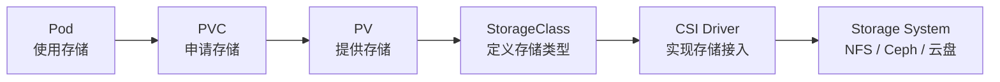

# Kubernetes 存储资源详解：PV、PVC、StorageClass、VolumeSnapshot 一次讲透

## 文章摘要

Pod 是 Kubernetes 里运行应用的最小单元，但 Pod 是**临时资源**——删除、迁移、重建之后，容器内部的数据跟着一起消失。数据库这类有状态应用，数据必须落到 Pod 之外。

Kubernetes 为此提供了一整套存储资源体系：PV、PVC、StorageClass、VolumeSnapshot。本文是这套体系的**概念总览**，讲清每个对象「是什么、负责什么、彼此什么关系」，不展开具体命令。

!!! tip "想动手实操？"
    概念读完想上手验证，看 [PV、PVC、StorageClass 三对象](pv-pvc-storageclass.md)——用 local-path-provisioner 实测了 PVC 从 Pending 到 Bound 的全过程；CSI 组件怎么工作，见 [CSI 到底拆了什么？](csi-nfs-components.md)。

---

## 为什么需要存储资源

创建一个跑 MySQL 的 Pod，写入一万条数据：

```yaml
apiVersion: v1
kind: Pod
metadata:
  name: mysql
spec:
  containers:
  - name: mysql
    image: mysql:8
```

```bash
kubectl delete pod mysql
```

重新创建后，之前写的一万条数据**全部丢失**。原因很简单：**容器文件系统 ≠ 持久化存储**。Pod 一删，容器可写层就没了。

所以 Kubernetes 把「存数据」这件事从 Pod 的生命周期里剥离出来，交给独立的存储资源对象管理。

---

## Kubernetes 存储体系

整体链路：



一句话记住各对象的职责：

| 对象 | 全称 | 职责 |
| --- | --- | --- |
| PV | PersistentVolume | **提供**存储（集群级资源） |
| PVC | PersistentVolumeClaim | **申请**存储（命名空间级声明） |
| StorageClass | — | **定义**存储类型，支持动态创建 PV |
| CSI | Container Storage Interface | **实现**存储接入的驱动 |
| VolumeSnapshot | — | 存储**快照**与恢复 |

---

## 什么是 PV

**PV（PersistentVolume）** 是集群级别的存储资源，可以理解为「一块已经准备好的磁盘」：

| 示例 | 含义 |
| --- | --- |
| 100Gi SSD | 一块 100G 的固态盘 |
| 500Gi NFS 共享 | 一个 500G 的 NFS 目录 |
| 1Ti 云盘 | 一块云厂商的块存储 |

PV 由管理员（或 StorageClass 自动）创建，独立于任何 Pod 存在：

```bash
kubectl get pv
```

```
NAME      CAPACITY   ACCESS MODES   RECLAIM POLICY   STATUS      CLAIM   STORAGECLASS   AGE
pv-001    100Gi      RWO            Retain           Available                           3d
```

`STATUS: Available` 表示这块 PV 还没被任何 PVC 认领，处于「待租」状态。

---

## 什么是 PVC

**PVC（PersistentVolumeClaim）** 是命名空间级别的存储声明，可以理解为「用盘申请单」：开发者不关心具体用哪块盘，只声明自己要多大、什么访问模式：

```yaml
apiVersion: v1
kind: PersistentVolumeClaim
metadata:
  name: mysql-pvc
spec:
  accessModes:
    - ReadWriteOnce
  resources:
    requests:
      storage: 100Gi
```

PVC 创建后，Kubernetes 自动寻找满足条件的 PV 进行绑定。这个「申请-分配」模式让开发者无需感知底层磁盘。

---

## PV 与 PVC 的关系

用租房类比最直观：

| 类比 | 对象 |
| --- | --- |
| 房子 | PV（实际存储） |
| 租房申请 | PVC（声明需求） |
| 签合同入住 | 绑定（Bound） |

流程：

```text
PVC（我要 100Gi RWO）  →  匹配  →  PV（100Gi 空闲）  →  Bound
```

绑定成功后的状态：

```bash
kubectl get pvc
```

```
NAME        STATUS   VOLUME     CAPACITY   ACCESS MODES   STORAGECLASS   AGE
mysql-pvc   Bound    pv-001     100Gi      RWO                           3m
```

!!! note "绑定规则"
    - 一个 PVC 只能绑定一个 PV（一对一）。
    - 一个 PV 通常也只能被一个 PVC 绑定。
    - PVC 的 `storage`、`accessModes` 必须与 PV 匹配才会绑定。
    - 没有匹配的 PV 时，PVC 会一直停在 `Pending`。

---

## 什么是 StorageClass

手工创建 PV 在集群变大后非常痛苦——每来一个 PVC 都要管理员先建一块盘。**StorageClass** 解决的就是「自动创建 PV」：

```yaml
apiVersion: storage.k8s.io/v1
kind: StorageClass
metadata:
  name: fast
provisioner: rancher.io/local-path
volumeBindingMode: WaitForFirstConsumer
```

StorageClass 可以理解为「存储模板」，定义了一类存储的 `provisioner`（谁来创建）、回收策略、绑定模式等。用户只需要：

```yaml
storageClassName: fast
```

系统就会按模板自动创建 PV，无需人工干预。local-path 的 StorageClass 完整拆解见 [PV、PVC、StorageClass 三对象](pv-pvc-storageclass.md)。

---

## 动态存储供应

动态供应是现代 Kubernetes 最常见的模式：

```text
PVC  →  StorageClass  →  CSI Driver  →  Storage System  →  自动创建 PV  →  Bound
```

用户只提交 PVC，剩下全自动。背后真正干活的 CSI 驱动，在 [CSI 到底拆了什么？](csi-nfs-components.md) 里拆到了容器级别。

---

## 什么是 VolumeSnapshot

**VolumeSnapshot** 是存储的快照，类似虚拟机快照：

```text
MySQL 数据盘  →  快照 Snapshot-001  →  出问题时快速回滚
```

典型用途：

- 数据备份与恢复
- 测试环境克隆（从快照拉起一份同样的数据）
- 升级前的回滚点

```bash
kubectl get volumesnapshot
```

!!! note "快照依赖"
    VolumeSnapshot 需要 StorageClass 的 provisioner 支持快照能力（CSI 驱动 + snapshot controller）。

---

## 常见存储类型与选型

| 存储 | 特点 | 适用场景 |
| --- | --- | --- |
| NFS | 最简单，多机共享，无块设备 | 实验环境、共享文件 |
| Longhorn | 轻量云原生，内置快照/备份 | 中小集群、私有云 |
| Ceph | 生产级，块/文件/对象三类 | 中大集群、统一存储 |
| 云盘（EBS/ESSD/CBS） | 云厂商托管，性能好 | 公有云生产集群 |

选型一句话：**实验用 NFS，私有云中小集群用 Longhorn，中大集群用 Ceph，公有云直接用云厂商 CSI。**

---

## 生产环境最佳实践

- **优先用 StorageClass 动态供给**，避免手工维护大量 PV。
- **数据库用独立 PVC**，不要和其他应用共享同一块盘。
- **定期创建快照**，并把「恢复演练」当成和备份同等重要的事。
- **监控存储容量**，避免磁盘耗尽导致的 Pod 驱逐。

---

## 常见故障排查

| 现象 | 排查命令 | 常见原因 |
| --- | --- | --- |
| PVC 一直 Pending | `kubectl describe pvc <name>` | 没匹配的 PV / StorageClass 不存在 / 等 Pod 调度 |
| Pod 起不来 | `kubectl describe pod <name>` | 卷挂载失败 / 后端存储不可达 |
| 数据读写异常 | `kubectl get pv,pvc,sc` | PV/PVC 状态、回收策略问题 |

---

## 总结

Kubernetes 存储体系可以浓缩成一句话：

> **Pod 负责运行应用，PVC 负责申请存储，PV 负责提供存储，StorageClass 负责自动化管理，CSI 负责对接真正的存储系统。**

- PV：提供存储
- PVC：申请存储
- StorageClass：定义模板 + 动态创建
- VolumeSnapshot：快照与恢复
- CSI：接入 NFS / Ceph / 云盘等后端

---

## 相关阅读

- [PV、PVC、StorageClass 三对象](pv-pvc-storageclass.md) — 动手实测动态供给、WaitForFirstConsumer、回收策略
- [CSI 到底拆了什么？](csi-nfs-components.md) — 部署 NFS CSI，拆 controller/node 容器分工
- [Linux NFS 服务安装（Debian 13）](../../linux/storage/nfs-server-debian13.md) — CSI 实战的 NFS 服务端环境准备
- [Kubernetes API Server 工作原理](../control-plane/api-server.md)
- [Kubernetes Etcd 工作原理](../control-plane/etcd.md)
- [Kubernetes Kubelet 工作原理](../node/kubelet.md)