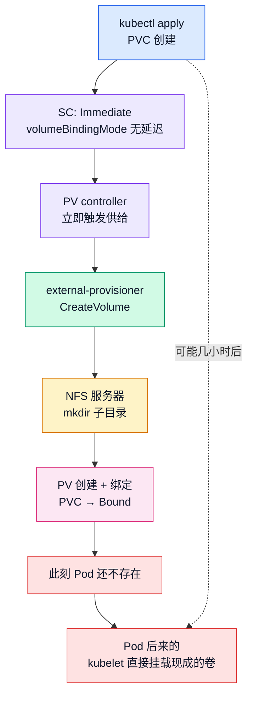
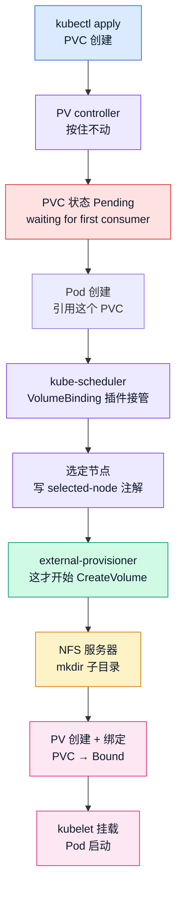
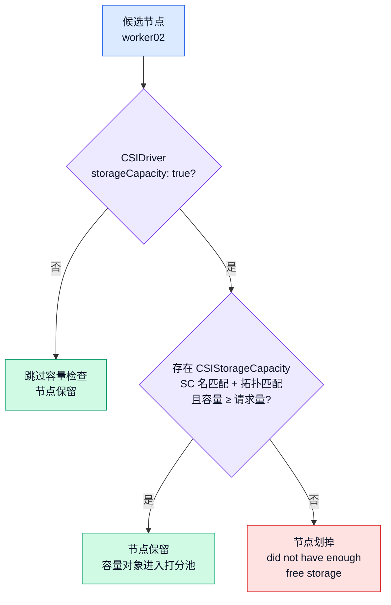

# K8s 存储第 6 篇：volumeBindingMode——PVC Pending 不一定是错的

> 存储系列第 6 篇。第 2 篇搭 NFS CSI 时，SC 里写过一行 `volumeBindingMode: Immediate`，一笔带过没解释。这篇把它补上——它还有个孪生兄弟 `WaitForFirstConsumer`（下称 WFFC），两者的差别用一句话说：**PVC 建完一直 Pending，不一定是出错，可能是在等第一个 Pod**。上上篇 v1.37 发布文里埋的 StorageCapacityScoring 钩子也在这篇回收：它和 volumeBindingMode 是一个话题域，而且我在 1.36 的集群上把它提前玩了一遍。

## 先把结论放桌上

`volumeBindingMode` 是 **StorageClass 的字段**，不是 PVC 的。同一个集群里两种模式可以并存，PVC 通过 storageClassName 选边站。

**Immediate**：PVC 创建后，PV controller 立刻开始工作——调用供给器建卷、创建 PV、完成绑定，全程不等任何 Pod。等你想起来要建 Pod 的时候，卷早就 Bound 好了。

**WaitForFirstConsumer**：PV controller 看到这个标记，把绑定动作整个按住。按到什么时候？按到第一个引用这个 PVC 的 Pod 出现、并且调度器为它选定了节点。也就是说，**绑卷的时机决策权从 controller 移交给了调度器**。

两张时序图放在一起看，差别一目了然：

**Immediate——PVC 和 Pod 两条独立的线：**



**WFFC——Pod 不来，卷不动：**



第一张图里 PVC 建完直接走到 Bound，Pod 是虚线里"可能几小时后"的存在。第二张图里 PVC 卡在红色的 Pending 节点，后面所有动作都被 Pod 的出现解锁。这个差别在 NFS 上能观察得非常精确——第 3 篇拆过，NFS 的 CreateVolume 本质就是一次 mkdir，所以 NFS 服务器上的 `inotifywait` 就是毫秒级的见证者：**目录什么时候出现的，一目了然**。

## 动手：同一个 NFS，目录出现的时刻差了整整一个阶段

实验还是那套环境：1.36.1 三 master 三 worker，NFS 服务器 192.168.114.155，csi-driver-nfs。两个 SC 除了 bindingMode 之外所有参数都一样，指向同一个导出目录——这样 NFS 侧观察到的差别就只来自绑定模式本身。

注意清单里**故意不放 Pod**：Pod 一旦创建就是"第一个消费者"，WFFC 的等待瞬间结束。所有实验对象都按需分批 apply，这是本篇实验设计的基本纪律。

```yaml
# volume-binding-mode.yaml（只有 SC×2）
apiVersion: storage.k8s.io/v1
kind: StorageClass
metadata:
  name: nfs-imm
provisioner: nfs.csi.k8s.io
parameters:
  server: 192.168.114.155
  share: /nfs/k8s
reclaimPolicy: Delete
volumeBindingMode: Immediate
---
apiVersion: storage.k8s.io/v1
kind: StorageClass
metadata:
  name: nfs-wffc
provisioner: nfs.csi.k8s.io
parameters:
  server: 192.168.114.155
  share: /nfs/k8s
reclaimPolicy: Delete
volumeBindingMode: WaitForFirstConsumer
```

两个 PVC 单独存文件——它们的 apply 时刻都有测量意义，必须能单独 apply：

```yaml
# pvc-imm.yaml
apiVersion: v1
kind: PersistentVolumeClaim
metadata:
  name: pvc-imm
spec:
  storageClassName: nfs-imm
  accessModes: ["ReadWriteMany"]
  resources:
    requests:
      storage: 1Gi
```

```yaml
# pvc-wffc.yaml
apiVersion: v1
kind: PersistentVolumeClaim
metadata:
  name: pvc-wffc
spec:
  storageClassName: nfs-wffc
  accessModes: ["ReadWriteMany"]
  resources:
    requests:
      storage: 1Gi
```

NFS 服务器上开两个终端。终端 A 挂上监视器，它就是这篇的秒表加毫秒表：

```bash
# k8s-nfs 上：
inotifywait -m --timefmt '%H:%M:%S' --format '%T %e %f' -e create,delete /nfs/k8s
```

### Immediate：PVC 一落地，目录立刻出现

master01 终端 B，apply PVC 后**立刻**查状态（`&&` 串起来，不给人工延迟留机会）：

```bash
kubectl apply -f volume-binding-mode.yaml && kubectl get sc nfs-imm nfs-wffc
kubectl apply -f pvc-imm.yaml && kubectl get pvc pvc-imm
```

我预测输出长这样（get pvc 的即时输出没截到，但下面的 ProvisioningSucceeded 事件和 NFS 同秒 CREATE 已经把 Bound 钉死了）：

```
persistentvolumeclaim/pvc-imm created
NAME      STATUS   VOLUME                                     CAPACITY   ACCESS MODES   STORAGECLASS   AGE
pvc-imm   Bound    pvc-61f0a2e1-b96a-4b41-9235-8e6d61650a2c   1Gi        RWX            nfs-imm        0s
```

AGE 0s 已经 Bound——不是碰巧快，是 Immediate 的语义本来就不等任何东西。describe 一下看事件链：

```bash
kubectl describe pvc pvc-imm
```

实测事件区：

```
Events:
  Type    Reason                 Age   From                                                          Message
  ----    ------                 ----  ----                                                          -------
  Normal  ExternalProvisioning   25m   persistentvolume-controller                                   Waiting for a volume to be created either by the external provisioner 'nfs.csi.k8s.io' or manually by the system administrator. If volume creation is delayed, please verify that the provisioner is running and correctly registered.
  Normal  Provisioning           25m   nfs.csi.k8s.io_worker01_df3dab65-d6ce-466d-bc02-35b6749b4334  External provisioner is provisioning volume for claim "default/pvc-imm"
  Normal  ProvisioningSucceeded  25m   nfs.csi.k8s.io_worker01_df3dab65-d6ce-466d-bc02-35b6749b4334  Successfully provisioned volume pvc-8db62741-f432-48e1-83e7-ce163db7ee61
```

三连齐了：PV controller 先喊"等外部供给器"，供给器接手，最后成功。注意 From 列的身份串里带着 `worker01`——那是 csi-nfs-controller 这个 Deployment 副本所在节点的主机名，供给器的身份标识 = 驱动名_主机名_UUID。

同一时刻，NFS 服务器的终端 A 跳出一行（实测）：

```
15:14:28 CREATE,ISDIR pvc-8db62741-f432-48e1-83e7-ce163db7ee61
```

`pvc-8db62741` 就是 pvc-imm——动态供给的目录名就是 PVC 的 UID，能直接对上号。关键是时间戳：PVC 的 creationTimestamp 是 15:14:28，目录出现的也是 15:14:28，**同一秒内完成供给**，比我预测的"~1 秒"还快。

此刻集群里没有任何 Pod 引用这个 PVC，目录已经躺在 `/nfs/k8s/` 下了。这就是 Immediate 的全部含义：**供给和消费彻底解耦，先建卷，用不用再说**。

### WFFC：Pending 不是病，是在等第一个消费者

pvc-wffc 还没建，现在建——apply 完直接查状态：

```bash
kubectl apply -f pvc-wffc.yaml && kubectl get pvc pvc-wffc
kubectl describe pvc pvc-wffc
```

apply 后 get 的预测输出（STATUS 直接就是 Pending）：

```
persistentvolumeclaim/pvc-wffc created
NAME       STATUS   VOLUME   CAPACITY   ACCESS MODES   STORAGECLASS   AGE
pvc-wffc   Pending                                      nfs-wffc       0s
```

describe 的事件区是这篇信息密度最高的地方，实测输出：

```
Events:
  Type    Reason                 Age                 From                                                          Message
  ----    ------                 ----                ----                                                          -------
  Normal  WaitForFirstConsumer   20m (x16 over 23m)  persistentvolume-controller                                   waiting for first consumer to be created before binding
  Normal  WaitForPodScheduled    20m                 persistentvolume-controller                                   waiting for pod pod-wffc to be scheduled
  Normal  ExternalProvisioning   20m                 persistentvolume-controller                                   Waiting for a volume to be created either by the external provisioner 'nfs.csi.k8s.io' or manually by the system administrator. If volume creation is delayed, please verify that the provisioner is running and correctly registered.
  Normal  Provisioning           20m                 nfs.csi.k8s.io_worker01_df3dab65-d6ce-466d-bc02-35b6749b4334  External provisioner is provisioning volume for claim "default/pvc-wffc"
  Normal  ProvisioningSucceeded  20m                 nfs.csi.k8s.io_worker01_df3dab65-d6ce-466d-bc02-35b6749b4334  Successfully provisioned volume pvc-75510643-9fac-4759-9f12-b580f1e98362
```

`waiting for first consumer to be created before binding`，来源 persistentvolume-controller，这句话在源码里就是这么写的：`pkg/controller/volume/persistentvolume/pv_controller.go` L309。但实测还送了一个没预测到的发现：**等待分两段**。第一段 `WaitForFirstConsumer`，等"消费者被创建"——注意 `(x16 over 23m)`，这个事件不是一次性广告，PV controller 每次 sync 都重发，从 15:16:12 一直重发到 Pod 出现为止；第二段 `WaitForPodScheduled`，等"消费者被调度"——Pod 创建了还不够，调度器选定节点之前照样不供给。两段事件正好把 15:16:12（PVC 创建）→ 15:19:34（Pod 创建）→ 15:19:35（调度、供给、目录出现）这条时间线钉在对象上。

NFS 服务器上，终端 A 保持**静默**。等 30 秒、等 5 分钟，都不会有 CREATE。第一反应是"是不是哪里坏了"——我第一轮实验就在这里干等了半天，后来才确认：这就是 WFFC 的正常态。把 Pod 放出来：

```yaml
# pod-wffc.yaml
apiVersion: v1
kind: Pod
metadata:
  name: pod-wffc
spec:
  terminationGracePeriodSeconds: 1
  containers:
    - name: main
      image: m.daocloud.io/docker.io/busybox
      command: ["sleep", "3600"]
      volumeMounts:
        - name: data
          mountPath: /data
  volumes:
    - name: data
      persistentVolumeClaim:
        claimName: pvc-wffc
```

```bash
kubectl apply -f pod-wffc.yaml && kubectl wait --for=jsonpath='{.status.phase}'=Running pod/pod-wffc --timeout=120s && kubectl get pvc pvc-wffc
```

实测输出（我 20 分钟后补查的，所以 AGE 23m）：

```
NAME       STATUS   VOLUME                                     CAPACITY   ACCESS MODES   STORAGECLASS   VOLUMEATTRIBUTESCLASS   AGE
pvc-wffc   Bound    pvc-75510643-9fac-4759-9f12-b580f1e98362   1Gi        RWX            nfs-wffc       <unset>                 23m
```

顺带一记：1.36 的 `kubectl get pvc` 输出里多了 `VOLUMEATTRIBUTESCLASS` 列，默认 unset——预测时没料到的格式出入，不影响本篇任何机制。

NFS 那边的实测 CREATE 行：

```
15:19:35 CREATE,ISDIR pvc-75510643-9fac-4759-9f12-b580f1e98362
```

pvc-wffc 的创建时刻是 15:16:12，目录出现的时刻是 15:19:35——**它在 NFS 服务器上"缺席"了整整 3 分 23 秒**，缺席的终点就是 Pod 被调度的那一刻。

调度器在这次供给里干了一件 Immediate 场景下完全不存在的事。把它抓出来：

```bash
kubectl get pvc pvc-wffc -o jsonpath='{.metadata.annotations.volume\.kubernetes\.io/selected-node}{"\n"}'
```

实测输出：

```
worker01
```

`volume.kubernetes.io/selected-node`——调度器选定节点后，把节点名写进 PVC 的注解，供给器看到这个注解才开始建卷。这就是 WFFC 的机关：**调度器通过一个注解，把"卷该建在哪个拓扑里"的指令传给了供给器**。NFS 没有拓扑概念，这个指令对它没有实际意义，但机制照走。

还有个细节值得验证：看这个 PV 有没有节点亲和性。

```bash
PV_WFFC=$(kubectl get pvc pvc-wffc -o jsonpath='{.spec.volumeName}')
kubectl get pv $PV_WFFC -o jsonpath='{.spec.nodeAffinity}' && echo "  <- 空 = 无 nodeAffinity"
```

实测输出只有 echo 的尾巴，jsonpath 部分是**空的**——和预测一致。csi-driver-nfs 的 CreateVolume 不返回拓扑，所以 PV 上没有 nodeAffinity，这个卷挂到哪个节点都行——这就是"NFS 感知不到 WFFC 的深层价值"的对象级证据，后面拓扑那节展开。

### 时间线对照

两组实验的目录创建时刻放在一起（2026-09-01 实测）：

| 观察点 | Immediate（pvc-imm） | WFFC（pvc-wffc） |
| --- | --- | --- |
| PVC 创建时刻 | 15:14:28 | 15:16:12 |
| NFS 目录 CREATE | 15:14:28（与创建同一秒） | 15:19:35（Pod 调度后） |
| 等待时长 | 不足 1 秒 | 3 分 23 秒（等 Pod） |

同一台 NFS 服务器，同一个导出目录，唯一的变量是 SC 里那一行 bindingMode：目录出现时刻从"与 PVC 同一秒"挪到了"Pod 调度那一秒"，中间隔着整整 3 分 23 秒。

## 只建不用：一个白忙一场，一个零开销

WFFC 还有一个容易被忽略的好处，用一对"孤儿 PVC"演示。两个 PVC 建出来之后**故意不建 Pod**，各观察 30 秒，然后删掉：

```yaml
# extra-pvcs.yaml（pvc-wffc2 给后面的自动化陷阱用，这里一起建）
apiVersion: v1
kind: PersistentVolumeClaim
metadata:
  name: pvc-imm-orphan
spec:
  storageClassName: nfs-imm
  accessModes: ["ReadWriteMany"]
  resources:
    requests:
      storage: 1Gi
---
apiVersion: v1
kind: PersistentVolumeClaim
metadata:
  name: pvc-wffc-orphan
spec:
  storageClassName: nfs-wffc
  accessModes: ["ReadWriteMany"]
  resources:
    requests:
      storage: 1Gi
---
apiVersion: v1
kind: PersistentVolumeClaim
metadata:
  name: pvc-wffc2
spec:
  storageClassName: nfs-wffc
  accessModes: ["ReadWriteMany"]
  resources:
    requests:
      storage: 1Gi
```

```bash
kubectl apply -f extra-pvcs.yaml && sleep 30
kubectl delete pvc pvc-imm-orphan pvc-wffc-orphan --wait=false
```

NFS 终端 A 的实测输出：

```
15:22:24 CREATE,ISDIR pvc-0fd403f0-0052-46be-b086-e904cd13f7ad
15:22:54 DELETE,ISDIR pvc-0fd403f0-0052-46be-b086-e904cd13f7ad
```

`pvc-0fd403f0` 是 pvc-imm-orphan，生与死之间正好 30 秒。同一批 apply 出来的 pvc-wffc-orphan 和 pvc-wffc2 都是 WFFC（后者 UID `377eccb3`），在 inotify 里全程零输出——**三个对象里只有 Immediate 的那个在 NFS 上真实存在过**。

Immediate 的孤儿 PVC 在 NFS 上真实地 mkdir 又 rmdir 了一回——卷被建出来、没有任何人用过、又被删掉。批量化之后这就是 CI 系统里的经典浪费：流水线建了一堆 PVC，Pod 没起来，存储侧照样扣容量（对容量计费的块存储是真金白银）。WFFC 的孤儿 PVC 从头到尾没碰过 NFS 服务器，删除时连 DeleteVolume 调用都不发生。

## 拓扑型存储为什么离不开 WFFC

前面对 NFS 说"selected-node 没有实际意义"——因为 NFS 没有"放不了"的问题：任何节点挂载 192.168.114.155 都一样。块存储完全是另一回事。

云盘是物理设备，一个卷落在某个可用区的机房里，就只有那个可用区的节点能挂它。这时如果 SC 用 Immediate，会出什么问题？

1. PVC 创建，PV controller 立刻调 CreateVolume，云厂商把卷建在了**随机挑的一个可用区**（PVC 此刻没有指定 zone）；
2. Pod 创建，调度器想把它调度到 zone-b 的节点——但卷在 zone-a，挂不上；
3. 调度器按"卷的 nodeAffinity"过滤所有 zone-b 节点，而 zone-a 的节点可能全满；
4. 最终结果：Pod 永远 Pending，事件里写着 `node(s) had volume node affinity conflict`。

卷是好的，节点是好的，单独看谁都正常，合在一起就是死局。而且这个死局发生在**建卷之后**——云厂商已经为一个没人用得上的卷计费了。

WFFC 把这个时序倒过来：Pod 先被调度（这一步还会参考 CSIStorageCapacity 的容量数据，下一节细说），调度器把选定的节点/可用区通过 selected-node 注解告诉供给器，供给器拿着这个信息去调 CreateVolume（CSI 规范里对应 `accessible_topology` 参数），卷被精确地建在 Pod 所在的可用区，PV 带上 nodeAffinity，一切闭环。**卷追着 Pod 走，而不是 Pod 撞上已建好的卷**。

这也解释了一个反直觉的现象：块存储 + 多可用区的集群里，WFFC 不是"可选的优化"，是**必选的正确姿势**。而 NFS、以及其它无拓扑约束的共享存储，两种模式功能上都能用——差别只剩时机和浪费。

代价也要说清楚。WFFC 的"等"是语义的一部分，但不是所有自动化都懂这个语义。最常见的翻车：CI 脚本建完 PVC 等它 Bound 再往下走。

```bash
kubectl wait --for=jsonpath='{.status.phase}'=Bound pvc/pvc-wffc2 --timeout=10s
```

实测报错：

```
error: timed out waiting for the condition on persistentvolumeclaims/pvc-wffc2
```

pvc-wffc2 没坏，是脚本的前提错了——WFFC 的 PVC 在 Pod 出现前就是不会 Bound，等一万秒也一样。StatefulSet 扩容同理：`volumeClaimTemplates` 生成的副本 PVC，在对应 Pod 被调度前全是 Pending，`kubectl get pvc` 满屏 Pending 不是事故。

> warning
> 排查 PVC Pending 的第一反应，从"哪里坏了"改成"先看 SC 的 volumeBindingMode"。是 WFFC 且没有 Pod 引用——这是正常态；是 Immediate 还 Pending，才轮到查 provisioner、quota、事件链这些常规嫌疑人。

## 容量过滤：1.36 就有的存量能力

WFFC 把"卷建在哪"的决策交给了调度器，调度器手里就多了一个可以用来决策的信息源：**CSIStorageCapacity**。这是 CSI 驱动上报的"我这个存储池还剩多少空间、覆盖哪些拓扑"，每个对象长这样：

```yaml
apiVersion: storage.k8s.io/v1
kind: CSIStorageCapacity
metadata:
  name: <由供给器生成>
  namespace: kube-system
storageClassName: <对应的 SC 名>
capacity: 500Gi
nodeTopology:
  matchLabels:
    topology.kubernetes.io/zone: b
```

调度器消费它的前提链条有三个环：CSIDriver 对象声明 `spec.storageCapacity: true`（开着这个开关，调度器才认为"这个驱动有容量数据可查"）→ 供给器实际发布 CSIStorageCapacity 对象 → PVC 走 WFFC + 动态供给。三个环少一个，容量数据就不参与调度。

1.36 的源码里这个过滤逻辑在 `pkg/scheduler/framework/plugins/volumebinding/binder.go` 的 `hasEnoughCapacity`（L976 起）：对每个候选节点，列出集群里所有 CSIStorageCapacity 对象，要求 `storageClassName` 等于 PVC 的 SC 名、`nodeTopology` 标签选择器能匹配到节点标签、容量数字大于等于 PVC 请求量（有 `maximumVolumeSize` 时优先用它）——三条全过的容量对象才算数，一条都没有，这个节点就被划掉。划掉的节点报什么错？`binder.go` L68 定义的常量：`node(s) did not have enough free storage`。

配一张小图：



这套过滤在 1.36 **不是 feature gate 管的**，是存量能力——所以可以在 1.36.1 的集群上直接做实验。但有个现实障碍：csi-driver-nfs 不发布容量数据（原因在最后一段），等于第二个环是空的。不过没关系——**调度器只认 API 里的对象，不管是谁写的**。CSIStorageCapacity 是个普通的 API 对象，我手动伪造两个，调度器照样信。

### 实验 B：伪造容量数据，把 Pod 逼进指定节点

实验对象先建齐。SC 一个（`nfs-topo`，WFFC，参数同 nfs-wffc），PVC 三个，每个 **100Gi**——故意比 zone-b 的"5Gi"大、比 zone-a 的"1Ti"小。NFS 后端根本不在乎 100Gi，这个数字只喂给调度器：

```yaml
# topo.yaml（SC + 三个 PVC）
apiVersion: storage.k8s.io/v1
kind: StorageClass
metadata:
  name: nfs-topo
provisioner: nfs.csi.k8s.io
parameters:
  server: 192.168.114.155
  share: /nfs/k8s
reclaimPolicy: Delete
volumeBindingMode: WaitForFirstConsumer
---
apiVersion: v1
kind: PersistentVolumeClaim
metadata:
  name: pvc-topo
spec:
  storageClassName: nfs-topo
  accessModes: ["ReadWriteMany"]
  resources:
    requests:
      storage: 100Gi
---
apiVersion: v1
kind: PersistentVolumeClaim
metadata:
  name: pvc-topo2
spec:
  storageClassName: nfs-topo
  accessModes: ["ReadWriteMany"]
  resources:
    requests:
      storage: 100Gi
---
apiVersion: v1
kind: PersistentVolumeClaim
metadata:
  name: pvc-topo3
spec:
  storageClassName: nfs-topo
  accessModes: ["ReadWriteMany"]
  resources:
    requests:
      storage: 100Gi
```

三个 Pod 分别引这三个 PVC，出场时机不同必须分文件。全文如下，逐个存成 `pod-topo.yaml` / `pod-topo2.yaml` / `pod-topo3.yaml`：

```yaml
# pod-topo.yaml
apiVersion: v1
kind: Pod
metadata:
  name: pod-topo
spec:
  terminationGracePeriodSeconds: 1
  containers:
    - name: main
      image: m.daocloud.io/docker.io/busybox
      command: ["sleep", "3600"]
      volumeMounts:
        - name: data
          mountPath: /data
  volumes:
    - name: data
      persistentVolumeClaim:
        claimName: pvc-topo
```

```yaml
# pod-topo2.yaml（只有两处不同：name 和 claimName）
apiVersion: v1
kind: Pod
metadata:
  name: pod-topo2
spec:
  terminationGracePeriodSeconds: 1
  containers:
    - name: main
      image: m.daocloud.io/docker.io/busybox
      command: ["sleep", "3600"]
      volumeMounts:
        - name: data
          mountPath: /data
  volumes:
    - name: data
      persistentVolumeClaim:
        claimName: pvc-topo2
```

```yaml
# pod-topo3.yaml（name 和 claimName 换成 topo3）
apiVersion: v1
kind: Pod
metadata:
  name: pod-topo3
spec:
  terminationGracePeriodSeconds: 1
  containers:
    - name: main
      image: m.daocloud.io/docker.io/busybox
      command: ["sleep", "3600"]
      volumeMounts:
        - name: data
          mountPath: /data
  volumes:
    - name: data
      persistentVolumeClaim:
        claimName: pvc-topo3
```

第一步，给节点打假拓扑标签（worker01 进 zone-a，worker02、worker03 进 zone-b），打开 CSIDriver 的容量开关，伪造两个容量对象——zone-a 说自己有 1Ti，zone-b 说自己只有 5Gi：

```bash
kubectl label node worker01 topology.kubernetes.io/zone=a
kubectl label node worker02 topology.kubernetes.io/zone=b
kubectl label node worker03 topology.kubernetes.io/zone=b
kubectl patch csidriver nfs.csi.k8s.io --type merge -p '{"spec":{"storageCapacity":true}}'
```

```yaml
# fake-capacity.yaml
apiVersion: storage.k8s.io/v1
kind: CSIStorageCapacity
metadata:
  name: fake-zone-a
  namespace: kube-system
storageClassName: nfs-topo
capacity: 1Ti
nodeTopology:
  matchLabels:
    topology.kubernetes.io/zone: a
---
apiVersion: storage.k8s.io/v1
kind: CSIStorageCapacity
metadata:
  name: fake-zone-b
  namespace: kube-system
storageClassName: nfs-topo
capacity: 5Gi
nodeTopology:
  matchLabels:
    topology.kubernetes.io/zone: b
```

```bash
kubectl apply -f topo.yaml
kubectl apply -f fake-capacity.yaml && sleep 5
kubectl apply -f pod-topo.yaml && kubectl wait --for=jsonpath='{.status.phase}'=Running pod/pod-topo --timeout=120s
kubectl get pod pod-topo -o wide
```

设计意图很清楚：pod-topo（100Gi）在 zone-b 只有 5Gi 的数据下只能落 worker01。但**实测没按这个剧本走**——当时我在清单上翻了一次车（Pod 文件没建齐，命令半途而废），再恢复时容量对象已经删了又建，pod-topo 是在死锁解除后复活的，那时 zone-b 已经被 patch 到 120Gi，两个 zone 都装得下。于是它落 worker01 的原因不是"被过滤逼的"，而是上一节说的 tie-break 名字序偏好。**"容量过滤把 Pod 逼进指定节点"这个观察，最终由 C 组最后一击（zone-b 打回 5Gi，score-5 落回 worker01）补上了实测。**按剧本完整跑的话，这里应该看到和 C2 同样的结果：NODE 列是 worker01，且 zone-b 两个节点在 `kubectl describe pod` 里报 `did not have enough free storage`。

pvc-topo 的 selected-node 注解也是 worker01——供给器拿着它去建卷，NFS 目录 15:56:55 同秒出现。

对照组来一发，证明这个过滤是容量数据驱动的：把 zone-b 的容量改成 120Gi（超过请求量），放出 pod-topo2：

```bash
kubectl -n kube-system patch csistoragecapacity fake-zone-b --type merge -p '{"capacity":"120Gi"}'
kubectl apply -f pod-topo2.yaml && kubectl wait --for=jsonpath='{.status.phase}'=Running pod/pod-topo2 --timeout=120s
kubectl get pod pod-topo2 -o wide
```

设计预测：NODE 列**可以是 worker02 或 worker03**——zone-b 的节点重新变得可调度，落点由其它打分插件决定，不再是容量一票否决。实测又偏了：pod-topo2 和 pod-topo 一样是死锁解除后复活的，落地时 zone-b 本来就是 120Gi，它落了 worker01——又是 tie-break。"解禁后能去 zone-b"这件事，在 C1（gate 开 + zone-b=1Ti，score-3/4 落 worker02/03）里得到了带打分的版本实测；不带打分的"解禁"版本，本组没拿到干净的对照。实验就是这样，设计是设计，现实是现实——好在三层机制（过滤、解冻、打分）各拿到了至少一段实测。

### 死锁陷阱：开了开关却没有数据

把两个假容量对象删掉，但 CSIDriver 的开关保持 true，放出 pod-topo3：

```bash
kubectl delete csistoragecapacity -n kube-system fake-zone-a fake-zone-b
kubectl apply -f pod-topo3.yaml
kubectl describe pod pod-topo3 | tail -8
```

实测事件：

```
Warning  FailedScheduling  0s (x2 over 0s)  default-scheduler  0/6 nodes are available: 3 node(s) did not have enough free storage, 3 node(s) had untolerated taint(s). no new claims to deallocate, preemption: 0/6 nodes are available: 6 Preemption is not helpful for scheduling.
```

预测的 `did not have enough free storage` + `untolerated taint` 组合一字不差，还白送了 preemption 的尾巴（`Preemption is not helpful`——抢占救不了容量死锁）。六个节点全部出局，连"没有任何容量数据"的 zone-a 也一样。这就是这个机制的黑暗面：**调度器把"没有数据"当成"没有容量"**。开关开了、供给器不发数据（或发错了），所有走 WFFC 动态供给的 Pod 全部卡死，而 PVC 看起来一切正常。生产上把一个驱动的 storageCapacity 打开之前，先确认它的 external-provisioner 真的带了 `--enable-capacity` 并在发布对象。

这次实验还有个计划外的续集：三个 topo Pod 卡死期间我把容量对象删了又重建，30 秒后**三个 Pod 全部自动复活**——调度器的 VolumeBinding 插件注册了对 CSIStorageCapacity 变化的事件监听（`volume_binding.go` L239 `isSchedulableAfterCSIStorageCapacityChange`），对象一重建，卡住的 Pod 重新入队。不需要删 Pod 重来，数据回来，调度恢复。NFS 侧的见证更直白：**15:56:55 同秒三连 CREATE**——三个目录同时出现，缺席了多久，解冻后一并补上。

## 1.37 的 StorageCapacityScoring：过滤之外，学会挑容量

到这里都是 1.36 已有的机制。1.37 转正的这个 Beta gate 改变的是**打分**环节。

先把 gate 的履历放这：`StorageCapacityScoring`，KEP-4049，`pkg/features/kube_features.go` 里 1.33 Alpha（默认 false）、1.37 Beta（默认 true）。开起来之后，调度器的 VolumeBinding 插件多出一个 Score 扩展点（1.37 源码 `pkg/scheduler/framework/plugins/volumebinding/volume_binding.go` L468 的 `Score` 函数，1.36 同款代码在 `volumebinding.go` L471）：过滤环节幸存下来的每个节点，按它所属拓扑的**剩余容量占比**打分。打分曲线由插件的 `shape` 参数决定，默认配置在 `pkg/scheduler/apis/config/v1/defaults.go` L198-208：利用率 0% 得 10 分，利用率 100% 得 0 分，中间线性插值。利用率 = PVC 请求量 ÷ 拓扑容量——**同样的请求，空间越宽裕的拓扑得分越高**。

过滤和打分的分工一句话：**过滤是硬规则，装不下就出局；打分是软偏好，都装得下但挑最宽裕的**。

这个 gate 在 1.36 的代码里完整在位（`volumebinding.go` L645-653 的 scorer 构建，只是默认 false）——和上上篇 KCM 那个闲置追踪一样，不用升级就能提前玩。

### 实验 C：1.36 上提前开 gate

实验对象分五个文件。`score-pvcs.yaml`——五个 PVC 全文（都是 100Gi + nfs-topo，只有名字不同）：

```yaml
# score-pvcs.yaml
apiVersion: v1
kind: PersistentVolumeClaim
metadata:
  name: pvc-score-1
spec:
  storageClassName: nfs-topo
  accessModes: ["ReadWriteMany"]
  resources:
    requests:
      storage: 100Gi
---
apiVersion: v1
kind: PersistentVolumeClaim
metadata:
  name: pvc-score-2
spec:
  storageClassName: nfs-topo
  accessModes: ["ReadWriteMany"]
  resources:
    requests:
      storage: 100Gi
---
apiVersion: v1
kind: PersistentVolumeClaim
metadata:
  name: pvc-score-3
spec:
  storageClassName: nfs-topo
  accessModes: ["ReadWriteMany"]
  resources:
    requests:
      storage: 100Gi
---
apiVersion: v1
kind: PersistentVolumeClaim
metadata:
  name: pvc-score-4
spec:
  storageClassName: nfs-topo
  accessModes: ["ReadWriteMany"]
  resources:
    requests:
      storage: 100Gi
---
apiVersion: v1
kind: PersistentVolumeClaim
metadata:
  name: pvc-score-5
spec:
  storageClassName: nfs-topo
  accessModes: ["ReadWriteMany"]
  resources:
    requests:
      storage: 100Gi
```

五个 Pod 全部带 `run: lab6-score` 标签，分三个文件——对照组 `pod-score-c0.yaml`（score-1、score-2）：

```yaml
# pod-score-c0.yaml
apiVersion: v1
kind: Pod
metadata:
  name: pod-score-1
  labels:
    run: lab6-score
spec:
  terminationGracePeriodSeconds: 1
  containers:
    - name: main
      image: m.daocloud.io/docker.io/busybox
      command: ["sleep", "3600"]
      volumeMounts:
        - name: data
          mountPath: /data
  volumes:
    - name: data
      persistentVolumeClaim:
        claimName: pvc-score-1
---
apiVersion: v1
kind: Pod
metadata:
  name: pod-score-2
  labels:
    run: lab6-score
spec:
  terminationGracePeriodSeconds: 1
  containers:
    - name: main
      image: m.daocloud.io/docker.io/busybox
      command: ["sleep", "3600"]
      volumeMounts:
        - name: data
          mountPath: /data
  volumes:
    - name: data
      persistentVolumeClaim:
        claimName: pvc-score-2
```

实验组 `pod-score-c1.yaml`（score-3、score-4）——结构完全一样，把两处 `metadata.name` 换成 pod-score-3 / pod-score-4、`claimName` 换成 pvc-score-3 / pvc-score-4，`labels` 原样保留。数据反转用 `pod-score-5.yaml`，从 c0 派生时**只取第一个文档**（c0 里有两个 Pod 文档，直接全局替换会带出 score-2 的文档，apply 时会多 configure 一个对象——无害但脏）：

```bash
sed '/^---$/,$d' pod-score-c0.yaml | sed 's/score-1/score-5/g' > pod-score-5.yaml
grep 'kind: Pod' pod-score-c1.yaml pod-score-5.yaml   # 预期：c1 是 2，score-5 是 1
```

对照组先行。容量数据保持 zone-a=1Ti / zone-b=120Gi——两个 zone 都装得下 100Gi，过滤不淘汰任何节点。gate 保持关闭：

```bash
kubectl -n kube-system get csistoragecapacity fake-zone-a fake-zone-b -o custom-columns='NAME:.metadata.name,CAP:.capacity'
kubectl apply -f score-pvcs.yaml
kubectl apply -f pod-score-c0.yaml
kubectl get pod -l run=lab6-score -o wide
```

我原来的预测是"落点没有容量规律，worker02、worker03 应该有中签的"——实测打脸：

```
NAME          READY   STATUS    RESTARTS   AGE     IP             NODE
pod-score-1   1/1     Running   0          17m     10.244.5.54    worker01
pod-score-2   1/1     Running   0          17m     10.244.5.58    worker01
```

**gate 关闭时容量数据对落点的影响是零，但调度器对同分节点有名字序偏好，worker01 < worker02 < worker03，两个 Pod 全部落了 worker01。**这个偏好前面就露过头了：B 组死锁解冻时，复活的三个 topo Pod 也全部落在 worker01（包括当时 zone-b 数据明明充足的 pod-topo2）。tie-break 不读容量数据，所以下一节把容量布局对调，这个偏好也不会变——这正好给打分实验当了干净的反衬。

然后开 gate。这是本篇唯一动控制面的操作，静态 Pod 清单三台 master **逐台**改。上个发布文里 KCM 的坑一个都不少：sed 幂等写法（先按内容删再追加，删除模式按内容包含匹配）、.bak 之类杂质文件绝不留在 manifests 目录、锚点缩进先看清楚再动手：

```bash
# 每台 master 上：
sudo grep -n -A6 'command:' /etc/kubernetes/manifests/kube-scheduler.yaml | head -8
# 确认 flag 行的实际缩进（通常是 4 空格），然后两条 sed：
sudo sed -i '/StorageCapacityScoring/d' /etc/kubernetes/manifests/kube-scheduler.yaml
sudo sed -i '/- kube-scheduler$/a\    - --feature-gates=StorageCapacityScoring=true' /etc/kubernetes/manifests/kube-scheduler.yaml
sudo grep -n 'feature-gates' /etc/kubernetes/manifests/kube-scheduler.yaml
```

三台都改完后验证——三台的运行 spec 都要带 gate（kube-scheduler 是 leader 选举，只有 leader 真正调度，但 gate 必须三台都在，防止 leader 漂移），再看 lease holder：

```bash
for n in master01 master02 master03; do kubectl -n kube-system get pod kube-scheduler-$n -o jsonpath='{.spec.containers[0].command}' | grep -o 'StorageCapacityScoring=true' >/dev/null && echo "$n OK" || echo "$n MISSING"; done
kubectl -n kube-system get lease kube-scheduler -o jsonpath='{.spec.holderIdentity}{"\n"}'
```

gate 生效后放实验组。**关键操作：先把容量布局对调**——zone-a 打下来、zone-b 放大。原因在 C0 的实测里：gate 关闭时调度器有名字序偏好（worker01 优先），如果保持 zone-a=1Ti 的布局，打分选中的 zone-a 和 tie-break 偏好的 worker01 是同一个节点，实验就区分不出打分的作用了。对调之后，打分偏好的 zone-b 和 tie-break 偏好的 worker01 正面冲突，看谁赢：

```bash
kubectl -n kube-system patch csistoragecapacity fake-zone-a --type merge -p '{"capacity":"120Gi"}'
kubectl -n kube-system patch csistoragecapacity fake-zone-b --type merge -p '{"capacity":"1Ti"}'
kubectl -n kube-system get csistoragecapacity fake-zone-a fake-zone-b -o custom-columns='NAME:.metadata.name,CAP:.capacity'
kubectl apply -f pod-score-c1.yaml
kubectl get pod -l run=lab6-score -o wide
```

预测：**score-3、score-4 落在 worker02 或 worker03**（zone-b）。对调后 zone-b 的利用率是 100Gi ÷ 1Ti ≈ 10%，shape 曲线上接近满分；zone-a 的 120Gi ÷ 100Gi 利用率 83%，得分贴近 0。如果打分真的在起作用，它会压过 tie-break 对 worker01 的名字序偏好——这就是"gate 开与不开"的分水岭。

实测命中。两个 Pod 在 16:19:10 同秒被调度（inotify 同秒两卷），落点摘自全景：

```
pod-score-3   1/1   Running   0   2m37s   10.244.19.79   worker03
pod-score-4   1/1   Running   0   2m37s   10.244.30.68   worker02
```

**打分压过了名字序。** gate 一开，调度器宁可选名字序靠后的 worker02/03（所属拓扑剩余 1Ti），也不去名字序第一的 worker01（所属拓扑只剩 120Gi）。C0 里那个"worker01 优先"的 tie-break，在容量分差面前失效了。

最后一击，证明打分是数据驱动的：把 zone-b 从 1Ti 打回 5Gi，装不下 100Gi，zone-b 被过滤淘汰，放出 score-5：

```bash
kubectl -n kube-system patch csistoragecapacity fake-zone-b --type merge -p '{"capacity":"5Gi"}'
kubectl apply -f pod-score-5.yaml
kubectl get pod pod-score-5 -o wide
```

实测：

```
NAME          READY   STATUS    RESTARTS   AGE     IP             NODE
pod-score-5   1/1     Running   0          2m19s   10.244.5.41    worker01
```

预测命中——zone-b 被过滤出局，score-5 落回 worker01。至此三个阶段的全景（16:22 实测）：

| Pod | 容量布局 | gate | 落点 |
| --- | --- | --- | --- |
| score-1 / score-2 | zone-a=1Ti / zone-b=120Gi | 关 | worker01 / worker01 |
| score-3 / score-4 | zone-a=120Gi / zone-b=1Ti | 开 | worker03 / worker02 |
| score-5 | zone-b 打回 5Gi | 开 | worker01 |

第一行的 worker01 是 tie-break 的偏好（不读容量数据）；第二行容量数据翻盘，落点跟着最宽裕的拓扑走；第三行数据被打穿，过滤接管，落点退回仅存的 zone-a。**同一个调度器，同一个 PVC 请求，落点被"gate × 数据"的组合牵着走**——NFS 服务器全程无感，四个目录照样建（inotify：16:19:10 双连、16:19:28 一个），100Gi 照样"承诺"——这也预告了下一节的答案。

## NFS 用户要的答案：游戏规则没变，也不需要变

v1.37 发布文里我留下的问题是：StorageCapacityScoring 会不会改变 volumeBindingMode 的游戏规则？跑完全部实验，答案是分层的。

对拓扑型块存储：它没有推翻 WFFC 和 Immediate 的胜负关系——Immediate 根本不经过调度器，容量打分再聪明也够不着它。它改变的是 WFFC 内部的"选哪里"：从"拓扑对得上就行"升级成"挑剩余空间最宽裕的拓扑"。多存储池（不同盘型、不同 tier 的 SC）混布的集群里，这是实打实的调度质量提升——热池快满了，新卷自动往凉池里放。

对 NFS：完全是空转。翻 csi-driver-nfs 的源码，`pkg/nfs/controllerserver.go` L336 的 `GetCapacity` 实现是这么写的：

```go
func (cs *ControllerServer) GetCapacity(_ context.Context, _ *csi.GetCapacityRequest) (*csi.GetCapacityResponse, error) {
        return nil, status.Error(codes.Unimplemented, "")
}
```

驱动压根没实现容量查询，external-provisioner 无从发布 CSIStorageCapacity。本篇实验 B/C 之所以成立，恰恰是因为调度器只认 API 对象、从不回源去问驱动——我们伪造的数据它照单全收。真实世界里没有供给者，NFS 的容量打分就是没有输入的函数。而且 NFS 无拓扑、共享挂载、单服务器，本来也没有"多个存储池挑一个"的决策空间。

所以这篇的最终答案：**volumeBindingMode 的选择逻辑，1.37 前后没变——拓扑型块存储用 WFFC，无拓扑共享存储随意；变了的是 WFFC 的选址智商，而那对 NFS 用户是别人的故事。**

## 验证命令清单

**准备（k8s-nfs 终端 A）：**

```bash
inotifywait -m --timefmt '%H:%M:%S' --format '%T %e %f' -e create,delete /nfs/k8s
```

**实验 A（master01 终端 B）：**

```bash
kubectl apply -f volume-binding-mode.yaml && kubectl get sc nfs-imm nfs-wffc
kubectl apply -f pvc-imm.yaml && kubectl get pvc pvc-imm
kubectl describe pvc pvc-imm
kubectl apply -f pvc-wffc.yaml && kubectl get pvc pvc-wffc
kubectl describe pvc pvc-wffc
kubectl apply -f pod-wffc.yaml && kubectl wait --for=jsonpath='{.status.phase}'=Running pod/pod-wffc --timeout=120s && kubectl get pvc pvc-wffc
kubectl get pvc pvc-wffc -o jsonpath='{.metadata.annotations.volume\.kubernetes\.io/selected-node}{"\n"}'
PV_WFFC=$(kubectl get pvc pvc-wffc -o jsonpath='{.spec.volumeName}')
kubectl get pv $PV_WFFC -o jsonpath='{.spec.nodeAffinity}' && echo "  <- 空 = 无 nodeAffinity"
kubectl apply -f extra-pvcs.yaml && sleep 30
kubectl delete pvc pvc-imm-orphan pvc-wffc-orphan --wait=false
kubectl wait --for=jsonpath='{.status.phase}'=Bound pvc/pvc-wffc2 --timeout=10s
```

**实验 B（容量过滤，无需 gate）：**

```bash
kubectl apply -f topo.yaml
kubectl label node worker01 topology.kubernetes.io/zone=a
kubectl label node worker02 topology.kubernetes.io/zone=b
kubectl label node worker03 topology.kubernetes.io/zone=b
kubectl patch csidriver nfs.csi.k8s.io --type merge -p '{"spec":{"storageCapacity":true}}'
kubectl apply -f fake-capacity.yaml && sleep 5
kubectl apply -f pod-topo.yaml && kubectl wait --for=jsonpath='{.status.phase}'=Running pod/pod-topo --timeout=120s && kubectl get pod pod-topo -o wide
kubectl -n kube-system patch csistoragecapacity fake-zone-b --type merge -p '{"capacity":"120Gi"}'
kubectl apply -f pod-topo2.yaml && kubectl wait --for=jsonpath='{.status.phase}'=Running pod/pod-topo2 --timeout=120s && kubectl get pod pod-topo2 -o wide
kubectl delete csistoragecapacity -n kube-system fake-zone-a fake-zone-b
kubectl apply -f pod-topo3.yaml
kubectl describe pod pod-topo3 | tail -8
```

**实验 C（打分 gate，改三台 master）：**

```bash
# 对照组（gate 关）：容量数据 zone-a=1Ti / zone-b=120Gi
kubectl apply -f fake-capacity.yaml && sleep 5
kubectl -n kube-system patch csistoragecapacity fake-zone-b --type merge -p '{"capacity":"120Gi"}'
kubectl apply -f score-pvcs.yaml
kubectl apply -f pod-score-c0.yaml
kubectl get pod -l run=lab6-score -o wide
# 开 gate（三台 master 逐台，sed 见正文）
sudo grep -n 'feature-gates' /etc/kubernetes/manifests/kube-scheduler.yaml
for n in master01 master02 master03; do kubectl -n kube-system get pod kube-scheduler-$n -o jsonpath='{.spec.containers[0].command}' | grep -o 'StorageCapacityScoring=true' >/dev/null && echo "$n OK" || echo "$n MISSING"; done
kubectl -n kube-system get lease kube-scheduler -o jsonpath='{.spec.holderIdentity}{"\n"}'
# 实验组（gate 开）：先把容量布局对调，再放 Pod
kubectl -n kube-system patch csistoragecapacity fake-zone-a --type merge -p '{"capacity":"120Gi"}'
kubectl -n kube-system patch csistoragecapacity fake-zone-b --type merge -p '{"capacity":"1Ti"}'
kubectl apply -f pod-score-c1.yaml
kubectl get pod -l run=lab6-score -o wide
# 数据反转
kubectl -n kube-system patch csistoragecapacity fake-zone-b --type merge -p '{"capacity":"5Gi"}'
kubectl apply -f pod-score-5.yaml && kubectl get pod pod-score-5 -o wide
```

**收尾清理（顺序别反）：**

```bash
# master01：
kubectl delete pod pod-wffc pod-topo pod-topo2 pod-topo3 pod-score-1 pod-score-2 pod-score-3 pod-score-4 pod-score-5 --ignore-not-found
kubectl delete pvc pvc-imm pvc-wffc pvc-wffc2 pvc-imm-orphan pvc-wffc-orphan pvc-topo pvc-topo2 pvc-topo3 pvc-score-1 pvc-score-2 pvc-score-3 pvc-score-4 pvc-score-5 --ignore-not-found
kubectl delete sc nfs-imm nfs-wffc nfs-topo
kubectl delete csistoragecapacity -n kube-system fake-zone-a fake-zone-b --ignore-not-found
kubectl label node worker01 worker02 worker03 topology.kubernetes.io/zone-
kubectl patch csidriver nfs.csi.k8s.io --type merge -p '{"spec":{"storageCapacity":false}}'
# 三台 master 还原 gate：
sudo sed -i '/StorageCapacityScoring/d' /etc/kubernetes/manifests/kube-scheduler.yaml
# k8s-nfs：
sudo rm -rf /nfs/k8s/pvc-*
```

> **下一篇预告**：存储系列第 7 篇——`allowVolumeExpansion`。PVC 建小了想扩容，第一关是 SC 的这个开关，第二关是文件系统的在线扩展，第三关是 NFS 驱动那个"扩容 = 假装扩容"的真相（`ControllerExpandVolume` 直接把请求的字节数原样返回，`controllerserver.go` L475-482 我在写这篇时顺路撞见了）。1Gi 的 PVC 申请 10Gi 到底会发生什么，下篇实测。


---

## 推荐阅读

- [PV、PVC、StorageClass 三对象](pv-pvc-storageclass.md) — 系列第 1 篇，PV/PVC 基础概念与生命周期
- [CSI 到底拆了什么？](csi-nfs-components.md) — 系列第 2 篇，NFS CSI 存储层搭建
- [PVC 毫秒级时间线拆解](pvc-timeline-ms-breakdown.md) — 系列第 3 篇，一个 PVC 的毫秒级全链路时间线
- [K8s 存储第 4 篇：动态供应 vs 静态供应，谁在删你的数据](static-vs-dynamic-provisioning.md) — 系列第 4 篇，动态/静态供应与回收策略矩阵
- [K8s 存储第 5 篇：reclaimPolicy 和 onDelete，两层回收逻辑谁说了算](ondelete-two-layer-reclaim.md) — 系列第 5 篇，reclaimPolicy 与 onDelete 两层回收逻辑
- [Kubernetes 存储资源](storage.md) — PV / PVC / StorageClass / VolumeSnapshot 概念总览
- [Linux NFS 服务安装（Debian 13）](../../../linux/storage/nfs-server-debian13.md) — 本实验的 NFS 服务端环境准备

