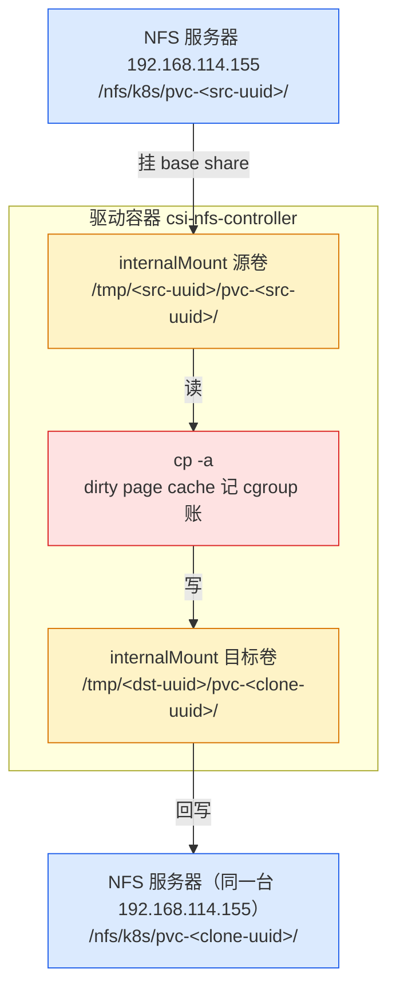

# K8s 卷克隆翻车实录：空卷照样 Bound，凶手是 yaml 里 3 个字母

> 实测声明：本文所有命令与输出主要来自 3 Master + 3 Worker 测试集群（K8s 1.36.1，Calico，NFS 后端存储），CSI 驱动为 csi-driver-nfs v4.13.4；其中四级静默的请求级证据来自 09-08 的一次同环境补跑复现。数据大小 3 个小文件到 300M，未做生产规模压测。

两个几乎一模一样的 PVC 清单，只差 dataSource 里 kind 字段的写法：

```yaml
# 这个 Bound 之后是空卷
dataSource:
    kind: PVC
    name: pvc-src
```

```yaml
# 这个正常复制了全部数据
dataSource:
    kind: PersistentVolumeClaim
    name: pvc-src
```

第一个的诡异之处在于：它**通过了所有校验**——apply 没警告、provisioner 没报错、describe 里看不到 DataSource 字段、PVC 秒级 Bound，每一步看起来都"成功"。只有把 Pod 挂上去 `ls /data` 那一刻，才发现目录是空的。

这篇记录完整的翻车和排错过程。先说结论：CSI 卷克隆功能本身是好的，300M 数据 1.34 秒就能搬完；但 `kind: PVC` 这种写法会让 provisioner **静默跳过复制逻辑**，直接给你一个空卷，而且从头到尾没有一行日志、一个事件告诉你为什么。

## 克隆是怎么触发的

上一篇文章（[NFS 快照与恢复](volume-snapshot-nfs.md)）讲过 csi-driver-nfs 的数据搬运内幕：驱动容器内部挂 NFS 导出，把数据抄到目标目录。克隆走的是同一个容器、同一套挂载，只是搬运方式不同。

外部链路：K8s 看 PVC 带 dataSource，让 external-provisioner 处理，provisioner 把源 PV 的 volumeHandle 塞进 CSI 的 CreateVolume 请求：

```text
GRPC request: /csi.v1.Controller/CreateVolume
"name": "pvc-<目标PV名>"
"volume_content_source": {
  "volume": { "volume_id": "192.168.114.155#nfs/k8s#pvc-<源PV名>##" }
}
```

驱动收到请求，进入 controllerserver.go 的 CreateVolume。第 638 行附近有个分发器：

```go
func (cs *ControllerServer) copyVolume(ctx context.Context, req *csi.CreateVolumeRequest, vol *nfsVolume) error {
        // ...
        switch vs := req.VolumeContentSource.GetType().(type) {
        case *csi.VolumeContentSource_Snapshot:
                return cs.copyFromSnapshot(ctx, req, vol)
        case *csi.VolumeContentSource_Volume:
                return cs.copyFromVolume(ctx, req, vol)   // 克隆走这里
        default:
                return status.Errorf(codes.InvalidArgument, "%v not a proper volume source", vs)
        }
}
```

copyFromVolume 从第 598 行开始，核心就三步：

```go
// L604 源路径必须带 '/.'，不能用 filepath.Join——它会做路径清洗把 '/.' 洗掉
srcPath := fmt.Sprintf("%v/.", getInternalVolumePath(cs.Driver.workingMountDir, srcVol))
dstPath := getInternalVolumePath(cs.Driver.workingMountDir, dstVol)
klog.V(2).Infof("copy volume from volume %v -> %v", srcPath, dstPath)   // L606

// 内部挂载源卷和目标卷（NFS base share 挂进驱动容器）
cs.internalMount(ctx, srcVol, nil, volCap)
cs.internalMount(ctx, dstVol, nil, volCap)

// L630 两个 NFS 挂载点之间直接 cp
out, err := exec.Command("cp", "-a", srcPath, dstPath).CombinedOutput()
if err != nil {
    return status.Errorf(codes.Internal, "failed to copy volume: %v, output: %v", err, out)
}
klog.V(2).Infof("copied %v -> %v", srcPath, dstPath)   // L634
```

几个值得停一下的点：

- `cp -a` 保留了 mtime。源文件的创建时间会在克隆卷里原样出现，后面实测验证了这一点。
- cp 失败会 return error，GRPC 整体失败，PVC 拿不到卷——**这是正常失败的路径**。后面你会看到，真正危险的是 cp "成功"返回零个文件的场景。
- L606 和 L634 两行日志是 V(2) 级别，驱动默认 `-v=5`，所以日志里能看到真实的 srcPath 和 dstPath——这两行后来成了排错的关键证据。

数据流路径画出来是这样：源卷挂载一次、目标卷挂载一次，cp 在两个 NFS 挂载点之间跑，数据全部经过驱动容器：



红色那个节点是数据的中转站——数据全过它的内存。这句话后面有反转，先记着。

源码读完，预测清单一页纸：

- 克隆应该秒级完成，没有 tar 打包开销
- mtime 应该保留（cp -a 的功劳）
- GRPC 同步阻塞，copied 日志行会出现在 L606 之后
- 我特意把驱动内存 limit 压到 200Mi，打算用 300M 大文件验证"数据过驱动容器内存"——按 lab8 快照恢复的经验，200Mi 会被 300M 打爆，OOMKilled 137

后来这份预测清单对了一半，另一半错得离谱，错的方式比预测本身有意思得多。

## 第一次克隆：Bound 了，但卷是空的

建源卷，造三个文件（sleep 3 是为了错开 mtime，后面验证 mtime 保留时用得上）：

```bash
$ kubectl apply -f pvc-src.yaml
persistentvolumeclaim/pvc-src created
pod/pod-src created
$ kubectl wait --for=jsonpath='{.status.phase}'=Bound pvc/pvc-src --timeout=60s && date +%T
persistentvolumeclaim/pvc-src condition met
11:10:16
$ kubectl exec pod-src -- sh -c \
    'echo from-src-1 > /data/file-1.txt && sleep 3 && \
     echo from-src-2 > /data/file-2.txt && sleep 3 && \
     echo from-src-3 > /data/file-3.txt'
```

然后克隆。注意看 Bound 的速度：

```bash
$ kubectl apply -f pvc-clone1.yaml && date +%T
persistentvolumeclaim/pvc-clone1 created
11:11:36
$ kubectl wait --for=jsonpath='{.status.phase}'=Bound pvc/pvc-clone1 --timeout=120s && date +%T
persistentvolumeclaim/pvc-clone1 condition met
11:11:42
```

6 秒 Bound。当时没觉得不对——克隆嘛，不就是复制三个小文件，快才是对的。建 Pod，挂上去验证：

```bash
$ kubectl exec pod-clone1 -- ls -l --full-time /data
error: Internal error occurred: error executing command in container: container "main" not found
```

这里先踩了一个小坑：Pod 刚提交还没 Ready 就急着 exec。等 Pod Ready 再来：

```bash
$ kubectl exec pod-clone1 -- ls -l --full-time /data
total 0
```

total 0。三个文件，一个都没有。

## du 说 16K，du 又说 4.0K

切到 NFS 服务器直接看目录。先确认源卷数据在：

```bash
$ du -sh /nfs/k8s/pvc-772ed0a7-43cb-4600-be98-0d3b621761e8 \
         /nfs/k8s/pvc-f8ce60a5-ec2f-471e-baba-d6a0db5bf2a9
16K     /nfs/k8s/pvc-772ed0a7-43cb-4600-be98-0d3b621761e8
4.0K    /nfs/k8s/pvc-f8ce60a5-ec2f-471e-baba-d6a0db5bf2a9
```

pvc-772ed0a7 是源卷（11:10 创建），三个文件加目录开销 16K，正常。pvc-f8ce60a5 是克隆卷（11:11 创建），只有 4.0K——一个空目录的体积。服务器侧和 Pod 内视角完全一致：**cp 没有把任何东西搬过去**。

继续往下做了写隔离和删源验证，结果反而更诡异：

```bash
# 克隆卷写入，只在克隆卷可见
$ kubectl exec pod-clone1 -- sh -c 'echo only-clone > /data/after-clone.txt'
$ kubectl exec pod-clone1 -- ls /data
after-clone.txt
# 源卷写入，只在源卷可见
$ kubectl exec pod-src -- sh -c 'echo after-src > /data/after-src.txt'
$ kubectl exec pod-src -- ls /data
after-src.txt
file-1.txt
file-2.txt
file-3.txt
```

隔离是好的——两个卷是独立目录，各自写入互不干扰。删掉源卷，克隆卷也没陪葬，卷独立性验证通过。**空卷是一个"健康"的空卷**：可以写、可以挂、可以独立存在，唯独没有克隆该有的数据。

## 排查的第一课：日志不等人

回过头想看驱动当时的日志——copyFromVolume 的 L606 会打出真实的 srcPath 和 dstPath，看了它就知道 cp 到底在抄哪。但这里犯了今天最贵的一个错误：**克隆的时候没有挂 `kubectl logs -f`，等要查的时候，驱动 Pod 已经因为后面的一次 patch 触发滚动更新被删掉了**。已删除 Pod 的日志，kubectl logs 拿不回来，除非事先 tee 到文件。

这个教训值一段话：**凡是涉及 CSI 驱动行为的实验，先挂 `logs -f | tee` 再动手**。GRPC 的执行窗口是毫秒到秒级，事后永远补不回来。

排查期间还发生了个插曲：为了排查我把驱动内存 limit 从 200Mi patch 到 1Gi（怀疑 OOM），结果滚动更新卡住了：

```bash
$ kubectl -n kube-system rollout status deploy/csi-nfs-controller
Waiting for deployment "csi-nfs-controller" rollout to finish: 0 of 1 updated replicas are available...
（卡了五分钟，Ctrl+C）
$ kubectl -n kube-system get pods -o wide | grep csi-nfs-controller
csi-nfs-controller-864d9f965c-65w5s   4/5   ImagePullBackOff   1 (6m30s ago)   7m22s   192.168.114.149   worker02
```

新 Pod 五个容器里有一个拉不动镜像。describe 看事件：

```text
Warning  Failed   5m37s (x247 over 70m)  kubelet  spec.containers{csi-resizer}: Error: ImagePullBackOff
Normal   Pulling  59s (x17 over 71m)     kubelet  spec.containers{csi-resizer}: Pulling image "registry.k8s.io/sig-storage/csi-resizer:v2.2.0"
Warning  Failed   29s (x16 over 51m)     kubelet  spec.containers{csi-resizer}: (combined from similar events):
         Failed to pull image "registry.k8s.io/sig-storage/csi-resizer:v2.2.0": rpc error: code = DeadlineExceeded ...
         Head "https://europe-west3-docker.pkg.dev/v2/k8s-artifacts-prod/images/sig-storage/csi-resizer/manifests/v2.2.0..."
         dial tcp 173.194.203.82:443: i/o timeout
```

registry.k8s.io 会被重定向到 Google 欧洲的 artifact 仓库，国内直连超时。集群里其余四个镜像节点上有缓存，唯独 csi-resizer:v2.2.0 没有——部署时 8 处镜像换国内源，漏掉或者被改回去的就是这一处。patch 成 daocloud 源的镜像名解决：

```bash
$ kubectl -n kube-system patch deploy csi-nfs-controller --type='strategic' \
    -p='{"spec":{"template":{"spec":{"containers":[{"name":"csi-resizer","image":"k8s.m.daocloud.io/sig-storage/csi-resizer:v2.2.0"}]}}}}'
```

这段和克隆空转没有直接关系，但它演示了一个排查上的大坑：**驱动 Pod 一旦滚动更新，旧的现场（日志、挂载点、/tmp 里的目录）全部消失**。今天下午有三个小时的排查是在没有第一轮日志的情况下盲摸的。

## 二次克隆：换了个写法，一切正常

清掉翻车现场重建源卷，这次克隆前先把日志挂上（新 Pod 名要用现场变量拿，跨 SSH session 的变量不持久）：

```bash
CONTROLLER_POD=$(kubectl -n kube-system get pod -o wide | grep csi-nfs-controller | grep -v node | awk '{print $1}')
kubectl -n kube-system logs $CONTROLLER_POD -c nfs -f | tee clone-round2.log
```

另一个终端建克隆（这次 dataSource 用的是我给的模板，注意 kind 的写法）：

```bash
$ kubectl apply -f pvc-clone3.yaml && date +%T
persistentvolumeclaim/pvc-clone3 created
13:56:31
$ kubectl wait --for=jsonpath='{.status.phase}'=Bound pvc/pvc-clone3 --timeout=120s && date +%T
persistentvolumeclaim/pvc-clone3 condition met
13:56:47
```

16 秒 Bound。挂 Pod，看数据：

```bash
$ kubectl exec pod-clone3 -- ls -l --full-time /data
total 12
-rw-r--r--    1 root     root            11 2026-09-07 05:55:00 +0000 file-1.txt
-rw-r--r--    1 root     root            11 2026-09-07 05:55:03 +0000 file-2.txt
-rw-r--r--    1 root     root            11 2026-09-07 05:55:06 +0000 file-3.txt
```

三个文件全在。**mtime 原样保留**——文件创建时间（05:55 UTC = 13:55 北京时间）是源卷上的写入时刻，cp -a 如实带过来了。

日志里的完整链路：

```text
I0907 05:56:35.691392  controllerserver.go:606] copy volume from volume
    /tmp/pvc-2243bf09-04b5-456d-b5a3-0d17db7a584e/pvc-2243bf09-04b5-456d-b5a3-0d17db7a584e/.
    -> /tmp/pvc-ea9a53c6-5d05-41ad-b015-c7cc7dd88435/pvc-ea9a53c6-5d05-41ad-b015-c7cc7dd88435
I0907 05:56:35.782044  controllerserver.go:634] copied
    /tmp/pvc-2243bf09-04b5-456d-b5a3-0d17db7a584e/pvc-2243bf09-04b5-456d-b5a3-0d17db7a584e/.
    -> /tmp/pvc-ea9a53c6-5d05-41ad-b015-c7cc7dd88435/pvc-ea9a53c6-5d05-41ad-b015-c7cc7dd88435
```

L606 到 L634 之间 91 毫秒——里面含两次内部挂载（86ms + 36ms），cp 本体不到 1 毫秒，三个 11 字节的文件而已。路径构造和源码逐字符吻合：mountDir 是 `<uuid>` 段（volumeHandle 的 uuid 段为空时回落用 subDir，所以目录名带 pvc- 前缀），子目录是 subDir 段，源路径末尾带着 L604 注释里强调的 `/.`。

同一个驱动、同一套代码、同样的三个文件——**这次抄过去了，上次没有**。两轮之间唯一的显著差异，表面上只有两样东西：克隆的时机（上次写完数据 65 秒就克隆，这次隔了 54 分钟）和 yaml 的来历（上次手写，这次抄模板）。

## 我先怀疑 NFS 缓存，然后被自己的对照实验打脸

两个差异里，时间窗看起来更"技术"一些。我当时的推理是：驱动容器内部的 NFS 挂载和 kubelet 为业务 Pod 做的挂载，走的是同一个内核 NFS 客户端、共享同一个 superblock（sharecache 机制）。如果源目录"刚创建时的空状态"被属性缓存住，而写入又发生在另一个客户端视角（pod-src 的挂载），那么 65 秒后 cp 读到的就可能是一份陈旧的空目录清单。内核 NFS 的目录属性缓存默认 acdirmin=30s、acdirmax=60s，65 秒贴着这个边界，看起来像个完美的解释。

于是设计了一个绕开 K8s 的窗口实测：在驱动容器里手动挂一次导出，先读一个空目录建立缓存，再从 NFS 服务器上往这个目录写文件，看多久后才被看见。

```bash
# 驱动容器内挂载 + 读空目录（建立缓存）
$ kubectl -n kube-system exec $CONTROLLER_POD -c nfs -- mkdir -p /tmp/cache-test
$ kubectl -n kube-system exec $CONTROLLER_POD -c nfs -- mount -t nfs 192.168.114.155:/nfs/k8s /tmp/cache-test
$ kubectl -n kube-system exec $CONTROLLER_POD -c nfs -- ls -la /tmp/cache-test/cache-test
total 8
drwxr-xr-x  2 root root 4096 Sep  7 06:16 .
drwxr-xr-x 13 root root 4096 Sep  7 06:16 ..
```

然后在 NFS 服务器侧写入。中间还有个小插曲：目录是 root 建的 755，以 xgj 用户写文件被拒，chmod 0777 才写进去——NFS 导出配了 no_root_squash 也救不了本地目录权限，POSIX 权限在服务器本地照样生效。

```bash
$ sudo echo hello-cache > /nfs/k8s/cache-test/x.txt && date +%T && ls -la /nfs/k8s/cache-test
14:21:19
-rw-rw-r--  1 xgj  xgj    12 Sep  7 14:21 x.txt

# 回到驱动容器立刻回读
$ date +%T && kubectl -n kube-system exec $CONTROLLER_POD -c nfs -- ls -la /tmp/cache-test/cache-test
14:21:44
-rw-rw-r--  1 1000 1000   12 Sep  7 06:21 x.txt
```

写入 25 秒后就能看见。但这个实验设计得不好：缓存建立的时刻是 14:16，回读是 14:21，中间隔了 5 分 44 秒——远超 60 秒的缓存上限，早就过期重取了。25 秒的间隔是从写入算的，不是从缓存建立算的。**窗口没踩进去，等于没测**。但至少排除了一种坏的可能：缓存不是永久的。

真正的定案来自一个 5 秒的先手棋——把两轮的 yaml 摆在一起看：

```bash
$ cat ~/volumeClone/pvc-clone1.yaml ~/volumeClone/pvc-clone2.yaml
# pvc-clone1.yaml
dataSource:
    kind: PVC            # ← 这里
    name: pvc-src
---
# pvc-clone2.yaml
dataSource:
    kind: PVC            # ← 这里
    name: pvc-clone1
```

第一轮手写的清单里，kind 写的是 `PVC`。而 CSI provisioner 认的是全称 `PersistentVolumeClaim`——我在第二轮模板里写的是全称，所以正常。

为了坐实这个判断，做了最后一个对照：**重建一个源卷，写完数据 3 秒内立刻克隆**（kind 用全称）。如果"写完立刻克隆"这个时间窗真的有问题，这次应该复现空卷：

```bash
$ kubectl apply -f pvc-clone4.yaml && date +%T
persistentvolumeclaim/pvc-clone4 created
14:42:10
$ kubectl wait --for=jsonpath='{.status.phase}'=Bound pvc/pvc-clone4 --timeout=120s && date +%T
persistentvolumeclaim/pvc-clone4 condition met
14:42:20
$ kubectl exec pod-clone4 -- ls -la /data
-rw-r--r--    1 root     root            12 Sep  7 06:42 file-1.txt
-rw-r--r--    1 root     root            12 Sep  7 06:42 file-2.txt
-rw-r--r--    1 root     root            12 Sep  7 06:42 file-3.txt
```

写完数据 3 秒就克隆，10 秒 Bound，数据完整、mtime 保留。**"写完立刻克隆会拿到陈旧空目录"的假说彻底死掉**。NFS 缓存从头到尾都是无辜的，凶手就是 kind 字段里那三个字母。

顺带一提，这个对照实验里还踩了个 Pod 的小坑：复制 pod-clone3.yaml 建 pod-clone4 时忘了改 metadata.name，apply 直接报 `pod updates may not change fields other than ...`——Pod 的 name 是不可变字段，改名字必须删了重建。

## 四级静默：为什么从 apply 到 Bound 没有一个环节报错

`kind: PVC` 能一路绿灯，是因为每一层都以为该别人管：

**第一级，API server 不拦。** K8s 1.34 起 AnyVolumeDataSource 特性转正，PVC 的 dataSource/dataSourceRef 字段放开了 kind 白名单——过去只允许 `PersistentVolumeClaim` 和 `VolumeSnapshot`，现在任意 kind 值都能通过 validation。设计初衷是让第三方 CRD 能做数据源，代价是：写错的 kind 不会被拦下，API server 默认"总会有 controller 来处理它"。

**第二级，describe 不显示。** `kubectl describe pvc pvc-clone1` 的输出里，Used By 直接到 Conditions，**DataSource 段整个消失**。字段值 API server 存了，但 describe 对它不展示——你连"自己写了什么"都看不到。

**第三级，provisioner 无声。** external-provisioner 只处理 `kind: PersistentVolumeClaim`（同 namespace）和 `kind: VolumeSnapshot`。其他 kind 一律不认识——不报错、不打日志、不写事件，直接当普通卷创建。

用错误的 kind 再复现一次（pvc-clone5）。provisioner 容器的日志当时 grep 过一条（clone5 和 datasource 一起搜的，原文存档）：

```text
$ kubectl -n kube-system logs $CONTROLLER_POD -c csi-provisioner \
    | grep -iE "clone5|datasource|data source" | tail -5
I0907 06:57:20.712976  event.go:389] "Event occurred" object="default/pvc-clone5" ...
    reason="Provisioning" message="External provisioner is provisioning volume
    for claim \"default/pvc-clone5\""
I0907 06:57:20.792943  controller.go:1021] successfully created PV pvc-10ca92dd-3909-4c7d-a277-9bf284a82d52
    for PVC pvc-clone5 and csi volume name 192.168.114.155#nfs/k8s#pvc-10ca92dd-...-9bf284a82d52##
I0907 06:57:20.797390  event.go:389] "Event occurred" object="default/pvc-clone5" ...
    reason="ProvisioningSucceeded" message="Successfully provisioned volume pvc-10ca92dd-..."
```

搜索词里带着 datasource，结果里一行都没有——provisioner 没抱怨、没警告，80 毫秒把卷建完，PVC 9 秒 Bound。

这里补一段实话。驱动那侧收到的请求 dump 当时没能落盘：处理 clone5 的驱动 Pod 在随后的滚动更新里被删，tee 的 clone-round2.log 只录到 clone4 时段。第二天（09-08）我用同款清单补跑了一次复现——新建 pvc-clone5v，kind 照旧写 PVC——这次把驱动日志完整抓了下来，它收到的请求：

```text
I0908 07:08:12.175870  1 utils.go:112] GRPC request: {"capacity_range":{"required_bytes":1073741824},
    "name":"pvc-5a1fe3ab-9b36-4404-945a-ab79da8b36ad",
    "parameters":{"csi.storage.k8s.io/pv/name":"pvc-5a1fe3ab-...",
    "csi.storage.k8s.io/pvc/name":"pvc-clone5v","csi.storage.k8s.io/pvc/namespace":"default",
    "server":"192.168.114.155","share":"/nfs/k8s"},
    "volume_capabilities":[{"AccessType":{"Mount":{}},"access_mode":{"mode":5}}]}
```

没有 `volume_content_source`。请求发出后 75 毫秒，驱动走完挂载、卸载，GRPC 返回成功——**copy volume 和 copied 两行从头到尾没出现**。更有意思的是，这次复现里正好先建了一个不带 dataSource 的普通 PVC（pvc-src3），两份请求摆一起逐字段同构，连后续日志都一个模子：provisioner 没认出这个 kind，就不会把 dataSource 转成请求里的 `volume_content_source`——驱动收到的就是普通建卷请求，天经地义。正常克隆的请求里这个字段在（压轴 clone6 的请求原文：`"volume_content_source":{"volume":{"volume_id":"192.168.114.155#nfs/k8s#pvc-9ccf59e4-...##"}}`）；kind 写错时，它整个缺席。

零抱怨。9 秒 Bound，比正常克隆（10-16 秒）还快——因为没有复制这一步。

**第四级，Bound 是真成功。** PVC 状态 Bound，PV 建了，NFS 目录建了，Pod 能挂，读写正常。每一项单体检查都"通过"，只有数据是空的。

四级加起来，用户从 apply 到生产事故之间没有任何线索。如果非要给这个场景一个防御建议，只有一条：**dataSource 的 kind 值永远写全称 `PersistentVolumeClaim`，从模板抄，不要手写**。以及，克隆完立刻挂个 Pod 看一眼数据，等业务写完了才发现克隆是空的，代价会大得多。

## 200Mi 之墙对克隆路径不存在

正片压轴：给源卷造一个 300M 文件，把驱动内存 limit 压回 200Mi，然后用正确的 kind 克隆它。

按 lab8 快照恢复的经验，这一步必炸——300M 数据全部过驱动容器的内存，200Mi 的 cgroup 限制会把它打成 OOMKilled 137，38 次重启那种。我把日志挂好，等着看 GRPC 断连和 provisioner 的重试风暴。

结果是安静的：

```bash
$ kubectl apply -f pvc-clone6.yaml && date +%T
persistentvolumeclaim/pvc-clone6 created
15:10:28
# kubectl get pvc pvc-clone6 -w 盯着看
pvc-clone6   Bound    pvc-849e201e-...   1Gi   RWX   nfs-snap   14s
```

14 秒 Bound，没有 OOM，没有重试。日志里 cp 干完了所有活（驱动日志原文，UUID 缩略，`#` 后是标注）：

```text
I0907 07:10:35.761969  1 utils.go:111] GRPC call: /csi.v1.Controller/CreateVolume
I0907 07:10:35.761999  1 utils.go:112] GRPC request: {"capacity_range":{"required_bytes":1073741824},
    "name":"pvc-849e201e-ad53-4850-8dcb-8cba47def890", ...parameters...,
    "volume_content_source":{"volume":{"volume_id":"192.168.114.155#nfs/k8s#pvc-9ccf59e4-...##"}}}
I0907 07:10:35.763298  1 mount_linux.go:270] Mounting cmd (mount) with arguments
    (-t nfs 192.168.114.155:/nfs/k8s /tmp/pvc-849e201e-...)          # 目标卷挂载开始
I0907 07:10:35.861249  1 nodeserver.go:177] volume(...pvc-849e201e-...##) mount
    192.168.114.155:/nfs/k8s on /tmp/pvc-849e201e-... successfully   # 98ms
I0907 07:10:35.863811  1 controllerserver.go:606] copy volume from volume
    /tmp/pvc-9ccf59e4-.../pvc-9ccf59e4-.../. -> /tmp/pvc-849e201e-.../pvc-849e201e-...
I0907 07:10:35.949705  1 nodeserver.go:177] volume(...pvc-9ccf59e4-...##) mount
    192.168.114.155:/nfs/k8s on /tmp/pvc-9ccf59e4-... successfully   # 源卷挂载，86ms
I0907 07:10:37.290836  1 controllerserver.go:634] copied
    /tmp/pvc-9ccf59e4-.../. -> /tmp/pvc-849e201e-.../pvc-849e201e-...
I0907 07:10:37.307279  1 utils.go:118] GRPC response: {"volume":{...}}   # 成功
```

从源卷挂载完成到 copied，**cp 花了 1.34 秒搬完 300M**——314572800 字节 / 1.341 秒，折算约 235MB/s，和直接在 Pod 里 dd 到这个 NFS 卷的实测速度（260.9MB/s）同一量级：这就是这条网络路径的裸速度。

顺带交代一句：这轮的验收停在日志层——copied 和 GRPC 成功之外，没有再挂 Pod 逐文件核对完整性（clone6 没建对应的 Pod）。复现的话补两步就能闭环：挂个 Pod `ls -la /data` 看 zero-300m 在不在，或者到 NFS 服务器上 `du -sh` 克隆目录。

为什么 lab8 的恢复路径能被 300M 打爆，克隆路径却毫发无伤？源码里两条路径的搬运方式不同：

- **克隆路径**：`exec.Command("cp", "-a", srcPath, dstPath)`——外部进程流式读写，内核 page cache 用完就收（dirty 页随 NFS 写回立即释放），cgroup 的 200Mi 限制根本装不满。**墙对这条路不存在**。
- **恢复路径**：驱动参数 `use-tar-command-in-snapshot` 默认 false，走 Go 的 TarUnpack 在进程内解包——lab8 实测这条路会被大文件打爆（OOMKilled 137），细节在那篇快照恢复的文章里。

同一个 200Mi 限制，两条数据通路，两种命运。预测清单里"200Mi 必炸"这条，错得有价值——它错出了两路径的真实差异。

## 预测 vs 实测清点

- **mtime 保留** ✅——cp -a 实锤，源文件的写入时刻原样带过来
- **GRPC 同步阻塞 + copied 日志行** ✅——L606 → L634 的时间戳链完整
- **秒级克隆** ❌——Bound 全程 10-16 秒，但其中 cp 只占毫秒到秒级，大头是 provisioner 的建卷流程；当初预测"秒级"错在把 Bound 时间当成了搬运时间
- **200Mi 必炸** ❌——流式 cp + 可回收 page cache，300M 平静穿过 200Mi；炸的是 lab8 那条 Go 解包的路
- **没预料到的**：`kind: PVC` 的四级静默陷阱——整场翻车的真凶，不在任何人的预测清单里

## 收尾清单

给要复现这篇的人：

- dataSource 的 kind 写全称 `PersistentVolumeClaim`，别手写缩写；克隆完立刻挂 Pod `ls /data` 验收
- 动克隆实验前先挂 `kubectl logs -f <驱动Pod> -c nfs | tee`——驱动 Pod 会因任何 patch 滚动更新而消失，日志不等人
- 驱动滚动更新卡住先查 ImagePullBackOff：`kubectl -n kube-system get pod -o wide` 看 READY 列，describe 看 Events——registry.k8s.io 国内直连超时会伪装成"部署卡住"
- provisioner 的 identity 格式是 `nfs.csi.k8s.io_<节点名>_<uuid>`，从 PVC Events 里就能看出这次 provision 是哪个节点干的——排查调度漂移时有用
- 克隆的写隔离和删源独立性是 NFS 子目录天然属性，实验里都验证过；但别指望它替代备份——源卷和克隆卷在同一台 NFS 服务器的同一个导出下，服务器挂了大家一起走

这篇留下的最后一个思考：一个 API 字段从"白名单校验"改成"任意值 + 交给 controller"之后，**写错的成本并没有消失，只是从报错变成了沉默**。validation 不拦、日志不打、事件不写、describe 不显示——四级静默里任何一级发一条 warning，这半天翻车都不会发生。

---

## 推荐阅读

- [K8s 存储第 8 篇：VolumeSnapshot——NFS 驱动把快照做成了一个 tar.gz](volume-snapshot-nfs.md) — 上篇，NFS 快照的 tar.gz 实现与恢复时的 OOM 教训
- [K8s 存储第 7 篇：allowVolumeExpansion——PVC 扩容的完整链路，和 NFS 没做的那部分](allow-volume-expansion.md) — 系列第 7 篇，PVC 扩容链路与 NFS 的假装扩容
- [K8s 存储第 6 篇：volumeBindingMode——PVC Pending 不一定是错的](volume-binding-mode.md) — 系列第 6 篇，SC 的 volumeBindingMode 与 WaitForFirstConsumer
- [K8s 存储第 5 篇：reclaimPolicy 和 onDelete，两层回收逻辑谁说了算](ondelete-two-layer-reclaim.md) — 系列第 5 篇，reclaimPolicy 与 onDelete 两层回收逻辑
- [K8s 存储第 4 篇：动态供应 vs 静态供应，谁在删你的数据](static-vs-dynamic-provisioning.md) — 系列第 4 篇，动态/静态供应与回收策略矩阵
- [PVC 毫秒级时间线拆解](pvc-timeline-ms-breakdown.md) — 系列第 3 篇，一个 PVC 的毫秒级全链路时间线
- [CSI 到底拆了什么？](csi-nfs-components.md) — 系列第 2 篇，NFS CSI 存储层搭建
- [PV、PVC、StorageClass 三对象](pv-pvc-storageclass.md) — 系列第 1 篇，PV/PVC 基础概念与生命周期
- [Kubernetes 存储资源](storage.md) — PV / PVC / StorageClass / VolumeSnapshot 概念总览
- [Linux NFS 服务安装（Debian 13）](../../../linux/storage/nfs-server-debian13.md) — 本实验的 NFS 服务端环境准备